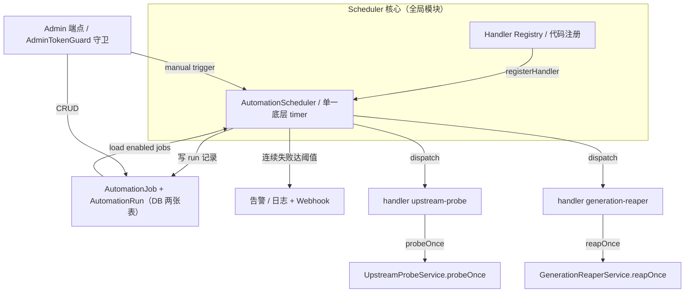

# Automations（自动化调度）模块设计规格 v1

> 日期：2026-10-11 · 版本 v1.1.0 · 状态：P0 已实现（待部署验证）
> 定位：任务管理模块 §C5；新子系统立项规格。
> 作者：WorkBuddy
> 输入：
> - 任务管理模块总体设计 `2026-10-09-task-management-module-design.md` §3 状态列
> - 当前生产代码中三处手写定时器：`upstream-probe.service.ts`、`generation-reaper.service.ts`、`agent-memory.service.ts` 注释中的 cron 预期

---

## 0. 配图索引

本文档含 1 张结构图（内嵌 Mermaid），无视觉稿附件。

| 编号 | 形式 | 内容 | 位置 | 用途 |
|---|---|---|---|---|
| 图 1 | 内嵌 Mermaid | 调度器核心 / handler registry / DB / admin 端点 / 告警五者的关系与数据流 | §4.5 | 评审时核对「谁触发谁、谁写谁读」，以及迁移后既有服务函数（probeOnce/reapOnce）与新 handler 层的边界 |

### 0.1 相关文档

| 文档 | 关系 |
|---|---|
| `docs/superpowers/specs/2026-10-09-task-management-module-design.md` | 上级模块全景；C5 是其中 L7「调度」层 |
| `docs/superpowers/specs/2026-10-09-model-platform-hardening-design.md` | B1 定时探活是 C5 首批迁移对象 |
| `apps/server/src/provider/upstream-probe.service.ts` | 当前手写 setInterval 定时器实例 #1 |
| `apps/server/src/studio/generation-reaper.service.ts` | 当前手写 setInterval 定时器实例 #2 |
| `apps/server/src/agent/agent-memory.service.ts` | 未来 cron 清扫预期消费方 |

---

## 1. 论点

**当前所有「定时任务」都是手写的 `setInterval`/`setTimeout`，已经造成运维黑盒。**

- 探活器（upstream-probe）和回收器（generation-reaper）各自维护独立计时器、独立日志前缀、独立开关（env 变量名不统一）；
- 没有运行历史、没有失败告警、没有手动触发入口；排查「为什么上一轮没跑」只能靠 SSH 看容器日志；
- 新增一个定时任务 = 再复制一份 `OnModuleInit`/`OnModuleDestroy` 模板，重复实现开关、unref、重叠防护、错误捕获；
- 参数调整（如探活间隔、回收阈值）必须改代码发版。

C5 的目标是把「定时任务」提升为一等公民：**统一调度器 + DB 持久化 + admin 管理 + 运行历史 + 失败告警**，让未来新增自动化任务变成配置而不是新服务。

---

## 2. 目标（5 条，均可验收）

| # | 目标 | 可观测判据 |
|---|---|---|
| **G1** | **所有定时任务进统一调度器** | 生产代码中不再有业务级 `setInterval`/`setTimeout`（保留 scheduler 自身一个 timer）；upstream-probe 与 generation-reaper 作为 job 注册 |
| **G2** | **运行历史可查** | DB `AutomationRun` 表记录每次执行的起止时间、reason、status、error、output；admin 端点可分页查询 |
| **G3** | **失败主动告警** | job 连续失败 N 次（默认 3）时，打 ERROR 日志并可通过 `AutomationJob.failureWebhook` 外发；告警携带 jobId、runId、最近 error |
| **G4** | **管理端点可开关/手动触发/调参** | admin CRUD `AutomationJob`：enabled 开关、interval/cron 表达式、参数 JSON；支持 `POST /admin/automations/:id/trigger` 手动触发 |
| **G5** | **新增自动化任务不发版** | 新 job 只需向 scheduler 注册一个 handler + DB 插一行配置（或 admin 创建）；核心代码不增加新文件即可上线 |

---

## 3. 现状架构（as-is）

### 3.1 定时任务分布

| 任务 | 当前实现 | 调度方式 | 开关 | 历史/告警 |
|---|---|---|---|---|
| 上游模型探活 | `apps/server/src/provider/upstream-probe.service.ts` | `setInterval` + 手动 `probeOnce('manual')` | `LNKPI_UPSTREAM_PROBE_INTERVAL_MINUTES=0` 禁用 | 仅 `UpstreamProbeRun` 表记录上游探活，无任务级运行史 |
| 卡死生成记录回收 | `apps/server/src/studio/generation-reaper.service.ts` | `setTimeout` 首扫 + `setInterval` 周期 | 无独立开关 | 仅日志 count |
| 记忆周期清扫 | `apps/server/src/agent/agent-memory.service.ts:312` | **尚未实现**，注释预留 cron hook | 无 | 无 |

### 3.2 共同痛点

1. **启动纪律重复**：每个服务都判断 `NODE_ENV === 'test'`、都 `unref`、都在 `onModuleDestroy` 清理；
2. **参数硬编码**：间隔写在 TS 常量/ env 变量，调整需发版；
3. **不可观测**：不知道上一轮什么时候跑的、跑了多久、是否失败、失败原因；
4. **无集中管理**：无法在产品/运维界面统一开关、手动触发、调整参数。

---

## 4. 目标架构（to-be）

### 4.1 核心抽象

```
AutomationJob（DB 配置层）
  id, name, description, enabled, handlerKey
  schedule: { type: 'interval', minutes: number } | { type: 'cron', expression: string }
  params: JSON
  concurrencyPolicy: 'forbid' | 'replace' | 'allow'   // 默认 forbid
  runOnStartup: boolean                               // v1.1.0（D1）：启动后延迟派发一次 reason='startup'
  failureThreshold: number                            // 默认 3
  failureWebhook: string | null

AutomationRun（DB 运行史）
  id, jobId, reason: 'scheduled' | 'manual' | 'startup'
  startedAt, finishedAt, status: 'running' | 'success' | 'failure' | 'skipped'
  output: JSON, error: string | null
```

### 4.2 调度器

`AutomationScheduler`（Nest global module）：
- 启动时从 DB 加载所有 `enabled=true` 的 job，按 schedule 注册；
- 使用单一底层 timer（如 `node-cron` 或自研最小 cron 解析器），避免每个 job 一个 `setInterval`；
- 执行前检查 `concurrencyPolicy`：
  - `forbid`：上一轮仍在 running → 本轮 skipped；
  - `replace`：取消上一轮（慎用）；
  - `allow`：并行执行；
- 执行时写入 `AutomationRun`（startedAt=now, status=running）；
- 执行后更新 `AutomationRun`（finishedAt, status, output/error）；
- 连续失败达到阈值时触发告警（日志 + webhook）。

### 4.3 Handler 注册

业务侧向 scheduler 注册 handler，而非自己设 timer：

```ts
automationScheduler.registerHandler('upstream-probe', async (params, run) => {
  await upstreamProbeService.probeOnce(run.reason as any)
})

automationScheduler.registerHandler('generation-reaper', async (params, run) => {
  await generationReaperService.reapOnce(run.reason as any)
})
```

注册是**代码级**（handler 函数必须在 TS 中定义），但启用/禁用/参数/schedule 是**配置级**（DB）。这样新增 job 仍然需要一次代码提交，但之后所有运维动作都不需要发版。

### 4.4 Admin 端点

在现有 `admin/` 模块下新增：
- `GET /admin/automations` — 列出 job + 最后运行状态
- `GET /admin/automations/:id/runs` — 分页运行史
- `PATCH /admin/automations/:id` — 改 enabled/schedule/params/failureThreshold
- `POST /admin/automations/:id/trigger` — 手动触发一次（reason=manual）

由 `AdminTokenGuard` 守卫（复用 B1/B2 已上线的 admin token 机制）。

### 4.5 架构图

下图（见 图 1）给出边界与数据流：Scheduler 是进程内唯一的 timer 持有者，业务侧只提供 handler；
DB 是「配置 + 运行史」的唯一真源，admin 端点只做 CRUD 与手动触发，不直接跑 job。

*图 1 · 调度器架构：handler 经 Registry 注册 → Scheduler 按 DB 配置派发 → 运行史写回 DB → 连续失败达阈值触发告警；admin 端点对 DB 做 CRUD、对 Scheduler 做手动触发；被迁移的 probeOnce / reapOnce 业务函数保持不变。*



---

## 5. 分期交付

### P0：统一现有任务（本周，改动小收益大）

- 新增 `AutomationJob` / `AutomationRun` 表 + Prisma schema；
- 新增 `AutomationScheduler` + handler registry；
- 迁移 `upstream-probe` 和 `generation-reaper` 到 scheduler：
  - 保留现有 `probeOnce` / `reapOnce` 业务逻辑不变；
  - 删除各自 `setInterval`/`setTimeout`；
  - 通过 bootstrap 种子插入两条默认 job 配置；
- admin 只读端点 + trigger 手动触发。

**P0 实现状态（v1.1.0）**：已实现（Task 1-4，分支 `feat/automations-p0`）——两表 + 手写 migration、`AutomationSchedulerService`（60s tick / forbid 同步占位 / manual trigger / startup 延迟派发 / create-if-missing 种子，13 测试）、admin 三端点（list / runs 分页 / trigger，7 集成测试）、probe/reaper 迁移接线（测试契约同步重写 25 例）。PATCH 写端点与告警属 P1 未实现。

**出口判据**：G1 + G2 + G4（trigger/只读）达成；生产无业务级 `setInterval`。

### P1：失败告警 + 运行史完善（1 周）

- `AutomationRun` 完整记录 output/error；
- 连续失败阈值告警（日志 + webhook）；
- admin 端点支持改 schedule/params/enabled；
- 运行史分页查询。

**出口判据**：G3 + G4 完整达成。

### P2：cron 表达式 + 无代码新增任务（季度级）

- schedule 支持 cron 表达式（除 interval 外）；
- 新增 job 可通过 admin 端点创建（前提是 handler 已注册在代码里）；
- 预留 agent-memory cron 清扫 job。

**出口判据**：G5 达成。

### 5.1 排序门禁

- **P0 必须先于 P1**：没有运行史就没有失败计数；
- **P2 依赖 P1**：admin 写端点成熟后才开放自由创建；
- **agent-memory 的 cron 清扫** 等 P0 落地后再接入，不阻塞 P0。

---

## 6. 全局约束

1. **单实例优先**：当前 pi-lnk API 是单容器部署，调度器用内存锁即可；未来多实例时再引入分布式锁；
2. **进程安全**：底层 timer 必须 `unref`，job 执行不得阻塞 bootstrap，不得阻止进程退出；
3. **测试环境不注册真实 timer**：`NODE_ENV === 'test'` 时 scheduler 不启动定时器，但保留手动触发能力；
4. **失败隔离**：单个 job 失败不影响 scheduler 和其他 job；
5. **幂等执行**：handler 自身保证幂等（现有 `probeOnce`/`reapOnce` 已经是幂等的）；scheduler 不承诺 exact-once，只承诺 at-least-once；
6. **Admin 鉴权复用**：所有 admin 端点走 `AdminTokenGuard`（B1 已上线），不再新建角色体系；
7. **不引入新依赖**：优先使用 Nest 内置 scheduler 或手写最小实现；如需 cron 解析，用 `node-cron` 或更小替代，评审时论证。
8. **边界裁定（回应总体设计 §6 的「C5 立项时再评估」）**：画布 workflow recipe（`UserWorkflowRecipe`）**不并入**本子系统——它是画布模板编译，不产生「定时 / 无人值守」执行语义；其未来若出现批量执行需求，在自身规格内设计，C5 只提供 job 注册面。该裁定随本规格评审确认，若有异议则在评审时推翻并回写总体设计 §6。

### 6.1 P0 实现期裁决回写（v1.1.0，2026-10-11，全文见 `docs/superpowers/plans/2026-10-11-automations-p0.md` 裁决表）

- **D1**：schema 增列 `runOnStartup`（§4.1 已同步）——`reason='startup'` 的唯一触发来源；probe/reaper 现有启动首扫语义（B3 竞态修复 / 15s 首扫）必须保留。
- **D2**：两服务的 startup 首扫从「服务内 setTimeout」迁移为「scheduler 启动后延迟 15s 派发 reason='startup' 的 run」（`STARTUP_RUN_DELAY_MS`）；probe 的「等路由表就绪」逻辑（B3 归属）保留在 probe 服务内（`probeOnceWhenRoutesReady` public 化），handler 在 startup 时先 await 它。
- **D3**：`LNKPI_UPSTREAM_PROBE_INTERVAL_MINUTES` 语义退役（间隔改 `AutomationJob.intervalMinutes` DB 配置）；`resolveProbeIntervalMinutes` 导出函数与纯函数测试保留（`@deprecated`）。
- **D4**：reason 映射 `'scheduled'→'periodic'` / `'manual'` / `'startup'`——`probeOnce`/`reapOnce` 签名零改动。
- **D5**：种子策略 = scheduler `start()` 时 create-if-missing（upsert `update: {}`），重启绝不覆盖运维调过的配置。
- **D6**：`concurrencyPolicy='replace'` P0 视同 `forbid`（不实现取消），P1 再实现。
- **D7**：due 判据 = 最近一条 run（任意 status，含 skipped）的 `startedAt + max(1, intervalMinutes)·60s ≤ now`；无 run ⇒ 立即 due。
- **D8**：dispatch 的 check-then-act 竞口用同步占位封死（先 `running.set(jobId,'pending')` 再 await create）。
- **D9**：重启孤儿（DB 残留 status='running' 行）不阻塞新调度（内存 Map 才是并发权威）；P1 告警可检测「超长 running」再收口。
- **G1 口径澄清**：「无业务级 timer」指**无调度型（recurring job）timer**；请求级 one-shot timer（重试退避 / abort 超时 / SSE 心跳 / grace 窗口）与本裁决无关。实测 `git grep setInterval|setTimeout` 仅剩 probe 的 `Promise.race` 等待上限（B3 归属，非调度 timer）与请求级 one-shot 命中，调度型命中为零。

---

## 7. Review Focus

| 输入/条件 | 期望行为 | 锚定测试 |
|---|---|---|
| 进程退出时 job 正在执行 | 不阻塞退出；当前 run 状态保留为 `running`（或按需 `failure`），下次启动可识别孤儿 | P0 集成测试：signal 退出 + 断言 run 记录状态 |
| 同一 job 上一轮还没结束，下一轮调度点到 | `concurrencyPolicy='forbid'` 时标记 `skipped`；不并发、不堆积 | P0 scheduler 单测 |
| handler 抛异常 | scheduler 捕获 → run.status='failure' → 继续调度其他 job；连续 3 次失败才告警 | P1 单测 |
| 手动触发与定时触发并发 | 同 concurrencyPolicy 处理；手动触发 reason='manual' | P0 集成测试 |
| 修改 schedule 后立即生效 | 不需要重启服务；scheduler 热重载注册 | P1 集成测试 |

---

## 8. 风险与回滚

| 风险 | 缓解 | 回滚 |
|---|---|---|
| scheduler 本身 bug 导致定时任务不跑 | P0 保留手动触发端点；P1 加失败告警；迁移时保留原 `probeOnce`/`reapOnce` 业务函数 | 关闭 scheduler，临时恢复手写 setInterval（git revert 单 PR） |
| DB 写入成为瓶颈 | `AutomationRun` 按 TTL 归档；高频 job 可配置不记录成功 run | 减少 retention / 关闭运行史 |
| cron 表达式解析错误导致 job 不触发 | schema 校验 + admin 保存前验证 next-run | 改回 interval 模式 |

---

## 9. 维护约定

1. 本规格是 Automations 子系统立项规格；后续每阶段实现前按 `superpowers:writing-plans` 出 `docs/superpowers/plans/2026-10-11-automations-p<N>.md`；
2. 新增定时任务必须走 scheduler 注册，禁止再引入业务级 `setInterval`；
3. 每次阶段上线后更新任务管理模块总体设计 §3 中 C5 状态列；
4. 运行史保留策略：成功 run 保留 7 天，失败 run 保留 30 天（P1 实现时写入 schema 注释）。
