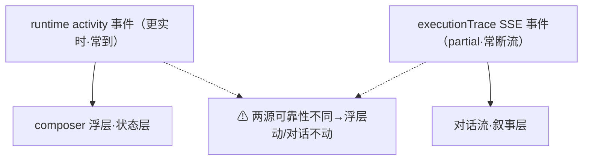
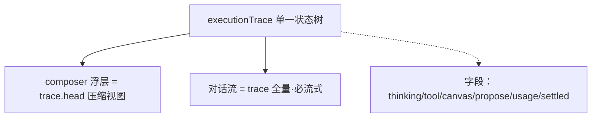
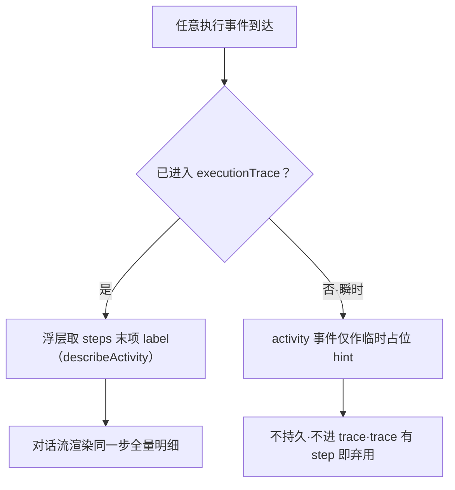

# Composer 浮层（状态层）× SSE 对话流（叙事层）职责边界 设计规格

状态：待评审（PM 评审产出，2026-10-17）  
前置：`2026-08-06-agent-execution-trace-design.md`（叙事层，已 GA） · `2026-07-25-agent-task-progress-card-design.md`（批量任务卡，已 GA） · `2026-10-17-agent-turn-identity-design.md`（partial 账本，已合入）  
分支约定：实现走 feature 分支 + PR + squash merge。

---

## 0. 配图索引（结构与视觉两类，均随本文档演进）

本文档的图分两类：**结构图**一律以 Mermaid 内嵌；本文不产出视觉稿附件（空间比例无关，纯数据流/判据，符合 §3.1）。

| 编号  | 形式         | 内容          | 位置   | 用途                                      |
| --- | ---------- | ----------- | ---- | --------------------------------------- |
| 图 1 | 内嵌 Mermaid | 当前双源失配架构    | §4.2 | 定位"浮层动、对话不动"的根因：两条"正在做什么"的源可靠性不同        |
| 图 2 | 内嵌 Mermaid | 目标单一真相源架构   | §4.3 | 验收基准：浮层与对话流只读同一份 executionTrace         |
| 图 3 | 内嵌 Mermaid | 事件 → 表面路由判定 | §5.2 | 去双源后的读取契约：任何展示都源自 trace，activity 仅作瞬时占位 |

---

## 1. 目标

1. **浮层与对话流共享同一份 `executionTrace` 状态**，消除"浮层动、对话不动"的失配（当前实测：浮层吃 `activity` 事件、对话流吃 SSE `trace`，两源可靠性不同）。
2. **浮层只承担"状态层"职责**（到哪了 / 耗时 / 预估→实结积分），不再逐句复述思考 / 工具 / 提议步骤。
3. **对话流（叙事层）必须真正流式**呈现思考 / 工具 / 提议，并修复 `partial` 捕获导致的缺段 / 错位。
4. **进度表达诚实**：有真分母（todo N 项 / 批量生成 N/M）才显示确定进度，否则不确定态，删除"第 N 步"伪计数。

---

## 2. 范围（含明确不做）

**做**：

- 定义两层（状态层 / 叙事层）的职责边界与单一真相源契约；
- 去双源：浮层主源由 `describeRuntimeActivity(agent.activity)` 改为 `describeActivity(trace)`；
- 修前端 `partial` 孤儿 `tool_result` 兜底（turn-identity §6 S5 尚未做）；
- 浮层 ↔ 叙事做视觉耦合（浮层作为该轮叙事的封面 / 入口）；
- 成本归因锚定对话内具体生成（`turnSummaryLine` 已做"已结算 -N 积分"）；
- 进度诚实化（删除 `describeRuntimeActivity` 的"第 N 步"拼接）。

**明确不做**：

- 不新增第三个"正在做什么"事件源（`activity` 事件降级为瞬时占位 hint，不再作浮层主源）；
- 不重写 `executionTraceReducer` / SSE 协议（契约不变，只是浮层读取路径改）；
- 不把批量任务卡（`AgentTaskProgressCard`）并入浮层（它是独立的批量 gen 清单表面，见 §3）；
- 不改动 / 不清理底部 `TurnReceipt`（本轮产出收据行，见 `composer/turnReceipt.ts`）：它是既有独立表面，负责本回合 **settled** 后的产出 / 成本 / 操作汇总（"本轮产出 N 张 · 定位到画布 / 结算 -N 积分 / 全部保留 / 撤销本轮"），与顶部浮层**时间互斥**，不在本规格清理范围；
- 不引入新的状态机 / store 字段（边界是**读取路径的重新指派**，非新增状态）。

---

## 3. 与既有规格的关系

- **修订** `2026-08-06-agent-execution-trace-design.md` §2 信息架构：该图把 bubble / trace / cards / chips 并列，但**遗漏了 composer 上沿浮层这一独立表面**，且未定义浮层与 `trace` 的读取关系。本文补上"浮层 = `trace.head` 压缩视图"这一条边，并把浮层显式列为第五个表面。
- **修订** `2026-07-25-agent-task-progress-card-design.md`：明确**任务卡 ≠ 浮层**。任务卡是确认后批量 gen 的逐项清单（有真分母 N/M），浮层是常驻的"本轮活动 + 成本"状态条；两者可并存，但浮层不得借用任务卡的"N/M"进度语义。
- **澄清** `TurnReceipt`（`composer/turnReceipt.ts`，P1-4.1 回合产出收据行）：它是**第六个表面**——**settled 态**的产出 / 成本 / 操作汇总行，与顶部浮层呈**时间互斥接力**（浮层管 running / waiting，receipt 管 settled），两者不重叠；本规格不改动其存在，只在此锚定其边界，避免与浮层职责混淆。
- **依赖** `2026-10-17-agent-turn-identity-design.md`：`partial` 账本（`partial` / `gapFrom`）是本文"对话流必须真正流式"的前置；PR #442 已修后端 `agent_start` 捕获，但前端孤儿 `tool_result` 兜底（turn-identity §6 S5）尚未做，属本文 P0 范围。
- **不推翻** 上述任一篇的既有结论；只在上补边界与读取关系。

---

## 4. 规范与判据

### 4.1 可复用规则（后续同类需求直接套）

| 编号     | 规则                                                                 | 为什么                                            |
| ------ | ------------------------------------------------------------------ | ---------------------------------------------- |
| **B1** | 浮层是**状态层**：只显示 状态 / 耗时 / 预估→实结积分，**禁止**逐句复述思考 / 工具 / 提议步骤          | 叙事是对话流的职责；浮层复述既冗余又抬高预期                         |
| **B2** | **单一真相源**：浮层与对话流只读同一份 `executionTrace` 状态，**禁止**各吃一个事件源            | 双源天然会失配（当前 `activity` 事件 vs SSE `trace` 可靠性不同） |
| **B3** | **进度诚实**：仅当有真分母（todo N 项 / 批量生成 N/M）才显示确定进度；否则不确定态，不得用"第 N 步"伪计数   | `activity.done` 只是同工具重复调用计数，非真任务计划进度           |
| **B4** | **成本双口径分离**：预估积分浮层一瞥即可，实结积分锚定对话内具体生成（`turnSummaryLine`"已结算 -N 积分"） | 成本漂浮在浮层会失去可追溯性                                 |
| **B5** | **空间耦合**：浮层是叙事的"封面 / 入口"，点击浮层应展开 / 滚动到对应回合叙事                       | 两层空间脱节迫使用户脑补映射                                 |
| **B6** | 叙事层默认折叠、可展开（沿用 execution-trace 规范）；浮层常驻、一瞥即得                       | 认知负荷分层：被动用户看浮层，主动用户钻叙事                         |

### 4.2 当前架构（双源失配，待消除）



*图 1 · 当前双源失配架构。这张图说明"浮层动、对话不动"的根因：两条"正在做什么"的真相源不同、可靠性不同（浮层吃 `AgentSideRail.vue:881` 的 `describeRuntimeActivity(agent.activity)`，对话流吃 `executionTrace` SSE 事件）。消除失配的唯一正解是让两者读同一份状态，见 图 2。*

见 图 1 —— 当前浮层主源 `describeRuntimeActivity(agent.activity)` 的注释明写"工具起手即到 · 更实时"，而对话流的 SSE `trace` 有已知的 `partial` 捕获缺陷，于是两条链可靠性不同步。

### 4.3 目标架构（单一真相源）



*图 2 · 目标单一真相源架构。这张图是验收基准：浮层是 `trace.head` 的压缩视图，对话流是 `trace` 全量，两者只读同一份 `executionTrace`，因此不可能再出现"浮层动、对话不动"。`activity` 事件不再作为浮层主源。*

见 图 2 —— `B2` 的落地形态：浮层与对话流的存活状态完全绑定。字段清单与既有 `executionTraceReducer` 一致，契约不变。

### 4.4 状态层运行态枚举（run-state machine）

浮层是"状态层"，其显示内容由**当前回合的运行态**决定，而非逐条叙事。以下态必须可被浮层识别并呈现（`turnStatusBar.ts` 的 `waiting` / `waitingTool` / `waitingQuestion` / `waitingDeadline` 已支撑，属 `B1` 范围）。回答用户三问：**ask_user 阻塞、propose 确认阻塞、画布产出——前两者是回合阻塞态、后者是产出态，都是"到哪了"的答案，必须进状态层；唯独脱离 agent 回合的纯画布生成不在浮层作用域。**

| 运行态 | 触发 | 浮层文案要点 | 是否在范围 |
|---|---|---|---|
| running | agent 主动执行（思考 / 工具 / 出图） | 阶段文案 + 实时秒数（沿用 `turnStatusLine`） | 是 |
| waiting_ask_user | `ask_user` 阻塞，题面在聊天侧 | "等待你作答：{题面}"（截断 24 字）+ 自动取消倒计时 | 是（必要） |
| waiting_propose_confirm | `propose_generation` 阻塞，确认动作在**画布**节点上 | "等待你在画布上确认生成" + 倒计时；**必须点明去画布**，否则用户只看到"等待确认"不知做什么 | 是（必要，且易漏） |
| producing（画布产出） | 用户确认提议后在画布跑生成 / 节点出图中（`node_status` 经 `trace` 回流） | 由 `describeActivity` 读 `node_gen` running 步 → "出图中"；与 running 同属"正在产出" | 是（必要：确认→产出的过渡必须可见，否则等待态凭空消失） |
| settled | 回合结算 | "已结算 -N 积分（…）"（`turnSummaryLine`） | 是 |
| failed | 生成失败 / 上游超时 | "生成失败 · {原因}"（`failureReason`） | 是 |
| **canvas 独立生成（无 agent 回合）** | 用户在画布直接点击生成、**无活跃 agent turn** | **不在范围**：此时无 agent 回合，浮层（run 作用域）不应显示；进度属于画布节点本身 / 任务卡 | 否（归属画布表面，避免破坏 `B2` 单一真相源） |

判定要点：
- `ask_user` 与 `propose` 确认**都是回合阻塞态**，不是叙事步骤——它们属于"到哪了"的答案，必须进状态层（已设计，必要）。
- `propose` 确认的确认动作在画布而非聊天，状态文案必须显式引导用户去画布，这是历史易漏点（`turnStatusBar.ts:76` 已专门处理 `waitingTool === 'propose_generation'`）。
- "用户在画布手动点击生成"若是对 agent 提议的**确认后置产出**，则它属于本回合的 `producing` 态（`node_status` 经 `trace` 回流，浮层经 `describeActivity` 读 head 即显示），必要；若是**脱离 agent 回合的独立画布操作**，则不属于浮层作用域，进度归画布节点 / 任务卡，不应强行塞进浮层（否则引入第二个真相源，违反 `B2`）。

---

## 5. 架构与契约

### 5.1 两个表面的读取契约

| 表面                           | 数据来源                                                                                          | 展示内容                                                       | 形态                     |
| ---------------------------- | --------------------------------------------------------------------------------------------- | ---------------------------------------------------------- | ---------------------- |
| **浮层（composer 上沿状态条）**       | `agent.executionTrace.steps` 末态 head + `turnStartedAt` + `usage.estimatedCredits` / `settled` | 阶段文案（desc） + 实时秒数 + 预估→实结积分；**不**逐句列步骤                     | 常驻、一瞥即得、不确定态扫动条（无真分母时） |
| **对话流（AgentExecutionTrace）** | `agent.executionTrace.steps` 全量                                                               | 思考 / 工具（含参数摘要）/ 画布动作 / 节点生成 / 提议 / usage / settled，默认折叠可展开 | 跟随具体回合、时序渐进            |
| **批量任务卡（已有，独立）**             | `task_list` / `task_update` / `task_summary`                                                  | 确认后批量 gen 逐项状态（有真分母 N/M）                                   | 独立卡片，不并入浮层             |

浮层必须呈现的运行态枚举（含 ask_user / propose 确认阻塞态、producing 产出态、canvas 独立生成的范围边界）见 §4.4。

### 5.2 事件 → 表面路由（去双源后的判定）



*图 3 · 事件到表面的路由判定。这张图定义去双源后的读取契约：任何"正在做什么"的展示都必须源自 `executionTrace` 的某个 step；`activity` 事件仅在 `trace` 尚无 step 的瞬时窗口作为占位 hint，且明确不持久、不进 `trace`，一旦 `trace` 出现 step 立即弃用。*

见 图 3 —— 路由的唯一判据是"事件是否已进入 `executionTrace`"。`describeActivity(steps)`（`activityLine.ts:36`）已是取末项非 phase 步 label 的实现，作为浮层**唯一**主源；原 `describeRuntimeActivity`（`activityLine.ts:25`）**整函数删除**（见 §7），其"activity 优先"双源偏好随之消失。`activity` 事件的瞬时占位角色由 图 3 的临时窗口承接——但仅服务于队列"已开口 / 动手"的 UX（`QUEUE_APPLIED_EVENTS`），**不再进入浮层 label 主路径**。

### 5.3 进度表达契约

- **`progressRatio`**：有 todo / task 真分母时由 `task_progress` 提供 `0..1`；否则浮层传 `null` → 不确定态扫动条（沿用现有 `AgentSideRail.vue:917` 注释"无完成比例数据源 → 不确定态"）。
- **删除** `describeRuntimeActivity`（`activityLine.ts:29`）的 `"· 第 ${done} 步"` 拼接 —— 那是同工具重复调用计数，非真任务计划进度，违反 `B3`。

### 5.4 视觉规范（双主题 · 令牌化契约）

浮层是常驻**状态条**，视觉必须**双主题可审计**——所有颜色 / 表面走设计令牌 L2/L3，禁止裸 hex/rgba（设计系统硬规则 1/2；`styles/design-token.test.ts` 守卫覆盖 `*.css`）。当前 `.composer-status-line`（`AgentSideRail.vue:4852-4900`）已令牌化，`B5` 要求把契约**明文写死**以防漂移。

| 维度 | 令牌（L2/L3） | 浅色 | 深色 | 契约 |
| --- | --- | --- | --- | --- |
| 字号 | `--lnk-text-2xs` | 11px | 11px | 状态行只用最小字号，不抢叙事 |
| 文字色 | `--lnk-text-muted` | `--lnk-ink-600`（4.90:1） | `#949aa8`（5.50:1） | AA；仅作次要信息，不作强调 |
| 轨道底 | `--lnk-ink-200` | `#e2e5ec` | 同（L1 共享） | 无真分母时的不确定态底 |
| 进度填充 | `--lnk-accent` | `--lnk-purple-600` | `--lnk-purple-500` | 强调色只此处点睛，禁大面积铺底 |
| 不确定态 | `is-indeterminate` 扫动动画 | — | — | 禁出伪分母 / 伪百分比（违反 `B3`） |
| 尺寸 | 状态行 `height≈24px`、横向 padding `var(--lnk-space-2)` | — | — | 一瞥即得，不挤压输入区 |

**强制修复（纳入本 PR）**：composer 交互区（驳回「知道了」`:3607`、propose「定位」`:3662`、「取消」`:3676`）现用字面 `bg-white`，**深色主题下变成刺眼白块**，且 `bg-white` 是 Tailwind 默认类、绕过令牌守卫，CI 漏检。改为 `bg-elevated`（=`--lnk-surface-raised`，深色 `#1f2430` / 浅色 `#fff`，双主题翻转正确），与同文件 `:3710` 既有的 `bg-[var(--lnk-surface-raised)]` 先例一致。

**不在本规格范围**：用户气泡媒体 chip 的 `#fff`（`:4701`/`4706`，`color-mix` 玻璃高光，属 `.agent-bubble-user` 子系统）——仅标注，不改动。

---

## 6. 主场景规格（逐项可验收）

| #  | 场景                                 | 期望                                                                          |
| -- | ---------------------------------- | --------------------------------------------------------------------------- |
| S1 | 构造 `trace` 有 step 但无 `activity` 事件 | 浮层显示该 step 人话（`describeActivity` 命中），不再依赖 `activity` 主源                     |
| S2 | 长耗时回合                              | 对话流逐条出现 思考 / 工具 / 提议（不再整段迟到）；浮层同步显示同一步 head                                 |
| S3 | `partial` 回合                       | 前端孤儿 `tool_result` 不渲染成 `parts[0]`，先出"前半段未捕获"notice（沿用 turn-identity §6 S5） |
| S4 | 进度诚实                               | 无 todo 的普通回合，浮层**不**出现"第 N 步"；确定进度仅在批量 gen（task 有 N/M）时出现                   |
| S5 | 成本                                 | 浮层显示预估积分（running）；对话流终态显示"已结算 -N 积分（输入… 缓存… 输出…）"（turnSummaryLine）          |
| S6 | 视觉耦合                               | 点击浮层 → 展开 / 滚动到该轮 `AgentExecutionTrace`                                     |
| S7 | propose 确认阻塞态                      | 浮层显示"等待你在画布上确认生成" + 自动取消倒计时；确认动作引导至画布节点（非聊天侧），不出现无信息量的"等待确认" |
| S8 | 确认后置产出                            | 用户确认提议后在画布跑生成，浮层由 `trace.head` 的 `node_gen` running 步显示"出图中"过渡，等待态不凭空消失            |

---

## 7. 数据与状态变更

- **无新增列 / 字段**：本规格是读取路径的重新指派，不引入新状态。
- **移除（而非降级）**：`describeRuntimeActivity`（`activityLine.ts:25-30`）**整函数删除** —— 它同时是双源偏好（activity 优先）与伪进度（"第 N 步"拼接）的唯一起源，保留为 hint 会重新引入双源风险。
  - 连带删除：`RuntimeActivity` 接口（`activityLine.ts:11-15`，仅被该函数使用、无其他读者）及其函数注释。
  - 文本职责由 `describeActivity(trace)` 完全接管；`trace` 暂无 step 时由 `turnStatusLine` 既有 `GENERIC_ACTIVITY` / "生成回复中" 兜底（见 §11）。
- **`agent.activity` store 字段 + `setActivity`（`stores/agent.ts:543`）一并移除**：函数删除后该字段零读者。需同步删除的**全部**位点（漏删任一处都会编译报错或留孤儿）：
  - 声明 `const activity = ref<...>(null)`（`stores/agent.ts:138`）+ 其注释块（`:132-137`）；
  - **写入调用** `agent.setActivity(...)`（`AgentSideRail.vue:2624` activity 事件处理、`:2638` pi_compaction 处理）—— 这是 store 字段的**唯二写入方**，删函数后必须一并删除；
  - 置空 `activity.value = null`（`stores/agent.ts:194` addUserMessage、`:703` reset）；
  - store 返回项（`:716` `activity`、`:723` `setActivity`）+ 注释（`:537-542`）。
  - "已开口"瞬时标记改由 `QUEUE_APPLIED_EVENTS` 的 `activity` 事件承接（`AgentSideRail.vue:2535` 用 `.has(event.type)` 触发 `markQueueApplied`，与 store 字段**完全解耦**），字段移除不影响它。
- **`QUEUE_APPLIED_EVENTS`（`AgentSideRail.vue:240`）**：`activity` 事件**保留**在集合内（标记队列"已开口 / 动手"的 UX，与浮层文本源无关），不得因去双源而误删 —— 这是独立的消费者。
- **状态输入**：`agent.composerStatus` 改用 `describeActivity(trace.head)` 计算，不新增字段。

---

## 8. 纯函数与算法（含单测要求）

- `describeActivity(steps)`（`activityLine.ts:36`）已有，作为浮层主源；断言：取 `steps` 末项非 `phase` 步的 `label`，`phase` 且非 `waiting_user` 跳过。
- `describeRuntimeActivity` 整段单测 suite（`activityLine.test.ts:30-52` + `:2` import）随函数删除而**整段删除**；新增"`describeActivity(trace)` 为主源"的断言（见 §9）。
- `partial` 孤儿兜底：**已落地**（`turnTimeline.ts:393-409`，`turnTimeline.test.ts:73-104` 已断言 `parts[0]` 为 notice 而非 `tool`）—— 本规格**不重复实现**，仅引用。其与前端的耦合点是「孤儿 `tool_result` 不置顶」，已在既有实现中满足 `S3`。
- **单测要求**：① 浮层主源改为 `trace` 后，`activity` 缺失不导致浮层空白；② `describeActivity` 不再接收 `RuntimeActivity`，伪计数彻底消失；③ `partial` 回合孤儿 `result` 不置顶（已由 `turnTimeline.test.ts` 覆盖，回归即可）。

---

## 9. 文件级改动清单

| 文件                                                         | 改动                                                                                                     |
| ---------------------------------------------------------- | ------------------------------------------------------------------------------------------------------ |
| `apps/web/src/components/agent/AgentSideRail.vue`          | `:122` 删除 `describeRuntimeActivity` import；`:881`、`:915` 删除 `describeRuntimeActivity(agent.activity) ??` 优先分支，仅保留 `describeActivity(trace)`；`progressRatio` 契约确认（`QUEUE_APPLIED_EVENTS` 中 `activity` 事件保留，勿误删） |
| `apps/web/src/components/agent/activityLine.ts`            | `:25-30` 整函数删除 `describeRuntimeActivity`；`:11-15` 连带删除仅被其使用的 `RuntimeActivity` 接口及注释；`:29` "第 N 步"拼接随函数删除自然消失 |
| `apps/web/src/stores/agent.ts`                            | `:138` `activity` ref 声明 + `:132-137` 注释块删除；`:543` `setActivity` + `:716/723` store 返回项 + `:194/703` `activity.value = null` + `:537-542` 注释 一并删除（无读者） |
| `apps/web/src/components/agent/AgentSideRail.vue`（事件处理） | `:2624`（activity 事件）、`:2638`（pi_compaction）两处 `agent.setActivity(...)` 写入调用**整行删除**（store 字段删除后必删，否则编译报错）；`QUEUE_APPLIED_EVENTS.add` 路径（`:2535` `.has`）保留 |
| `apps/web/src/components/agent/AgentSideRail.vue`（turn 组装） | `partial` 孤儿 `tool_result` 兜底（不入 `parts[0]`）                                                           |
| `apps/web/src/components/agent/turnStatusBar.ts`           | 文案共享，无需改（`estimateSuffix` / `turnStatusLine` 复用）                                                       |
| `apps/web/src/components/agent/activityLine.test.ts`       | `:2` 删除 `describeRuntimeActivity` import；`:30-52` 整段 `describeRuntimeActivity` suite 删除；新增 `describeActivity(trace)` 主源断言 |
| turn 组装相关 test / turn-identity S5 兜底 test                  | 新增 `partial` 孤儿不置顶断言                                                                                   |

---

## 10. 测试策略与验收标准（含目视验收）

- **单测**（§8 三条要求）全绿。
- **集成**：mock `streamEvents` 延迟激活 + assert 浮层与对话流同源、孤儿 `tool_result` 不置顶（复现 turn-identity 判据）。
- **目视验收**：真实画布跑一轮（如 `cmvbv1vb0000tms01ch8ranmp`）长耗时回合，确认：浮层与对话流同生死、对话流逐条流式、无"第 N 步"伪进度、点击浮层展开该轮叙事。
- `pnpm verify-spec-figures` 0 错 0 警。

---

## 11. 风险

- 去双源后，若 `trace` 渲染也有瞬时延迟（非 `partial`，纯网络），浮层可能短暂空白 → 需保留一个极短期的"处理中"兜底（`GENERIC_ACTIVITY`），但**不得**绑定 `activity` 事件。
- 视觉耦合（点击浮层展开叙事）需评估移动端布局，避免遮挡输入区。
- 进度诚实化会让"看起来有进度"的回合变为不确定态扫动条，可能让用户焦虑感上升 → 用"阶段文案 + 实时秒数"补偿（沿用 `turnStatusLine` 已有秒数）。

---

## 12. 实施计划（单 PR 闭环）

本规格一次性落地，不拆多 PR。分支 `fix/composer-overlay-single-source`（从 `origin/master` 起），提交顺序与验收：

| 序 | 改动 | 文件 | 验收 |
| -- | --- | --- | --- |
| 1 | 去双源：浮层只读 `describeActivity(trace)`，删 `describeRuntimeActivity` 优先分支 | `AgentSideRail.vue:881/915` | `S1`：无 activity 事件也显示 trace step 人话 |
| 2 | 删 `describeRuntimeActivity` 全家：`RuntimeActivity` 接口 + 函数 + import + 两处读取 + 测试套件 | `activityLine.ts` / `AgentSideRail.vue:122` / `activityLine.test.ts` | `S4`：无"第 N 步"伪进度；`verify-spec-figures` 0 错 |
| 3 | 删 `agent.activity` store 字段 + `setActivity` + **两处写入调用** + 声明 + 注释 + 返回项 | `stores/agent.ts` / `AgentSideRail.vue:2624/2638` | 编译通过；`QUEUE_APPLIED_EVENTS` 仍标记"已接住" |
| 4 | 视觉令牌化：composer 交互区 `bg-white` → `bg-elevated`（双主题翻转） | `AgentSideRail.vue:3607/3662/3676` | 深色主题无白块；令牌守卫不报裸色 |
| 5 | 双主题视觉规范写入（§5.4） | 本规格 | `verify-spec-figures` 0 错 0 警 |

- `partial` 孤儿兜底（S3）**已实现**，本 PR 不重复实现，仅回归 `turnTimeline.test.ts`。
- 视觉耦合 `S6`（点击浮层展开叙事）属交互增强，不在本 PR；成本归因 `S5` 已随 `liveEstimatedCredits` 既有链路满足。
- 与 `execution-trace` / `task-progress-card` 两篇既有规格的修订（§3）须同步，避免新旧规格打架。
- 合入后按 `prod-deploy-verify` 在 `cmvbv1vb0000tms01ch8ranmp` 跑一轮长耗时回合目视验收（浮层与对话流同生死、无伪进度、点击展开该轮叙事）。

---

## 13. 配图规范自检

跑 `pnpm verify-spec-figures --file docs/superpowers/specs/2026-10-17-agent-composer-overlay-trace-boundary-design.md` 结果（2026-10-17 作者执行）：

```
✓ docs/superpowers/specs/2026-10-17-agent-composer-overlay-trace-boundary-design.md
校验完成：1 篇在范围内，0 篇历史文档跳过（< 2026-09-22），0 个错误，0 个警告
```
