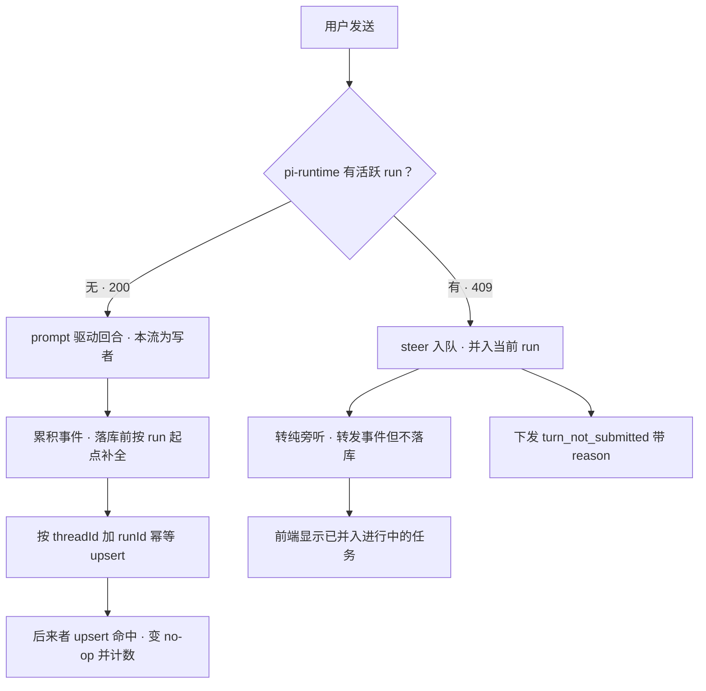
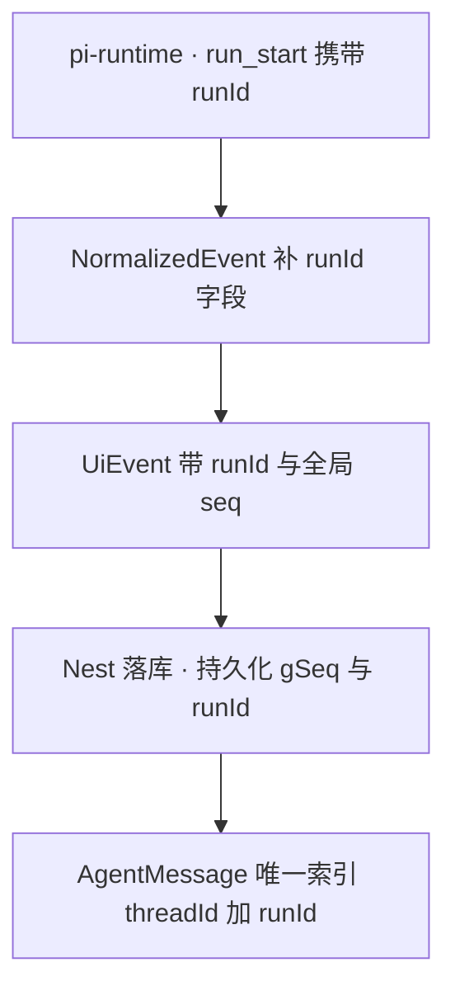

# 回合身份与单一写者 设计规格

状态：待评审（brainstorming 产出，2026-10-17）
前置：[提议生成卡片漂移诊断报告](../../../%E6%8F%90%E8%AE%AE%E7%94%9F%E6%88%90%E5%8D%A1%E7%89%87%E6%BC%82%E7%A7%BB%E8%AF%8A%E6%96%AD%E6%8A%A5%E5%91%8A.html)（v2，生产取证） · [Codex 源码对照审核](2026-10-17-agent-turn-identity-codex-review.md)
分支约定：实现走 `feat/turn-identity-single-writer` + PR + squash merge。

---

## 0. 配图索引

| 编号 | 形式 | 内容 | 位置 | 用途 |
|---|---|---|---|---|
| 图 1 | 内嵌 Mermaid | 回合准入与写者判定流转 | §4.2 | PR1/PR2 的判据验收基准：任何一条发送路径都要能被这张图判定出归属 |
| 图 2 | 内嵌 Mermaid | 回合身份与全局序号的透传链 | §5.1 | PR2 字段验收：逐层核对每层有没有丢标识 |

---

## 1. 目标

1. **同一次 run 在库里只有一条助手消息**：重复落库恒为 0（当前实测：一次 run 落 4 条）。
2. **助手消息的事件账本完整且顺序真实**：首事件非 `thinking` 的占比归零（当前实测 69/400）；跨流可归并。
3. **回合进行中的用户输入有确定性反馈**：不再出现「发了没反应，只能重发」的失信闭环。

---

## 2. 范围（含明确不做）

**做**：pi-runtime 事件归一化补齐标识 → Nest 落库语义（写者唯一）→ 数据模型（身份与序号）→ 前端渲染降级与门控 → 历史数据软标记。

**明确不做**（复核后维持，理由见审核记录 §5）：

- **不自研进程内 run 注册表与「owner 断流提升 shadow」机制** —— 本轮自我纠正：上游 `LaneBusy` 返回的 409 **就是现成的 `NotIdle`**，DB 唯一索引**就是持久写锁**，二者组合已覆盖该机制要解决的问题。加一层内存注册表 = 引入一个副本间不一致的伪权威。
- **不自研事件总线 / broker**（上游靠 session 单循环 + 写锁，无 broker）。
- **不改 vendor 上游源码**（缺口全在适配层）。
- **不靠前端去重**（唯一性由数据库裁决）。
- **不引入 fan-out 层**（`SessionRouter` attachment 模型留给真正的多端接管需求）。

---

## 3. 与既有规格的关系

- **修订** `2026-10-14-agent-conversation-three-defects-analysis.md`：本文把其中「重复订阅切片」的结论下移一层 —— 切片是**症状**，根因是**回合身份与全局序号两层标识在归一化时被丢弃**。
- **不推翻** 时间线渲染层既有结论（`turn_timeline` 已 GA，PR #405/#406/#408/#411 已合入）。本文只在其上补 A/B/C 三层。
- **依赖** `docs/agent/delivery.md`：pi-runtime 改动走 `runtime-deploy.yml` **手工发版**，CI 不自动跑。

---

## 4. 规范与判据

### 4.1 可复用规则（后续同类需求直接套）

| 编号 | 规则 | 为什么 |
|---|---|---|
| **N1** | **拒绝必须是一等类型，禁止退化成新回合。** 上游返回 `NotIdle` 时，适配层只能「并入当前回合」或「显式告知用户」，**不得**新建会落库的流 | Codex `start_or_steer` 仅在 `NoActiveTurn` 时 spawn（`turn_input.rs:373-451`）；我方现状是 catch 409 后继续旁听到 `agent_end` 并各自落库，正是该反模式 |
| **N2** | **两层标识（回合身份 + 全局序号）不得在任何一层归一化时被丢弃。** 每跨一层必须核对「runId 还在吗、seq 还是全局吗」 | 我方在两处各丢一次：pi-runtime `NormalizedEvent` 丢 runId；Nest 落库丢全局 seq（改用本地 `traceSeq`） |
| **N3** | **入队与驱动分离**：并入当前回合走 steer/followUp 队列（durable、不落库、不开流）；驱动回合走 prompt（唯一写者） | 对应 Codex「因果围栏」；也对应我方已存在的 `runs/steer`、`runs/followup`、`runs/events` 三端点 |
| **N4** | **账本来源必须是一手账本，不是订阅窗口。** 落库前以 run 起点补齐，补不齐就标 `partial`，**不假装有全量** | 切片能伪装成合法顺序（本地 seq 单调），只有全局序号能证伪 |
| **N5** | **判定重复用因果围栏，不用内容指纹。** 内容 hash 只作辅助 | 内容 hash 分不清「5 分钟后真重发」与「重复投递」；Codex 全程用 `expected_previous_turn_id` / `expected_turn_id` CAS |

### 4.2 回合准入与写者判定



*图 1 · 回合准入与写者判定流转。这张图说明每条发送路径最终归到「驱动并落库」还是「并入并旁听」，是 PR1 与 PR2 的验收基准：任何一条新增发送路径都必须在图上找得到落点。*

见 图 1 —— 关键分叉是 409 这一支：它当前被 `.catch` 吞掉后走进「旁听到 agent_end 并落库」，也就是图里不存在的第四条路。

---

## 5. 架构与契约

### 5.1 身份与序号透传链



*图 2 · 两层标识的透传链。这张图用于逐层定位「标识在哪一层被丢」：现状是 B 层丢 runId、D 层丢全局 seq，两处都要补。*

见 图 2。**现状定位**：

| 层 | 坐标 | 现状 |
|---|---|---|
| pi-runtime 缓冲 | `session-manager.ts:2624` | 会话级全局单调 `seq: entry.nextSeq++` ✅ 存在 |
| pi-runtime 归一化 | `session-manager.ts:150`（`NormalizedEvent`） | 只有 `type/lane/ts/seq/data`，**runId 被丢** ❌（`turnBudget` 内部用了 `evt.runId` 却没透传） |
| Nest 归一 | `pi-events.ts:20/57/115` | 全局 seq 已透传进 `UiEvent.seq` ✅ |
| Nest 落库 | `agent.service.ts:1309-1323` | 改用本地 `traceSeq` 覆盖，**全局 seq 被丢** ❌（注释原话「数组下标即序，seq 冗余」） |
| 生产实证 | 库内两条切片 | `a = 1..72`、`b = 1..55` ⇒ 落库序号是**每条流各自从 1 起** |

### 5.2 写者契约（三层各司其职）

| 层 | 职责 | 机制 |
|---|---|---|
| 谁写 | 只有驱动 run 的那条流落库 | `prompt` 结果 **判定后分流**（不再 `void ... .catch`）：200 = 写者；409 = 旁听 |
| 写什么 | 写全量 | `run_start` 的 `gSeq` 为起点；`droppedFromSeq > startSeq` ⇒ 标 `partial` + `gapFrom` |
| 不会写重 | 主键裁决 | `(threadId, runId)` 唯一索引 + upsert，先到先得，后来者 no-op 并计 `duplicate_turn_persist` |

**为什么不需要进程内注册表**：409 由上游 `LaneBusy` 产生（`lane.ts:688-699`：`state.operation !== null` 即拒），它是**跨进程、权威**的活跃判据；upsert 让"谁先落谁赢"，断流时下一条流自然接手。注册表只在内存里，副本间不一致时反而制造伪权威。

### 5.3 拒绝的结构化下发（对位 Codex `NotSubmittedReason`）

新增 SSE 事件 `turn_not_submitted`，`reason` 取值：`not_idle`（已并入当前 run）/ `not_steerable`（当前不可插话，走 `/answers`）/ `no_active_turn`（已结束，请刷新）/ `steer_failed`（入队失败，必须告警）。

理由：409 是传输层信号，语义太薄 —— UI 拿不到 reason 就无法区分这四种情形，用户只能再发一次。

---

## 6. 主场景规格（逐项可验收）

| # | 场景 | 期望 |
|---|---|---|
| S1 | propose 阻塞期内用户再发一条消息 | 库内**仅 1 条** assistant；前端显示「已并入进行中的任务」；不新建时间线 |
| S2 | 刷新页面后（客户端认为空闲）再发 | 同上；且事件照常回流到新页面 |
| S3 | 驱动流中途断开、另一条流仍挂着 | 回合**不丢账**：由仍存活的流 upsert 成功（先到先得） |
| S4 | 落库时全局序号已被淘汰 | 标 `partial:true` + `gapFrom`，前端顶部标注缺口，**不**冒充完整账本 |
| S5 | 孤儿 `tool_result`（无前置 `tool_call`） | 渲染为「本轮前半段事件未捕获」notice，**不**伪造工具行 |
| S6 | 阻塞期取消 | 走 `/answers` `decision:"decline"`，回可输入空闲态；不残留等待态 |
| S7 | 历史 3 条污染消息（本画布 cmv9jtdsb/c/d） | 软标记 `supersededBy`，读取出口统一过滤，前端不再渲染 |

---

## 7. 数据与状态变更

| 项 | 变更 | 说明 |
|---|---|---|
| `AgentMessage.runId` | 新增可空列 | **待批准（AGENTS.md 红线）**：additive 迁移，SQLite 下 NULL 互不冲突，存量零回填，可回滚 |
| `@@unique([threadId, runId])` | 新增唯一索引 | **这就是我们的 writer_lock 等价物**：持久、跨进程；与 Codex `rollout/writer_lock.rs` 同构 |
| `metadata.partial` / `metadata.gapFrom` | 新增 | 诚实降级，不新增列 |
| `metadata.supersededBy` | 新增（历史修复用） | 影子行软标记 |
| `PersistedExecutionEvent.gSeq` | 新增 | 上游全局 seq；保留 `seq` 作本地序兼容存量，排序取 `gSeq ?? seq` |
| `PersistedExecutionEvent.runId` | 新增 | 事件级身份（对位 Codex `Event.id` = submission id） |

---

## 8. 纯函数与算法（含单测要求）

| 函数 | 职责 | 单测要求 |
|---|---|---|
| `resolveTurnSubmission(promptResult)` | `{ ok: 'driver' } \| { ok: 'attach', reason }` | 200/409/其他错误三路；409 时**必须**返回 attach |
| `isLedgerComplete(startSeq, droppedFromSeq)` | 判断能否补全 | `dropped > start` ⇒ false；边界相等 ⇒ true |
| `mergeExecutionEvents(existing, incoming)` | 按 `gSeq` 归并去重 | 幂等：同一集合归并两次结果不变（**变异测试**：删去重分支必须红） |
| `classifyOrphanToolResult(parts, event)` | 判定孤儿 | 无前置 `tool_call` 且 parts 中无更早同工具 ⇒ orphan |
| `pickOwnerByEventSet(rows)` | 历史修复选 owner | 取事件集最大者；互不为子集 ⇒ 返回 `null`（宁放过不误杀） |

---

## 9. 文件级改动清单

### PR1 · 止血（无 pi-runtime 依赖）

| 文件 | 改动 |
|---|---|
| `apps/server/src/agent/agent.service.ts` | `:1248-1279` 的 `void client.prompt(...).catch` 改为**判定后分流**：409 ⇒ 置 `attachOnly`，转纯旁听语义（转发事件、**不** `finalizeTurn`），并下发 `turn_not_submitted` |
| 同上 | `:1309-1323` `pushTraceEvent` 增 `gSeq`（取 `UiEvent.seq`，即已透传的全局 seq） |
| `apps/server/src/agent/pi-runtime/pi-events.ts` | `UiEvent` 增 `runId?`（透传 `NormalizedEvent.runId`，PR2 前为 undefined 不破） |
| `apps/web/src/components/agent/turnTimeline.ts` | `:605-613` 排序改 `gSeq ?? seq` |
| 观测 | 新增 `turn_not_submitted{reason}`、`persist_ordinal_gap`、`duplicate_turn_persist` |

### PR2 · 立身份（**依赖 pi-runtime 手工发版**）

| 文件 | 改动 |
|---|---|
| `services/pi-runtime/src/session-manager.ts` | `NormalizedEvent` 增 `runId`；`dispatch` 打戳取 `evt.runId ?? entry.currentRunId` |
| `apps/server/prisma/schema.prisma` | 加 `runId` 列 + 唯一索引（**待批准**） |
| `apps/server/src/agent/agent.service.ts` | `finalizeTurn` 改 `(threadId, runId)` upsert；落库前按 `run_start.gSeq` 补全，残缺标 `partial` |

### PR3 · 交互与降级

`AgentSideRail.vue`（阻塞期三态卡 + `decline` 回空闲）、`turnTimeline.ts:326-345`（孤儿降级 + `partial` 标注）、`streamRecovery.ts:134-138`（幂等键改因果围栏辅助）、`agent.service.ts:661` `getThreadState` 填真值。

### PR4 · 历史数据

扫描脚本（对齐键用 `ts + type + 数据指纹`，**不能用 seq**）→ 产出待处理清单 → 软标记 + `linkedOutputs` 去重合并；物理删除延后到观察期后。

---

## 10. 测试策略与验收标准

| 判据 | 命令/方法 | 期望 |
|---|---|---|
| 重复落库归零 | `SELECT threadId, runId, COUNT(*) FROM AgentMessage WHERE runId IS NOT NULL GROUP BY 1,2 HAVING COUNT(*)>1` | 空集 |
| 漂移签名归零 | 扫描首事件类型 | 非 `thinking` 占比 0 |
| 全局序号连续 | `persist_ordinal_gap` | 恒 0 |
| S1 真跑一遍 | propose 等待期内发第二条 | 库内 1 条 assistant，UI 有确定性反馈 |
| 归并幂等 | `mergeExecutionEvents` 变异测试 | 删去重分支必须红 |
| 孤儿降级 | 单测 + 生产 bundle 复验 | 不再置顶工具行 |

本地测试纪律按 `docs/agent/delivery.md`：**全量 web 测试交给 CI**，本机只跑改动相关单文件。

---

## 11. 风险

| 风险 | 缓释 |
|---|---|
| **schema 迁移**（红线） | additive 可空列 + 唯一索引，SQLite NULL 不冲突；先修数据模型评审再动 |
| **pi-runtime 手工发版时序** | 方向安全：runtime 先有 runId 而 Nest 不认 = 无害；Nest 先认而 runtime 无 = 退化当前行为但不崩。**runtime 必须先落地** |
| **PR1 后无人落库**（驱动流全断） | PR1 期间可能出现；PR2 的 upsert 补上。故 PR1→PR2 间隔要短 |
| **`generation-recovery.drainConversation` 是第三个写者** | 生产 `GENERATION_RECOVERY_ENABLED=true`；必须纳入同一 upsert 键，否则前功尽弃 |
| 本画布 3 条污染记录是唯一黄金样本 | 物理删除放在 P0 复验通过之后 |

---

## 12. 后续包 / 路线图

- **终态（本包不做）**：落库由 run 驱动、与 HTTP 连接解耦（对位 Codex `codex_thread.rs:529`「caller disconnects 不影响回合」）。当前 upsert 是过渡方案，需 `owner_lost` 指标观测。
- **多端接管**：真正需要时再引入 `SessionRouter` attachment 模型。
- **历史数据物理删除**：观察 1–2 周、确认漂移签名归零且无投诉后执行。

---

## 13. 配图规范自检

```bash
$ pnpm verify-spec-figures --file docs/superpowers/specs/2026-10-17-agent-turn-identity-design.md
```

（结果见 §13.1，提交前补）

### 13.1 结果

_2026-10-17 执行（corepack pnpm，仓库根）：_

```
$ corepack pnpm verify-spec-figures --file docs/superpowers/specs/2026-10-17-agent-turn-identity-design.md
✓ .worktrees/turn-identity/docs/superpowers/specs/2026-10-17-agent-turn-identity-design.md
校验完成：1 篇在范围内，0 篇历史文档跳过（< 2026-09-22），0 个错误，0 个警告
```

图 1（准入与写者判定）与图 2（标识透传链）均为内嵌 Mermaid，无 SVG 附件。
