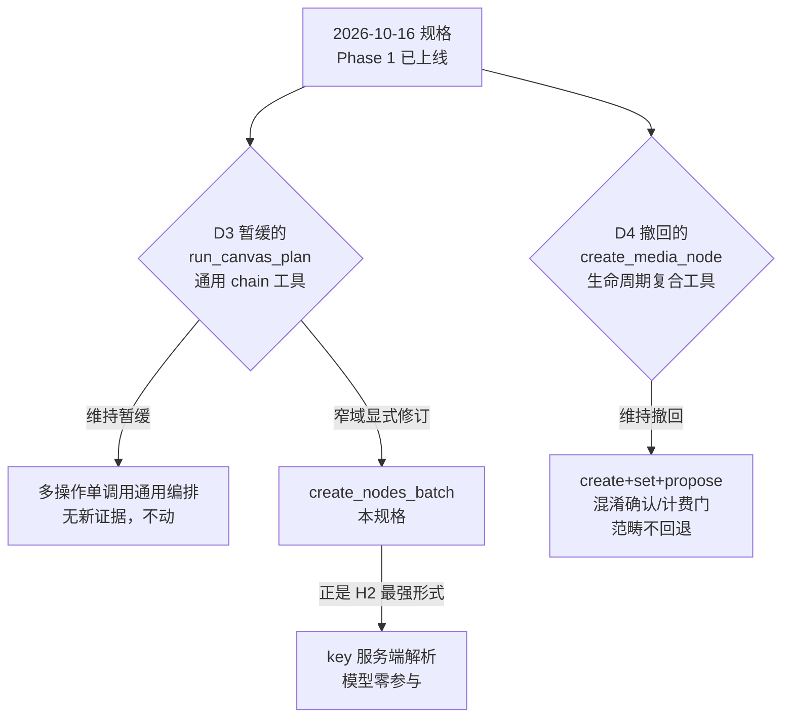
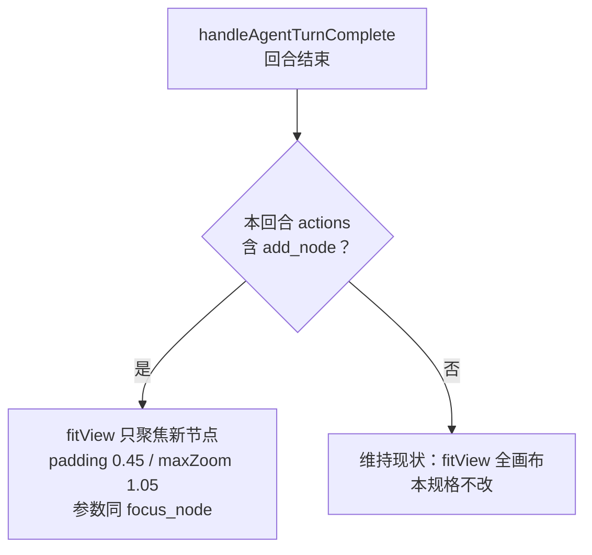
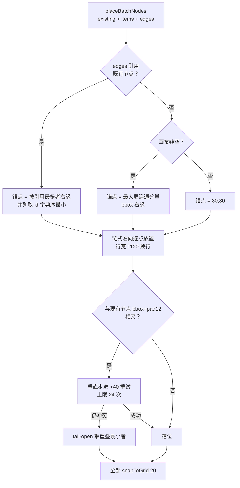

# SP-A 批量创建即整齐：create_nodes_batch 工具 + 放置内核 设计规格

> 日期：2026-10-20
> 状态：**待评审**（brainstorming 产出，D1–D6 决策经用户指令「同意按以上决策先行」批准）
> 产品：超创平台（lnkpi）无限画布 / Agent Runtime
> 上级：[2026-09-14-agent-atomic-as-tools-design.md](./2026-09-14-agent-atomic-as-tools-design.md)（pi 原子性哲学 / HITL 确认门 / 节点 SSOT）
> 前置：[2026-10-16-canvas-write-tool-chain-design.md](./2026-10-16-canvas-write-tool-chain-design.md)（Phase 1 已上线；本规格对其 D3 做窄域显式修订，见 §3）
> 来源评审：[outputs/agent-canvas-layout-gap-review.html](../../../outputs/agent-canvas-layout-gap-review.html)（17 项缺口分级，本规格 = P0 ①②）
> 分支约定：实现走 feature 分支 + PR + squash merge。

---

## 0. 配图索引

本文档的图全部为**结构图**（Mermaid 内嵌）；无 SVG 视觉稿（理由：本规格无像素级布局/比例/形状依赖，放置算法的落位规则可用决策树无损表达）。

| 编号 | 形式 | 内容 | 位置 | 用途 |
|---|---|---|---|---|
| 图 1 | 内嵌 Mermaid | create_nodes_batch 端到端数据流 | §5.1 | 实施时组件落点与事务边界对照 |
| 图 2 | 内嵌 Mermaid | 放置内核锚点三级优先决策树 | §8.1 | 放置算法金样单测的用例来源 |
| 图 3 | 内嵌 Mermaid | 回合末视口行为分流 | §5.4 | 前端焦点行为改动的验收判据 |
| 图 4 | 内嵌 Mermaid | 与 2026-10-16 规格的决策关系 | §3 | 规格冲突消解的裁决记录 |

---

## 1. 目标

1. **agent 一次调用原子创建 ≤12 个节点 + ≤20 条边**：单 Nest 事务、单次 SSE flush 应用，视觉上整批一帧出现（消除 N 次串行调用的「逐个蹦点」）；任一失败整体不存在，不留半幅工作流。
2. **落位由服务端放置内核决定，整齐度不靠模型运气**：链式挨放 + bbox 避碰 + 网格吸附，零压盖、贴现有内容右侧生长；agent 单节点创建与批量创建**同享一个内核**（同址替换现有网格取模公式）。
3. **id 流转零模型参与**：批内连边用 `key` 索引引用，服务端解析为 nodeId——2026-10-16 规格 H2「id 流转结构性绑定」的最强形式。

## 2. 范围

### 2.1 本规格做

- 新增 pi 工具 `create_nodes_batch`（常驻，最小 schema，草稿-only）。
- Nest `addNodesBatch` 扩展：edges 同事务解析、items 数量上限、key 唯一性校验。
- 新增放置内核 `placeBatchNodes`（packages/shared 纯函数模块）+ 单建/批建同址替换网格公式。
- 前端回合末视口分流：有新节点只聚焦新节点，否则维持现状。
- prompt 点名一句（canvas_daily_ops），按 AGENTS.md 同步矩阵逐项核查。

### 2.2 明确不做（登记在 §12，不隐性扩范围）

- align/distribute/参考线/标尺（SP-B）；stage 暂存 UI（SP-E）；canvasVersion 乐观并发（SP-E）。
- 分组折叠、parentNode 序列化补齐（SP-F）；resize 手柄、z-order、旋转（SP-G）。
- 布局双实现合一（前端 useCanvasGrouping 691 行 ↔ Nest canvas-layout.util 518 行）——SP-A 只做 shared+Nest 侧合一，前端那份留给 SP-F。
- DB schema 变更：canvasData 本就是 JSON blob，节点/边/位置均在其内，零 migration。

## 3. 与既有规格的关系

图 4 说明本规格对 2026-10-16 规格决策的处置：只在一个窄域上解除暂缓，其余决策全部维持。



*图 4 · 本规格与 2026-10-16 规格的决策关系：通用 chain 维持暂缓、生命周期复合工具维持撤回，仅在「草稿-only 批量创建」窄域解除暂缓，且该工具是 H2 的最强形式而非回退。*

### 3.1 显式修订 D3（窄域解除暂缓）

**修订对象**：2026-10-16 规格 D3「`run_canvas_plan` chain 工具暂缓，待 Phase 1 生产数据再评」。**修订范围仅限：草稿-only 的批量节点/边创建工具**，通用 chain 工具维持暂缓。

四条理由：

| # | 理由 |
|---|---|
| R1 | **它是 H2 的最强形式**：H2 要求 id 流转结构性绑定。after_tool 钩子注入是「事后纠正」，key 服务端解析是「模型从起点就不接触 id」——比已上线方案更彻底，而非绕过。 |
| R2 | **端点已存在**：`addNodesBatch`（`agent-canvas-tools.service.ts:899-975`）早就在 Nest 沉睡（仅被 upsert 单建路径包装调用），items 自带 `key` 字段、`applyOrStage` 已支持 stage 参数。本工具是薄暴露，零新业务逻辑。 |
| R3 | **需求实证**：缺口评审 P0-①——无批量工具 ⇒ agent 只能 N 次串行 `upsert_media_node`，N 个节点 N 次 LLM 延迟间隔逐個蹦出，且无批量事务（第 4 个失败留半幅）。 |
| R4 | **暂缓前提现已可评**：Phase 1（run 级 sequential + after_tool/before_tool）修好了「单链 id 猜错」事故；但「多节点工作流」的新证据（N 调用延迟、半成品态）正是暂缓时未知的那类数据。 |

### 3.2 维持的决策

- **维持 D4（撤回复合工具）**：D4 撤回的 `create_media_node` 是**生命周期复合**（create+set+propose 混淆确认门与计费门）。`create_nodes_batch` 是草稿-only 的创建原语薄暴露，不碰 set/propose/确认语义，范畴不同——不是回退。
- **维持 H1/H4/H5/H6/H7**：原子工具契约不变；计费 `run_*` 仍只在用户确认后走 Nest；同批窗口注入仍是 Phase 1 主修复；生成仍走 `propose_generation` 逐节点确认。
- **D3 的通用 chain（`run_canvas_plan`）维持暂缓**：本工具只表达「一批同类创建」，不是通用多操作编排。

### 3.3 新增硬不变量

| ID | 规则 |
|---|---|
| **HN1** | 工具**永不接受 position 参数**——坐标永远由服务端放置内核计算（延续「坐标由后端计算」纪律；`upsert_media_node` 的 position 入参是用户侧拖拽落点透传，不在本工具面）。 |
| **HN2** | 批内连边只接受本批 `key` 或既有节点 id 作端点，**key→nodeId 的解析完全在服务端**，模型零参与 id 文本搬运。 |
| **HN3** | 单批 ≤12 节点、≤20 边（与 `connect_nodes` 的 `CONNECT_NODES_MAX_EDGES` 对齐）；超出工具层抛可操作错误；跨批续接用上一批返回的 nodeId。 |

## 4. 规范与判据（可复用）

### 4.1 新 canvas 工具接入判据（后续同类需求直接套）

| 判据 | 问题 | `create_nodes_batch` 的答案 |
|---|---|---|
| J1 原子性 | 是否混淆生命周期阶段（create/set/propose/run）？ | 否——纯草稿创建，set/propose 仍走既有原子工具 |
| J2 id 流转 | 跨对象引用靠模型文本搬运还是服务端结构化绑定？ | key 服务端解析（HN2） |
| J3 端点存在性 | Nest 侧是否已有沉睡端点可薄暴露？ | 是——`addNodesBatch`（service.ts:899） |
| J4 tier 判定 | 是否会被常驻工具「凑部分答案」？ | 是（`upsert_media_node` 常驻且能逐个建）⇒ **必须常驻**，进延迟集永远等不到搜索 |
| J5 先例一致性 | 同形态工具是否有先例？ | `connect_nodes` / `delete_nodes` / `duplicate_node` 均为批量工具，「一工具一操作类型」解释一贯 |

**tiering 铁律（结论 2，tiering.ts 文件头）**：不许常驻工具给延迟工具的领域凑部分答案。`upsert_media_node` 是批量创建的事实部分替代品 ⇒ J4 判「必须常驻」。2026-10-06 tool_search 探针实验（6 命中 0 miss）证明延迟工具**可达**，但可达不等于该可达——铁律优先。

### 4.2 prompt 点名纪律

- 新增工具若改变模型的默认行为路径（如「多节点优先用批量工具」），必须在 canvas_daily_ops 点名，否则模型惯性走 upsert。
- 点名文案预算：L6 当前余量 **161 字符**（`prompt-registry/PROMPT_SPEC.md:75` 机检表；AGENTS.md 的 68 为过期手工值，以机检表为准）。
- 同步矩阵按 AGENTS.md 逐项核查：MANIFEST contentHash、fallback.ts 内嵌常量、assembler EXPECTED 三处必动；COMPOSED_IDS / FALLBACK_BY_ID 不变。
- 工具 description 与注释中**禁带引号的其他工具名**（防幽灵项）。

## 5. 架构与契约

### 5.1 端到端数据流

图 1 是本规格的组件落点全景：放置计算放 Nest 服务层（不放 pi-runtime、不放前端），节点+边单事务。

```mermaid
flowchart LR
    A["模型"] -->|"create_nodes_batch<br/>items + edges"| B["pi-runtime 工具层<br/>canvas-write.ts"]
    B -->|"POST /agent/internal/<br/>add-nodes-batch"| C["Nest Controller<br/>agent-canvas-tools"]
    C --> D["placeBatchNodes<br/>shared/canvas/layout.ts"]
    D -->|"position per item"| E["addNodesBatch 扩展<br/>edges 同事务解析"]
    E --> F["applyOrStage<br/>单事务 add_node xN + add_edge xM"]
    F -->|"actions"| G["details.actions"]
    G -->|"SSE"| H["applyActionsToFlow<br/>批量幂等应用"]
    H --> I["画布整批一帧出现"]
```



*图 1 · create_nodes_batch 端到端数据流：从模型意图到画布一帧出现的完整链路；放置内核（D）在 Nest 服务层被调用，节点与边在同一个 applyOrStage 事务内落库，前端 applyActionsToFlow 对混合 add_node+add_edge 的批量应用已幂等（零改）。*

### 5.2 工具契约（pi-runtime）

```ts
// services/pi-runtime/src/tools/canvas-write.ts（新增，tier = graph_batch，常驻）
create_nodes_batch({
  items: Array<{
    key: string            // 批内唯一索引（非空，≤64）；连边引用用，不返回给模型当作 id 用
    type: 'image' | 'video' | 'text' | 'audio'
    prompt: string         // 必填（与 upsert_media_node 一致：无 prompt 的节点无生成意义）
    title?: string         // 缺省退化为 prompt（addNodesBatch 侧已有 title 逻辑）
  }>,                       // ≤12（BATCH_NODES_MAX）
  edges?: Array<{ source: string; target: string }>  // ≤20；端点按「本批 key → 既有节点 id」解析
})
// 返回：{ nodes: [{ key, nodeId }], actions }——nodeId 供跨批续接
```

设计要点：

- **schema 最小化**：生成参数（model/aspect/duration…）不进本工具，仍走既有 `set_node_generation_params`——压常驻 schema token 成本。
- **edges 形状与 `connect_nodes` 逐字相同**（`canvas-write.ts:974-981` 先例），模型零学习成本；差异仅在端点解析域多一层「本批 key」。
- **草稿-only**：节点恒以 `status:'draft'` 创建（addNodesBatch 现有行为，service.ts:945）；description 明示「不启动生成；逐节点 `propose_generation`」。
- **stage 参数本规格不暴露**：`applyOrStage` 已内建 stage 能力，但暂存确认 UI 属 SP-E；现在暴露 = 暂存无 UI 陷阱（YAGNI）。工具不传 stage，Nest 侧 `stage?: boolean` 能力保留不动。

### 5.3 Nest 端点扩展

`POST /agent/internal/add-nodes-batch`（controller.ts:1137 已存在）扩展三点：

| # | 扩展 | 位置 | 失败行为 |
|---|---|---|---|
| E1 | `edges?: Array<{source,target}>` 入参，节点 action 全部生成后、`applyOrStage` 前统一解析 | `addNodesBatch`（service.ts:899） | 任一端点既不在本批 key 映射也不在画布节点 ⇒ **整体 fail-closed 400**，错误信息逐条列出未解析端点（不落库、不留半连边——静默半连边是 silent-degrade 家族） |
| E2 | items 数量上限 ≤12 | 工具层显式校验（`connect_nodes` 同模式，canvas-write.ts:983-986）+ DTO `@ArrayMaxSize` 纵深 | 工具层可操作错误文案 `create_nodes_batch accepts at most 12 nodes per call (got N)` |
| E3 | key 批内唯一 + 非空校验 | `addNodesBatch` 入口 | 400 列重名 key |

**解析序（HN2）**：`edges[].source` 先查本批 `mapping`（key→nodeId），未中再查 `canvas.nodes`（id）；两步皆不中 ⇒ E1 失败。解析与节点创建在**同一方法同一事务窗口**内完成，不引入第二个事务。

### 5.4 回合末视口分流（前端）

图 3 是唯一的既有行为修改点：`handleAgentTurnComplete`（CanvasPage.vue:1744，已核实现状为**无条件 fitView 全画布**）。



*图 3 · 回合末视口行为分流：有新节点的回合只把新区域带入视口（用户全局视野不被劫持）；无新节点的回合维持既有全画布 fitView——后者的问题登记 SP-C，不在本规格扩大改动面。*

**决策依据**：批量落点贴近主工作区，只需把新区域带入视口；100 节点画布每回合把用户缩放甩出全览是「凌乱感」的放大器之一。无新节点分支维持现状（登记 §12），保持本包改动面最小。

### 5.5 prompt 点名

canvas_daily_ops 增加一句（草稿，约 25 字符，L6 余量 161 内）：

> 批量建节点用 `create_nodes_batch`（key 引用连边），不要逐个 upsert。

（注：写入 prompt 正文时按该文件既有格式去掉反引号；反引号仅为防幽灵项的本文档约定。）

## 6. 主场景规格（可验收）

**场景**：用户对 agent 说「建 6 个分镜节点连成一条线」。

1. agent 单次调用 `create_nodes_batch`（6 items + 5 edges，key 引用）。
2. **一帧出现**：6 节点 + 5 边在同一 SSE flush 应用，无中间态闪烁。
3. **零压盖**：任意两节点 bbox（pad 12）不相交；链式落位、行宽 1120 换行。
4. **视口只带新区域**：用户此前缩放的画布上下文不被全览劫持（新节点进入视野，其余不动）。
5. **id 正确性**：5 条边全部落在本批 6 节点之间；返回的 nodeId 与画布上节点一一对应。

## 7. 数据与状态变更

- **DB**：零变更。canvasData 为 JSON blob（Session 模型），节点/边/位置本就在其内。
- **CanvasAction**：零新类型。复用 `add_node` / `add_edge`（addNodesBatch 与 connect 端点已在产）。
- **前端 store**：零变更。`applyActionsToFlow`（useCanvasActions.ts）对混合 add_node+add_edge 的批量应用已幂等。
- **shared 类型**：新增 `LayoutNode` 的 shared 落地（从 canvas-layout.util.ts 上移，见 §9），不改变既有 Nest/前端 import 面（canvas-layout.util.ts 改为 re-export）。

## 8. 纯函数与算法

### 8.1 放置内核 placeBatchNodes

图 2 是算法的锚点决策树，同时是金样单测的用例来源。



*图 2 · 放置内核锚点三级优先决策树：边引用优先（延伸已有链路自然接续）→ 最大弱连通分量右缘（贴着主工作区长）→ 空画布原点；避碰用定向垂直步进、有次数上限、失败时取重叠最小而非死循环。*

**签名**（packages/shared/src/canvas/layout.ts）：

```ts
export function placeBatchNodes(
  existing: LayoutNode[],
  items: Array<{ key: string; type: string }>,
  edges?: Array<{ source: string; target: string }>,
): Map<string, { x: number; y: number }>  // key → position
```

**精确规则**：

| # | 规则 |
|---|---|
| A1 | **锚点三级优先**（图 2）：① edges 引用的既有节点（按被引用次数降序，并列取 id 字典序最小）落其右缘 `x = node.x + w + 40`；② 最大弱连通分量（按现有 edges 计算的弱连通分量，取节点数多者，并列取 bbox 面积大者）bbox 右缘 +40；③ 空画布 (80,80) |
| A2 | **链式生长**：items 按传入顺序从锚点向右逐点放置，累计 `x += w + 40`；超行宽 1120 换行（x 回行首，`y += 行高 + 40`） |
| A3 | **避碰**：候选点与所有 existing（含批内已放置）按 bbox+pad 12 检测；冲突则 `y += 40` 重试，上限 24 次；24 次仍冲突 fail-open 取重叠面积最小者（不抛错——放置永不阻塞创建） |
| A4 | **分组子节点**：existing 中 parentNode 非空的节点按 `getAbsolutePosition`（canvas-layout.util.ts:60）换算绝对坐标参与避碰——`computeNewNodePosition` 的既有缺陷（子坐标按父相对却与绝对坐标比对）不在本内核复现 |
| A5 | **网格收官**：全部落点 `snapToGrid(20)`（与用户侧松手吸附同网格；NODE_SIZES 均为 20 倍数 ⇒ 间距恒定） |
| A6 | **确定性**：纯函数、无随机、无时钟、无视图依赖——同输入同输出，金样测试可锁 |

**常数**（与既有实现对齐处）：`SNAP_GRID=20`（useCanvasNodePlacement.ts:3 同名）、`COLLISION_PAD=12`（useCanvasNodePlacement.ts:52）、`H_GAP=40`、`ROW_WIDTH=1120`、`MAX_STEP=24`、`ANCHOR=(80,80)`（service.ts:937 原点）。

### 8.2 单建同址替换

`addNodesBatch` 的 `item.position ?? 网格公式`（service.ts:934-939）中，`item.position` 缺省分支改为调 `placeBatchNodes`（existing + 当前批 items）。`upsertMediaNode` 创建路径本就包装 addNodesBatch（service.ts:1021-1037），**零改动即同享内核**。

**注意（既有第三处网格公式）**：service.ts:1611-1612 与 2698-2699 还有两处同款网格公式（其他创建路径）。本规格只替换 addNodesBatch 这一处（单建+批建共用位）；另两处登记 §12，避免改动面静默扩大。

### 8.3 单测要求

| 层 | 用例 |
|---|---|
| 放置内核（金样） | 空画布 / 单簇锚点 / 离群点（最大分量 vs 全 bbox 差异）/ 分组子节点参与避碰 / 密集碰撞触发步进 / 长链换行 / 边引用锚点优先于分量锚点 / 确定性（同输入两次调用逐点相等）/ 网格吸附（输出均为 20 倍数） |
| Nest 扩展 | key 重名 400 / items 超限 / edges 未解析端点 fail-closed 且错误列名 / 边解析序（key 优先于 id）/ 节点+边单事务（部分失败无残留） |
| tiering | tiering.test.ts 登记 create_nodes_batch 常驻 |
| 前端 | 混合 add_node+add_edge 批量经 applyActionsToFlow 后节点/边齐全（回归锁，非新功能） |
| prompt | MANIFEST contentHash / fallback / assembler 既有测试（点名改动后自动验证） |

## 9. 文件级改动清单

| 文件 | 改动 |
|---|---|
| `packages/shared/src/canvas/layout.ts` | **新增**。`placeBatchNodes` + snapToGrid + rectsOverlap + 从 canvas-layout.util.ts **逐字上移**的 NODE_SIZES / getNodeSize / getAbsolutePosition / LayoutNode（保证行为等价：canvas-layout 现有测试全绿为验收） |
| `packages/shared/src/canvas/index.ts` | 导出新模块 |
| `apps/server/src/agent/canvas-layout.util.ts` | 删除上移部分，改为从 shared re-export（保既有 import 面不变） |
| `apps/server/src/agent/agent-canvas-tools.service.ts` | addNodesBatch：+edges 解析（E1）+key 校验（E3）+items cap 服务端兜底（E2）+ 网格公式替换为 placeBatchNodes（§8.2） |
| `apps/server/src/agent/agent-canvas-tools.controller.ts` | add-nodes-batch DTO：+edges 字段 + @ArrayMaxSize（E1/E2 纵深） |
| `services/pi-runtime/src/tools/canvas-write.ts` | 新增 `create_nodes_batch` 工具定义 + execute（tier=graph_batch，BATCH_NODES_MAX=12 常量） |
| `services/pi-runtime/src/tools/tiering.ts` | 常驻名单登记 + tiering.test.ts |
| `apps/web/src/pages/CanvasPage.vue` | handleAgentTurnComplete 视口分流（§5.4，约 10 行） |
| prompt-registry（canvas_daily_ops） | 点名一句 + 6 处同步矩阵 |
| `apps/server/src/agent/*.spec.ts` | 放置内核金样 + addNodesBatch 扩展单测 |

## 10. 测试策略与验收标准

| 层 | 标准 |
|---|---|
| 单测 | 放置内核金样全绿（§8.3）；canvas-layout.util 既有测试零回归（re-export 等价） |
| 集成 | Nest add-nodes-batch + edges 端到端：事务原子性（注入失败场景无残留） |
| 类型 | `pnpm build` 根目录全量（跨包改动纪律，corepack shim） |
| 目视 | §6 主场景五条逐条过；另测：空画布首批 / 密集区续建 / 跨批续接连边（第二次调用 edges 引用第一批返回的 nodeId） |
| 生产复测 | 上线后真机：agent 批量建图一帧出现、零压盖、视口符合预期（prod-deploy-verify 纪律） |

## 11. 风险

| # | 风险 | 缓解 |
|---|---|---|
| R1 | prompt 点名不进 / 模型仍惯性逐个 upsert | 点名 + description 明示；上线后观察 tool 调用分布（silent-degrade 教训：行为类改动要可观测） |
| R2 | shared 上移 getNodeSize 等与 Nest 版漂移 | 逐字迁移 + canvas-layout 现有测试全绿为门；SP-F 再合前端那份 |
| R3 | fitView 行为变更影响既有会话 | 仅改 add_node 分支；无新节点分支维持现状；focus_node 参数（padding 0.45/maxZoom 1.05）是既有验证过取值 |
| R4 | fail-closed 边解析提高模型重试率 | 错误信息逐条列未解析端点（含「不在本批 key / 不在画布」判定），一次重试可修正 |
| R5 | 常驻 schema token 成本 | 最小 schema（type+prompt+title+key）；生成参数不进；L6 点名控制在 30 字符内 |

## 12. 后续包 / 路线图

| 包 | 内容 | 依赖 |
|---|---|---|
| SP-B 对齐与参考线 | align 六向/distribute 原语 + 工具条 + 拖拽参考线 | 本规格的 shared/canvas/layout.ts |
| SP-C 视口恢复 | viewport 入序列化 + loadSession 恢复；回合末无新节点分支的 fitView 劫持问题 | 无 |
| SP-D 连线校验 | isValidConnection + 服务端端点/环校验 + add_edge 去重 | 无 |
| SP-E 并发与暂存底座 | canvasVersion CAS + stage 透传 UI + 校验对齐 + 回合 checkpoint | 无 |
| SP-F 分组深化+内核合一 | parentNode 序列化 + 分组折叠 + 前端布局实现迁入 shared | SP-A/B |
| SP-G 缓议池 | resize / z-order / 旋转 / 分页摘要 / CanvasNode 布局元数据类型 / 只读接口鉴权 | — |

**本规格内登记的两处遗留**：① service.ts:1611/2698 两处同款网格公式未替换（其他创建路径，改动面控制）；② 无新节点回合的回合末 fitView 维持现状（SP-C）。

## 13. 配图规范自检

`pnpm verify-spec-figures --file docs/superpowers/specs/2026-10-20-agent-canvas-batch-layout-design.md` 结果：**1 篇在范围内，0 个错误，0 个警告**（R1–R8 全过；本文档 4 张图全部为 Mermaid 结构图，无 SVG 附件，R1/R6/R8 天然满足）。
