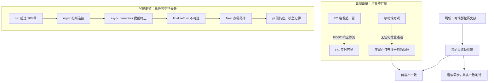
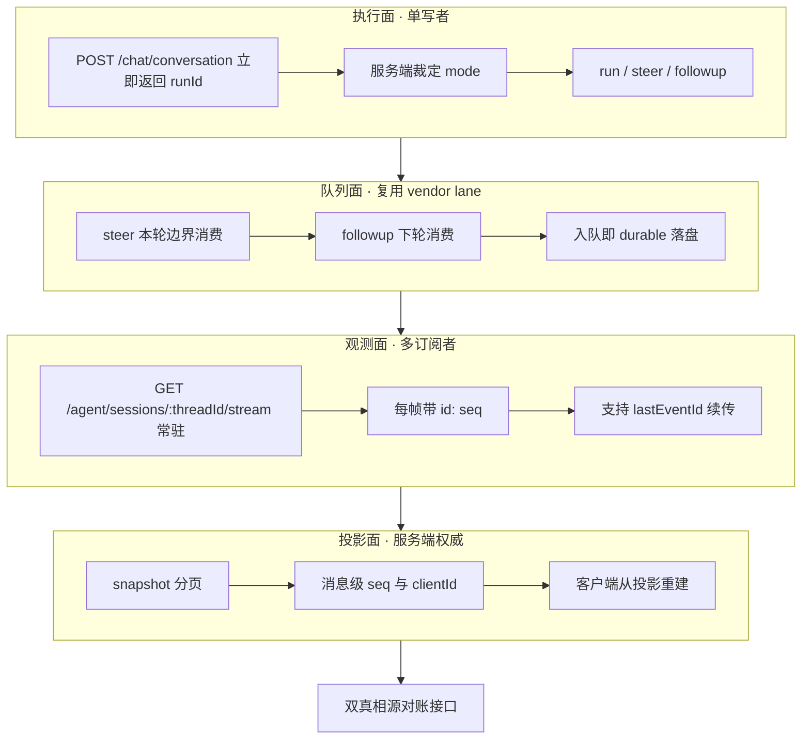
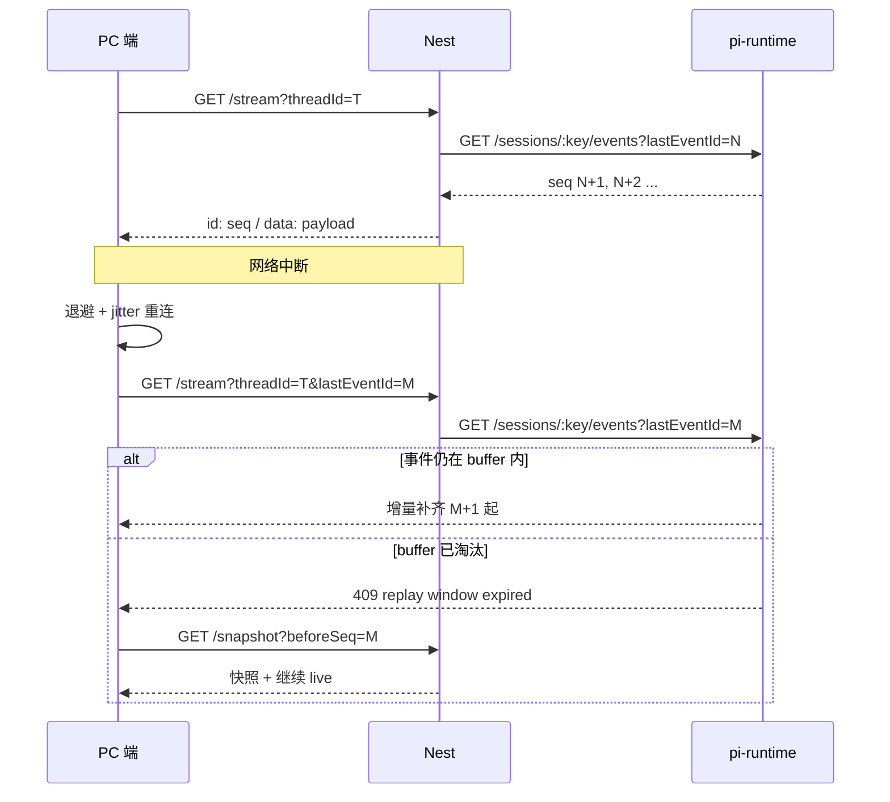
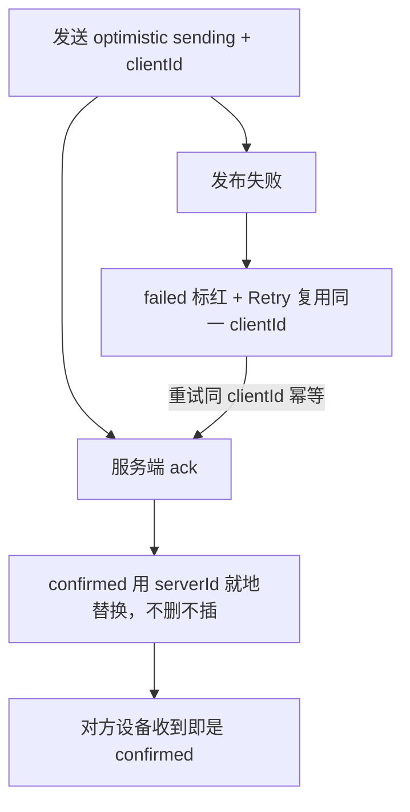
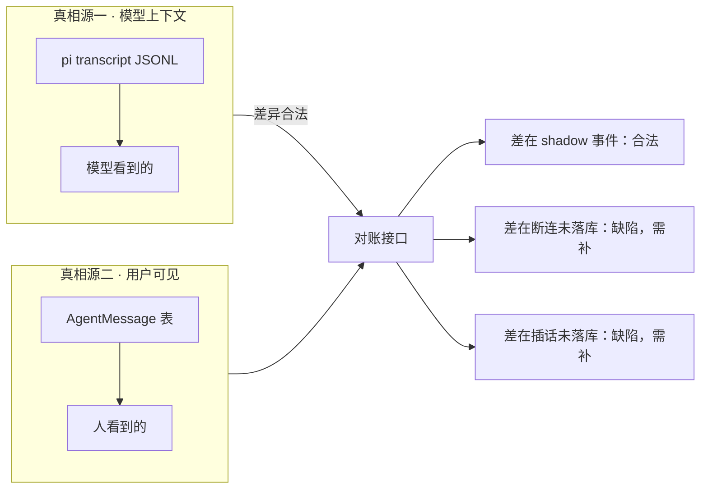

# 多端同会话一致性 设计规格

状态：待评审（2026-10-21 产出，取证驱动）
前置：[`docs/superpowers/specs/2026-10-17-agent-turn-identity-design.md`](./2026-10-17-agent-turn-identity-design.md)（已上线，本规格继承其「回合身份」判据并修复其覆盖盲区）
分支约定：实现走 feature 分支 + PR + squash merge。

> ⚠️ **本规格的两条实证前提必须先复核**：① 长任务丢库（nginx 300s）目前只有强相关 + 机制自洽，**缺一条直接日志**；② 插话不入库已有生产实证。批次 A 的 Task 1 专门用于补齐 ① 的证据链——**若复现失败，P0-2 的技术选型要重评**。

## 0. 配图索引

本文档的图分两类：**结构图**一律以 Mermaid 内嵌；**视觉稿**以 `assets/` 下的 SVG 附件承载（相对路径引用）。

| 编号 | 形式 | 内容 | 位置 | 用途 |
|---|---|---|---|---|
| 图 1 | 内嵌 Mermaid | 现状双断链结构（读侧不广播 + 写侧超时丢库） | §4.1 | 评审时确认「差异来自两条独立断链，而非单一同步 bug」 |
| 图 2 | 内嵌 Mermaid | 目标四层职责拆分（执行/观测/投影/队列） | §5.1 | Task 3–8 的架构归属判据 |
| 图 3 | 内嵌 Mermaid | SSE 游标续传时序（首连 / 断线 / 补齐） | §5.3 | Task 5 的实现基准与验收时序 |
| 图 4 | 内嵌 Mermaid | 乐观插入状态机（含幂等 clientId） | §5.4 | Task 9 的状态转移判据 |
| 图 5 | 内嵌 Mermaid | 双真相源分工与对账边界 | §7 | Task 10 的对账接口契约 |

## 1. 目标

1. **任一端打开会话，能看到另一端发起的全部增量**，不必刷新。
2. **任何一轮对话，只要在 pi 侧执行完成，就一定能在历史里查到**（哪怕执行它的 HTTP 连接已断）。
3. **两端同时说话时，每条消息都有确定归属**（立即执行 / 并入本轮 / 下轮执行），用户看得见、刷新不丢。

三条都可验收，判据见 §10。

## 2. 范围

**在范围内**

- 观察面解耦：会话级常驻 SSE 与「谁发起的 run」无关
- 写入侧与请求生命周期解耦：落库不再依赖 SSE 连接存活
- SSE 游标（`Last-Event-ID`）端到端贯通 + 前端退避重连 + 可见性恢复
- 消息身份：`seq` + `clientId`（乐观插入幂等）
- 插话落库 + 显式 mode 三态回传
- 双真相源对账接口

**明确不做**（及理由）

| 不做 | 理由 |
|---|---|
| WebSocket | 需求是单向增量；`Last-Event-ID` 是浏览器自动重发的标准字段；现有 Nest 已是 `text/event-stream`；WS 需自建重连 + 游标 + 心跳 + 背压，过代理更脆 |
| 用 BroadcastChannel 做一致性 | 只在同源标签页生效，跨设备无效；需求明确含「手机」⇒ 必须走服务端。可作同源标签页的**延迟优化**（提示「对端刚发了消息」），但不是一致性机制 |
| 把 `AgentMessage` 表当唯一真相 | pi transcript 才是模型上下文的真相源；表当真相会让压缩/分支场景失真 |
| 硬锁禁止并发发起 | 需求要「手机随时插话」⇒ 走队列（`steer`/`followUp`），不是拒绝。对标：Codex 的硬锁用于「同一份文件并发写」，不用于消息队列 |
| 多实例部署 | 事件 buffer 在内存（`BUFFER_LIMIT=500`，`replicas=1` 时无兜底）。本期维持单实例，把多实例列 §12 |
| 视觉稿 | 本规格无空间/比例依赖（§1 判据全不命中），故无 `assets/` SVG；不硬凑图 |

## 3. 与既有规格的关系

| 既有规格 | 关系 | 说明 |
|---|---|---|
| `2026-10-17-agent-turn-identity-design.md`（回合身份） | **继承 + 补盲区** | 它立了 `owner`/`shadow` 单写者 + `@@unique([threadId, runId])`。但 `runId` 可空 ⇒ SQLite 下 NULL 互不冲突 ⇒ 生产 9443 条 assistant 里 **9368 条（99.2%）唯一索引完全失效**。本规格用消息级 `seq` 补上这层，且**不推翻**它的 `owner`/`shadow` 判据 |
| `2026-10-19-propose-confirm-single-surface-design.md`（ADR-0011） | 不冲突 | 提议确认收敛为单一锚定表面，与本规格的投影面共用 `snapshot` 投影 |
| `2026-10-17-mobile-composer-sse-boundary-design.md` | **相关，需对齐** | 它界定了 SSE 边界（stale 判定、insert-line）。本规格 Task 5 扩展同一套边界（加游标与退避），实现前须核对其既有判据不被破坏 |
| PR #534（插话补气泡，commit `43151009`，已在 master） | **前置，非重复** | #534 做了**前端气泡层**（消费时补气泡 + 修 fork 切点被冲掉），**未落 `AgentMessage` 表**。本规格 Task 8 承接其后半段；**不改 #534 的既有实现** |

## 4. 规范与判据

### 4.1 现状：两条独立断链

用户观察到的「两端不一致」不是一个 bug，是**两条互不相干的断链叠加**（见 图 1）：



*图 1 · 现状双断链结构。用于评审时区分「读侧不同步」与「写侧丢数据」两个独立问题——它们的修法完全不同，混在一起谈会导致只修读侧就宣称「已解决」。*

**关键判据**：读侧与写侧的修复必须**分别**有验收用例，任一方的测试全绿不代表另一方被修好。

### 4.2 可复用判据（后续同类需求直接套）

| 判据 | 内容 |
|---|---|
| **D1 增量通道属于会话，不属于 run** | 任何「X 端发起的流」若只能被 X 看到，就是缺陷。判据：另一个客户端在 X 发起的全程都能看到事件流 |
| **D2 落库不得依赖请求存活** | 执行完成即应有记录，与发起的 HTTP 连接是否存活无关。判据：断网 10 分钟再回来，历史里那轮在 |
| **D3 真相源要能对账** | 双真相源可以分工，但差异必须可列出、可解释。判据：有接口能回答「这轮为什么没落库」 |
| **D4 并发语义由服务端裁定并回传** | 客户端不猜「这句话去哪了」。判据：每次发消息都拿到 `{mode}` |
| **D5 队列化消息必须落库** | 进队列的消息即用户的显式表达。判据：刷新后仍在，且能看出它排队过 |
| **D6 id 唯一性不可依赖可空列** | SQLite 下 NULL 互不冲突 ⇒ 含 NULL 的唯一索引形同虚设。判据：唯一键列 `NOT NULL` |

### 4.3 失败模式登记

| 模式 | 症状 | 判据 |
|---|---|---|
| **M1 覆盖竞态** | `loadHistory` 整体替换 `messages`（`stores/agent.ts:670`）吞掉刚 push 的增量 | 历史到达时若已有本地新增消息，不得整体替换 |
| **M2 假同步** | 两端刷新后一致，但都缺内容 | 「一致」必须叠加 D2/D3 判据验收 |
| **M3 首连漏窗** | 订阅先于 prompt 建立才不丢首事件（`agent.service.ts:1356` 的 eager 保证） | 该保证不得被改成惰性 generator |
| **M4 buffer 淘汰** | `BUFFER_LIMIT=500` + `message_update` 每 token 一个 ⇒ 溢出是**常规路径**（`session-manager.ts:420-436` 注释原话） | 重连走 `snapshot` 兜底，不得假设 buffer 够用 |

## 5. 架构与契约

### 5.1 四层职责拆分

见 图 2。核心动作只有一句：**把「流」从 run 的附属物改成会话的附属物**。



*图 2 · 目标四层职责拆分。用于 Task 3–8 的架构归属判据——每个改动必须能归到某一层，跨层的改动要拆成独立任务，因为它们的失败面与回滚粒度都不同。*

### 5.2 执行面契约

```ts
// POST /api/agent/chat/conversation 的响应（改造后）
type ConversationAck = {
  runId: string
  /** 服务端裁定的归属，不再让客户端猜 */
  mode: 'run' | 'steer' | 'followup'
  /** mode !== 'run' 时说明原因 */
  reason?: 'not_idle' | 'not_steerable'
  /** mode === 'steer'/'followup' 时该消息的 AgentMessage id（已落库） */
  messageId?: string
}
```

| 判据 | 语义 |
|---|---|
| `mode: 'run'` | 空闲 ⇒ 立即开新 run |
| `mode: 'steer'` | 忙碌 ⇒ 进队列，本轮下一个 turn 边界被接住 |
| `mode: 'followup'` | 忙碌且语义是「下轮再说」⇒ 收尾边界接住 |

⚠️ `steer` 与 `followup` 的差异由**用户显式意图**决定（Codex 的 `turn/steer` 同构），不由客户端猜。现有 `POST /runs/steer` 与 `/runs/followup` 两个端点已存在，改造后由 ACK 统一表达。

### 5.3 观测面契约（游标续传）

见 图 3。



*图 3 · 游标续传时序。用于 Task 5 的实现基准与验收时序——注意「409 → 快照 → 转 live」是上游既有范式（`pi-runtime.client.ts:521-543` 已有），本任务只是把它**透传到前端**，不新造。*

⚠️ **可复用的上游能力（此前全部未用透）**：

| 原语 | 位置 | 本规格怎么用 |
|---|---|---|
| `lane.watch()` | `vendor/…/harness/runtime/lane.ts:1705-1726` | 官方「快照 + 增量」范式，是 §5.4 投影面的地基 |
| `GET /sessions/:id/snapshot` | `session-manager.ts:2143-2153` | 已封装，但裁剪狠（transcriptTail 16 条 / 文本 400 字）⇒ Task 7 扩展 |
| SSE `id:` 帧 | `app.ts:474` | pi-runtime **已发** `id: ${seq}`，Nest 侧 `agent.controller.ts:502` **丢掉了** ⇒ Task 4 补回 |
| `?lastEventId=` replay | `app.ts:48-55` | 服务端已支持，Nest 未透传 ⇒ Task 4 |
| `queue_update` 事件 | `lane.ts:1513` | 投影面的队列数据源，现被丢弃 |

### 5.4 投影面契约

```ts
// GET /api/agent/sessions/:threadId/snapshot?beforeSeq=<seq>&limit=50
type SessionProjection = {
  messages: Array<{
    id: string          // AgentMessage 主键
    seq: number         // 会话内单调递增，D6 判据的载体
    clientId: string | null  // 乐观插入幂等键
    role: 'user' | 'assistant'
    content: string
    runId: string | null
    queued: boolean     // D5：排队中/已应用
    createdAt: number
  }>
  activeOperation: { operationId: string; kind: 'run' | 'steer' | 'followup' } | null
  queue: Array<{ entryId: string; kind: 'steer' | 'followUp' | 'nextRun'; text: string }>
  turnState: unknown | null
  nextSeq: number      // 客户端续传起点
}
```

**客户端语义变更（关键）**：消息列表**从投影重建，不做增量 append**。增量事件只用于「刷新投影页内的临时状态」（流式文本、工具进度），**不直接往消息数组 push 永久消息**。这样「历史 + 增量」的竞态（M1）从根上消失。

### 5.5 乐观插入状态机

见 图 4。



*图 4 · 乐观插入状态机。用于 Task 9——注意「就地替换」而非「删除+插入」，否则会造成消息位置跳变；且 `clientId` 必须一路贯通到唯一索引，否则幂等失效。*

⚠️ **失败必须分两类**（行业标准做法，Slack/Ably 一致）：

| 失败类型 | 语义 | UI |
|---|---|---|
| 发布失败 | 消息从未进会话 | 保留气泡 + 可 Retry |
| 唤醒 agent 失败 | 消息**已进会话**，只是没唤醒 | **保留气泡**，只重试唤醒 |

## 6. 主场景规格

### 场景 A：PC 发起，手机旁观（对应用户报告的现象）

| 步骤 | 期望 |
|---|---|
| PC 发消息 | PC 立即见乐观气泡；手机在**同一秒**出现 pending 态消息 |
| PC 收到流式增量 | 手机同步收到（游标续传，非快照重拉） |
| PC 关掉页面 | **手机不受影响**，流继续 |
| 手机刷新 | 历史与 PC 完全一致，且**包含**本轮 |

### 场景 B：两端同时说话（对应用户第二个问题）

| 步骤 | 期望 |
|---|---|
| PC 发消息（run 进行中） | 手机立即看到「生成中」+ 可插话入口 |
| 手机发消息 | 返回 `mode: 'steer'`；手机气泡标记「已并入进行中的任务」；**落库** |
| 刷新两端 | 那条插话仍在，标记为已应用 |
| steer 被消费后 | 气泡转普通态（D5 + Task 8） |

### 场景 C：长任务（回归 Task 1–2 的判据）

| 步骤 | 期望 |
|---|---|
| 发起 >300s 的 run | 连接不被掐（Task 1）；即使被掐，落库不受影响（Task 2） |
| 期间对端查看 | 能看到进行中状态（D1） |
| 完成后两端查看 | 历史里都有，**无缺轮**（D2） |

## 7. 数据与状态变更

见 图 5。双真相源分工**必须显式**（D3）。



*图 5 · 双真相源分工与对账边界。用于 Task 10——差异本身可以是合法状态（如 shadow 流只转发不落库），但「合法」必须由对账接口说明白，而不是靠人猜。*

### 7.1 Schema 变更

```prisma
model AgentMessage {
  // ... 既有字段不动
  seq      Int       // 消息级会话内单调序号
  clientId String?   // 乐观插入幂等键（D5 幂等）
  queued   Boolean   // 是否处于队列中（D5）

  @@unique([threadId, seq])   // ⭐ 取代 runId 唯一键（D6）
}
```

**迁移纪律**（不可跳过）：

| 步 | 动作 | 判据 |
|---|---|---|
| 1 | 加列（可空、无唯一索引） | 生产无报错 |
| 2 | 应用、部署、**观察一个迭代** | 存量数据 `seq` 全为 NULL，行为与今天完全一致 |
| 3 | 回填存量 `seq`（按 `createdAt` + `id` 排序） | 行数与 `count(*)` 一致 |
| 4 | **确认无 NULL 后**再加 `@@unique([threadId, seq])` | ⛔ 未确认就加 ⇒ 9368 条 NULL 行会让迁移失败或索引失效 |
| 5 | `runId` 保留但不再参与唯一性 | 兼容回滚 |

⚠️ 第 4 步是不可跳过的闸门——这正是 `runId` 当年埋的坑（`schema.prisma:358-361` 注释已写明「存量零回填」，代价是唯一索引至今对 99.2% 数据失效）。

## 8. 纯函数与算法

| 函数 | 位置 | 单测要求 |
|---|---|---|
| `shouldPersistAssistant` 的加强版 | `apps/server/src/agent/agent.service.ts` | 覆盖「`assistantText` 空但有 `executionEvents`」⇒ 仍须落库 |
| `resolveMessageSeq(threadId, createdAt, id)` | 新增（server） | 排序稳定性：同毫秒内按 `id` 兜底 ⇒ 可重放 |
| `parseSseFrames` 的 `id` 提取 | `pi-runtime.client.ts`（既有） | 补：有 `id` / 无 `id` / `id: 0` 三态 |
| `backoffWithJitter(base, cap, attempt)` | 新增（web） | 抖动落在 `[0.5, 1.5)×2^attempt`，断言**不单调**（防退化成无抖动） |
| `mergeHistoryAndLive(history, live, clientIds)` | 新增（web） | 覆盖 M1：历史到达时已有本地新增 ⇒ 不得整体替换 |

## 9. 文件级改动清单

| 文件 | 动作 | 归属层 | Task |
|---|---|---|---|
| `deploy/nginx/lnkpi.conf` | 改（timeout 300s→1800s） | 部署 | 1 |
| `apps/server/src/agent/agent.service.ts` | 改（落库与请求解耦） | 执行面 | 2 |
| `apps/server/src/agent/agent.controller.ts` | 改（`id:` 帧 + `lastEventId` 透传） | 观测面 | 4 |
| `apps/server/src/agent/pi-runtime/pi-runtime.client.ts` | 改（游标透传 + jitter） | 观测面 | 4 |
| `apps/server/src/agent/session-projection.controller.ts` | 新增 | 投影面 | 7 |
| `apps/server/src/agent/session-projection.service.ts` | 新增 | 投影面 | 7 |
| `apps/server/src/agent/turn-reconciliation.controller.ts` | 新增 | 投影面 | 10 |
| `apps/server/src/agent/agent.service.ts`（ACK） | 改（`mode` 三态 + 插话落库） | 执行/队列 | 6、8 |
| `apps/server/prisma/schema.prisma` | 改（`seq`/`clientId`/`queued`） | 数据 | 7 |
| `apps/web/src/stores/agent.ts` | 改（`randomUUID` + 投影重建） | 投影面 | 2（前端侧）、9 |
| `apps/web/src/components/agent/AgentSideRail.vue` | 改（游标 + 退避 + 可见性） | 观测面 | 5 |
| `apps/web/src/components/agent/backoff.ts` | 新增 | 观测面 | 5 |
| `apps/web/src/components/agent/mergeHistory.ts` | 新增 | 投影面 | 9 |

## 10. 测试策略与验收标准

### 10.1 三条目标的验收判据

| 目标 | 验收方法 | 判据 |
|---|---|---|
| 目标 1 | 双客户端集成测试：客户端 A 发起，B 全程订阅 | B 收到的事件序列与 A **逐条相同**（不只是条数） |
| 目标 2 | 断连集成测试：发起后 5s 强制断连，跑完再查历史 | 该轮 assistant **在**历史里，`metadata.partial` 语义正确 |
| 目标 3 | 双发测试：A 发起中，B 发消息 | 两条消息都在历史；B 的 `queued` 有正确终态 |

### 10.2 变异测试要求（防止假绿）

本仓纪律：**「测试全绿」不等于「测试能证伪」**。每个关键守卫都要有变异实测记录：

| 守卫 | 变异动作 | 期望 |
|---|---|---|
| 落库解耦 | 把 settle 改回「generator 正常收尾才执行」 | 测试红 |
| 游标透传 | Nest 侧去掉 `id:` 帧 | 续传测试红 |
| jitter | 去掉随机抖动 | 抖动测试红 |
| 插话落库 | 去掉 `AgentMessage.create` | 场景 B 红 |
| 投影重建 | 把合并改回整体替换 | M1 测试红 |

### 10.3 目视验收

- 手机与 PC 并排，手机在 PC 说话后 **≤1s** 出现 pending 气泡
- 手机插话后返回 PC，PC 侧历史里能看到那条插话（带「已并入」标记）
- 长任务（>300s）全程两端进度条同步，无跳变

## 11. 风险

| 风险 | 等级 | 缓解 |
|---|---|---|
| **R1 未复现**（长任务丢库根因假设错） | **高** | Task 1 专门复现；复现失败则 P0-2 重评，**不要基于假设改架构** |
| `streamFromPiRuntime` 是 40+ 处位置调用的 generator，拆分易错位 | 高 | 新增端点 + 灰度开关，**不原地重构**；参数一律追加在末尾（改中段会静默错值，因同型参数都是 `string[]`） |
| `seq` 迁移第 4 步闸门漏做 | 高 | 迁移脚本内置断言：存在 NULL 则拒绝加索引 |
| 多实例下 buffer 内存态失效 | 中 | 本期维持单实例；部署加 `replicas` 断言 |
| 前端重构波及移动端贴底壳契约 | 中 | 改 `AgentSideRail.vue` 后必跑 `AgentSideRail.mobileMaskTabbar.test.ts`（五条守卫） |
| 与 #534（插话气泡）冲突 | 中 | Task 8 明确「不改 #534 既有实现」，只加后端落库 |

## 12. 后续包 / 路线图

| 项 | 为什么不在本包 |
|---|---|
| 多实例部署 | 需先把事件 buffer 挪到共享存储；`replicas=1` 时无兜底 |
| presence / 接管语义 | 需要先有稳定的 session SSE 与设备身份；属体验层，可后置 |
| fork 逃生舱 | `POST /sessions/:id/fork` 已有，但**运行中/压缩中被拒**（`session-manager.ts:2702-2704`）⇒ 手机上想开分支必须等当前 run 结束，是独立议题 |
| 压缩策略与投影的关系 | `pi transcript` 会压缩，`AgentMessage` 不压缩 ⇒ 长会话下两者天然分叉，属独立议题 |

## 13. 配图规范自检

- 校验命令：`pnpm verify-spec-figures --file docs/superpowers/specs/2026-10-21-multi-device-consistency-design.md`
- 结果：见提交时的 CI 输出（配图索引 §0 齐备、图 1–5 连续且均被正文引用、Mermaid 均用受支持类型且标签带引号）