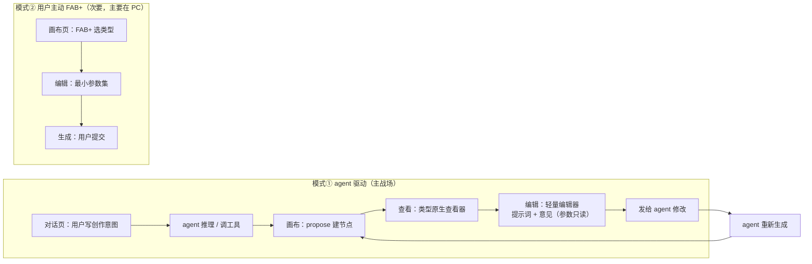
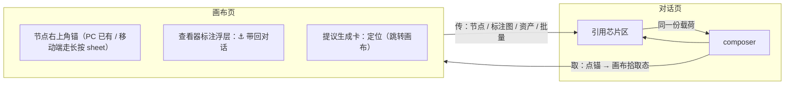
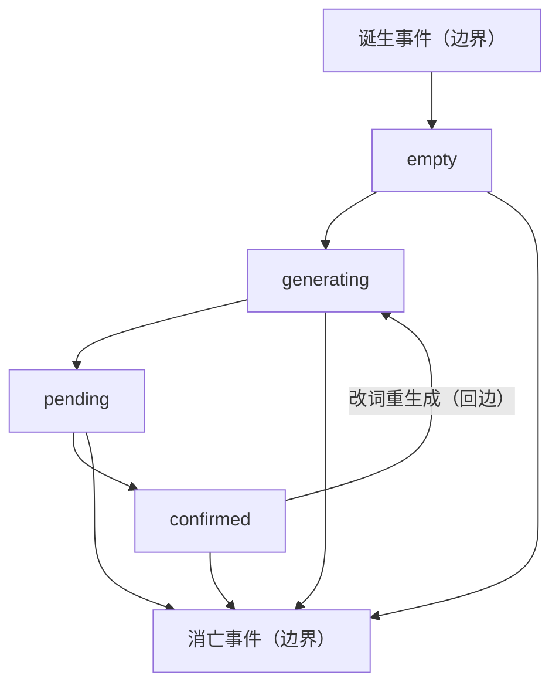
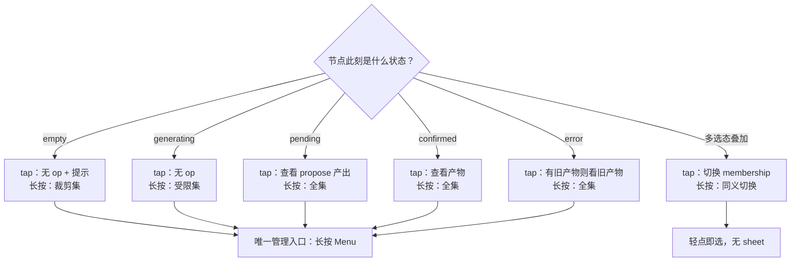
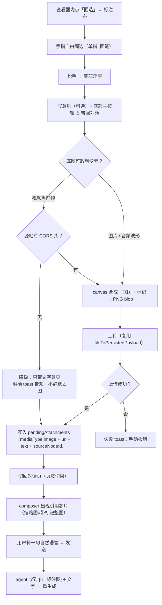
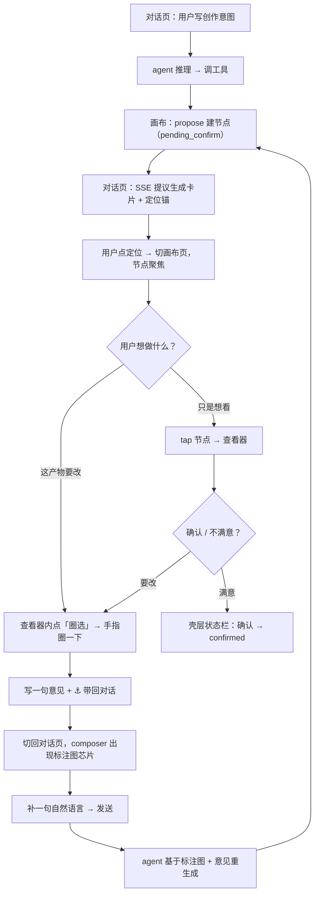

# 移动端节点生命周期与载体分工 设计规格

状态：已评审 · 实施中（ADR-0013 已 Accepted；2026-10-26 二轮审核结论已并入 §15 与各节原地修订）
基线：master `fdc62b53`（#578 走查六条修复在基线上；本规格的代码证据全部以 master 直读为准）
关联：R1-R4 节点重构（2026-10-22）、#571 引用修复、#573 波形、#578 走查六条、ADR-0011 / ADR-0012 / ADR-0004
决策真相源：`docs/adr/0013-mobile-node-interaction-mode-and-carriers.md`（Accepted）——本规格是**规范**真相源，ADR 是**决策**真相源
原始评审稿（v1.4，924 行）：`docs/design/2026-10-25-mobile-node-lifecycle.md`（**保留归档**，本文档是它的规范化继任者）
分支约定：实现走 feature 分支 + PR + squash merge。

## 0. 配图索引（结构与视觉两类，均随本文档演进）

本文档的图分两类：**结构图**一律以 Mermaid 内嵌；本文档**不含视觉稿**（理由：全部待定义内容是交互判据与状态门控，无真实空间/比例/形状依赖；查看器与编辑器的落点形态由 §6 的表格逐格描述，视觉稿待打样阶段补）。

| 编号 | 形式 | 内容 | 位置 | 用途 |
|---|---|---|---|---|
| 图 1 | 内嵌 Mermaid | 五态 × 手势门控（状态 → 单击/长按可用动作） | §5.1 | 判「这个节点此刻能做什么」的唯一查表入口 |
| 图 2 | 内嵌 Mermaid | 模式① 的端到端闭环（对话 → 画布 → 标注 → 锚回传 → agent 重生成） | §6.1 | 验收主场景是否闭环；定位断链在哪一段 |
| 图 3 | 内嵌 Mermaid | 模式① / 模式② 的载体分工（三载体各自归属） | §4.2 | 验收「载体服从模式」是否被落实 |
| 图 4 | 内嵌 Mermaid | 锚的双向载荷信封（对话→画布取 / 画布→对话传） | §4.5 | 验收「传送一律经锚」；新增载荷是否需新图标 |
| 图 5 | 内嵌 Mermaid | 标注产出的合成与回传管线（底图 → 标记 → 合成 → 上传 → 芯片） | §5.3 | 验收 CORS 降级与上传态是否被显式处理 |
| 图 6 | 内嵌 Mermaid | 生命周期七阶段 × 五态的映射（回边与边界事件） | §4.1 | 验收两模型边界未混 |
| 图 7 | 内嵌 Mermaid | 移动端组件语义三分（Menu / Action Sheet / Sheet 的判据） | §4.11.4 | 验收「揭示选项」与「动作澄清」未混用；验收容器选型 |

---

## 1. 目标

1. **移动端节点交互有一套单一判据**：任意类型、任意状态下，用户对节点的每一次手势都有唯一确定的去向（查 §5.1 总门控表即可，无需推断）。
2. **模式①（agent 驱动）的主闭环在移动端完整可走**：看产物 → 圈一下 → 写一句 → 锚回传 → agent 重生成，全程不依赖 PC。
3. **载体服从模式**：模式① 的移动端不出现 PC studio dock 的全量参数面板，也不出现「生成」钮（生成权归 agent），从根上消灭参数双语义。

**可验收判据**（对应 §10 的验收清单）：
- §5.1 总门控表逐格行为符合（4 类节点 × 5 态 × 2 手势 + 多选态叠加 = 44 格）。
- 模式① 从「agent 提议」到「agent 重生成」链路无断点，且**产物回传的每一步都有可见落地**（切页 / 芯片 / toast 至少其一）。
- 移动端模式① 编辑器**无参数控件、无「生成」钮**（源码级断言，见 §9）。

---

## 2. 范围（含明确不做）

**范围**：移动端（≤767px）画布页单节点（文本 / 图片 / 视频 / 音频）从创建到删除的全业务，含查看、管理、标注反馈、迭代协作。

**明确不做**（避免隐性范围）：

| 不做 | 理由 |
|---|---|
| PC 端任何行为改动 | 本规格对 PC 只做「对齐盘点」（§11），不动 PC 代码 |
| 移动端接 PC studio dock 全量参数 | §4.2 决定二：参数所有权在 agent 侧（propose 已写死） |
| 移动端模式① 出现「生成」钮 | §4.2 K1：绕过 propose 确认 ⇒ 双执行路径 |
| 精确蒙版 / SAM 分割 / 程序化局部重绘 | §4.3 L1：移动端标注是**意图表达**，不是像素编辑；此类需求留 PC |
| 引入结构化坐标契约 | §4.3 L1：`SidebarAttachment` 现有字段已够用（零新契约、零服务端改动） |
| 移动端画布节点右上角铺锚按钮 | §4.5 P6 + §4.6：移动端保持长按单入口（本体不铺按钮） |
| 视频跨域取帧的服务端代理 | 媒体代理白名单仅放行图片 ⇒ 视频走**诚实降级**（不带图），不做服务端扩展 |
| 提示词迭代历史与回滚 | §4.7（M3 可选，仅记录），不属本规格实施范围 |
| 模式② 的全量参数 | §4.2 决定二：模式② 在移动端保持最简 |

**平台**：iOS Safari / Android Chrome 均可；跨端形态统一（iOS / Material 3 对等，§4.11.9），不引入平台专属控件（§4.4）。

---

---

## 3. 与既有规格的关系（显式修订 / 显式推翻）

> 本节的作用是**防止新旧规格打架**。每条既有文档都标明「修订 / 推翻 / 沿用」。

| 既有文档 | 关系 | 本规格如何处置 |
|---|---|---|
| `docs/design/2026-10-22-mobile-node-refactor.md`（R1–R4 节点重构，已上线） | **修订** | 沿用其「移动优先媒体瓦片 + 集中式动作面板」与「点按播放 · 长按编辑」骨架；**推翻**其隐含的「编辑 = PC dock 复用」（`MobileNodeEditorSheet` 直接挂 `DockStudioRouter`）⇒ 改为 §4.2 的轻量编辑器（D8） |
| `docs/superpowers/specs/2026-10-19-propose-confirm-single-surface-design.md` + ADR-0011 | **沿用** | 单一锚定表面（节点即确认面）、dock 按状态门控、对话流降权为只读日志——**全部保持**。§4.2 K1 与其同构：pending 确认面仍在节点上，移动端不新增确认面 |
| `docs/superpowers/specs/2026-10-14-view-canvas-media-design.md` | **沿用** | 查看器按媒体类型的形态基调不变；本规格只补退出通道（X + 下滑）与标注层 |
| `docs/superpowers/specs/2026-10-06-selection-as-default-reference-design.md` | **沿用** | 选中即引用；本规格不改动其语义，只在多选态叠加时补充视觉与门控（§4.6） |
| `docs/design/2026-10-24-brand-anchor-icon-spec.md`（品牌锚视觉规范） | **沿用 + 引用** | 两枚锚资产角色分工（`anchor-generate` = 创作锚 / `anchor-locate` = 定位·引用锚）；本规格的「传送一律经锚」**只用 `anchor-locate`**，不新造图标（受 `home-profile-p3.guard.test.ts:147-152` 守卫） |
| ADR-0012（点锚 = 进入创作） | **不冲突（不同语境）** | ADR-0012 的锚是**品牌页的「点击锚→创作」**；本规格的锚是**对话⇄画布的载荷传送**。两者同资产族、不同语义位，**不改动 ADR-0012 的决策** |
| ADR-0004（视觉能力三态声明） | **依赖** | §4.3 L1「一张图给 agent」依赖识图能力：视觉模型走多模态直通，非视觉模型走 `sidebar-vision` 识图兜底 |
| `docs/design/2026-10-25-enter-creation-unified.md`（进入创作统一，PR #592 已合并） | **不冲突** | 那是「进入创作」的入口层；本规格是「进入之后节点怎么被看/被管/被反馈」的操作层 |
| 本规格的早期版本（`docs/design/2026-10-25-mobile-node-lifecycle.md` 评审稿 v1.0–v1.4） | **被本规格取代** | 评审稿原在 `docs/design/`（非规范目录），无配图与骨架约束；本规格是它的**规范化继任者**，内容已全部并入并按 §4 冲突校正 |

### 3.1 明确推翻的既有实现（不是推翻规格，是修实现）

| 实现 | 位置 | 处置 | 缺陷编号 |
|---|---|---|---|
| 空节点 tap → 编辑器 | `composables/mobileNodeOpenPolicy.ts:17-31` | 改：空节点 tap = 无 op + 引导长按 | D1 |
| 查看器唯一退出是 `‹` | `components/mobile/MobileNodeViewer.vue:12` | 改：右上 X + 下滑关闭 | D2 |
| 多选态 tap 会误开查看器 | `components/mobile/MobileNodeTile.vue` | 改：多选态 tap = 切换 membership | D4 |
| 删除零确认 | `pages/CanvasPage.vue:4794-4822` | 改：**撤销优先**（删除 + Snackbar「撤销」；不可撤销者才走确认弹层，§4.11.10） | D5 |
| 长按动作不认状态 | `components/mobile/MobileNodeActionSheet.vue:41-48` | 改：按 §5.1 门控 | D7 |
| 移动端编辑 = PC dock 全量 | `components/mobile/MobileNodeEditorSheet.vue:2,77-87` | 改：轻量编辑器（参数只读 + 发给 agent） | **D8** |
| 查看器 `type` 含 audio（死分支） | `components/mobile/MobileNodeViewer.vue:13-15` | 改：删 audio，音频永不进查看器 | D2 |
| 磁贴 CTA「点按生成 / 点按撰写」 | `components/mobile/MobileNodeTile.vue` | 改：「长按编辑 / 长按撰写」 | D1 |

---

## 4. 规范与判据（可复用规则）

> 本章的规则**后续同类需求直接套**，不再重新设计。每条都是**判据**（可判定），不是偏好。

### 4.1 交互六原则（铁律）

> P1–P3 为 v1.1 起的三条基础铁律；P4（载体服从模式）/ P5（标注只有一支笔）/ P6（传送一律经锚）为 v1.2–v1.4 评审新增。**六条同属铁律级，无优先级。**

- **P1 单击 = 查看。** 任何类型、任何状态，单击都不进入编辑。空 / 生成中 / error（无旧产物）= 无 op + 轻提示；**pending / confirmed = 查看**（pending 看 propose 产出见 §4.8，confirmed 看产物见 §6.2）。
- **P2 长按 = 管理。** 节点自身的管理操作（编辑 / 重命名 / 引用 / 副本 / 多选 / 删除 / 资产库 / 保存本地）只从长按唤起的 **Menu** 进（**不是** Action Sheet，§4.11.2），唯一入口。
- **P3 全屏层必须可退。** 查看器与编辑 sheet 都必须同时具备「右上角 X」与「下滑关闭」两条通道；退出即停（停播 / 停朗读），进行中的生成提示不丢。
- **P4 载体服从模式（模式① / 模式②，§4.2）。** 模式①（agent 驱动）下：**查看 = 类型原生查看器**（不是文本节点）、**编辑 = 轻量「提示词 + 意见」编辑器**（不是 PC studio dock 全量参数）、**生成权归 agent**（移动端不出现「生成」钮，改为「发给 agent 修改」）。模式②（用户主动 FAB+）下才允许用户在移动端直接提交生成。
- **P5 标注只有一支笔（§4.3）。** 标注层**只有手指自由圈选**一个工具，产出**「一张带标记的整图 + 一句文字意见」**；不做多工具栏、不做区域裁切、不引入坐标契约。四类节点共用同一套（底图不同：图片=图 / 视频=当前帧 / 音频=波形图 / 文本=直接文字引用）。
- **P6 传送一律经锚（§4.5）。** 对话 ⇄ 画布之间的任何内容搬运（取节点 / 送标注图 / 送资产 / 批量引用）**都必须经由锚**（`anchor-locate.png`）——**同一枚 glyph，不因载荷不同而新造图标**；锚的一切传送必须"看得见落地"（切页 + 芯片 + toast 至少其一），失败必须明说降级。

### 4.2 决定一：模式① / 模式② 分工与三载体形态（I1 / J1 / K1）

| | **模式① agent 驱动（主战场）** | **模式② 用户主动 FAB+（次要，主要在 PC）** |
|---|---|---|
| **查看载体** | **类型原生查看器**（图片灯箱可缩放 / 视频播放器可逐帧 / 文本阅读器 / 音频**不进查看器**、磁贴内联波形） | 同左 |
| **编辑载体** | **轻量「提示词 + 意见」编辑器**：提示词（可改词）+ 我的意见（自由文本）+ 参数**只读摘要一行** + 引用 chips + 提交按钮「**发给 agent 修改**」。**无参数控件、无生成钮** | **最小参数编辑器**：类型 + 提示词 + 模型/比例（后置到 M3）。**明确不做 PC 全量参数** |
| **生成归属** | **agent**。移动端**不出现「生成」钮** | 用户自己（画布页提交） |
| **画布页角色** | **观察 + 表态**（看产物、标注、提意见） | **创作**（建节点、写提示词、提交生成） |

- **I1** 查看 = 类型原生查看器 + 内置标注层。（否决：I2 统一文本节点式 ⇒ 产物降级；I3 复用 PC `MediaPreviewOverlay` ⇒ PC 浮层与移动端全屏层不同构）
- **J1** 编辑 = 轻量「提示词 + 意见」编辑器、参数只读。（否决：J2 现状复用全量 dock ⇒ 参数双语义 + 4800 行窄屏不可用；J3 收进二级页 ⇒ 复杂度高收益低）
- **K1** 生成权归 agent。（否决：K2 移动端保留「生成」钮 ⇒ 绕过 propose 确认 + 双执行路径；K3 双轨 ⇒ 状态归属仍混）

⭐ **不接 PC studio dock 的根因**（不是"移动端屏幕小"这一条）：**模式① 的参数所有权在 agent 侧**（`proposeGeneration` 已写死 `imageModel`/`imageAspect`/`imageResolution`/`videoSettings`），用户再调 = 两套参数语义打架；且模式① 的心智是"我说，你做"。

**图 3 · 模式① / 模式② 的载体分工**



### 4.3 决定二：标注层 = 手指自由圈选 + 一张带标记的整图 + 一句话（L1）

**核心判据：agent 的输入是「图 + 话」，不是「图 + 坐标」。** 坐标是给程序看的，人话是给 agent 的——把"精确圈定"交给 agent 的识图能力，是把复杂度放在对的一侧。

- **唯一工具 = 手指自由圈选**（canvas 画笔）。产出「**带标记的整图 PNG**」+ 一句文字意见。
- ⛔ **取消**：「标注片段」结构化契约 / 区域**裁切**截图 / 框选·套索·拖段·选段四套手势 / 多工具栏。
- ✅ **保留整图**：裁切丢上下文（agent 不知"这是整图哪里"）；整图带标记保留全部语境。
- ✅ **四类节点收敛为「一张图 + 一句话」两种形态**（**只有底图不同，工具与契约完全一致**）：

| 类型 | 底图 | 标注动作 | 引用去向 |
|---|---|---|---|
| 图片 | 当前图 | 手指自由圈 | composer 引用芯片（image + 文字） |
| 视频 | **暂停后的当前帧** | 手指自由圈 | composer 引用芯片（image + 文字） |
| 音频 | **波形图**（`useNodeWaveform` 真实 peaks） | 手指在波形上划 | composer 引用芯片（image + 文字） |
| 文本 | 该段文字 | ——（文本本身即引用内容） | composer 引用芯片（text） |

- ⭐ **零新数据契约、零服务端改动**：复用 `SidebarAttachment` 现有字段——图走 `url`、意见走 `text`、归属走 `sourceNodeId`、类型 `mediaType:'image'`。
> ⭐ **实现裁决**：① 标注浮层**走 `MobileSheet` 基座**（⛔ 禁第二套 sheet 皮肤，§4.11.8）；② **每次标注的 `sourceNodeId` 必须唯一**（后缀取 `${nodeId}#annotate-${Date.now()}` 或 uuid 片段；⛔ 禁组件内单调计数器 `n`——跨会话 / App 重启即归零，不同会话的两次标注会撞 id，`addFromPayload` 按 `url` **或** `sourceNodeId` 去重 ⇒ 同 id 的第二次标注**被静默丢弃**（用户零反馈））；③ 标注图 = `mediaType:'image'` + **上传后的持久 url** ⇒ 引用芯片缩略图**天然复用既有 `` 分支**（⛔ 不改 PC 组件、零 diff）。

**三个必须解决的技术点**（否则实现期翻车）：

1. **合成 = canvas**（底图 + 标记 + 输出 PNG）。图片底图须**同源化**再 `drawImage` ⇒ 复用 `services/media-url.ts` 的 `sameOriginApiMediaUrl`（**本就是为 canvas 像素读取写的**）。⛔ **媒体代理白名单仅放行图片** ⇒ **视频不能靠代理取帧**；优先 `<video crossOrigin="anonymous">` 直接 `drawImage`，源站无 CORS 头则**诚实降级为「暂停 + 文字意见，不带图」**，不静默失败。
2. **blob → 可用引用 URL**：引用契约**明确拒绝 blob URL** ⇒ 合成后必须**上传**再进引用（复用 `useMediaUpload.fileToPersistedPayload`）。⇒ 引用芯片在上传完成前**不能**出现（否则服务端会拒）⇒ 需一个「上传中」态。
3. **标注态必须显式进入**（底部一个「圈选」按钮）——查看器里单指拖动 = 滚动 / 缩放，隐式手势在移动端极易误触 ⇒ **不做双击切换这类隐式手势**。

### 4.4 决定三：操作全集按「频率 × 风险」归类 + 跨平台形态

> ⚠️ **本节已被 §4.11 修订**（上一轮自审）：容器语义（Menu vs Action Sheet）、数量上限、破坏性位置、删除确认方式四处与 HIG 冲突，以 **§4.11 为准**；本节保留"频率 × 风险"归类表与"不铺胶囊"原则（仍有效）。

**iOS / Android 多操作的设计范式**（⚠️ 见 §4.11.2 的修正）：

- **iOS HIG**：对象有多个操作时，标准范式是 **Menu（菜单）**——长按或「⋯」触发，列出相关操作；**破坏性操作用红色按钮**。**Action Sheet 只用于"为一次动作做澄清"**（如删除确认）。
- **Material（Android）对等**：**Modal Bottom Sheet** + **`⋮` 溢出菜单**，与 iOS Action Sheet 语义一致。
- **跨平台统一结论**：采用**底部浮层**作唯一操作容器（iOS/Android 原生都支持、认知一致、不引入平台专属控件）——但**容器内承载的语义是 Menu（揭示一组选项）**，破坏性确认另用 Action Sheet / 确认弹层（§4.11.2）。**不**在卡片上铺多个胶囊/文字按钮（拥挤、与「单击=查看」冲突、跨端不一致）。

| 操作 | 频率 | 风险 | 在 Menu 中的处理 |
|---|---|---|---|
| 编辑 | 高 | 无 | 置顶首项 + 图标，视为默认主操作 |
| 重命名 | 中 | 无 | 列表项 |
| 引用 | 中 | 无 | 列表项 + toast |
| 副本 | 中 | 无 | 列表项 |
| 副本（含上游） | 低 | 无 | **二级**（M2 新增） |
| 存入资产库 | 低 | 无 | **二级**（M2 新增） |
| 保存到本地 | 低 | 无 | **二级**（M2 新增） |
| 多选 | 中 | 无 | 列表项（进入选择模式） |
| 删除 | 低 | **高（破坏性）** | **置底、红色、前置分隔线**；执行前若可撤销 ⇒ 走 Snackbar 撤销（§4.11.10） |
| 取消生成 | 仅 generating | 中 | 上下文项（仅 generating 出现） |
| 查看参数 | 仅 generating | 无 | 上下文项（仅 generating，只读） |

**形态与位置原则**：

1. **唯一容器 = Menu（菜单）**（长按 / 「⋯」），**破坏性确认另用 Action Sheet / 确认弹层**（§4.11.2）。
2. **一级 ≤ 5 项**（权威分层见 §4.11.3 第 5 条），低频项进二级「更多」；⛔ 禁止可滚动的 Action Sheet。
3. **频率分层在 Menu 内体现**：高频（编辑）置顶；低频进二级；破坏性（删除）置底红色 + 分隔线。
4. **不铺胶囊按钮**：卡片保持极简（仅内容 + 属性行），避免与「单击=查看」冲突。
5. **画布双入口（可选）**：若长按在真机 discoverability 不足，卡片右上角加「⋯」（`UIMenu` / `⋮` 等价），与长按**同源同容器**。待拍板（§9-E）。**查看器内的「⋯」为必带**（§4.6）。
6. **退出一致性**：Menu 内操作执行完即关；删除按 §4.11.10 走「撤销优先」或确认弹层。

### 4.5 决定四：锚 = 双向连接器 + 统一载荷信封（M1）

**锚的产品定义 = 双向连接器**：对话→画布 = 「取」；画布→对话 = 「传」。

**图 4 · 锚的双向载荷信封**



⭐ **核心结论「锚 = 统一载荷信封」**：节点引用 / 标注图 / 资产库 / 多选批量**四类载荷共用 `SidebarAttachment`**（`mediaType` + `url` + `text` + `sourceNodeId`）⇒ **新增载荷不需要新增图标**。

**M1 判决**：标注回传的锚 = **标注浮层的主按钮「⚓ 带回对话」**（用 `anchor-locate.png`）。（否决：M2 查看器右上独立锚 ⇒ 违反 §4.4 克制原则 + 多一步；M3 自动回传 ⇒ 违背品牌叙事 + 剥夺控制权）

**形态判据**：锚 = 「产出物诞生地」的传送动作 ⇒ 圈完 → 浮层（意见输入 + ⚓ 带回对话）→ 合成上传 → **切回对话页** → composer 出现芯片 → 用户补一句 → 发送。

⭐ **移动端特殊职责**：PC 是左右同屏，移动端是**页签切换** ⇒「带回对话」= 切回 chat 页签 + 载荷已入 composer，用户落地即见芯片——这是"锚 = 传送门"在移动端最直白的表现。

**可见性铁律**：上传中态（契约拒 blob URL ⇒ 必须先上传）/ 切页 + 芯片 / 失败明说降级（视频跨域无 CORS ⇒「本条只带文字，未附截图」）。

**与 PC 既有实现的差异（事实）**：

| # | 位置 | glyph | 行为 | 事实 |
|---|---|---|---|---|
| ① | **对话页 composer 左上角** | `anchor-locate.png`（`AgentSideRail.vue:5003-5013`） | 点 ⇒ 切画布页 + 激活拾取态 ⇒ 点选节点 ⇒ 拾取结束自动回对话页（`CanvasPage.vue:5439-5447`） | **已有**；移动端拾取态有专门 placeholder |
| ② | **画布节点右上角** | `anchor-locate.png`（`CanvasRefTargetIcon.vue` + `NeoBaseNode.vue:240-249`） | 点 ⇒ 该节点进 composer 引用 | **已有，但仅 PC**；⚠️ 移动端瓦片 `MobileNodeTile.vue` 无此按钮（走长按 sheet 的「引用」） |
| ③ | **提议生成卡「定位」** | `anchor-locate.png`（`propose-locate-disc`，`AgentSideRail.vue:4710-4712`） | 点 ⇒ 定位到画布上待确认节点 | **已有**；幽灵盘 / 点亮盘两态 |

### 4.6 决定五：查看器内操作入口与「⋯」必带

- **查看器（全屏）右上角与 X 并列放一枚「⋯」，必带**，且与画布「⋯」**同源同容器**（同一组件、同一操作集定义，避免双入口分裂）。
> ⭐ **硬判据（E1 拍板落地，2026-10-26 二轮审核显式化）**：**画布卡片本体不铺「⋯」（E1：唯一管理入口 = 长按）；「⋯」仅存在于查看器右上（必带）**。本规格后文所有「⋯」一律指查看器入口，不指卡片。
> ⭐ **实现裁决**：查看器「⋯」**直接复用与长按同一个 Menu 浮层**（不新建第二套操作集）；「⋯」图标为**内联 SVG**（⛔ 禁文本字符 `⋯`，§4.11.5）。理由：全屏沉浸查看时用户随时可能「引用 / 存本地 / 副本 / 改词」，若强制先退出再长按，会打断播放流——iOS Photos 全屏右上「⋯」即此范式。
- **查看器操作集 = 与长按 Menu 同一操作集**（因上方「同源同容器」裁决 ⇒ ⋯ 打开的就是长按那个 Menu 浮层）⇒ 内容强相关项（引用 / 副本 / 副本含上游 / 存入资产库 / 保存到本地 / 改词重生成 / 删除）**均在**；多选 / 重命名亦随同一操作集出现。
  > ⭐ **实施期裁决修订（2026-10-26 对账）**：原表述「裁剪子集，不含多选/重命名」与「同源同容器」**互斥**（同源即无法裁剪）⇒ 以**同源同容器**为准，删去「裁剪子集」提法。**代价**：「改词」在 ⋯ 与底部主栏**双入口重复**、「多选/重命名」出现在沉浸态 —— 属**已知取舍**，真机走查时定夺是否再裁。**音频无查看器**，此规则对音频不适用。
- **不退出查看器**：点「⋯」开 **Menu** 覆盖于查看器之上（更高 z 层，走 `MobileSheet` 基座），底层媒体保持；选非删除操作后关浮层回查看器继续查看 / 播放。仅「删除」关闭查看器。与 P3「退出即停」不冲突——P3 的「停」只在真正退出查看器时触发。
- **不建议「仅放提示词编辑」**：查看器高频需求是内容相关操作，只放编辑会漏掉其他内容操作，操作集不对称。
- ⚠️ **§4.11.6 修正**：**「改词」从右上角下沉到底部主栏**（iOS 可达性：高频操作放下方拇指区，顶部只放低频的退出类）。⇒ 查看器右上 = **X（退出）· ⋯（全集）** 两枚图标。

### 4.7 决定六：磁贴提示词显示分级与贯穿更新（G1）

提示词是「产物的来由」，应在节点存在的全周期可回看，但**呈现分级，不与产物争主位**：

| 状态 | 磁贴提示词呈现 | 理由 |
|---|---|---|
| empty / 撰写 | **主内容**：提示词文本（或撰写占位）填满磁贴 | 无产物，提示词即唯一内容 |
| generating（首生成） | **主内容** + 生成指示（无产物） | 同空态，等待产物 |
| generating（改词 / 反馈重生成，有旧产物） | 旧产物**淡化** + 「重新生成中」角标 + 提示词 chips 可见 | 保留视觉锚点不闪空；chips 让用户看清「在基于什么重生成」 |
| pending | 产物预览为主；提示词 chips（可点展开） | 决策层看产物，提示词降级可回看 |
| confirmed | 产物为主；提示词 chips（落查看器可展开全文） | 产物是主角，提示词常驻轻量回看 |
| error（有旧产物） | 旧产物 + 失败角标；提示词 chips | 同 confirmed |
| error（无旧产物） | 同 empty | —— |

**原则**：提示词在「无产物态」是磁贴主内容；在「有产物态」降级为一行可点的「提示词」chips——不占满磁贴、不喧宾夺主，单击 chips 在查看器内展开全文。

**改词 / 局部反馈后，磁贴如何贯穿更新**（必须显式定义，否则实现期磁贴会闪空或丢上下文）：

1. **confirmed → generating**：磁贴从「产物」转「旧产物淡化 + 重新生成中角标」；若提示词被改（整体改词），chips 同步更新为最新提示词；若是局部反馈（§4.3），提示词本身不变，但附加「含 N 处局部反馈」标记。
2. **generating → pending**：磁贴转待确认态，产物预览为 propose 产出，chips 保持。
3. **pending → confirmed**：磁贴落新产物 + 属性行，chips 常驻。
4. **pending → generating**（改词放弃 propose）：回到第 1 步。
5. **generating → error**：转失败态，旧产物可看、chips 保持。

⇒ 磁贴内容**确实会更新**，并完整贯穿 `confirmed → generating → (pending) → confirmed` 状态链。

**提示词迭代历史**（v1 / v2 … 与产物版本对比回滚）属 M3 可选，仅记录，不进 M1 / M2。

### 4.8 决定七：pending（待确认）态专项

**原缺陷**：pending 态 tap 被设为「无 op」，等于**剥夺用户查看 propose 产出的权利**——用户被迫在「确认 / 取消」间二选一，却看不到 agent 生成了什么。违背「确认前应先看」的基本产品逻辑。

**修正**：

- **磁贴**：保持待确认态 + 壳层状态栏「确认 · 取消」（propose 协议主入口，不另铺按钮）。
- **tap → 进查看器看审核内容层**（⭐ 2026-10-26 修订：propose_generation 的产物要**确认后**才生成，原表述「看 propose 产出」对图 / 视频 / 音频不成立——此刻无产物可看；详见下方审核内容层表）；**音频例外**：音频无查看器，pending 查看 = 内联播放 propose + 壳层状态栏「确认 · 取消」。
- 查看器内分两层：**决策层**（确认 / 取消）+ **操作层**（改词 / 全集）。
- 确认 / 取消同时出现在「壳层状态栏」与「查看器底部主栏」，两处一致、非重复——前者是画布态常驻入口，后者是沉浸态入口。
- ⚠️ **§4.11.6 修正：「改词」下沉到查看器底部主栏**（不再放右上角）——iOS 可达性原则「高频操作放下方拇指区，顶部只放低频退出类」。进**轻量编辑器**（模式①：提示词 + 意见，**无参数 / 无生成钮**）改词。改词与确认互斥——改词不触发确认，视为放弃当前 propose、把修改意见回传 agent。
- **右上「⋯」**：全集（引用 / 副本 / 副本含上游 / 存入资产库 / 保存到本地 / 删除），走 `MobileSheet` 浮层（§4.11.8）。
- **引用**：保留在「⋯」内（第二高频但属轻动作，不升常驻图标，避免右上拥挤）。若真机走查发现引用发现性不足再升级。
- **confirmed 态查看器**：右上 = **X + 「⋯」**（低频退出类）；**底部主栏 = 「改词」**（高频，下沉）；**无底部确认栏**。
  > ⭐ **实现裁决**：「改词」**仅在有产物的节点出现**（空节点走长按才进编辑器，§5.1 门控）；点击 ⇒ 打开**轻量编辑器**（模式①：改词 + 意见 → 发给 agent）。**查看器内置标注层**（§4.3）：图片圈选区域 / 视频暂停圈当前帧 / 音频波形划选 / 文本选段 → 生成引用块 → 经锚回 composer。
- **本体是否铺高频按钮**：**不铺**。pending 本体的「确认 / 取消」已由壳层状态栏承载；confirmed 本体保持极简；每张卡铺「编辑」「引用」会拥挤、与「单击=查看」冲突、跨端不一致。**高频入口只进查看器（全屏有空间），本体不铺。**

⭐ **审核内容层（2026-10-26 补全，原规格缺口）**：用户走查实证——提议确认前打开查看器得到**满屏黑 + 只剩底部决策按钮**（空媒体区 + `--lnk-surface-canvas`；R2-T2「空白全屏」在 pending 分支复活）。pending 查看器三层定为：

| 层 | 内容 | 判据 |
|---|---|---|
| **审核内容层**（主体） | 提议提示词**全文**（磁贴放不下的长提示词在此全量可读、可滚动）+ 参数只读摘要（`imageModel` / `imageAspect` / `imageResolution`，与磁贴 `proposeParams` 同源，缺省项不猜不占位） | ⛔ **pending 且无产物时禁止渲染空媒体区**（无 `url` 不出 img/video）；有产物时仍以产物预览为主（§4.7），不出审核层 |
| **决策层**（底部主栏） | 拒绝 / 改词 / 确认（本节既有） | **改词门控 = 有产物或有提示词**（propose 必有 `data.prompt` ⇒ 实际恒可见）；改词与确认互斥——改词 = 放弃当前 propose、回传 agent |
| **标注（圈选）** | pending 且无产物**不提供**圈选入口 | 无产物底图，圈选无从谈起（§4.3 底图判据）⇒ 意见走文字通道 = 「改词」进轻量编辑器的意见字段；有产物态标注照 §4.3 |

- 提示词编辑 = 「改词」进**轻量编辑器**（模式①：提示词可改 + 意见 + 参数只读 → 发给 agent 修改，§4.2 J1）；查看器内**不内联编辑**——编辑是输入态、查看是阅读态，不混一屏。

#### 4.8.1 共享阅读面（2026-10-26 拍板：chip 内容查看 / 审核层 / 文本阅读器三形态收敛）

**背景**：提议生成卡片落画布后，用户从图片 / 音频 / 视频节点（及后续对话页 chip）打开的「内容查看」本质是**读文本**（提示词全文 + 参数摘要）——与文本阅读器交互范式同构。三方收敛裁决：

1. **抽共享阅读面**（新组件，落 `components/mobile/MobileReadingSurface.vue`，后续 PR）：承载 全屏可滚动文本面 + X + 下滑可退（P3）+ 朗读/停 + 标题行。文本阅读器（`viewer-reader`）与 pending 审核内容层（`viewer-review`）**都迁入**，`MobileNodeViewer` 只留媒体分支（灯箱 / 播放器 / 标注）。
2. **数据层必须分开**：共享的是**交互范式与壳**，不是取数。文本阅读器取 `data.content`；审核层 / chip 面取 `data.prompt` + 参数字段（`imageModel` / `imageAspect` / `imageResolution`，磁贴 `proposeParams` 同源）。⛔ 共享面内部不得再摸 `data.content`（否则复刻硬编码）。
3. **⛔ 禁做成 `MobileNodeViewer` 的一个 type**：D2 契约变更**刚删掉 `audio` type**（死分支教训：契约留死分支 = 未来按契约调用必得空白屏）；再加 `type='audio' | 'chip' | 'prompt'` 是重蹈覆辙。且 type 分支会连带卷入圈选/标注门控（annotate 按 type 排除），阅读面无底图天然无标注，塞回 viewer 处处是补丁。

**代码证据（开发免重新推导；行号以 master `4c86f9b6` 基线为准）**：

| # | 证据 | 位置 | 说明 |
|---|---|---|---|
| ① | TTS 取词硬编码 `data.content` | `MobileNodeViewer.vue:64` | `const text = String((props.data …)?.content ?? '')` —— 共享面若复用朗读，必须由调用方喂文本，不能沿用该取数 |
| ② | 阅读器渲染硬编码 `data?.content` | `MobileNodeViewer.vue:365` | `<div v-else-if="type === 'text'" class="viewer-reader">{{ data?.content }}</div>` —— type 分支 + content 硬编码即「禁新 type」的病灶本体 |
| ③ | 圈选入口按 type 排除 | `MobileNodeViewer.test.ts:87-91` | `it('文本节点不提供圈选入口…')` 断言 text 无 annotate —— 证明 type 与标注能力是耦合的，新形态进 type 必被卷入 |
| ④ | `audio` type 已删（死分支教训） | `MobileNodeViewer.vue:15-17`（D2 注释） | 契约收窄为 `'image' \| 'video' \| 'text'` —— 「再补一个 type」直接违反 D2 拍板 |

**两条边界（防过度收敛）**：

- ⚠️ 「100% 复用」**只限「读文本内容」形态**。有产物的媒体查看（图片灯箱缩放 / 视频逐帧播放 / 标注圈选）仍归 **I1 类型原生查看器**（§4.2 拍板），共享阅读面不得吞并。
- ⚠️ 音频「无查看器」（§6.2 例外）指**媒体播放**不进全屏查看器；音频的 **prompt 文本审读**走共享阅读面**不违反**该例外（D2 删的是媒体分支，阅读面不是媒体查看器）。

### 4.9 决定八：多选选择模式（H1）

**现状痛点**：进入多选后，要继续选第二个节点仍需「回画布 → 找节点 → 长按 → 弹菜单 → 点多选」，每加一个节点都走一遍长按菜单。

**正确设计（对标 iOS 照片多选）**：

1. **进入**：长按节点 → **Menu** → 点「多选」；或（若 §9-E2）节点「⋯」→「多选」。
> ⭐ **实现裁决**：多选态信号**已存在**（`CANVAS_MULTI_SELECT_ACTIVE_KEY` 注入，R4-T4 起用于多选徽标）⇒ **不新增** `selectionMode` prop（避免第二个真源）；统一走 computed `isSelectionMode`（注入可能是真 ref 或普通对象 `{ value: boolean }` ⇒ 模板直接判 ref 会得到「对象恒 truthy」的错判）。
2. **全局视觉信号**：进入选择模式**瞬间**，画布上**所有节点本体右上角浮现一枚圆形选择指示器**（未选 = 空心圆，已选 = 实心 + 对勾），磁贴其余外观不变。这是模式切换的强信号，也是唯一需要用户「发现」的入口——之后纯靠轻点。
3. **模式内单击 = 切换 membership**：点任意节点（已选 / 未选皆可）仅切换选中态，**不开查看器、不弹 Menu**。
4. **模式内长按的处理**：**不再弹单节点 Menu**（避免退回单节点管理语境），与单击同义 = 切换选中。
5. **底部动作条**：既有「完成」+ **新增「全选」**；已选 ≥1 时展开批量操作（删除 / 引用 / 副本 / 存入资产库 / 保存到本地）。点「完成」退出模式回普通画布。
   > ⭐ **实现裁决**：⛔ **不加「取消」** —— 既有「完成」已是「退出选择模式」（`exitMultiSelectMode` 清空选区），再加「取消」= 两个同义按钮（iOS Photos 多选条也只有「全选」+「完成」）。
6. **退出**：底部「取消」或「完成」；退出后节点恢复普通呈现，圆圈消失。

### 4.10 决定九：五态 × 生命周期 的模型边界（§10 专题结论）

**两个正交维度，不是一套、也不一一对应**：

| 维度 | 是什么 | 视角 | 回答的问题 | 稳定性 |
|---|---|---|---|---|
| **五态（D-C 状态机）+ 多选** | 节点的「内容生产状态」+ 画布「选择模式」 | 系统 / 数据 | 节点现在是什么、现在能做什么 | 节点固有属性，跨生命周期持久、可跨会话还原 |
| **生命周期七阶段** | 用户的「任务流」 | 用户 / 任务 | 用户走到哪了、下一步该什么、节点存亡 | 一次性、有向，随用户操作推进 |

- 五态 = **硬真相源**：驱动呈现、手势门控、操作集可用性（§5.1 总门控表）。
- 生命周期 = **外层软维度**：驱动引导、先后次序、存亡语义，**不进入门控表**。
- 多选态 = **第三个正交维度「选择模式」**（关 / 开），叠加在五态之上；不存在独立的「单选态」。

**七阶段 → 五态映射（证明「不一一对应」）**：

| 生命周期阶段 | 映射到的五态 | 性质 |
|---|---|---|
| 1 创建 | 节点诞生事件 → empty | **边界事件（生命周期独有）**，非状态 |
| 2 撰写 | empty | 用户动作（写提示词），节点状态未变 |
| 3 生成中 | generating | 与状态机同名态 |
| 4 待确认 | pending | 与状态机同名态 |
| 5 已确认 | confirmed | 与状态机同名态 |
| 6 改词重生成 | confirmed → generating（回边） | 状态机**回边**，非新状态 |
| 7 删除 | 节点消亡事件 | **边界事件（生命周期独有）**，五态无对应 |

⇒ 关系是**一对多**（empty 同时覆盖阶段 1+2；generating 同时覆盖 3+6）+ **缺失**（删除在五态无位置）。硬做一一对应必然失真。

**图 6 · 生命周期七阶段 × 五态的映射**



**边界划分（最合理设计）**：

1. **维持双模型分层，不合并、不一一对应。**
2. **生命周期收敛为四语义**：诞生（创建）/ 撰写动作 / 生成-确认循环（由状态机表达，不当并列阶段）/ 消亡（删除）。
3. **以五态为交互门控唯一真相源**；生命周期只驱动引导语与入口先后次序。
4. **往返由状态机回边表达**：「改词重生成」= confirmed → generating，生命周期不另设阶段。
5. **删除是生命周期终点边界事件**，不在五态中占一位；删除语义（**撤销优先**、落库、节点消失）在 §6.4 与 §4.11.10 处理。

### 4.11 决定十：跨端视觉与组件哲学（iOS HIG / Material 3 对齐）

> 本节是**上一轮自审新增**。起因：评审追问「本次涉及的图标、组件、交互是否充分借鉴了 iOS 的极简与品牌高端哲学（Android 下也用）」。经逐条比对 Apple HIG 原文与 Material 3 规范，**发现 3 处组件选型错误、4 处规范盲区**，本节给出修正判据。
> ⛔ **本节结论优先于 §4.4 / §4.6 中与之冲突的表述**；冲突处已在原地标注「见 §4.11」。

#### 4.11.1 品牌高端哲学的三条（Apple HIG 的 Clarity / Deference / Depth）

iOS 的"高端"不是"多"，是**三层克制**。据此本项目的移动端组件哲学定为：

| 原则 | HIG 原文含义 | 本项目落法（可判定） |
|---|---|---|
| **Deference 谦逊** | UI 服务内容，不与内容争 | **chrome 让位**：磁贴只放内容 + 属性行；不铺按钮（P2）；查看器除必要层不叠控件 |
| **Clarity 清晰** | 一眼可辨、可预测 | **一屏一主动作**：pending 查看器底部只有一组「确认 / 取消」；查看器右上**只 2 枚图标**（X · ⋯，低频退出类），高频「改词」在底部主栏（§4.11.6）；**第 3 枚一律不铺** |
| **Depth 层次** | 用层与材质表达层级 | 统一 `MobileSheet` 基座（scrim + 拖拽把手 + 圆角 + 阴影）表达"浮起"；层级靠 `--lnk-z-*` 与表面令牌，不靠加边框 |

⭐ **一句判据**：**"这个界面能不能被删掉一半而更好用？"**——能删的都删。Apple 的极简是**减法纪律**，不是视觉风格。

#### 4.11.2 修正一：长按 = **Menu**，不是 Action Sheet（组件选型错误）

**Apple HIG 现行原文（Action sheets）**：

> "Use an action sheet — **not a menu** — to provide choices related to an action. People are accustomed to having an action sheet appear when they perform an action that might require clarifying choices. **In contrast, people expect a menu to appear when they choose to reveal it.**"

⇒ 按此判据，**本项目的组件选型有两处错**：

| 场景 | 现状（规格 §4.4 / §4.6） | HIG 判据 | **修正** |
|---|---|---|---|
| **长按节点 → 列出管理操作** | 底部 Action Sheet | 用户是"**主动揭示**更多" ⇒ 应是 **Menu**（`UIMenu` / context menu） | **改用 Menu 语义**：长按唤起「菜单」，语义上是"揭示一组选项"，**不是"为一次动作做澄清"** |
| **删除 → 确认** | 二次确认弹层 | "为一次动作做澄清" ⇒ **正是 Action Sheet** | 保留为 **Action Sheet / 确认弹层**（破坏性确认）；但**可撤销的删除优先走「删除 + 撤销」**（§4.11.10） |

- ✅ **修正后的组件分工（跨端一致）**（判据流程见**图 7 · 移动端组件语义三分**）：
  - **Menu（菜单）** = 长按唤起、承载管理操作全集（编辑 / 重命名 / 引用 / 副本 / 多选 / 资产库 / 本地 / 删除）。
  - **Action Sheet（确认）** = 仅用于**破坏性确认**（删除二次确认）。
  - **Sheet（浮层）** = 需要输入或持续交互的载体（编辑器 / 标注浮层 / 任务面板）—— 走统一 `MobileSheet` 基座。
- ⛔ **否决「长按直接弹 Action Sheet 承载 11 项操作」**：既违 HIG 语义（reveal ≠ clarify），又违数量上限（见 4.11.3）。
- **Material 3 对等**：MD3 的 context menu / overflow menu 同样是"揭示一组选项"，Android 侧落在 **`⋮` 溢出菜单 / context menu**；破坏性确认落在 **dialog**。⇒ **两端语义同构**。

#### 4.11.3 修正二：Menu / Action Sheet 的**数量上限**（HIG 硬约束）

**Apple HIG 原文**：

> "**Avoid displaying more than four buttons in an action sheet, including the Cancel button.** … Because the Cancel button is required, aim to provide no more than three additional choices."
> "**Avoid letting an action sheet scroll.** … scrolling an action sheet can be hard to do without inadvertently tapping a button."

⚠️ **现状违反此约束**：`MobileNodeActionSheet.vue` 现有 **6 项 + 取消 = 7 个按钮**（重命名 / 引用 / 副本 / 多选 / 编辑 / 删除 / 取消），而规格 §4.4 的 M2 目标态是 **11 项全平铺**。⇒ **两条都超出 HIG 上限**。

**修正判据（分层降载）**：

1. **Menu 一级 ≤ 5 项**（对齐 HIG 的 scannable 原则：菜单要"短而可扫读"）：编辑 / 引用 / 副本 / 多选 / 删除（有产物态；**权威集合见第 5 条分层表**）。
2. **低频项下沉到二级**（M2 新增的三项：副本含上游 / 存入资产库 / 保存到本地）—— 收进「⋯ 更多」子菜单 / 二级 sheet，**不在一级平铺**。
3. **Action Sheet（含 Cancel）≤ 4 个按钮**：删除确认 = 「删除」+「取消」= 2 个，**有余量**。
4. ⛔ **禁止可滚动的 Action Sheet**（HIG 明文）；若一级菜单放不下 ⇒ **必须分层**，不是加滚动。
5. ⭐ **一级 / 二级权威分层表（唯一依据；2026-10-26 二轮审核裁定，取代本节此前所有一级项列举——此前点 1 / 点 5 / W-2 三处集合互相矛盾）**：

| 节点状态 | 一级（≤5，按序） | 二级「更多」 |
|---|---|---|
| empty | 编辑 / 重命名 / 引用 / 多选 / 删除 | 无（三项产物操作不适用 ⇒ 不显示「更多」） |
| pending / confirmed / error（有旧产物） | 编辑 / 引用 / 副本 / 多选 / 删除 | 重命名 / 副本含上游 / 存入资产库 / 保存到本地 |
| generating | 受限集（§6.4：查看参数 / 取消生成 / 重命名 / 多选） | 无 |

   > **已知取舍**：「重命名」在 empty 为一级、有产物态下沉二级（有产物态一级已满 ≤5；重命名是中频项中最低频者）。真机走查若反馈位置跳动不适，再议。
   > 本表与 W-2 / §6.4 empty 裁剪集 / V-1 / G-13 同源；**禁止在本节之外另列一级项集合**。
   - MD3 对等：MD3 的 overflow menu 同样限制可见项数、其余进 overflow；`R5.7` 明文「**Limit action icons to 2-3**，超出进 more menu」。

#### 4.11.4 修正三：破坏性操作的**位置**（HIG 现行 = 置顶，不是置底）

**Apple HIG 现行原文**：

> "Make destructive choices visually prominent. Use the **destructive** style for buttons that perform destructive actions, and **place these buttons at the top of the action sheet** where they tend to be most noticeable."

⚠️ **冲突**：规格 §4.4 现写「删除 **置底**、红色」——这是 **iOS 8 时代的老做法**（当年 destructive 在底部），HIG 现已改为**置顶**。

**修正判据**：

| 载体 | 破坏性位置 | 理由 |
|---|---|---|
| **Menu（一级 / 二级）** | **置底 + 分隔线 + 红色** | Menu 的惯例是「组内 destructive 在末位」；破坏性靠"与常规项分离"表达 |
| **Action Sheet（删除确认）** | **置顶 + 红色** | HIG 现行明文 |

- ⇒ **不矛盾**：两句话说的是**两种不同载体**。规格原有的"删除置底"在 **Menu** 语境下仍成立（保留），但**删除确认弹层内的「删除」按钮须置顶**（新增）。
- ⚠️ **实现层提醒**：`MobileNodeActionSheet` 现状把 danger 放在**列表末尾**且无分隔线——若改为 Menu 语义，需补**分隔线**（destructive 前）以达"视觉显著"。

**图 7 · 移动端组件语义三分（HIG 判据）**

```mermaid
flowchart TD
  U["用户触发节点上的动作"] --> Q{"用户是在<br/>\"揭示一组选项\"<br/>还是<br/>\"为一次动作做澄清\"？"}
  Q -->|"揭示一组选项"| M["Menu（菜单）<br/>长按 / 右上 ⋯<br/>一级 ≤4-5 项 + 二级<br/>破坏性置底 + 红色 + 分隔线"]
  Q -->|"为一次动作做澄清"| A["Action Sheet（确认）<br/>仅破坏性确认<br/>含取消 ≤4 按钮<br/>破坏性置顶 + 红色"]
  Q -->|"需要输入 / 持续交互"| S["Sheet（浮层）<br/>统一 MobileSheet 基座<br/>scrim + 把手 + 圆角 + 安全区"]
  M -->|"执行后"| S
  A -->|"确认后"| S
```

#### 4.11.5 图标体系：SF Symbols 式优先，但**不新造**

**Apple HIG / Apple HIG skill 原文**：

> "**SF Symbols first.** If a system glyph exists … use it. **Custom icons only when no equivalent exists.**"
> "Use SF Symbols consistently." / "Never rely on color alone to communicate status."

**本项目的现实约束（取证）**：

| 事实 | 取证 |
|---|---|
| 仓库**无任何图标库依赖**（`apps/web/package.json` 25 个依赖，无 lucide / heroicons / material-icons / fontawesome） | `apps/web/package.json` |
| 品牌图标资产**仅 3 个**：`anchor-generate.png` / `anchor-locate.png` / `send-arrow.png` | `apps/web/src/assets/icons/` |
| 移动端现有做法：查看器用 **`‹` 文本字符**当返回键；`MobileMultiSelectMoreSheet` 用**纯文字按钮 + CSS 几何**（无 svg） | `MobileNodeViewer.vue:12` |
| 品牌守卫已锁「**锚用既有品牌资产，不新造图标**」 | `apps/web/src/pages/home-profile-p3.guard.test.ts:147-152` |

**修正判据（图标）**：

1. ⛔ **不引入第三方图标库**（品牌高端的敌人是"图标风格混杂"）——**保持零图标库**这一现状（这是优势，不是缺口）。
2. ✅ **新增图标一律内联 SVG**，线宽统一 `--lnk-icon-stroke`（1.5px）、尺寸取 `--lnk-icon-{sm,md,lg}`，**几何与品牌锚同一套**（圆头圆角、24 网格）——参照既有 `MobileSheet.vue` 的关闭图标写法（内联 `svg viewBox="0 0 24 24" stroke-width="2"`）。
3. ⛔ **禁用文本字符当图标**：`‹` / `×` / `⋯` 这类字符**不得**作为功能图标——`‹` 是细笔画（U+2039）、在不同字重下形态不稳定，是本规格 §附录 B「‹ 识别失败」的根因。⇒ 改为内联 SVG（chevron.left / xmark）。
4. ✅ **图标只承载"动作"，不承载"状态"**：状态用色 + 文案（避免"仅靠颜色传达"）。
5. ⭐ **锚是唯一例外**：`anchor-locate.png` 是品牌资产，**必须用位图、不得用 SVG 替代**（守卫已锁）——它是"品牌高端"的锚点，恰恰因为它是**唯一手工资产**才显珍贵。

#### 4.11.6 触控与可达性：44pt 是**下限**，拇指区是**位置**

| 判据 | 数值 / 规则 | 取证与现状 |
|---|---|---|
| **最小命中区** | **≥ 44×44pt**（iOS）/ **≥ 48×48dp**（Android MD3） | 令牌 `--lnk-touch-target: 44px` **已达标**（`design-tokens.css:184`，且 `design-token.test.ts:478` 有守卫 `≥44`） |
| **图标按钮视觉尺寸 vs 命中区** | 视觉 16–22px，**命中区仍须 44pt**（靠 padding 撑开，不用放大 glyph） | `MobileSheet` 的关闭按钮已正确：44×44 命中 + 16px svg |
| **拇指可达区** | 主操作放**屏幕下 1/3**；顶部只放低频 | 规格 §4.6 的"查看器右上图标" = 顶部低频操作 ✅；但**「改词」是高频** ⇒ 见下条 |
| **危险动作不置于拇指区盲区** | 删除不在随手可触处 | 删除经二级入口 + 确认，符合 |
| **横向双按钮间距** | 相邻命中区间距 ≥ 8pt（防误触） | `MobileMultiSelectMoreSheet` 的 3 列网格已按 `gap: var(--lnk-space-2)` = 8px ✅ |

⚠️ **新发现的一处冲突**：§4.6 / §4.8 把「**改词**」列为查看器右上角常驻图标（高频），但 **iOS 的可达性原则是"高频操作放下方"**（拇指区）⇒ **「改词」不该在右上角**。

**修正判据（可达性）**：查看器右上角 = **X（退出）· ⋯（操作全集）** 两个图标（低频、退出类，符合顶部）；**「改词」下沉到查看器底部主栏**（pending 态底部已有「确认 / 取消」组 ⇒ 改词作为独立一枚按钮置于同栏左侧或作为独立底部按钮）。⇒ 与 §4.8「pending 底部主栏」自然合并，**且解决了 §4.11.1「一屏一主动作」的拥挤**。

#### 4.11.7 文案：动作特定动词，不用「Yes / OK」

**Apple HIG**：「Use action-specific verbs (Save Changes, Delete Photo) instead of Yes / OK」。

**现状**：`MobileNodeActionSheet` 的按钮是**纯名词**（重命名 / 引用 / 副本 / 多选 / 编辑 / 删除），而 `MobileMultiSelectMoreSheet` 用**动词短语**（生成 / 停止 / 重新生成 / 分组 / 导出）。

**修正判据**：移动端操作项文案统一为**动词短语**，与既有 `MobileMultiSelectMoreSheet` 对齐：
「重命名」→「重命名」✅（已是动词）/「引用」→「**引用到对话**」/「副本」→「**创建副本**」/「多选」→「**多选节点**」/「编辑」→「**编辑提示词**」/「删除」→「**删除节点**」。
⚠️ **例外**：**动作对象唯一且无歧义时**可保留短名词（如「取消」「确定」）——但确认弹层的标题须说明**后果**（HIG：「no destructive verb without confirmation copy that says what will happen」）⇒ 文案为「**删除节点？** 删除后可通过撤销恢复」；走撤销路径时的提示文案为「**节点已删除 · 撤销**」。

#### 4.11.8 材质与动效：统一到 `MobileSheet` 基座

| 判据 | 规范 | 现状取证 |
|---|---|---|
| **浮层基座唯一** | 所有移动端浮层走 `MobileSheet`（scrim + 拖拽把手 + 圆角 20px + 阴影 + 250ms decelerate + 底部安全区） | ⚠️ **`MobileNodeActionSheet` 是裸 `position:fixed` div**（无 scrim / 无把手 / 无圆角 / 无 Teleport）⇒ **与 `MobileSheet` 两套实现并存** |
| **Teleport 到 body** | 画布区有 `transform`，`fixed` 会被困住 | `MobileSheet` 已用 `Teleport to body` ✅；`MobileNodeActionSheet` 未用 ⇒ 潜在定位陷阱 |
| **拖拽把手** | MD3 `R5.9`：bottom sheet 必须有可见 drag handle | `MobileSheet` 有（40×4px）✅；`MobileNodeActionSheet` 无 ❌ |
| **scrim** | 模态浮层必须遮罩底层 | `MobileSheet` 有（`--lnk-scrim`）✅；`MobileNodeActionSheet` 无 ❌ ⇒ **点了 sheet 外的画布不会关**（现状真缺陷） |
| **动效时长 / 曲线** | 统一 `--lnk-duration-*` + `--lnk-ease-decelerate`；iOS 惯例 0.25s decelerate | `MobileSheet` 用硬编码 `0.25s cubic-bezier(0.22,1,0.36,1)` ⚠️ **未用令牌** ⇒ 应改 `--lnk-duration-base` + `--lnk-ease-decelerate` |
| **Reduce Motion** | 必须支持 `prefers-reduced-motion` | 仓库已有先例（`neo-node.css:651`、`LoginVideoPanel.vue:182`）；⚠️ `MobileSheet` 未处理 ⇒ **浮层过渡不减震**（Apple HIG：Reduce Motion 必须尊重） |
| **圆角刻度** | 用 `--lnk-radius-*`，禁魔法值 | ⚠️ `MobileSheet` 硬编码 `20px`（应 `--lnk-radius-2xl`=24px 或新增 sheet 令牌）；`ProfilePane` 硬编码 `14px` ⇒ 属既有债，本规格只约束**新增/改动面** |

⇒ **本节产出一条硬判据**：**移动端浮层一律走 `MobileSheet` 基座；不得新写第二套 sheet 皮肤。**

#### 4.11.9 Android / Material 3 对等表（双端一致）

| 语义 | **iOS（HIG）** | **Android（MD3）** | **本项目统一实现** |
|---|---|---|---|
| 揭示一组选项 | Menu（`UIMenu` / context menu） | context menu / `⋮` overflow menu | **Menu**（长按 / 右上「⋯」）—— 一级 ≤4–5 项，低频进二级 |
| 破坏性确认 | Action Sheet / Alert（destructive 置顶 + 红色） | Dialog（destructive 红色 + 确认/取消） | **确认弹层**：标题说后果，「删除节点」置顶红色，≤4 按钮 |
| 输入 / 持续交互 | Sheet | Modal bottom sheet | **`MobileSheet`**（唯一基座） |
| 批量操作 | — | Bottom app bar + overflow | **底部动作条**（`MobileMultiSelectBar`，已有） |
| 短暂反馈 | Toast / HUD | Snackbar（带 1 个 action） | **Snackbar/toast**；⚠️ **可撤销动作优先给"撤销"**（见 4.11.10） |
| 破坏性后Undo | 「Undo beats 'Are you sure?' for reversible actions」 | `R5.16`：可撤销操作给 action（如 Undo），限 1 个 | **删除节点 ⇒ 优先「删除 + Snackbar 撤销」而非二次确认弹层** |
| 选中态 | 圆圈/对勾（Photos 多选） | Checkbox | **圆形指示器 + 对勾**（§4.9 H1）✅ |

#### 4.11.10 删除的 iOS 最优解：**撤销优先于确认**（与 §4.4 A1 冲突，须拍板）

**Apple HIG / HIG skill 原文**：

> "**Undo beats 'Are you sure?' for reversible actions.**" / "**Minimize modality + prefer undo.**"

**本项目的现实**：仓库**已有画布撤销栈** —— `useCanvasUndoStack.ts`（`undo()` / `redo()` / `canUndo`，且**明确处理 delete→undo 的 url/status 恢复**：`CanvasPage.vue:325-331` 的 session cache 注释 + `useCanvasUndoStack.ts:6-9`）。

⚠️ **⇒ 规格 §4.4 A1「删除二次确认」不是 iOS 最优解**：节点删除**可撤销** ⇒ 正确形态是「**直接删除 + Snackbar「撤销」**」，而非「删除 → 弹窗 → 确认」。

**修正判据**：

- **首选（iOS 最优）**：删除立即执行 → 底部 Snackbar「**撤销**」→ 用户点则恢复（复用 `useCanvasUndoStack`）。
- **兜底**：若删除**不可撤销**（如级联删除上游、跨项目删除），才用**二次确认弹层**（destructive 置顶 + 标题说后果）。
- ⛔ **禁止**「无撤销能力的删除 + 确认弹层」——那是"用模态换安全感"，违反 iOS 的 Deference。

⇒ 与既有拍板项的关系：**A1 需修订为 A4**（见 §9 / §14 拍板表）。本项**必须由发起人拍板**，因为它改变了"删除"这条最破坏性动作的整套交互。

⭐ **撤销窗口边界（2026-10-26 二轮审核明确）**：撤销依赖客户端会话缓存（`useCanvasUndoStack`）⇒ **撤销窗口 = 本会话内且 App 存活**；App 被杀死 / 后台回收后撤销失效，节点不可恢复（已知边界，不做服务端软删除）。若真机走查反馈误删风险实质化 ⇒ 另立 ADR 评估服务端保留期。

#### 4.11.11 本节产出的可验收判据（进 §10 测试策略）

| # | 判据 | 验收方式 |
|---|---|---|
| V-1 | 长按唤起的**不是** Action Sheet 语义（是 Menu：一级 ≤5 项、可二级下钻） | 组件层断言一级项数 ≤5；有产物态断言存在「更多」二级入口（empty 无二级 ⇒ 不显示，§4.11.3 权威分层表） |
| V-2 | **Menu 内**破坏性项**置底 + 分隔线 + 红色**；**若**走确认弹层（仅不可撤销的删除）则按钮数 ≤4（含取消）且「删除节点」**置顶**红色 | 组件层断言 Menu 末位为破坏性项且有分隔线 |
| V-3 | 移动端浮层**全部**走 `MobileSheet`（scrim + handle + Teleport body + 圆角令牌） | 静态守卫：**扫 `components/mobile/*.vue` 全目录**禁止裸 `position:fixed` 全屏浮层；白名单须**逐个显式列出并写明豁免理由**（禁「只点名个别文件」—— 那会让缺口逃过守卫） |
| V-4 | 功能图标**无文本字符**（禁 `‹` `×` `⋯` 作图标） | 静态守卫：移动端模板禁出现这些字符作为按钮内容 |
| V-5 | 所有命中区 **≥44px**；图标按钮视觉 ≤22px 但命中区 44px | 令牌守卫已覆盖 `--lnk-touch-target`；新增：图标按钮 `min-width/min-height` 断言 |
| V-6 | **全部新增移动端动效**（浮层 / 查看器转场 / 磁贴状态切换 / 标注画笔反馈）尊重 `prefers-reduced-motion`（2026-10-26 二轮审核由「仅 MobileSheet」提升为全局，§15.10） | 静态守卫：`MobileSheet` 含 reduce-motion 分支（存量判据）+ 查看器转场同检 |
| V-7 | 删除**带撤销**（Snackbar「撤销」）或（不可撤销时）确认弹层说明后果 | 行为级：删除后出现可撤销提示；断言撤销可恢复节点 |
| V-8 | 操作文案为**动词短语** | 组件层断言文案集合 |
| V-9 | 新增移动端表面样式**零新增 hex / rgba / 魔法值**（一律 L2/L3 令牌，防硬编码回潮） | 静态守卫（§9 #35） |
| V-10 | 浮层**焦点管理**（打开移入 / 关闭归还触发点）+ 撤销 toast 与上传态为 **live region**（SR 可播报） | 组件层断言 + 真机走查 W-23 |

#### 4.11.12 本节**不做**的事（明确排除）

- ❌ **不引入第三方图标库**（保持零图标库，避免风格混杂）。
- ❌ **不做视觉稿 / 不做深色模式专项**（本规格只管交互判据；视觉稿待打样阶段另立）。
- ❌ **不追求像素级还原 iOS**（跨端一致 > 拟态；MD3 对等即可）。
- ❌ **不改 PC 端任何视觉/交互**（本节只约束移动端改动面）。
- ❌ **不清理既有硬编码圆角/动效的存量债**（`ProfilePane` / `MobileSheet` 旧值），只约束**本次新增与改动**。

---

---

## 5. 架构与契约（组件 / 接口 / 状态变更）

### 5.1 节点五态与总门控表（单一真相源）

五态沿用 D-C 状态机（`resolveMobileNodeState`，优先级 generating > pending > error > 内容）：

| 状态 | 定义 | 磁贴呈现 |
|---|---|---|
| empty 空 | 无产物（无 url / content） | 占位 + 「长按编辑 / 长按撰写」CTA |
| generating 生成中 | 生成任务进行中 | 生成态（计时可见，**不造假 0→100% 进度**） |
| pending 待确认 | propose 产出待用户确认 | 待确认态 + 壳层状态栏确认/取消 |
| confirmed 已确认 | 有已确认产物 | 内容 + 属性行 |
| error 失败 | 生成失败（可能有旧产物） | 失败态；有旧内容时可看旧内容 |

**术语**：

- **壳层状态栏**：画布常驻条（底部 / 顶部），承载生成中「耗时 · 取消」与 pending「确认 · 取消」等协议动作；**非菜单**，与长按唤起的 Menu（§4.4/§4.11.2）是两回事。
- **propose 协议**：假定 agent 产出经 propose，生成完毕进入 `pending` 待用户确认；自动确认型（跳过 pending 直接 `confirmed`）不在本规格范围。

**总门控表**（本规格的核心判据；§6 各矩阵均由它派生）：

| 状态 | 单击（tap） | 长按（long-press） |
|---|---|---|
| empty | 无 op + 轻提示「长按编辑 / 长按撰写」 | 全集（裁剪版，§6.4） |
| generating | 无 op（壳层状态栏可见：耗时 · 取消） | 受限集（§6.4） |
| pending | 查看（看 propose 产出；确认/取消在查看器底部主栏或壳层状态栏） | 全集（编辑 sheet 内含改词入口，§4.8） |
| confirmed | 查看（§6.2） | 全集（§6.3） |
| error | 有旧产物 ⇒ 看旧产物；无旧产物 ⇒ 无 op + 提示 | 全集 + **重新生成**（§6.3 / §15.5 错误恢复矩阵） |
| 多选态叠加 | 选择模式内：轻点任意节点 = 切换 membership、不开查看器（D4，§4.9） | **Menu** 多选项变「加入 / 移出多选」；模式内长按同义切换 |

**图 1 · 五态 × 手势门控**



### 5.2 移动端组件分层（模式①）

| 层 | 组件 | 职责 | 状态 |
|---|---|---|---|
| 壳层 | `MobileCanvasShell.vue` | 移动端画布壳：全屏层挂载、状态栏、FAB、页签 | 已有 |
| 瓦片 | `MobileNodeTile.vue` | 节点本体（内容 + 属性行 + 提示词 chips） | 已有（**不加右上角锚**） |
| **Menu** | `MobileNodeActionSheet.vue` | 长按管理菜单（唯一管理入口）；走 `MobileSheet` 基座 | 已有（待补状态门控 D7 + 三项操作 D6 + Menu 化 + 一级/二级分层，§4.11） |
| **查看器** | `MobileNodeViewer.vue` | 全屏媒体查看（灯箱 / 播放器 / 阅读器）+ **标注层** | **待改造**：加 X + 下滑关闭（D2）、加标注层（§5.3） |
| **轻量编辑器** | `MobileNodeEditorSheet.vue` | 模式① 的编辑载体：提示词 + 意见 + 参数只读 + 「发给 agent 修改」 | **待改造**：不再复用 `DockStudioRouter`（D8） |
| 标注浮层 | **新增** `MobileNodeAnnotateSheet.vue` | 圈选后的浮层：意见输入 + 「⚓ 带回对话」 | **新增**（§5.3） |
| 引用芯片 | `AgentSidebarRefChip.vue` + `useSidebarAttachments` | 承载回传的载荷（image + 文字） | 已有（`pendingAttachments` 为模块级单例 ⇒ 跨页可携带） |

### 5.3 标注产出的合成与回传管线

**图 5 · 标注产出的合成与回传管线**



**回传契约（零新字段）**：

| `SidebarAttachment` 字段 | 本场景取值 |
|---|---|
| `mediaType` | `'image'`（音频底图是波形图，仍是 image；文本节点用 `'text'`） |
| `url` | 合成图上传后的持久 URL（**不可为 blob**，契约会拒） |
| `text` | 用户意见原文 |
| `sourceNodeId` | 被标注的节点 id（agent 侧可回溯是哪个节点） |
| `label` | 节点标题 |
| `sourceKind` | `'canvasNode'`（沿用既有枚举，不新增） |

**不新增服务端字段、不新增客户端契约**——这是 §4.3 L1 最大的工程收益。

---

## 6. 主场景规格（逐项可验收）

### 6.1 模式① 的端到端闭环（主场景）

**图 2 · 模式① 的端到端闭环**



**闭环验收点**（对应 §10）：

> ⭐ 本闭环仅适用于走 propose pending 的节点；**自动确认型**（跳过 pending 直接 confirmed，§5.1）不进入 §4.8 决策层——已知排除。

| # | 验收点 | 判据 |
|---|---|---|
| 1 | 提议卡定位可跳画布并聚焦节点 | 点「定位」后画布页签激活 + 节点闪烁定位 |
| 2 | 切画布可见生命周期 | 画布页可见空 → 生成中 → 待确认 → 已确认的磁贴态演进（**无假进度**） |
| 3 | 产物可看 | tap 节点进查看器；图片可缩放、视频可逐帧、音频内联播放 |
| 4 | 可标注 | 查看器内点「圈选」显式进入标注态；单指画笔；圈选不被滚动手势吞掉 |
| 5 | 可回传 | 点「⚓ 带回对话」⇒ 上传 ⇒ 切回对话页 + composer 出现芯片 |
| 6 | 可迭代 | 发送后 agent 重生成 ⇒ 画布节点回「重新生成中」⇒ 新 propose ⇒ 再次可审 |

### 6.2 查看矩阵（单击）——看什么 / 在哪看 / 如何退出

| 类型 \ 状态 | empty | generating | pending | confirmed | error（有旧产物） | error（无旧产物） |
|---|---|---|---|---|---|---|
| 图片 | 无 op + 「长按编辑」 | 无 op | 查看（§4.8） | 全屏灯箱：原图 + 「尺寸 · 比例 · 大小」 | 看旧产物（灯箱） | 无 op + 「长按编辑」 |
| 视频 | 无 op + 「长按编辑」 | 无 op | 查看（§4.8） | 全屏播放器 + 属性行 | 看旧产物（播放器） | 无 op + 「长按编辑」 |
| 音频 | 无 op + 「长按编辑」 | 无 op | 查看（§4.8，内联播放 propose） | **磁贴内联**播放 / 暂停（不离开画布） | 旧音频可播 | 无 op + 「长按编辑」 |
| 文本 | 无 op + 「长按撰写」 | 无 op | 查看（§4.8） | ≤120 字磁贴直显；>120 字全屏阅读器（可朗读、可停） | 看旧文本（阅读器） | 无 op + 「长按撰写」 |

> **pending 列**：原稿曾写「无 op」，经 §4.8 修订为 **查看 propose 产出**（音频为内联播放 propose，不进查看器）。确认 / 取消在查看器底部主栏或壳层状态栏。

「无 op + 提示」= 轻 toast（1.5s 自动消失），不进任何全屏层；壳层状态栏已把生成中 / 待确认的进度与确认/取消摆在可见处，tap 不重复入口。

**查看器退出形态（对标 iOS 原生，P3 落地）**：

| 通道 | 规格 |
|---|---|
| 右上角 X | 44px 触控目标，式样/令牌与编辑 sheet 的 X 完全一致（#578 已建立） |
| 下滑关闭 | 拖拽超过阈值（建议 100px 或速度阈值）即关；未过阈值回弹取消 |
| 退出即停 | 视频 `pause()` 并复位；朗读立即停止；查看器状态（缩放/滚动）不保留 |
| 背 scrim | 不做——查看器是满幅媒体，没有「外部」可点；X + 下滑两条通道满足 P3 |
| 音频 | **不进查看器**：删除查看器 `type` 中的 `audio`（死分支），音频永远磁贴内联 |

**音频例外（无查看器）**：音频永远磁贴内联，故所有「依赖查看器的能力」对音频改走内联 / 长按 **Menu**：① pending 查看 = 内联播放 propose + 壳层状态栏「确认 · 取消」；② confirmed 的改词 / 引用 / 副本 / 资产库 / 保存到本地 / 删除 = 全部走长按 Menu（§4.6 的查看器「⋯」对音频不适用）；③ 查看器底部的「改词」按钮、查看器「⋯」均不出现在音频上。

### 6.3 操作矩阵（长按 Menu）——有哪些 / 执行后如何退出

| 操作 | 行为 | 执行后如何退出 |
|---|---|---|
| 编辑【模式①】 | **轻量「提示词 + 意见」编辑器**（改词 + 提意见，**无参数、无生成钮**，§4.2） | 右上 X → 回画布（草稿可保留） |
| 编辑【模式②】 | 最小参数编辑器（提示词 + 模型 / 比例 / 分辨率，§4.2） | 右上 X → 回画布 |
| 重命名 | **Menu** 内联输入 | 确定 / 取消 → 自动关 |
| 引用 | 加入 Agent 引用 + toast | 选完即关 + toast |
| 副本 | 新建副本（落画布） | 选完即关 |
| 副本（含上游）【新增】 | 连上游一起复制 | 选完即关 |
| 存入资产库【新增】 | 图片 / 视频 / 音频产物入库 | 选完即关 + toast |
| 保存到本地【新增】 | 图片 / 视频下载 | 选完即关 + toast |
| 多选 | 进入「选择模式」：全局节点浮现圆圈，轻点即选（§4.9） | 底部动作条「全选 / 取消 / 已完成(N)」+ 批量操作；「完成」退模式 |
| 删除 | **撤销优先**：删除落库 + Snackbar「撤销」（不可撤销者才走确认弹层，破坏性置顶，§4.11.10） | 撤销 → 节点恢复；超时未撤销 → 节点已消失回画布 |
| 重新生成【仅 error，2026-10-26 二轮审核新增】 | 复用「发给 agent 修改」通道（§15.4）：不改词，`text = 重新生成「{节点标题}」`；模式② = 编辑器重新提交 | 选完即关，磁贴转 generating |
> ⭐ **实现裁决**：撤销提示**不走 `MobileSheet`**（toast = 短暂反馈、Sheet = 模态浮层，语义不同，§4.11.9 对等表）⇒ 页面内 `.mobile-undo-toast`（Teleport + 5s 定时器 + 单一 action）。

> **模式① / 模式② 的编辑载体不同**（§4.2）：agent 驱动模式下编辑 = 改词 + 提意见（生成权归 agent）；用户主动建节点模式下编辑 = 最小参数集（生成权归用户）。

### 6.4 生命周期时间线（按模式分列）

| 阶段 | 界面呈现 | 用户可做什么 | 如何退出该层 |
|---|---|---|---|
| 1 创建 | ＋FAB → 新建 sheet → 选类型 → 空节点落画布（**模式②**）；**模式① 由 agent propose 建节点** | 模式②：选类型；模式①：无需创建 | 新建 sheet 选完即关；**不弹编辑器** |
| 2 撰写 | **模式①**：撰写发生在**对话页**（原始创作意图），画布侧只见 agent 写的提示词<br>**模式②**：长按空节点 → 编辑 sheet | 模式①：见提示词（只读 / 可改词）；模式②：写提示词 | 右上 X → 回画布 |
| 3 生成中 | 磁贴生成态 + 壳层状态栏（耗时 · 取消） | 取消生成；查看参数（只读） | 无需退（磁贴态可见） |
| 4 待确认 | 磁贴待确认态 + 壳层状态栏（确认 · 取消） | 确认 / 拒绝；或先查看产出 | 无需退 |
| 5 已确认 | 磁贴落内容 + 属性行 | tap 查看 / 长按全集管理 | 见 §6.2 / §6.3 |
| 6 改词重生成 | **模式①**：长按 → 编辑 → 改词 + 意见 → **发给 agent 修改** → agent 重新生成<br>**模式②**：编辑 sheet → 改词 → 提交生成<br>（或 pending/confirmed 查看器内点「改词」铅笔，§4.8） | 模式①：同阶段 2 但终态是「意见回传对话」<br>模式②：同阶段 2 | 模式①：提交后回画布，磁贴转生成中（旧产物淡化 + 提示词 chips 更新，§4.7）<br>模式②：同阶段 2 |
| 7 删除 | 长按 → 删除 → **撤销提示**（不可撤销者才走确认弹层） | 撤销 / 忽略 | 撤销 → 节点恢复；否则节点消失回画布 |

**empty 裁剪集**：编辑 / 重命名 / 引用 / 多选 / 删除（无产物 ⇒ **普通副本、副本含上游、存入资产库、保存到本地均不出现**——空节点无产物可复制/入库，复制仅得空壳价值低；与 §4.11.3 权威分层表、W-2 同源）。

**generating 受限集**：

| 操作 | 行为 |
|---|---|
| 查看参数 | **模式①**：编辑器内参数只读摘要（§4.2）<br>**模式②**：编辑器只读态；「生成」钮变「取消生成」 |
| 取消生成 | 停止生成，磁贴回 error / empty |
| 重命名 / 多选 | 允许 |
| 删除 | 默认禁止（§9-B） |
| 引用 / 副本 / 资产库 / 保存到本地 | 禁止（产物未定） |

### 6.5 与 PC 操作集对齐（缺口盘点）

| PC 右键项 | 移动端现状 | 处置 |
|---|---|---|
| 编辑图像 | 编辑（全量参数） | **模式① 改为轻量编辑器（§4.2，参数只读）；模式② 取最小集** |
| 下载图片 | 无 | M2 补「保存到本地」 |
| 存入资产库 | 无 | M2 补 |
| 新建副本（含上游） | 无 | M2 补 |
| 加入 Agent 引用 | 引用 | 已对齐 |
| 删除节点 | 删除（**无撤销、无确认**，D5） | M2 补**撤销优先**（§4.11.10） |
| 重命名 | 重命名（sheet 内联） | 已对齐 |
| 多选 | 多选（三态文案） | 已对齐 |
| （PC 特有）元素编辑 / 局部重绘 / 裁剪 / 扩图 | 无（PC 有 `NodeElementEditOverlay` / `NodeInpaintOverlay` / `NodeCropOverlay`） | **不在移动端对齐**：这些是「用户自己操作产物」的重 PC 能力，移动端走 §4.3 的标注回传 agent 的轻路径 |

---

---

## 7. 数据与状态变更

| 变更 | 类型 | 说明 |
|---|---|---|
| `node.data.prompt` | 复用（读写） | 提示词全文：编辑器可改（改词）；磁贴 chips 展示 |
| `node.data.status` | 复用（读） | 五态判据唯一来源（`pending_confirm` / `generating` / `completed` / `error` / `draft`） |
| `node.data.url` / `content` | 复用（读） | 产物存在性判据 |
| `SidebarAttachment[]` | 复用（写） | 标注图回传的载荷载体；**无新字段** |
| `pendingAttachments` | 复用（模块级单例） | 跨页携带（画布页 → 对话页） |
| **无新增** | — | **零 DB 迁移、零服务端契约变更、零 shared schema 变更** |

⚠️ **服务端既有约束（不可绕过）**：`pending_confirm` 是服务端硬守卫下的状态——客户端无权把它翻成终态（`apps/server/src/sessions/sessions.service.ts:75-110`）。模式① 的移动端「发给 agent 修改」**不触碰**这个状态语义（改词走 agent 通道，不直写 status）。

⭐ **写操作权威边界（2026-10-26 二轮审核补全，A3）**：

| 操作 | 客户端 | 服务端 |
|---|---|---|
| 确认 / 取消（pending） | 乐观呈现，失败回滚 | **唯一权威**（`sessions.service.ts` 硬守卫：客户端无权翻 `pending_confirm`）⇒ 必须经服务端接口 |
| 删除 | 乐观移除 + 撤销栈快照 | 删除最终以服务端落库为准（画布数据保存通道）；客户端撤销仅恢复本地会话快照，重连后以服务端数据对账（§15.1） |
| 改词（`node.data.prompt`） | 本地读写（本表既有约定） | 随「发给 agent 修改」经对话通道生效（§15.4），不直写服务端状态 |
| 断网 | 写操作给出明确失败提示（§15.2），禁静默丢失 | —— 重连后按 §15.1/§15.2 对账 |

---

## 8. 纯函数与算法（含单测要求）

| 纯函数 | 位置 | 职责 | 单测要点 |
|---|---|---|---|
| `resolveMobileNodeState` | `composables/mobileNodeState.ts` | 节点 → 五态 | 优先级 generating > pending > error > 内容（**不可交换**） |
| `resolveMobileNodeTapIntent` | `composables/mobileNodeOpenPolicy.ts` | 节点 → tap 意图 | **须引入 status 门控**（D1）：empty/generating/error(无旧) → 无 op；pending/confirmed → viewer；audio → inline |
| `summarizeMobileNodeTasks` | `composables/mobileNodeTaskSummary.ts` | 节点集合 → 状态栏摘要 | 只给数量 + 最早起始时；**不假造百分比** |
| `sameOriginApiMediaUrl` | `services/media-url.ts` | 媒体 URL → 可 canvas 读取的同源地址 | `/api/uploads/` 绝对地址折叠为同源；外部图走 `/api/media/proxy`；`blob:`/`data:` 原样返回 |
| `renderCropBlob` | `components/canvas/refine/cropExport.ts` | 原图 + 旋转 + 裁剪框 → PNG blob | **复用其 canvas 手法**（不直接用其裁切语义） |
| `peaksFromChannelData` | `composables/waveformPeaks.ts` | PCM → 波形峰 | 音频底图的数据来源；失败时**保持占位不造假** |
| **新增** `composeAnnotatedImage` | `components/mobile/annotate/composeAnnotatedImage.ts` | 底图 + 标记路径 → PNG blob | 空 marks / 超大画布 / 底图为空的降级；**纯函数**（底图以 `ImageBitmap`/`HTMLImageElement` 传入，不自行加载） |
| **新增** `resolveAnnotateIntent` | `composables/mobileAnnotateIntent.ts` | 节点类型 → 标注底图来源 | 图片=图 / 视频=当前帧 / 音频=波形 / 文本=无图（走 text 引用） |

---

---

## 9. 文件级改动清单

> 按 §5.2 的组件分层列出。**每个任务（见 plan）都应只碰其中少数几行**，便于独立评审。

| # | 文件 | 动作 | 归属 | 说明 |
|---|---|---|---|---|
| 1 | `apps/web/src/composables/mobileNodeOpenPolicy.ts` | **改** | D1 | `resolveMobileNodeTapIntent` 引入 status 门控：empty/generating/error(无旧) → 无 op；pending/confirmed → viewer |
| 2 | `apps/web/src/composables/mobileNodeOpenPolicy.test.ts` | **改/增** | D1 | 补状态门控用例 |
| 3 | `apps/web/src/components/mobile/MobileNodeTile.vue` | **改** | D1 | 空瓦片 CTA 文案「点按生成 / 点按撰写」→「长按编辑 / 长按撰写」 |
| 4 | `apps/web/src/components/mobile/MobileNodeViewer.vue` | **改** | D2 | 加右上 X（44px）+ 下滑关闭 + 退出停播/停朗读；删 `type` 中的 `audio`（死分支） |
| 5 | `apps/web/src/components/mobile/MobileNodeViewer.test.ts` | **改/增** | D2 | 退出通道 + 停播断言 |
| 6 | `apps/web/src/components/mobile/MobileNodeActionSheet.vue` | **改** | D6/D7 | 补三项操作（保存到本地 / 存入资产库 / 副本含上游）+ 按 §5.1 门控（generating 受限集） |
| 7 | `apps/web/src/components/mobile/MobileNodeActionSheet.test.ts` | **改/增** | D6/D7 | 新操作 + 门控断言 |
| 8 | `apps/web/src/pages/CanvasPage.vue` | **改** | D5/D8 | 删除接**撤销优先**（删除 + Snackbar「撤销」）；`handleMobileNodeGenerate` 拆出「发给 agent」通道（模式①） |
| 9 | `apps/web/src/components/mobile/MobileNodeEditorSheet.vue` | **改（重写）** | **D8** | 不再复用 `DockStudioRouter`；改为提示词 + 意见 + 参数只读 + 「发给 agent 修改」 |
| 10 | `apps/web/src/components/mobile/MobileNodeEditorSheet.test.ts` | **改** | D8 | 断链用例（`generate` 透传）需随契约调整 |
| 11 | `apps/web/src/components/mobile/annotate/composeAnnotatedImage.ts` | **新增** | §5.3 | 底图 + 标记 → PNG blob（纯函数） |
| 12 | `apps/web/src/components/mobile/annotate/composeAnnotatedImage.test.ts` | **新增** | §5.3 | 空 marks / 空底图 / 尺寸上限 |
| 13 | `apps/web/src/composables/mobileAnnotateIntent.ts` | **新增** | §5.5 | 节点类型 → 标注底图来源 |
| 14 | `apps/web/src/components/mobile/MobileNodeAnnotateSheet.vue` | **新增** | §4.3/§4.5 | 标注浮层：意见输入 + 「⚓ 带回对话」 |
| 15 | `apps/web/src/components/mobile/MobileNodeAnnotateSheet.test.ts` | **新增** | §4.3 | 上传中态 / 降级态 / 锚按钮接线 |
| 16 | `apps/web/src/components/agent/AgentSidebarRefChip.vue` | **改** | §5.3 | 标注图芯片（缩略图 = 带标记整图）可点开预览 |
| 17 | `apps/web/src/components/mobile/MobileMultiSelectBar.vue` | **改** | D4/§4.9 | 选择模式视觉（全局圆圈）+ 底部动作条 |
| 18 | `apps/web/src/components/canvas/annotateModel.ts` | **复用（不改）** | §4.3 | 只取「像素叠加」那半（画笔/矩形路径），不复用「改图」语义 |
| 19 | `apps/web/src/components/mobile/MobileNodeActionSheet.vue` | **改（Menu 化）** | **§4.11.2/§4.11.3/§4.11.4/§4.11.8** | 改用 `MobileSheet` 基座（scrim + 把手 + Teleport body + 圆角令牌）；一级 ≤5 项 + 二级「更多」；破坏性**置底 + 前置分隔线** + 红色；文案改动词短语；**禁文本字符当图标** |
| 20 | `apps/web/src/components/mobile/MobileNodeActionSheet.test.ts` | **改/增** | §4.11.3/§4.11.7 | 一级项数上限 / 二级下钻 / 破坏性位置与文案 / 浮层基座断言（V-1、V-2、V-8） |
| 21 | `apps/web/src/components/mobile/MobileSheet.vue` | **改** | §4.11.8 | 圆角改令牌（`--lnk-radius-2xl`）；动效改 `--lnk-duration-base` + `--lnk-ease-decelerate`；**补 `prefers-reduced-motion` 分支** |
| 22 | `apps/web/src/components/mobile/MobileNodeViewer.vue` | **改** | §4.11.5/§4.11.6 | `‹` 文本字符 → 内联 SVG（chevron）；右上 = X + ⋯ 两枚；「改词」下沉底部主栏 |
| 23 | `apps/web/src/composables/useCanvasUndoStack.ts` | **复用（不改）** | §4.11.10 | 删除撤销能力已存在（`undo()` + delete→undo 的 session cache 恢复） |
| 24 | `apps/web/src/components/mobile/MobileUndoToast.vue`（或复用既有 toast） | **新增/改** | §4.11.10 | 删除后 Snackbar「撤销」（时长 ≥5s + 单一 action，MD3 `R5.16`） |
| 25 | `apps/web/src/components/mobile/mobileVisualLanguage.guards.test.ts` | **新增守卫** | §4.11.8/§4.11.5 | 禁移动端模板出现 `‹`/`×`/`⋯` 文本字符作图标；禁裸 `position:fixed` 全屏浮层（除 `MobileSheet`）；`MobileSheet` 含 reduce-motion 分支 + 圆角/动效用令牌 |
| 26 | `apps/web/src/composables/mobileNodeActionPolicy.ts` | **改（新增分层函数）** | §4.11.3 | 增 `resolveMobileNodeMenuTiers(node)` ⇒ `{ primary, more }`：一级 ≤5 项（edit / reference / duplicate / multi-select / delete）+ 二级「更多」（duplicate-upstream / save-asset / save-local） |
| 27 | `apps/web/src/composables/mobileNodeActionPolicy.test.ts` | **改/增** | §4.11.3 | 一级项数上限（≤5）/ 二级归属 / delete 置底 三条断言 |

| 28 | `apps/web/src/components/mobile/MobileNodeTile.vue` | **改（§4.7 G1）** | **G1** | 提示词**分级显示**：empty/撰写 = 提示词填满磁贴（主内容）；有产物态 = 降级为**一行可点的「提示词」chips**，单击在**查看器内展开全文**。⭐ 本行系 2026-10-26 对账**补列**（原 §9 漏列 ⇒ PR #600 未实现） |
| 29 | `apps/web/src/components/mobile/MobileNodeTile.vue` | **改（§4.7 G1）** | **G1** | generating（改词重生成）态：**旧产物淡化保留**（不闪空）+「**重新生成中**」角标 + chips 可见；局部反馈时附加「含 N 处局部反馈」标记。⭐ 本行系 2026-10-26 对账**补列**（原 §9 漏列 ⇒ PR #600 未实现） |
| 30 | `apps/web/src/components/mobile/MobileNodeViewer.vue` | **改（§4.8 决策层）** | **§4.8** | **pending 态查看器底部主栏 = 「确认 / 取消」**（决策层），与壳层状态栏**两处一致**；confirmed 态底部主栏 = 「改词」（无确认栏）。⭐ 本行系 2026-10-26 对账**补列**（原 §9 漏列 ⇒ PR #600 未实现；走查项 W-10 因此不可能通过） |
| 31 | `apps/web/src/components/mobile/MobileNodeViewer.vue` | **改** | **§4.6 / I1** | 灯箱**支持双指缩放**（W-5；类型原生查看器的隐含底线 —— 拍板项 I1 选它正是因为「文本节点承载不了缩放/逐帧/波形」）+ 查看器内展示**提示词全文**（承接 #28 的 chips 展开）。⭐ 本行系 2026-10-26 对账**补列** |
| 32 | `apps/web/src/components/mobile/mobileVisualLanguage.guards.test.ts` | **改（V-3 守卫收紧）** | **V-3** | 静态守卫改为**扫 `components/mobile/*.vue` 全目录**禁裸 `position:fixed`；白名单**逐个显式列出并写明豁免理由**（⛔ 禁「只点名个别文件」—— 那会让缺口逃过守卫） |
| 33 | `apps/web/src/components/mobile/mobileVisualLanguage.guards.test.ts` | **改（V-5 补齐）** | **V-5** | 新增「图标按钮 `min-width`/`min-height` ≥ `--lnk-touch-target`」断言（V-5 明写"新增"） |
| 34 | `apps/web/src/pages/CanvasPage.mobileDeleteUndo.test.ts` | **改（V-7 补齐）** | **V-7** | 新增**端到端**行为级断言：删除 → 点「撤销」⇒ **节点真的恢复**（现有仅 composable 层 `undo restores previous snapshot`） |
| 35 | `apps/web/src/components/mobile/mobileVisualLanguage.guards.test.ts` | **新增守卫（§15.10 / 令牌纪律）** | V-9 / A5 | 新增移动端表面样式**零新增 hex / rgba / 魔法值**（一律消费 design-tokens L2/L3，防硬编码回潮）；图标按钮含 `aria-label`；撤销 toast 含 live region |
| 36 | `apps/web/src/components/mobile/MobileNodeViewer.vue` + `MobileCanvasShell.vue` | **改（§4.8 审核内容层）** | **§4.8** | pending 且无产物 ⇒ 查看器主体 = **审核内容层**（提示词全文 + 参数只读摘要；⛔ 禁空媒体区/满屏黑）；无产物不给圈选入口；pending 底部主栏「改词」门控放宽为**有产物或有提示词**（propose 确认前无产物 ⇒ 原门控使待确认图/视频节点无改词入口）。⭐ 本行系 2026-10-26 用户走查实证后**补列** |
| 37 | `apps/web/src/components/mobile/MobileReadingSurface.vue`（**新增**）+ `MobileNodeViewer.vue` 迁移 | **新增/重构（§4.8.1，后续 PR）** | **§4.8.1** | **共享阅读面**：文本阅读器（`viewer-reader`）与 pending 审核内容层（`viewer-review`）迁入；承载滚动 + X + 下滑可退（P3）+ 朗读；数据层分开（调用方喂 `content` 或 `prompt+params`，面内禁摸 `data.content`）；⛔ `MobileNodeViewer` **禁新增 type**（D2 死分支教训 + 证据表 ①–④）。chip 内容查看落地时一并实施 |

> ⭐ **2026-10-26 对账补列说明**：上列 #28–#34 系规格 ↔ 实现逐条对账后**补列**的条目 —— 它们在 §12（M2 路线图）、§10.3（走查 W-5 / W-10 / W-16）里都被列为本轮必做，但**原 §9 文件级清单漏列**、实施计划的 9 个 Task 也无对应项 ⇒ **PR #600 未实现**。
> **根因教训**：§9 是「文件级改动清单」，是实施排期的**唯一输入**；§9 漏列 ⇒ 计划无 Task ⇒ 实现漏做 ⇒ **三处一致地漏**才没被发现。
> ⇒ **流程改进**：规格升版时，§9 必须与 §12 / §10.3 / 实施计划**交叉核对**（新增 §9 条目时同步加 Task；或加一条「§9 ↔ §12 覆盖度自检」）。⭐ 2026-10-26 二轮审核升级：人工自检已被证伪一次（漏列 7 行 ⇒ PR #600 漏做）⇒ 该交叉核对**必须脚本化**（比对 §9 缺陷编号 ↔ §12 / §10.3，缺一即红），归入 §12 M4。

**服务端与 shared**：**零改动**（§5.4）。

---

## 10. 测试策略与验收标准

### 10.1 测试分层

| 层 | 手段 | 覆盖 |
|---|---|---|
| 纯函数单测 | vitest | `resolveMobileNodeTapIntent`（D1）、`composeAnnotatedImage`（合成）、`mobileAnnotateIntent`（底图来源）、`sameOriginApiMediaUrl`（同源化） |
| 组件测试 | vitest + mount | 查看器退出通道（D2）、动作 sheet 门控与新操作（D6/D7）、标注浮层（上传中 / 降级 / 锚接线）、多选视觉（D4）、**跨端组件哲学 V-1..V-8（§4.11.11）** |
| 契约测试 | vitest（静态源码契约） | 移动端编辑器**无** `DockStudioRouter` 引用、**无**「生成」钮、参数区只读（D8 的关键守卫）；**移动端模板禁文本字符当图标 / 禁第二套 sheet 皮肤（§4.11.5/§4.11.8）** |
| 真机走查 | 人工 | §8.3 清单（逐格勾选） |

⚠️ **测试纪律（本项目既有）**：
- 本机 vitest **必须用 nvm node 24**（默认 node 20 会在 `ERR_REQUIRE_ESM` 炸在 jsdom 依赖链）；加 `--maxWorkers=1 --no-file-parallelism`，否则易 SIGTERM(137)。
- **后台长跑 vitest 会把整机占满 ⇒ 连 `git commit` 都被 SIGTERM(137) 且不报错** ⇒ 跑测试期间禁并发发命令。
- 类型检查对齐 CI：apps/web build = `vue-tsc -b`（非 `--noEmit -p`）。**抽组件后必跑 `vue-tsc -b`**（旧测试里的派生变量会成孤儿 ⇒ `TS6133` 卡住构建，而 vitest 不报）。
- 改契约后预期他人 mock 会撞（PR 的 CI 跑 merge commit ⇒ 本地查不出）⇒ 合并 master 后同步。

### 10.2 行为级守卫（不允许退化的关键断言）

| 守卫 | 断言 | 防什么 |
|---|---|---|
| G-1 | 空节点 tap **不**进编辑器（无 op + 提示） | D1 复活 |
| G-2 | 查看器同时存在 X 与下滑关闭两条通道 | D2 复活 |
| G-3 | 退出查看器时视频 `pause()` 被调用 | 「退出即停」退化 |
| G-4 | 多选态 tap **不**调 openViewer | D4 复活 |
| G-5 | 删除走「**撤销优先**」（删除立即落库 + Snackbar「撤销」）；**不可撤销**的删除才走二次确认弹层 | D5 复活 / 退回「模态换安全感」 |
| G-6 | generating 态长按**不出现**「引用 / 副本 / 资产库 / 保存到本地」 | D7 复活 |
| G-7 | 移动端编辑器源码**不含** `DockStudioRouter` | D8 复活（最关键） |
| G-8 | 移动端编辑器**无**「生成」按钮文案 | K1 复活 |
| G-9 | 标注产出为**整图**（合成底图尺寸 = 底图尺寸，非裁切） | L1 退化为裁切 |
| G-10 | 标注浮层回传按钮用 `anchor-locate.png`（品牌守卫） | 品牌语汇破坏 |
| G-11 | 标注回传后切回对话页 + composer 出现芯片 | P6「看得见落地」 |
| G-12 | 视频无 CORS 时产出**只带文字**并有明确 toast | 静默丢图 |
| G-13 | 长按唤起的浮层是 **Menu 语义**（一级项数 ≤5 + 有产物态存在二级「更多」），**不是** Action Sheet | §4.11.2 组件选型回退 |
| G-14 | **Menu 内**破坏性项**置底 + 前置分隔线 + 红色**（`--lnk-error`）；**若**走确认弹层（仅不可撤销的删除）则其内「删除节点」**置顶**且含取消 ≤4 按钮 | §4.11.3/§4.11.4 违反 HIG 硬约束 |
| G-15 | 移动端浮层**走 `MobileSheet` 基座**（scrim + handle + Teleport body） | §4.11.8 两套 sheet 皮肤并存 |
| G-16 | 移动端模板**无** `‹` `×` `⋯` 文本字符充当功能图标 | §4.11.5 图标一致性退化 |
| G-17 | 删除后出现**可撤销**提示（撤销可恢复节点）；不可撤销时才用确认弹层 | §4.11.10 退回"模态换安全感" |
| G-18 | 所有图标按钮命中区 **≥44px**（视觉 glyph 可小） | §4.11.6 可达性退化 |

### 10.3 真机走查清单（按矩阵逐格勾选）

| # | 场景 | 期望 | ☐ |
|---|---|---|---|
| W-1 | 画布空节点 tap | 无 op + toast「长按编辑 / 长按撰写」 | ☐ |
| W-2 | 画布空节点长按 | **Menu** 出现（一级 ≤5 项：**编辑 / 重命名 / 引用 / 多选 / 删除**，**无**三项新操作、**无**普通副本 —— 与 §6.4「empty 裁剪集」一致） | ☐ |
| W-2b | Menu 内点「更多」 | 二级浮层含「副本含上游 / 存入资产库 / 保存到本地」 | ☐ |
| W-3 | pending 节点 tap | 进查看器看 propose 产出 | ☐ |
| W-4 | pending 节点长按 | 全集（含三项新操作） | ☐ |
| W-5 | confirmed 图片节点 tap | 灯箱，可双指缩放 | ☐ |
| W-6 | confirmed 音频节点 tap | **不**进查看器（磁贴内联播放） | ☐ |
| W-7 | 查看器右上 X | 关闭回画布，视频已暂停 | ☐ |
| W-8 | 查看器下滑 | 关闭回画布 | ☐ |
| W-9 | 查看器点「⋯」 | 底部 **Menu** 浮层（scrim + 拖拽把手），**不**关闭查看器 | ☐ |
| W-9b | 查看器右上角 | **仅 X + ⋯ 两枚图标**；「改词」在**底部**主栏 | ☐ |
| W-10 | pending 查看器底部「确认」 | 节点落 confirmed | ☐ |
| W-11 | 查看器**底部**点「改词」 | 进轻量编辑器（**无参数控件、无生成钮**） | ☐ |
| W-12 | 轻量编辑器写意见 →「发给 agent 修改」 | 切回对话页，composer 出现引用芯片 | ☐ |
| W-13 | 查看器点「圈选」 | 显式进入标注态，单指可画 | ☐ |
| W-14 | 圈完写意见 →「⚓ 带回对话」 | 上传中 → 切回对话页 + 芯片缩略图=带标记整图 | ☐ |
| W-15 | 视频节点标注（源站无 CORS） | **只带文字** + 明确 toast（不带图） | ☐ |
| W-16 | 发送含标注图的消息 | agent 重生成 ⇒ 磁贴转「重新生成中」+ 旧产物淡化 | ☐ |
| W-17 | 多选：长按 → 多选 | 全局节点浮现圆形指示器 | ☐ |
| W-18 | 多选：轻点另一个节点 | 切换选中，**不开查看器** | ☐ |
| W-19 | 多选：底部「完成」 | 退模式，圆圈消失 | ☐ |
| W-20 | 删除节点长按 → 删除 | 节点立即删除 + 底部 Snackbar「**撤销**」；点撤销可恢复 | ☐ |
| W-20b | 点击浮层外的 scrim | 浮层关闭（不误触底层画布） | ☐ |
| W-21 | 模式① 节点长按 → 编辑 | 轻量编辑器；**源码断言无 dock** | ☐ |
| W-22 | 系统开启「减弱动态效果」 | 浮层过渡不动画（reduce-motion 生效） | ☐ |
| W-23 | 开启 VoiceOver 操作查看器 / Menu / 撤销 toast | 图标按钮有可读标签；「节点已删除」被播报（§15.10） | ☐ |
| W-24 | pending 确认时断网 → 恢复网络 | 失败提示明确；重连后状态与服务端对账一致（§15.2） | ☐ |
| W-25 | error 节点长按 → 重新生成 | 磁贴转 generating，agent 收到重生成请求（§15.5） | ☐ |
| W-26 | pending 提议提示词超过磁贴展示长度 → 点节点进查看器 | 全屏显示**提示词全文 + 参数摘要**（非满屏黑）；底部主栏 = 拒绝 / 改词 / 确认；无产物不给圈选（§4.8 审核内容层） | ☐ |

---

## 11. 风险

| # | 风险 | 影响 | 缓解 |
|---|---|---|---|
| R-1 | **改契约撞他人 mock**：J1/K1 打破 `MobileNodeEditorSheet` 既有断言（`DockStudioRouter` 的 `generate` emit 透传、R4-T2 断链修复用例） | PR CI 红 | 合并 master 后立即同步；PR 描述中标注「本 PR 会影响 `MobileNodeEditorSheet` 相关测试」 |
| R-2 | **移动端能力回退**：模式① 下用户不能自己改参数重跑 | 参数敏感型用户觉得「被收走」 | 模式② 保留最小参数集；用户可在对话里用自然语言要求改参数（agent 执行） |
| R-3 | **视频标注弱于图片**：媒体代理白名单仅放行图片，跨域无 CORS 头时取不到帧 | 视频的局部反馈能力降级 | 诚实降级（只带文字 + 明确 toast）；若成为高频诉求 ⇒ 另开 ADR 评估服务端取帧 |
| R-4 | **合成图上传失败 / 弱网**：引用契约拒 blob ⇒ 必须先上传 | 用户「发不出去」 | 浮层「上传中」态 + 失败明确 toast；不静默丢图 |
| R-5 | **两套编辑载体并存**（模式① 轻量 / 模式② 最小参数） | 移动端维护成本翻倍 | 模式② 参数集可向模式① 靠拢，反之不可（受 propose 协议约束）；两者共用同一 shell |
| R-6 | **画布手势冲突**：单指拖动在查看器 = 滚动/缩放，在标注态 = 画笔 | 误触、画不出标记 | 标注态**显式进入**（底部「圈选」按钮）；不做隐式手势 |
| R-7 | **长按 discoverability 不足** | 用户找不到管理入口 | 保留 §9-E 的 E2 升级选项（卡片右上「⋯」，同源同容器）；真机走查 W-2 验证 |
| R-8 | **agent 看不懂圈选位置** | 迭代返工 | 整图 + 标记 + 文字三合一；**可观测判据**：agent 反问「你指哪」⇒ 需评估区域裁切 + 坐标（另开 ADR，不悄悄改） |
| R-9 | **规范漂移**：本文档与 ADR-0013 双写，结论漂移 | 实施依据不一致 | 以 ADR-0013 为**决策**真相源、本文档为**规范**真相源；ADR 转 Accepted 时本文档同步升版 |
| R-10 | **Menu 化改动面被低估**：长按浮层从「Action Sheet」改「Menu」牵动组件语义、二级下钻、删除位置、文案、图标 —— 现有 `MobileNodeActionSheet` 的 6 个既有测试全部要改 | M2 范围变大、PR 变大 | 与 Task 4（操作集补全）**合并为一个 PR** 改，不拆两次（避免同一组件两轮重写）；既有 6 项测试按 §4.11 逐条重写而非删 |
| R-11 | **删除改「撤销优先」⇒ 误删无确认拦截** | 用户误删且错过撤销窗口 ⇒ 数据丢失 | Snackbar 时长 ≥5s + 单一「撤销」按钮（MD3 `R5.16`）；**不可撤销的删除**（级联删上游 / 跨项目）仍走确认弹层；真机验 W-20 |
| R-12 | **浮层收敛到 `MobileSheet` 可能触发既有样式回归** | 其他移动端浮层（`MobileMultiSelectMoreSheet` 等）视觉变化 | 本期只收敛**本次改动面**（`MobileNodeActionSheet` + `MobileNodeViewer`）；`MobileSheet` 自身的圆角/动效令牌化是**纯等价替换**（20px→24px 圆角、硬编码曲线→令牌），需截图比对 |

---

## 12. 后续包 / 路线图（避免隐性范围）

| 包 | 内容 | 依赖 | 状态 |
|---|---|---|---|
| **M1 原则闭环（P0）** | D1 tap 门控 / D2 查看器 X + 下滑 + 停播 / D3 多选态门控 / 空瓦片 CTA 文案 | — | 本规格实施 |
| **M2 操作集 + 载体 + 迭代（P1）** | D5 删除确认 / D6 三项新操作 / D7 长按门控 / §4.8 pending 查看 / §4.3 标注层 / §4.7 磁贴提示词 / §4.9 多选视觉 / **D8 轻量编辑器 + 发给 agent** / §4.5 锚语汇 / **§4.11 跨端组件哲学（Menu 化 + 数量上限 + 撤销优先 + 图标体系统一 + 浮层收敛 `MobileSheet`）** | M1 | 本规格实施 |
| **M3 固化** | 行为级守卫（§10.2 十八条）/ 真机走查清单（§10.3）/ 规格随实现升版 | M1 + M2 | 本规格实施 |
| **M4 完备性补强（§15，2026-10-26 二轮审核新增）** | 状态同步（§15.1）/ 离线恢复（§15.2）/ 模式归属字段（§15.3）/ 度量埋点（§15.9）/ 无障碍 V-9·V-10（§15.10）/ 发布开关（§15.11）/ §9↔§12 交叉核对脚本化 | M2 | **待排期**（判据已定稿于 §15） |
| M3 可选（仅记录） | 提示词迭代历史与回滚（§4.7 末条） | M2 | **不在本规格范围** |
| 后续（另开 ADR） | 视频服务端取帧（若 R-3 成真） | M2 实测 | **不在本规格范围** |
| 后续（另开 ADR） | 区域裁切 + 结构化坐标（若 R-8 成真） | M2 实测 | **不在本规格范围** |
| 后续（另开 ADR） | 存量浮层统一收敛 `MobileSheet`（`MobileMultiSelectMoreSheet` / `ProfilePane` 等非本次改动面） | M2 | **不在本规格范围**（本期只约束改动面，R-12） |
| 后续 | 引入图标库（评估跨端一致性 vs 品牌混杂） | — | **明确不做**（§4.11.5：零图标库是品牌资产的优势） |
| 后续 | 移动端画布节点右上角锚（对齐 PC） | — | **明确不做**（§4.6 克制原则 + P2 单入口） |
| 后续 | 模式② 全量参数 | — | **明确不做**（§2 范围） |
| 后续 | PC 端节点交互优化 | — | **明确不做**（本规格只做 PC 对齐盘点） |

---

## 13. 配图规范自检

> 校验命令：`pnpm verify-spec-figures --file docs/superpowers/specs/2026-10-25-mobile-node-lifecycle-design.md`

**本文档的图**（6 张，全部内嵌 Mermaid，无视觉稿）：

| 图号 | 形式 | 类型关键字 | 节点数 | 图注 | 正文引用 |
|---|---|---|---|---|---|
| 图 1 | Mermaid | `flowchart TD` | 7 | ✔ | §5.1 |
| 图 2 | Mermaid | `flowchart TD` | 15 ⚠️ | ✔ | §6.1 |
| 图 3 | Mermaid | `flowchart LR` | 9 | ✔ | §4.2 |
| 图 4 | Mermaid | `flowchart LR` | 6 | ✔ | §4.5 |
| 图 5 | Mermaid | `flowchart TD` | 17 ⚠️ | ✔ | §5.3 |
| 图 6 | Mermaid | `flowchart TD` | 7 | ✔ | §4.10 |

**规则自检**：

| 规则 | 结论 |
|---|---|
| R1 视觉稿必须 SVG 在 `assets/` 下 | ✅ 本文档无视觉稿（理由：全部待定义内容是交互判据与状态门控，无真实空间/比例/形状依赖） |
| R2 图号唯一且从 1 连续 | ✅ 图 1–6 |
| R3 每张图有图注 | ✅ 每图下方有「图 N · 内容」行 |
| R4 每张图被正文引用 | ✅ 见上表「正文引用」列 |
| R5 含图文档有 §0 配图索引且列全部图号 | ✅ §0 列图 1–6 |
| R6 附件引用为相对路径且存在 | ✅ 无附件引用 |
| R7 Mermaid 块非空且首行为受支持类型 | ✅ 6 张首行均为 `flowchart TD` / `flowchart LR` |
| R8 视觉稿有标注/图例 | ✅ 无视觉稿，不适用 |

**Mermaid 书写约束自检**（SPEC-CONVENTIONS §3.1）：

- ✅ 节点标签一律引号包裹（`A["文字"]`）。
- ✅ 判定节点用 `{"问题？"}`（图 1 的 `S0`、图 5 的 `E` / `G` / `J`）。
- ✅ 无 `<br/>` 换行（改用 `/` 或 `·`）。
- ✅ 标签内无 `()`（用中文括号「（）」）。
- ⚠️ **图 2（15 节点）与图 5（17 节点）超出一图 ≤12 节点的约束** —— 已按「拆成总览 + 细节」处理：图 2 是主场景的**单一闭环**（拆开会丢失「回到画布再审」的回路语义），图 5 是**一条线性管线**（拆成两半会丢失「降级分支」）。**两图的节点语义均为线性/单回路，无并列分支** ⇒ 判定为可接受，但**实施期若继续加分支必须拆图**。

---

## 14. 拍板结论（拍板项 A–N —— **已拍板**）

> **状态**：✅ **已拍板**（2026-10-25，发起人逐条复核通过：14 项**全部按建议采纳**）。
> `ADR-0013` 同步转 **Accepted**；本节由「决策建议」转为「拍板结论」，是**实施依据**。
> 完整论证（备选方案对比 / 后果 / 将来要注意）见 `docs/adr/0013-mobile-node-interaction-mode-and-carriers.md`。

| # | 议题 | 选项 | **决定** | 一句话理由 |
|---|---|---|---|---|
| A | 操作集范围 | A1 全补 + 删除确认 / A2 只做 M1 / A3 全补 +「重新生成」入长按 / **A4 全补 + 删除走「撤销优先」**（§4.11.10 新增） | **A4** | D5/D6 是既有承诺（PC 有、移动端缺）；但 iOS 判据是「**Undo beats 'Are you sure?'**」，仓库**已有** `useCanvasUndoStack` 且明确支持 delete→undo ⇒ 首选"删除 + Snackbar 撤销" |
| B | 生成中能否删除 | B1 禁止 / B2 允许但二次确认 | **B1** ✅ | 生成中删除 = 中断已消耗积分的任务；B2 的文案反而在教用户「可以中断」 |
| C | 新建后引导 | C1 一次性 toast / C2 仅空瓦片 CTA / C3 无 | **C2** ✅ | 模式① 空节点由 agent 创建；模式② 才需引导 ⇒ toast 是噪音 |
| D | 音频查看器分支 | D1 删 `type` 中 audio / D2 保留死分支 | **D1** ✅ | 音频永不进查看器 ⇒ 死分支必被误调得空白屏 |
| E | 操作入口形态 | E1 仅长按 / E2 长按 + 卡片右上「⋯」/ E3 卡片铺胶囊 | **E1** ✅ | P2 单入口铁律；#578 已因双入口付出代价（双卡片框） |
| F | 迭代协作（圈选/局部引用） | F1 M2 同批 / F2 M3 / F3 仅记录 | **F1** ✅ | 它就是模式① 的主闭环，不该延后 |
| G | 磁贴提示词常驻显示 | G1 分级（有产物降级为 chips）/ G2 永不显示 / G3 常显全文 | **G1** ✅ | 提示词是「产物的来由」，全周期可回看但不与产物争主位 |
| H | 多选选择模式视觉 | H1 全局圆圈 + 轻点切换 / H2 仅已选显示 / H3 仍需长按 | **H1** ✅ | 对标 iOS 照片多选；现状每加一个都要重走长按 sheet |
| I | 查看载体形态（模式①） | I1 类型原生查看器 + 标注层 / I2 统一文本节点 / I3 复用 PC `MediaPreviewOverlay` | **I1** ✅ | 文本节点承载不了缩放/逐帧/波形 ⇒ 产物降级 |
| J | 编辑载体形态（模式①） | J1 轻量「提示词+意见」编辑器 / J2 继续复用全量 dock / J3 全量收进二级页 | **J1** ✅ | 参数所有权在 agent 侧（propose 已写死）⇒ 再调 = 双语义 |
| K | 生成归属（模式①） | K1 归 agent / K2 保留「生成」钮 / K3 双轨 | **K1** ✅ | 绕过 propose 确认 = 双执行路径 + 状态归属混乱 |
| L | 标注层形态（模式①） | L1 手指自由圈选 + 带标记整图 / L2 精确裁切 + 坐标契约 / L3 复用 PC 全套工具 | **L1** ✅ | ⭐ agent 要的是「图+话」不是「图+坐标」 |
| M | 标注回传的锚形态 | M1 锚作标注浮层主按钮 / M2 查看器右上独立锚 / M3 自动回传 | **M1** ✅ | 锚在产出物诞生地、一步完成；复用 `anchor-locate.png`（品牌守卫禁新造图标） |
| N | **跨端组件哲学（iOS HIG / MD3）** | N1 全量采纳 §4.11（Menu 化 + 数量上限 + 撤销优先 + 图标体系统一 + 统一 MobileSheet）（推荐）/ N2 只采纳图标与材质部分（保留 Action Sheet + 二次确认）/ N3 仅记录不实施 | **N1** ✅ | HIG 三处硬约束（容器语义 / 数量上限 / 破坏性位置）当前**全部违反**；iOS 判据「Undo beats Are you sure?」有仓库既有 `useCanvasUndoStack` 支撑 |

⭐ **四项已拍板但实施期需重点盯的代价**（ADR「负面 / 代价」节已完整记录）：

1. **J1 意味着移动端模式① 不再能自己改参数重跑** —— 参数敏感型用户是真实的能力回退（模式② 保留最小参数集作补偿）。
2. **L1 的视频能力弱于图片** —— 媒体代理白名单仅放行图片，视频跨域无 CORS 头时只能「暂停 + 文字意见、不带图」。
3. **K1/J1 改契约会打破 `MobileNodeEditorSheet` 既有测试断言** —— 合并 master 后需同步他人 mock（这是 PR 的 CI 风险点 R-1）。
4. **N1 的代价：低频操作被下沉二级 ⇒ 多一次点击** —— 「存入资产库 / 保存到本地 / 副本含上游」三项从一级 Menu 移到二级「更多」；换来的是一级 ≤4–5 项的可扫读性（HIG 硬约束）。另：**删除改「撤销优先」后，误删不再有确认拦截**，完全依赖 Snackbar 的可见时长与撤销按钮 ⇒ 需真机验证 Snackbar 时长（建议 ≥5s）与可达性。

> ⭐⭐ **2026-10-26 实施后对账补充（PR #600 上线后复核）**：§9 已补列 7 行（#28–#34），
> 对应**本轮未做、需另行排期**的 4 项（完整报告见
> `docs/superpowers/specs/2026-10-25-mobile-node-lifecycle-audit-report.md`）：
> ① **§4.7 G1 磁贴提示词分级**：提示词 chips / 旧产物淡化 / 「重新生成中」角标 /
>    「含 N 处局部反馈」标记 —— 现状：chips 不存在，generating 态**旧产物不渲染**
>    （正是规格要避免的「闪空」）。
> ② **§4.8 查看器决策层**：pending 态底部主栏的「确认 / 取消」—— 现状：
>    `viewerBottomActions` 无状态分支 ⇒ 走查项 W-10 不可能通过。
> ③ **查看器双指缩放**（W-5）：现状无任何缩放能力。
> ④ **V-7 端到端断言**「点撤销 ⇒ 节点真的恢复」。
>
> ⇒ **本轮（#600）实际已达成**：§9 原 27 项 **27/27 落地**；§14 拍板 A–N 中 12 项完全落地、
> E/N 两项部分（E 与 §4.6「⋯ 必带」互斥；N 的 V-3/V-5/V-7 已在本 PR #605 补齐）。
>
> ⭐ **2026-10-26 二轮审核（产品经理 + 架构师视角）**：结论**不另立文件**，已就地并入本规格——
> 新增 **§15 完备性补强**（状态同步 / 离线恢复 / 模式归属真源 / 编辑回传契约 / 错误恢复 /
> 音频控件 / 批量失败 / 手势常量与性能预算 / 度量 / 无障碍 / 发布回滚 / 文案清单 / 行为级 e2e），
> 并原地修订：§4.3 注②（标注 id 唯一性机制改时间戳/uuid）、§4.6（「⋯」硬判据显式化）、
> §4.11.3（一级/二级权威分层表，消除三套矛盾列举 + 统一「≤5」口径）、§4.11.10（撤销窗口边界）、
> §6.3 / §6.4（error「重新生成」+ empty 裁剪集对齐）、§7（写操作权威边界）、§9 #35、
> §10（V-9 / V-10、W-23~W-25）、§12（M4）；新增判据的实施排期归 M4，不阻塞已上线部分。

---

## 15. 完备性补强（2026-10-26 二轮审核采纳）

> 本节是第二轮审核（产品经理 + 架构师视角）结论的落地，**不另立评审文件**。既有强项不重复（状态模型 / HIG 判据 / 显式非目标 / 零契约纪律 / 代码证据）；本节补齐四块缺口：**度量、全链路韧性、状态同步机制、发布策略**，以及若干会让实现产生分歧的隐含前提。**新增判据的实施排期归 §12 M4，不阻塞已上线部分。**

### 15.1 状态同步（架构底座）

五态是「系统 / 数据」真相源（§4.10），但移动端如何感知服务端状态变迁此前未定义：

- **主通道 = 既有 agent 事件流 SSE**（`/api/agent/runs/events`）：生成 / propose 状态变更经该流驱动磁贴五态。
- **判据 1**：客户端**禁止只靠本地推演**状态机——generating → pending 的翻转必须由服务端事件或快照确认。
- **判据 2**：SSE 断线重连后、以及页面由后台回前台时，**必须拉取服务端画布快照对账一次**，以服务端覆盖本地乐观态。
- **判据 3**：任何乐观写操作必须有「本地已乐观 / 服务端已确认」两段式区分；对账冲突时**服务端胜出**。

### 15.2 离线与恢复

| 操作 | 断网时 | 重连后 |
|---|---|---|
| 确认 / 取消（pending） | 按钮置忙 + 明确失败 toast，本地状态不翻 | 自动对账（§15.1 判据 2） |
| 删除 | 允许乐观移除 + 撤销提示；落库失败 ⇒ toast 变「删除未同步」并重试 | 重试落库；仍失败 ⇒ 恢复节点 |
| 发给 agent 修改 / 标注回传 | 芯片保留在 composer，发送报错（沿用既有消息通道行为） | 用户手动重发 |

判据：**任何写操作不得静默丢失**；失败必须可见且可重试。走查 W-24。

### 15.3 模式① / 模式② 的归属真源

§4.2 按模式分派编辑载体，但「一个节点此刻属于哪种模式」此前无判定来源：

- **判据：模式归属 = 节点创建来源**。由 agent propose 创建 ⇒ 模式①；用户 FAB / 新建 sheet 创建 ⇒ 模式②。
- **落地**：shared schema 无现成创建来源字段（已核：`packages/shared` 无 `createdBy` 类字段）。优先用既有可判定信号推导（节点历史状态含 `pending_confirm` ⇒ 模式①）；若无可靠信号 ⇒ 新增 `node.data.createdBy: 'agent' | 'user'`，**这是本规格唯一允许的字段级新增**（须同步修订 §7「零字段变更」并评审确认）。
- 存量节点缺省推导：有产物 ⇒ 模式①、无产物 ⇒ 模式②，真机走查确认兜底是否成立。

### 15.4 「发给 agent 修改」回传契约

与标注回传**同通道**（composer 引用芯片，P6），载荷复用 `SidebarAttachment`，零新字段：

| 字段 | 取值 |
|---|---|
| `sourceNodeId` | 被修改节点 id |
| `url` | 当前产物（有则附；无则缺省） |
| `text` | 组装后的修改请求（模板见下） |
| `label` / `sourceKind` | 同 §5.3 既有约定 |

- **text 模板**：`基于「{节点标题}」修改：提示词改为「{新提示词}」` +（有意见时）`；我的意见：{意见}`；error 重试复用本通道，`text = 重新生成「{节点标题}」`。
- 改词同时本地写 `node.data.prompt`（§7 既有读写）；pending 改词 = 放弃当前 propose（§4.8 既有），状态翻转仍走服务端。
- agent 侧零改动（自然语言可解析）；若实测解析不稳 ⇒ 另立结构化字段 ADR，不悄悄改。

### 15.5 错误恢复矩阵

| 场景 | UX |
|---|---|
| error（有旧产物） | 长按 Menu 增「**重新生成**」（§6.3）；旧产物可看 |
| error（无旧产物） | Menu 全集 + 重新生成；磁贴 CTA 同 empty |
| generating 疑似卡死 | 计时照常（不造假进度）；**> 5 分钟轻 toast 一次**「生成时间较长，可取消后重试」（§15.12） |
| 标注合成 / 上传失败 | §5.3 既有降级 + 明确失败 toast，可重试 |

判据：**每个 error 态都存在至少一条明确的「走出 error」入口**（消除 §5.1「重试引导」的含糊表述）。

### 15.6 音频内联控件（唯一无专属表面的媒体类型）

- 播放 / 暂停按钮命中区 ≥44px；单击波形 = 跳播（scrub），拖拽 = 连续 seek。
- pending 内联 propose 播放复用同套控件；音频的改词 / 引用等一律走长按 Menu（§6.2 既有例外不变）。

### 15.7 批量规模与部分失败

- 批量选择上限 **≤ 50**（超限提示「最多选择 50 个节点」，§15.12）。
- 批量删除含任一**不可撤销项**（级联上游）⇒ 整批前置确认弹层（标题说明后果，§4.11.10 兜底路径）。
- 部分失败：**尽力而为逐项执行 + 汇总 toast「成功 N · 失败 M」**；失败项保留原状，不回滚已成功项。

### 15.8 手势常量与性能预算

| 常量 | 建议值 | 说明 |
|---|---|---|
| 长按判定 | 500ms | iOS 惯例 |
| tap 位移容差 | ≤10px | 防误判长按 |
| 下滑关闭 | 位移 ≥120px **或** 速度 ≥800px/s | 未过阈值回弹（§6.2 的落地值） |
| 撤销 toast | 5s | §4.11.10 既有 |

性能预算（真机走查核实）：查看器双指缩放 ≥30fps（中端安卓）；标注画笔跟随 ≤1 帧（rAF）；新增移动端分包增量 ≤30KB gzip；画布滚动无可感掉帧。

### 15.9 度量与验收指标

| 类 | 指标 | 说明 |
|---|---|---|
| 成功 | 标注→重生成转化率 | 发出标注图芯片的消息占比（P6 主闭环是否真被用） |
| 成功 | pending 查看率 | tap 进查看器次数 / propose 总数（§4.8「先看再确认」是否成立） |
| 成功 | 撤销使用率 | 误删被挽回的比例 |
| 护栏 | 删除未撤销率 / 标注上传失败率 / error 态节点占比 | 越限触发 §15.11 回滚判据 |

埋点事件（建议名，实施时对齐既有埋点体系）：`mobile_node_undo_used` / `mobile_annotate_sent` / `mobile_pending_viewer_open` / `mobile_edit_send_to_agent`。**埋点实现归 M4**，不阻塞 M1/M2；上线 2 周复盘。

### 15.10 无障碍

- **焦点管理**：`MobileSheet` 及全屏层打开时焦点移入浮层、关闭归还触发点（V-10）。
- **SR**：新增图标按钮一律 `aria-label`；撤销 toast 与上传中 / 失败提示为 live region（`aria-live="polite"`）。
- **字号**：新文本表面跟随系统字体缩放，不以固定 px 高度裁断文本。
- **对比度**：新表面文字色一律实色令牌（AGENTS.md 既有约束），深浅两主题走查确认。
- 走查 W-23。

### 15.11 发布与回滚

- 改动面置于可配置开关之下（`localStorage` 键 `lnk-mobile-lifecycle-v2`，缺省开启；置 false 走旧路径）。若评估双路径维护成本过高，可降级为「快速回滚 PR + 明确回滚责任人」——二选一在 M4 排期时拍板。
- **回滚判据**：护栏指标（§15.9）越限，或 W-20 撤销链路真机复现数据丢失 ⇒ 当日回滚。

### 15.12 文案清单（终态字符串，i18n 提取源；规则见 §4.11.7）

| 位置 | 文案 |
|---|---|
| Menu 一级（有产物态） | 编辑提示词 / 引用到对话 / 创建副本 / 多选节点 / 删除节点 |
| Menu 一级（empty） | 编辑提示词 / 重命名 / 引用到对话 / 多选节点 / 删除节点 |
| Menu 二级「更多」 | 重命名 / 创建副本（含上游）/ 存入资产库 / 保存到本地 |
| generating Menu | 查看参数 / 取消生成 |
| 删除确认弹层（仅不可撤销） | 「删除节点？」/ 正文「删除后不可恢复（含上游 N 个节点）」/「删除节点」（置顶红）+「取消」 |
| 撤销 toast | 「节点已删除 · 撤销」 |
| 空节点轻提示 | 「长按编辑 / 长按撰写」 |
| 视频标注降级 toast | 「本条只带文字，未附截图」 |
| 上传失败 toast | 「附图上传失败，请重试」 |
| 重生成超时提示 | 「生成时间较长，可取消后重试」 |
| 批量超限 toast | 「最多选择 50 个节点」 |
| 批量部分失败 toast | 「成功 N · 失败 M」 |

### 15.13 行为级 e2e 清单（补 §10.1 的行为层；实施载体待定，最少覆盖）

1. 删除 → 点撤销 ⇒ **节点真的恢复**（V-7 行为化）。
2. 标注圈选 → 带回 → 发送 ⇒ agent 收到「图 + 文」并重生成（图 2 闭环 #4–#6）。
3. pending 查看器点确认 ⇒ 服务端状态翻转成功 ⇒ 磁贴落 confirmed（W-10 行为化）。
4. 「发给 agent 修改」⇒ composer 芯片内容符合 §15.4 模板（W-12 行为化）。
5. 断网确认 → 恢复 ⇒ 对账一致（W-24）。

---

## 附录 A. 代码证据索引（master `fdc62b53` 直读）

| 事实 | 位置 |
|---|---|
| tap 意图只看 type+data、无状态门控（D1/D3） | `apps/web/src/composables/mobileNodeOpenPolicy.ts:17-31` |
| 查看器唯一退出是左上 `‹`，无 X / 无下滑（D2） | `apps/web/src/components/mobile/MobileNodeViewer.vue:12` |
| 查看器模板无音频分支（死分支） | `apps/web/src/components/mobile/MobileNodeViewer.vue:13-15` |
| 查看器 fixed inset:0 z-index:90（遮挡论证） | `apps/web/src/components/mobile/MobileNodeViewer.vue:21-30` |
| 壳层内 viewer / coach mark 挂载顺序 | `apps/web/src/components/mobile/MobileCanvasShell.vue:448-455` |
| 顶栏 z-index:85（< 90，不遮挡） | `apps/web/src/components/mobile/MobileTopBar.vue` |
| 引导层 z-index:70 且居底部（不遮挡） | `apps/web/src/components/mobile/MobileNodeCoachMark.vue` |
| 根容器无 transform ⇒ 无 fixed 包含块陷阱；壳层挂画布容器外 | `apps/web/src/pages/CanvasPage.vue:5538`、`:6011`（挂载处注释） |
| 空瓦片 CTA「点按生成 / 点按撰写」（M1 改文案） | `apps/web/src/components/mobile/MobileNodeTile.vue`（`emptyCtaLabel`） |
| 长按动作分发六键；delete 直连 `removeSingleNode` 无确认（D5） | `apps/web/src/pages/CanvasPage.vue:4794-4822` |
| 长按动作集六项（缺口三项的对照基线） | `apps/web/src/components/mobile/MobileNodeActionSheet.vue:41-48` |
| PC 下载图片 / 存入资产库 / 副本含上游 | `apps/web/src/components/canvas/CanvasContextMenu.vue:69-93` |

**§4.11 跨端组件哲学的取证（同一基线直读）**：

| 事实 | 位置 |
|---|---|
| **既有高质量浮层基座**（scrim + 40×4 拖拽把手 + 20px 圆角 + 阴影 + 250ms decelerate + 底部安全区 + Teleport body） | `apps/web/src/components/mobile/MobileSheet.vue`（全文） |
| ⚠️ **长按浮层是裸 `position:fixed` div**（无 scrim / 无把手 / 无圆角 / **无 Teleport**）⇒ 与 `MobileSheet` 两套实现并存 | `apps/web/src/components/mobile/MobileNodeActionSheet.vue`（`<style scoped>` 段：`.mobile-action-sheet{position:fixed;bottom:0;z-index:80}`） |
| ⚠️ **长按浮层无遮罩 ⇒ 点浮层外的画布不会关闭** | 同上（无 scrim 元素；`MobileSheet` 有 `m-sheet-scrim` + `@click="dismiss"`） |
| ⚠️ **长按浮层现有 7 个按钮**（重命名/引用/副本/多选/编辑/删除 + 取消）⇒ **超 HIG「含取消 ≤4」上限** | `MobileNodeActionSheet.vue:41-48`（`actions` computed）+ 模板「取消」按钮 |
| ⚠️ **长按浮层按钮为纯名词**（非动词短语） | 同上（`label: '重命名'` / `'引用'` / `'副本'` / `'多选'` / `'编辑'` / `'删除'`） |
| ⚠️ **查看器退出键是文本字符 `‹`**（U+2039 细笔画，形态随字重不稳） | `apps/web/src/components/mobile/MobileNodeViewer.vue:12` |
| ⚠️ **`MobileSheet` 关闭图标 = 内联 SVG**（`viewBox 0 0 24 24` + `stroke-width:2`）⇒ **既有正确范式**，可照抄 | `MobileSheet.vue`（`.m-sheet-close svg`） |
| ✅ **触控目标令牌已达标 44px**（且有守卫 `≥44`） | `apps/web/src/styles/design-tokens.css:184`；守卫 `apps/web/src/styles/design-token.test.ts:478` |
| ✅ **既有图标刻度令牌**（`--lnk-icon-{sm,md,lg}` + `--lnk-icon-stroke: 1.5px`） | `design-tokens.css`（图标节） |
| ⚠️ **仓库零图标库依赖**（25 个依赖中无 lucide/heroicons/material-icons/fontawesome） | `apps/web/package.json` |
| ✅ **品牌图标资产仅 3 个** | `apps/web/src/assets/icons/`（`anchor-generate.png` / `anchor-locate.png` / `send-arrow.png`） |
| ⚠️ **品牌守卫锁「锚用既有资产、不新造图标」** | `apps/web/src/pages/home-profile-p3.guard.test.ts:147-152` |
| ✅ **画布撤销栈已存在**（`undo()` / `redo()` / `canUndo`）+ **明确支持 delete→undo 恢复 url/status** | `apps/web/src/composables/useCanvasUndoStack.ts:5-9`、`:39-53`、`:164`、`:193`；接线 `apps/web/src/pages/CanvasPage.vue:415`、`:3462-3466` |
| ⚠️ **`MobileSheet` 动效用硬编码**（`0.25s cubic-bezier(0.22,1,0.36,1)`，未用 `--lnk-duration-*` / `--lnk-ease-*`） | `MobileSheet.vue`（`.m-sheet-enter-active`） |
| ⚠️ **`MobileSheet` 圆角硬编码 `20px`**（未用 `--lnk-radius-*`） | `MobileSheet.vue`（`.m-sheet{border-radius:20px 20px 0 0}`） |
| ⚠️ **`MobileSheet` 无 `prefers-reduced-motion` 分支**（仓库已有先例） | 同上；先例 `apps/web/src/styles/neo-node.css:651`、`apps/web/src/components/auth/LoginVideoPanel.vue:182` |
| ✅ **多选批量条已用「更多 ⋯」+ 动词短语**（对齐 §4.11.7 的正确范式） | `apps/web/src/components/mobile/MobileMultiSelectMoreSheet.vue`（生成 / 停止 / 重新生成 / 分组 / 导出） |
| ✅ **多选条已有「完成」钮 + 已有 sheet**（不重复造，§4.9） | `apps/web/src/components/mobile/MobileMultiSelectBar.vue` |

**外部规范引用（§4.11 的判据来源）**：

| 规范 | 引用要点 |
|---|---|
| Apple HIG · Action sheets | 「Use an action sheet — **not a menu** — to provide choices related to an action… people expect a **menu** to appear when they **choose to reveal it**」；「**Avoid displaying more than four buttons** in an action sheet, including the Cancel button」；「**Avoid letting an action sheet scroll**」；「place [destructive] buttons at the **top** of the action sheet」 |
| Apple HIG · Layout（触控） | 最小命中区 **44×44pt**；icon-only 按钮命中区仍须 44pt（glyph 17–22pt） |
| Apple HIG · Writing | 用**动作特定动词**（Save Changes / Delete Photo），不用 Yes / OK；破坏性动词必须配**说明后果**的确认文案 |
| Apple HIG · Reduce Motion | 必须尊重 `prefers-reduced-motion` |
| Apple Design（Clarity / Deference / Depth） | 三条品牌哲学（§4.11.1 的框架来源） |
| Material 3 · Bottom app bar / Sheets | overflow menu 打开为 **bottom sheet**；`R5.7` limit action icons to **2-3**；`R5.9` bottom sheet 必须有 **visible drag handle**；`R5.12` confirm 用 text button、dismiss 在左；`R5.16` 可撤销操作给**一个** action（如 Undo） |
| 瓦片 tap 无多选门控（D4） | `apps/web/src/components/mobile/MobileNodeTile.vue`（`onTileClick`） |
| **移动端编辑 sheet 直接复用 PC studio dock 全量参数**（D8 / §4.2） | `apps/web/src/components/mobile/MobileNodeEditorSheet.vue:2,77-87`（import + 挂载 `DockStudioRouter`） |
| **PC studio dock 体量**：6 panel + 12 shared ≈ 4800 行 | `apps/web/src/components/canvas/dock-studio/panels/*`（Audio 548 / Image 476 / Video 494 / Text 217 / Prompt 90）+ `dock-studio/shared/*`（DockRefChip 288 / GuidePickerPopover 477 …） |
| **propose 写死 agent 侧参数**（模型 / 比例 / 分辨率 / 视频设置） | `apps/server/src/agent/agent-canvas-tools.service.ts:1138-1230`（`proposeGeneration` 写 `pending_confirm` + summary 含 `imageModel` / `imageAspect` / `imageResolution` / `videoSettings`） |
| **服务端硬守卫：客户端无权把 `pending_confirm` 翻成终态** | `apps/server/src/sessions/sessions.service.ts:75-110` |
| **移动端「生成」当前是本地提交**（与 K1 冲突） | `apps/web/src/pages/CanvasPage.vue:2645+`（`handleMobileNodeGenerate`） |
| **PC 局部编辑能力已存在但未接移动端**（元素编辑 / 重绘 / 裁剪导出） | `apps/web/src/components/canvas/NodeElementEditOverlay.vue`、`NodeInpaintOverlay.vue`、`refine/cropExport.ts`（`renderCropBlob` 可复用：区域 → PNG blob） |
| **PC annotate 只做像素标注、不做「引用回对话」** | `apps/web/src/components/canvas/annotateModel.ts`（工具集：画笔 / 矩形 / 文本 / 马赛克 / 水印 / 签名） |
| **引用芯片跨页携带天然可行**（模块级单例） | `apps/web/src/composables/useSidebarAttachments.ts:72-77`（`pendingAttachments` 模块级 `ref`）+ `useCanvasRefPickAdd.ts`（单一真源） |
| **提议卡片带「定位」按钮 → 切画布聚焦** | `apps/web/src/components/agent/AgentSideRail.vue:4700-4712`（`propose-wait-locate` + 定位锚图标） |
| **图片可同源化后进 canvas 像素读取**（标注合成的前提） | `apps/web/src/services/media-url.ts:20-37`（`sameOriginApiMediaUrl`：`/api/uploads/` 折叠同源 + 外部图走 `/api/media/proxy`；注释明写"canvas 像素读取必须 crossOrigin 加载"） |
| **媒体代理仅放行图片 ⇒ 视频不能靠代理取帧** | `apps/server/src/media/media.controller.ts`（proxy 白名单只含图片） |
| **引用契约拒绝 blob URL ⇒ 合成图必须先上传** | `packages/shared/src/sidebarAttachments.ts:35-37`（`item.url?.startsWith('blob:')` 抛错） |
| **上传通道现成**（File → 持久 URL） | `apps/web/src/composables/useMediaUpload.ts:6-45`（`persistMediaUrl` / `fileToPersistedPayload`） |
| **图片附件进多模态（agent 有识图能力）** | `apps/server/src/agent/direct-image-payload.ts`（视觉模型 + 图片附件 → base64 `images` + `[I1=文件名]` 标记；上限 4 张、单张 >5MB 缩图至 2048 长边） |
| **非视觉模型走识图兜底**（图 → 结构化字段 → 文本上下文） | `apps/server/src/agent/sidebar-vision.ts`（`imageUrlsForParse` 上限 4 + `supportsVisionModel`） |
| **音频波形已有真实 peaks**（可作标注底图） | `apps/web/src/composables/useNodeWaveform.ts`（`decodeChannelWithWebAudio` 真实解码；失败则**保持占位不造假**）+ `MobileNodeWaveform.vue` |
| **PC 标注只做像素叠加**（可复用「画」的一半，不复用「改图」的一半） | `apps/web/src/components/canvas/annotateModel.ts`（工具：画笔 / 矩形 / 文本 / 马赛克 / 水印 / 签名） |
| **锚 = 定位/取用（`anchor-locate.png`），与「生成锚」是同概念不同朝向** | `apps/web/src/assets/icons/anchor-locate.png`（定位锚）/ `anchor-generate.png`（生成锚）；生成锚用于 `DockGenerateButton.vue:80` / `SlideToCreate.vue:228` / `SignatureHero.vue:644` |
| **① 对话页 composer 左上角锚**（对话→画布取用） | `apps/web/src/components/agent/AgentSideRail.vue:5003-5013`（`composer-canvas-ref-btn` + `composer-locate-glyph` + `is-active` 高亮） |
| **② 画布节点右上角锚**（画布→对话引用，**仅 PC**） | `apps/web/src/components/canvas/NeoBaseNode.vue:240-249` + `apps/web/src/components/shared/CanvasRefTargetIcon.vue`（同款 `anchor-locate.png` 遮罩） |
| **③ 提议生成卡「定位」锚**（对话→画布定位） | `apps/web/src/components/agent/AgentSideRail.vue:4710-4712` + 样式 `:6948-6976`（`propose-locate-disc` 幽灵盘 / 点亮盘两态） |
| **移动端瓦片无右上角锚**（引用走长按 sheet） | `apps/web/src/components/mobile/MobileNodeTile.vue`（无 `CanvasRefTargetIcon` / `addToAgent`）；移动端引用项在 `MobileNodeActionSheet.vue:43` |
| **移动端「取用」自动回对话页**（锚点击后的既有行为） | `apps/web/src/pages/CanvasPage.vue:4630-4646`（切到画布页 + 激活拾取态）与 `:5439-5447`（拾取结束回 chat 页签 + `showRefPickToast`） |
| **锚 glyph 不得新造**（品牌守卫已存在） | `apps/web/src/pages/home-profile-p3.guard.test.ts:147-152`（「锚 glyph 必须走 assets/icons/anchor-generate.png」） |

---

## 附录 B. 「‹ 是不是被遮挡」专项结论（历史论证留档）

**结论：没有被遮挡，`‹` 一直在屏幕上、可点。** 证据链（全部 master 直读）：

1. 查看器 `position: fixed; inset: 0; z-index: 90`（`MobileNodeViewer.vue:21-30`），且壳层挂载点在 CanvasPage 根级、**画布容器之外**——挂载处注释明示「fixed 定位组件，挂载在容器外避免被画布 transform 影响避让计算」；CanvasPage 根容器（`CanvasPage.vue:5538`，`relative h-[100dvh] overflow-hidden`）无 `transform / filter / will-change / contain` ⇒ **不存在 fixed 包含块陷阱**，查看器确实贴视口。
2. 唯一可能压住屏幕顶部的 fixed 层是 `MobileTopBar`（`z-index: 85 < 90`）⇒ 查看器在其之上。
3. 常驻引导层 `MobileNodeCoachMark` `z-index: 70` 且仅居底部 ⇒ 与顶部无关。
4. `MediaPreviewOverlay` / `MediaInspectorDrawer` 均为 v-if 对话框，查看节点时不挂载。

真实原因是**识别失败 + 无替代通道**（与 #578 之前编辑 sheet 左上「▾」同一失效模式）：

- `‹` 是细笔画角引号字形、透明背景、无文字标签，不像「返回」也不像「关闭」；
- 没有背 scrim——点媒体以外的区域没有任何反应；
- 没有下滑关闭手势；
- 查看器 `type` prop 含 `audio` 但模板无音频分支 ⇒ 音频一旦进查看器是**死分支**（空白屏只剩 `‹`）。

⇒ 修法不是「把 ‹ 挪出来」，而是按 P3 重建退出形态（§6.2）。

---

## 附录 C. 标注层收敛的取舍记录（v1.3）

评审提出：标注层可否简化为**原生手指圈选 → 输入文字意见 → 把「整张截图（含圈选标记 + 意见）」给 agent**，不要搞太多选择工具。

**判决：采纳。** 六条理由：

1. **agent 要的是「图 + 话」，不是「图 + 坐标」**——坐标是给程序看的，人话是给 agent 看的。
2. **零新契约、零服务端改动**——`SidebarAttachment` 现有字段已够用；对比原设计需新增片段契约 + 服务端解析 + 渲染回执。
3. **移动端手势成本最低**——canvas 自由画笔，一套覆盖四类；原设计要重做四套且要求"画得准"。
4. **整图优于裁切**——裁切丢上下文；整图带标记保留全部语境。
5. **四类节点统一**——音频用「波形图 + 划」、视频用「当前帧 + 圈」，都是"一张图"；文本直接文字引用。**原设计的"音频拖段 / 文本选段"两套特例被取消。**
6. **与 PC 心智同源**——都是"在图上画"，但语义不同：PC 是"改产物"，移动端是"反馈 agent"。

**代价与诚实降级**：① 精度不如精确蒙版（"改图"类需求不够用 ⇒ 留 PC）；② 合成图需**上传**才能进引用（契约拒 blob）⇒ 引用芯片要有"上传中"态；③ **视频跨域无 CORS 头时无法取帧 ⇒ 降级为「暂停 + 文字意见，不带图」**，不静默失败。

