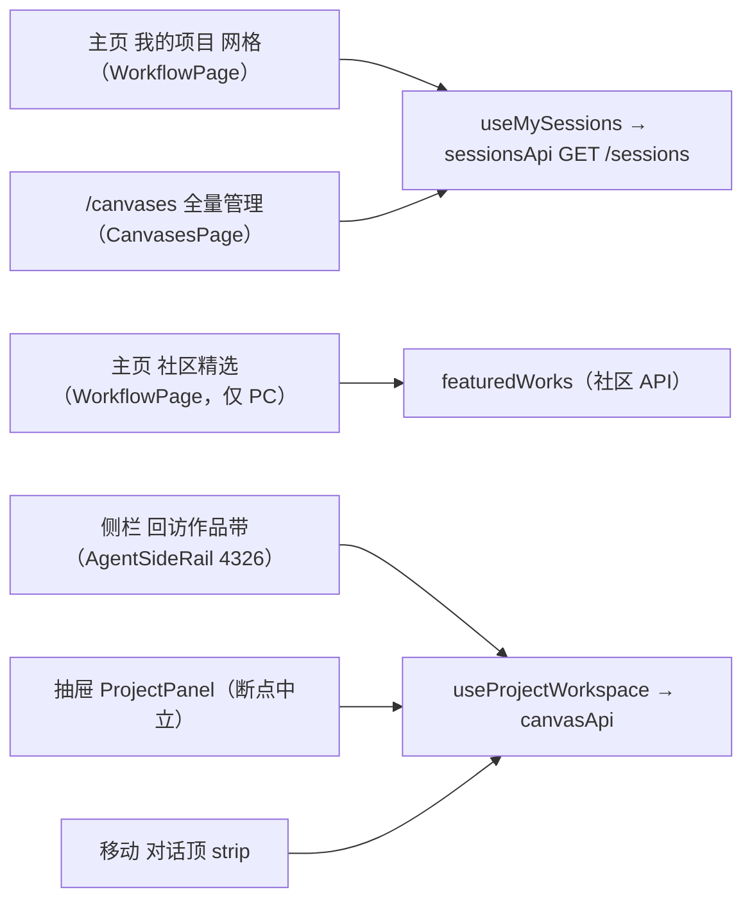
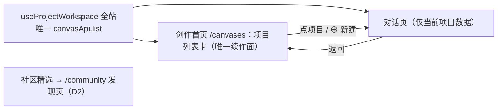
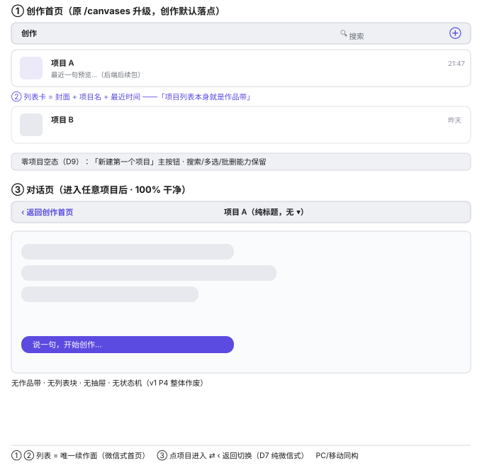
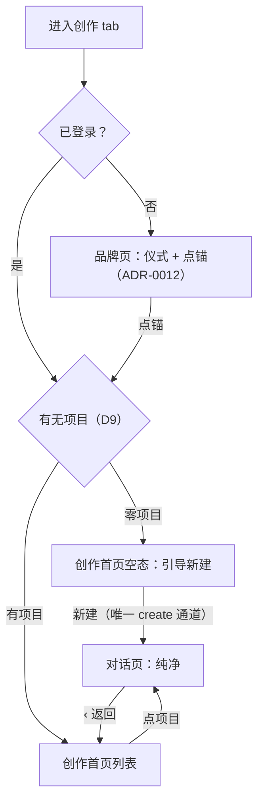
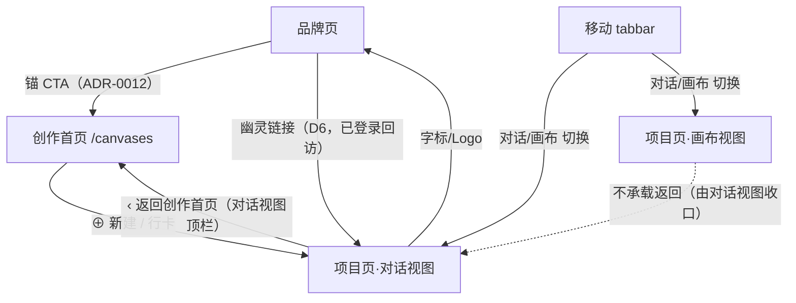

# 门面收敛与续作面统一（Project Gallery Consolidation）设计规格

状态：已实施（v2.1 · 2026-10-26 · PR #614 已合 master 并生产部署 · prod 取证四层通过）· **v2.2 修订（2026-10-27 · 真机实测 hotfix · 待开发）**
前置：
- INV-10：全仓唯一 `canvasApi.list` 调用点 = `useProjectWorkspace`（`composables/useProjectWorkspace.ts`）
- **ADR-0012「品牌页点锚 = 进入创作」**（仪式感定位，本规格不改动该语义；v2 定义「进入创作后的落点」）
- IA v4（2026-10-23 用户裁决）——其中「回访作品带」三项被 v2 **显式取代**（作品带组件废弃）
- 移动端【发现】页已承载社区（品牌页只讲品牌，2026-10-23 用户裁定）
- 上游台账：`2026-10-26-sp-d-edge-validation-design.md`（并行规格，无交叉）

**修订记录**：
- v1（2026-10-26 午）：P0 单源 + P1 主页减法 + P2 续作面唯一（strip+抽屉）+ P3 入口收口 + P4 作品带降 chrome（空态展开/活跃收起状态机）。
- **v2（2026-10-26 晚）**：评审中途拍板改为**微信式收敛**——①「项目列表本身就是作品带」（两设计合并，列表加封面即续作面）；②对话页 100% 干净，切换/返回走列表（D7 纯微信式）。**P4 状态机整体作废**（不存在收起/展开问题）；strip 与 ProjectPanel 抽屉从对话页退场；原 P1 幽灵链接作废；原 D3/D4/D5/D6 作废留档。图 3 重绘、图 4/5 删除后以新图 4（导航流）替代。
- **v2.1（2026-10-26 深夜）**：D9/D10 拍板（见附录 A）。D10 结论 = **删除 ProjectPanel**（实测取证：`CanvasesPage.vue:17` 能力为 ProjectPanel 超集）；作品带非「去留选项」——v2 已整体删除，两者幸存形态都是创作首页。D1 范围精化：`sessionsApi` 仅删 `list`，**`remove` 必须保留**（`useProjectWorkspace.remove:182` 依赖此通道）。
- **v2.2（2026-10-27，真机实测 hotfix）**：已登录用户真机（移动端 + PC）实测暴露四类问题 → 回到设计层修订，仅改判定、不改 v2.1 已落地的架构。① **D9 修订**：点锚落点统一进**创作首页**——有项目 → 创作首页列表；零项目 → 创作首页空态引导首建（**取消原「零项目直建进对话」**，保留首建零摩擦但改在列表空态触发）；② **D6 恢复**：品牌页对已登录回访用户加一行幽灵链接「继续：<上次项目名>」（IA v4 曾决议整页进最近项目，gallery 收敛误删，本次以幽灵链接形态恢复）；③ 新增 **§6.5 按钮清单与冲突处置**（返回创作首页 vs 返回品牌页；对话视图收口、画布视图不承载返回；移动 tabbar 切两视图不跳列表）+ 图 5；④ 新增 **§6.6 空态三态**（加载中 / 加载失败-重试 / 真无项目-引导首建）；⑤ §5.1 门面职责补「项目页 = 对话视图(默认)+画布视图 同路由两视图」；⑥ 图 4 导航闭环零项目分支已绘为创作首页空态，本版仅同步其 caption 与 D9 修订。新增 D11/D12。代码落地见 `plans/2026-10-27-project-gallery-consolidation-hotfix.md`。

分支约定：实现走 feature 分支 + PR + squash merge；每阶段独立 PR。

> 一句话：**两个门面一条路径**——创作首页（项目列表加封面 = 唯一续作面，原 `/canvases` 改造升级）+ 对话页（100% 干净，返回列表切换）；数据源唯一（`useProjectWorkspace`）；PC/移动同构，同微信「列表 → 对话 → 返回」一条路径。

## 0. 配图索引（结构与视觉两类，均随本文档演进）

本文档图分两类：**结构图**一律以 Mermaid 内嵌；**视觉稿**以 `assets/` 下的 SVG 附件承载（相对路径引用）。

| 编号 | 形式 | 内容 | 位置 | 用途 |
|---|---|---|---|---|
| 图 1 | 内嵌 Mermaid | 现状：四门面 + 双数据源（暴露冗余） | §4 | 暴露「同一意图被渲染成多份 + 两套 API 并存」的缺口 |
| 图 2 | 内嵌 Mermaid | v2 目标架构：单源 + 两个门面 | §5 | 确定收敛后唯一真源与门面职责边界 |
| 图 3 | SVG 附件 `assets/2026-10-26-project-gallery-consolidation-1-layout.svg` | 创作首页 + 对话页目标布局（PC/移动同构） | §6.2 | 验收「列表=续作面、对话页干净」的布局基准 |
| 图 4 | 内嵌 Mermaid | 导航闭环（含零项目空态分支 D9） | §6.3 | 落到可执行判据：进创作/返回/新建三条边 |
| 图 5 | 内嵌 Mermaid | 按钮清单与返回落点（品牌页/创作首页/项目页·对话视图/项目页·画布视图 × 移动/PC） | §6.5 | 落到可执行判据：哪个按钮去哪、画布视图不承载返回 |

> 补充件（非图号）：`assets/2026-10-26-project-gallery-consolidation-1-layout.html` —— 图 3 的**交互版**，浏览器打开可切换「有项目 / 零项目空态」两态；正式验收基准仍以图 3 SVG 为准。
> v1 遗留件：v1 的图 3（作品带 chrome 布局）已被本版 SVG 覆盖重绘；v1 图 4/5（状态机/决策树）随 P4 作废删除。

## 1. 目标

| # | 目标 | 验收 |
|---|---|---|
| G1 | **单一数据源**：创作首页（原 `/canvases`）、对话页、一切项目列表消费 `useProjectWorkspace`（INV-10），删除 `sessionsApi` 的 `GET /sessions` 第二源 | 全仓 `useMySessions` import/调用点、`sessionsApi.list` 零命中；只发一次列表请求 |
| G2 | **续作面唯一 = 创作首页**：「项目列表本身就是作品带」——列表卡加封面 + 项目名 + 最近时间；`RecentProjectsStrip` 组件整体废弃；原 P1 幽灵链接作废 | 全仓 `RecentProjectsStrip` 零引用；创作首页是唯一展示「我的项目」的门面 |
| G3 | **对话页 100% 干净**：顶部只剩「‹ 返回创作首页 + 项目名标题」（D7 纯微信式）；`ProjectPanel` 抽屉从对话页退场；无任何列表/作品带形态 | 对话页无列表组件、无抽屉触发；返回 → 创作首页闭环 |
| G4 | **主页纯品牌**：删「我的项目」网格与「社区精选」（社区唯一入口 = `/community`，与移动【发现】同叙事）；品牌页维持 ADR-0012 点锚仪式，不加个人内容 | 主页无项目网格、无社区区块、无发布按钮 |
| G5 | **入口收口**：「新建项目」= 创作首页 ⊕ + 空态首建（D9）；「发布作品」= 画布内 `CanvasFloatingChrome`（改造后）+ 移动端顶栏菜单 | grep 确认「新建」两处、「发布」两处 |
| G6 | **空态三态**（v2.2）：创作首页列表加载中 / 加载失败（可重试）/ 真无项目（引导首建）三者明确区分，绝不把「加载失败」误判成「还没有项目」 | CanvasesPage 三态各自有独立 UI 且失败态有重试入口；零项目刷新不再误报 |
| G7 | **回访幽灵链接**（v2.2，D6 恢复）：已登录回访用户在品牌页见一行「继续：<上次项目名>」幽灵链接，直达最近项目；不破坏 ADR-0012 点锚仪式 | 已登录且有记忆项目 → 品牌页渲染幽灵链接并正确跳转；未登录/无记忆 → 不渲染 |

## 2. 范围

### 2.1 本规格做

- **P0 单源**：`CanvasesPage` / `WorkflowPage` 数据切 `useProjectWorkspace`；删 `useMySessions` 列表职责与 `sessionsApi.list`。
- **P1 创作首页改造**：原 `/canvases` 升级为创作首页——列表卡加封面（`coverUrl`/`coverNodeId`）+ 最近时间；顶栏加 ⊕ 新建；零项目空态引导首建；路由 path 不动（`/canvases`，避免断链），页面语义/文案改「创作首页」。
- **P2 对话页清理**：删 `<RecentProjectsStrip>`（`AgentSideRail.vue:4326`）及组件本体与测试；「项目名 ▾」（`CanvasFloatingChrome`，宿主 `CanvasPage.vue:5981`）改「‹ 返回创作首页 + 项目名」；`ProjectPanel` 抽屉按 D10 处置（推荐删除并迁移重命名/删除能力到创作首页）。
- **P3 主页品牌化**：删「我的项目」section（313-360）与「社区精选」（362-392）、删发布接线；社区迁 `/community`。

### 2.2 明确不做（登记 §12，不隐性扩范围）

- 不改动品牌页仪式与点锚语义（ADR-0012，D8 不在本规格讨论范围）。
- 不改动 `useProjectWorkspace` 的 list/create/update 契约（只消费不扩展）。
- 不改动移动端【发现】页 / `/community` 内容组织。
- 列表卡「最近一句预览」需后端摘要字段，**本包不做**（§12 后续包；P1 先上封面+名称+时间）。
- `sessionsApi` 非列表用途去留由 D1 拍板，不强行删文件。

## 3. 与既有规格的关系

- **INV-10**：P0 把「唯一 `canvasApi.list`」扩展到创作首页与主页，消除双源。
- **IA v4（2026-10-23）**：其「作品带首卡新建 / 全部 N 个 / 手动收拢」三项被 v2 **显式取代**（作品带组件废弃，续作面=创作首页列表）；其余 IA v4 裁定不受影响。
- **ADR-0012（品牌页点锚=进入创作）**：语义不动；v2 新增定义「进入创作后的落点」（D9：有项目→创作首页；零项目→直接新建进对话，保留首建零摩擦）。§12 登记回写 ADR 引用语境。
- **2026-10-23 用户裁定（品牌页只讲品牌）**：P3 镜像到 PC，社区迁 `/community`。
- **v1 本规格（2026-10-26 午）**：P4 状态机、幽灵链接、strip 降 chrome 方案作废；P0/P3 主页部分延续。

## 4. 现状盘点（代码级取证，2026-10-26，基准主仓工作区）

> 方法：不采信台账，逐条回代码核实（Grep + 直读两路）。

### 4.1 四门面 + 双数据源（图 1）

*图 1 · 现状：同一「项目」概念被渲染成五处；数据源分两套——`sessionsApi`（主页+全量页）与 `canvasApi`（侧栏+抽屉+移动），各自排序/缓存。v2 中 A/B 并入创作首页、C/D 整体废弃、E 升级为创作首页。*

### 4.2 关键实测（v2 复核，全部为真）

- `WorkflowPage.vue:10,128,129` `useMySessions` + `COMPACT_SESSIONS_COUNT = 5`；「我的项目」section 313-360（h2 在 320）、「社区精选」362-392（h2 在 366）；`openPublish`:253、`PublishNeoTVDialog`:400（`v-if="showPublish"`）。
- `CanvasesPage.vue:5,22` 消费 `useMySessions`，`visibleSessions(∞)` 全量；已有搜索/多选/批删管理能力 → **升级为创作首页的地基已存在，无需新页面**。
- `AgentSideRail.vue:4314/4326` `agent-chat-scroll` 内 `<RecentProjectsStrip>`，位于空态块之前；注释明示「在滚动流内 ⇒ 随消息流上推」。
- `RecentProjectsStrip.vue:65,98-104` `lnk.recentWorks.collapsed` 默认展开；组件与 `RecentProjectsStrip.test.ts` 均存在 → v2 整体废弃（测试随删）。
- `CanvasFloatingChrome` 宿主 = `CanvasPage.vue:5981`（emit `project-click="openProjectPanel"`，见 `CanvasPage.projectEntry.test.ts`）；`ProjectPanel` 抽屉含重命名/删除能力（`ProjectPanel.test.ts` 存在）→ **D10 迁移核对项**。
- `useProjectWorkspace.ts:87` INV-10 注释；`coverUrl`/`coverNodeId` 已在 `RecentWorkItem` → 列表卡封面**零后端改动**。
- `/community` 路由存在（`router/index.ts:34`）。

## 5. 目标架构与契约（图 2）

*图 2 · v2 目标：数据源唯一；两个门面 = 创作首页（列表=作品带=管理，一处三职）与对话页（纯净）；一条「列表 ⇄ 对话」路径；社区独立于创作链路。*

### 5.1 门面职责（v2）

| 门面 | 唯一职责 | 新建入口 | 列表能力 |
|---|---|---|---|
| 品牌页（ADR-0012，不动） | 仪式 + 点锚进入创作；回访幽灵链接（D6） | 无（点锚落点见 D9） | 无 |
| **创作首页**（`/canvases`） | 续作 + 管理（搜索/多选/批删） | ⊕ 顶栏 + 空态首建 | 全量列表（封面卡） |
| **项目页**（`/workflow/:id`，单一路由） | 当前项目的**对话视图（默认）+ 画布视图**（同路由切换，非独立路由） | 无 | 无（返回切换） |
| ↳ 对话视图 | 对话驱动创作；承载「‹ 返回创作首页」+「字标 → 品牌页」 | 无 | 无 |
| ↳ 画布视图 | 画布创作；**不承载任何返回 / 出入口**（由对话视图收口，D11） | 无 | 无 |

## 6. 打样 / 主场景规格（逐项可验收）

### 6.1 P0 单源（验收 G1）

- [ ] `grep -rn "useMySessions" apps/web` **import/调用点**零命中（文件本体去留由 D1）。
- [ ] `CanvasesPage` / `WorkflowPage` 改 `useProjectWorkspace`，映射 `mapSessionToRecentWork`（§8）。
- [ ] 网络面板：进入创作首页只发 1 次列表请求。

### 6.2 P1 创作首页改造（验收 G2，图 3）

*图 3 · 左：创作首页（顶栏 标题+搜索+⊕；列表卡 = 封面 + 项目名 + 最近时间，即原作品带语义）；右：对话页（顶部 ‹ 返回 + 项目名纯标题，下方纯净消息流）。①②③ 标注见 SVG 图内图例。PC/移动同构（同一数据、同一卡片形态）。*

- [ ] 列表卡 = 封面（`coverUrl` 优先，缺省 `coverNodeId`，再缺省首字符占位块）+ 项目名 + `relativeTime(updatedAt)`；卡片高度收敛为单行式（微信式），替代原网格卡。
- [ ] 顶栏 = 「创作」标题 + 搜索（已有）+ ⊕ 新建。
- [ ] 零项目空态：主按钮「新建第一个项目」（走唯一 create 通道）。
- [ ] 点任意列表卡 → 进入该项目对话页（`/workflow/:sessionId`）。
- [ ] 路由 path 不动；页面标题/导航文案改「创作首页」。

### 6.3 P2 对话页清理（验收 G3，图 4）

*图 4 · 导航闭环：三条边（点锚→分流、列表⇄对话、空态→首建）。**v2.2 修订（D9）**：零项目点锚统一进**创作首页空态**引导首建（取消原「直建进对话」），有项目点锚亦进创作首页列表；之后永远落创作首页。PC/移动同构。画布视图不承载返回，由对话视图收口（见 §6.5 / 图 5）。*

- [ ] 删除 `AgentSideRail.vue:4326` 的 `<RecentProjectsStrip>` 及其 import/事件接线/样式；删除 `RecentProjectsStrip.vue` 与 `RecentProjectsStrip.test.ts`。
- [ ] `CanvasFloatingChrome` 改造：「项目名 ▾」→「‹ 返回创作首页 + 项目名」；移除 `project-click → openProjectPanel`；`CanvasPage.projectEntry.test.ts` 同步改契约（返回接线）。
- [ ] `ProjectPanel` **删除**（D10 已拍板）：组件 + `ProjectPanel.test.ts` 同删；其能力实测已被创作首页全量覆盖（`CanvasesPage.vue:17`：全量列表/搜索/多选批删/重命名/复制/删除/新建 ⊇ ProjectPanel 列表/新建/重命名/删除），**零迁移工作**；P0 切源后重命名/删除走 `useProjectWorkspace.rename/remove`（后者底层通道 `sessionsApi.remove` 保留，见 D1）。
- [ ] 移动端 `MobileTopBar` 同构：顶栏改返回语义；移动侧栏不再出现作品带/抽屉。

### 6.4 P3 主页品牌化（验收 G4/G5）

- [ ] 删「我的项目」section（313-360）与「社区精选」（362-392）；社区唯一入口 = `/community`。
- [ ] 删 `openPublish`/`showPublish` 主页接线；`PublishNeoTVDialog` 主页卸载（画布内接线保留，发布能力不丢）。
- [ ] 主页 = 纯品牌 + 锚点（ADR-0012），无任何个人项目内容（v1 幽灵链接作废）。
- [ ] 「新建项目」仅存创作首页 ⊕ + 空态首建；「发布作品」仅存画布内 + 移动端顶栏菜单。

### 6.5 按钮清单与冲突处置（v2.2，D11）

> 真机实测暴露「返回按钮位置未清晰定义」（bug②）。本节把**每个按钮的落点**钉死，消除「返回创作首页」与「返回品牌页」的歧义，并明确**画布视图不承载返回**。

**按钮 × 落点 × 平台**（单一真源，禁止第二套）：

| 按钮 | 所在门面 | 平台 | 落点 | 备注 |
|---|---|---|---|---|
| 锚 CTA（点锚） | 品牌页 | 移动/PC | `enterCreation()` → **创作首页** `/canvases`（D9：有项目→列表；零项目→空态） | ADR-0012 仪式，不动 |
| 幽灵链接「继续：<上次项目名>」 | 品牌页（仅已登录回访） | 移动/PC | `/workflow/:lastProjectId`（直接进项目·对话视图） | D6 恢复；不喧宾夺主，仅一行 |
| ⊕ 新建 / 空态首建 | 创作首页 | 移动/PC | `create()` → `/workflow/:newId`（对话视图） | 唯一 create 通道 |
| 行卡 | 创作首页 | 移动/PC | `/workflow/:id`（对话视图） | 封面节点存在带 `focusNode` 深链 |
| 「‹ 返回创作首页」 | 项目页·**对话视图** | 移动 `≡` / PC `CanvasFloatingChrome` | `/canvases` | **唯一**返回列表入口 |
| 字标 / Logo | 项目页·对话视图 | 移动/PC | `/workflow`（品牌页） | 返回品牌页，与「‹」区分 |
| （无） | 项目页·**画布视图** | 移动（顶栏不渲染）/ PC（返回在对话栏同屏浮层） | —— 由对话视图收口 | **画布视图不承载任何返回 / 出入口**（D11） |
| tabbar「对话」/「画布」 | 项目页（移动） | 移动 | 切换项目页**内两视图**（不跳列表、不跳品牌） | tabbar 始终可见，画布视图下不卡死 |
| 导航「创作」 | 全局（PC） | PC | `/workflow`（品牌页） | **不动**（用户拍板：登录默认落地=品牌页，仪式前门） |

*图 5 · 按钮清单与返回落点：画布视图（PV）不渲染返回，所有返回收口到对话视图；「‹ 返回创作首页」与「字标→品牌页」是两个不同按钮、不同落点，绝不混用。*

**冲突处置硬规则**：
- **R-return-1**：项目页内「‹ 返回创作首页」只存在于**对话视图**；画布视图不得出现任何返回/新建/列表入口（移动端顶栏 `v-if="mobileAppTab !== 'canvas'"` 已保证；PC 浮层返回按钮落在对话栏，不落在画布上）。
- **R-return-2**：「返回创作首页」≠「返回品牌页」。对话视图顶栏左 `‹` → `/canvases`；字标/Logo → `/workflow`。二者按钮形态/位置必须可区分，不得合并成一个「返回」。
- **R-return-3**：移动 tabbar 在画布视图**始终可见**，`对话/画布` 仅切换项目页内两视图，不触发任何路由跳转至 `/canvases` 或 `/workflow`，避免「返回即回列表」的不一致（bug② 根因之一）。

### 6.6 空态三态（v2.2，D12，验收 G6）

> 真机实测（bug④）：刷新后明知有项目却报「还没有项目」+ 渲染多个「新建项目」按钮。根因：空态只判 `mgr.filtered.length`，**不区分「list 失败」与「真无项目」**；且「新建项目」在顶栏与空态内各渲染一处。

创作首页列表空区必须区分三态：

| 态 | 触发条件 | UI | 行为 |
|---|---|---|---|
| A 加载中 | `mgr.loading.value === true` | 6 张骨架卡（`animate-pulse`） | 不发二次请求 |
| B 加载失败 | `wsError.value === true` **且** `mgr.projects.value.length === 0` | 「项目加载失败 · 重试」+ 重试按钮 | 重试调用 `listProjects()`；**不**显示「还没有项目」、**不**触发创建 |
| C 真无项目 | `!wsError.value` 且 `mgr.projects.value.length === 0` | 「还没有项目」+ 新建引导 | 走唯一 create 通道 |

**关键约束**：
- `useProjectWorkspace.list()` 的 catch **不清空**已有清单（2026-10-25 实证：一次后台刷新失败不该抹掉用户正在看的项目）。因此若历史清单非空（`projects.length > 0`）即便本次 `error=true`，仍展示旧清单（不进 B）—— B 仅在「清单为空且失败」时成立。这恰好把「连接饥饿导致的假失败」与「真无项目」分开。
- **去重**：「新建项目」按钮只在创作首页顶栏渲染**一处**；空态（态 C）内**不再**重复渲染第二个「新建项目」（消除 bug④ 的「多个新建按钮」）。
- **取 `error` 的方式**：`useProjectManager` 未 re-expose `error`。在 `CanvasesPage` 内 `const { error: wsError, list: listProjects } = useProjectWorkspace()` 复用模块级 ref（与 `mgr` 同源），或给 `useProjectManager` 增加 `error` 透传（二选一，推荐前者，零改动 manager）。

## 7. 数据与状态变更

- 删除组件：`RecentProjectsStrip.vue`（含 props/collapse/localStorage 键）、`ProjectPanel.vue`（按 D10）。
- `CanvasesPage` 列表卡消费字段：`id`/`title`/`coverUrl`/`coverNodeId`/`updatedAt`（均在现契约内，零后端改动）。
- `localStorage['lnk.recentWorks.collapsed']` 随组件废弃（可留残留键，不清理）。
- 不新增后端字段；「最近一句预览」登记 §12 后续包。

## 8. 纯函数与算法（含单测要求）

- `mapSessionToRecentWork(session): RecentWorkItem`（P0 字段映射，v1 已定义，沿用）。
- `projectCoverFallback(project): { type: 'image' | 'initial', value: string }`：`coverUrl` → image；否则 `coverNodeId` → image；否则 initial（title 首字符）。单测：三档覆盖。
- v1 的 `shouldExpandStrip` 随 P4 作废删除（不存在于 v2）。

## 9. 文件级改动清单（实施排期唯一输入；与 §12 / §10 交叉核对）

> 每阶段 PR 的 Task 必须能由此表反推。

### P0（架构底座，须最先合）
- `apps/web/src/composables/useProjectManager.ts` + `.test.ts` — **新增**：管理状态机（搜索/多选批删/菜单/重命名/复制/删除）从 `useMySessions` 迁入，数据面消费 `useProjectWorkspace`；仅 `CanvasesPage` 消费。
- `apps/web/src/composables/useMySessions.ts` — 删除列表职责；**非 list 方法逐个对账迁移**（`rename`/`remove` → `useProjectWorkspace`；`duplicate`/`removeMany` 直走 `sessionsApi` 对应通道；`copy` 承接点盘点）。
- `apps/web/src/composables/useMySessions.test.ts` — 随删。
- `apps/web/src/services/sessions-api.ts` — **仅删 `list` 导出**；`remove` 保留（`useProjectWorkspace.remove:182` 依赖）；`update/removeMany/duplicate` 保留（管理通道）；`copy` 等其余方法按盘点结论处置（D1）。
- `apps/web/src/pages/CanvasesPage.vue` — 切 `useProjectManager` + `useProjectWorkspace`（`rename`→`:174`、`remove`→`:181`；`copy` 确认承接点）。
- `apps/web/src/pages/WorkflowPage.vue` — 切 `useProjectWorkspace`；删 `COMPACT_SESSIONS_COUNT`（网格块 P3 删）。

### P1（创作首页改造）
- `apps/web/src/pages/CanvasesPage.vue` — 列表卡改微信式单行卡（封面+名称+时间）；顶栏 ⊕ 新建；零项目空态；文案「创作首页」。
- `apps/web/src/pages/CanvasesPage.test.ts`（如有）/ 新增列表卡渲染测试 — 封面三档 fallback（§8）。

### P2（对话页清理）
- `apps/web/src/components/agent/AgentSideRail.vue` — 删 `<RecentProjectsStrip>`（4326）及 import/接线/样式。
- `apps/web/src/components/project/RecentProjectsStrip.vue` — **删除**。
- `apps/web/src/components/project/RecentProjectsStrip.test.ts` — **删除**。
- `apps/web/src/components/canvas/CanvasFloatingChrome.vue` — 「项目名 ▾」→「‹ 返回创作首页 + 项目名」；删 `project-click`。
- `apps/web/src/pages/CanvasPage.vue` — `openProjectPanel` 移除，改返回接线（`router.push('/canvases')`）；`CanvasPage.projectEntry.test.ts` 契约同步。
- `apps/web/src/components/project/ProjectPanel.vue` + `ProjectPanel.test.ts` — 按 D10（推荐删除；重命名/删除能力迁移创作首页）。
- `apps/web/src/components/mobile/MobileTopBar.vue` — 顶栏返回语义同构（确认存在项）。

### P3（主页品牌化）
- `apps/web/src/pages/WorkflowPage.vue` — 删「我的项目」（313-360）与「社区精选」（362-392）section；删 `openPublish`/`showPublish`/`PublishNeoTVDialog` 主页接线。
- `apps/web/src/components/workflow/SessionCard.vue` — 随网格删除评估去留（若创作首页单行卡已替代）。

### 本轮 hotfix（v2.2，基于 `origin/master` @ `a4deaac7`；任务清单见 `plans/2026-10-27-project-gallery-consolidation-hotfix.md`）

> 仅修 v2.2 判定的四件事（D9 修订 / D6 恢复 / 按钮落点 D11 / 空态三态 D12）。**不回退 v2.1 已落地的架构**（单源、两门面、微信式返回）。分支从 `origin/master` 起（当前 `feat/multi-device-unified-thread` 早于 #614，不可用）。

- `apps/web/src/composables/useEnterCreation.ts` — **D9 修订**：点锚手势路径（`allowImplicitCreate: true`）无论有无项目统一 `navigate('/canvases')`（有项目→列表；零项目→空态首建）；零项目空态内的「新建」走 `ws.create()`。自动分发路径（`allowImplicitCreate: false`，移动端一次性）保持进最近项目（穿透，不创建）。list 失败兜底（记忆项目兜底仅手势路径）保留。
- `apps/web/src/pages/CanvasesPage.vue` — **D12 空态三态（§6.6）**：接入 `const { error: wsError, list: listProjects } = useProjectWorkspace()`；`v-else` 拆为「B 加载失败（重试）/ C 真无项目（引导）」；`loading` 骨架保留；**去重**「新建项目」按钮（空态 action 移除，仅顶栏一处）。
- `apps/web/src/pages/WorkflowPage.vue` + `apps/web/src/components/workflow/SignatureHero.vue` — **D6 恢复幽灵链接**：`WorkflowPage` 在已登录且 `resolveLastProjectId()` 存在时，于 hero 之下渲染一行「继续：<上次项目名>」幽灵链接（标题取自 `list()`/首拉，兜底「继续创作」），点击 `navigate('/workflow/:id')`；`SignatureHero` 保持纯品牌（不改其 `create` emit）。
- `apps/web/src/composables/useProjectWorkspace.ts` — 确认 `error`/`resolveLastProjectId` 语义供上述复用（契约不动）。
- `apps/web/src/pages/CanvasPage.vue` — **bug③ 加固 + D11 复核**：返回 `/canvases` 时若 list 在连接饥饿下失败，复用 §6.6 三态（`loadIfStale` 优先已拉数据）；排查返回后 12 条控制台错误来源（疑似 list 失败后的级联空渲染），加守卫避免空白态报错。`backToCreationHome`(`/canvases`)/`goHome`(`/workflow`) 落点已正确，仅补测试。
- `apps/web/src/components/mobile/MobileTopBar.vue` — **D11 复核**：对话视图 `≡`→`/canvases`；`tab==='canvas'` 仅 `⋯` 无返回（已符合，补守卫测试）。
- `apps/web/src/components/canvas/CanvasFloatingChrome.vue` — **D11 复核**：PC 返回→`/canvases`（已符合，补测试）。

## 10. 测试策略与验收标准（含目视验收）

- **单测**：
  - `mapSessionToRecentWork` / `projectCoverFallback` 纯函数（§8）。
  - 创作首页列表卡：封面三档、点击进入对应项目、空态首建。
  - `CanvasFloatingChrome`：返回创作首页接线（改造后契约）。
  - `useProjectWorkspace` 共享源：创作首页与对话页同源（G1）。
- **grep 守卫（全目录扫描，禁子集抽样）**：`useMySessions` import、`sessionsApi.list`、`RecentProjectsStrip` 全仓零引用；对话页模板无列表组件。
- **集成/回归**：`vue-tsc -b` 通过；进入创作首页只发 1 次列表请求。
- **目视验收（prod 取证四层）**：
  - 创作首页：列表卡带封面；⊕ 新建可用；空态首建引导；搜索/多选仍可用。
  - 对话页：顶部仅「‹ 返回 + 项目名」；无作品带/抽屉；返回 → 创作首页；移动端同构。
  - 主页：纯品牌 + 锚点；无项目网格/社区/发布。
- **v2.2 新增单测 / 守卫**（对应 G6/G7、D9/D6/D11/D12）：
  - `useEnterCreation`：点锚手势路径（有项目 / 零项目）均 `navigate('/canvases')`；自动分发路径仍进最近项目（穿透不创建）；list 失败兜底仅手势路径生效。
  - `CanvasesPage` 空态三态：`loading`→骨架；`error && 空`→失败-重试（**不**显示「还没有项目」、不触发创建）；`!error && 空`→真无项目引导；「新建项目」按钮唯一（顶栏一处）。
  - `WorkflowPage` 幽灵链接：已登录且有记忆项目 → 渲染「继续：<名>」并可跳转 `/workflow/:id`；未登录/无记忆 → 不渲染。
  - 按钮落点（D11）：`MobileTopBar` 对话视图 `≡`→`/canvases`、画布视图无返回；`CanvasFloatingChrome` 返回→`/canvases`；字标→`/workflow`。
  - grep 守卫：创作首页「新建项目」按钮 `data-testid="canvases-create"` **全局唯一**（去重后）。

## 11. 风险

- R1（P0 映射）：`Session` vs `Project` 形状差异 → `mapSessionToRecentWork` + 单测对齐。
- R2（P0 删除面）：`CanvasesPage` 搜索/多选/批删是否依赖 `sessionsApi` 独有能力 → 动工前实测确认。
- R-v2-1（D10 能力对账）：**已实测闭环**（2026-10-26）——`CanvasesPage.vue:17` 自述并接线「全量列表/搜索/多选批删/重命名(:149)/复制/删除(:151)/新建(:73,178)」，为 `ProjectPanel`（列表/新建/重命名/删除）的**严格超集** → 删除 ProjectPanel 零能力损失。遗留核对仅一项：P0 切源后 `copy` 在 `useProjectWorkspace` 的承接点。
- R-v2-2（路由语义）：`/canvases` 从「管理页」变「创作首页」，既有跳转入口（如 `WorkflowPage` 原「查看全部」已删、其他 `router.push('/canvases')` 调用点）→ P1 动工前全仓 grep `/canvases` 调用点对账。
- R-v2-3（D7 代价）：画布全屏创作中途换项目需两跳（返回列表再进）→ 已拍板接受（微信式纯粹性优先）。
- R-v2-4（ADR 衔接）：点锚落点定义（D9）需在 ADR-0013 的引用语境中登记（不动 ADR-0012 语义本体）→ §12 回写项。

## 12. 后续包 / 路线图（本包外的东西登记，避免隐性范围）

- **分阶段实施**（每阶段独立 PR，顺序不可乱）：
  - **Phase 0 = P0**：单数据源（G1）。▶ 必须先合。
  - **Phase 1 = P1**：创作首页改造（G2）。▶ 先于 P2（返回落点必须先可用）。
  - **Phase 2 = P2**：对话页清理（G3）。
  - **Phase 3 = P3**：主页品牌化（G4/G5）。
- 不在本包（登记）：列表卡「最近一句预览」后端摘要字段；`ProjectPanel` 能力迁移的细节打磨（若 D10 选暂留）；列表接口分页/游标；ADR 引用语境回写（R-v2-4，随 P2 PR 顺带）。

## 13. 配图规范自检（跑 `pnpm verify-spec-figures` 的结果贴此处）

- 执行：`pnpm verify-spec-figures --file docs/superpowers/specs/2026-10-26-project-gallery-consolidation-design.md`
- 结果（2026-10-26 v2）：`✓ … 0 个错误，0 个警告`（EXIT=0）。
- 图 1/2/4 内嵌 Mermaid（≤12 节点、标签引号）；图 3 为 `assets/` SVG（①②③ 标注 + 图例）；§0 索引齐全、图号 1–4 连续、每图正文引用。R1–R8 全过。

---

## 附录 A · 决策表（评审用，v2 更新）

| # | 决策点 | 结论/推荐 | 状态 |
|---|---|---|---|
| D1 | `useMySessions`/`sessionsApi` 处置 | 删列表职责；`sessionsApi` 仅删 `list`，**`remove` 保留**（:182 依赖）；其余方法盘点后定 | 待拍板（范围已精化） |
| D2 | 社区精选迁 `/community` | 删除主页区块，唯一入口发现页 | ✅ 已拍板（v1） |
| D3/D4/D5 | v1 作品带落位/默认态/移动空态 | —— 随 P4 状态机作废 | ⛔ 作废留档 |
| D6 | 品牌页回访幽灵链接 | **v2.2 恢复**：已登录回访用户在品牌页加一行「继续：<上次项目名>」幽灵链接（IA v4 曾整页进最近项目，gallery 收敛误删，本次以幽灵链接形态恢复；不喧宾夺主，锚 CTA 仍是主仪式） | ✅ 已拍板（2026-10-27） |
| D7 | 对话页切换/返回方式 | **纯微信式：返回创作首页切换**（抽屉从对话页退场） | ✅ 已拍板（2026-10-26） |
| D8 | 品牌页去留 | 维持 ADR-0012 点锚仪式定位，本规格不讨论 | ✅ 已有定论（ADR） |
| D9 | 点锚落点（进入创作后） | **v2.2 修订：有项目 → 创作首页列表；零项目 → 创作首页空态引导首建**（统一进创作首页；保留首建零摩擦但改在列表空态触发，取消原「直建进对话」）。自动分发（移动端一次性，`allowImplicitCreate=false`）仍进最近项目 | ✅ 已拍板（v2.2，2026-10-27） |
| D10 | `ProjectPanel` vs 作品带 去留 | **两者都从对话页退场，幸存形态 = 创作首页**：作品带 v2 已整体删除（与首页列表 100% 重叠）；ProjectPanel 能力被 `CanvasesPage` 严格覆盖（:17 实证，见 R-v2-1）→ 删除组件，零迁移 | ✅ 已拍板（2026-10-26） |
| D11 | 画布视图是否承载返回 | **画布视图不承载任何返回 / 出入口**，所有返回收口到对话视图（见 §6.5 / 图 5）。移动 tabbar 切两视图不跳列表/品牌 | ✅ 已拍板（2026-10-27） |
| D12 | 创作首页空态几态 | **三态**：加载中 / 加载失败-重试 / 真无项目-引导首建（见 §6.6，验收 G6） | ✅ 已拍板（2026-10-27） |

## 附录 B · 交付前自上而下全盘自审（v1，2026-10-26 午；v2 复核结论附后）

> v1 自审发现 6 处（A1–A6）已修入 v1 正文。v2 改写后状态：

| # | v1 发现 | v2 状态 |
|---|---|---|
| A1 | P4 落位错误（CanvasFloatingChrome 宿主在 CanvasPage:5981） | 随 P4 作废；该事实已转入 §4.2 与 P2 清单 |
| A2 | `RecentProjectsStrip.test.ts` 已存在写「新增」 | 随组件整体删除，测试文件同删（§9 P2） |
| A3 | `forceExpand` prop 冗余 | 随 P4 作废 |
| A4 | grep 零命中措辞与 D1 矛盾 | 已沿用收敛措辞（§6.1） |
| A5 | 行号漂移（313-360 / 362-392） | 已沿用实测行号（§9 P3） |
| A6 | §10 缺幽灵链接单测 | 幽灵链接作废，改列表卡/返回接线测试（§10） |

**v2 新增自审（2026-10-26 晚）**：① 图 2/4 Mermaid 语义重复已规避（图 2=数据流、图 4=导航流）；② R-v2-1/R-v2-2 为 v2 新引入的两处「动工前对账」前置，已分别挂到 D10/P1；③ v1 图 3 SVG/HTML 已按新布局重绘，避免图文打架；④ ADR-0012 衔接显式登记（R-v2-4 + §12 回写），不静默改语义。

**v2.1 自审（2026-10-26 深夜）**：① D10 拍板以能力对账实证收口（非偏好取舍），R-v2-1 从「动工前对账」降级为「仅剩 copy 承接点一项核对」；② 发现 `useProjectWorkspace.remove` 底层走 `sessionsApi.remove`（:17/:181-182 注释）→ D1 删除范围精化，避免「顺手删 sessionsApi 文件」打断删除通道；③ `useMySessions` 的 `copy` 等非 list 方法登记进 P0 盘点，防 blanket-delete。

**v2.2 自审（2026-10-27，真机实测驱动）**：① 抓出一处**图文/表不一致**：图 4 流程早已绘为「零项目→创作首页空态」，但附录 A 的 D9 文字与 `useEnterCreation` 代码仍写「零项目直建进对话」——三处只有图对了。本次以图 4 为真相源，统一 D9 文字与代码（待落地），并记录此不一致源于 v2.1 仅改了图未回写表/码。② D6 在 v2 被「列表页即续作面，链接无必要」作废；但真机发现**品牌页缺回访快捷入口**会让已登录老用户每次都重走点锚仪式 → 恢复为「一行幽灵链接」形态（不是 v1 的整页进最近项目），与 ADR-0012 仪式不冲突。③ 空态三态（D12）补的是 v2.1 留的洞：当时只判 `filtered.length`，把「连接饥饿假失败」误判成「零项目」→ 误报 + 双新建按钮（bug④）。④ 按钮落点（D11）把 bug②「返回键位置不清」钉成可执行判据，明确画布视图零返回、tabbar 仅切视图。⑤ 全节改动**不回退** v2.1 架构（单源/两门面/微信式返回），仅为 hotfix。
