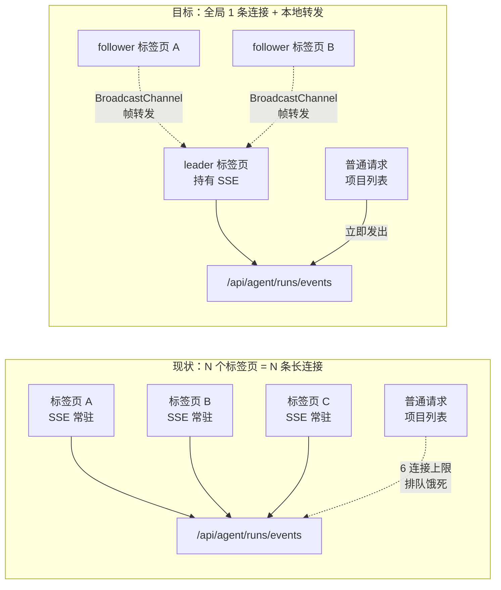
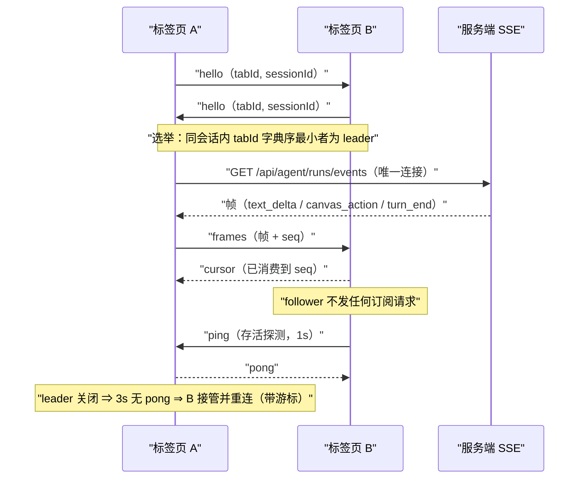
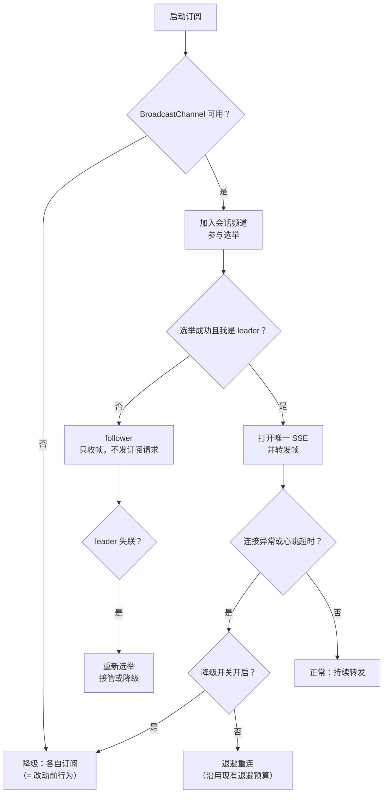

# 会话级订阅跨标签页共享 · 设计规格

> 状态：**待审核**（architectural path · 生产事故取证产出） · 2026-10-26
> 生产取证与止血见 `docs/design/2026-10-26-workflow-homepage-stuck-postmortem.md`（PR #594 止血）
> 相关：`apps/web/src/components/agent/follow-up-tail.ts`（常驻订阅实现） · `apps/web/src/components/agent/tail-visibility.ts`（后台释放） · `apps/web/src/App.vue`（#585 预热删除记录） · `docs/agent/delivery.md`

---

## 0. 配图索引（结构与视觉两类，均随本文档演进）

本文档的图分两类：**结构图**一律以 Mermaid 内嵌；**视觉稿**本包不含（理由：本次改动不产生任何界面形态变化，纯连接拓扑调整）。

| 编号 | 形式 | 内容 | 位置 | 用途 |
|---|---|---|---|---|
| 图 1 | 内嵌 Mermaid | 连接拓扑：现状（N 标签页 N 条长连接）vs 目标（1 条 + 本地转发） | §5.1 | 验收「全局只开 1 条 SSE」的结构基准 |
| 图 2 | 内嵌 Mermaid | leader 选举与帧转发协议（消息序列 + 故障接管） | §5.2 | 评审协议完备性与接管时机 |
| 图 3 | 内嵌 Mermaid | 降级与故障处理决策树 | §5.3 | 验收「不支持 BroadcastChannel 时行为等同现状」 |

---

## 1. 目标（可验收）

1. **连接预算**：同一浏览器、同一会话的 N 个标签页 ⇒ **全浏览器范围内最多 1 条** `GET /api/agent/runs/events` 长连接；同源其他普通请求不再被订阅挤占（当前上限 6，见 §2）。
2. **语义零回归**：任一标签页都能收到另一端回合的 `text_delta` / `canvas_action` / `turn_end`；可见文本与改动前逐字一致。
3. **零新增故障面**：不支持 `BroadcastChannel` 的客户端**行为与改动前完全一致**（各自订阅）；选举/转发任何异常 ⇒ 一律降级到现状，不得抛错、不得静默失联。

---

## 2. 范围（含明确不做）

### 2.1 生产事故背景（已闭合的取证链）

- 形态：品牌页点锚 →「正在进入画布…」→ **15 秒** →「项目加载失败 · 重试」，**重试依旧失败**。
- DevTools：4 条 `GET /api/agent/canvas/list` 全部 15s 超时被取消、**已传输 0 B**；同窗口 nginx access.log **零条** ⇒ 请求**根本没离开浏览器**。
- 占用方：会话级常驻订阅（`#574` 起，每标签页一条长连接，靠服务端心跳维持，实测 30s+ 不关闭）。
- 硬约束：Chrome 对同源 HTTP/1.1 只有 **6 个连接**；本项目站点是**明文 HTTP** ⇒ **HTTP/2 多路复用在浏览器侧不可用**（`listen ... http2` 只启用 h2c，浏览器不认，已实测撤回）。

### 2.2 本包要做

- 跨标签页**同会话**订阅共享：只有 leader 标签页真正持有 SSE，其余标签页经 `BroadcastChannel` 收帧。
- leader 死亡接管、游标（`lastSeq`）单调传递、降级路径。

### 2.3 明确不做（登记为后续包，见 §12）

- **不做 HTTPS / HTTP/2**：那是唯一能让浏览器用上多路复用的结构性路径，但属独立基础设施工程。
- **不做服务端订阅合并**：服务端无法跨浏览器进程合并连接。
- **不做 SSE 协议改造**：`text_delta` / `canvas_action` / `done` / `turn_ack` 契约**一字不改**。
- **不改 `#574` 的产品承诺**：「另一端在跑、本端不刷新也能看见」必须继续成立。

---

## 3. 与既有规格/实现的关系

| 既有 | 关系 | 说明 |
|---|---|---|
| `#574` 会话级常驻订阅（`follow-up-tail.ts` 头注释） | **显式修订** | 语义（常驻、靠心跳、clean-end 重连）**保留**；修订的是「**每实例**持有连接」⇒ 改为「**每会话全局一条**」。注释需同步改写并说明修订理由。 |
| `#587` 后台标签页释放（`tail-visibility.ts`） | **保留** | 隐藏即释放仍是硬约束；共享后由 leader 统一执行，follower 不各自持有。 |
| `#585` 删除全局预加载（`App.vue`） | **保留** | 预热删除与本包正交。 |
| `#590/#591` 进入创作统一 + 项目清单跨端复用 | **保留** | 本包不改进入创作语义；PR #594 的「记忆项目兜底」与之互补。 |
| `useEnterCreation` 的 INV-6/择优契约 | **不动** | 止血已在 PR #594 落地并有守卫测试。 |

---

## 4. 规范与判据（可复用规则）

| 规则 | 内容 | 级别 |
|---|---|---|
| **R-A 连接预算** | 同源**长连接**（订阅类）在一个浏览器实例内，**每会话至多 1 条**；普通请求不计入。 | 错误 |
| **R-B 归属唯一** | 同一会话在同一时刻**有且仅有一个** leader 持有连接；follower 不得自行 `fetch` 订阅 URL。 | 错误 |
| **R-C 游标单调** | 任何标签页收到的 `seq` **只增不减**；转发不得回退游标（回退 ⇒ 服务端全量重放）。 | 错误 |
| **R-D 降级优先** | 任何异常（无 `BroadcastChannel`、消息异常、选举异常）⇒ **退到现状行为**（各自订阅），且**不得抛错**。 | 错误 |
| **R-E 可观测** | 必须能回答「此刻这个会话有几条订阅连接、谁是 leader、切换过几次」⇒ 提供查询接口 + 计数埋点。 | 错误 |
| **R-F 失效即报** | leader 失联超过阈值 ⇒ follower **必须**在阈值内接管（或降级各自订阅），**不得静默停在"无连接"状态**。 | 错误 |

---

## 5. 架构与契约

### 5.1 连接拓扑（现状 vs 目标）



*图 1 · 连接拓扑对照：目标把 N 条常驻长连接压成 1 条，把 6 连接的上限额度还给普通请求。*

### 5.2 选举与帧转发协议



*图 2 · 协议时序：follower 全程零订阅请求；leader 死亡由 ping/pong 超时触发接管。*

### 5.3 降级与故障处理



*图 3 · 决策树：任何分支最终都落到「有连接」或「降级各自订阅」，不存在静默失联态。*

### 5.4 模块与接口

新增 `apps/web/src/components/agent/shared-subscription.ts`：

```ts
export interface SharedSubscriptionDeps {
  /** 频道名：同源同会话唯一 */
  channelName: string
  /** 真正打开 SSE（仅 leader 调用） */
  openStream: (onFrame: (frame: Frame) => void, onClose: (err?: unknown) => void) => () => void
  /** 收到帧（leader 收到的 + follower 收到的）统一入口 */
  onFrame: (frame: Frame) => void
  /** leader 切换等可观测事件 */
  onStatus?: (s: SharedSubscriptionStatus) => void
  /** 注入：BroadcastChannel 工厂（测试可替换） */
  createChannel?: (name: string) => ChannelLike | null
  /** 注入：时钟（测试可控制） */
  now?: () => number
}

export interface SharedSubscription {
  start(): void
  stop(): void
  /** 可观测：当前是否 leader、已切换次数、订阅连接数 */
  status(): SharedSubscriptionStatus
}
```

`follow-up-tail.ts` 改造：**把「开连接」抽象为可注入 transport**，其余语义（游标、退避预算、idle 闸门、clean-end 重连、404/401/403 终态）**全部保留**，不改一行判定逻辑。

---

## 6. 主场景规格（逐项可验收）

| 编号 | 场景 | 期望 |
|---|---|---|
| S1 | 单标签页打开会话 | 1 条订阅连接；行为与改动前一致（帧、游标、重连语义） |
| S2 | 同会话开 2 个标签页 | **Network 面板只见 1 条** `runs/events`；两个标签页都能看到同一批帧 |
| S3 | leader 标签页关闭 | follower 在 ≤3s 内接管并重连（带游标，不全量重放）；期间不得静默 |
| S4 | 另一端在跑 | 两个标签页**都**出现对方那轮的文本与 canvas 变更 |
| S5 | 客户端不支持 BroadcastChannel | 各自订阅（= 改动前），不报错、不卡 |
| S6 | 不同会话的两个标签页 | 各 1 条连接，**不合并**（频道按 sessionId 隔离） |
| S7 | 同一标签页切换会话 | 旧会话退订、新会话按新频道重新选举；旧频道不留残留订阅 |
| S8 | follower 后台（隐藏） | 不自行开连接；`#587` 的后台释放语义由 leader 统一执行 |

---

## 7. 数据与状态变更

- **服务端**：无变更（协议与端点一字不改）。
- **localStorage**：无新增。
- **BroadcastChannel 消息**（频道名 `lnkpi:agent-sub:<sessionId>`）：

| 消息 | 字段 | 语义 |
|---|---|---|
| `hello` | `tabId, sessionId, at` | 加入频道，宣告自己与目标会话 |
| `ping` / `pong` | `tabId, at` | 存活探测（leader 失联判定） |
| `frames` | `frames[], seq` | leader 转发帧（含单调 seq） |
| `cursor` | `seq` | follower 已消费到的游标（供 leader 重连时对齐） |
| `bye` | `tabId` | 主动退出（会话切换/页面卸载） |

---

## 8. 纯函数与算法（含单测要求）

| 函数 | 语义 | 单测要点 |
|---|---|---|
| `electLeader(tabIds: string[]): string` | 字典序最小者为 leader | 空数组、单元素、并列、含已下线成员 |
| `shouldTakeOver({lastPongAt, now, timeoutMs}): boolean` | 心跳超时判定 | 边界值（恰好等于阈值）、时钟回拨不误判 |
| `mergeCursor(a: number \| null, b: number \| null): number \| null` | 游标单调合并 | `null` 处理、相等、回退输入取大 |
| `planFrames(frames, lastSeq): Frame[]` | 丢弃已消费帧，保证单调 | 乱序、重复、缺口 |

⚠️ 这四个函数**必须是纯函数**（依赖注入时钟/频道），否则无法单测——本仓既有教训（`follow-up-tail.ts` 抽出工厂正是为此）。

---

## 9. 文件级改动清单

| 文件 | 改动 |
|---|---|
| `apps/web/src/components/agent/shared-subscription.ts` | **新增**：选举 + 转发 + 降级 + 可观测状态 |
| `apps/web/src/components/agent/shared-subscription.test.ts` | **新增**：§8 四个纯函数 + 选举/接管/降级行为 |
| `apps/web/src/components/agent/follow-up-tail.ts` | 抽出 transport 接口；**判定逻辑零改动**；头注释写明「连接归属已移交 shared-subscription」 |
| `apps/web/src/components/agent/follow-up-tail.test.ts` | 适配 transport 注入；**既有断言必须原样通过** |
| `apps/web/src/components/agent/AgentSideRail.vue` | 装配改为经 `shared-subscription`；`#587` 的可见性策略改由 leader 统一执行 |
| `apps/web/src/components/agent/AgentSideRail.observerWiring.test.ts` | 既有守卫**保留**，补一条「follower 不得直接 fetch 订阅 URL」断言 |
| `apps/web/src/composables/useAgentSubscriptionMetrics.ts` | **新增**：可观测计数（连接数/leader 切换次数），供 Admin 健康页或调试面板 |

---

## 10. 测试策略与验收标准

- **单测**：§8 四个纯函数全覆盖；`shared-subscription.test.ts` 覆盖选举、接管、降级、游标单调。
- **契约守卫**（静态断言，防回归）：
  1. `follow-up-tail.ts` 内**不得**出现 `fetch(` 直接调用（连接必须经注入的 transport ⇒ follower 无法自建连接）；
  2. `AgentSideRail` 的 follower 路径**不得**触发 `listenFollowUpTail()` 的直连分支。
- **e2e（人工 + 脚本）**：两个标签页打开同一会话 ⇒ Chrome Network 面板 `runs/events` **只有 1 条**；另一端跑一轮 ⇒ 两个标签页都出文本。
- **目视验收**：无界面变化 ⇒ 无需视觉稿。
- **性能验收**：单标签页场景下订阅连接数与改动前**持平**（不得因共享引入额外连接）。

---

## 11. 风险

| 风险 | 影响 | 缓解 |
|---|---|---|
| **脑裂**：两标签页同时自认 leader | 双连接（回到现状） | 选举用确定性规则（tabId 字典序）+ `hello` 握手后再确认；最多 1 条为准（1 段冗余可接受，但必须可观测） |
| leader 突然被杀 | 该会话短暂失联 | ping/pong 3s 超时 ⇒ follower 接管并带游标重连 |
| 消息丢失（BC 非可靠） | follower 漏帧 | 帧带单调 seq；follower 检测到缺口 ⇒ 请求 leader 重放该 seq 区间（服务端按游标续传） |
| 时钟漂移 | 误判 leader 死亡 | 判定用**相对**间隔 + 容差；`shouldTakeOver` 必须覆盖边界 |
| 降级路径长期化（BC 不可用） | 退回现状 | 与改动前一致，不新增故障；R-D 要求「降级优先于失败」 |
| 共享后单点故障 | leader 挂 ⇒ 全会话失联 | 接管路径必须演练（S3）+ 3s 内恢复承诺 |

---

## 12. 后续包 / 路线图（本包外）

1. **HTTPS + HTTP/2**：唯一能让浏览器用上多路复用的路径；可一次性消除「6 连接上限」类问题（含未来新增长连接的场景）。
2. **可观测补齐**：nginx 访问日志加 `$request_time`（当前无耗时字段 ⇒ 排队无法量化）；前端「在飞请求数」埋点。
3. **订阅配额守卫**：客户端侧对同源长连接总数设上限（例如 ≤2），超限即拒绝新订阅并给出可见提示。
4. **上游通道治理**：4 家上游（apimart/fal/minimax/stepfun）自 2026-10-24 18:31 起持续探活超时，多模型能力实际不可用 ⇒ 独立立项。

---

## 13. 配图规范自检

- 图号连续：图 1 / 图 2 / 图 3，均有图注（紧邻 `*图 N · …*`），且在正文被引用（§5.1–§5.3）。
- 全部为内嵌 Mermaid，首行为受支持关键字（`graph` / `sequenceDiagram`）；无 SVG 附件 ⇒ R1/R6 不适用；R8 不适用（无视觉稿）。
- 待跑：`pnpm verify-spec-figures`（结果回填本节）。

---

## 14. 拍板项（待用户/评审确认）

- **A**：跨标签页共享是否引入**新依赖**？（本规格默认**零依赖**，用浏览器原生 `BroadcastChannel`）
- **B**：leader 死亡接管阈值取 **3s**？还是 5s（与 `#587` 的 idle 闸门口径对齐）？
- **C**：是否接受「同会话多标签页共享后，**只有 leader 标签页的后台释放语义生效**」？（follower 不各自持有连接 ⇒ 无需释放）
- **D**：本包是否与「HTTPS + h2」合并推进？（建议**分开**：本包不依赖 TLS，落地更快且可独立验证）
