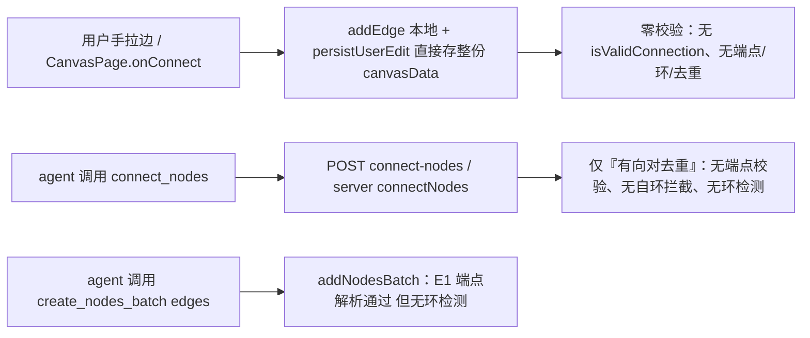
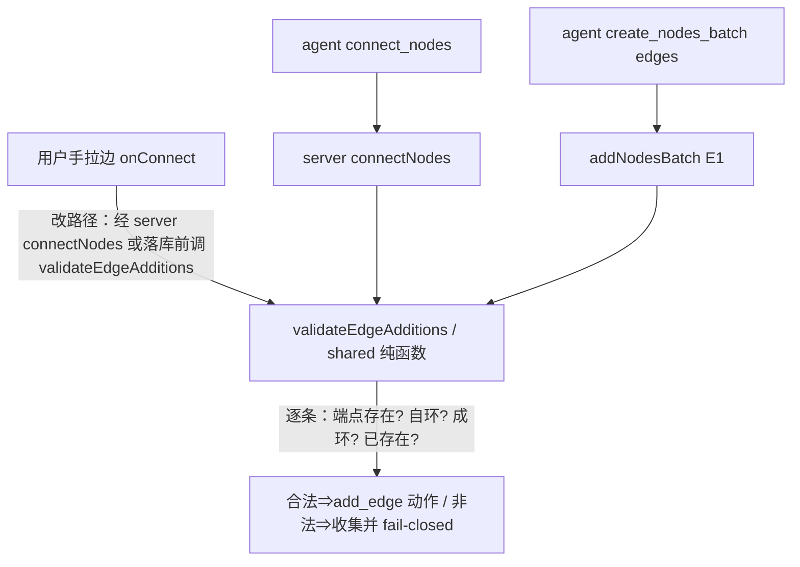

# SP-D 连线校验（edge validation）设计规格

> 来源：`docs/superpowers/specs/2026-10-20-agent-canvas-batch-layout-design.md` §12 路线图
> 「**SP-D 连线校验**：isValidConnection + 服务端端点/环校验 + add_edge 去重」（SP-A §12 / SP-B §15.4 / SP-C §8 同述）。
> 前置：SP-A（批量创建即整齐，#529/#554）、SP-B（对齐与参考线，#554/#557/#561）、SP-C（视口恢复，#564/#576）均已上线。
> 本规格为 **Draft 一稿（代码级取证后成文），待评审、待决策拍板**。
>
> ⚠️ 与上游台账不一致声明：本仓过往台账曾记「SP-D 规格已就位、待评审」，**经本稿独立核对，SP-D 独立规格/计划文件在本仓（含 git 历史）从未创建**（见 §4.0）。本稿即为从零起草原稿，不是「评审既有稿」。

## 0. 配图索引

本文档含 2 张结构图（Mermaid 内嵌）；无 SVG 视觉稿（连线校验为逻辑/判据，可用决策树无损表达）。

| 编号 | 形式 | 内容 | 位置 | 用途 |
|---|---|---|---|---|
| 图 1 | 内嵌 Mermaid | 当前两条连线入口与各自的校验待遇 | §4.1 | 暴露「用户手拉边绕过服务端」的缺口 |
| 图 2 | 内嵌 Mermaid | SP-D 校验落点：统一在 add_edge 落地处校验 | §6.1 | 确定权威校验 chokepoint，避免两条入口两种待遇 |

## 1. 目标

| # | 目标 | 验收 |
|---|---|---|
| G1 | 连线（无论用户手拉还是 agent `connect_nodes`/`create_nodes_batch` 的 edges）都经过**统一的端点存在性校验**：端点必须是画布中真实存在的节点 id，否则 fail-closed | 给不存在的 source/target ⇒ 连线被拒（前端即时反馈 + 服务端 400，错误信息点名未解析端点） |
| G2 | **环校验**：画布是有向图，禁止形成环（含自环 a→a 与反向 2-环 a→b 后 b→a） | 会成环的边被拒；现有合法 DAG 不受影响（无环画布零变化） |
| G3 | **去重一致**：有向对 `source->target` 唯一（已存在则幂等跳过），两条入口待遇一致 | 重复拉同一条边 / 重复 `connect_nodes` 同一对 ⇒ 不产生第二条边；`b→a` 在 `a→b` 已存在时按 G2 判为成环被拒 |
| G4 | 用户手拉边与 agent 边**同一条校验通道**，不再「用户手拉零校验、agent 走服务端」的分裂 | onConnect 落库路径经统一校验；不引入第二条独立校验实现 |

## 2. 范围

### 2.1 本规格做

- 新增 shared 纯函数 `validateEdgeAdditions(canvas, newEdges)`（端点存在性 + 自环 + 环检测 + 有向对去重），框架无关、可单测，与 SP-A/B 的 `layout.ts` 原语同层；
- **服务端 `connectNodes`** 补齐端点存在性校验 + 自环拦截 + 环检测（复用 shared 原语），fail-closed；
- **`addNodesBatch` 的 edges**（SP-A E1 已做端点解析）复用同一环检测原语，避免批量造环；
- **前端 `onConnect`** 增加 vue-flow `isValidConnection`：拦截自环 + 本地已存在的同对有向边（即时视觉反馈），并把落库路径收口到统一校验（G4）；
- `connect_nodes` / `create_nodes_batch` 工具 description 注明「端点须存在、不可成环、不可重复」（零 L6 预算成本，description 承载发现能力，不进 prompt 点名）。

### 2.2 明确不做（登记 §10，不隐性扩范围）

- 边的视觉样式 / 箭头 / 标签（属渲染层，不在本包）；
- 多边平行语义（同 `source->target` 多权重）——本包维持一对一有向边，不做平行边；
- 跨画布连线 / 跨会话引用边；
- 环的「自动打破」（成环即拒绝，不替用户删边）；
- 历史边的批量纠错（存量画布若有环，本包不主动清理；仅保证新加法不造环 + 提供一次性诊断命令，见 §9-R3）。

## 3. 与既有规格的关系

- **SP-A §12 / SP-B §15.4 / SP-C §8**：本包即路线图中的 SP-D，命名与范围一致。
- **SP-B §16.1「顺着连线」重排**：`layoutNodesAlongEdges` 沿**有向边**做拓扑分层（`assignRanks`）。该算法**隐含假设画布是有向无环图（DAG）**——一旦存在环，rank 分配失效、重排结果错乱。⇒ **G2 禁止环的动机直接来自 SP-B 的拓扑布局**，不是凭空加约束。
- **SP-A E1 端点解析纪律**：`addNodesBatch` 对批内 edges 已做「端点须在本批 key 或画布节点否则 fail-closed 400」。本包把**同款端点存在性纪律**补到 `connectNodes`（目前缺失，见 §4），并对两条入口统一。
- **SP-B §7「坐标类变更走前端 canvas_command 通道」纪律**：连线是图结构变更，与坐标同类——用户手拉边目前绕过服务端直接存整份 canvasData，违反「变更统一通道」原则；本包收口（G4）。

## 4. 现状盘点（代码级取证，2026-10-26，基准 `origin/master` @ `c9b62313`）

> 方法同 SP-B §15：不采信台账声明，逐条回代码核实。以下为实测证据。

### 4.0 SP-D 规格自身是否存在（先澄清上游台账误记）

- `git log --all -- docs/superpowers/specs/2026-10-24-sp-d-edge-validation-design.md`：**零记录**（该路径从未存在）；
- 全仓 grep `sp-d` / `edge-validation` / `连线校验`：**零命中**；
- `docs/superpowers/plans/` 无 `*-sp-d-*` 计划文件。
⇒ **SP-D 从未被创建**。上游台账「SP-D 已就位、待评审」为**误记**，本稿为从零起草。

### 4.1 两条连线入口与各自校验待遇（图 1）



*图 1 · 当前两条连线入口的校验待遇：用户手拉边完全绕过服务端（零校验）；agent 走服务端但服务端只做有向对去重。两条入口都缺端点存在性与环校验。*

### 4.2 服务端 `connectNodes` 实测（`apps/server/src/agent/agent-canvas-tools.service.ts:1260-1285`）

```ts
async connectNodes(input: { sessionId; edges: {source,target}[]; stage? }) {
  const { canvas } = await this.loadSession(input.sessionId)
  const actions: CanvasAction[] = []
  const existing = new Set(canvas.edges.map((e) => `${e.source}->${e.target}`))
  for (const edge of input.edges) {
    const key = `${edge.source}->${edge.target}`
    if (existing.has(key)) continue   // ✅ 有向对去重（已存在的跳过）
    existing.add(key)
    actions.push({ type: 'add_edge', payload: { id: edgeId(edge.source, edge.target), source, target } })
  }
  await this.applyOrStage(input.sessionId, actions, input.stage)
  return { actions }
}
```

- `edgeId(source,target)` = `e-${source}-${target}`（同文件 `:87-89`，确定性有向对 id）。
- **❌ 端点存在性校验缺失**：不查 `source`/`target` 是否在 `canvas.nodes`。可造出指向不存在节点的**悬空边**（与 SP-A E1 纪律不一致）。
- **❌ 自环缺失拦截**：`a->a` 会被正常加入（除非已存在）。
- **❌ 环检测缺失**：`a->b` 后 `b->a`（2-环）、或更长的 `a->b->c->a` 都自由放行。
- ✅ 有向对去重（已存在的 `source->target` 跳过）+ 批内重复去重（靠 `existing` 集合累加）。

### 4.3 前端 `onConnect` 实测（`apps/web/src/pages/CanvasPage.vue:1418-1430`）

```ts
function onConnect(connection: Connection) {
  connectCompleted = true
  pendingConnect.value = null
  connectPicker.value = null
  addEdge({ id: `e-${connection.source}-${connection.target}`, source, target, sourceHandle, targetHandle })
  persistUserEdit()   // 直接存整份 canvasData，不经过 server connectNodes
}
```

- **❌ 无 `isValidConnection`**：vue-flow 默认放行所有连接。
- **❌ 自环可拉**：从节点拖回自身 ⇒ `e-a-a` 落库。
- **❌ 绕过服务端**：`persistUserEdit()` 直接写整份 canvasData，**服务端 `connectNodes` 的（有限的）有向对去重都吃不到** ⇒ 用户手拉边可造重复边（vue-flow `addEdge` 仅按 id 去重，故同 `a->b` 重拉会被 vue-flow 拦，但 `a->b` 后 `b->a` 不同 id ⇒ 2-环直接落库）。

### 4.4 `connect_nodes` 工具层（`services/pi-runtime/src/tools/canvas-write.ts:977-999`）

- 仅校验 `edges.length > 20` ⇒ 抛错（边数上限）。
- 透传给 server `connect-nodes`，**不预校验端点/环/去重**（这些本应在服务端，但服务端目前也没做，见 §4.2）。

### 4.5 缺口清单（按严重度）

| # | 缺口 | 严重度 | 归属 |
|---|---|---|---|
| P1 | 用户手拉边零校验（自环/重复/悬空均可落库） | 高 | G1/G3/G4 |
| P2 | 服务端 `connectNodes` 缺端点存在性校验（悬空边） | 高 | G1 |
| P3 | 服务端 `connectNodes` 缺环检测（破坏 SP-B 拓扑布局前提） | 高 | G2 |
| P4 | 缺自环拦截（a→a） | 中 | G2 |
| P5 | `addNodesBatch` edges 缺环检测（批量可造环） | 中 | G2 |
| P6 | 两条入口校验分裂 | 中 | G4 |

## 5. 判据与不变量

| # | 不变量 |
|---|---|
| N1 | **端点必须存在**：每条待加边 `source`/`target` ∈ `canvas.nodes[].id`，否则 fail-closed |
| N2 | **无自环**：`source === target` ⇒ 拒绝 |
| N3 | **无环**：加入 `source→target` 后若图中已存在 `target →* source` 路径 ⇒ 拒绝（即会闭合环） |
| N4 | **有向对唯一**：`source->target` 已存在 ⇒ 幂等跳过（不报错、不产生第二条） |
| N5 | **存量画布零变化**：本包只拦「新加边」，不删不改任何存量边；存量即便有环也不主动清理（诊断见 §9-R3） |
| N6 | **统一通道**：用户手拉边与 agent 边经同一份 `validateEdgeAdditions` 原语校验，不维护两套逻辑 |
| N7 | **确定性**：校验为纯函数、无随机/时钟，同输入同输出，可金样锁 |

## 6. 架构与契约

### 6.1 统一校验 chokepoint（图 2）

所有「加边」动作最终都归结为 `add_edge` action。把权威校验收口到一处：新增 shared 纯函数 `validateEdgeAdditions(canvas, newEdges)`，被 `connectNodes`、`addNodesBatch`、以及**用户手拉边的落库路径**共同调用。



*图 2 · SP-D 校验落点：无论入口，加边都经过同一 `validateEdgeAdditions` 原语（端点/自环/环/去重），杜绝「两条入口两种待遇」。*

### 6.2 shared 纯函数（`packages/shared/src/canvas/graph.ts` 新增）

```ts
// 边判据原语，与 layout.ts 同层（框架无关、可单测）
export interface RawEdge { source: string; target: string }

/** 在已有 edges + nodes 上，校验一批待加边；返回 { valid: CanvasAction[], rejected: RejectReason[] } */
export function validateEdgeAdditions(
  nodes: { id: string }[],
  existingEdges: RawEdge[],
  newEdges: RawEdge[],
): { actions: Array<{ id: string; source: string; target: string }>; rejected: Array<{ edge: RawEdge; reason: 'missing-node' | 'self-loop' | 'cycle' | 'duplicate' }> }

/** 加入 source→target 是否会闭合环（图中是否已存在 target →* source 路径） */
export function wouldCreateCycle(existingEdges: RawEdge[], source: string, target: string): boolean
```

- `wouldCreateCycle`：以 `target` 为起点沿有向边 DFS/BFS，若可达 `source` ⇒ 加 `source→target` 成环（含 `source===target` 自环情形可一并判，或单独判 N2）。
- `edgeId` 沿用既有 `e-${source}-${target}`（**不改 id 规则**，保证存量边 id 不变、N5 零迁移）。
- 复用既有 `existing.has('source->target')` 去重逻辑（N4）。

### 6.3 服务端 `connectNodes` 修订（`agent-canvas-tools.service.ts:1260`）

- 调 `validateEdgeAdditions(canvas.nodes, canvas.edges, input.edges)`；
- `rejected` 非空 ⇒ 抛 `BadRequestException`，错误信息逐条列出被拒边及原因（与 SP-A E1 一致的可操作错误风格）；
- 全部合法 ⇒ 仅对 `valid` 生成 `add_edge` 动作（仍走 `applyOrStage`）。

### 6.4 `addNodesBatch` edges 修订（`agent-canvas-tools.service.ts:1037-1066`）

- 现有 E1 端点解析（key/id 解析 + 未解析 fail-closed）**保留**；
- 在生成 `add_edge` 动作前，对批内 edges 额外跑 `wouldCreateCycle`（基于「批内已解析边 + 画布存量边」）——避免批量造环（P5）。

### 6.5 前端 `onConnect` 修订（`CanvasPage.vue:1418`）

- 新增 `isValidConnection(connection)` 传给 `<VueFlow>`：
  - 拦自环（`connection.source === connection.target`）⇒ 拖线时即时不可落；
  - 拦本地已存在的同对有向边（`canvas.edges` 已有 `source->target`）⇒ 即时反馈；
  - （实时环检测不可靠——前端不知远端完整图 ⇒ **环检测以服务端为准**，不在 `isValidConnection` 做，避免误拦/漏拦）。
- **落库路径收口（G4，关键）**：`onConnect` 不再 `addEdge + persistUserEdit` 直接存整份；改为走与 agent 同款的 `connectNodes` 服务端通道（前端 `arrange_nodes` 同铁律：图变更经前端命令/服务通道，避免 `saveCanvas` 整份覆盖且保证校验统一）。具体接线方式见 §11-D6 待拍板。

## 7. 文件级改动清单

| 文件 | 改动 |
|---|---|
| `packages/shared/src/canvas/graph.ts` | **新增**。`validateEdgeAdditions` + `wouldCreateCycle`（纯函数，金样单测） |
| `packages/shared/src/canvas/index.ts` | 导出新模块 |
| `apps/server/src/agent/agent-canvas-tools.service.ts` | `connectNodes` 调 `validateEdgeAdditions`（端点/自环/环/去重，fail-closed）；`addNodesBatch` edges 加 `wouldCreateCycle` |
| `services/pi-runtime/src/tools/canvas-write.ts` | `connect_nodes` / `create_nodes_batch` description 注明端点/环/去重约束（不点名 prompt） |
| `apps/web/src/pages/CanvasPage.vue` | `onConnect` + 新增 `isValidConnection`；落库路径收口（§6.5 / D6） |
| `apps/server/src/agent/agent-canvas-tools.service.test.ts` | connectNodes 端点/自环/环/去重用例；addNodesBatch 环检测用例 |
| `packages/shared/src/canvas/graph.test.ts` | `wouldCreateCycle` / `validateEdgeAdditions` 金样（自环 / 2-环 / 长环 / 已存在幂等 / 悬空端点 / 确定性） |

## 8. 测试与守卫

| 层 | 用例 |
|---|---|
| shared 纯函数 | `wouldCreateCycle`：自环 / 直接 2-环 / 长环 `a→b→c→a` / 无环（a→b 后 c→d） / 起点终点相同但无回边（非环）；`validateEdgeAdditions`：悬空端点 rejected(missing-node) / 自环 rejected(self-loop) / 成环 rejected(cycle) / 已存在 rejected(duplicate) 且合法边正常产出 / 混合批部分合法部分非法 ⇒ 合法者仍加、非法者进 rejected 且不落库 |
| services/pi-runtime | `connect_nodes` 描述含约束；`create_nodes_batch` edges 造环被服务端拒 |
| apps/server | `connectNodes` 给不存在端点 ⇒ 400 且错误列名；给 `a→a` ⇒ 400；给 `b→a`（a→b 已存在）⇒ 400(cycle)；重复 `a→b` ⇒ 幂等零动作（沿用 dedup-to-empty 快路径）；全部合法 ⇒ 正常加边 |
| apps/web | `isValidConnection` 拦自环 + 本地已存在同对；`onConnect` 落库路径经统一校验（静态断言：不再直接 `persistUserEdit` 整份） |
| 全局 | `pnpm build` 全绿；`vue-tsc -b`（改 .vue 必跑）；shared 新增测试全绿 |

## 9. 风险

| # | 风险 | 缓解 |
|---|---|
| R1 | 存量画布若有环，本包不清理 ⇒ 用户可能困惑「为何新边能加、旧环还在」 | §2.2 明确不主动清理；提供一次性诊断脚本（`scripts/...`）列出含环画布，供运营/用户决策；文档说明 |
| R2 | `onConnect` 落库路径收口改动面大（涉及 saveCanvas 整份覆盖纪律） | D6 拍板前先小范围验证；保留 `persistUserEdit` 的回退通道；改完跑 SP-B 的 `CanvasPage` 连线相关测试 |
| R3 | 环检测性能（大画布 N 节点 M 边） | `wouldCreateCycle` 为 O(M) DFS/ BFS（邻接表），单条边校验成本可控；批量校验对每条新边各跑一次，批≤20 ⇒ 上限 20×O(M)，远低于渲染成本 |
| R4 | 误判「成环」导致合法边被拒 | 邻接表构建纯函数化 + 金样覆盖自环/2-环/长环/非环四类；与 SP-B 拓扑布局回归联动（拓扑布局本就假设 DAG） |

## 10. 后续 / 关联登记

- SP-D 完成后，画布布局优化主线剩 **SP-E 并发与暂存底座**（canvasVersion CAS + stage 透传 UI）/ **SP-F 分组深化+内核合一** / **SP-G 缓议池**（resize/z-order/旋转…）。
- SP-D 的 `validateEdgeAdditions` 是 SP-E「并发写 canvasData」的自然前置：环/端点校验与 CAS 冲突裁决可在同一 `add_edge` 落地处叠加。
- 存量环诊断脚本（§9-R1）属一次性工具，登记在此、不进主流程。

## 11. 决策表（待用户拍板）

| # | 议题 | 选项 / 推荐 | 影响 |
|---|---|---|---|
| **D1** | 画布是否为 DAG？环是否禁止？ | **推荐：禁止环**（动机：SP-B §16.1 拓扑分层 `assignRanks` 假设无环；分镜/流程语义本就有向无环） | 决定 N3 是否存在；若允许环则 G2 降级为「仅拦自环」 |
| **D2** | 自环 a→a 是否禁止 | **推荐：禁止**（无语义、纯噪声，N2） | 不论 D1 如何都建议禁 |
| **D3** | 反向 2-环（a→b 后 b→a） | 若 D1 禁止环 ⇒ 自动被 N3 拦（b→a 在 a→b 存在时成环）；无需独立规则 | 跟随 D1 |
| **D4** | 端点校验放哪 | **推荐：服务端 `connectNodes`/`addNodesBatch` 统一做 fail-closed**（与 SP-A E1 一致；悬空边是 silent-degrade 风险）；前端 `isValidConnection` 只做 cheap 本地拦截（自环+本地重复） | 决定 N1 实现位置 |
| **D5** | 前端 `isValidConnection` 是否实时判环 | **推荐：否**（前端不知远端完整图，实时判环不可靠）；环检测以服务端为准 | 避免误拦/漏拦 |
| **D6** | `onConnect` 落库路径如何收口（G4 关键） | 选项 A（推荐）：`onConnect` 改走 server `connectNodes`（与 agent 同通道，校验天然统一，符合 SP-B §7「图变更经前端命令/服务通道」纪律）；选项 B：`persistUserEdit` 落库前调 `validateEdgeAdditions`（不动通道，但在保存边界补校验）。需拍板 | 决定前端改动面与一致性强度 |

## 12. 配图规范自检

待本稿定稿后跑：`pnpm verify-spec-figures --file docs/superpowers/specs/2026-10-26-sp-d-edge-validation-design.md`（本文档 2 张 Mermaid 结构图，无 SVG 附件，R1/R6/R8 天然满足）。
