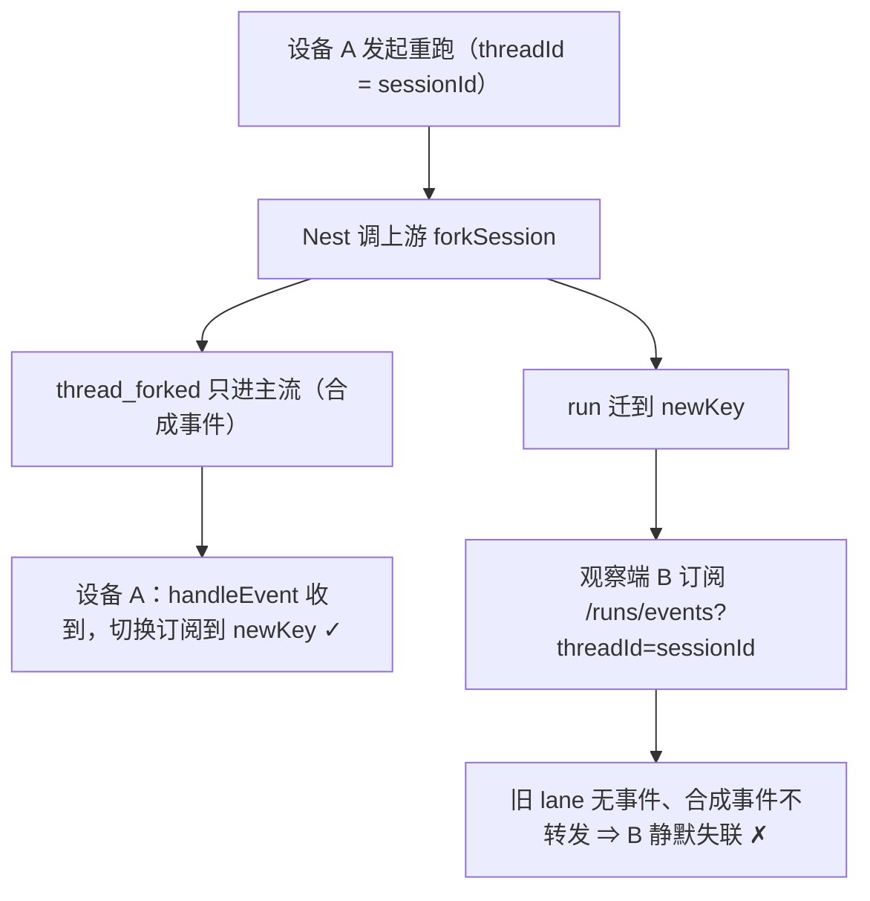
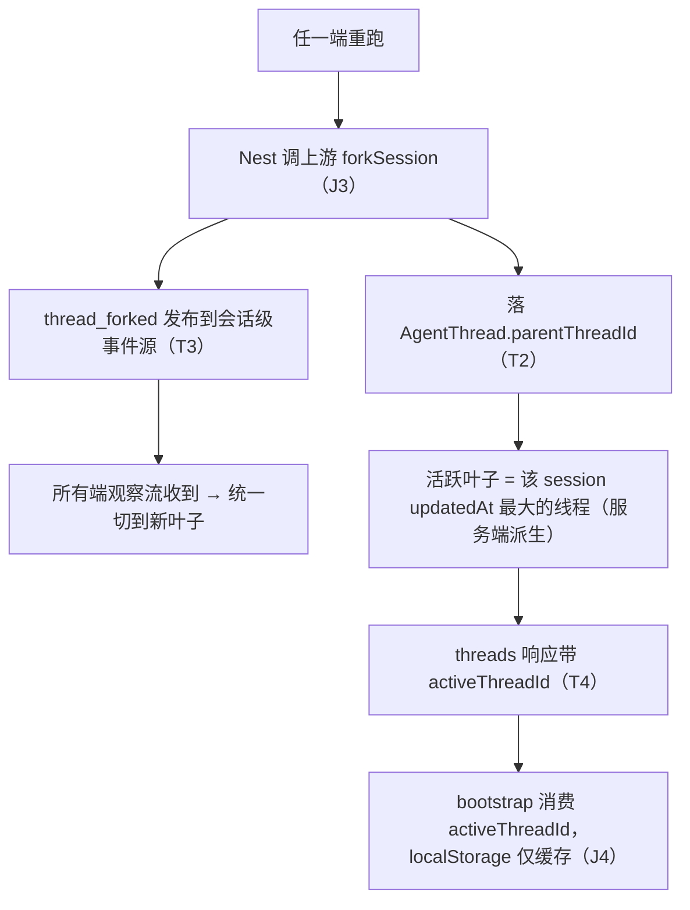

# 多端单会话（1 项目 = 1 画布 + 1 对话）设计规格

状态：已拍板（产品决策 2026-10-26；Phase 1 已合 master，PR #609 squash `8772a722`）
前置：[`2026-10-21-multi-device-consistency-design.md`](./2026-10-21-multi-device-consistency-design.md)（继承其四层架构与 Task 9/10/7）、[`2026-10-17-agent-turn-identity-design.md`](./2026-10-17-agent-turn-identity-design.md)（回合身份判据继续有效）
分支约定：实现走 feature 分支 + PR + squash merge。

## 0. 配图索引

本文档的图分两类：**结构图**一律以 Mermaid 内嵌；**视觉稿**以 `assets/` 下的 SVG 附件承载（相对路径引用）。

| 编号 | 形式 | 内容 | 位置 | 用途 |
|---|---|---|---|---|
| 图 1 | 内嵌 Mermaid | 现状：重跑分支的多端发散根因（合成事件只进主流 + 观察端订阅死键） | §4.2 | 评审时确认「跨设备重跑发散不是 bug 而是订阅键语义」，Phase 2 T3 的靶子 |
| 图 2 | 内嵌 Mermaid | 目标：会话级广播 + 服务端权威活跃叶子 | §5.1 | Phase 2 T2/T3/T4 的实现基准与验收锚点 |

## 1. 目标

1. **任一设备打开项目，进入同一条对话**：会话身份恒定 = `sessionId`（Phase 1 已落地），历史与进行中的轮次双端一致，不必刷新。
2. **任一端重跑（③ 重跑），其余端自动跟随**：对话身份不变（用户无感切换），所有端看到同一条活跃叶子。
3. **用户只看到 1 个对话**：多对话 UI（历史面板 / 新建对话 / 切换对话）退役，`threadId` 退为内部实现细节。

三条都可验收，判据见 §10.3。

## 2. 范围

**在范围内（Phase 2，T1–T5）**

- T1 legacy 历史归并 backfill（**部署前置**，幂等）
- T2 `AgentThread.parentThreadId` 分支血缘列 + fork 落库 + schema 注释修正
- T3 `thread_forked` 升级为会话级广播（观察端可达）
- T4 bootstrap 改读服务端权威活跃叶子（fork key 退役）
- T5 退役多对话 UI

**明确不做**（及理由）

| 不做 | 理由 |
|---|---|
| 自制 truncate/原地重生成 | 上游 pi `forkSession` 已提供切点分支语义（Codex 同款）；自制会与上游漂移，且 fork 结果内部化后用户无感 |
| 多对话并存（对话列表/新建/切换） | 产品已拍板 1 项目 = 1 对话；将来若要恢复须重新设计（见 §12） |
| WebSocket / 多实例部署 | 继承 [`2026-10-21` 规格 §2](./2026-10-21-multi-device-consistency-design.md) 的判据与约束，本轮不变 |
| ChatGPT 全套 mapping 树 + current_node UI | 当前分支来源**只有重跑一个**，线性 UI + 活跃叶子指针已覆盖；全套树是过度设计（ADR-0015 方案对比） |

## 3. 与既有规格的关系

| 既有规格/决策 | 关系 | 说明 |
|---|---|---|
| `2026-10-21-multi-device-consistency-design.md`（多端一致性） | **继承 + 补盲区** | 其四层架构（执行/观测/投影/队列）与 Task 9（mergeHistory）/ Task 10（turn-reconciliation）/ Task 7 收口（`@@unique([threadId,seq])` + clientId 写入）继续有效；本轮补上它未覆盖的盲区——**threadId 身份语义**（其隐含前提「threadId 由前端任意派生」被本规格修订） |
| `2026-08-07-agent-conversation-isolation.md`（对话隔离） | **推翻** | 其「threadId 格式 `{sessionId}:{randomSuffix}`、新建对话隔离聊天」的隔离语义被 ADR-0015 取代：会话身份恒定 = `sessionId`，不再随机后缀 |
| `2026-10-17-agent-turn-identity-design.md`（回合身份） | 不冲突 | `owner`/`shadow` 单写者判据继续有效；`@@unique([threadId, runId])` 的收口仍由 2026-10-21 Task 7 承接 |
| PR #609（Phase 1，已合 master `8772a722`） | **前置，已落地** | `createAgentThreadId` 确定式返回 `sessionId`；bootstrap 收敛 + `selectThread` 守卫 + fork key 单端恢复（评审 F1 修复：切回主对话清 fork key） |

## 4. 规范与判据

### 4.1 五条判据（J1–J5，后续同类需求直接套）

- **J1 会话身份恒定**：用户可见的对话身份 = `sessionId`，确定式、服务端可推导；任何前端代码不得再生成随机 threadId。
- **J2 threadId 只有两个合法来源**：共享线程（= `sessionId`）与服务端活跃叶子（重跑分支）。客户端不得自造第三种。
- **J3 fork 必须经上游**：重跑分支一律走 pi-runtime `forkSession`（切点 fork、原会话不动），禁止自制 truncate。
- **J4 活跃叶子服务端权威**：「当前在哪条叶子」由服务端派生/存储；客户端 localStorage 只做缓存，不做真相。
- **J5 部署前置 = backfill 幂等**：legacy 归并脚本重跑不产生重复消息、不丢失消息；未跑 backfill 不得部署 Phase 1 之后的 bootstrap 收敛逻辑到生产。

### 4.2 现状根因（代码级取证，双路验证）

跨设备重跑发散不是某个 bug，而是**订阅键语义**（结构见图 1）：`thread_forked` 是 Nest 在主流生成器里合成的 `AgentStreamEvent`（`agent.service.ts:419`），而观察端 `runEventStream`（`agent.service.ts:688`）只转发 pi-runtime 事件（经 `mapPiEventToUiEvent` 归一）——合成事件不在其中。fork 后 run 整体迁到 `newKey`，观察端仍订阅旧键，旧 lane 上再无事件。

*图 1 · 说明设备 A 能跟随而设备 B 静默失联的结构原因：合成事件只进主流、观察端订阅键在 fork 后变成死键。这是 Phase 2 T3 的靶子。*

## 5. 架构与契约

### 5.1 目标架构（Phase 2 完成后，结构见图 2）

*图 2 · 说明 Phase 2 五个任务的架构归属：fork 落血缘 → 会话级广播 → 双端跟随；活跃叶子服务端派生 → bootstrap 服务端化。验收锚点是 S2（§10.3）。*

### 5.2 契约变更

| 契约 | 变更 | 消费方 |
|---|---|---|
| `GET /api/agent/chat/threads?sessionId=` | 响应增加 `activeThreadId: string`（服务端按 `updatedAt` 最大者派生，平局取 `createdAt` 最新） | 前端 bootstrap |
| `AgentStreamEvent`（观察流） | 新增合成事件 `thread_forked`（会话级发布；**无 pi seq ⇒ 不写 SSE `id:` 行**，沿用 controller 既有游标纪律） | 所有端 `handleEvent` 既有 `case 'thread_forked'` 分支 |
| `AgentThread` 表 | 新增 `parentThreadId String?`（仅重跑分支行有值；不建外键关系，避免与 pi 侧生命周期耦合） | 审计 / 将来树渲染 |
| 渠道命名 | shared-subscription 频道名里的 `:${agentThreadId}` 段随 T5 退役（1 对话后频道只按 sessionId 命名） | 同源多标签页 |

## 6. 打样/主场景规格

无视觉稿依赖（本规格无空间/比例判据，§1 反面判据命中），场景验收见 §10.3。

## 7. 数据与状态变更

- **T1 legacy backfill**：把旧随机线程 `{sessionId}:{suffix}` 的 `AgentMessage` 归并到共享线程 `sessionId`。幂等判据：以 `(threadId, runId, seq/clientId)` 为去重键，重跑脚本消息数不变；执行前**备份数据库**（生产 SQLite 文件级备份）。放置位置：`apps/server/prisma/migrations/<时间戳>_unify_legacy_thread_messages/migration.sql`（迁移目录既有约定）。
- **T2**：`AgentThread` 加 `parentThreadId String?` 列 + 迁移；fork 成功路径落血缘；同步修正 `schema.prisma` 两处过期注释（`:377`「格式 sessionId:suffix」、`:388`「一个画布可以有多个对话线程」的理由段——现语义为「一个画布恰一个用户可见对话，线程行是内部叶子」）。
- **T4**：fork key（`lnkpi:agentThreadFork:<sessionId>`）退役，`resolveBootstrapThreadId` 改为消费服务端 `activeThreadId`；localStorage 主键仅作缓存降级（服务端不可达时沿用上次值）。

## 8. 纯函数与算法（含单测要求）

| 函数 | 位置 | 单测要求 |
|---|---|---|
| 活跃叶子派生 `pickActiveLeaf(rows)` | 服务端纯函数（service 内导出） | ① 单行 ⇒ 它自己；② 多行取 `updatedAt` 最大；③ 平局取 `createdAt` 最新；④ 空数组 ⇒ 返回 sessionId 兜底 |
| backfill 去重判据 | migration SQL + 校验脚本 | 幂等性：同一库跑两遍，`AgentMessage` 总数第二遍不变；归并后消息按原时间序 |
| `resolveBootstrapThreadId`（T4 后） | `streamRecovery.ts` | ① 服务端 activeThreadId 有值 ⇒ 用它；② 服务端不可达 ⇒ 回落缓存；③ 两者皆无 ⇒ sessionId |

## 9. 文件级改动清单

> ⭐ 本节是实施排期的唯一输入，已与 §5.2 契约、§10.3 验收、§12 路线图逐条交叉核对（纪律：三处一致地漏过一次）。

| 任务 | 文件 | 改动 |
|---|---|---|
| T1 | `apps/server/prisma/migrations/<ts>_unify_legacy_thread_messages/migration.sql`（新增） | legacy 归并 SQL，幂等 |
| T2 | `apps/server/prisma/schema.prisma` | `AgentThread.parentThreadId` 列 + `:377`/`:388` 注释修正 |
| T2 | `apps/server/src/agent/agent.service.ts` | fork 成功路径写 `parentThreadId`；`pickActiveLeaf` 纯函数 |
| T3 | `apps/server/src/agent/agent.service.ts` | fork 时向会话级事件源发布 `thread_forked`；`runEventStream` 合并该事件源 |
| T3 | `apps/server/src/agent/agent.controller.ts` | 观察流透传合成事件（无 seq 不写 `id:` 行，沿用既有纪律） |
| T4 | `apps/server/src/agent/agent.controller.ts` | `chat/threads` 响应加 `activeThreadId` |
| T4 | `apps/web/src/components/agent/streamRecovery.ts` | `resolveBootstrapThreadId` 消费 `activeThreadId`；fork key 辅助函数删除 |
| T4 | `apps/web/src/components/agent/AgentSideRail.vue` | bootstrap 传参调整；`thread_forked` 处理里的 `persistForkedThreadId` 调用移除 |
| T5 | `apps/web/src/components/agent/AgentSideRail.vue` | 退役历史面板/新建对话/`selectThread`/`fetchThreads`/`threads` state + 移动端两处入口 |
| T5 | `apps/web/src/components/agent/AgentSideRail.forkKeyWiring.test.ts` | 随 fork key 退役与 `selectThread` 移除改写（守卫点迁移到「bootstrap 必须走服务端活跃叶子」） |
| T4/T5 | `apps/web/src/components/agent/streamRecovery.test.ts` | bootstrap 用例改为服务端权威语义 |
| 全部 | `apps/server/src/agent/agent.service.test.ts`（或就近测试文件） | `pickActiveLeaf`、fork 落血缘、会话级发布三组用例 |

**Phase 1 已落地**（PR #609 + 本轮评审修复，随本规格一起提 PR）：`streamRecovery.ts`、`streamRecovery.test.ts`、`AgentSideRail.vue`、`AgentSideRail.forkKeyWiring.test.ts`（新增，3 用例）。

## 10. 测试策略与验收标准

### 10.1 单元 / 静态契约

- §8 三个纯函数/算法的单测全覆盖。
- `AgentSideRail.forkKeyWiring.test.ts`（Phase 1 期）：① `thread_forked` 持久化分支；② `selectThread` 清 fork key；③ bootstrap 经 `resolveBootstrapThreadId`。T4/T5 落地时按 §9 改写，**不得只删不断言**。
- `observerWiring.test.ts` 既有 6 用例必须保持绿（订阅重挂契约不受影响）。

### 10.2 服务端契约

- 观察流收到 `thread_forked` 且**不带 `id:` 行**（防 Last-Event-ID 指向不存在 seq）。
- `chat/threads` 响应含 `activeThreadId` 且与 `pickActiveLeaf` 一致。

### 10.3 端到端场景验收（真机/双端）

| 场景 | 判据 |
|---|---|
| S1 跨设备续聊（Phase 1 已达成） | PC 发消息 → 手机不刷新可见；手机续聊 → PC 可见 |
| S2 跨设备重跑跟随（T2/T3/T4） | PC 重跑 → 手机收到 `thread_forked` 并自动跟随新叶子；双端此后消息互见，对话身份不变 |
| S3 单对话呈现（T5） | 任意端无历史面板/新建对话入口；刷新后仍进同一条对话（服务端活跃叶子） |
| S4 legacy 不丢（T1，部署前置） | backfill 后老用户打开项目看到原历史；重跑脚本消息数不变 |
| S5 分支返回不弹回（本轮评审 F1，Phase 1 期过渡行为） | 重跑 → 历史面板切回主对话 → 刷新后仍在主对话（fork key 已清） |

## 11. 风险

| 风险 | 缓解 |
|---|---|
| backfill 误伤生产数据 | 先文件级备份 SQLite；先在 staging/本地库演练；脚本幂等（§8） |
| 观察端合成事件与 pi seq 游标体系混淆 | 合成事件**不带 seq、不写 `id:` 行**（既有纪律），文档 + 契约测试双锁 |
| fork key（客户端）与服务端活跃叶子双轨期不一致 | 双轨期以服务端为准（T4 落地即删 fork key）；T4 之前不部署（J5） |
| 单实例约束（会话级事件源为进程内 pubsub） | 继承 2026-10-21 §2「不做多实例」；多实例列 §12 |
| 退役 UI 误伤静态契约测试 | §9 已点名 `forkKeyWiring`/`observerWiring` 的处置；退役 PR 必须跑 `agent` 目录全部静态测试 |

## 12. 后续包 / 路线图

| 项 | 来源 | 说明 |
|---|---|---|
| Task 9 `mergeHistory` | 2026-10-21 规格 | M1 覆盖竞态修复，不依赖本轮 |
| Task 10 `turn-reconciliation` | 2026-10-21 规格 | 双真相源对账接口 |
| Task 7 收口 | 2026-10-21 规格 | `@@unique([threadId,seq])` + 回填 + clientId 写入接线 |
| 真机走查 | 移动端生命周期台账 | 23 项 + §4.7/§4.8，与本轮 S1–S5 真机验收可合并一次走查 |
| 多实例部署 | 2026-10-21 §2 | 会话级事件源若上多实例需改进程间 pubsub，届时重评 |
| 恢复多对话能力（若产品反悔） | ADR-0015 | 须重新设计；活跃叶子模型可扩展为树，但 UI/产品语义另立规格 |

## 13. 配图规范自检

`pnpm verify-spec-figures --file docs/superpowers/specs/2026-10-26-unified-single-conversation-design.md`：通过（R1–R8，2 图内嵌 Mermaid，无附件）。
