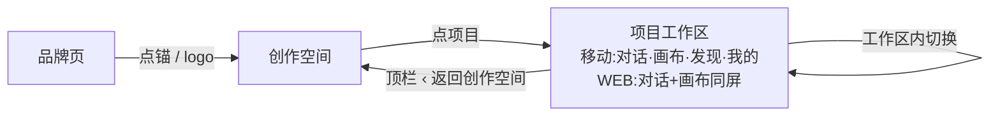

# 三页顶栏统一重构设计规格（移动端 + WEB）

状态：设计已定稿（v2 · 2026-10-27 · 用户拍板移动端 + WEB 纳入 · **待开发**）
前置：
- **ADR-0015「多端统一单对话」**（1 项目 = 1 对话 + 1 画布，只暴露 1 个对话）——本规格依此移除对话页「新对话 / 历史对话」入口。
- **门面收敛与续作面统一规格**（`2026-10-26-project-gallery-consolidation-design.md`，已实施）——其 G3 已要求「对话页顶部 = ‹ 返回创作首页 + 项目名」；本规格在 G3 基础上**把同一规则延伸到画布视图与 WEB 工作台**，并修订其 §6.5（见 §3）。
- 移动端 IA v3 / v4（四页签壳 `MobileTabBar` + `MobileTopBar` + `MobileCanvasShell` 已落地）。
- 全局 `AppHeader`（`App.vue:39` `<AppHeader v-if="!isImmersiveCanvas" />` 常驻，仅沉浸画布路由隐藏）。

**修订记录**：
- v1（2026-10-27）：用户基于真机三页截图拍板。核心 = 统一三页导航语言为三层、每层单一返回；对话/画布补「项目名（次级静默 + 截断）」；画布补回顶栏；创作空间（画廊）做极简栏、去常驻搜索框/管理/账户 chrome。
- v2（2026-10-27）：用户基于 WEB 端两张截图拍板「WEB 一并纳入统一优化收口」。新增 P5/P6（WEB 创作空间裸栏 + WEB 工作台统一顶栏）；**自审修订一处关键坑**——原 §6.1「CanvasesPage 自写极简栏、不复用 AppHeader」会与全站常驻 `AppHeader` 形成「双栏叠加」，改为「`AppHeader` 按路由渲染裸栏（移动+WEB 统一），`CanvasesPage` 去除自写顶栏、仅留一行标题」；项目名样式 §6.4 扩至 WEB 工作台；新增 §6.7/§6.8、G7–G9、V11–V13、WEB 文件清单与 §12 自审。

分支约定：实现走 feature 分支 + PR + squash merge（superpowers 纪律）。

> 一句话：**把三页（移动端 + WEB）的导航语言收成一套**——品牌页 → 创作空间（画廊/启动器）→ 项目工作区（对话/画布/发现/我的）；对话与画布顶栏统一为「‹ 返回创作空间 + 项目名（次级静默、超长截断）」，画布原浮动 ⤢ 并入顶栏右侧；创作空间做一条极简栏，把账户 chrome 与常驻搜索全部清掉；WEB 与移动端为「同一层、不同形态」的视觉一致。

## 0. 配图索引

| 编号 | 形式 | 内容 | 位置 | 用途 |
|---|---|---|---|---|
| 图 1 | SVG 附件 `assets/2026-10-27-mobile-web-three-page-topbar-redesign-mockup.svg` | 三页顶栏终稿布局（移动端 ①②③ + WEB ④⑤，含项目名次级样式 + 超长截断演示） | 本文件根目录 `assets/` | 布局/视觉验收基准 |
| 图 2 | 内嵌 Mermaid | 导航层级与返回落点 | §6.6 | 落到可执行判据：哪层返回去哪 |

## 1. 目标

| # | 目标 | 验收 |
|---|---|---|
| G1 | **导航语言统一**：三页（移动+WEB）共用一套返回语义（品牌页 → 创作空间 → 项目工作区），每层只有一条返回路径 | 创作空间顶栏 logo→品牌页；对话/画布顶栏 ‹→创作空间；无「抽屉回创作首页 + 品牌回品牌页」双路线并存 |
| G2 | **画布视图补回顶栏**（推翻 gallery 规格 §6.5 旧决策）：含 ‹ 返回创作空间 + 项目名 + ⤢ + ⋯，消除「进画布即迷路」的导航死路 | 画布页可见顶栏；点 ‹ 回到创作空间；⤢ 仍可用；原浮动 ⤢ 按钮不再单独出现 |
| G3 | **项目名可见且次级**：对话/画布顶栏显示当前项目名，但用次级静默样式、超长截断，不抢视觉 | 项目名颜色=次级灰、字重 500、超长显示 `…`；视觉权重低于 ‹ 返回 |
| G4 | **创作空间极简化**：极简栏（左 logo→品牌页，右 🔍+＋），移除大 H1/副标题/主题切换/积分/头像/常驻搜索框/管理 链接 | 创作空间顶栏仅 logo+🔍+＋；无底部四页签；点击 ＋ 走既有建项目流程 |
| G5 | **对话页去冗余入口**：移除「新对话 / 历史对话 / 抽屉 / 品牌」四块，仅留 ‹ 返回创作空间 + 项目名 + ⋯ 项目菜单 | 对话页顶栏无 新对话/历史/抽屉/品牌；⋯ 承载 发布/导出/导入/任务 |
| G6 | **语义不混**：画廊 ＋ = 建项目；画布左下 ＋ = 加节点（二者不在同一页，互不混淆） | 创作空间仅顶栏 ＋ 一个建项目入口；画布内建节点走其既有 FAB，不在顶栏再加 ＋ |
| G7 | **WEB 创作空间（画廊）裸栏**：`AppHeader` 按路由渲染，`/canvases` 仅 logo + 🔍 + ＋，去掉 创作/发现/主题/账号；`CanvasesPage` 去除自写顶栏，仅留一行「创作空间 · N 个」标题 + 网格 | WEB `/canvases`：AppHeader 无 创作/发现/主题/账号；页面无 h1/新建/管理 自写栏；仅 logo+🔍+＋ 单栏 |
| G8 | **WEB 工作台（对话+画布同屏）统一顶栏**：左 ‹ 返回创作空间 + 项目名（复用 §6.4）；右 发现/我的/主题/账号/⋯；删除画布右上漂浮簇与聊天栏 新对话/历史 | WEB 画布路由可见统一顶栏；无漂浮 ThemeToggle/AccountChrome；聊天栏头部无 新对话/历史 |
| G9 | **三端 IA 一致**：画廊无导航词、不挂全局/底部导航词；项目名次级静默截断；每层单一返回；WEB 与移动端为「同一层、不同形态」 | 画廊裸栏（移动/ WEB 同构）；发现/我的 在工作台可见（移动=底部页签 / WEB=顶栏右簇），无功能退化 |

## 2. 范围

### 2.1 本规格做

- **P1 创作空间顶栏重构**（`AppHeader.vue` 路由条件 + `CanvasesPage.vue`）：`AppHeader` 在 `/canvases` 渲染裸栏（logo + 🔍 + ＋）；`CanvasesPage` 移除自写大标题栏，仅留一行标题 + 网格。
- **P2 对话页顶栏重构**（`MobileTopBar.vue` chat 分支）：移除 抽屉/品牌/新对话/历史，改 ‹ 返回创作空间 + 项目名 + ⋯。
- **P3 画布页顶栏重构**（`MobileTopBar.vue` canvas 分支 + `MobileCanvasShell.vue` + `CanvasPage.vue`）：补 ‹ 返回创作空间 + 项目名；⤢ 从浮动钮上提至顶栏右侧；移除 `MobileCanvasTopControls` 浮动实例。
- **P4 项目名贯通**：`sessionTitle`（CanvasPage 真源）经壳层 prop 传入 `MobileTopBar` 渲染（含 §6.4 次级样式）。
- **P5 WEB 创作空间裸栏**（`AppHeader.vue` 路由条件：`/canvases` → 裸栏；`/workflow` 与其他路由维持现状；画布路由维持不渲染）：与 P1 共用 `AppHeader` 改造，移动+WEB 统一单栏。
- **P6 WEB 工作台统一顶栏**（新增 `WorkspaceTopBar.vue` + `CanvasPage.vue` + `AgentSideRail.vue`）：`CanvasPage` 画布路由挂 `WorkspaceTopBar`（‹ 返回创作空间 + 项目名 + 发现/我的/主题/账号/⋯），删除右上漂浮簇；聊天栏头部移除 新对话/历史、保留 收起(×)。

### 2.2 明确不做（登记 §10，不隐性扩范围）

- 不改底部四页签组成（对话/画布/发现/我的）与 `MobileTabBar` 逻辑（移动端工作区仍用底部页签；WEB 工作区改用顶部 `WorkspaceTopBar`，二者为同层不同形态，不互斥）。
- 不改「发现 / 我的」页内容（仍为透明占位页，保持 `MobileTopBar.is-ghost`）；仅调整其**入口出现位置**（WEB 工作台顶栏右簇显式出现，与移动端底部页签可见性对等）。
- 不改品牌页仪式与点锚语义（ADR-0012）。
- 不新增「项目切换器」——跨项目靠「返回创作空间 → 选另一个项目」，不做抽屉式项目列表。
- 不在画廊页加「发现」入口（用户 2026-10-27 明确：不加；发现/我的 仅在工作台可达，与移动端 IA 一致）。

## 3. 与既有规格的关系

- **ADR-0015**：P2/P6 移除「新对话 / 历史对话」直接依据——单对话模型下这两个入口无意义。
- **gallery 规格 G3**：本规格 P2 与其一致（对话页 = ‹ 返回 + 项目名）。本规格 P3/P8 把同一规则延伸到画布视图与 WEB 工作台。
- **⚠️ 修订 gallery 规格 §6.5**：原 §6.5 写明「画布视图不承载返回」。真机验证证明该决策导致画布页既无项目名也无回城、成为导航死路。本规格 **取代该条**——画布视图现在承载 ‹ 返回创作空间 + 项目名。实施时同步回写 gallery 规格 §6.5 该行（标注「2026-10-27 被 mobile-web-three-page-topbar-redesign 取代」）。WEB 画布此前「路由无返回、靠漂浮簇」属该条 WEB 版，一并推翻。

## 4. 设计原则（iOS 极简）

1. **每层单一返回**：每个页面只有一条返回路径，不并存两条（杜绝「抽屉 vs 品牌」双路线）。
2. **信息密度减法**：账户属性（主题/积分/头像）属于「我的」页签，不占画廊页顶栏；常驻搜索框在 iOS 上以点按展开替代。
3. **触控目标 ≥44px**：所有顶栏按钮命中区 ≥44px（视觉 icon 可小，命中区补足，沿用现有 `::after` 外扩模式）。
4. **语义不混**：建项目（＋ 顶栏）与加节点（画布 FAB）是不同动作，不共用一个 ＋ 入口。
5. **次级信息静默**：项目名是上下文而非操作，用次级灰 + 截断，视觉权重低于返回操作。
6. **同层同律**：WEB 与移动端是「同一 IA 层的不同形态」——画廊都裸栏（无导航词）、工作台都显式带「发现/我的」、项目名都次级静默截断；不因平台分裂出第二套导航语言。

## 5. IA 三层模型

```
品牌页(hero)  ──点锚 / logo──▶  创作空间(画廊/启动器, 独立页, 无底部/全局导航词)
                                │  点项目
                                ▼
           项目工作区 ── 移动端：底部四页签(对话/画布/发现/我的)
                        WEB：顶部 WorkspaceTopBar(对话+画布同屏, 右簇含 发现/我的)
                                │  ‹ 返回创作空间
                                ▼
                           创作空间
```

- 创作空间是「启动器」，不在工作区页签/全局导航词内（移动端与 WEB 同此）。
- 进入项目后，工作区内部切换对话/画布/发现/我的；返回创作空间靠顶栏 ‹，不靠页签。
- WEB 与移动端差异仅在**导航形态**（移动=底部页签，WEB=顶部栏），IA 同构。

## 6. 逐页逐条详细规格

### 6.1 创作空间（画廊页 · 统一由 `AppHeader` 渲染裸栏）

> **v2 修订（自审关键坑）**：原方案让 `CanvasesPage` 自写极简栏并「不复用 AppHeader」。但 `AppHeader` 全站常驻（仅沉浸画布隐藏），`/canvases` 非沉浸 ⇒ 会呈现「AppHeader(logo+主题+账号) 叠在自写栏」的**双栏**。故改为：**`AppHeader` 按路由在 `/canvases` 渲染裸栏（移动+WEB 同一组件、同一视觉），`CanvasesPage` 彻底去除自写顶栏，仅留一行页面标题。**

- **`AppHeader` 在 `/canvases` 的渲染形态（裸栏）**：
  - 左：`BrandLogo`（→ `router.push('/workflow')` 品牌页）。**不显示「← 返回主页」**（logo 已承担回城）。
  - 右（两枚图标按钮）：
    - `🔍` 搜索：点按 → 切换共享状态 `gallerySearchOpen`（见 §7），`CanvasesPage` 在标题下方就地展开搜索输入（复用 `sessions.sessionSearch`）。
    - `＋` 创建：紫粉渐变圆盘白加号（与画布 FAB 同族视觉，语义=建项目），点击 → `useProjectWorkspace().create`（带登录守卫 + 20s 超时 + 失败 toast），路由到 `/workflow/:id?openAgent=1`。
  - **隐藏项**：`创作/发现` 文字 tab（`tabs` 导航）、`ThemeToggle`、`AccountChrome` 在 `/canvases` 均不渲染。
- **其他路由维持现状**（不被本规格改动）：
  - `/workflow`（品牌页）：维持 `logo + 创作/发现`（`md:flex`），不展示主题/账号（沿用 `isBrandPage`）。
  - 画布路由：`isImmersiveCanvas` ⇒ `AppHeader` 不渲染，交给 `WorkspaceTopBar`（见 §6.8）。
  - 其余路由：维持 `logo + 创作/发现 + 主题 + 账号`。
- **`CanvasesPage` 页面内容（去除自写栏后）**：
  - **删除**：原自写大 `h1`（"我的项目"/"创作首页"）+ 副标题、`← 返回主页`、`新建项目` 紫按钮、常驻搜索 `input`、`管理` 链接、批量删除按钮。
  - **保留一行标题**：「**创作空间** · N 个」（N=项目数，小字次级灰），置于网格上方；下方为项目卡片网格。
  - 页面标识名统一「创作空间」（路由 `/canvases` 不变，避免断链）。
  - **底部**：无四页签（它是启动器，不是工作区页签）。

### 6.2 对话页（`MobileTopBar.vue` tab='chat' · 移动端）

- **删除**：`≡` 抽屉（`open-drawer`）、`墨鱼π` 品牌（`go-home`）、`新对话` 卡（`new-chat`）、`🕘` 历史（`open-history`）四块全部移除。
- **左（新增）**：`‹ 返回创作空间`——chevron(`<`) + 文案「创作空间」，整块可点 → emit `go-gallery` → `router.push('/canvases')`。文案用主色 `--lnk-text-primary`、字重 500，是栏内主操作。
- **项目名（新增，prop `projectName`）**：紧跟返回簇之后，样式见 §6.4（次级灰、截断）。
- **右（新增）**：`⋯` 项目菜单，承载 发布作品 / 导出工作流（含轻量包二级）/ 导入工作流 / 任务（有任务才显示），沿用现有 `bar-menu` 与 `showTaskItem` 逻辑（原仅 canvas 分支有，现 chat/canvas 共用）。
- 顶栏高度、`is-chat` 左对齐布局保留。

### 6.3 画布页（`MobileTopBar.vue` tab='canvas' + 壳层/页面桥接 · 移动端）

- **补回顶栏**：原 canvas 分支仅渲染 `⋯` 菜单、且画布视口另有浮动 ⤢，顶栏近乎空。**现 canvas 分支与 chat 同构**：左 `‹ 返回创作空间` + 项目名，右 `⤢` + `⋯`。
- **左**：同 §6.2 的 `‹ 返回创作空间` + 项目名。
- **右（两枚）**：
  - `⤢` 适应画布：从 `MobileCanvasTopControls` 浮动钮**上提**至顶栏右侧（位于 ⋯ 左侧）。点击 → emit `fit-view` → 经壳层桥接调用 `useVueFlow().fitView({ padding:0.2, duration:200 })`（必须在 VueFlow 上下文内，故由 `CanvasPage` 持有并下发）。
  - `⋯` 项目菜单：同 §6.2（发布/导出/导入/任务）。
- **移除**：`MobileCanvasTopControls` 在移动端的浮动实例（其 `fitView` 逻辑上提，组件标识待清理，无桌面用途则删除）。
- 画布内容区、左下 `＋` 加节点 FAB 均不动（语义=加节点，与顶栏 ＋ 建项目不混，符合 G6）。

### 6.4 项目名称统一样式规约（用户硬约束，移动+WEB 通用）

> ⭐ **§14 v4 取代注（2026-10-28）**：本节「左置 15px / weight 500」样式已升级为
> **居中页题注**——「对话·「项目名称」」/「画布·「项目名称」」（页签前缀 + 直角引号包裹），
> 细体 `font-weight: 300`、小字号（移动 12px / PC 13px）、绝对居中、次级灰、截断、非交互。
> 详见 §14.2-D2；颜色（次级灰）与非交互约束沿用本节。

适用：§6.2、§6.3（移动端顶栏）、§6.8（WEB 工作台顶栏）的项目名。**目的：可见但不抢眼，超长必须截断。**

- **颜色**：`var(--lnk-text-secondary)`（次级灰），**禁止**用 `--lnk-text-primary`、禁止纯黑。
- **字重**：`500`（medium），**禁止** 600/700 加粗。
- **字号**：`15px`（导航标题级，非大标题），与返回簇文案同量级或略小。
- **截断（必须）**：
  ```css
  .topbar-project-name {
    flex: 1 1 auto;
    min-width: 0;                 /* flex 截断关键 */
    max-width: calc(100% - 150px);/* 给返回簇与右侧菜单留白 */
    overflow: hidden;
    text-overflow: ellipsis;      /* 超长显示 … */
    white-space: nowrap;
    font-size: 15px;
    font-weight: 500;
    color: var(--lnk-text-secondary);
    line-height: 1;
  }
  ```
- **非交互**：项目名是纯文本 `span`（非按钮），不绑定点击；整条返回簇（chevron + 「创作空间」）才是可点按钮。
- **视觉权重排序**：`‹ 返回创作空间`（主色，主操作）> `⋯` 菜单 / `发现`/`我的` > `项目名`（次级灰，静默）。

### 6.5 底部四页签规则（移动端工作区）

- 创作空间（画廊）：**无**底部四页签（启动器）。
- 对话/画布/发现/我的：在 `MobileCanvasShell` 内渲染 `MobileTabBar`（已有，不动）。
- 此规则与 gallery 规格一致，仅在此重申以防实施偏差。

### 6.6 导航返回落点矩阵（取代 gallery §6.5）

三层信息架构下每页的返回落点见图 1（判据：任何层级只有一个回城动作）：



*图 1 · 导航返回落点矩阵：任何层级只有一个回城动作（顶栏 ‹），工作区内切换不触发路由回城。*

| 当前页 | 返回操作 | 落点 |
|---|---|---|
| 创作空间（移动/ WEB） | 顶栏 logo（lnk π） | 品牌页 |
| 对话页（移动） | 顶栏 ‹ 返回创作空间 | 创作空间 |
| 画布页（移动） | 顶栏 ‹ 返回创作空间 | 创作空间 |
| WEB 工作台 | 顶栏 ‹ 返回创作空间 | 创作空间 |
| 对话/画布/发现/我的 | 移动端底部页签 / WEB 顶栏右簇 | 同工作区内切换 |

### 6.7 WEB 创作空间（画廊 · `AppHeader` 路由裸栏，详见 §6.1）

- 与 §6.1 为**同一实现**：`AppHeader` 在 `/canvases` 渲染裸栏（左 logo→品牌页，右 🔍+＋），隐藏 创作/发现/主题/账号；`CanvasesPage` 去除自写顶栏，仅留「创作空间 · N 个」标题 + 网格。
- **WEB 与移动端视觉一致**：同为单栏裸栏、无导航词（发现/我的 不在此页出现，用户已确认不加）。
- 搜索：`AppHeader` 的 🔍 与 `CanvasesPage` 的搜索输入**共享 `gallerySearchOpen` 状态**（见 §7），展开后标题下方出现一行搜索框，绑定 `sessions.sessionSearch`。
- `＋` 建项目：调用 `useProjectWorkspace().create`，与移动端同流程。

### 6.8 WEB 工作台（对话+画布同屏 · 新增 `WorkspaceTopBar.vue`）

> WEB 画布路由 `isImmersiveCanvas` ⇒ `AppHeader` 不渲染，此前只剩画布内漂浮簇（`ThemeToggle + AccountChrome`）+ 聊天栏头部 新对话/历史 —— 即「进画布即迷路」的 WEB 版死路。本规格补统一顶栏。

- **新增组件 `WorkspaceTopBar.vue`**（与移动端 `MobileTopBar` 共用「返回 + 项目名 + ⋯」语义，但 WEB 形态为**顶部整页栏**）：
  - **左**：`‹ 返回创作空间`（`chevron + 创作空间`，emit `go-gallery` → `router.push('/canvases')`）+ **项目名**（prop `projectName`，样式复用 §6.4：次级灰、15px、截断）。
  - **右簇（显式常驻，与移动端底部页签可见性对等）**：`发现`（→ `/community`）、`我的`（→ 账户/个人页）、`ThemeToggle`、`AccountChrome`、`⋯` 项目菜单（发布/导出/导入/任务）。
- **`CanvasPage.vue`（WEB 分支）**：
  - 画布路由顶部挂载 `WorkspaceTopBar`，传入 `:project-name="sessionTitle"`（已是真源）。
  - **删除**画布右上漂浮簇（`ThemeToggle + AccountChrome` 浮动实例），改由 `WorkspaceTopBar` 右簇承载。
  - 移动端分支不变（仍走 `MobileCanvasShell` + `MobileTopBar`）。
- **`AgentSideRail.vue`（WEB 聊天栏头部）**：
  - **删除**「新对话（＋）」「历史（🕘）」按钮（按 ADR-0015：1 项目=1 对话，对话层入口移除）。
  - **保留** `收起(×)` 与栏内会话标题；logo 不在此处另设回城（导航统一由 `WorkspaceTopBar` 的 ‹ 承担）。
- 左 `NodePanelDock`（＋加节点等）、画布缩放控件、聊天输入均不动。

## 7. 交互细节

- **🔍 展开搜索（创作空间，移动+WEB 共用）**：`AppHeader` 的 🔍 切换共享 ref `gallerySearchOpen`（新增于 `useProjectWorkspace` 或轻量 UI store）。`CanvasesPage` 监听该状态，在「创作空间 · N 个」标题下方就地插入一行搜索输入框（复用 `sessions.sessionSearch` 双向绑定），聚焦；再点 🔍 或失焦且空则收起。不保留原常驻搜索框。
- **批量管理（创作空间）**：原「管理」按钮 + 「删除选中」移除。改为**长按项目卡**进入多选态（与画布节点长按同范式），多选态显示删除/重命名操作条。顶栏不再有「管理」常驻入口。
- **＋ 建项目（创作空间）**：复用既有 `useProjectWorkspace().create`（含登录守卫 + 20s 超时 + 失败 toast），路由到 `/workflow/:id?openAgent=1`。
- **⤢ 适应画布**：逻辑上提，`CanvasPage` 经 `useVueFlow().fitView` 提供 `fit-view` 处理，壳层透传至 `MobileTopBar` canvas 分支（移动端）。WEB 无此需求（画布内已有缩放控件）。
- **WEB 工作台导航**：`WorkspaceTopBar` 右簇 `发现/我的` 为显式常驻导航，补 WEB 上「发现/我的」的可达性（移动端由底部页签承载），二者 IA 对等、无功能退化。（**v3 修订**：「我的」与头像下拉重复，已撤——见 §13.4/D1；「发现」保留。）

## 8. 验收判据

| # | 判据 | 验证方式 |
|---|---|---|
| V1 | 创作空间顶栏仅含 logo(左) + 🔍 + ＋(右)（移动+WEB） | grep/视觉：`h1`/`返回主页`/`管理`/`主题`/`积分`/`头像` 在 `/canvases` 零命中；`AppHeader` 创作/发现/ThemeToggle/AccountChrome 在 `/canvases` 不渲染 |
| V2 | 创作空间点击 ＋ → 走建项目流程（登录守卫 + 20s 超时） | 点击 `gallery-create` 触发 `useProjectWorkspace().create` |
| V3 | 创作空间 🔍 → 就地展开搜索，复用 `sessionSearch`（`gallerySearchOpen` 共享） | 点击 `gallery-search-toggle` 出现搜索输入且绑定 `sessionSearch` |
| V4 | 对话页顶栏无 新对话/历史/抽屉/品牌 四块 | grep：`mobile-topbar-brand`/`new-chat`/`open-history`/`open-drawer` 在 chat 分支零命中 |
| V5 | 对话页显示 ‹ 返回创作空间 + 项目名；点 ‹ → `/canvases` | `mobile-topbar-back` 存在且 `projectName` 文本=sessionTitle |
| V6 | 画布页显示顶栏（‹ + 项目名 + ⤢ + ⋯），无浮动 ⤢ | `MobileCanvasTopControls` 浮动实例移除；`mobile-topbar-fit` 存在 |
| V7 | 项目名字色=次级灰、字重 500、超长截断为 `…` | 样式断言 + 长名（如「agent 模特换装工作流…」）渲染为截断 |
| V8 | 画布 ⤢ 功能等价原浮动钮（fitView） | 点 `mobile-topbar-fit` 视口适应 |
| V9 | 底部四页签仅在工作区内（移动）；创作空间无底部栏/无全局导航词 | 视觉/结构确认 |
| V10 | 跨规格一致：gallery §6.5 已标注被本规格取代 | gallery 规格 §6.5 行加修订注 |
| V11 | WEB `/canvases`：AppHeader 仅 logo+🔍+＋（创作/发现/主题/账号 零命中）；`CanvasesPage` 无自写标题栏（h1/新建/管理 零命中） | grep + 结构：单栏裸栏、标题仅「创作空间 · N 个」一行 |
| V12 | WEB 工作台顶栏含 ‹ 返回创作空间 + 项目名(§6.4) + 发现/主题/账号/⋯（**v3 修订**：「我的」撤除，§13.4）；画布页无漂浮 ThemeToggle/AccountChrome 簇 | 结构：`WorkspaceTopBar` 存在且渲染；漂浮簇 DOM 移除 |
| V13 | WEB 聊天栏头部无 新对话/历史 按钮；收起(×) 保留 | grep：`AgentSideRail` 头部 `new-chat`/`open-history` 零命中；`collapse` 保留 |

## 9. 文件级改动清单（实施照此，避免偏差）

1. **`apps/web/src/components/layout/AppHeader.vue`**（P1/P5 · 路由条件渲染）
   - 新增路由判断：`/canvases` → 渲染**裸栏**：左 `BrandLogo`(→`/workflow`)；右 `🔍`(`gallerySearchOpen` 切换) + `＋`(`useProjectWorkspace().create`，testid `gallery-create`)。
   - `/canvases` 时**隐藏**：`tabs` 导航（创作/发现）、`ThemeToggle`、`AccountChrome`。
   - `/workflow` 与其他路由维持当前渲染（不被本规格改动）。
   - 画布路由由 `App.vue` 的 `isImmersiveCanvas` 控制不渲染（不变）。
   - 新增 testid：`gallery-search-toggle`。

2. **`apps/web/src/pages/CanvasesPage.vue`**（P1 · 去自写栏）
   - **删除**自写顶栏：大 `h1`+副标题、`← 返回主页`、主 `新建项目` 按钮、常驻搜索 `input`、`管理` 链接、批量删除按钮。
   - **新增**一行标题：「创作空间 · N 个」（N=项目数，次级灰小字）+ 卡片网格。
   - 搜索输入改为监听 `gallerySearchOpen`，展开时出现在标题下方（复用 `sessions.sessionSearch`）。
   - 批量管理改为长按卡进入多选（新增交互或沿用现有多选态），顶栏不再放「管理」。
   - 确保 `CanvasesPage` 不再渲染任何顶栏 chrome（顶栏职责移交 `AppHeader` 裸栏）。

3. **`apps/web/src/components/mobile/MobileTopBar.vue`**（P2/P3 · 移动端对话/画布）
   - 删除 chat 分支：`open-drawer`(≡)、`go-home`(墨鱼π)、`new-chat`(新对话)、`open-history`(🕘) 四块 DOM 与对应 emit/文案。
   - chat 分支新增：左 `‹ 返回创作空间`（`emit('go-gallery')`）+ `projectName` span（§6.4 样式）+ 右 `⋯` 菜单（复用 canvas 现有 `bar-menu` + `showTaskItem`）。
   - canvas 分支新增：左 `‹ 返回创作空间` + `projectName`；右新增 `⤢`（`emit('fit-view')`）置于 `⋯` 前。
   - 新增 props：`projectName: string`；新增 emits：`go-gallery`、`fit-view`；移除 emits：`go-home`、`open-drawer`、`new-chat`、`open-history`。
   - 顶栏高度、`--lnk-topbar-h`、毛玻璃/边线样式不变。
   - 新增 testid：`mobile-topbar-back`、`mobile-topbar-project-name`、`mobile-topbar-fit`。

4. **`apps/web/src/components/mobile/MobileCanvasShell.vue`**（P3 · 壳层桥接）
   - 新增 prop `projectName` 透传给 `MobileTopBar`；新增 `go-gallery` 处理（`router.push('/canvases')`）、`fit-view` 处理（调用由页面下发的 fitView）。
   - 移除 `MobileCanvasTopControls` 浮动实例的渲染（⤢ 上提后不再需要）。

5. **`apps/web/src/pages/CanvasPage.vue`**（P3 移动端 / P6 WEB）
   - 移动端分支：向 `MobileCanvasShell` 传 `:project-name="sessionTitle"`（补充既有 `:default-title`）；新增 `go-gallery` handler（`router.push('/canvases')`）、`fit-view` handler（`useVueFlow().fitView({ padding:0.2, duration:200 })`）；停止在移动端渲染 `MobileCanvasTopControls` 浮动 ⤢。
   - WEB 分支：画布路由顶部挂载 `WorkspaceTopBar`，传 `:project-name="sessionTitle"`；**删除**画布右上漂浮簇（`ThemeToggle + AccountChrome` 浮动实例）。
   - 移动端/WEB 顶栏路径按视口/路由分别挂载（不互相干扰）。

6. **`apps/web/src/components/canvas/MobileCanvasTopControls.vue`**（P3 · 清理）
   - 移动端不再渲染其浮动 ⤢；组件标记待清理（无桌面用途则删除）。

7. **`apps/web/src/components/canvas/WorkspaceTopBar.vue`**（P6 · **新增**）
   - WEB 工作台整页顶栏：左 `‹ 返回创作空间` + `projectName`(§6.4)；右簇 `发现`/`我的`/`ThemeToggle`/`AccountChrome`/`⋯`。（**v3 修订**：`我的` 撤除入头像下拉，§13.4/D1。）
   - props：`projectName: string`；emits：`go-gallery`。
   - `发现`→`/community`、`我的`→账户页、`⋯`→项目菜单（发布/导出/导入/任务）。
   - 视觉与 `AppHeader` 同族（高度、毛玻璃、边线）。

8. **`apps/web/src/components/agent/AgentSideRail.vue`**（P6 · 聊天栏头部减法）
   - 删除头部「新对话(＋)」「历史(🕘)」按钮（按 ADR-0015）。
   - 保留 `收起(×)` 与栏内会话标题；不在此另设 logo 回城。

9. **共享状态**（P1/P5 · 搜索开合）
   - 在 `useProjectWorkspace` 或轻量 UI store 新增 `gallerySearchOpen` ref，`AppHeader`(🔍) 与 `CanvasesPage`(搜索输入) 共享。

10. **测试**
    - `MobileTopBar.chat.test.ts` / `MobileTopBar.taskMenu.test.ts`：移除 抽屉/品牌/新对话/历史 断言；新增 `mobile-topbar-back`(go-gallery)、`mobile-topbar-project-name`(=sessionTitle、截断)、`mobile-topbar-menu` 断言。
    - `CanvasPage.mobileChromeHygiene.test.ts` 等：校验 chat/canvas 顶栏呈现 ‹ 返回创作空间 + 项目名；canvas 顶栏含 ⤢；移动端无浮动 ⤢。
    - `CanvasesPage.test.ts`：校验 WEB+移动端均仅 logo+🔍+＋ 单栏；点 ＋ 触发 `create`；🔍 展开搜索；大标题/返回主页/管理 零命中；`AppHeader` 在 `/canvases` 无 创作/发现/主题/账号。
    - `WorkspaceTopBar.test.ts`（新增）：校验 ‹ 返回创作空间 + 项目名(§6.4) + 发现/我的/主题/账号/⋯；`AgentSideRail` 头部无 新对话/历史。

## 10. 明确不做（与 §2.2 呼应）

- 不动 `MobileTabBar` 组成与逻辑（移动端工作区仍用底部页签）。
- 不动「发现 / 我的」页内容（保持透明占位）；仅调整其入口出现位置（WEB 工作台顶栏右簇）。
- 不动品牌页仪式与点锚语义。
- 不新增项目切换器/抽屉式项目列表。
- **不在画廊页加「发现」入口**（用户 2026-10-27 明确）。
- ~~不改 PC 端布局~~（**v2 作废**：WEB 已纳入 P5/P6）。

## 11. 风险与注意

- **跨规格回写**：实施本规格后必须回写 gallery 规格 §6.5（标注「画布视图不承载返回」被本规格取代），否则两份规格静默矛盾（gallery 规格判据会失真）。
- **fitView 上下文**：⤢ 上提后必须在 VueFlow 上下文内调用 `fitView`；若从 teleported 顶栏直接调会失上下文 → 统一经 `CanvasPage` 桥接。
- **项目名真源**：`sessionTitle`（CanvasPage）已是真源，经 `:default-title`/`:project-name` 入顶栏；本规格只新增「渲染到顶栏」一环，不新造状态。
- **测试单例**：`useProjectWorkspace` 模块级单例若被测试改动需 reset（沿用既有 `resetProjectStoreForTest` 模式）。
- **⚠️ 双栏坑（v2 已修）**：`AppHeader` 全站常驻，若让 `CanvasesPage` 自写栏会与 `AppHeader` 叠加成双栏。v2 改为 `AppHeader` 按路由渲染裸栏、`CanvasesPage` 去自写栏，实施须严格照此，否则回归双栏。
- **搜索状态共享**：🔍 在全局 `AppHeader`、搜索输入在 `CanvasesPage` 页面，二者必须共享 `gallerySearchOpen`，否则 🔍 点了页面无反应。
- **WEB 顶栏样式漂移**：`WorkspaceTopBar` 与 `MobileTopBar` 是独立组件，项目名样式必须**复用 §6.4 同一套 class/token**，禁止在两处各写一份（防止次级灰/截断语义漂移）。
- **主题可达性**：画廊裸栏移除 `ThemeToggle/AccountChrome` 后，主题切换仅在 `WorkspaceTopBar`(WEB) 与其他路由（发现/我的）可得；品牌页本就不翻主题，无功能丢失，但需确认用户已知悉（已通过 WEB 方案拍板确认）。

## 12. 自审（2026-10-27 · v2 收口前一轮）

> 自审方法：自上而下逐节核对「目标 ↔ 范围 ↔ 逐页规格 ↔ 验收 ↔ 文件清单 ↔ 风险」是否一致、有无内部矛盾、有无与代码现实不符的假设。

| # | 检查项 | 发现 | 处置 |
|---|---|---|---|
| S1 | 双栏现实核对 | `AppHeader` 全站常驻 + `CanvasesPage` 自写栏 ⇒ `/canvases` 双栏；原 §6.1「自写栏、不复用 AppHeader」落地会回归双栏 | **已修**（§6.1 v2 修订 + §9-1/2 + §11 风险登记）：`AppHeader` 按路由渲染裸栏，`CanvasesPage` 去自写栏 |
| S2 | 搜索状态跨组件 | 🔍 在全局 `AppHeader`、输入框在 `CanvasesPage`，若各自 local state 会失联 | 新增共享 `gallerySearchOpen`（§7 + §9-9） |
| S3 | WEB 与移动端 IA 对齐 | WEB 画廊若保留 创作/发现 会与移动端「同层不同语言」 | 画廊统一裸栏（无导航词）；发现/我的 在工作台顶栏（WEB）= 底部页签（移动），可见性对等（§4-6、§6.7/§6.8） |
| S4 | 项目名样式两处实现 | `WorkspaceTopBar` 与 `MobileTopBar` 各自写易漂移 | §6.4 声明「移动+WEB 通用」，§11 强制复用同一 class |
| S5 | 功能退化核对 | 画廊去掉 主题/账号/发现 后是否丢能力 | 主题在 `WorkspaceTopBar`+其他路由可得；用户已确认画廊不加发现；无退化（§11 末条） |
| S6 | 跨规格矛盾 | gallery §6.5「画布不承载返回」与本规格冲突 | §3 登记取代 + V10 验收 + 实施须回写 |
| S7 | 文件清单 ↔ 逐页规格对应 | §6.1–§6.8 每条是否都在 §9 有落点 | 逐条核对：§6.1→§9-1/2；§6.2/§6.3→§9-3/4/5/6；§6.4→§9-3/7；§6.7→§9-1/2；§6.8→§9-5/7/8；§7→§9-9；覆盖完整 |
| S8 | 验收 ↔ 文件清单对应 | V1–V13 是否均有实现抓手 | V1–V3→§9-1/2/9；V4–V6→§9-3/4/5/6；V7→§9-3/7；V11–V13→§9-1/5/7/8；覆盖完整 |
| S9 | 范围 ↔ 明确不做一致 | §2.2 与 §10 是否都去掉了「不改 PC 端」 | 两处均已作废并改述（§2.2 末条、§10 末条） |
| S10 | 测试落点 | 既有测试是否覆盖减法断言 | §9-10 列出需新增/修改的测试文件与断言方向 |

**自审结论**：v2 规格内部一致、与代码现实对齐，无遗留内部矛盾；唯一实施强约束为「`AppHeader` 单栏裸栏 + `CanvasesPage` 去自写栏」（S1）与「项目名样式双端复用 §6.4」（S4），已在 §9/§11 落为可验证条目。可进入实施计划阶段。

## 13. 追加迭代（2026-10-28 · v3：上线观感回访四项收口）

> 背景：#626 部署后用户实测回访（2026-10-28），提出四项观感/层级问题。本节是对 v2 的**追加迭代**，
> 与 v2 条目冲突处以本节为准（冲突点逐条标注取代关系）。范围仍限于三页顶栏与其直接受害者。

### 13.1 顶栏「封条感」：发丝线全撤 + 创作空间滚动材质化

**问题**：三顶栏均为「常驻材质」（不透明底 + 0.5px 发丝线 + blur），视觉上像在页面上贴了封条。
iOS 范式（scroll-edge appearance）：导航栏默认融入内容，仅当内容滚动越过栏下方时材质才淡入。

**代码现实核对**（决定各栏能否 ghost）：
- `AppHeader.vue:79`：`border-b border-line-subtle bg-surface backdrop-blur-xl`（sticky，创作空间列表滚动时会穿栏 ⇒ 材质必须有，但应**滚动驱动**而非常驻）。
- `WorkspaceTopBar.vue:160`：实色底 + `0.5px` 发丝线 + blur（PC 画布节点平移会穿栏 ⇒ 材质保留）。
- `MobileTopBar.vue:202-205`：实色底 + 发丝线；移动**对话/画布内容穿栏实证**：`MobileCanvasShell.vue:569` 对话流 `padding-top: calc(var(--lnk-space-4) + safe-area)` = 16px < 栏高 44px ⇒ 消息滚动会穿到栏下 ⇒ 材质不可撤。

**裁定**：
- A1 **发丝线全撤**：三顶栏删除 `border-bottom`（0.5px 发丝线是封条感主源；深色主题下栏与页面的色差本就小于浅色，发丝线反而强化了「贴条」轮廓）。
- A2 **AppHeader 滚动材质化**（移动+WEB 同机制）：默认 ghost（透明、无 blur），`window.scrollY > 8` 时淡入材质（bg + blur + 顶部分隔阴影）。创作空间列表滚动后栏浮出，正是 iOS scroll-edge 范式。
- A3 **WorkspaceTopBar / MobileTopBar（对话/画布）**：材质保留（内容穿栏实证），仅做 A1 去发丝线；不引入滚动逻辑（画布不滚动、对话流穿栏需要常驻材质）。
- A4 MobileTopBar 既有 `is-ghost`（发现/我的透明占位）机制不变。

### 13.2 z-index 语义令牌阶梯（修 viewer 被顶栏遮挡）

**问题**：移动端图片/视频 viewer（`MobileNodeViewer`）的全屏操作按钮被画布页顶栏挡住。

**根因取证**：
- z-index 裸数字散落 55 处，关键竞争：`MobileTopBar` z=85（Teleport 到 body）、`MobileNodeViewer` z=90（**未 Teleport**，渲染在 shell 内部）。viewer 数值虽大 5，但其祖先链上存在创建 stacking context 的属性（blur/transform），fixed 层被困在局部 context 内参与比较 ⇒ 被 body 层 z=85 的顶栏盖住。
- `MobileSheet` z=120、`AgentSideRail` 96/70/60、画布内 refine 面板 50-56 等，彼此无契约。

**裁定**：
- B1 `design-tokens.css` L3 新增语义阶梯（本期只收编「跨组件全屏竞争层」，页内局部层级渐进收敛不在本期）：
  ```css
  --lnk-z-chrome: 85;   /* 全屏常驻 chrome：三顶栏（含 WorkspaceTopBar 从 60 收编） */
  --lnk-z-viewer: 110;  /* 全屏媒体 viewer（高于一切 chrome/浮层，低于 modal） */
  --lnk-z-modal: 120;   /* MobileSheet 对话浮层基座（保持现值，语义化） */
  ```
- B2 替换落点：`MobileTopBar` 85→`var(--lnk-z-chrome)`；`WorkspaceTopBar` 60→`var(--lnk-z-chrome)`；`MobileNodeViewer` 90→`var(--lnk-z-viewer)`；`MobileSheet` 120→`var(--lnk-z-modal)`。
- B3 **`MobileNodeViewer` 根元素包 `Teleport to="body"`**——结构上脱离 shell 祖先 stacking context，z 值比较回归 body 平面（治本，不改这条则调多大 z 都可能再被新 context 困住）。
- B4 `design-token.test.ts` 增守卫：上述四文件必须消费 z 令牌、不得再写裸数字；viewer 的 z 令牌值必须 > chrome。

### 13.3 PC 创作空间网格卡墙（单代码库 · 布局层分叉）

**问题**：`CanvasesPage` 移动+PC 一套模板，行卡是单列全宽长条（`v-for` 行 `flex items-center` 全宽），窄屏天然适配故移动好看；PC 上 1000px+ 长条信息密度极低、视觉丑。

**裁定**（回应「在哪一层分开」：**只分展示子组件，不分页面；数据/交互/通道保持一份**）：
- C1 新增 `components/canvases/ProjectGrid.vue`（PC ≥768px）：`grid-template-columns: repeat(auto-fill, minmax(220px, 1fr))` 竖版卡墙——大封面（上）+ 标题/时间（下），参考 macOS Finder 图库视图；长按多选、`session-card-menu-anchor`、封面三态等交互契约与行卡完全一致。
- C2 现行卡结构抽为 `components/canvases/ProjectList.vue`（移动 <768px 保留现状视觉，零回归）。
- C3 `CanvasesPage.vue` 用 `useAgentMobileLayout()` 既有断点判定切二者（不新增 767px media query 补丁，守 AGENTS.md 移动端呈现规则）；`CanvasesPage.test.ts` 断言两个视图共享同一数据源与交互接线。

### 13.4 WEB 工作台顶栏减法：撤「我的」（与头像重复）

**问题**：`WorkspaceTopBar` 右簇 `发现/我的/主题/账号/⋯` 中，「我的」与头像（AccountChrome→AccountUserMenu，已含「我的主页」→ `/profile`）语义重复，违反「头像即个人枢纽」的 iOS 惯例。

**裁定**：
- D1 撤 `workspace-mine`（RouterLink→/profile）：「我的」语义由头像下拉全权承载（既有能力，零新增）。
- D2 **「发现」保留**：2026-10-27 用户已拍板「不在画廊页加发现入口」，顶栏右簇是 PC 端「发现」当前唯一可达点；撤除即功能丢失。若后续拍板发现入口下沉画廊页，随其撤除（登记 §10 呼应）。
- D3 修订注：本条部分取代 v2 §6.8 右簇描述、§7 末条「发现/我的 显式常驻导航」、§9-7 与 V12 中「我的」部分（V12 判据同步改述）。

### 13.5 验收判据（追加）

| # | 判据 | 验证方式 |
|---|---|---|
| V14 | 三顶栏 `border-bottom` 零命中（grep `border-bottom` 于 AppHeader/WorkspaceTopBar/MobileTopBar 样式段） | grep 守卫 |
| V15 | AppHeader 未滚动（scrollY≤8）时无 bg/blur；>8px 后材质类出现 | 组件测试：scroll 事件驱动 class 断言 |
| V16 | `MobileNodeViewer` 根元素为 `<Teleport to="body">` 包裹，z 消费 `--lnk-z-viewer`；四文件 z 全部消费令牌 | grep 守卫（B4）+ design-token.test.ts |
| V17 | PC（≥768px）创作空间渲染网格卡墙（auto-fill minmax(220px,1fr)），移动渲染行卡；两视图共享数据源/长按多选/`session-card-menu-anchor` | 组件测试 + 断点切换断言 |
| V18 | `WorkspaceTopBar` 无 `workspace-mine`（grep 零命中）；头像下拉含「我的主页」可达 /profile | grep + 既有 AccountUserMenu 测试 |
| V19 | z 令牌成对性/引用完整性通过 `design-token.test.ts`；`theme-usage`/`dead-styles` 全绿 | 守卫四件套 |

### 13.6 文件级改动清单（v3 追加）

1. `styles/design-tokens.css`：L3 加 `--lnk-z-chrome/viewer/modal`（B1）。
2. `components/layout/AppHeader.vue`：去 border-b；默认 ghost + window scroll 材质化（A1/A2）。
3. `components/canvas/WorkspaceTopBar.vue`：去 border-bottom；z→chrome 令牌；撤 `workspace-mine`（A1/B2/D1）。
4. `components/mobile/MobileTopBar.vue`：去 border-bottom（is-ghost 内 border-bottom-color 行同步清理）；z→chrome 令牌（A1/B2）。
5. `components/mobile/MobileNodeViewer.vue`：Teleport to body + z→viewer 令牌（B2/B3）。
6. `components/mobile/MobileSheet.vue`：z→modal 令牌（B2）。
7. `components/canvases/ProjectGrid.vue`（新增）/ `ProjectList.vue`（自 CanvasesPage 抽出）；`pages/CanvasesPage.vue` 断点切换（C1-C3）。
8. 测试：`AppHeader.test.ts`/`galleryBareBar.test.ts`（V14/V15）、`WorkspaceTopBar.test.ts`（V18）、`design-token.test.ts`（B4/V16/V19）、`CanvasesPage.test.ts`（V17）、新增 `ProjectGrid.test.ts`（卡墙契约）。

## 14. 追加迭代 v4（2026-10-28 晚 · 真机走查：封条终撤 + 居中页题注 + 对话页顶栏可见性回归修复）

### 14.1 背景与根因

真机走查（#631 后第四轮）三条反馈：

1. **【画布】页仍有「封条」**：#628 只撤了发丝线，`WorkspaceTopBar`（PC）保留 `--lnk-surface` 材质底+blur、`MobileTopBar` 画布页签保留 `--lnk-surface-overlay` 材质底——材质横带在画布底色上仍是一根「封条」。
2. **【对话】页看不到项目名称、也没有「‹ 创作空间」回城出口**：⭐ **#628 引入的 z 序回归**——顶栏 z 从裸 85 收敛为 `var(--lnk-z-chrome)`=40（§13.2），而移动端对话面板 `.agent-panel-mobile-dock`（Teleport 到 body，与顶栏同层竞争）仍是裸 `z-index: 70` ⇒ 面板不透明背景（`--lnk-surface-canvas`，top:0 满屏）**反盖顶栏**，回城出口与项目名整体不可见。画布页签面板不遮顶栏 ⇒ 只暴露「封条」，形成「画布页有名称、对话页啥都没有」的错位观感。
3. **顶栏标题内容与位置不对**：项目名左置、15px/500，用户要求**居中**且带页签前缀（对话/画布），细体小字不抢占。

### 14.2 裁定

- **D1 画布封条终撤**：`WorkspaceTopBar` 去材质底+blur（`background: transparent`）；`MobileTopBar` 画布页签加 `is-canvas-bare`（透明）。**对话页签材质保留**——对话流 `padding-top: 16px < 栏高 44px`，内容从栏下穿过，透明栏会让正文顶进题注区。
- **D2 居中页题注（取代 §6.4 左置样式，见 §6.4 取代注）**：
  - 文案：chat → `对话·「项目名称」`；canvas → `画布·「项目名称」`；PC（WorkspaceTopBar 恒为画布语义）→ `画布·「项目名称」`。
  - 样式：绝对居中（`left:50%` + `translateX(-50%)`，不随左右簇宽度漂移）、`font-weight: 300`、移动 12px / PC 13px、`--lnk-text-secondary`、ellipsis 截断、`pointer-events: none`。视觉权重全栏最低。
- **D3 对话面板 z 序治本**：`.agent-panel-mobile-dock` z `70 → 30`——面板是页面级表面，落在 `main`(z-10 堆叠上下文) 之上、三顶栏 chrome(40) 与项目抽屉(95) 之下。design-token.test.ts 新增守卫钉死（面板 z 回到 ≥40 即红）。
- **D4 取代关系**：本条取代 §6.4 样式细则（颜色/非交互沿用）、§13.1 中「材质底保留」的画布分支表述；`backdrop-filter` 在 WorkspaceTopBar 全退（V14 延伸：blur 也零命中）。

### 14.3 验收判据（v4 追加）

| # | 判据 | 验证方式 |
|---|---|---|
| V20 | 对话页（tab='chat'）顶栏可见：`‹ 创作空间` 可点、居中题注 `对话·「…」` 可见；面板 z=30 被 design-token 守卫钉死 | 真机走查 + design-token.test.ts |
| V21 | 画布页（tab='canvas'）与 PC 工作台顶栏零封条：无材质底、无 blur、无发丝线 | grep 守卫（WorkspaceTopBar.test.ts / MobileTopBar.redesign.test.ts） |
| V22 | 居中题注三处齐备：MobileTopBar（对话/画布双前缀）+ WorkspaceTopBar（画布·「」）；`left:50%`+`translateX(-50%)`+weight 300 | 静态契约测试 |

### 14.4 文件级改动清单（v4 追加）

1. `components/mobile/MobileTopBar.vue`：`is-canvas-bare` 画布页签透明；左置项目名 → 居中题注 `topbar-page-title`（testid `mobile-topbar-project-name` 保留）。
2. `components/canvas/WorkspaceTopBar.vue`：栏体透明（去 bg+blur）；左置项目名 → 居中题注 `wkb-page-title`（testid `workspace-project-name` 保留）。
3. `components/agent/AgentSideRail.vue`：`.agent-panel-mobile-dock` z `70 → 30`（根因修复）。
4. 测试：`MobileTopBar.redesign.test.ts`（V21/V22）、`WorkspaceTopBar.test.ts`（V21/V22）、`design-token.test.ts`（D3 守卫）。
