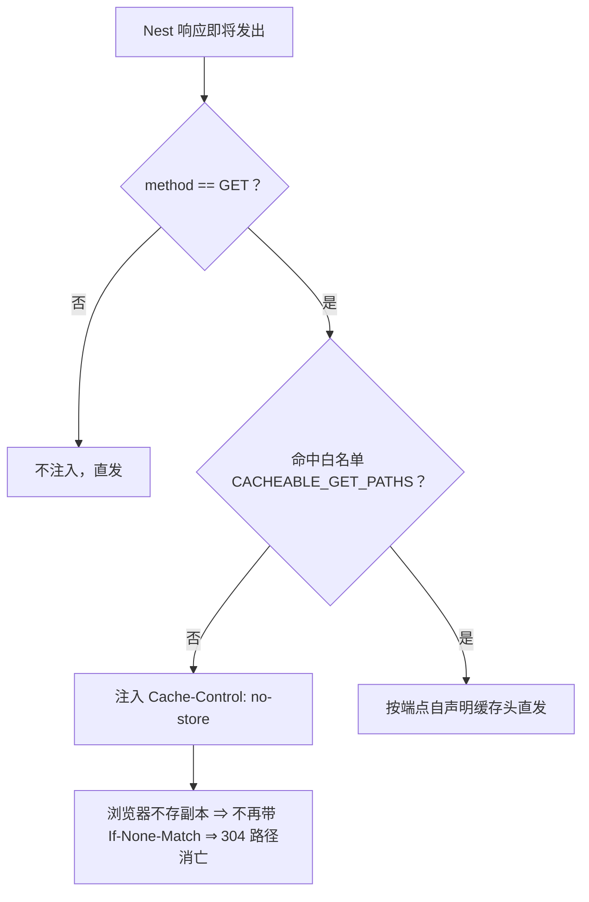
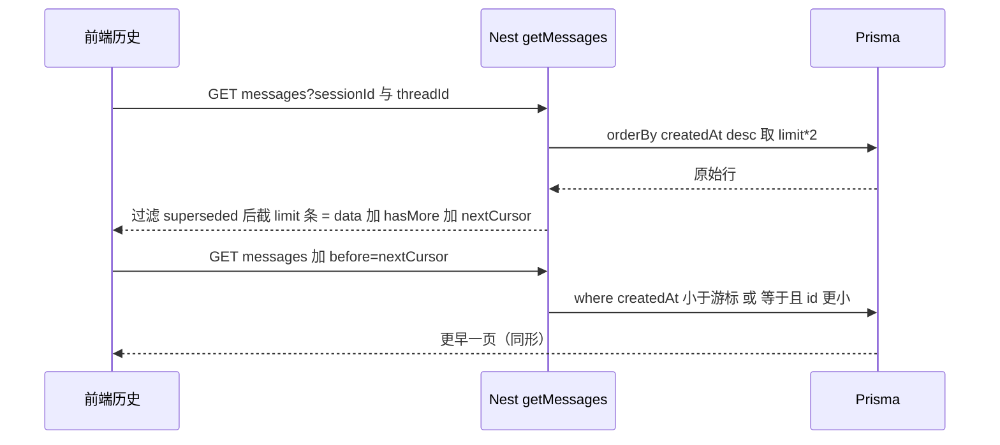
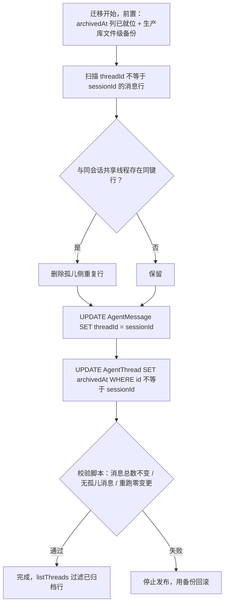

# 会话历史恢复治本 H0+H1（缓存收口 · legacy 归并 · 读协议）设计规格

状态：待评审（2026-10-28，由讨论文档 H0/H1 路线固化；H2/H3 归既有规格，本包不实施）
前置：[`discussion/2026-10-28-agent-history-multidevice-review-discussion.md`](../discussion/2026-10-28-agent-history-multidevice-review-discussion.md)（取证与归因来源）、[`specs/2026-10-26-unified-single-conversation-design.md`](./2026-10-26-unified-single-conversation-design.md)（ADR-0015，T1 细化承接方）
分支约定：实现走 feature 分支 + PR + squash merge。H0 与 H1 各自独立成 PR、独立可发。

## 0. 配图索引（结构与视觉两类，均随本文档演进）

本文档的图分两类：**结构图**一律以 Mermaid 内嵌；本规格无空间/比例判据，**无视觉稿附件**（§1 反面判据命中）。

| 编号 | 形式 | 内容 | 位置 | 用途 |
|---|---|---|---|---|
| 图 1 | 内嵌 Mermaid | H0-a 缓存收口判定：响应出口统一决策 | §5.1 | 拦截器实现与验收锚点（S2） |
| 图 2 | 内嵌 Mermaid | H0-b legacy 归并流程：去重 → 移动 → 归档 → 校验 | §7.2 | 迁移 SQL 编写顺序与幂等验收锚点（S4） |
| 图 3 | 内嵌 Mermaid | H1-a 分页游标时序 | §5.2 | getMessages 契约变更的实现与验收锚点（S5） |

## 1. 目标

1. **刷新/切回后，历史要么完整呈现、要么呈现可重试的失败态**——正确性不依赖任何单个调用点记得带对缓存头，304 空体类事故在服务端层面绝根。
2. **193 个 legacy 会话的老用户打开项目能看到原历史**：归并迁移幂等可重跑，补回 ADR-0015 J5 门禁欠账。
3. **历史读协议补齐**：分页游标（长对话不丢头部）、轻量计数、死端点清除、加载期净化。

判据见 §10.3（S1–S8）。

## 2. 范围

**在范围内（H0-a～d + H1-a～e，共 9 项）**

| 批次 | 项 | 一句话 |
|---|---|---|
| H0-a | 服务端统一缓存收口 | Nest 全局拦截器对 `/api` 动态 GET 注入 `Cache-Control: no-store`（白名单制，今日为空） |
| H0-b | legacy 线程归并 backfill | `migrations/*_unify_legacy_thread_messages`（ADR-0015 T1 的细化承接），幂等 + 前置备份 |
| H0-c | legacy 行禁用态 | 历史面板对 `archivedAt` 非空行渲染禁用态（「已归档 · 即将合并到主对话」），停止「点了没反应」。**禁用谓词禁止用 `id !== sessionId`**：在役 fork（重跑）分支线程 id 同为 `sessionId:后缀` 复合键（生产实证，223 条孤儿线程全部此形态），按 id 判禁会误杀活跃分支 |
| H0-d | 失败重试入口 | `loadHistory` 失败渲染「对话历史加载失败 · 重试」行内卡，消灭 toast+空白 |
| H1-a | 分页游标 | `chat/user/messages` 加 `before/limit`，响应加 `hasMore/nextCursor`；superseded 过滤移入服务层 |
| H1-b | 轻量计数 | `chat/threads` 行加 `messageCount`，bootstrap 不再全量下载消息只为数数；threads 失败 fail-open |
| H1-c | 死端点退役 | `GET /agent/thread-state` 退役 + 前端 3 处调用删除，不许半死 |
| H1-d | 加载期 sanitize | 历史消息进渲染前统一净化：畸形 metadata 降级标注、空 assistant 行剔除、恢复定位改「最后一条非空 assistant」 |
| H1-e | 机器载荷清单单源 | `__new_task__` 等清单收敛到 `packages/shared`，消灭多副本漂移面 |

**明确不做（及理由）**

| 不做 | 理由 |
|---|---|
| 服务端写路径清洗 `__new_task__`（落库前删标记） | 会破坏回合分类语义（mid-run-interrupt 规格 UAT-INT-PV-03 依赖该标记）；单源收敛只在读/渲染面 |
| H2（activeLeaf 服务端指针 / thread_forked 会话级广播 / 多对话 UI 退役） | = ADR-0015 Phase 2 本体（T2/T3/T4/T5），已拍板，不另立规格 |
| H3（seq 回填收口 / 对账自愈修复 / 恢复轮询游标化） | = 2026-10-21 多端一致性规格 Task 7 与姊妹篇 P2a，合流实施 |
| 客户端缓存层（SWR/IndexedDB 会话镜像） | 镜像即第三个真相源；恢复正确性优先 |
| supersededBy 真列化 | 依赖 seq 收口同窗（Task 7），本包用 overfetch 过滤先行 |

## 3. 与既有规格的关系

| 既有规格/决策 | 关系 | 说明 |
|---|---|---|
| ADR-0015（2026-10-26 统一单会话） | **继承 + 细化 + 补过渡态** | 其 T1（归并）由本规格 H0-b 细化落地；其 §4.1 J5 门禁被违约是 H0-b 的直接动因（讨论文档 §1.3 取证）；其 T4 实施时须继承本包的 `archivedAt` 判据（活跃叶子派生排除已归档行）；H0-c 是其 T5 退役前的过渡禁用态，T5 落地即删 |
| 会话历史域审视讨论文档（2026-10-28） | **实现其 H0/H1** | 取证链、31 项缺陷清单（D1-D31）、六条根因均以该文为准；本规格重新锚定行号（该文行号为 B 级证据，会漂移） |
| 2026-10-21 多端一致性规格 | 不冲突 | 其 Task 7（`@@unique([threadId,seq])` + clientId 写入）= H3，不在本包；本包 H1-a 的游标用 `(createdAt, id)` 复合键，seq 就绪后由 H3 切换为 seq 游标（§12） |
| 2026-08-12 mid-run-interrupt 规格 | 约束 | `__new_task__` 是回合分类输入 ⇒ H1-e 不做写路径清洗（§2） |
| 姊妹篇画布审视（P0-P4） | 互补 | 其 P0「可观测先行」与本包 H0-a 并行；D28（agent 域外缓存审计）登记 §12 |

## 4. 规范与判据（K1–K5，后续同类需求直接套）

- **K1 缓存策略服务端收口**：动态读端点的缓存语义由服务端出口统一决策（图 1）；前端 `no-store` 保留为纵深防御，但**正确性不得依赖它**。新增 GET 端点无需思考缓存头。
- **K2 迁移必须 expand→migrate→contract**：先加列（additive，可回滚），再归并数据，最后才允许切读端/退役。门禁（如 J5）违约等同事故，欠账须显式登记并补课。
- **K3 恢复失败必须 fail-visible + 可重入**：任何历史/线程拉取失败不得呈现为「真空态」或只 toast；必须渲染可重试入口。threads 拉取失败还须 fail-open（保留本地线程标识现场，不清 fork key）。
- **K4 机器载荷清单单一来源**：`__new_task__` 等对用户不可见的机器载荷文本，清单只存在于 `packages/shared` 一处；任何消费方（过滤、可见性、测试）一律 import。
- **K5 读协议必须游标化**：历史类列表端点禁止「take 截断后过滤」；分页判据（hasMore/nextCursor）必须是服务端权威输出，不得让前端用「返回条数 < limit」猜测。

## 5. 架构与契约

### 5.1 H0-a 缓存收口（图 1）

新增 `NoCacheInterceptor`（Nest 全局拦截器，`main.ts` 注册）：在响应出口对 GET 请求统一注入 `Cache-Control: no-store`，白名单机制今日为空、留作将来可缓存端点（如导出下载）的显式出口。

*图 1 · 说明 H0-a 的收口判定：缓存决策从「每个前端调用点的自觉」上移到服务端响应出口，白名单为空即全禁。这是验收 S2 的实现基准。*

边界说明：`/api/uploads/*` 静态资源走 express static 中间件，先于 Nest 拦截器执行，不受影响；SSE 端点（`/runs/events`）是 GET，会被注入 no-store，对事件流无副作用（本就不应缓存）；Express 的 ETag 计算保留（no-store 下浏览器不存副本，ETag 变为无效冗余，无害）。

### 5.2 契约变更（图 3）

| 契约 | 变更 | 消费方 |
|---|---|---|
| 所有 `/api` GET 响应头 | 新增 `Cache-Control: no-store`（图 1） | 全部前端 fetch/XHR |
| `GET /api/agent/chat/user/messages` | query 增 `before?: string`（游标 `base64("<createdAt>:<id>")`，指向**本页最早一行**）、`limit?: number`（默认 100，上限 200）；响应顶层增 `hasMore: boolean`、`nextCursor: string \| null`；`data` 数组形状与排序（createdAt asc）**不变**，向后兼容 | 前端「加载更早消息」 |
| `GET /api/agent/chat/threads` | 行增 `messageCount: number`，透出 `archivedAt`；**不过滤**已归档行（前端 H0-c 据此渲染禁用态；bootstrap 对已归档分支计数为 0 ⇒ fork key 自愈回落共享线程） | 前端 bootstrap 计数 / 历史面板 |
| `AgentThread` 表 | 新增 `archivedAt DateTime?`（H0-b 归并后 orphan 行置值）。**两类谓词解耦**：迁移一次性归档谓词 = `id != sessionId`（仅针对 Phase 1 上线前历史债，见 §7.2 边界）；读端禁用谓词 = `archivedAt` 非空（活跃 fork 分支不归档 ⇒ 永不被禁用/归并误伤） | 迁移 / 前端禁用态 / ADR-0015 T4 |
| `GET /api/agent/thread-state` | **退役删除**（连同 W27 phase-state 的退役另立小项，见 §12） | 前端 3 处调用删除（§9 H1-c） |
| `packages/shared` | 新增 `machinePayloads.ts` 导出机器载荷清单 | `agentInterruptGate.ts`（web 两处消费经它中转） |

游标时序见图 3。superseded 过滤（`metadata.supersededBy` 非空的 assistant 行不返回）从 take **之后**移入服务层：overfetch `limit*2` → 过滤 → 截取 `limit` → `hasMore/nextCursor` 按剩余行判定（SQLite 下 metadata 为 String 列，Prisma 无法在查询层过滤 JSON，真列化见 §12）。

*图 3 · 说明 H1-a 的分页协议：服务端权威输出 hasMore/nextCursor，前端只消费不猜测；游标取**本页最早一行**（asc 输出后的首行）的 `(createdAt, id)` 复合键，同毫秒写入不重不漏。这是验收 S5 的实现基准。*

## 6. 打样/主场景规格

无视觉稿依赖。主场景 = §10.3 S1–S8，其中 **S3（legacy 会话历史可见）是本包最高优先场景**——它是 193 个生产会话的日常体验问题。

## 7. 数据与状态变更

### 7.1 迁移一（expand）：`<ts>_add_thread_archived_at`

`schema.prisma` 的 `AgentThread` 增 `archivedAt DateTime?`（含注释：归并标记，ADR-0015 T4 活跃叶子派生须排除）。纯 additive，可原样回滚。

### 7.2 迁移二（migrate）：`<ts>_unify_legacy_thread_messages`（图 2）

纯 SQL（Prisma migration），按图 2 顺序：

1. **去重**：孤儿行与共享线程行同键时删孤儿侧。键谓词：`runId` 非空 ⇒ `(sessionId, runId, role, content)`；`runId` 为空 ⇒ `(sessionId, role, content, createdAt)`（同毫秒全同文本视为重复）。
2. **移动**：`UPDATE AgentMessage SET threadId = sessionId WHERE threadId != sessionId`（保持 createdAt 原值，时序天然不变）。
3. **归档**：`UPDATE AgentThread SET archivedAt = 当前时间 WHERE id != sessionId`（orphan 线程行保留作审计，含其 turnState；listThreads 过滤后前端不可见）。
4. **共享线程 turnState 不动**：活跃线程的回合连续性状态只认共享线程行。

> **与在役 fork（重跑）的边界（审核修订 2026-10-28）**：fork 落库路径在役（`agent.service.ts` forkSession 后消息落 `sessionId:后缀` 复合键线程；生产实证 Phase 1 上线后仍有分支消息写入，且 223 条孤儿线程 id 形态与 fork 分支**同构**）。本迁移只归并「Phase 1 上线（2026-10-26 21:32）前」的历史债；**归并后至 Phase 2（T2/T4）前，用户重跑仍会创建新分支线程——新债显式接受，随 Phase 2 统一收口，本包不追**。校验脚本含前置断言：`createdAt ≥ Phase 1 上线时刻` 的孤儿行数必须为 0，非零即中止转人工（防误伤归并窗口内新产生的活跃分支）。

*图 2 · 说明 H0-b 归并的执行顺序与幂等来源：去重先行防跨线程重复，移动后 UPDATE 影响行数为零即证明幂等；校验不通过必须停发回滚。这是验收 S3/S4 的实现基准。*

**幂等与回滚**：三步均为全量条件 UPDATE/DELETE，重跑零变更（S4）；移动不可逆，回滚 = 恢复备份（7.3）。

### 7.3 生产执行程序（H0-b 上线前置）

1. 生产库文件级备份：`sqlite3 <db> ".backup '<备份路径>'"`，备份留存至归并验收通过后删除；
2. staging/本地库全量演练：先跑迁移一 + 迁移二，再跑 `scripts/verify-thread-unify.ts` 全绿；
3. 生产 `prisma migrate deploy`（迁移按序自动执行）；
4. 跑校验脚本出报告（消息总数、会话覆盖数 193、重跑零变更、**Phase 1 时刻前置断言通过**）。

## 8. 纯函数与算法（含单测要求）

| 函数 | 位置 | 单测要求 |
|---|---|---|
| `isCacheablePath(path)` | `no-cache.interceptor.ts` 导出 | ① 空白名单 ⇒ 恒 false；② 命中白名单前缀 ⇒ true；③ 大小写敏感；④ 非 GET 不进该判定 |
| 游标编解码 `encodeCursor/decodeCursor(row)` | `agent.service.ts` 导出 | ① 往返一致；② 畸形输入（非 base64/缺字段）⇒ 抛 BadRequest 而非静默；③ 同毫秒两行按 id 排序稳定 |
| `sanitizeHistoryMessages(rows)` | `apps/web/src/components/agent/historySanitize.ts` | ① metadata 解析失败 ⇒ 行保留 + `degraded: true`；② content 为空的 assistant 行 ⇒ 渲染剔除但游标语义保留；③ `__new_task__` user 行 ⇒ 按 K4 清单剔除；④ 恢复定位取「最后一条非空 assistant」；⑤ 全畸形输入 ⇒ 空数组而非抛错 |
| 归并幂等 | 校验脚本 `scripts/verify-thread-unify.ts` | 同库跑两遍：第二遍消息总数、各会话计数与第一遍完全一致；**前置断言：`createdAt ≥ Phase 1 上线时刻` 的孤儿行数为 0**（非零 = 疑似活跃 fork 分支，中止转人工） |
| `resolveBootstrapThreadId`（H1-b 后） | `streamRecovery.ts` | ① threads 拉取失败 ⇒ 不清不覆盖本地缓存（fail-open）；② threads 正常 ⇒ 现行为不变 |

## 9. 文件级改动清单

> ⭐ 本节是实施排期的唯一输入，已与 §5.2 契约、§10.3 验收、§12 路线图逐条交叉核对。
> 行号锚点为 2026-10-28 master 实测，实施时以符号搜索重新定位。

| 任务 | 文件 | 改动 |
|---|---|---|
| H0-a | `apps/server/src/common/no-cache.interceptor.ts`（新增） | 拦截器 + `CACHEABLE_GET_PATHS` 白名单常量 + `isCacheablePath` 导出 |
| H0-a | `apps/server/src/common/no-cache.interceptor.test.ts`（新增） | §8 判定用例 + 「GET 响应带 no-store 头」行为用例 |
| H0-a | `apps/server/src/main.ts` | `useGlobalInterceptors` 注册（:30 全局管道之后） |
| H0-b | `apps/server/prisma/schema.prisma` | `AgentThread.archivedAt` 列 + 注释（:376 模型块内） |
| H0-b | `apps/server/prisma/migrations/<ts>_add_thread_archived_at/migration.sql`（新增） | additive 加列 |
| H0-b | `apps/server/prisma/migrations/<ts>_unify_legacy_thread_messages/migration.sql`（新增） | §7.2 四步 SQL（名称对齐 ADR-0015 T1） |
| H0-b | `scripts/verify-thread-unify.ts`（新增） | §8 幂等校验 + 会话覆盖报告 |
| H0-b | `apps/server/src/agent/agent.service.ts` | `listThreads`（:312）**不加** `archivedAt` 过滤（归档行必须到达前端渲染禁用态；Task 4 以负向契约钉死），行经 findMany 自然透出 `archivedAt` 列 |
| H0-c | `apps/web/src/components/agent/AgentSideRail.vue` | 历史面板行 `archivedAt` 非空渲染禁用态（「已归档 · 即将合并到主对话」，`--lnk-*` 令牌），点击不响应；**禁用谓词禁止 `id !== sessionId`**（在役 fork 分支同构，见 §7.2 边界）；`selectThread`（:1630 一带）守卫保留为双保险 |
| H0-c | `apps/web/src/components/agent/AgentSideRail.legacyThreadArchived.test.ts`（新增） | 静态契约：禁用态存在且不触发 selectThread |
| H0-d | `apps/web/src/components/agent/AgentSideRail.vue` | `historyLoadState: 'idle' \| 'loading' \| 'failed'`；失败渲染「对话历史加载失败 · 重试」行内卡，重试 = 重新 `loadHistory()`；成功态不复现 |
| H0-d | `apps/web/src/components/agent/AgentSideRail.historyRetryCard.test.ts`（新增） | 静态契约：失败态卡片 + 重试入口存在 |
| H1-a | `apps/server/src/agent/agent.controller.ts` | `GetAgentMessagesQueryDto`（:215）加 `before/limit`（`@IsOptional @IsString` / `@IsOptional @IsInt @Min(1) @Max(200)`）；`getMessages`（:256）响应透出 `hasMore/nextCursor` |
| H1-a | `apps/server/src/agent/agent.service.ts` | `getMessages`（:280）改签名 `(sessionId, threadId, before?, limit?)`；overfetch + superseded 过滤移入服务层 + 游标编解码导出 |
| H1-a | `apps/server/src/agent/agent.service.messages-pagination.test.ts`（新增） | §8 游标用例 + 分页正确性 + superseded 不占页 |
| H1-a | `apps/web/src/components/agent/AgentSideRail.vue` | 「加载更早消息」入口（`hasMore` 时）→ 追加拉取并 `prependHistory` |
| H1-a | `apps/web/src/stores/agent.ts` | 增 `prependHistory(rows)`（幂等去重，复用 loadHistory 的净化路径） |
| H1-b | `apps/server/src/agent/agent.service.ts` | `listThreads` 增 groupBy 计数合并 `messageCount` |
| H1-b | `apps/web/src/components/agent/streamRecovery.ts` | `resolveBootstrapThreadId` 去 `messageCountFor` 依赖；threads 失败 fail-open（不清 fork key） |
| H1-b | `apps/web/src/components/agent/AgentSideRail.vue` | 删 bootstrap 选项里的 `messageCountFor` 实现（计数改读 threads 行） |
| H1-b | `apps/web/src/components/agent/streamRecovery.test.ts` | 改写：fail-open 用例 + 「bootstrap 不再为计数发 user/messages 请求」断言 |
| H1-c | `apps/server/src/agent/agent.controller.ts` | 删 `thread-state` 端点（:375）；W27 phase-state（:384）本包不动 |
| H1-c | `apps/web/src/components/agent/AgentSideRail.vue` | 删 :1892、:3171 两处调用及其死分支；恢复横幅判据改为「runs/events 实时状态 + 消息 metadata 终态」（既有 P1#11 判据） |
| H1-c | `apps/web/src/components/agent/streamRecovery.ts` | 删 `fetchThreadStateSafe`（:57） |
| H1-c | `apps/web/src/components/agent/streamRecovery.test.ts` 等 | 删 thread-state 相关用例并**改写**为「无 thread-state 请求」断言；涉及 `forkKeyWiring`/`historyFetchNoStore` 的断言保持绿，**不得只删不断言** |
| H1-d | `apps/web/src/components/agent/historySanitize.ts`（新增） | `sanitizeHistoryMessages` |
| H1-d | `apps/web/src/components/agent/historySanitize.test.ts`（新增） | §8 五组用例 |
| H1-d | `apps/web/src/components/agent/AgentSideRail.vue` | `loadHistory` 消费 sanitize 后的行集；恢复定位改用非空 assistant |
| H1-e | `packages/shared/src/machinePayloads.ts`（新增） | 机器载荷清单单源（自 `agentInterruptGate.ts:51` 一带迁移） |
| H1-e | `packages/shared/src/machinePayloads.test.ts`（新增） | 清单内容快照 + 消费方 import 路径契约 |
| H1-e | `apps/web/src/components/agent/agentInterruptGate.ts` | 改 import 自 shared；本文件不再持有清单字面量 |
| 全部 | `apps/web/src/components/agent/AgentSideRail.historyFetchNoStore.test.ts` | H0-a 落地后补注释「前端为纵深防御，收口在服务端拦截器」；断言不删（K1） |

## 10. 测试策略与验收标准

### 10.1 单元 / 静态契约

- §8 全部纯函数用例覆盖；web 侧按仓库纪律 node24 + `--maxWorkers=1 --no-file-parallelism`，批次 ≤3 文件。
- 既有契约必须保持绿：`AgentSideRail.forkKeyWiring.test.ts`、`AgentSideRail.historyFetchNoStore.test.ts`、`observerWiring.test.ts`（6 用例）、`agentInterruptGate.test.ts`、`bubbleVisibility.test.ts`。
- H1-c/H1-b 的用例改写遵守「不得只删不断言」：删除的死路径必须转化为否定断言（不发该请求 / 不存在该调用）。

### 10.2 服务端契约

- 任意 `/api` GET 响应头含 `Cache-Control: no-store`（行为级测试，非仅单测纯函数）。
- `chat/user/messages` 带 `before` 翻页：翻到头 `hasMore=false`；游标畸形 ⇒ 400。
- `chat/threads`：行含 `messageCount` 且与 `getMessages` 计数一致；已归档行以 `archivedAt` 非空**透出而非过滤**（H0-c 禁用态数据源）。

### 10.3 端到端场景验收（真机/生产复测）

| 场景 | 判据 |
|---|---|
| S1 失败可见可重试（H0-d） | 断网刷新画布 ⇒ 历史区呈现「加载失败 · 重试」卡；恢复网络点重试 ⇒ 历史完整。不存在 toast+空白 |
| S2 缓存收口（H0-a） | 任意 `/api` GET 响应带 `no-store`；将前端任一处 `no-store` 临时移除后三连强制刷新 ⇒ 历史仍完整（正确性不依赖调用点，K1） |
| S3 legacy 历史可见（H0-b，最高优先） | 从生产 223 条 orphan 线程抽样 ≥3 个会话：归并后打开项目历史完整呈现，内容与归并前备份一致 |
| S4 归并幂等（H0-b） | 校验脚本两遍执行计数一致；生产重跑 `migrate deploy` 零变更 |
| S5 长对话不丢头部（H1-a） | staging 构造 >100 条消息会话：「加载更早消息」可回溯至第一条；无重复无遗漏 |
| S6 轻量计数（H1-b） | bootstrap 期间网络面板无「以计数为目的」的 `user/messages` 请求（契约测试钉死） |
| S7 死端点清除（H1-c） | web 全域 grep 无 `agent/thread-state` 引用；端点 404；恢复横幅行为回归通过 |
| S8 畸形历史不白屏（H1-d） | 构造 metadata 损坏 + 空 assistant 行的会话：渲染降级标注（「过程数据缺失」），恢复定位正确，无崩溃 |

## 11. 风险

| 风险 | 缓解 |
|---|---|
| 归并误伤生产数据 | §7.3 三道闸：文件级备份、staging 全量演练、校验脚本门禁；移动步骤不可逆 ⇒ 校验失败必须停发回滚 |
| H0-b/H0-c 误伤在役 fork（重跑）分支 | **谓词解耦**（§5.2/§7.2）：迁移归档 = `id != sessionId` 且前置断言「Phase 1 时刻后零孤儿行」（fork 分支同构复合键，生产实证）；读端禁用 = `archivedAt` 非空（活跃分支不归档 ⇒ 永不禁用）；归并后重跑产生的新分支显式接受为窗口债，随 Phase 2 收口 |
| thread-state 退役击中未知消费方 | 实施前全域 grep 复验（讨论文档 C 级证据纪律）；web 三处调用点逐一改写并留否定断言 |
| archivedAt 过滤与 ADR-0015 T4 交互 | §5.2 已写明 T4 活跃叶子派生须排除已归档行；ADR-0015 实施时继承，登记 §12 |
| 拦截器对特殊 GET 的影响（SSE / 下载） | SSE 无副作用（本就不缓存）；将来可缓存端点走白名单显式出口（图 1） |
| overfetch 翻页在大表上的成本 | limit 上限 200 ⇒ 单查询 ≤400 行，现有索引（sessionId+threadId 过滤）可承载；seq 游标落地后（H3）切真游标 |
| H1-e 迁移清单漂移 | shared 单源 + 快照测试；`agentInterruptGate` 既有用例必须保持绿 |

## 12. 后续包 / 路线图

| 项 | 来源 | 说明 |
|---|---|---|
| H2：activeLeaf 服务端指针 + thread_forked 会话级广播 + 多对话 UI 退役 | ADR-0015 Phase 2（T2/T3/T4/T5） | 本包不实施；T4 继承 `archivedAt` 排除判据；T5 落地时删除 H0-c 过渡禁用态 |
| H3：seq 回填收口 + `@@unique([threadId,seq])` + clientId 写入 | 2026-10-21 规格 Task 7 | H1-a 游标届时由 `(createdAt,id)` 切换为 seq 游标 |
| H3-b：对账自愈修复（upsert/键源统一/failed 语义） | 讨论文档 R6/D18-D21 | 随 Task 7 同窗评估 |
| supersededBy 真列化 | 本包 §5.2 | 依赖 seq 收口，届时 overfetch 过滤退役 |
| D28 agent 域外 304 审计 | 姊妹篇 P0 可观测 | 拦截器落地后全域复核一遍残留端点 |
| W27 phase-state 死端点处置 | 讨论文档 D20 同款 | 与 H1-c 同判据，独立小 PR |
| 真机走查合并 | ADR-0015 S1-S5 + 本包 S1-S8 | 与 askuser 重制真机走查合并一次 |

## 13. 配图规范自检

`pnpm verify-spec-figures --file docs/superpowers/specs/2026-10-28-agent-history-recovery-h0-h1-design.md`：通过（R1–R8，3 图内嵌 Mermaid，无附件）。
