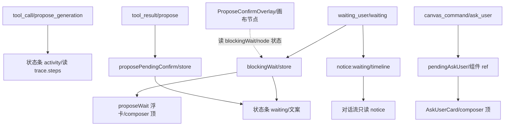
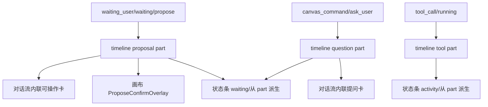
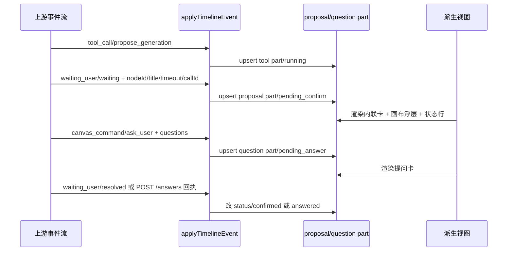
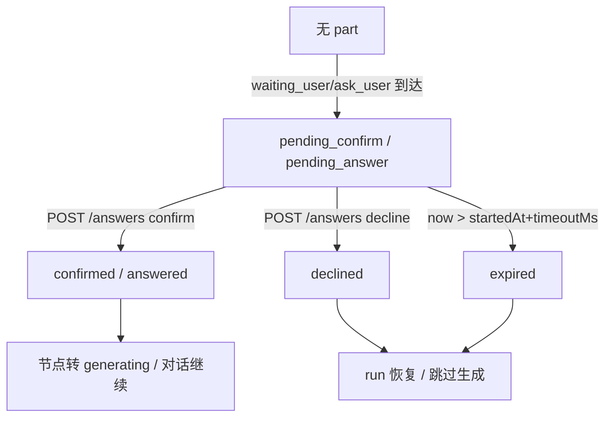

# 会话等待态时间线单一真相 —— 根治设计规格

状态：待评审（实现中，2026-10-28）
前置：
- `2026-10-19-propose-confirm-single-surface-design.md`（ADR-0011，已上线部分：画布节点内联确认面收敛、对话卡画布上下文只读化；本文显式修订其「对话流降权为只读日志」决定）
- `2026-10-06-propose-confirm-deterministic-design.md`（确认走 `POST /answers` 确定性信号，契约不动）
- `2026-09-28-ask-user-tool-design.md` / `2026-09-30-ask-user-blocking-design.md`（ask_user 工具与阻塞语义）
分支约定：实现走 feature 分支 + PR + squash merge；commit 只在 worktree。

> 一句话：**把「等用户确认」从分散在 4 个表面 + 状态条双源的控制信号，收敛成时间线里的一个内联 part（单一真相）**；画布节点浮层、对话流内联卡、底部状态行都只做它的派生视图。这同时根治用户反馈的两个现象——「提议生成卡片脱离对话流」与「状态行已显示走到提议生成、对话流却看不到」。

---

## 0. 配图索引（结构与视觉两类，均随本文档演进）

本文档的图全部为**结构图**，以 Mermaid 内嵌（无视觉稿——布局为结构性节点关系，非像素级空间）。

| 编号 | 形式 | 内容 | 位置 | 用途 |
|---|---|---|---|---|
| 图 1 | 内嵌 Mermaid | 当前 4 表面 + 状态条双源（根因结构） | §4.1 | 证明 desync 来自「同一事实多源」 |
| 图 2 | 内嵌 Mermaid | 目标态：时间线 part 单一真相 + 派生视图 | §5.1 | 验收「单一写入、多处派生」是否达成 |
| 图 3 | 内嵌 Mermaid | 等待态状态机（proposal/question part 状态流转） | §5.3 | 守卫「等待中 / 已确认 / 已拒绝 / 已超时」唯一出口 |
| 图 4 | 内嵌 Mermaid | SSE 事件 → 时间线 part 映射时序 | §5.2 | 核对「一个事件只产出一个真相」契约 |

---

## 1. 目标

1. **单一真相**：propose_generation 与 ask_user 的「等待用户」态，在客户端只有**一个**权威表示——时间线里的一个内联 `proposal` / `question` part；`blockingWait`、`proposePendingConfirm`、`pendingAskUser` 三套冗余状态全部下线，不再作为「是否在等」的真相源。
2. **对话流包含决策点**：提议生成 / 提问卡作为时间线内联部件出现在用户正在读的对话流里（live dock 与历史气泡同源渲染），而不是飘在对话流之外的系统层浮卡；卡片自带确认 / 取消 / 倒计时按钮。
3. **状态行退位为 ambient**：底部状态行不再抢「你要做的动作」动词，其「等待中」与「正在做什么」两路文案都从时间线 part 派生，与对话流同刻同源，结构性消除「状态行抢跑、对话流滞后」。

---

## 2. 范围（含明确不做）

**做**：
- 时间线模型新增 `proposal` / `question` part kind，承载等待态全部信息（nodeId/title/timeout/callId/questions/options…）。
- `applyTimelineEvent` 的 `waiting_user`（propose）与 `canvas_command{type:'ask_user'}` 分支改为 upsert 该 part，作为唯一写入点。
- `turnStatus` / `turnStatusBar` / `activityLine` 改为从时间线 part 派生；删除 `blockingWait` / `proposePendingConfirm` 的真相角色；`pendingAskUser` 组件 ref 改为读 part。
- 对话流内联渲染可操作的 proposal/question 部件；画布节点 `ProposeConfirmOverlay` 改为读同一 part。
- 单测 + 验收（见 §10）。

**不做（明确排除）**：
- 不改动 `POST /answers` 确定性确认契约（沿用 2026-10-06）。
- 不在本次重排画布节点确认面的视觉位置（ADR-0011 的节点即确认面保留，只是它的数据来源从 `blockingWait` 改为时间线 part）。
- 不要求后端合并 `waiting_user` 与 `canvas_command` 两个通道（前端足够在既有通道上收口；后端合并列为 §12 后续可选包）。
- 不处理非阻塞式工具的正常执行步骤（那些本就在 trace/timeline 里，与本次无关）。

---

## 3. 与既有规格的关系

- **显式修订 ADR-0011（2026-10-19 single-surface）决定 2「对话流降权为只读日志」**：ADR-0011 把「确认面」收敛到画布节点、把对话流里的提议卡降为只读，并新增了一个独立的 `.agent-system-layer` 浮卡（`proposeWait`，`AgentSideRail.vue:4828`）。这消除了画布「三带叠罗汉」，但**没有让对话流包含决策点**——提议卡仍飘在对话流之外，且 `blockingWait`/`proposePendingConfirm`/`pendingAskUser` 三套状态 + 状态条双源全部保留。本文把它进一步收敛：决策点进对话流内联 part，浮卡删除，三套状态下线，状态条改读时间线。ADR-0011 的「节点即确认面」**保留**，只是其数据源改为时间线 part（同一真相的第二个视图，而非第二个来源）。
- **沿用 2026-10-06 确定性契约**：确认 / 取消仍走 `POST /answers(callId)`，不变。
- **沿用 ask_user 既有语义**：问题集结构（`id/question/options/multiSelect/allowOther`）不变，只是承载从组件 ref 迁到时间线 part。

---

## 4. 规范与判据

### 4.1 根因（当前 4 表面 + 状态条双源）

「等用户」这一**单一事实**当前被 4 个表面 + 状态条 2 个数据源承载，来源事件不同、到达时点不同，必然 desync：

| # | 表面 / 数据源 | 真相角色 | 写入事件 | 清除时机 |
|---|---|---|---|---|
| S0 | `blockingWait`（store，`agent.ts:139-150`） | 是否在等（一票通过） | `waiting_user{status:"waiting"}`（`AgentSideRail.vue:3431`） | resolved / addUserMessage / finishStreaming / clear |
| S1 | `proposePendingConfirm`（store，`agent.ts:128-129`） | 是否待确认（反推） | `tool_result` 中 `propose_generation` 状态 `pending_confirm`（`agent.ts:416-421`） | addUserMessage / clear（**finishStreaming 不清，残留 bug**） |
| S2 | `pendingAskUser`（**组件 ref**，`AgentSideRail.vue:1290`） | ask 题面 | `canvas_command{type:'ask_user'}`（`AgentSideRail.vue:3730`） | 提交 / 取消 / 失败回 snapshot |
| S3 | 时间线 `notice:waiting`（part，`turnTimeline.ts:537-575`） | 只读提示 | `waiting_user` | resolved 改文案 |
| D0 | 状态条 `activity` | 「正在做什么」文案 | 直接读 `executionTrace.steps`（`activityLine.ts:16-24` → `AgentSideRail.vue:1108`） | — |
| D1 | 状态条 `waiting` 文案 | 「等待你确认」 | `blockingWait` / `proposePendingConfirm`（`turnStatusBar.ts:114-129`） | — |

> 同一件事，4 个写入口（S0/S1/S2/S3）+ 2 个状态条读源（D0/D1）。`tool_call(propose_generation)` 一到，trace 多一步 → D0 立刻显示「提议生成」；而可见的确认入口要等更晚/更飘的 `waiting_user`/`blockingWait` 才出现。**这就是用户看到的现象：状态行说到「提议生成」了，对话流里却还没看到可操作的卡。**

*图 1 · 当前 4 表面 + 状态条双源（根因结构）*



图 1 说明：三个 SSE 事件（A/B/C/E）各自写向不同的真相容器，状态条又从 trace（D0）和 blockingWait/proposePendingConfirm（D1）两路各读各的；最终 UI 有 4 个可见表面（F0/F1/F2/F3）+ 1 个永远钉底的状态条。任一事件迟到或漏到，就会出现「状态行抢跑、对话卡滞后 / 缺失」。

### 4.2 可复用判据（后续同类需求直接套）

1. **等待态判据**：凡「回合被挂起、等用户操作」的语义（确认 / 选择 / 输入），一律建模为时间线 `proposal` / `question` part，禁止新增 store 布尔或组件 ref 表达「是否在等」。
2. **派生判据**：任何「是否等待」「等待多久」「等什么」的展示（状态条、画布浮层、对话卡），**只能读时间线 part**，不得直连 `executionTrace.steps` 或任何 store 布尔去反推。
3. **写入判据**：一个 SSE 事件只 upsert 一个 part（稳定 id），不得同时写 store 态 + timeline part + 组件 ref 三处。
4. **ambient 判据**：底部固定状态条只承担「环境进度」（running 秒数 / 会话恢复中），不承载「需要你拍板的动作」动词；动作动词只出现在对话流内联 part 上。

---

## 5. 架构与契约

*图 2 · 目标态：时间线 part 单一真相 + 派生视图*



图 2 说明：所有「等待」写入收敛到时间线 `proposal`/`question` part 两个 upsert 点；所有可见表面（对话流卡、画布浮层、状态行）都是它的**只读派生**。状态行的 activity 也改为从时间线 `tool` part 派生（不再直连 trace），实现「单一写入、多处派生」。

### 5.1 数据模型（新增 part kind）

`turnTimeline.ts` 的 `TimelinePart` 联合类型新增两类（与现有 `thinking/text/tool/canvas/artifact/notice` 平级）：

```ts
| {
    kind: 'proposal'
    id: string                 // 稳定 id（同 waitingNoticeId 思路），等待期 upsert 不追加
    toolName: 'propose_generation'
    nodeId?: string
    title: string              // 人话标题，如「提议生成 · 1个节点」
    status: 'pending_confirm' | 'confirmed' | 'declined' | 'expired'
    callId?: string
    timeoutMs?: number
    startedAt: number          // 用于倒计时
  }
| {
    kind: 'question'
    id: string
    callId?: string
    title: string
    status: 'pending_answer' | 'answered' | 'declined'
    questions: Array<{
      id: string
      question: string
      options: { label: string; value: string }[]
      multiSelect?: boolean
      allowOther?: boolean
    }>
    startedAt: number
  }
```

**「是否在等」= 时间线 parts 中存在 `status==='pending_confirm'` 的 proposal 或 `status==='pending_answer'` 的 question。** 从此只有一个来源。

### 5.2 SSE 事件 → part 映射

*图 4 · SSE 事件 → 时间线 part 映射时序*



图 4 说明：propose 由 `waiting_user`（已带 nodeId/title/timeout/callId）直接产出 `proposal` part；ask_user 由既有 `canvas_command` 通道产出 `question` part（**不要求后端合并通道**）。确认 / 取消经 `POST /answers` 触发状态回执，`applyTimelineEvent` 据回执把 part 改为终态。每个事件只产出一个 part，杜绝多源。

### 5.3 等待态状态机

*图 3 · 等待态状态机（proposal / question part）*



图 3 说明：等待态有且仅有一个 part 表达，四个出口（确认 / 拒绝 / 超时 / 无）都从同一个 part 的状态流转，状态行、画布浮层、对话卡读同一 part 即得一致结论，结构性消除 desync。

### 5.4 契约（P0，前端可独立完成，后端可选）

- **前端（必做，零后端改动）**：`waiting_user` 已携带 `nodeId/title/timeoutMs/callId`，直接进 `proposal` part；`canvas_command.ask_user` 已携带 `questions`，直接进 `question` part。无需新协议字段。
- **后端（可选，§12）**：将 `canvas_command.ask_user` 的问题集并入 `waiting_user` 单一事件，进一步减少通道；非本次阻塞项。

---

## 6. 打样 / 主场景规格（逐项可验收）

### 6.1 propose_generation 场景

- **对话流（live dock + 历史气泡同源）**：出现内联 `proposal` 部件，含标题「提议生成 · N个节点」+ 「确认生成 / 取消」按钮 + 倒计时（读 `timeoutMs` 与 `startedAt`）。用户眼睛在对话流，决策入口就在对话流——**根治 Q1（脱离流）**。
- **画布节点 `ProposeConfirmOverlay`**：读同一 `proposal` part 的 `nodeId/status`，不再自维护 `blockingWait`/节点状态判据（守卫逻辑下沉到「提交答案」动作）。
- **状态行**：`waiting` 文案从 `proposal` part 派生（「等待你在画布上确认生成」+ 倒计时），与对话流内联卡同刻；`activity` 从时间线 `tool` part 派生。**根治 Q2（状态行抢跑）**。
- `.agent-system-layer` 里的 `proposeWait` 浮卡（`:4828`）**删除**——它和 inline 部件重复。

### 6.2 ask_user 场景

- 对话流内联 `question` 部件，渲染题面 + 选项 + 多选/其他，自带提交 / 取消；从 `question` part 读 `status`。
- `pendingAskUser` 组件 ref **删除**，`AskUserCard` 改为读 `question` part。
- 状态行 `waitingQuestion` 文案从 `question` part 派生。

### 6.3 状态条退位

- `turnStatus` 的 `activity` 不再直连 `describeActivity(executionTrace.steps)`；改为 `describeActivityFromTimeline(timeline.parts)`（读 `tool` part 的最新非 phase 步）。保留超时 / 网络错误等 ambient 文案。
- `resolveWaiting` 改为 `resolveWaitingFromTimeline(parts)`：parts 含 pending proposal/question 即 `waiting=true`，删 `blockingWait`/`proposePendingConfirm` 入参。

---

## 7. 数据与状态变更

**删除（不再作为真相源）**：
- `stores/agent.ts`：`blockingWait`（声明 `139-150`、mutations `setBlockingWait 649-660`、`setBlockingWait(null)` 调用点）、`proposePendingConfirm`（声明 `128-129`、写入 `endToolCall 416-421`、清除点）。
- `AgentSideRail.vue`：`pendingAskUser` 组件 ref（`:1290`）及其 SET/CLEAR 逻辑。
- `AgentSideRail.vue`：`.agent-system-layer` `proposeWait` 浮卡（`:4828`）渲染块。

**新增（唯一真相）**：
- `turnTimeline.ts`：`proposal` / `question` part kind + `applyTimelineEvent` 的 `waiting_user` / `canvas_command.ask_user` 分支 upsert 它们（稳定 id）。
- UI 渲染：`AgentTurnTimeline.vue` 增加 `v-else-if` 分支渲染 proposal/question 部件（live + 历史自动同源，因两处挂载共用该组件）。

**保留**：
- `POST /answers` 契约（`agentAnswers.ts`）与 `resolveProposeConfirmCallId` / `cancelProposeForNode` 等动作函数（语义不变，只是数据来源从 store 态改为 part）。
- 画布节点确认面视觉位置（ADR-0011）。

---

## 8. 纯函数与算法（含单测要求）

1. **`applyTimelineEvent` 分支（纯函数，必测）**：
   - `waiting_user{status:'waiting', toolName:'propose_generation', nodeId, title, timeoutMs, callId}` → upsert 一个 `proposal` part（status=`pending_confirm`），重复到达只更新不追加。
   - `waiting_user{status:'resolved'}` 或对应 `POST /answers` 回执 → 将匹配 `callId` 的 proposal 改 `confirmed`/`declined`。
   - `canvas_command{type:'ask_user', questions, callId}` → upsert 一个 `question` part（status=`pending_answer`）；提交/取消改 `answered`/`declined`。
   - 超时：渲染层据 `startedAt+timeoutMs` 派生 `expired`（不写死在 reducer，保持 part 纯）。
2. **`resolveWaitingFromTimeline(parts): boolean`**：parts 含 `pending_confirm` proposal 或 `pending_answer` question → true，否则 false。
3. **`describeActivityFromTimeline(parts)`**：取最后一个非 phase `tool` part 的 `presentToolStep().label`，缺失返回 null（降级 GENERIC_ACTIVITY）。
4. **单测要求**：上述 3 个纯函数各 ≥3 例（含「重复事件不追加」「resolved 改终态」「无 pending 即非等待」）；`AgentSideRail` 渲染层断言「proposeWait 浮卡已删除」「内联 proposal 部件出现」「状态行 waiting 文案从 part 派生」。

---

## 9. 文件级改动清单

| 文件 | 改动 |
|---|---|
| `apps/web/src/components/agent/turnTimeline.ts` | 新增 `proposal`/`question` part kind；`applyTimelineEvent` 的 `waiting_user`、`canvas_command.ask_user` 分支 upsert part |
| `apps/web/src/components/agent/AgentTurnTimeline.vue` | 新增 `proposal`/`question` part 渲染分支（确认/取消/倒计时/选项） |
| `apps/web/src/stores/agent.ts` | 删除 `blockingWait`、`proposePendingConfirm` 声明与写入；`endToolCall`/`finishStreaming` 清理相关逻辑 |
| `apps/web/src/components/agent/turnStatusBar.ts` | `resolveWaiting` → `resolveWaitingFromTimeline(parts)`；`turnStatusLine` 入参去除 `blockingWait`/`proposePendingConfirm`/`waitingTool`/`waitingQuestion` 直连，改由 `AgentSideRail` 从 part 取 |
| `apps/web/src/components/agent/activityLine.ts` | `describeActivity` → `describeActivityFromTimeline(parts)` |
| `apps/web/src/components/agent/AgentSideRail.vue` | 删除 `proposeWait` 浮卡（`:4828`）与 `pendingAskUser` ref；`handleEvent` 的 `waiting_user`/`canvas_command` 分支改为触发 timeline upsert；`turnStatus` 改为从 timeline part 取 `waiting`/`activity`/`question` |
| `apps/web/src/components/agent/proposeWaitActions.ts` | 保留动作函数（resolveConfirmCallId 等），调用方从 part 取 callId |
| `apps/web/src/pages/CanvasPage.vue` | `ProposeConfirmOverlay` 改为读 timeline `proposal` part（`isPendingConfirmNode` 派生依据改 part 而非 store 态） |
| 测试 | `turnTimeline.test.ts`（proposal/question 分支）、`turnStatusBar.test.ts`（resolveWaitingFromTimeline）、`AgentSideRail.proposeReadonly.test.ts` 改造为「内联 part 存在、浮卡删除」、`AgentSideRail.confirmTakedown.test.ts`（clearProposeGeneration emit 仍断言） |

---

## 10. 测试策略与验收标准（含目视验收）

**单测（本机 vitest，nvm node24 + `--maxWorkers=1 --no-file-parallelism`，归 CI 全量）**：
- `applyTimelineEvent`：propose/ask upsert 不重复、resolved 改终态、无 pending 即非等待。
- `resolveWaitingFromTimeline` / `describeActivityFromTimeline`：各 ≥3 例。
- 渲染层：`proposeWait` 浮卡 DOM 不存在；对话流内联 proposal 部件含按钮与倒计时；状态行文案与 part 同步变化。
- 回归护栏：`proposeWaitActions.test.ts`、`AgentSideRail.confirmTakedown.test.ts` 既有权断言保留（`/answers` 契约与 `clearProposeGeneration` emit 不被破坏）。

**验收判据（全满足才算闭环）**：
1. 提议生成 / 提问卡**出现在对话流内联位置**（live dock 与历史气泡都可见），不再有对话流之外的独立浮卡（根治 Q1）。
2. 底部状态行的「等待中」与「正在做什么」两路文案，与对话流内联卡**同刻同源**（改 part 即两者一起变，根治 Q2）。
3. `blockingWait` / `proposePendingConfirm` / `pendingAskUser` 三套冗余状态**全部下线**，grep 无残留真相角色引用。
4. 确认 / 取消仍走 `POST /answers` 确定性信号，无「虚假确认 / 误判取消」回归（沿用 2026-10-06 判据）。
5. 画布节点确认面正常（读同一 part），移动端三窗态表现正确。

**目视验收**：桌面 + 移动各跑一遍 propose 与 ask_user 全流程，截图核对「对话流内联卡存在、状态行与卡同刻、无独立浮卡」。

---

## 11. 风险

- **清除时序回归（最高）**：`finishStreaming` 原本不清 `proposePendingConfirm` 已埋残留 bug；收口到 part 后，终态必须靠 `resolved` 事件 / `/answers` 回执显式改，不能依赖 next-turn 复位。part 模型天然强制这点（状态只看 part）。
- **事件到达顺序**：`tool_call` 早于 `waiting_user` 是上游保证（`vendor/.../harness/agent-harness.ts` 的 `emitBatch` 串行），但需单测固化「先 tool_call 后 waiting_user 合成 proposal part」不漏步。
- **ask_user 双通道**：若后端未来把问题集并入 `waiting_user`，前端需同步把 `canvas_command` 分支迁移；本次保持双通道但都落同一 part，迁移成本为零。
- **测试天花板**：`AgentSideRail`/`CanvasPage` 级挂载测试超本机 vitest 天花板（既有纪律：全量归 CI）；纯函数 + 组件单测覆盖核心，挂载层靠 CI + 目视。

---

## 12. 后续包 / 路线图

- **后端可选（非阻塞）**：将 `canvas_command.ask_user` 问题集合并入 `waiting_user` 单一事件，进一步减少通道；届时前端 `canvas_command` 分支可删除，仅留 `waiting_user` 一路。
- **上游对齐（低成本）**：`waiting_user` 命名已对齐上游 `ui_prompt_start/end`（T8 已注释），可择机把 `waiting_user` 的 `status` 字段统一为上游 `ui_prompt` 的 `started/resolved` 语义。
- **历史回放**：part 模型纯函数化后，旧 snapshot 回放天然兼容（reducer 同形），无需迁移脚本。

---

## 13. 配图规范自检

```
pnpm verify-spec-figures --file docs/superpowers/specs/2026-10-28-agent-wait-timeline-single-source-design.md
```

预期：4 张 Mermaid 结构图全部命中（图 1 根因 / 图 2 目标态 / 图 3 状态机 / 图 4 时序），§0 索引齐全，正文各图均被引用（§4.1 / §5.1 / §5.2 / §5.3），无 R1–R8 违规。脚本结果贴此：

- [x] 运行结果：`✓ 0 个错误，0 个警告`（2026-10-28 通过）
