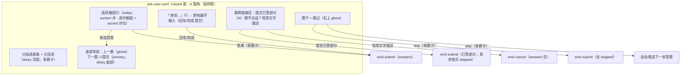
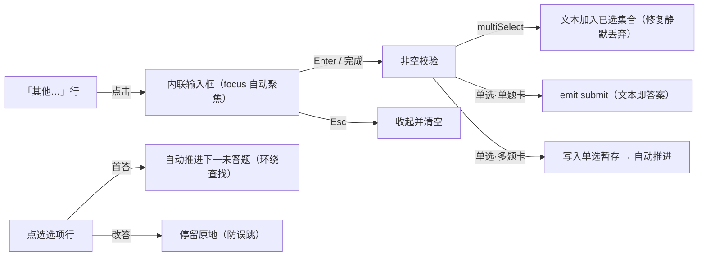

# AskUserCard 视觉重制 — Apple 式收敛 × 墨流令牌（2026-10-28）

## 0. 配图索引

| 图号 | 内容 | 锚点 |
|---|---|---|
| 图 1 | 卡片信息架构：主路径 / 静默逃生区 / 固定导航三层 | 图 1 |
| 图 2 | 「其他」展开交互与答后自动推进状态机 | 图 2 |

## 1. 背景与动机

PR #627 落地了 T0-T2（有界滚动 / 分页单题推进 / 契约强制 + 部分提交逃生），解决多题卡死。
线上走查发现视觉层仍有认知负担（用户实测反馈）：

1. **四个逃生口平铺等权**：常驻「其他」输入框、「跳过此题」、「取消选项，自行描述」、「提交已答部分」
   四者视觉权重接近主路径选项，用户难以分辨「我现在点的会走到哪条通道」。
2. **chip 胶囊选中态弱**：描边 + 软底色变化不显著，多选场景需要回读文字确认。
3. **跳过位置与题干争夺注意力**：独立占一行。
4. **缺陷**：multiSelect 题的「其他」文本写入单选暂存位，与已勾选项互斥，提交时被静默丢弃。

设计哲学对齐：Apple（Clarity / Deference / Depth）× 本仓墨流 Ink Flow（中性承载结构，品牌色只做点睛）。

## 2. 目标与非目标

**目标**
- G1 主路径唯一显眼：选项行 + 单个主操作钮；逃生口全部降级为静默链接。
- G2 全令牌化：只消费 `--lnk-*` L2/L3，零新增 hex/rgba，深浅主题成对自适应（design-token.test.ts 守卫）。
- G3 6 态契约齐备：default / hover(@media hover:hover) / active(scale .98) / focus-visible(2px border-focus 外环) / disabled（显式 `--lnk-text-disabled`，**禁 opacity**）/ loading（本卡无异步，不适用）。
- G4 修复 multiSelect「其他」静默丢弃缺陷。
- G5 交互增强：首答自动推进下一未答题（改答不推进）；「其他」chip 化原地展开。

**非目标**
- T3 MobileSheet 承载维持 deferred（沿用原 spec 判定，本卡仍由 AgentSideRail 系统层承载）。
- 不改 wire 契约：只 POST answers，未答隐式 skipped；skipped 显式列表保留。
- 不新增移动端专用组件（无 767px 媒体查询；触控目标 44px 由令牌保证）。

## 3. 信息架构（图 1）

**图 1 · 卡片信息架构：主路径（选项→导航）与三条逃生通道（部分提交/文字描述/跳过）分层呈现**

## 4. 「其他」展开与自动推进（图 2）

**图 2 · 「其他」展开交互与答后自动推进状态机：改答不推进，首答才推进**

## 5. 令牌映射（Apple 视觉 → 墨流令牌）

| Apple 设计元素 | 本仓落点 |
|---|---|
| 卡面白 + 大圆角 + 极浅阴影 | `--lnk-surface-raised` + `--lnk-radius-xl` + `--lnk-shadow-sm` + `--lnk-border-subtle` |
| 选项行浅灰填充 | `--lnk-surface-sunken`（深浅主题各自成对：浅=灰井 / 深=墨井） |
| 选中"翻面"+光晕环 | `--lnk-surface-raised` 底 + `--lnk-accent-border` 描边 + `0 0 0 2px --lnk-accent-subtle` |
| system blue 对勾/主钮 | `--lnk-accent`（品牌电光紫，Ink Flow 点睛语义）+ `--lnk-text-on-accent` |
| 大标题 | `--lnk-text-md` + `--lnk-weight-semibold` |
| 分段进度条 | past=`--lnk-accent`，cur=`--lnk-accent` @ opacity .45（装饰元素允许），rest=`--lnk-surface-sunken` |
| focus 环 | `outline: 2px solid --lnk-border-focus; outline-offset: 2px`（§3.1 契约） |
| 动效 | `--lnk-duration-*` + `--lnk-ease-standard/spring`；只动 transform/opacity；reduced-motion 全静止 |

## 6. 行为规格

- **R1 单题卡**：点选项行即提交（B-6 不变）；skip 即提交全 skipped；「其他」回车即提交文本。
- **R2 多题卡首答自动推进**：单选首答 / skip / multiSelect 确认后，自动前进到下一个未答且未跳过的题（环绕查找）；全部已答/已跳过则触发答满自动提交（S3）。
- **R3 改答不推进**：对已答题再次点选只更新暂存，停留原地（防误跳）。
- **R4 multiSelect「其他」**：文本追加进已选集合（去重），随「确认（已选 N 项）」提交；修复旧实现静默丢弃。
- **R5 部分提交**（T2 保留）：仅 0<已答<N 时显示于静默链接区，文案「提交已答部分（N）」。
- **R6 cancel**（保留）：文案改「都不合适？改用文字描述」，emit cancel 语义不变。
- **R7 跳过可返回**：跳过后题头按钮变「已跳过」（disabled）+ 题下提示行「此题已跳过 / 重新作答」。
- **R8 T0 有界滚动保留**：`max-height: min(60vh, 520px)` + 自滚；进度条/导航 sticky 且负 margin 盖住卡片内边距防漏底。

## 7. 兼容性与风险

- 测试锚定 class 全保留（`.ask-chip/.ask-skip/.ask-multi-confirm/.ask-other-input/.ask-nav-*/.ask-partial/.ask-cancel/.ask-progress`）。
- `.ask-chip` 语义从「胶囊」变「触控行」，DOM 数不变（每题 2 选项 + 1 其他行）。
- 风险：其他行由「常驻输入框」变「点开输入」——键盘用户多一次点击；对勾 SVG 为内联零依赖，符合图标规范。
- `--neo-*` 零引用（neoUsageRatchet 禁增）；无 767px 媒体查询；无新增第三方依赖。

## 8. 验收判据

- V1 `AskUserCard.test.ts` 全绿（含新增：其他行提交 / multiSelect 其他修复 / 自动推进 / 改答不推进 / 跳过返回）。
- V2 `vue-tsc -b` 零错误。
- V3 令牌四守卫全绿：design-token / text-token-guard / theme-usage / dead-styles；neoUsageRatchet 计数不增。
- V4 深浅主题人工核对：行填充、选中翻面、对勾、focus 环在两主题均达对比度（令牌成对性由测试保证）。

## 9. 文件级改动清单

| 文件 | 改动 |
|---|---|
| `apps/web/src/components/agent/AskUserCard.vue` | 视觉重制 + 「其他」chip 化 + 自动推进 + multiSelect 其他修复 |
| `apps/web/src/components/agent/AskUserCard.test.ts` | 适配自动推进语义；+5 用例 |
| `docs/superpowers/specs/2026-10-28-askuser-card-visual-refinement.md` | 本规格 |

不改：`AgentSideRail.vue`（宿主零改动）、`services/pi-runtime/**`（wire 契约不变）、令牌文件。
