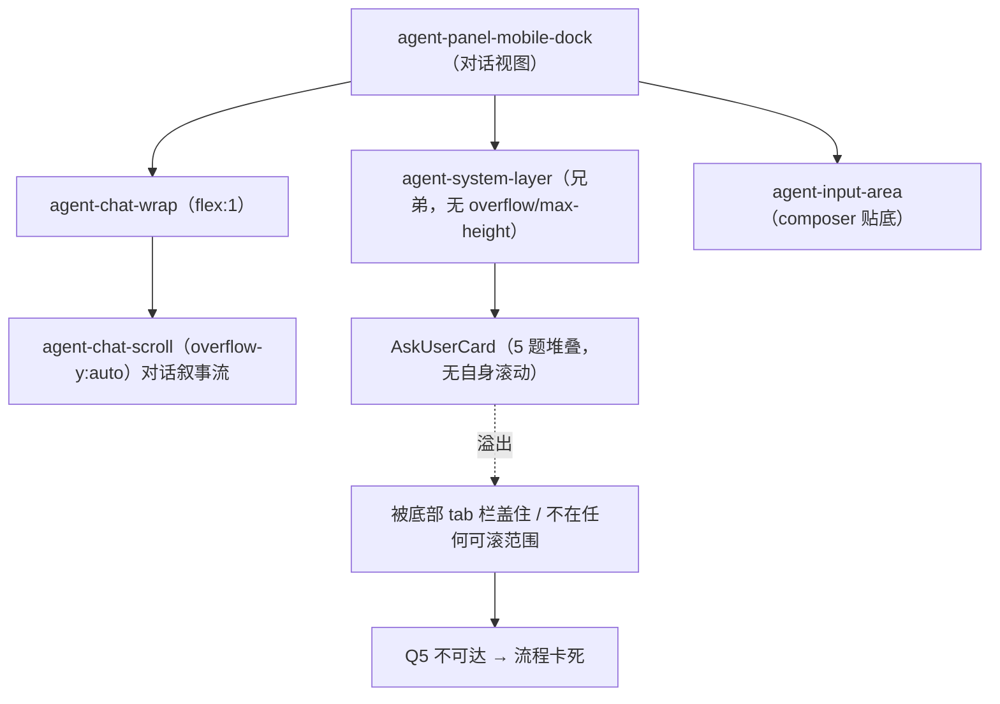
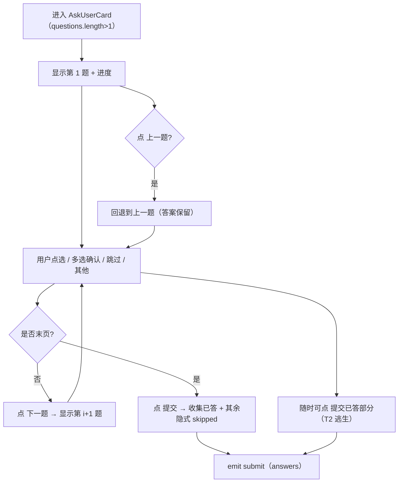
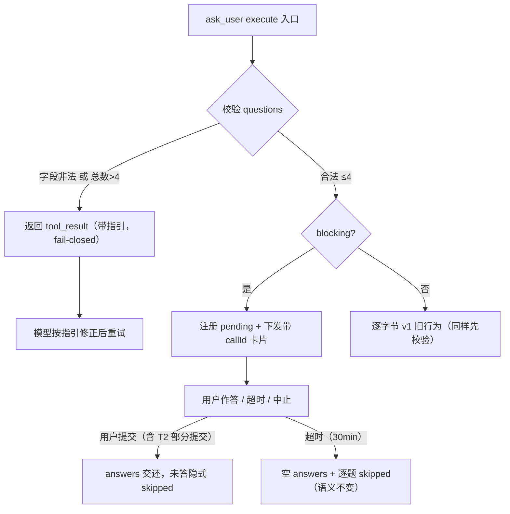

# ask_user 多题卡移动端死锁根因与重构设计规格

状态：待评审（2026-10-28，源于生产事故复盘 + 上游 pi-agent / Codex / Claude 生态对标）
前置：
- `docs/superpowers/specs/2026-09-30-ask-user-blocking-design.md`（阻塞分支 B-1/B-4/B-5，本规格修订其「多题全堆一卡」的实现假设）
- `docs/superpowers/specs/2026-10-17-mobile-composer-sse-boundary-design.md`（D-4 阻塞态 peek 自动展开；本规格对齐并修正其「卡片在滚动容器内」的隐含前提）
- 上游 pi-agent `packages/coding-agent/examples/extensions/questionnaire.ts`（单题推进 tab 范式，直接吸收）
分支约定：实现走 `fix/askuser-multi-question` 分支 + PR + squash merge。

## 0. 配图索引（结构图一律内嵌 Mermaid）

| 编号 | 形式 | 内容 | 位置 | 用途 |
|---|---|---|---|---|
| 图 1 | 内嵌 Mermaid | 当前布局缺陷：ask 卡在滚动容器之外、无界无滚 → Q5 不可达 | §4 | 锁定根因 1（卡片被移出唯一滚动容器） |
| 图 2 | 内嵌 Mermaid | 目标分页交互流：一题一屏 + 进度 + 上一题/下一题/提交 + 部分提交逃生 | §5 | 验收 T1 分页单题推进 |
| 图 3 | 内嵌 Mermaid | 契约强制 + 超时数据流：工具入口校验 ≤4 / 字段合法，非法 fail-closed 引导重试 | §5 | 验收 T2 契约强制 |

---

## 1. 目标（可验收）

1. **G-1 多题卡永不死锁**：任意题数（含模型违规多发）下，用户都能到达并作答每一题、且能提交；移动端不出现「Q5 被 tab 栏盖住、对话流拖不动」的卡死。
2. **G-2 契约落地**：`ask_user` 的题目数 / 字段合法性在工具入口被运行时强制校验（fail-closed），模型发超量或畸形题不再穿透到 UI 造成崩溃。
3. **G-3 不丢数据、有逃生通道**：阻塞期间提供「提交已答部分」逃生钮；用户不必苦等 30 分钟超时，已作答部分立即生效，未答隐式 skipped（模型按既有语义自主决策）。

## 2. 范围（含明确不做）

**做**：
- T0：`.ask-user-card` 有界可滚（内部 `max-height + overflow-y:auto`）兜底，杜绝任何高度溢出。
- T1：多题卡改为**一题一屏 + 进度 + 导航**（吸收上游 `questionnaire.ts` 范式）；单题卡保持点选即提交低摩擦主路径。
- T2：工具入口契约校验（≤4 题 + 字段合法，非法 fail-closed 引导重试）；卡片加「提交已答部分」逃生钮。
- T4：带视口高度的组件测试 + 契约单测。

**不做（本期明确划出）**：
- **T3 全量迁移到 `MobileSheet` 浮层**：见 §12 路线图。理由——系统层（`.agent-system-layer`）已是「阻塞交互贴条」的既定承载面，且 SSE 边界 spec D-4 已规定 `blockingWait` 触发 peek（≤60vh）自动展开使其可见可达；T0+T1 已让卡片有界、单屏、内部可滚，**T3 想达成的「可见 / 可达 / 可逃」三性已被满足**。把 ask 卡单独塞进 `MobileSheet` 会破坏与同层 `propose-wait` / `turn-status` 的一致性，需连带迁移才能不分裂，属于更大的「阻塞等待统一」架构包，不在本包范围。
- 不改动超时语义（仍交还空 answers + 逐题 skipped；无部分通道）——部分答案通过 T2 逃生钮显式提交，而非靠超时自动 salvage（见 §5.3 论证）。
- 不改 PC 端形态（分页逻辑对桌面同样适用且无回归）。

## 3. 与既有规格的关系

| 规格 / 决策 | 关系 | 说明 |
|---|---|---|
| `2026-09-30-ask-user-blocking-design.md` | **修订实现假设** | 原 §5.3 默认「多题卡答满自动提交」建立在「卡片能完整显示」之上；本规格修正为分页单屏，并补「系统层无滚动容器」这一被忽略的前提。阻塞契约（B-1/B-4/B-5）、waiting 事件、cancel 语义全部保留。 |
| `2026-10-17-mobile-composer-sse-boundary-design.md` D-4 | **对齐 + 修正隐含前提** | D-4 假定阻塞卡在 peek（≤60vh）展开容器内即可见。但 ask 卡在 2026-10-14 P1-5 被移出 `agent-chat-scroll`、放进 `.agent-system-layer`（该层无 `overflow`/`max-height`），故 peek 展开的是**对话流**而非 ask 卡 → 卡仍不可达。本规格 T0 补滚动、T1 让卡有界，使其真正落在 D-4 的「可见可达」承诺内。 |
| 上游 `questionnaire.ts` | **直接吸收** | 多题提问用 tab / 单题推进（一次一题、答完进下一题、末页提交）。本规格 `AskUserCard` 多题分支即此范式，不再重造「全堆一卡」。 |

## 4. 规范与判据（可复用规则，后续同类需求直接套）

- **判据 R1（多题收集 = 分页单题推进）**：凡 `ask_user` 题数 > 1，UI 必须**一题一屏**展示，绝不纵向堆叠全部题目。单屏高度必然 ≤ 视口，永不溢出、永不卡死。→ 直接复用 `AskUserCard` 分页分支。
- **判据 R2（系统层卡片必须有界可滚）**：任何渲染在 `.agent-system-layer` 的卡片，自身必须有 `max-height + overflow-y:auto`（或等同的有界滚动），**不得依赖宿主滚动容器**。新增系统层卡片一律适用（防回归守卫见 §10）。
- **判据 R3（契约 fail-closed）**：`ask_user` 题目数与字段合法性在工具入口校验；非法输入以带指引的 `tool_result` 交还（非抛异常），引导模型修正后重试，而非让畸形数据穿透到 UI。对齐 SP-D 的「服务端 fail-closed」哲学。
- **判据 R4（阻塞必有逃生）**：阻塞式收集必须提供「提交已答部分」类逃生钮，用户不等超时即可交还已作答部分；未答隐式 skipped（模型已知题面，缺答即视为跳过）。

## 5. 架构与契约

### 5.1 当前布局缺陷（根因 1：卡片被移出唯一滚动容器）

图 1 展示宿主结构：`AskUserCard` 在 2026-10-14 P1-5 被移出 `agent-chat-scroll`（`overflow-y:auto`），放进 `.agent-system-layer`；该层 CSS 仅 `canvas-view` 的 `display` 规则，**无 `overflow` / `max-height`**，且与滚动容器是**兄弟**关系。于是 5 题堆叠的卡片是一个完全没有滚动容器的块，溢出后直接被底部 tab 栏盖住，且不在任何可滚范围内 → Q5 不可达。

**图 1 · 当前布局缺陷：ask 卡在滚动容器之外、无界无滚 → Q5 不可达（根因 1）**

### 5.2 目标分页交互流（T1）

多题卡（`questions.length > 1`）改为一题一屏：顶部进度「第 X / N 题 · 已答 A / N」，中部当前题（题干 + 选项 + 其他 + 跳过），底部固定导航（上一题 / 下一题 或 提交）。答案按 `qid` 跨页保留；末页「提交」收集全部已作答 + 其余隐式 skipped。单题卡（`length === 1`）维持点选即提交。

**图 2 · 目标分页交互流：一题一屏 + 进度 + 导航 + 部分提交逃生（T1/T2）**

### 5.3 契约强制 + 超时数据流（T2）

工具入口先校验 `questions`：每题须有非空 `id` / `question`、≥1 个非空 `label+value` 的 `option`；总数 ≤ `MAX`（= 4，与 schema `max:4` 同源导出）。非法 → 返回带精确指引的 `tool_result`（如「题目数超过上限 4（收到 N），请合并或缩减为 ≤4 题后重试」），模型重试，**卡片永不收到越界数据**。合法 → 走既有阻塞 / 非阻塞分支。

**图 3 · 契约强制 + 超时数据流：工具入口校验 ≤4 / 字段合法，非法 fail-closed 引导重试（T2）**

**为何超时仍交还空 answers（不改）**：部分答案只存在于前端，未 POST 即随卡清除；强行 salvage 需服务端暂存通道（2026-10-02 已删 `recordPartial`）。本规格改用**显式「提交已答部分」逃生钮**（T2）让用户在超时前主动交还，语义更明确、零服务端改动。

### 5.4 改动落点（文件级，详见 §9）

- `apps/web/src/components/agent/AskUserCard.vue`：T0 有界滚动 CSS；T1 分页状态机（`currentIndex` + 导航 + 跨页保留）；T2 部分提交钮。
- `services/pi-runtime/src/tools/ask-user.ts`：T2 入口契约校验 + 导出 `ASK_USER_MAX_QUESTIONS` 常量复用进 schema。
- `AgentSideRail.vue` **不改**（T0 由卡片自带有界滚动覆盖，详见 §9 注释）。
- 测试：`AskUserCard.test.ts`（T1/T2/视口）、`ask-user.test.ts`（T2 契约）。

## 6. 打样 / 主场景规格（逐项可验收）

| # | 场景 | 验收标准 |
|---|---|---|
| S1 | 单题卡（length=1） | 点 chip 即 emit submit（低摩擦主路径不变）；skip 即 submit 全 skipped；cancel 保留 |
| S2 | 多题卡分页 | 一次只显示一题；进度「第 X/N 题 · 已答 A/N」；上一题/下一题可往返，答案跨页保留 |
| S3 | 多题卡提交 | 答满自动提交（保留既有契约）**且** 末页「提交」钮可显式提交 |
| S4 | 多题卡逃生（T2） | 「提交已答部分」钮：已答 A<N 时点击 → emit 已答部分（其余隐式 skipped），卡关闭、agent 续行 |
| S5 | 多题卡 + multiSelect | 点选切换 + 显式确认钮（D2 语义保留）；确认后可下一题/提交 |
| S6 | 有界滚动（T0） | 单题选项极多 / 长题干时，卡片内部 `overflow-y:auto` 滚动，导航钮 `sticky` 常驻可见；不溢出到 tab 栏 |
| S7 | 契约强制（T2） | 模型发 5 题 → 工具返回带指引 tool_result，卡片不渲染越界卡；发畸形题（缺 option）→ 同样被拒 |
| S8 | 非阻塞路径 | `ASK_USER_BLOCKING=off` 旧行为同样先校验（不渲染越界卡） |

## 7. 数据与状态变更

- **无 store / DB 变更**：`pendingAskUser` 结构不变（`AgentSideRail` 内部 `ref`）；`AskUserCard` 仅增内部 `currentIndex`（分页游标，组件本地）。
- **wire 契约不变**：`onAskSubmit` 仍只 POST `answers`；未答隐式 skipped 的语义不变（模型已知题面，缺答即跳过）。`skipped` 本地 UI 状态继续用于进度与跨页保留，不进 wire。
- **工具结果契约不变**：合法分支返回 `{ok:true, answered:true, answers}`；超时返回空 answers + 逐题 skipped；新增「非法参数」结果属既有 `tool_result` 文本通道，不新增字段。

## 8. 纯函数与算法（含单测要求）

- **`validateAskQuestions(questions, max)`（ask-user.ts 内纯函数）**：返回 `{ ok: true }` 或 `{ ok: false, reason: string }`。判据：数组非空、长度 ≤ max、每题 `id`/`question` 非空字符串、`options` 为长度 ≥1 且每项 `label`/`value` 非空。单测覆盖：合法 / >max / 空 options / 缺 id / 空 question。
- **分页游标（AskUserCard 内 computed）**：`current = questions[currentIndex]`；`isFirst = currentIndex===0`；`isLast = currentIndex===questions.length-1`；`answered(id)` 判据复用既有 `answeredCount` 逻辑。无独立纯函数，随组件测试覆盖。

## 9. 文件级改动清单（实施排期唯一输入，须与 §12 / §10 交叉核对）

| 文件 | 改动类型 | 对应任务 |
|---|---|---|
| `apps/web/src/components/agent/AskUserCard.vue` | 修改 | T0（卡片 CSS 有界滚动 `max-height+overflow` + 导航 sticky）/ T1（分页状态机 + 模板 + 导航样式）/ T2（部分提交钮 + 样式） |
| `services/pi-runtime/src/tools/ask-user.ts` | 修改 | T2（入口 `validateAskQuestions` 校验 + 导出 `ASK_USER_MAX_QUESTIONS` 复用进 schema） |
| `apps/web/src/components/agent/AskUserCard.test.ts` | 修改 | T4（分页 / 部分提交 / 视口高度 / 单题与 multiSelect 回归） |
| `services/pi-runtime/src/tools/ask-user.test.ts` | 修改 | T4（契约强制：>4 被拒 / 畸形被拒 / 合法放行） |
| `docs/superpowers/specs/2026-10-28-askuser-mobile-multi-question-redesign.md` | 新增 | 本规格 |

> **`AgentSideRail.vue` 不改**（T0 已由卡片自带有界滚动覆盖）：对话视图下 `agent-chat-wrap` 为 `flex:1`、吸收系统层之上的剩余高度，系统层（ask 卡）高度 = 卡片自身 `max-height`（≤60vh），永远不会溢出到 tab 栏之下；故无需在宿主层加高度约束（避免改动 4000+ 行巨型组件的回归风险，R-1）。T3（MobileSheet 迁移）亦不在本清单——见 §2 / §12 路线图。

## 10. 测试策略与验收标准（含目视验收，T4）

| 层 | 用例 | 工具 |
|---|---|---|
| 组件（AskUserCard） | S1-S5 全场景：单题提交 / 分页导航 + 跨页保留 / 答满自动提交 / 部分提交逃生 / multiSelect | vitest + @vue/test-utils |
| 组件（视口高度） | **新增**：以 `attachTo` + 注入 `viewport` 高度挂载，断言卡片 `getBoundingClientRect().height` ≤ 视口且内部可滚（`scrollHeight > clientHeight` 时不溢出宿主）；导航钮 `sticky` 可见 | vitest（带 `window.innerHeight` mock） |
| 契约（ask-user） | S7/S8：>4 题返回 fail-closed tool_result；畸形题（空 options / 缺 id）被拒；合法 ≤4 放行进入等待 | node:test（既有 harness） |
| 令牌 | `design-token.test.ts` + `theme-usage.test.ts` + `text-token-guard.test.ts` 全过（新增样式只用既有 `--neo-*` / `--lnk-*` 令牌，不引裸色值） | vitest |
| 类型 | `vue-tsc -b` 全绿 | vue-tsc |
| 防回归守卫 | 新增静态守卫：`.agent-system-layer` 内卡片组件必须有 `overflow` / `max-height`（或宿主层兜底）—— 行为级，扫全目录，附变异测试 | 脚本 + 变异 |

**目视验收（真机，A 类）**：iOS / Android 各一，复现原事故（5 题）→ 确认可逐题作答并提交、不卡死、不溢出 tab 栏；`prefers-reduced-motion` 下分页切换直切。

## 11. 风险

| # | 风险 | 缓解 |
|---|---|---|
| R-1 | `AgentSideRail.vue` 是 4000+ 行巨型组件，T0 改 CSS 回归面大 | T0 只动 `.agent-system-layer` 对话视图高度 + 卡片自身滚动（双保险），不动 hosting 逻辑；令牌测试 + 类型检查兜底 |
| R-2 | 分页改写可能破坏既有「答满自动提交」契约 | S3 明确保留自动提交 + 显式提交双路径；`AskUserCard.test.ts` 覆盖回归 |
| R-3 | 契约拒绝 >4 题可能让模型丢题（5→4） | 属模型按指引修正的契约行为，非静默丢失；且 T1 分页已能兜底任意 N（即便校验被绕过也不崩）。双保险 |
| R-4 | 视口高度组件测试在本机（无真实浏览器视口）需 mock | 用 `window.innerHeight` + `attachTo` 文档元素模拟；断言不依赖真实像素，只判「卡片高度 ≤ 视口且不溢出宿主」 |

## 12. 后续包 / 路线图（本包外的东西登记，避免隐性范围）

- **T3 MobileSheet 迁移（deferred）**：待「阻塞等待统一」架构包立项时，将 `propose-wait` / `turn-status` / `ask_user` 一并迁入 `MobileSheet`，统一阻塞浮层语义。当前 T0+T1 已满足「可见/可达/可逃」，故不在本包。触发条件：灰度数据出现「系统层贴条在某种态下仍不够显眼」或 D-4 peek 形态需整体升级为 sheet。
- **SP-E 并发 CAS**：本包不改 canvas 写路径，与 `2026-10-28-sp-e-canvas-write-cas-design.md` 无耦合。
- **spec 回写**：本包合入后，回写 `2026-09-30-ask-user-blocking-design.md` §5.3（标注「多题分页单屏」）与 `2026-10-17-mobile-composer-sse-boundary-design.md` D-4（标注「系统层卡片须有界可滚，否则 peek 不可达」）。

## 13. 配图规范自检

- 跑 `pnpm verify-spec-figures --file docs/superpowers/specs/2026-10-28-askuser-mobile-multi-question-redesign.md`：
  - 图 1 / 图 2 / 图 3 均为内嵌 Mermaid（`flowchart TD`），首行关键字合法（R7 ✓）。
  - 三图编号连续、各有图注、正文均引用（R2/R3/R4 ✓）。
  - 无 SVG 附件，R1/R6 不适用。
  - §0 配图索引登记全部图号（R5 ✓）。
- 结果：待实现后回填本规格提交时的实际退出码（预期 0）。
