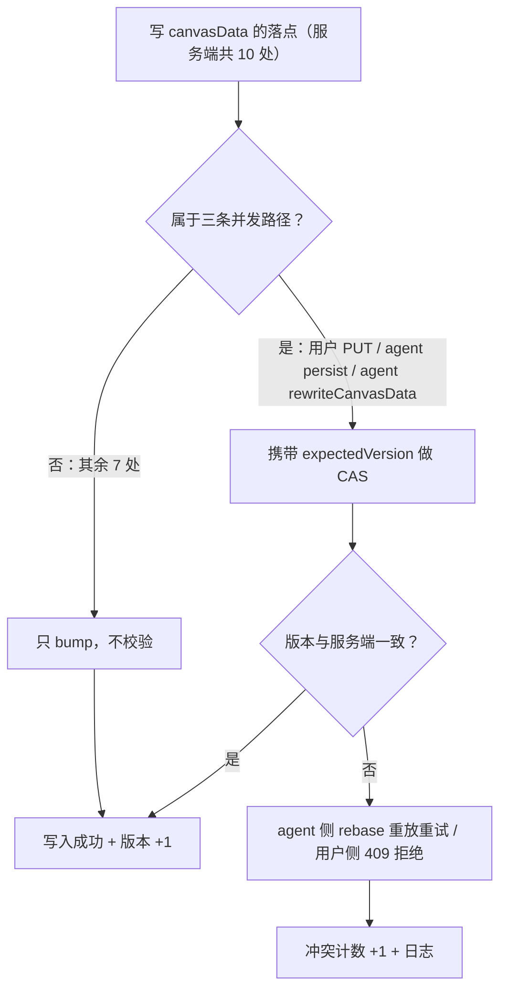
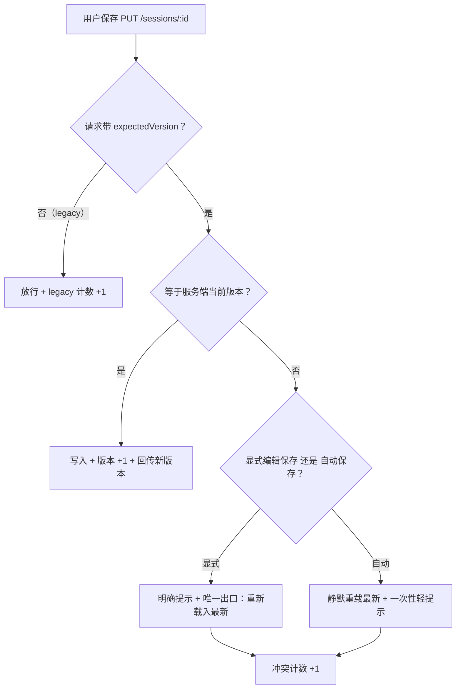

# SP-E · 画布并发写入底座（canvasVersion CAS）设计规格

状态：待评审（brainstorming 产出，2026-10-28）
前置：SP-A 批量布局（已上线）/ SP-B 对齐（已上线）/ SP-C 视口恢复（已上线）/ SP-D 连线校验（已上线，#610 + ADR-0014）
分支约定：实现走 feature 分支 + PR + squash merge；本轮**同时动后端与前端**，须走 `prisma migrate deploy`。

> 范围声明：本规格是 SP-E 的**第一子项**（并发写入底座）。原路线图的 SP-E 含「canvasVersion CAS + stage 暂存 UI + 校验对齐 + 回合 checkpoint」，本轮只做 CAS 与冲突可观测，其余拆为后续子项（见 §12）。

---

## 0. 配图索引

本文档的图分两类：**结构图**一律以 Mermaid 内嵌；**视觉稿**以 `assets/` 下的 SVG 附件承载。本文档不含视觉稿（理由：本轮无空间/比例/形状类判据，全部判据均为流程与规则，可用结构图无损表达）。

| 编号 | 形式 | 内容 | 位置 | 用途 |
|---|---|---|---|---|
| 图 1 | 内嵌 Mermaid | 写路径收口范围与 CAS 判定 | §5.1 | 判定「哪些写点必须校验、哪些只 bump」的唯一依据；新增写点时照此对号入座 |
| 图 2 | 内嵌 Mermaid | 用户侧保存的冲突处理分支 | §5.2 | 验收用户侧 409 行为与显式/自动保存分级 |

---

## 1. 目标（3 条，均可验收）

1. **不再发生「客户端用旧版本整块覆盖服务端新版本」**。判据：携带过期 `expectedVersion` 的 `PUT /sessions/:id` 返回 409，且不落库。
2. **冲突不再静默**。判据：每次 CAS 失败都产生一条冲突计数与一条日志，字段含 `sessionId / surface / expected / actual`。
3. **新增写 canvasData 的落点不会漏掉版本 bump**。判据：静态守卫测试对「写 canvasData 但未 bump」的落点转红（见 §8.2）。

---

## 2. 范围

**做**：`canvasVersion` 列与迁移；CAS 原语；三条并发路径的校验；agent 侧 rebase 重放；用户侧 409 与前端分级处理；bump 义务静态守卫；三个冲突/兼容计数。

**明确不做**（有意为之，非遗漏）：

- stage 暂存确认 UI（服务端能力已内建，但「agent 何时进暂存」是提示词策略问题，另立子项，见 §12.1）；
- 回合 checkpoint（边界未清，缓议）；
- 语义冲突裁决（同一节点同一字段双改，谁赢——见 §5.3）；
- 跨设备实时同步 / 广播；
- 其余 7 处写路径的校验（只 bump，不校验，见 §4.1 与 图 1）。

---

## 3. 与既有规格的关系

| 既有规格 | 关系 |
|---|---|
| SP-D 连线校验（ADR-0014） | **复用**：`connect-nodes` 通道与前端回滚机制原样保留，本包只在其上叠加版本校验；`validateEdgeAdditions` 在 rebase 重放时再次执行（防重放期间成环） |
| SP-C 视口恢复 | **受保护对象**：视口已是一等持久化状态，随整块 canvasData 落库；本包挡住「旧版本整块覆盖」即同时保护视口 |
| SP-A 批量布局 | **沿用其结论**：SP-A 已记「stage 参数本规格不暴露」，本包维持不暴露 |
| ADR-0014 | 新增 ADR-0016 记录本包决策（opt-in 兼容、用户侧 fail-closed、agent 侧 rebase），两者无冲突 |

---

## 4. 规范与判据

### 4.1 现状取证：写者矩阵（本包的事实基础）

服务端写 `canvasData` 的落点共 **10 处**（`grep 'canvasData:.*JSON.stringify'` 得 9 处，另有 `sessions.service.update` 的条件写 1 处）。逐处判定：

| 写者 | 落点 | 是否事务内 | 覆盖风险 | 处置 |
|---|---|---|---|---|
| 用户整块 PUT | `sessions.service.ts:116` | 否 | **最高** | 校验（核心） |
| agent `rewriteCanvasData` | `agent.service.ts:2972` | 否 | 中 | 校验 |
| agent `persist` | `agent-canvas-tools.service.ts:3796` | 是 | 低 | 校验 |
| `connect-nodes`（SP-D） | 走 `persist`，**同一落点不另计** | 是 | 低 | 随 persist 校验 |
| `commitStaged` | `:3596` | 是 | 低 | 只 bump |
| `persistCanvasData` | `:3697` | 是 | 低 | 只 bump |
| `persistCanvasGroups` | `:3726` | 是 | 低 | 只 bump |
| `persistLayoutNodes` | `:3749` | 是 | 低 | 只 bump |
| `composition` | `composition.service.ts:219` | — | 各自域内 | 只 bump |
| `stories` | `stories.service.ts:23` | — | 各自域内 | 只 bump |
| `persist-remote` | `persist-remote.service.ts:402` | — | 各自域内 | 只 bump |

合计：**3 处校验 + 7 处只 bump**（`connect-nodes` 与 `persist` 同落点，不重复计数）。

⚠️ **一条反直觉但必须写清的事实**：`persist()` 在事务内「读最新 → apply actions → 写」，**本身已经是 rebase 语义**，它并不会拿回合开始的旧快照去覆盖用户改动。真正的覆盖源是**用户侧整块 PUT**（客户端手里是旧版本）。本包的收益主体因此是用户侧 CAS；agent 侧 CAS 的收益是「收口非事务写点 + 冲突可观测 + 严格保证 apply 基线」。

### 4.2 两次事故实证（本包不是预防想象中的敌人）

| 时间 | 事故 | 出处 |
|---|---|---|
| 2026-10-26 | 6 条并发 SSE 占满同源连接 → 画布加载停在空态 → 自动保存把「空画布」整份 PUT 回服务端 → **真画布被抹掉** | `CanvasPage.vue:5074-5094` 注释 |
| 2026-10-13 | 浏览器整份 PUT 把服务端 `pending_confirm` 盖回旧终态 → runtime 轮询误读为「已确认自起生成」 | `sessions.service.ts:78-84` 注释 |

两次的既有处置（`shouldBlockCanvasOverwrite`、`guardPendingConfirmStatuses`）都是**字段级/加载态的专项守卫**，挡不住「我手里是旧版本、但我照样 PUT 成功」这一类。CAS 补的正是这个洞。

### 4.3 判据

- **G-1（bump 义务）**：任何写 `canvasData` 的落点都必须 `canvasVersion + 1`，无一例外。版本号停滞会让 CAS 出现假绿。
- **G-2（校验范围）**：只有 §5.1 判定的三条并发路径做 `expectedVersion` 校验，其余只 bump。
- **G-3（用户侧 fail-closed）**：携带过期版本的请求一律 409，且**不提供「强制覆盖」出口**——那扇门就是 2026-10-26 事故的门。
- **G-4（opt-in 兼容）**：请求未携带 `expectedVersion` 时**放行**并计数 `canvas_legacy_write_total`，不强拒。理由见 §11.1。
- **G-5（agent 侧不放弃）**：agent 侧冲突先进 rebase 重放重试（上限 3 次），耗尽才把冲突作为 tool_result 回给 agent 重新决策；既不静默丢弃 agent 产出，也不覆盖用户改动。
- **V-1**：并发双写交错（用户 PUT 与 agent 写同时发生）后，画布不丢任何一方的合法改动。
- **V-2**：`canvas_legacy_write_total` 连续 7 天为 0 ⇒ 下一轮 PR 关闭 opt-in 转 fail-closed（登记为有主待办，见 §12.2）。

---

## 5. 架构与契约

### 5.1 写路径收口范围（见 图 1）

*图 1 · 十处写 canvasData 的落点在「是否校验」上的分流：三条并发路径走 CAS，其余七处只 bump 不校验；无论哪条，成功写入都必须 bump。判「新写点该怎么做」时照此图对号入座。*



**CAS 原语**（统一一处，禁止散落——复用本仓 `payment.service.ts` 既有模式）：

```ts
const res = await tx.session.updateMany({
  where: { id: sessionId, canvasVersion: expected },
  data: { canvasData: JSON.stringify(next), canvasVersion: { increment: 1 } },
})
if (res.count === 0) throw new ConflictException(/* 冲突 */)
```

### 5.2 用户侧保存的冲突处理（见 图 2）

*图 2 · 用户侧保存的三岔口：不带版本（legacy 前端）放行但计数；带版本且匹配则成功并回传新版本；带版本但不匹配按「显式编辑保存 / 自动保存」分级——显式给明确提示与唯一出口，自动保存静默重载以免弹窗轰炸。*



**契约变更**：`PUT /sessions/:id` body 增可选 `expectedVersion?: number`；`findOne` 与 `update` 的响应体经 `formatSession` 增 `canvasVersion`。

### 5.3 语义冲突的边界声明（不解决，只声明）

rebase 只解决**技术冲突**（我的动作能否在最新状态上落地）。**语义冲突**——同一节点同一字段，用户改了、agent 也改了——重放后仍是后写赢。本包只承诺「不静默丢失 + 冲突被显式暴露」，语义冲突裁决登记在 §12.3。

### 5.4 agent 侧 rebase 重放（逐类判定）

| action | 重放语义 | 判定 |
|---|---|---|
| `add_node` | 同 id 已存在 ⇒ 跳过（对齐 SP-D `add_edge` duplicate 幂等先例） | 安全 |
| `update_node` | 按字段 patch；目标已不存在 ⇒ 记入失败 | 技术安全，语义冲突未解 |
| `remove_node` | 目标已不存在 ⇒ 无操作 | 安全 |
| `add_edge` | 幂等跳过；重放时再跑 `validateEdgeAdditions`（端点/自环/成环） | 安全 |
| `remove_edge` | 幂等 | 安全 |
| `set_viewport` | 覆盖式 | 安全（低风险） |

重试上限 3 次；耗尽或遇不可重放失败 ⇒ `ConflictException` → tool_result 回 agent：「画布在你操作期间被用户改动，请基于最新状态重新决策」。

---

## 6. 主场景规格（逐项可验收）

| # | 场景 | 期望 | 验收方式 |
|---|---|---|---|
| S1 | 用户持有过期版本触发显式保存 | 409，不落库；提示「你刚才这一下改动没保存」+ 唯一出口「重新载入最新」 | 集成测试 + 生产复测 |
| S2 | agent 写期间用户改了画布 | 自动 rebase 重放后成功，两侧改动都在；`canvas_cas_rebase_retry_total` +1 | 集成测试 |
| S3 | rebase 目标已被删除，重试耗尽 | 回退：ConflictException → tool_result 回 agent；用户改动保留 | 单测 |
| S4 | 未携带版本的 legacy 客户端保存 | 放行成功；`canvas_legacy_write_total{surface}` +1 | 单测 |
| S5 | 自动保存（视口防抖/回合轮询）遇冲突 | 静默重载最新 + 一次性轻提示，无弹窗轰炸 | 目视验收 |
| S6 | 新增一处写 canvasData 却未 bump | 静态守卫测试转红 | 变异测试（见 §10.3） |

---

## 7. 数据与状态变更

- `Session` 增列 `canvasVersion Int @default(0)`；存量全为 0，**无需回填**（0 是合法起始版本）。
- 迁移由 `prisma migrate dev` 生成（目录名形如 `<timestamp>_add_session_canvas_version`，时间戳不预写）；部署走 `prisma migrate deploy`。⛔ **禁手工 ALTER**（本仓有 P3009 → 容器重启循环前科）；若发现手工改过，用同镜像临时容器 `prisma migrate resolve --applied <name>` 兜。
- 不变：`stagedActions` / `stagedAt` 语义不变（stage 只累积动作、不写 canvasData，故不 bump）。

---

## 8. 纯函数与算法

### 8.1 冲突计数（三个，all 为计数器）

| 指标 | 触发 |
|---|---|
| `canvas_cas_conflict_total{surface=agent｜connect｜user_edit}` | CAS 返回 count 0 |
| `canvas_cas_rebase_retry_total` | agent 侧每次重放重试 |
| `canvas_legacy_write_total{surface}` | 请求未携带 expectedVersion 而放行 |

### 8.2 bump 义务静态守卫（新增测试）

扫描 `apps/server/src/**` 中 `canvasData: JSON.stringify` 的落点，凡附近未见 `canvasVersion: { increment: 1 }` ⇒ 转红。
**必须做变异验证**：人为去掉一处 bump ⇒ 守卫须 EXIT=1 且指名该处，证明不是恒绿（本仓既有纪律）。

---

## 9. 文件级改动清单

| # | 文件 | 改动 |
|---|---|---|
| 1 | `apps/server/prisma/schema.prisma` | `Session` 增 `canvasVersion Int @default(0)` |
| 2 | `apps/server/prisma/migrations/<ts>_add_session_canvas_version/migration.sql` | 新增（由 `prisma migrate dev` 生成） |
| 3 | `apps/server/src/sessions/sessions.controller.ts` | `UpdateSessionDto`(:12) 增可选 `expectedVersion` |
| 4 | `apps/server/src/sessions/sessions.service.ts` | `update()`(:116) 改 CAS；`formatSession()`(:163) 返回 `canvasVersion` |
| 5 | `apps/server/src/agent/agent-canvas-tools.service.ts` | `persist()`(:3768) CAS + rebase 重试 + 透传 expectedVersion；`commitStaged`(:3586)/`persistCanvasData`(:3682)/`persistCanvasGroups`(:3707)/`persistLayoutNodes`(:3732) 加 bump；`connectNodes` 透传 expectedVersion |
| 6 | `apps/server/src/agent/agent.service.ts` | `rewriteCanvasData`(:2963-2975) 改事务内 CAS + bump |
| 7 | `apps/server/src/studio/composition.service.ts` | :219 加 bump（不校验） |
| 8 | `apps/server/src/stories/stories.service.ts` | :23 加 bump（不校验） |
| 9 | `apps/server/src/assets/persist-remote.service.ts` | :402 加 bump（不校验） |
| 10 | `apps/web/src/services/sessions-api.ts` | `update`(:10) 签名增 `expectedVersion`；`Session` 类型增 `canvasVersion` |
| 11 | `apps/web/src/pages/CanvasPage.vue` | `saveCanvas()`(:5071) 带版本 + 409 分级处理 + 成功后回写新版本；版本装载来自 `GET /sessions/:id` |
| 12 | `apps/server/src/sessions/sessions.cas.test.ts` | 新增：S1/S4 + 版本回传 |
| 13 | `apps/server/src/agent/agent-canvas-tools.cas.test.ts` | 新增：S2/S3 + 逐 action 重放判定 |
| 14 | `apps/server/src/canvas/canvas-version-guard.test.ts` | 新增：bump 义务静态守卫（§8.2）+ 变异验证 |
| 15 | `docs/adr/0016-canvas-write-cas.md` | 新增：记录 opt-in / 用户侧 fail-closed / agent 侧 rebase 三项决策 |

---

## 10. 测试策略与验收标准

### 10.1 单测（必须）

CAS 命中/冲突分支；rebase 6 类 action 逐类重放；冲突回退 tool_result；opt-in 放行且计数；`formatSession` 版本回传；bump 守卫及其变异验证。

### 10.2 集成测试（必须）

双写交错模拟：agent 写与用户 PUT 交错执行 ⇒ 断言 V-1（双方合法改动都在）。

### 10.3 生产复测（合并 + 部署后，必须）

1. 老前端（不带版本）保存成功 ⇒ `canvas_legacy_write_total` 增；
2. 新前端双标签页：A 改 → B（旧版本）改 ⇒ B 得 409 且不落库；
3. agent 回合运行中用户拖拽 ⇒ 双方改动都在，重试计数可见。

### 10.4 目视验收

自动保存冲突不弹窗轰炸（S5）；显式保存冲突提示文案准确（S1）。

---

## 11. 风险

### 11.1 部署序风险（本包最大的风险，已用 opt-in 化解）

`.github/workflows/deploy.yml` 中 `deploy-api` 与 `deploy-web` 是**两个并行 job**（都只 `needs: changes`，彼此无依赖），**没有任何机制保证前端先于 API 落地**。若对用户侧直接 fail-closed 而旧前端尚未带上版本，最坏情况是**线上旧页面全部保存 409**（P0）。故取 opt-in：最坏情况退化为现状，不回归。代价由 V-2 收口判据兜底。

### 11.2 其它

| 风险 | 处置 |
|---|---|
| 迁移 P3009 → 容器重启循环 | 走 `migrate deploy`；禁手工 ALTER；出问题用临时容器 `resolve --applied` |
| opt-in 变成永久后门 | 打点 + V-2 收口判据 + 登记有主待办 |
| rebase 掩盖语义冲突 | §5.3 显式声明 + §12.3 登记 |
| 自动保存冲突弹窗轰炸 | §5.2 分级处理 |

---

## 12. 后续包 / 路线图

### 12.1 SP-E2 · stage 暂存确认 UI（下一子项，需重新评估）

服务端 `stage/commit/rollback` 已内建，但**当前没有任何工具传 `stage=true`** ⇒ 单做 UI 不会出现。其真问题是「agent 何时该进暂存模式」，属提示词规则（改一处需同步 6 处，见 AGENTS.md），且与已上线的 M5 提议卡批注/编辑功能存在重叠。**建议单独立项时先做产品决策，不要当成低风险 UI 任务。**

### 12.2 opt-in 收口（有主待办）

`canvas_legacy_write_total` 连续 7 天为 0 ⇒ 关闭 opt-in，转 fail-closed。

### 12.3 语义冲突裁决

同一节点同一字段双改的裁决策略（谁赢、如何提示），本包不解决。

### 12.4 其余写路径收口

`commitStaged` / `persistCanvasData` / `persistCanvasGroups` / `persistLayoutNodes` / `composition` / `stories` / `persist-remote` **七处**目前只 bump 不校验，登记为「已知未收口」。

### 12.5 SP-F / SP-G

分组深化 + 内核合一（SP-F）、缓议池 resize/z-order/旋转（SP-G），维持原路线图。

---

## 13. 配图规范自检

本文档 2 张图，均为内嵌 Mermaid 结构图，无 SVG 附件（R1/R6/R8 天然满足）。提交前跑：

```bash
pnpm verify-spec-figures --file docs/superpowers/specs/2026-10-28-sp-e-canvas-write-cas-design.md
```
