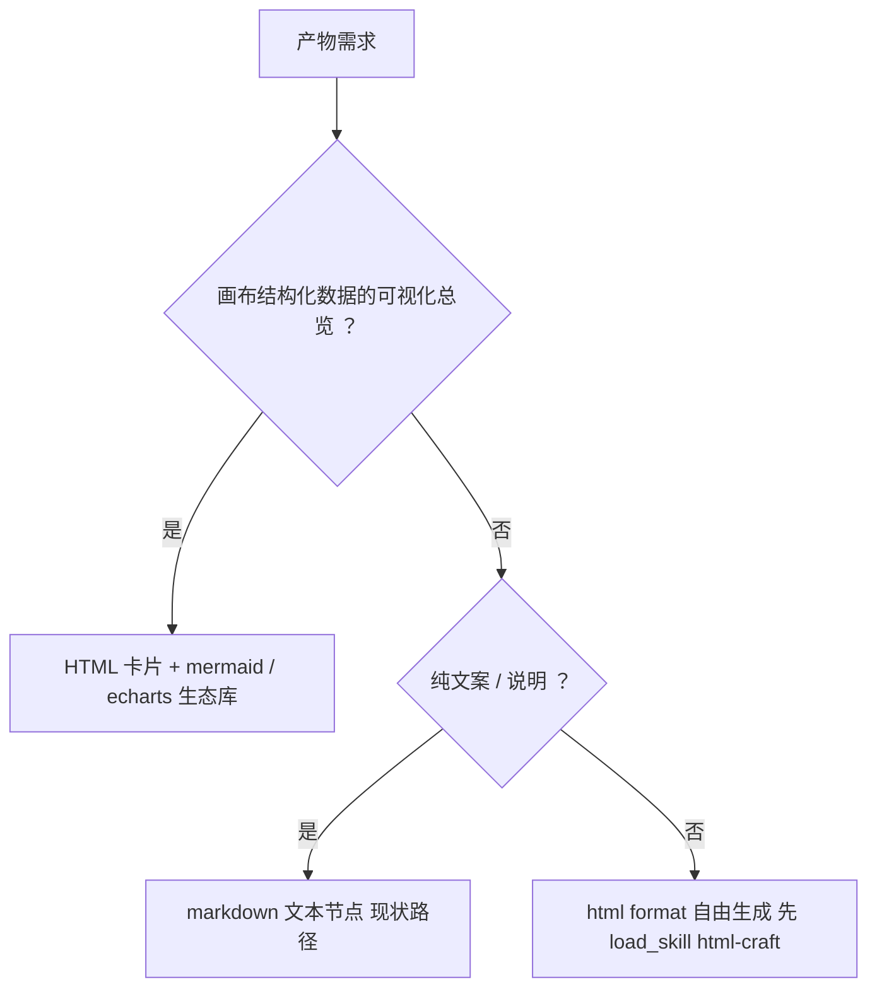
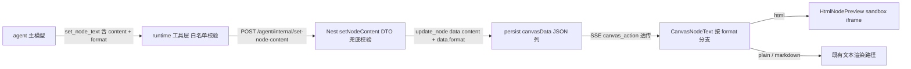
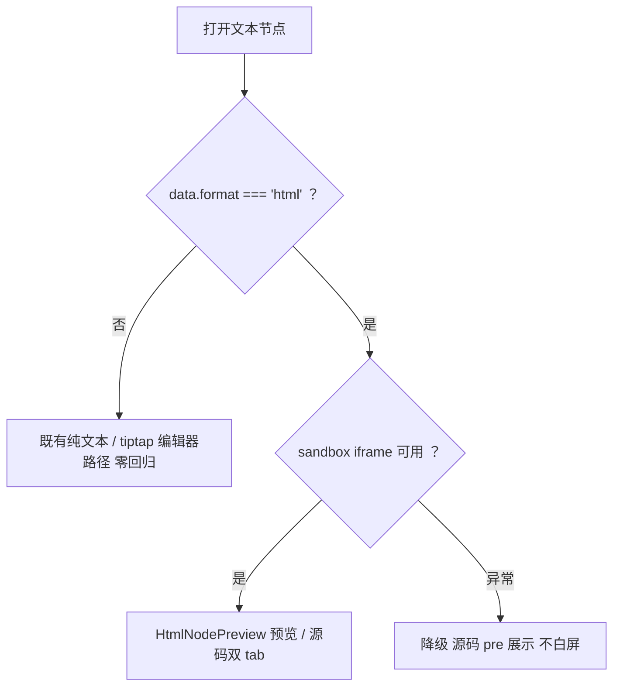

# 文本节点 HTML 产物格式设计规格（agent 生成 HTML，不新增节点）

状态：待评审（2026-10-28，产品 + 架构评审产出）
前置：
- NodeType 收敛纪律（`packages/shared/src/index.ts:10` 及其注释：prompt/group/shot/sceneComposer/mediaInput 五类已下线，白名单 4 项三层拦截）——本规格是收敛纪律的延续。
- `apps/web/src/components/agent/presentation/svg-sanitize.ts` 的威胁模型先例：**agent 产出 = 不可信输入**。
- P1-1 事故纪律（`agent-canvas-tools.service.ts:1387`，2026-10-13）：媒体节点正文不可写。
- 移动端浮层唯一基座 = `MobileSheet.vue`（禁第二套 sheet 皮肤）。

分支约定：实现走 feature 分支 + PR + squash merge（superpowers 纪律）。

**修订记录**：
- v1（2026-10-28）：产品 + 架构评审产出，V1 范围定稿（format 契约 + 工具参数 + sandbox 预览）。
- v2（2026-10-28）：吸收 WorkBuddy `show_widget`/`widget_guidelines` 一手机制调研与 anthropics/skills 开源实践——P6 从「工具描述一句话」升级为「工具描述 + `html-craft` skill（经 `load_skill` 按需加载）」三件套（出口 / 规范 / 分层加载）；§4.3 CSP 增加 CDN 白名单（图表/流程图交给 echarts/mermaid 等生态轮子，不自造渲染）；新增 §4.9 出口选择判据与图 3；render-canvas-view 定位调整（冻结不迭代，下线判据登记 §12）。
- v3（2026-10-28）：规格评审细化（防实施偏差），全部回代码核实——① zod schema 是文档位非闸门位（`SetNodeContentRequestSchema` 全仓无消费方，校验真身 = typebox 枚举 + DTO `@IsIn`，§5.3/§5.4 改写）；② create 链路字段映射三处口径不一致（工具 `type` → body `targetType`，`title ?? prompt`；端点名 `/agent/internal/add-nodes-batch`；`BatchNodeItemDto` :98），format 插入点精确到 4 处（§5.3）；③ 移动端接线点从「实施时定位」落为 `MobileNodeViewer.vue`（text 分支，v3 实证其 props 契约）+ `MobileNodeEditorSheet`（§6 S5 / §9 #13）；④ 新增 §5.4 HtmlNodePreview 组件契约（readonly prop + emit save，禁直接 inject patch——CanvasNodeText onSave 注释里的既有覆盖陷阱）；⑤ 旁路系统验证清单（duplicate/workflowExchange 等 data 整包拷贝，format 自动随行，§4.11）；⑥ S9 数据边界（`get_canvas_layout` 仅 `{id,type,title,position}`，读正文须 get_node，防编造进 skill 内容清单）；⑦ 外链图片必裂（CSP img-src 无远程域）⇒ html-craft 强约束「图片一律 data URI/SVG/CSS」；⑧ 沙箱 modals 未授予 ⇒ alert/confirm 静默失效，skill 写「用行内提示」。
- v4（2026-10-28）：**WorkBuddy 最佳实践原文纳入**（用户拍板「照抄」）——新增 §14 附录：`show_widget`/`widget_guidelines` 一手原文摘录（会话内取证）、照抄/改写/弃用三档逐条对照（含理由）、`skills/html-craft/SKILL.md` 全文草案（实施照此落盘，不自行撰写）、`set_node_text` / `create_nodes_batch` 工具描述改写全文（现状原文 → 定稿全文）。§2.1 P6 / §9 #14 指向 §14。
- v4.1（2026-10-28，SDD 执行期）：§14.4 frontmatter description 改 `>-` 折叠块标量——runtime parseSimpleYaml 不解析多行 plain scalar，截断导致路由索引丢失强制加载句与不适用边界（评审发现，loader 零改动纪律保持）。
- v4.2（2026-10-29，final review）：§5.4 srcdoc 组装改 DOCTYPE 感知——meta CSP 前置于 DOCTYPE 会使文档落入 quirks mode（布局保真受损），有 DOCTYPE 时插于其后、无则前置；守卫测试同步。
- v4.3（2026-10-29，CI 修复）：§14.4 撤改读类工具点名（A1 红线：延迟集工具不得被下发资产按名点名）——改写为「先 tool_search 搜『画布』加载读类工具」+ 能力描述，沿用 2026-10-06 四 skill 点名撤改先例；verify-tool-tiering 随 CI 复验。

> 一句话：**HTML 是文本节点的一种内容格式（`data.format:'html'`）加一种沙箱渲染视图**——不新增节点类型、不新增工具、不动 vendor、不动 DB；agent 经现有 `set_node_text` 直写 HTML 源码，前端按 format 分支进 sandbox iframe 预览。

## 0. 配图索引

本文档的图均为结构图，以 Mermaid 内嵌（无空间比例诉求，不落 SVG 附件）。

| 编号 | 形式 | 内容 | 位置 | 用途 |
|---|---|---|---|---|
| 图 1 | 内嵌 Mermaid | format 字段从工具到渲染的全链路流转 | §5.1 | 实施时逐段对照接线点，防漏段 |
| 图 2 | 内嵌 Mermaid | 文本节点渲染分支判据决策树 | §5.2 | 渲染层实现与测试用例的判据锚点 |
| 图 3 | 内嵌 Mermaid | 产物出口选择决策树（何时用 html / markdown / 生态库卡片） | §4.9 | agent 路由判据与 html-craft「何时使用」段的文本母版 |

## 1. 目标

| # | 目标 | 验收 |
|---|---|---|
| G1 | 用户可让 agent 生成 HTML 产物（网页 / 页面 / 原型），以文本节点承载，支持沙箱预览与源码查看 | 说「做个 xx 网页」→ 画布出现带 HTML 徽章的文本节点，双击可预览可交互 |
| G2 | 零类型扩散：`NodeType` 联合类型、runtime `CREATE_NODES_BATCH_ALLOWED_TYPES`、Nest `CREATABLE_NODE_TYPES` 三层白名单**逐字符不变** | 三处 diff 为空；新增节点类型为否决项 |
| G3 | 存量零回归：全部存量节点（无 `format` 字段）行为逐项不变 | 无 format 或 format!=='html' 的节点走既有渲染/编辑路径 |
| G4 | 安全 fail-closed：HTML 仅在 sandbox iframe（**无 allow-same-origin**）渲染；非法 format 值双层拒绝；不做内容嗅探自动渲染 | §4.3/§4.2/§4.4 各判据有对应守卫测试 |
| G5 | 不重复造轮子：复用既有工具与容器；vendor（pi v0.85.1）零改动、零 patch | 无 vendor diff；无新增 npm 运行时依赖 |

## 2. 范围

### 2.1 本规格做

- **P1 契约层**：shared 新增 `textNodeFormat.ts`（格式白名单 SSOT）；`SetNodeContentRequestSchema` 加可选 `format`。
- **P2 工具层（runtime）**：`set_node_text` 与 `create_nodes_batch` 各加可选 `format` 参数并透传；**不新增任何工具**（规避 tiering「点名资产」前置与 L6 预算约束）。
- **P3 服务层（Nest）**：`SetNodeContentDto` / create items DTO 加可选 `format`（@IsIn 白名单）；`setNodeContent` 写入 data；create items 透传进 data。
- **P4 web 渲染层**：`CanvasNodeText.vue` 按 format 分支；新增 `HtmlNodePreview.vue`（sandbox iframe 预览 / 源码双 tab）。
- **P5 移动端**：HTML 节点预览落 `MobileSheet`（唯一浮层基座）。
- **P6 质量三件套（照搬 WorkBuddy `show_widget` + `widget_guidelines` 机制，机制零新增）**：
  - **出口**：`set_node_text(format:'html')`（P2，已在）+ `HtmlNodePreview`（P4，已在）。
  - **规范（质量来源）**：新增 `skills/html-craft/SKILL.md`——反 AI slop 设计规范（裁剪移植 anthropics/skills `frontend-design`，Apache 2.0：禁居中布局泛滥/紫色渐变/统一圆角/Inter 字体）+ 单文件与大小预算（对齐 §4.3）+ 编辑纪律（≤4 次增量改，超过整体 rewrite，对齐 Claude artifacts 实践）+「何时使用」量化判据（§4.9/图 3）+ 环境约束（v3：图片一律 data URI/SVG/纯 CSS——外链必裂；弹窗 API 静默失效——用行内提示；数据边界——取不到不编造 §4.11）。
  - **分层加载（成本控制）**：复用既有 `load_skill` 机制——skill index（name+description）常驻「可用技能」、正文按需加载、`observeSkillLoad` 按名观测路由命中（`skill-tool.ts` 现状，与 WorkBuddy widget_guidelines 的 lazy-load 模式同构）；`set_node_text` 描述强制「写 html 前必先 `load_skill('html-craft')`」。**原文照抄 / 改写 / 弃用三档逐条对照、SKILL.md 全文草案、工具描述定稿全文 → 见 §14 附录。**

### 2.2 明确不做（登记 §12，不隐性扩范围）

- 不新增节点类型 / 不新增工具 / 不动 `run_text_generation`（二跳路径 V2 再评估传 format 提示）。
- 不做内容嗅探自动渲染（模型漏写 format 时降级为纯文本可见；V2 评估「检测到 HTML，切换渲染？」的用户确认式提示）。
- 不做导出单文件、缩略图渲染快照、模板库（V2/V3）。
- iframe **不允许**外链资源加载（connect-src 'none'）、不允许 `allow-popups` / `allow-top-navigation`；`allow-forms` V1 不给（V2 评估）。
- 不动 nginx CSP（iframe 内 meta CSP 自包含，见 §4.3）；不动 vendor。
- **不在本包下线 `render-canvas-view`**（定位调整见 §3；冻结不迭代，下线判据与前置条件登记 §12）。

## 3. 与既有规格 / 决策的关系

- **NodeType 收敛纪律**：五类节点下线的历史证明「扩类型」的收敛代价；本规格把「格式」下沉为 data 属性，是该纪律的正向应用——**扩格式不扩类型**。
- **svg-sanitize 威胁模型**：agent 产物不可信。HTML 不沿用「白名单净化」防线（理由：交互页白名单净化=功能残废，且项目禁新增运行时依赖），改用**浏览器原生沙箱**（iframe sandbox 属性），防线不依赖 nginx CSP 改造。
- **P1-1 闸门**：`setNodeContent` 的「媒体节点正文不可写」校验保留；`format` 校验落在同一函数，仅 text 节点合法。
- **prompt-registry 预算**：L6 实测余量仅 68 字符（AGENTS.md，2026-10-15 修正值），**禁止**把 HTML 路由指引写进 prompt 规则；主通道改工具描述（API tools schema，不占 L6）。
- **pi 内核**：v0.85.1 无 artifact 概念；artifact 是产品层概念，内核提供的工具机制（typebox 参数 / gate / tiering）够用。本规格全部落在 L2/L3，符合 vendor 只读纪律。
- **`render-canvas-view` 定位调整（v2）**：实测效果不达预期，且其「结构化 builder 出 SVG 卡片」职责可被「agent 读画布数据（`get_canvas_layout`）+ html-craft 规范直出 HTML 卡片（引 mermaid/echarts 生态库）」替代——轮子用生态的，不自造。本包**不删不改**（范围纪律 + 工具下线成本），转冻结：不再迭代、P0 之外不投入测试；下线走 §12 判据与前置条件。

## 4. 规范与判据（可复用规则；后续文本系格式直接套用）

- **4.1 格式即属性**：凡「文本系新格式」（svg / csv / json / md…）一律走 `data.format` + 前端渲染分支，禁止新增节点类型。本判据是本规格最重要的可复用产出。
- **4.2 显式格式（fail-closed）**：渲染分支只认 `data.format === 'html'`；禁止按内容（`<!DOCTYPE html` 开头等）嗅探自动切换。模型漏写 format ⇒ 降级为纯文本可见（不丢内容），V2 再做用户确认式切换。
- **4.3 沙箱判据**：渲染容器必须是 `<iframe sandbox="allow-scripts">`，`srcdoc` 注入、无 `src`；**禁止** `allow-same-origin` / `allow-top-navigation` / `allow-popups` / `allow-forms`（V1）。srcdoc 首部注入 meta CSP（v2 修订：加 CDN 白名单，支撑生态轮子）：`default-src 'none'; script-src 'unsafe-inline' https://cdnjs.cloudflare.com https://cdn.jsdelivr.net https://unpkg.com; style-src 'unsafe-inline' https://fonts.googleapis.com; font-src https://fonts.gstatic.com; img-src data: blob:; connect-src 'none'`。`connect-src 'none'` 保持不变 ⇒ fetch/XHR/WebSocket 全禁，**数据必须内联**（维持单文件产物模型）；白名单对齐 Claude artifacts 实践（cdnjs 首选、锁精确版本、UMD 构建）。缺 `allow-same-origin` ⇒ opaque origin，无法读父域 / cookie / localStorage——这是**产品行为**（沙箱页不能用持久化存储），写进用户可见提示。
- **4.4 白名单双层**：format 仅接受 `plain | markdown | html`（SSOT = shared `TEXT_NODE_FORMATS`）。runtime 工具层先拦 + Nest DTO 兜底——同 `create_nodes_batch` type 白名单的双层模式，错误信息必须列出合法值。
- **4.5 仅 text 节点**：format 出现在 image/video/audio 节点 = 非法（`setNodeContent` 现有媒体闸门同函数拦截）。
- **4.6 下游语义**：HTML 节点作为 refs / 下游输入 = **源码字符串**（与普通文本一致）；V1 不做渲染截图注入。
- **4.7 节点卡不跑 iframe**：html 节点卡 = 「HTML」徽章 + 摘要（`<title>` 优先，strip tags，≤40 字符）。多节点画布逐帧跑 iframe 性能不可接受。
- **4.8 降级纪律**：iframe 渲染异常 ⇒ 源码 `<pre>` 展示，不白屏不抛错（沿用 svg-sanitize `ok:false` 降级模式）。
- **4.9 出口选择判据（量化；v2 新增，写进 html-craft「何时使用」段）**：



*图 3 · 产物出口选择决策树：说明「什么时候用 html」的量化路由——结构化可视化走生态库 HTML 卡片（不再新增对冻结中 render-canvas-view 的依赖）、纯文案留在 markdown、只有自由布局/交互/带脚本的产物才走 html 自由生成。本图是 html-craft skill「何时使用」段的文本母版。*

  1. 结构化数据可视化（画布总览/时间线/矩阵）⇒ **HTML 卡片 + 生态库**（mermaid / echarts / chart.js，CDN 白名单内）——能交给轮子的不自由画；不再新增对 render-canvas-view 的依赖（§3 定位调整）。
  2. 纯文案 / 说明 ⇒ markdown 文本节点（现状，不出 html）。
  3. 自由布局 / 交互原型 / 表单 / 带脚本的演示页 ⇒ `format:'html'` 自由生成——**HTML 只承接结构化表达不了的产物**。
- **4.10 质量前置判据（v2 新增）**：写 `format:'html'` 内容前必须 `load_skill('html-craft')`；未经加载直写 = 违反工具契约（描述层强制 + `observeSkillLoad('html-craft')` 命中率观测兜底，`skill-tool.ts` 现成指标）。
- **4.11 旁路系统与数据边界（v3 新增）**：
  - **data 整包拷贝路径 format 自动随行，禁改动**：`duplicateToCanvasActions`（`data: node.data ?? {}` 整包拷）、undo/redo（data patch 透传）、workflowExchange 导入导出、compositionExpand 等造节点路径**不带 format 语义**（缺省即 plain）——这些文件一律不动，验收时只确认 format 不丢。
  - **S9 数据边界（防编造）**：`get_canvas_layout` 只提供 `{id, type, title, position}`（render-canvas-view.ts 头注释实证）——HTML 总览卡片**只能**基于这些字段；节点正文须经 `get_node` / canvas-read 显式读取。取不到的字段**不编造**（本仓「数据源缺失不填假值」纪律），此条必须写进 html-craft skill。

## 5. 架构与契约

### 5.1 format 全链路（图 1：实施时逐段对照接线点，防漏段）



*图 1 · format 从工具到渲染的全链路：说明链路共 6 段接线点（工具参数 → 端点 body → DTO 校验 → data 持久化 → SSE 透传 → 前端分支），实施与排期逐段对照，漏任何一段即静默断链。*

### 5.2 渲染分支判据（图 2：测试用例的判据锚点）



*图 2 · 渲染分支判据决策树：说明读取侧只认显式 format（fail-closed）与降级路径（fail-soft），是 §10 组件测试用例的直接判据来源。*

### 5.3 契约变更点（v3 字段级细化；字段名以本表为准，实施勿凭印象）

| 层 | 契约 | 变更 | 校验/消费方式（v3 实证） |
|---|---|---|---|
| shared | `textNodeFormat.ts`（新） | `TEXT_NODE_FORMATS`、`TextNoteFormatSchema`、`resolveTextNodeFormat`、`assertTextNodeFormat` | ⚠️ **zod 是文档位不是闸门位**：`SetNodeContentRequestSchema` 全仓无消费方（v3 实证），真正的校验 = runtime typebox 枚举（拦 agent）+ Nest DTO `@IsIn`（拦直打端点）。zod 加字段仅作类型同步，**禁止**误以为它有防护而去掉 DTO 校验 |
| shared | `SetNodeContentRequestSchema`（:247） | 加可选 `format: TextNoteFormatSchema` | 同上，仅类型契约同步 |
| runtime | `set_node_text`（canvas-write.ts:277） | parameters 加可选 `format`（Type.Union 白名单），content 分支 body 加 `format: p.format` | 描述追加「html 用于网页/可交互产物；写前先 load_skill html-craft」 |
| runtime | `create_nodes_batch`（canvas-write.ts:1002） | item schema 加可选 `format`；body 映射（:1067-1073）**现有口径是 `it.type→targetType`、`title ?? it.prompt`**，同处追加 `format: it.format` | 端点名 = `/agent/internal/add-nodes-batch` |
| Nest | `BatchNodeItemDto`（controller :98） | 加 `@IsOptional() @IsIn(['plain','markdown','html']) format?: string` | 端点 `add-nodes-batch`（:1165） |
| Nest | `AddNodesBatchDto`（:152）→ service `nodeData` 组装（service :1004 附近：`{title, manifestKey, prompt, status:'draft', ...defaults}`） | 追加 `...(item.format ? { format: item.format } : {})`——缺省**不写键**（存量语义不变） | |
| Nest | `SetNodeContentDto`（:307） | 加 `@IsOptional() @IsIn(['plain','markdown','html']) format?: string` | 端点 `set-node-content`（:1217） |
| Nest | `setNodeContent`（service :1375） | ①白名单复检（绕 HTTP 的内部调用不过 DTO，fail-closed 在此兜底）；②data 写入 `{ content, format?, status:'completed' }`（format 缺省不动旧键） | 媒体节点正文闸门（:1391）保留在先 |
| web | `CanvasNodeText` props.data | 加可选 `format`；分支见 §6 | 消费方 NodeRenderer / CanvasReadonlyPage / ReplayPage 不改 |
| skills | `skills/html-craft/SKILL.md`（新） | frontmatter name/description；loader 自动扫描进「可用技能」index | 正文经 `load_skill` 按需加载 |

### 5.4 `HtmlNodePreview.vue` 组件契约（v3 新增，防实施偏差的核心细化）

```
props:  content: string            // 完整 HTML 源码（data.content 原样）
        readonly?: boolean = false // 只读页/回放页=true：无源码编辑、无保存、无 emit
        embedded?: boolean = false // 移动端内嵌态=true：不渲染 overlay/关闭钮，退出由宿主 viewer 负责（实施期补充）
emits:  save(payload: { content: string; format: 'html' })  // 源码 tab 保存
        close()                                             // 浮层退出（移动端含下滑关闭）
```

- **iframe 组装顺序（srcdoc，v4.2 DOCTYPE 感知）**：meta CSP 不得前置于 `<!DOCTYPE>`——DOCTYPE 非文档首 token 会落入 quirks mode（百分比高度/行高/盒模型解析全变，布局保真受损）。有 DOCTYPE（`^\s*<!doctype\s+html` 大小写不敏感）时 meta 插于其声明行之后（`<html>` 之前）；无 DOCTYPE 时前置——两种路径均保证 DOCTYPE 为首 token 且 meta 先于任何可执行内容生效，其余不做任何改写/净化。
- **保存通路（⚠️ 既有陷阱）**：`CanvasNodeText.onSave` 注释明示——`updateNodeData` 只写 Vue Flow 内部 store，会被下一次页面 patch 的旧数据**覆盖**。因此 HtmlNodePreview **禁直接 inject `CANVAS_NODE_PATCH_KEY`**：一律 `emit('save')` 由宿主决定通路——PC 宿主 `CanvasNodeText` 走 `patchCanvasNode(nodeId, { content, format })`；移动端宿主 `MobileNodeViewer` 由 shell 层传入保存回调。
- **readonly=true 时**：隐藏源码编辑与保存（CanvasReadonlyPage / ReplayPage 无 patch 通道，走 updateNodeData fallback = 静默假写，必须关死）。
- **降级（§4.8）**：iframe `onerror` / 空白检测 → 源码 `<pre>`，态内提示，不抛错。

## 6. 打样 / 主场景规格（逐条可验收）

- **S1 创建**：用户说「做个落地页」⇒ agent 先 `load_skill('html-craft')`（§4.10），再调 `create_nodes_batch{ type:'text', format:'html', prompt:… }`，随后 `set_node_text` 直写完整 HTML（`format:'html'`）。验收：节点卡出现「HTML」徽章 + 摘要。
- **S2 直写**：`set_node_text{ node_id, content:'<!DOCTYPE html>…', format:'html' }` ⇒ data.content 为完整源码。验收：双击打开沙箱预览，内联脚本可运行、外网请求被 CSP 阻断。
- **S3 预览 / 源码**：预览 tab = sandbox iframe；源码 tab = 可编辑 textarea（**不进 tiptap**，避免 markdown 管线 mangling raw HTML），保存走 `emit('save')` → 宿主 `patchCanvasNode(nodeId, { content, format:'html' })`（§5.4，禁 updateNodeData fallback）。验收：编辑后预览刷新、刷新页面内容仍在。
- **S4 迭代改写**：选中 HTML 节点说「把标题改红」⇒ agent `set_node_text` 更新 content ⇒ VueFlow 响应式更新，预览自动刷新。
- **S5 移动端（v3 落点实化）**：HTML 文本节点进入 `MobileNodeViewer.vue`（type:'text' 分支）⇒ 分支内渲染 `HtmlNodePreview`（sandbox iframe 预览 + 源码查看）；保存回调由 shell 层传入（§5.4）；源码**编辑**走 `MobileNodeEditorSheet`（textarea）；TTS 朗读对 html 节点朗读 strip-tags 纯文本（复用摘要 strip 逻辑），不做交互元素朗读。遵守 reduced-motion、双退出通道（X + 下滑）沿用 MobileNodeViewer 既有契约。
- **S6 存量 / 非 html**：无 format 或非 'html' ⇒ 既有路径逐项不变（含双击进 `PromptMarkdownEditor`）。
- **S7 非法值**：`format:'jsx'` ⇒ runtime 层报错（错误信息列合法值）；绕过工具直打端点 ⇒ Nest 400。
- **S8 只读 / 回放**：`CanvasReadonlyPage` / `ReplayPage` 复用 `CanvasNodeText` 自动获得分支；传入 `readonly` ⇒ HtmlNodePreview 无编辑无保存（§5.4，防 updateNodeData 静默假写）。
- **S9 可视化卡片（v2 新增，render-canvas-view 主场景的替代路径）**：用户要「画布总览图 / 流程图 / 时间线」⇒ agent `get_canvas_layout` 取数据 → `load_skill('html-craft')` → HTML 卡片（mermaid/echarts，CDN 白名单内、数据内联）→ `set_node_text` 落节点。**数据边界（v3）**：layout 仅 `{id,type,title,position}`（§4.11），节点正文须 get_node 显式读，取不到不编造。验收：替代主场景产出可用；render-canvas-view 零改动（冻结）。

## 7. 数据与状态变更

- **无 DB 迁移**：canvasData 为 JSON 列，`node.data` 是自由 bag；`format` 随 data 持久化。
- `format` 语义：缺省 = `plain`（存量全部命中）；一次性写入，不参与生成状态机（`status` 语义不变，P1-1 闸门保留）。
- persist / SSE：`update_node` data 原样透传，无白名单变更。

## 8. 纯函数与算法（含单测要求）

- `assertTextNodeFormat(v)`（写入侧，fail-closed）：白名单外 throw，错误信息含合法值。
- `resolveTextNodeFormat(data)`（读取侧，fail-soft）：缺省/未知值 ⇒ `'plain'`，不抛错。写入与读取**分两个函数**——写入严格、渲染宽容。
- `htmlNodeSummary(data)`（v3 优先级细化）：`data.label`（节点标题，节点卡现显示位）> HTML `<title>` > strip tags 首段，≤40 字符。纯函数单测覆盖：label 存在 / label 缺失走 title / title 缺失走 strip / 空 content / 超长截断。strip 逻辑导出复用（S5 移动端 TTS 朗读 strip-tags 同源）。

## 9. 文件级改动清单（实施排期唯一输入；与 §2 / §12 交叉核对）

| # | 文件 | 动作 | 内容 |
|---|---|---|---|
| 1 | `packages/shared/src/textNodeFormat.ts` | 新增 | 白名单 SSOT + 两个校验/归一函数 |
| 2 | `packages/shared/src/agentContract.ts` | 修改 | `SetNodeContentRequestSchema.format` 可选 |
| 3 | `packages/shared/src/index.ts` | 修改 | re-export textNodeFormat |
| 4 | `services/pi-runtime/src/tools/canvas-write.ts` | 修改 | `set_node_text`(:277) 加参数+描述；`create_nodes_batch`(:1002) item 加 `format`，body 映射(:1067-1073)加 `format: it.format`（字段口径见 §5.3：`type→targetType`、`title ?? prompt` 既有映射不动） |
| 5 | `services/pi-runtime/src/tools/tiering.test.ts` | 修改 | 变更登记（归属不变：常驻） |
| 6 | `services/pi-runtime/src/tools/canvas-write.test.ts` | 修改 | format 用例 + 非法值用例 + body 映射含 format 断言 |
| 7 | `services/pi-runtime/src/tools/canvas-write.contract-mirror.test.ts` | 修改 | DTO 对齐（format 可选） |
| 8 | `apps/server/src/agent/agent-canvas-tools.controller.ts` | 修改 | `BatchNodeItemDto`(:98) 与 `SetNodeContentDto`(:307) 各加 `@IsOptional() @IsIn(['plain','markdown','html'])` |
| 9 | `apps/server/src/agent/agent-canvas-tools.service.ts` | 修改 | `addNodesBatch` nodeData 组装追加条件键；`setNodeContent`(:1375) 复检+写入（口径 §5.3） |
| 10 | `apps/web/src/components/canvas/CanvasNodeText.vue` | 修改 | format 分支：节点卡徽章+摘要；双击开 HtmlNodePreview（宿主职责：emit save → patchCanvasNode） |
| 11 | `apps/web/src/components/canvas/HtmlNodePreview.vue` | 新增 | 组件契约见 §5.4（props/emits/readonly/srcdoc 组装/降级） |
| 12 | `apps/web/src/components/canvas/NodeRenderer.vue` / `CanvasReadonlyPage.vue` / `ReplayPage.vue` | 修改（v3 升级） | 只读两页需向 CanvasNodeText 传 readonly（经 props 透传或提供注入值），HtmlNodePreview 才能关死编辑——**不再是纯验证项** |
| 13 | `apps/web/src/components/mobile/MobileNodeViewer.vue` + `MobileNodeEditorSheet.vue` | 修改（v3 落点实化） | text 分支 format==='html' → 渲染 HtmlNodePreview（保存回调由 shell 传入）；编辑走 MobileNodeEditorSheet textarea；TTS 朗读 strip-tags 纯文本 |
| 14 | `skills/html-craft/SKILL.md` | 新增 | **全文草案见 §14.4，实施照此落盘不自行撰写**；后续迭代按 §14 三档对照流程改 |
| 15 | `services/pi-runtime/src/tools/skill-tool.ts` | 验证不改 | `load_skill` 机制现状复用（index 常驻 + 正文按需 + observeSkillLoad），零改动 |
| 16 | `skills/*.md`（涉及「产出网页」语义的垂类正文） | 修改 | 按需补路由指引（R1 段落级，保留「## 工具可用性」小节） |

## 10. 测试策略与验收标准

- **单测**：#1 纯函数（白名单边界/未知值/缺省 + 摘要优先级）；#6 工具参数、非法值、body 映射含 format；#7 DTO 镜像；Nest service spec（媒体节点拒 format、非法值 400、正常写入、**内部调用绕 DTO 时 service 复检生效**）；#10/#11 组件测试。
- **行为级守卫**（参照仓库守卫纪律：剥注释 + 行为断言）：`HtmlNodePreview` 契约测试断言 `sandbox` 属性含 `allow-scripts` 且**不含** `allow-same-origin|allow-popups|allow-top-navigation|allow-forms`，srcdoc 首部含 meta CSP——防后续「顺手放开」；readonly=true 断言无编辑/保存入口；emit save 断言（禁 inject patch）。
- **旁路系统验证清单（v3 新增，§4.11 对应）**：duplicate 节点 / workflowExchange 导出再导入 / undo-redo 往返，各断言 `data.format` 不丢、不重复、不合法化（这三个路径零改动，只验证）。
- **skill 接线守卫（v2 新增）**：loader 扫描测试断言「可用技能」index 含 `html-craft`（描述含触发词）；工具描述守卫断言 `set_node_text` 描述含「先 load_skill html-craft」线索；`observeSkillLoad('html-craft')` 指标存在（路由命中率观测，对应 tool_search 触发率为 0 的历史教训——**新指引必须有指标可验**）。
- **目视验收**：PC 预览/源码切换、S4 迭代刷新、移动端 MobileSheet、只读页四场景走查。
- **回归线**：存量文本节点双击编辑、媒体节点 set_node_text 报错文案、replay 回放，逐项与改前一致。
- **纪律**：vitest 用 nvm node24 + `--maxWorkers=1 --no-file-parallelism`；改组件后跑 `vue-tsc -b`。

## 11. 风险

- **沙箱内脚本执行**：威胁模型 = opaque origin（无同源权限，摸不到父域/cookie/localStorage）；残余风险为页面自身钓鱼样式与 CPU 忙循环（子帧内，可关浮层）。已在 §4.3 固化属性集 + 守卫测试钉死。
- **工具描述 token 增量**：路由指引走 tools schema 不占 L6，但增加每回合 system token；措辞最短化，PR 时核对 system 总量。
- **模型忘写 format** ⇒ HTML 以纯文本呈现（不丢内容、用户可读源码）；靠工具描述 + S1 错误信号纠偏；V2 做确认式切换。
- **模型不 load_skill 直写 html（v2）** ⇒ 质量降级为裸 HTML（AI slop 风险）；缓解 = 工具描述强制线索 + `observeSkillLoad('html-craft')` 命中率观测；命中率持续为 0 时参照 tool_search 教训回看触发链路。
- **CDN 白名单信任面（v2）**：脚本仅允许 cdnjs / jsdelivr / unpkg 三个主流域（与 Claude artifacts 白名单一致）；`connect-src 'none'` 不变 ⇒ 无数据外传通道；不引入 Google Fonts 之外的新样式域需走规格修订。
- **外链图片必裂（v3 新增）**：`img-src` 无远程域 ⇒ 模型生成的 HTML 引 unsplash 等外链图会裂图——不是 bug 是判据；html-craft 必须写「图片一律 data URI / SVG / 纯 CSS 绘制」并给示例；裂图走 §4.8 降级可见。
- **沙箱 modals 未授予（v3 新增）**：未给 `allow-modals` ⇒ 页面内 `alert/confirm/prompt` 静默失效（confirm 恒 false）——html-craft 写「交互提示用行内元素，不用弹窗 API」。
- **tiptap 与 raw HTML**：源码编辑走 textarea，规避 markdown 管线 mangling（S3 已定）。

## 12. 后续包 / 路线图（本包外，登记防隐性范围）

- **V2**：确认式嗅探提示（「检测到 HTML，切换渲染？」）；`run_text_generation` 传 format 二跳；导出单文件；缩略图渲染快照；`allow-forms` / `allow-popups` / 外链资源白名单评估；web-artifacts-builder 式「脚手架 → 打包单文件」管线（复杂 artifact 场景）。
- **V2/V3 · render-canvas-view 下线包**（独立小包，前置条件按序）：
  1. html-craft + HTML 卡片路径生产验证：S9 场景产出质量与采纳率 ≥ 冻结前 render-canvas-view 现状（`observeSkillLoad('html-craft')` 命中 + 用户实际使用证据）；
  2. 点名资产清点：按 `docs/agent/tool-capability-catalog.md` 的扫描命令找出全部点名 render-canvas-view 的 prompt 规则 / skill，同步移除或改写指向新路径；
  3. 移除本体（registry / tiering.test.ts / catalog 行）+ 保留一个版本的观察回退窗口；
  4. 下线期间 render-canvas-view **保持冻结**：只修 P0，不迭代新视图。
- **V3**：格式家族化——`svg`（归并 `AgentSvgCard` 先例进同一 format/视图体系）、`csv` 表格视图；模板/组件库。

## 13. 配图规范自检

实施分支提交前跑：`pnpm verify-spec-figures --file docs/superpowers/specs/2026-10-28-text-node-html-artifact-design.md`，结果回填本节。

- 2026-10-28 v2 定稿时实测：1 篇在范围内，**0 错误 0 警告**（图 1–3 编号连续、图注齐、§0 索引完整）。
- 2026-10-28 v3 评审细化后复测：**0 错误 0 警告**。
- 2026-10-28 v4 原文纳入后复测：**0 错误 0 警告**。

## 14. 附录：WorkBuddy 最佳实践原文纳入（v4，照抄 / 改写 / 弃用三档对照）

### 14.1 一手性与出处声明

- 摘录源 = WorkBuddy host 的 `show_widget` 工具描述原文 + `widget_guidelines` 工具返回原文（2026-10-28 会话内一手取证，**非转述、非二手资料**）。
- 处理分三档：**照抄**（语义与数字均不变）/**改写**（结构保留、参数按本仓环境换）/**弃用**（本仓场景不存在）。
- 若 WorkBuddy 侧规范迭代，对齐时以更新后原文为准重走三档对照，并把对齐时点写进 PR 描述。

### 14.2 照抄原文摘录（verbatim）

`show_widget` 工具描述（关键约束句）：

> "Call widget_guidelines (modules: diagram|mockup|interactive|chart|art) before your first show_widget call to load required design guidance."
> "widget_code MUST be a raw SVG/HTML fragment (no \<html\>/\<head\>/\<body\>/\<!DOCTYPE\>)"

`widget_guidelines` 返回原文（质量规范关键句，逐字）：

> "No font-size below 11px"
> "Two weights only: 400 regular, 500 bold. Never use 600 or 700."
> "No gradients, drop shadows, blur, glow, or neon effects"
> "Box subtitles: ≤5 words" / "Colors: ≤2 ramps per diagram" / "Horizontal tier: ≤4 boxes at full width (~140px each)"
> "Box width formula: rect_width = max(title_chars × 7, subtitle_chars × 6) + 24"
> "For HTML widgets, begin with a visually-hidden \<h2 class=\"sr-only\"\> containing a one-sentence summary."
> "scripts, fonts and other external resources may ONLY load from cdnjs.cloudflare.com, esm.sh, cdn.jsdelivr.net, unpkg.com"（CSP 白名单结构）

以上全部进 html-craft（14.4 已逐条落位），**禁止实施时凭印象改数字**。

### 14.3 改写 / 弃用对照表

| WorkBuddy 原文 | 处理 | html-craft 版 | 理由 |
|---|---|---|---|
| "viewBox starting with 0 0 680" | 改写 | 响应式：viewport meta + max-width 容器自适配 | 680 固定宽是 host 卡片位约定；本仓预览 overlay / 移动端宽度可变 |
| CSP 白名单 "cdnjs…esm.sh…jsdelivr…unpkg" | 改写 | cdnjs / cdn.jsdelivr.net / unpkg + Google Fonts（§4.3 定稿，去 esm.sh） | 对齐 Claude artifacts 白名单；esm.sh 的 ESM 场景 V1 不需要 |
| 主题跟随（IDE light/dark，文字色随主题翻转） | 改写 | 产物自带完整配色，**不消费 `--lnk-*` 令牌**，正文对比度 ≥4.5:1 | iframe 是用户产物世界（§4.3 已判定不受画布令牌管辖）；host 主题进不去沙箱 |
| 流式渲染规则（inline style 优先 / style 块 ≤15 行 / 渐变闪烁） | **弃用** | — | srcdoc 整块替换渲染，无流式差分，闪烁问题不存在 |
| 模块路由（diagram/mockup/interactive/chart/art 分模块加载） | **弃用（V1）** | 单一 SKILL.md 正文 | 本仓 skill 无模块机制；正文体积远小于 host guidelines；V2 若超预算再拆 |
| 本地图片路径自动重写 | **弃用** | 图片一律 data URI / 内联 SVG / 纯 CSS（§11 已列） | 本仓 host 无路径重写能力；且 CSP img-src 无远程域 |
| "Call widget_guidelines before first show_widget"（先加载后产出） | 改写 | "写 format:'html' 前必先 `load_skill('html-craft')`"（§4.10 / 工具描述强制） | 机制同构：host 工具描述强制 → 本仓工具描述强制 |

### 14.4 `skills/html-craft/SKILL.md` 全文草案（v4 定稿文本，实施照此落盘）

```markdown
---
name: html-craft
version: "0.1.0"
description: >-
  生成高质量 HTML 产物的强制规范。当用户要求做网页、页面、原型、落地页、
  H5、可交互演示，或要把画布数据做成总览卡片/流程图/时间线卡片时，写 html 格式文本节点
  前必须先加载本 skill。纯文案、markdown 内容、媒体节点不适用。
---

# HTML 产物生成规范（html-craft）

## 何时使用（出口选择，先读这段再动手）

1. 画布结构化数据可视化（总览图/流程图/时间线卡片）→ HTML 卡片 + mermaid / echarts
   （CDN 白名单内）。读数据前先 tool_search 搜「画布」加载读类工具：布局工具仅含
   id/type/title/position；要节点正文用节点详情读取工具显式读取；
   **取不到的字段一律不写、不编造**。
2. 纯文案 / 说明 → markdown 文本节点，不出 html。
3. 自由布局 / 交互原型 / 表单 / 带脚本的演示页 → format:'html' 自由生成（本规范全文管这个口）。

## 环境硬约束（违反即产物残废，写码前逐条自检）

- 单文件自包含：CSS/JS 全部内联；外部脚本仅允许 cdnjs.cloudflare.com / cdn.jsdelivr.net /
  unpkg.com，**锁精确版本、用 UMD 构建**（UMD 在全局定义变量，放在使用它的内联脚本之前）。
- 图片一律 data URI / 内联 SVG / 纯 CSS 绘制——远程图片必被 CSP 拦截（裂图，非 bug）。
- 无 alert / confirm / prompt（沙箱内静默失效）——交互提示用行内元素。
- 无 localStorage / cookie（沙箱 opaque origin）——状态放内存变量。
- 无 fetch / XHR / WebSocket（connect-src 'none'）——数据内联进页面。
- 字体用系统字体栈或 Google Fonts（唯一允许的外部样式域，字体文件来自 fonts.gstatic.com）。

## 设计规范（反 AI slop）

- 字号 ≥11px；字重只用 400/500 两档；正文行高 1.6。
- 禁渐变/投影/发光/霓虹；平面实色。
- 配色 ≤2 个色系 ramp；中性色打底，强调色只做点睛。
- 布局留白充分；圆角统一一档（8–12px）；间距取阶梯值（4/8/12/16/24）。
- 复杂度预算：单屏组块 ≤7 个；图示横排 ≤4 项；标签 ≤5 词；
  盒宽估算 = max(标题字数×7, 副标题字数×6)+24（px，中文按字数）。
- 图表优先 mermaid / echarts（白名单 CDN），不手写数据图形。
- 自带完整配色（不依赖宿主主题）；文字与背景对比度 ≥4.5:1。
- 无障碍：页面首个元素放 visually-hidden 的一句话摘要（class="sr-only"）。

## 编辑纪律

- 每轮增量修改 ≤4 次；超过必须整体 rewrite（整页重写质量高于碎修补）。
- 修改锚点必须唯一精确，禁止模糊替换。

## 交付自检（全部勾完才允许 set_node_text 交付）

□ DOCTYPE + viewport meta；□ CSS/JS 全内联或白名单 CDN；□ 无远程图片；
□ 无弹窗 API；□ 数据全内联；□ 中文文案无乱码；□ 移动端窄屏不破版；□ 标题层级清晰
```

### 14.5 工具描述改写全文（v4 定稿，PR 中逐字核对）

**`set_node_text`**（现状原文 → 修改后全文；追加部分加粗标注）：

> 现状（canvas-write.ts:279-280）：
> "Update prompt and/or content text on an EXISTING node (at least one of prompt/content; passing both updates both). For creating nodes use upsert_media_node instead."
>
> 修改后：
> "Update prompt and/or content text on an EXISTING node (at least one of prompt/content; passing both updates both). For creating nodes use upsert_media_node instead. **For HTML pages (webpage / prototype / interactive / canvas overview card) set format='html' and ALWAYS call load_skill('html-craft') FIRST — required before writing any html content. Keep it a single self-contained file: images as data URI or inline SVG (remote images blocked), no alert/confirm, everything else inline.**"

**`create_nodes_batch` item `format` 参数描述**（新增字段）：

> "Optional content format: 'html' for webpage / interactive artifacts (then call load_skill('html-craft') before writing content via set_node_text)."

⚠️ 追加量 ~70 tokens/回合（system 总量在 PR 核对，§11 已列）；措辞已最短化，实施时不得再加长。
