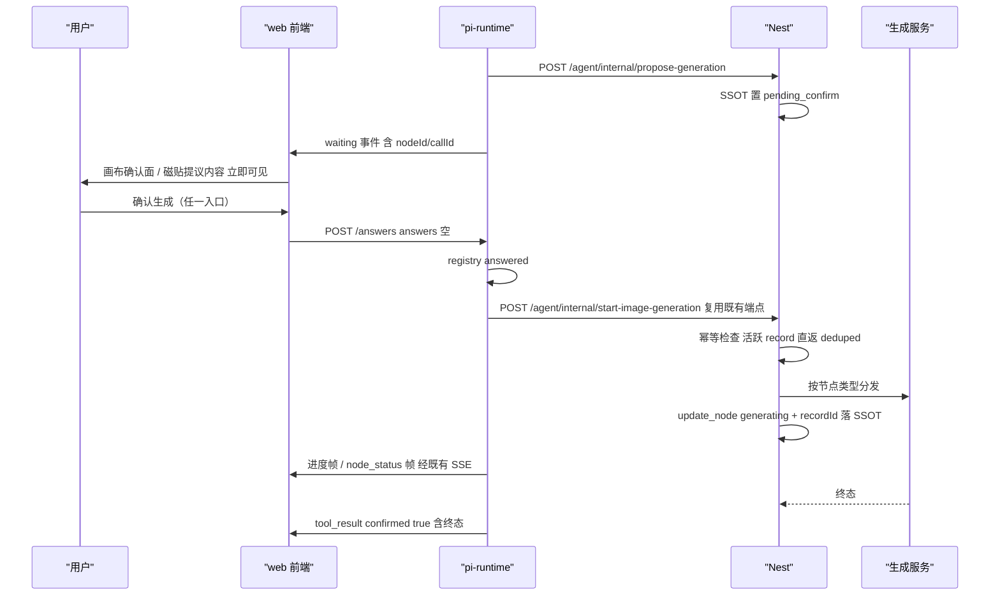
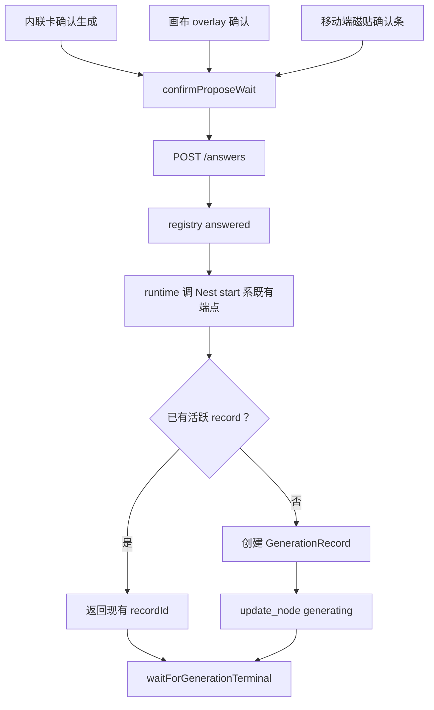
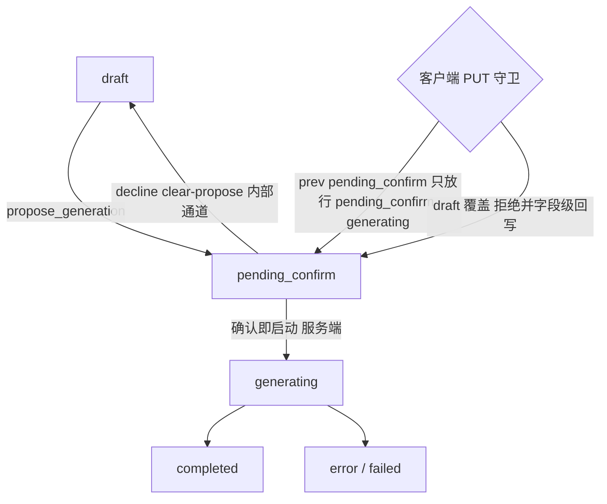

# propose 确认执行权归一（P0 止血包）设计规格

状态：待评审（2026-10-30，起因：真机回归 thread `cmvtadc5w009ap901qxfpcelz` propose 全链路断裂）
> 修订 v1.1（实施日裁决）：**P0-1 不新增端点**——Nest 已有 `start-image-generation` / `start-video-generation` / `run-text-generation` / `run-audio-generation` 内部端点（run_* 工具的执行面，参数装配/SSOT 写入/幂等锚点俱全），runtime 确认后直调即可，不重复造轮子。Nest 侧改动收敛为：start 系幂等守卫 + PUT 守卫收紧 + summary 补 audioKind。
前置：
- `docs/discussion/2026-10-29-propose-execution-ownership-architecture-review.md`（v1，推理留痕）
- `docs/discussion/2026-10-29-agent-authority-model-redteam-review.md`（**v2 定稿，本规格 = 其 Part C「P0 止血 5 条」的落地规格**）
- `docs/superpowers/specs/2026-10-28-agent-wait-timeline-single-source-design.md`（已上线 #635/#637）
- `docs/superpowers/specs/2026-10-25-mobile-node-lifecycle-design.md`（移动端磁贴/pending 决策栏 SSOT，v1.5）
分支约定：实现走 feature 分支（基于**最新 origin/master**，本地 master 落后 #635–#638）+ PR + squash merge。
⚠️ 本包同时改 Nest + pi-runtime + web 三层，部署 = API 镜像 + runtime-deploy（手工 dispatch tag）+ web 三条流水线全量，非纯前端 paths-filter。

## 0. 配图索引

| 编号 | 形式 | 内容 | 位置 | 用途 |
|---|---|---|---|---|
| 图 1 | 内嵌 Mermaid（sequenceDiagram） | 修复后「确认→服务端启动→终态回执」全链路时序 | §5.1 | 实施时逐段对照接线点；验收时对照各帧是否按图出现 |
| 图 2 | 内嵌 Mermaid（flowchart） | 三个确认入口收敛到单一执行链 | §5.2 | 验收「执行入口集合 == 1」判据 |
| 图 3 | 内嵌 Mermaid（flowchart） | 节点状态机与服务端 PUT 守卫收紧后的合法转移 | §7 | sessions.service 守卫改造与测试用例的判据锚点 |

## 1. 目标（3 条，可验收）

1. **确认即生成**：任何入口（内联卡 / 画布 overlay / 移动端磁贴确认条）确认 propose 后 30s 内 `GenerationRecord` 出现、节点转 `generating`——不依赖任何前端启动路径。
2. **等待期可见**：`propose_generation` 等待期间，画布确认面与磁贴提议内容（prompt）在 PC 与移动端**立即**可见——锚点来自服务端等待事件（part），不再依赖 `update_node{pending_confirm}` 随 tool_result 迟到。
3. **误报清零**：等待挂起期 SSE 断流不再显示「生成失败 · 网络连接不稳定」；turn 失败判定只来自服务端终态事实。

## 2. 范围

### 2.1 本规格做（= 红队 v2 P0-1…P0-5）

- P0-1（v1.1）runtime 在 registry `answered` 后直调 Nest **既有**内部端点（按节点类型派发：image→`start-image-generation`、video→`start-video-generation`、text→`run-text-generation`、audio→`run-audio-generation`，与 run_* 工具同一执行入口）；Nest 仅在 start 系补幂等守卫；前端 propose 确认路径**移除自起生成**（单执行者）。
- P0-2 画布确认面 / 磁贴提议内容锚点换源：活跃 propose 等待 part（服务端 waiting 事件派生）∥ 节点 `pending_confirm` 双源 OR；移动端补磁贴级确认入口。
- P0-3 随 P0-2 落地：磁贴在等待期渲染提议 prompt（prompt 已在节点 data，现状被 `pending_confirm` 单点门控挡住）。
- P0-4 服务端 PUT 守卫收紧：客户端整份 PUT 不得把 `pending_confirm` 写回 `draft`（`PENDING_CONFIRM_CLIENT_EXITS` 去掉 `draft`；取消走 decline 内部通道，不受影响）。
- P0-5 前端流断归因收口：存在活跃等待 part 时主流 catch 不标 turn 失败；`/answers` 幂等回执（deduped/404）把对应 part 翻终态而非报错。

### 2.2 明确不做（登记 §12，不隐性扩范围）

- 不做挂起态持久化 / 重启重建（P1-3）；本包内 `pending-registry` 维持进程内 Map，接受「runtime 重启 → 等待丢失」为已知残留（本期由 capMs timeout 收尾兜底）。
- 不做生成 job 化（P1-2）：`waitForGenerationTerminal` 持轮保留（确认后生成真实启动，持轮语义恢复成立）；13 分钟 cap 与「生成仍在进行」文案保留为兜底。
- 不做状态机单 owner 全面收敛（P1-1）、saveCanvas patch 化（P1-4）、审批风险分级（P1-5）、propose_plan/视频/批量 job 化。
- 不改提示词规则（`propose_generation` description 与 canvas_daily_ops 语义在新行为下仍成立；若实施中发现冲突，按提示词 6 处同步纪律另开小包）。
- 不动 ask_user 链路（上游 Promise 模型已对齐）。

## 3. 与既有规格 / 决策的关系

- **对 #635/#637（等待态单一真相）的延续而非回滚**：本规格不复活 `pendingAskUser`/`blockingWait` 白名单等已退役前端镜像态；等待态呈现仍唯一读时间线 part。新增的只是「画布确认面锚点 = part ∥ 节点状态」双源 OR——part 是第一真相，节点状态是服务端广播到达后的加速器。
- **对 v1 讨论「内联卡接 handleAgentGenerateNode」的正式否决落地**：本包删除 propose 路径的前端自起生成，而不是给内联卡再接一条生成链（维持双执行者 = 每个新入口都要重复接线）。
- **对 `2026-10-25-mobile-node-lifecycle` v1.5 的对齐**：移动端确认入口落在磁贴级「pending 决策栏常驻」（其 §4.3 / 决定十一既定形态），不新建第二套 sheet 皮肤；遵守 `MobileSheet.vue` 唯一基座纪律。
- **上游对照（已核实的正统）**：`vendor/.../coding-agent/src/core/extensions/runner.ts` 的 `ctx.ui.confirm = withUIPrompt("confirm", …)` = 工具内 await 宿主 UI Promise。本包把「确认」保留在工具生命周期内（registry answered），把「执行」收进服务端——审批门与执行者回到同一侧，与 Claude Code permission / Codex approval 的行业不变量一致。

## 4. 规范与判据（可复用规则）

### 4.1 权限边界三判据（本包核心不变量，后续同类工具直接套用）

1. **执行入口集合 == 1**：生成启动只允许发生在 Nest（studio 生成服务 / 新内部端点）。runtime 与前端都是**调用方**，不是执行者。
2. **呈现权 = 只读复制 + 发意图**：客户端对节点 `status` 只许透传服务端下发的值，禁止本地合成/覆盖（前端确认路径不再 patch draft；`forcePendingConfirmInPayload` 类载荷整形永不复活——那是「客户端替服务端写状态」的反模式）。
3. **turn 终态判定来源 == 服务端事件**：SSE 连接状态（断流/重连）不参与 turn 成败归因。

### 4.2 确认幂等判据

同一 `(sessionId, nodeId)` 的 propose 确认，无论到达几次（双击 / 重连后重放 / 内联卡+画布并发），服务端只产生一个活跃 `GenerationRecord`。实现锚点（v1.1）：`start-image/start-video-generation` 入口检查节点 `data.generationRecordId` + `status===generating`，已有活跃启动则直接返回现有 recordId（与 registry `answer` 的 `{ok, deduped}` 幂等契约同形）。

### 4.3 等待可见性判据

等待期画布任何确认面 / 提议内容渲染，其数据源必须是**服务端已确认的事实**（waiting 事件 part、或服务端广播的节点状态），不得依赖「tool_result 尚未发出的 action」。

## 5. 架构与契约

### 5.1 修复后全链路时序（图 1：实施逐段对照，验收逐帧核对）

*图 1 · 说明确认动作从「前端自起生成」改为「runtime 调服务端既有幂等启动端点」后，各帧的先后与来源；实施时逐段对照接线点，验收时对照「确认后 30s 内 recordId 出现」等判据。*

### 5.2 确认入口收敛（图 2：验收「执行入口集合 == 1」）

*图 2 · 说明三个确认入口全部收敛到 `confirmProposeWait → /answers → runtime → Nest start 系端点` 单链；`generateForNode` 仅保留给非 propose 的手动生成，本图用于验收「生成执行入口 == 1」。*

### 5.3 契约变更点

| 契约 | 现状 | 本包变更 |
|---|---|---|
| start 系内部端点（v1.1 复用） | `start-image-generation`/`start-video-generation` 已存在（run_* 执行面） | 不新增端点；start 系补幂等守卫（活跃 record 直返 `{recordId, deduped:true}`）；`propose-generation` 返回值 summary 追加 `audioKind`（runtime 派发 run-audio 用，免二次 get-node） |
| `POST /agent/internal/propose-generation` | 只写 SSOT pending_confirm，返回 summary/actions | 不改签名；返回值追加 `nodeType`（runtime 启动失败时的文案归因用，可选） |
| `POST /answers` | `{ok, deduped}` 幂等 | 语义不变；前端对 `deduped` / 404 的处理从「静默/报错」改为「part 翻 confirmed 终态 + 状态对账」 |
| `SessionsService.PENDING_CONFIRM_CLIENT_EXITS` | `{pending_confirm, draft, generating}` | 收紧为 `{pending_confirm, generating}`（图 3） |
| 前端 `handleAgentGenerateNode` / `handleNodeGenerate`（propose 态） | confirmProposeWait + patch draft + generateForNode | 仅 confirmProposeWait；删除本地 patch draft（P0-4 生效后该 patch 反会被服务端回写） |
| 前端生成轮询 | 由 generateForNode 调用方启动 | 新增 watcher：节点 `data.generationRecordId` 出现且 `status==='generating'` 且无活跃轮询 → 启动 `useGenerationPolling`（覆盖服务端启动的生成） |

## 6. 打样 / 主场景规格（逐条可验收）

以用户原始真机场景「生成一只老虎，请你给我推荐风格和构图」为验收主场景：

- **S1 等待可见**：模型调用 propose_generation 后，对话内联卡出现的同时，切到画布页（PC overlay / 移动端磁贴确认条）**无需刷新**即见确认/取消入口与提议 prompt。判据：切页后 3s 内可见。
- **S2 确认即启动**：点任一入口「确认生成」→ 30s 内 `GET /studio/generations/:recordId` 可查、节点磁贴转生成中态。判据：GenerationRecord 出现且 `sessionId/nodeId` 匹配。
- **S3 幂等**：确认后 5s 内再点一次（或重连回放后重按）→ 不产生第二个 record；part 显示「已确认」而非报错。
- **S4 流断不误报**：等待/生成期间飞行模式 5s 再恢复（或切后台回前台）→ 不出现「生成失败 · 网络连接不稳定」；生成终态经回放/轮询照常上屏。
- **S5 取消**：磁贴确认条 / overlay「取消」→ decline → 节点回 draft → runtime 收 rejected → 模型收到「用户未确认」，无生成产生。
- **S6 移动端全流程**：S1–S5 在移动端（767px 以下）全部可达——确认入口不再因 `!isMobileLayout` 缺失。
- **S7 守卫回归**：模拟客户端 stale 整份 PUT（draft 覆盖 pending_confirm）→ 服务端字段级回写 pending_confirm（既有 P0-B 行为扩展到 draft 分支）。

## 7. 数据与状态变更

节点状态机与 PUT 守卫（图 3：sessions.service 守卫改造与测试判据锚点）：

*图 3 · 说明收紧后客户端 PUT 对 `pending_confirm` 节点只允许 `pending_confirm`/`generating` 两个去向；`draft` 覆盖被拒并回写——取消语义改走 decline 内部通道（`resolveProposeCancelCallId` → `/answers decision:decline` → runtime clear-propose），不经客户端 PUT。*

- 无新增表 / 字段；`Session.canvasData` 内节点 `data` 沿用 `status / generationRecordId / generationStartedAt` 既有键。
- `start-node-generation` 写入的 `update_node` 走既有 `applyOrStage`（内部通道，不受客户端 PUT 守卫约束）。

## 8. 纯函数与算法（含单测要求）

- `resolveProposeConfirmCallId` / `resolveProposeCancelCallId`（proposeWaitActions.ts）：签名与行为**不变**（本包不删这三个函数，等待卡定位/取消仍依赖）。
- 新增纯函数 `deriveProposeConfirmAnchor(waitingPart, nodeStatus)`：入参活跃等待 part（nodeId 可匹配）与节点 status，输出 `'part' | 'status' | 'none'`——确认面/磁贴门控唯一判定来源（可测：part 优先、无 part 退化 status、两者皆无为 none）。
- 新增纯函数 `shouldStartPolling(nodeData, activeRecordId)`：`status==='generating' && recordId && recordId !== activeRecordId` 时 true（watcher 去重判据）。

## 9. 文件级改动清单（实施排期唯一输入；与 §2.1 / §12 交叉核对）

| # | 文件 | 改动 | 对应 |
|---|---|---|---|
| 1 | `apps/server/src/agent/agent-canvas-tools.service.ts` | v1.1：`startImageGeneration`/`startVideoGeneration` 入口幂等守卫（generating+recordId → 直返 deduped）；`proposeGeneration` summary 补 `audioKind` | P0-1 |
| 2 | `apps/server/src/sessions/sessions.service.ts` | `PENDING_CONFIRM_CLIENT_EXITS` 去 `draft`；守卫注释同步 | P0-4 |
| 3 | `apps/server/src/sessions/sessions.service.test.ts` | 守卫用例：draft 覆盖被回写 / generating、pending_confirm 放行 | P0-4 |
| 4 | `apps/server/src/agent/agent-canvas-tools.service.test.ts` | startNodeGeneration：首次启动 / 幂等直返 / prompt 缺失 fail-closed | P0-1 |
| 6 | `services/pi-runtime/src/tools/canvas-write.ts` | propose confirmed 分支：先调 `start-node-generation`（失败→fail 信号文案，不装「生成中」）；轮询臂与 `waitForGenerationTerminal` 保留为兜底 | P0-1 |
| 7 | `services/pi-runtime/src/tools/canvas-write.test.ts` | 确认即启动用例（mock nest-client：answered→start 调用断言、start 500→fail 文案断言） | P0-1 |
| 8 | `apps/web/src/composables/useCanvasActions.ts` | 新增 `deriveProposeConfirmAnchor`；`applyActionsToFlow` 不变 | P0-2 |
| 9 | `apps/web/src/pages/CanvasPage.vue` | ① `handleAgentGenerateNode`/`handleNodeGenerate`（propose 态）删自起与 patch draft；② 生成轮询 watcher；③ overlay/磁贴锚点接 `deriveProposeConfirmAnchor` | P0-1/P0-2 |
| 10 | `apps/web/src/components/canvas/ProposeConfirmOverlay.vue` | 锚点 prop 化（由父组件传 anchor 判定）；移动端门控从本组件剥离 | P0-2 |
| 11 | 移动端磁贴确认条（mobile-node-lifecycle SSOT §9 既定项位） | pending 决策栏接 `confirmProposeWait/cancelProposeForNode`（经既有 emit 链，禁第二套 sheet） | P0-2/P0-3 |
| 12 | `apps/web/src/components/canvas/NodePendingPrompt.vue` | 渲染门控接 anchor（part ∥ status） | P0-3 |
| 13 | `apps/web/src/components/agent/AgentSideRail.vue` | ① 主流 catch：活跃等待 part 时不标失败；② `/answers` deduped/404 → part 翻终态 | P0-5 |
| 14 | `apps/web/src/stores/agent.ts` | 暴露活跃 propose 等待 part 的只读派生（从 timeline part 派生，不新增白名单 ref） | P0-2/P0-5 |
| 15 | 测试：`CanvasPage` 确认接线契约、`AgentSideRail` 流断门控、`deriveProposeConfirmAnchor`/`shouldStartPolling` 单测 | 新增/更新 | §10 |

交叉核对：#1–#5=P0-1/P0-4（Nest），#6–#7=P0-1（runtime），#8–#15=P0-2/P0-3/P0-5（web）；§12 五项治本均不出现在本清单。

## 10. 测试策略与验收标准

- **分层**：§6 S1–S7 行为判据 > 本节单测清单 > 叙述。全部通过 + 生产取证（nginx/DB/GenerationRecord）才算收口（沿用 squash+生产复测纪律）。
- **单测**（nvm node24 + `--maxWorkers=1 --no-file-parallelism`，分批 ≤12 文件）：§9 #4/#5/#7/#15；改组件后跑 `vue-tsc -b`；改令牌相关样式跑 design-token 四测试。
- **契约守卫**：`AgentSideRail` 新增「waiting 期断流不标失败」静态/行为用例，与既有 `historyFetchNoStore` 同规格钉死。
- **验收判据（行为级，来自红队 v2 Part C）**：
  - 内联卡确认 → 30s 内 GenerationRecord 出现、节点转 generating（不再依赖任何前端路径）；
  - 移动/PC 切画布均见确认/取消面（不再依赖节点 status 单点）；
  - 提议内容（prompt）在磁贴可见；
  - 画布页 3s 自动 PUT 不再翻转服务端状态；
  - waiting 期断流不显示「生成失败」。
- **目视验收**：S1–S7 用户真机走查（清单入 PR 描述，沿用 #636/#638 惯例）。

## 11. 风险

| # | 风险 | 缓解 |
|---|---|---|
| 1 | 双启动竞态：旧 web 缓存仍走「confirm + generateForNode」 | start 系幂等守卫（已实现）+ 旧缓存前端双启动属过渡期残留，随缓存刷新自愈（PR 注记） |
| 2 | start 失败但 /answers 已消费：确认被吞 | runtime 捕获失败→fail 信号+明说「未启动」；前端 part 按 tool_result confirmed:false 翻终态；S3 幂等重试可再触发 |
| 3 | 守卫收紧误伤存量客户端（旧缓存 patch draft） | 服务端字段级回写 pending_confirm 自愈（P0-B 既有机制），随后 runtime start 正常推进 |
| 4 | 移动端确认条与 v1.5 既有形态冲突 | 实施前回读 mobile-node-lifecycle SSOT §9 对应项位；确认条属既定 pending 决策栏，不新造形态 |
| 5 | `waitForGenerationTerminal` 13min 持有仍在（capMs） | 本包不动（生成真实启动后语义成立）；P1-2 job 化根治，§12 登记 |
| 6 | runtime 重启丢等待（registry 内存态） | 已知残留（§2.2），capMs timeout 收尾兜底；P1-3 持久化根治 |

## 12. 后续包 / 路线图（本包外，登记防隐性范围）

- P1-1 状态机单 owner 收敛；P1-2 生成 job 化（job handle + 终态事件注入同 thread，删持轮与启发式）；P1-3 挂起态持久化 + 迟到答案幂等 + 重启重建；P1-4 saveCanvas patch 化；P1-5 审批风险分级（Codex auto-review 类比）。出处：红队 v2 Part B/C。
- propose_plan / 视频长任务 / 批量生成一并 job 化（只修 image = 指标不治本）。
- P2 chord 式纪律（幂等 attach + 状态复制 + worker 可退役），与 J5 孤儿线程治理（PR #639 后的三道闸）合流。
- 治本度量：状态写者数→1 / 执行入口数→1 / 整份覆盖写→0 / 挂起可恢复率→100% / 终态判定来源→服务端事件。

## 13. 配图规范自检

本文档含 3 张内嵌 Mermaid 图，无 SVG 附件。`pnpm verify-spec-figures` 结果：待跑（提交前必跑，见 §4 R 规则）。
