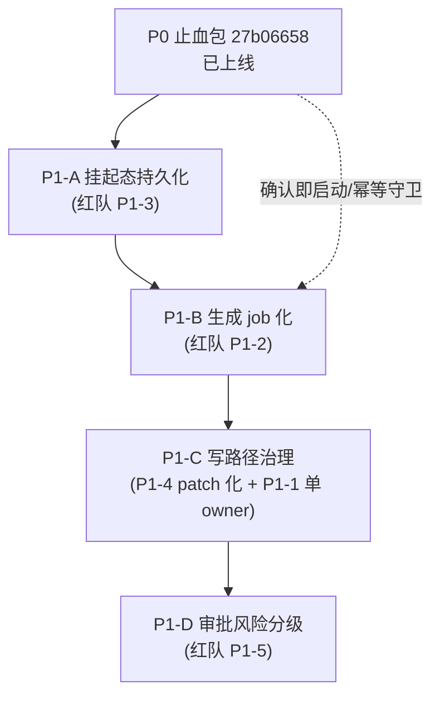
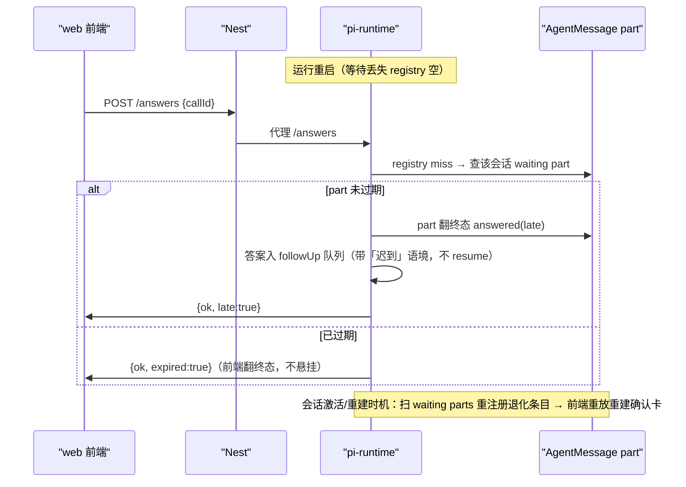

# P1 治本总纲：状态权收敛 · 生成 job 化 · 挂起持久化（路线规格 v1）

状态：草案待评审（2026-10-31，起因：P0 止血包 #640 上线后按规格 §12 推进根治，**避免止血包范围膨胀——治本项全部移出 P0 单独分包**）
> 定位：本文是 **总纲（分包裁决 + 贯穿不变量 + 判据）**，不是实施规格。每包开工前按 SDD 纪律另写该包实施规格 + 计划（§9 文件级清单以各包规格为准）。
前置：
- `docs/discussion/2026-10-29-agent-authority-model-redteam-review.md`（**v2 定稿，Part B/C = 本总纲出处**；本文入库时一并补齐两份 discussion 文档——此前一直是未跟踪状态，P0 规格的前置引用悬空）
- `docs/discussion/2026-10-29-propose-execution-ownership-architecture-review.md`（v1 推理留痕）
- `docs/superpowers/specs/2026-10-30-propose-confirm-execution-unity-design.md`（P0 已上线 `27b06658`，其 §12 登记项 = 本文范围；§14 自审 F1/F2 独立于本总纲，P0.1 overlay 小包先行）
- `docs/superpowers/specs/2026-10-28-agent-wait-timeline-single-source-design.md`（#635/#637，时间线 part 单一真相 = P1-A 的 durable 锚点）

## 0. 配图索引

| 编号 | 形式 | 内容 | 位置 | 用途 |
|---|---|---|---|---|
| 图 1 | 内嵌 Mermaid（flowchart） | 四包依赖关系与推进顺序 | §3 | 分包裁决锚点 |
| 图 2 | 内嵌 Mermaid（sequenceDiagram） | P1-A 重启重建 + 迟到答案收敛时序 | §5 | 首包实施对照 |

## 1. 目标（治本度量，红队 v2 Part D，全部可验收）

| # | 指标 | 现状（27b06658 实测） | 目标 |
|---|---|---|---|
| M1 | 节点状态写者数 | **>1**：Nest applyOrStage（权威）+ 前端 `useNodeGeneration` 轮询终态回写 completed（U6 接线点）+ 客户端整份 PUT（P0-4 守卫仅护 pending_confirm 分支） | ==1（Nest） |
| M2 | 生成执行入口数 | ==1（P0-1 已达成） | ==1（守住） |
| M3 | 客户端整份覆盖写 | 每次画布自动保存都是整份 PUT（守卫逐字段打补丁） | ==0（patch 化后整份路径弃用） |
| M4 | 挂起态可恢复率 | **0%**：`pending-registry` 纯进程内 Map，重启即丢，迟到答案 404/503 悬挂 | 100%（重启重建 + 迟到答案显式收敛） |
| M5 | turn 终态判定来源 | 服务端事件（P0-5 达成）但生成终态仍靠 13min 持轮 + 前端轮询回写 | 纯服务端事件注入，无持轮 |

## 2. 贯穿不变量（每包验收必查；守卫测试落 CI）

1. **节点状态的写者集合 == {Nest}**——代码级 grep 守卫：`apps/web` 与 `services/pi-runtime` 不得出现节点 `status` 直写字面量（白名单清单随 P1-B/C 收紧）。
2. **生成执行入口集合 == {1 个服务端服务}**（P0 不变量延续）。
3. **客户端写画布 = patch 语义**，禁止整份替换（P1-C 后成为硬约束）。
4. **turn 终态判定来源 == 服务端事件**（非连接状态、非本地轮询推断）。
5. **每个挂起 call 在 DB 有 durable 记录**（AgentMessage part，不新增表）。
6. **禁 `lane.resume()`**（cmv3zzid 纪律延续）：恢复手段 = 读持久化态重建卡片 + 迟到答案走新一轮输入（followUp 语义），绝不续跑上游 LLM。

## 3. 分包裁决（图 1：依赖与顺序）

*图 1 · 说明：P1-A 最小且独立（先做，durable part 基建被 P1-B 复用）；P1-B 依赖既有 notify 通路（已在生产）；P1-C 必须在 P1-B 之后（生成终态写者先收归 Nest，写者集合才可能收敛到 1）；P1-D 依赖前三包的转移 API 面定型。*

| 包 | 对应红队项 | 一句话范围 | 为什么这个顺序 |
|---|---|---|---|
| **P1-A 挂起态持久化** | P1-3 | 重启重建等待 + 迟到答案显式收敛（不 404 悬挂） | 最小、独立、可靠性缺口仍在流血（M4=0%）；durable part 基建被后续包复用 |
| **P1-B 生成 job 化** | P1-2 | 工具返回 job handle 即返回；终态事件注入；删 13min 持轮/启发式/假文案；生成终态节点写者收归 Nest | 通路大半已在（`late-generation-notify` 生产在跑）；必须先于 P1-C（否则写者收敛不彻底） |
| **P1-C 写路径治理** | P1-4 + P1-1 | C1 saveCanvas patch 化（整份 PUT 弃用期）；C2 状态机单 owner 收敛 + grep 守卫 | patch 化是单 owner 的载体；C2 的验收判据依赖 B 已把终态写者收归 Nest |
| **P1-D 审批风险分级** | P1-5 | propose 带 risk 标注；低风险自动确认（可配置可审计） | 产品减负项，依赖转移 API 面定型；提示词改动走 6 处同步纪律 |

## 4. 侦察实锤（2026-10-31，`git show 27b06658` 逐条核实；各包规格的文件级输入）

| # | 事实 | 位置 | 影响包 |
|---|---|---|---|
| F1 | 挂起注册表 = 纯进程内 `Map`（键=画布 sessionId；`PendingEntry{toolName, resolve, timer, settled}`；hooks `onWaitStart/onSettled` 已具备广播面；铁律 resolve 不 reject） | `services/pi-runtime/src/pending-registry.ts` | A |
| F2 | `/sessions/:sessionId/answers` 在 registry 缺条目时 **503 降级**（app.ts:65 缺省注释）→ 运行侧重启后用户确认即悬挂 | `services/pi-runtime/src/app.ts:459-` | A |
| F3 | durable 挂起锚点**已存在**：AgentMessage 时间线 part（#635 起 proposal/question part 持久化，前端重放已能恢复卡片）；**缺的只是 runtime 侧 registry 重建** | `apps/server` timeline parts | A |
| F4 | **Nest→runtime 终态注入通路已在生产**：generation-reaper 每 5min 扫「最近落终态+有画布会话+未通报」→ `POST /sessions/:id/notify-generation` → pi-runtime 裁决（工具仍在等 ⇒ 抑制；否则 lane followUp，drainQueued 空 prompt 兜底开轮）；durable 去重 `metadata.agentTurnNotified` | `apps/server/src/agent/pi-runtime/late-generation-notify.ts` | B |
| F5 | runtime 仍持轮：`waitForGenerationTerminal` capMs=780s（`PI_RUNTIME_GEN_TERMINAL_WAIT_MS` 可调）+ 超时假文案「生成仍在进行…不要声称已完成」 | `services/pi-runtime/src/tools/canvas-write.ts:59/790-835` | B |
| F6 | **前端是节点状态写者**：轮询终态后 web 写节点 `status: completed`（含「completed 但无产物判 error」的 U6 逻辑——收敛时该判定须随写者迁入 Nest） | `apps/web/src/composables/useNodeGeneration.ts:505-521` | B/C |
| F7 | 画布保存 = `PUT /sessions/:id` 整份替换 canvasData；P0-4 守卫是逐字段补丁（`PENDING_CONFIRM_CLIENT_EXITS`），patch 化前守卫面随新状态字段线性增长 | `apps/server/src/sessions/sessions.controller.ts:58` | C |
| F8 | GenerationRecord（schema `model GenerationRecord`）= 已持久化的生成 job；结算点分散在 studio.service 多处 update + reaper 兜底 | `apps/server/prisma/schema.prisma:273`、`apps/server/src/studio/` | B |

## 5. P1-A 挂起态持久化（首包，深度设计）

### 5.1 时序（图 2）

*图 2 · 说明：重启后 `/answers` 不再 503/404——registry miss 时以 durable part 为真源裁决；迟到答案绝不唤醒已死 promise，走 followUp 新一轮输入。*

### 5.2 机制与契约

1. **durable 真源 = AgentMessage part**（不新增表，延续 P0 纪律）：waiting part 已含 `callId / toolName / nodeId / startedAt`；补 `deadline`（startedAt + timeoutMs，可由 part meta 携带）与 settle 回写（waiting → answered/timeout/expired/aborted，由 settle 时刻落库）。
2. **registry 重建（退化条目）**：会话激活时机（首条 run/steer/followUp/notify 到达该会话）懒扫描该会话未 settle 的 waiting part → 重注册**无原 promise** 的条目；`resolve` 落「迟到答案记录 + followUp 注入」。按会话懒扫，不做全局启动扫描（F1 键结构天然支持）。
3. **/answers 契约升级**：registry miss → 查 durable part（图 2 两分支）；响应补 `late`/`expired` 标记；前端对 `expired` 把对应 part 翻终态（P0-5 门控同款，不报错）。
4. **迟到答案语境**：followUp 注入文本必须带「该提问已超时，以下为迟到答案，仅作背景参考，不要当作新指令重复执行」——防模型重复行动（红队 Part E 风险②同源）。
5. **超时兜底**：重建条目若已过 deadline → 注册即 settle(expired)，不武装新 timer 等待。

### 5.3 验收判据（行为级）

- A1 重启恢复：propose/ask 等待中重启 pi-runtime → 会话内确认卡经重放可见；用户确认 → **不 404/503**，part 翻终态，答案以迟到语境注入新 turn。
- A2 过期显式化：deadline 后确认 → `{expired:true}`，前端翻终态，无悬挂转圈。
- A3 不 resume：重建路径全程无 `lane.resume()`（grep 守卫 + 代码评审）。
- A4 幂等：同一 callId 重复 /answers → 首次裁决生效，重放返回同型回执（deduped 语义）。
- A5 零回归：既有 registry 单测全绿（纯数据结构行为不变，重建层是新增外壳）。

### 5.4 文件级改动清单（首包排期唯一输入，实施规格展开后复核）

| # | 文件 | 改动 |
|---|---|---|
| 1 | `services/pi-runtime/src/pending-registry.ts` | 退化条目重建 API（`rehydrate`：无 promise、settle 走迟到路径）、deadline 判定 |
| 2 | `services/pi-runtime/src/app.ts` | `/answers` miss 分支查 durable part（late/expired 裁决） |
| 3 | `services/pi-runtime/src/session-manager.ts` | 会话激活懒扫描接线（rehydrate 触发点） |
| 4 | `apps/server` part settle 回写 | waiting part 翻终态落库（settle 时刻；内部通道） |
| 5 | `apps/web` 前端 | `late`/`expired` 回执处理（part 翻终态，同 P0-5 门控规格） |
| 6 | 测试 | registry rehydrate 单测、/answers late/expired 行为用例、A1-A5 判据用例 |

## 6. P1-B / P1-C / P1-D 概要（边界防膨胀；各包开工另出实施规格）

### P1-B 生成 job 化（依赖 P1-A 基建 + F4 通路）

- propose 确认派发成功（P0-1 点位）后**立即返回 job handle** `{started:true, recordId}`，删 `waitForGenerationTerminal` / capMs 假文案 / SSOT 轮询启发式；run_* 同族四类（image/video/text/audio）一并改——红队 Part E：只改一处 = 指标不治本。
- 终态注入收紧：studio 结算点直发 notify-generation（reaper 5min 延迟降为兜底），载荷带 `nodeId/status/recordId/url`；模型据注入简报产物。
- **生成终态节点写者收归 Nest**（F6 迁移）：Nest 结算写节点 `completed/error + url`（含 U6「completed 无产物判 error」判定随迁）；web `useNodeGeneration` 回写撤除，`useGenerationPolling` 降为纯呈现加速（只读）。
- 幂等：`proposalEpoch` 抢占规则（红队风险④）——同 `(sessionId, nodeId)` 二次确认走 P0 幂等守卫，epoch 只在「撤回重提」语义时递增。
- 不做：propose_plan/批量生成 job 化（量级不同，单列后续包）；多端并发编辑冲突（红队 Part E 未覆盖项，独立议题）。

### P1-C 写路径治理（C1 patch 化 + C2 单 owner）

- C1：新增 `PATCH /sessions/:id/canvas`（字段级/ops 级 merge）；web saveCanvas 切 PATCH；整份 PUT 进入弃用期（打点观测清零后关闭或降级只读合并）。P0-4 式逐字段守卫随之退役（patch 语义下客户端根本提交不了 status）。
- C2：grep 守卫落 CI（web/runtime 无节点 status 直写）；状态转移 API 幂等面定型（P1-D 依赖）。
- 风险：旧 web 缓存仍发整份 PUT → 弃用期由服务端合并兼容自愈（P0-4 守卫过渡期经验复用）。

### P1-D 审批风险分级

- propose 工具 schema/描述带 `risk` 标注（低/中/高）；低风险自动确认（策略可配置、决策留审计）；提示词改动走 **6 处同步纪律**（prompt-registry + fallback 常量 + L6 预算余量先跑 `pnpm prompt:lint`）。
- 依赖：P1-C2 转移 API 定型；产品语义（哪些动作算低风险）需产品裁决，规格开工前先出决策文档。

## 7. 明确不做（防范围膨胀，登记不隐性扩）

- 不做挂起态跨实例共享/分布式协调（单实例部署现实下 rehydrate 足够）。
- 不新增持久化表/列——全部复用 AgentMessage part 与 GenerationRecord（除非实施证实必须，需在包规格里论证）。
- 不做多端画布并发冲突合并（独立议题）；不做 chord 引入（P2）。
- 不动 ask_user 交互语义（仅持久化外壳）；不改上游 vendored 代码（对齐面已在）。

## 8. 测试策略

- 每包：单测（nvm node24 + `--maxWorkers=1 --no-file-parallelism`）+ 行为判据用例 + `vue-tsc -b`；涉及提示词跑 `pnpm prompt:lint`。
- 守卫测试落 CI：贯穿不变量 §2 的 grep 守卫与行为用例随所在包合入，此后全量把关。
- P1-A 演练：本地/CI 注入「重启」用例（registry 清空 → rehydrate 断言）；生产验收走真机走查（A1-A5 清单入 PR 描述）。

## 9. 风险

| # | 风险 | 缓解 |
|---|---|---|
| 1 | 迟到答案被模型当新指令重复执行 | 注入强制带迟到语境（§5.2-4）；eval 用例覆盖 |
| 2 | part settle 回写与前端重放竞态 | settle 回写走内部通道（applyOrStage 同源）；前端以回执/重放幂等收敛 |
| 3 | job 化后模型失去产物因果链 | notify 载荷带 url/nodeId；工具返回文案明确「完成后会通报」；followUp 注入即因果闭合 |
| 4 | notify 直发与 reaper 双发 | 复用 `agentTurnNotified` durable 去重标记（先到先得） |
| 5 | patch 化迁移期双写面 | 弃用期打点 + 服务端合并兼容；旧缓存自愈后再关闸 |
| 6 | 范围膨胀（本总纲最大的风险） | 总纲只锁分包与判据；每包独立 SDD，§7 不做清单随包复核 |

## 10. 配图规范自检

本文档含 2 张内嵌 Mermaid 图，无 SVG 附件。`pnpm verify-spec-figures` 结果：**本文 0 错 0 警**（2026-10-31 提交前已跑；全库另有 2 警落在 2026-10-04 metrics 旧文档 R4 引用建议，与本规格无关）。
