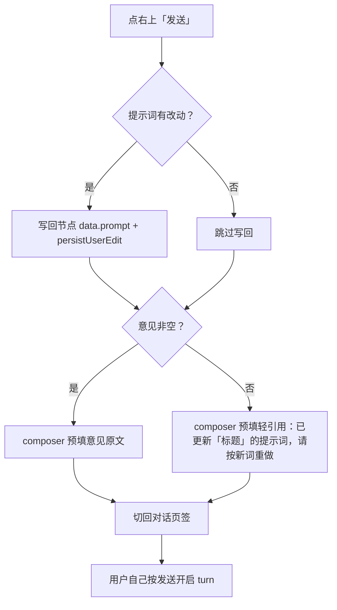
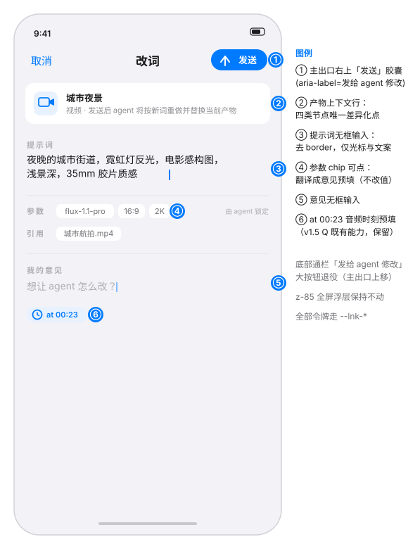
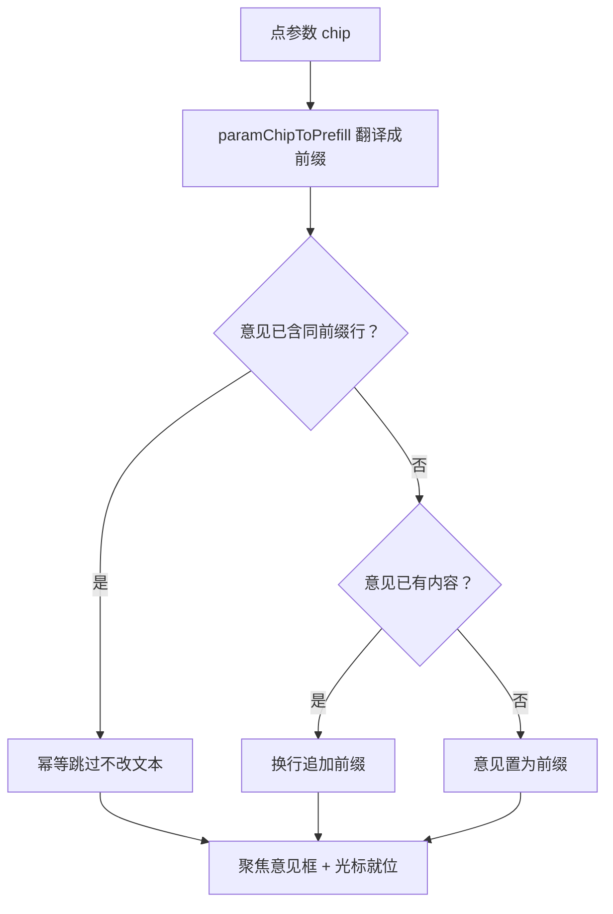

# 移动端「改词」浮层 iOS 化重设计（MobileNodeEditorSheet v2）

状态：已评审·实现中（2026-11-01，评审通过并开 feature 分支 `feat/mobile-editor-sheet-ios`）
前置：
- `docs/superpowers/specs/2026-10-28-text-node-html-artifact-design.md`（已上线，#636：html 产物保留 agent 改词流的职责边界）
- PR #644（已上线 `f8b2a60c`：文本节点就地编辑——本规格明确**不**照搬该心智，见 §3）
- `docs/superpowers/specs/2026-10-28-askuser-mobile-multi-question-redesign.md` 等既有移动端浮层规格（§4.11 视觉哲学）

分支约定：实现走 feature 分支 + PR + squash merge + 生产取证。

## 0. 配图索引（结构与视觉两类，均随本文档演进）

本文档的图分两类：**结构图**一律以 Mermaid 内嵌；**视觉稿**以 `assets/` 下的 SVG 附件承载（相对路径引用）。

| 编号 | 形式 | 内容 | 位置 | 用途 |
|---|---|---|---|---|
| 图 1 | SVG 附件 `assets/mobile-editor-sheet-ios-1-layout.svg` | 改造后浮层整体布局与六处圈注 | §6 | 布局与验收基准（真机走查对照） |
| 图 2 | 内嵌 Mermaid | 点【发送】后的完整决策流 | §5 | 发送行为契约（含毛边修复分支）的验收锚点 |
| 图 3 | 内嵌 Mermaid | 参数 chip → 意见预填（翻译制）流程 | §6-D | 预填幂等与追加语义的验收锚点 |

## 1. 目标

1. 「改词」浮层（html / 图片 / 视频 / 音频四类节点共用）的视觉与交互对齐 iOS 全屏撰写模式：导航三段化、无框输入、主出口右上移。
2. 消灭现存毛边：意见为空时点【发送】落在空 composer（用户按了按钮却无事可发）。
3. 参数从「只读哑巴」升级为「翻译制可表达」：点参数 chip 预填意见，不改值、不越权（参数所有权仍在 agent）。

## 2. 范围（含明确不做）

**做**：
- `MobileNodeEditorSheet.vue` 单组件视觉/结构重排（导航三段、无框输入、产物上下文行、参数 chip 化、转场）
- 新增纯函数策略文件 `mobileEditorSheetPolicy.ts`（预填翻译、fallback 意见文案、类型标签）
- `CanvasPage.handleMobileNodeSendToAgent` 增加意见为空 fallback 分支
- 既有 3 个测试文件断言更新 + G-8 守卫修订 + 新增用例

**不做**（登记 §12）：
- 参数直管编辑（模型/比例/分辨率本地修改 + 本地重生成）——依赖 P1-B 生成 job 化，现在做必被下次 propose 覆盖（两套参数语义打架）
- 取消时的草稿保留确认（iOS Mail 式「删除草稿/保留」弹窗）——v1 取消直接关，原文仍在节点上，重开即原文
- PC 端 Dock 改动（零 diff，本规格全部改动收敛在移动端组件与 CanvasPage 移动端处理函数内）
- 迁移 MobileSheet 基座（本组件是全屏表单 ≠ 62vh 选择型，V-3 白名单豁免理由不变）

## 3. 与既有规格的关系

- **对 PR #644（文本就地编辑）**：显式不照搬。就地编辑 = 直接改产物、本地闭环；改词 = 改指令、agent 异步重做。两者心智不同，改词保持表单形态，只借鉴其「无框、沉浸、退出不丢字」三特质。
- **对 #636（html 产物边界）**：不破坏。html 文本节点仍走改词（agent 改词流），本规格不改任何格式白名单。
- **对 §4.11 移动视觉哲学**：新增判据 §4（全屏撰写模式），不推翻既有判据；G-8 / V-3 守卫语义收窄或保持，见 §9。
- **对 v1.5 Q（at mm:ss 预填）**：原样保留，且参数 chip 预填不得覆盖它（追加语义，见 图 3）。

## 4. 规范与判据（可复用）

| # | 判据 | 说明 |
|---|---|---|
| J-1 | **翻译制**：用户对参数的任何诉求都翻译成自然语言意见交 agent，系统永不本地改参 | 参数 owner 永远是 agent（`proposeGeneration` 写死）；P1-B 前无本地重生成通路 |
| J-2 | **发送必有落点**：点【发送】后用户回到对话页签，composer 必有可见内容（意见或轻引用） | 毛边修复的验收判据；扣扳机者永远是用户（不自动发送） |
| J-3 | **一个主出口**：全浮层唯一主操作 = 右上「发送」胶囊；取消 = 左上对称文本按钮 | iOS Mail/Messages 撰写惯例；底部通栏按钮退役 |
| J-4 | **内容即界面**：输入区无 border、无盒子背景，仅 role 小标签 + 光标 | 沿用 iOS 备忘录哲学；参数/引用等元信息用弱化行呈现 |
| J-5 | **z 层不动**：浮层保持 `position:fixed; z-index:85` | 既有生态位（顶栏 40 / 对话面板 30 / 抽屉 95）已盘点，改转场不动层 |
| J-6 | **令牌与图标红线**：新增样式一律 `--lnk-*`（禁 `--neo-*`）；图标一律内联 SVG（24 网格 stroke:2，零第三方图标库） | design-token / theme-usage / dead-styles / G-16 四守卫不破 |
| J-7 | **语义在 aria**：UI 短文案「发送」，`aria-label="发给 agent 修改"` 保留完整语义 | 教育成本与 iOS 简洁的折中；屏幕阅读器不断链 |

## 5. 架构与契约

改动收敛在三层：组件内重排（无新 props / emits，`node` 已含 `type` 与 `data.title`）、新增纯函数策略文件、CanvasPage 发送处理函数补一个分支。**不新增任何 props/emit 契约，不改 store/schema。**

图 2 说明了点【发送】后的完整行为契约——这是本规格最核心的一条验收锚点：提示词与意见是两条不同的通路（提示词=节点数据落库，意见=composer 对话），且意见为空时有兜底轻引用，composer 永不为空。

*图 2 · 点【发送】后的行为契约：提示词走节点落库、意见走 composer，意见为空时兜底轻引用，composer 永不为空且不自动发送。*

**毛边文案（fallback 轻引用）**：`已更新「{标题}」的提示词，请按新词重做并替换当前产物`。标题缺省时降级为类型名（`{类型}节点`，如「图片节点」）。措辞避开「生成」二字无硬约束（该守卫只扫组件模板），但保持与 G-8 语义一致的表达习惯。

## 6. 打样/主场景规格（逐项验收，对照 图 1）

*图 1 · 改造后「改词」浮层布局基准：导航三段（①）、产物上下文行（②）、无框输入（③⑤）、翻译制参数 chips（④）、at mm:ss 预填（⑥）；真机走查 V-F~V-K 逐项对照此图。*

### A. 导航三段（图 1 ①）
- 左「取消」accent 文本按钮（44px 命中区）= 放弃本次编辑：**不写回、不跳页签**，直接关浮层（原文仍在节点上，重开即原文）。
- 中大标题「改词」（17px semibold）；`role="dialog"` `aria-label` 同步改为「改词」。
- 右上「发送」胶囊：accent 底 + 白字 + arrow-up 内联 SVG；`aria-label="发给 agent 修改"`；禁用态（提示词与意见全空）opacity 0.5 不可点。
- **底部通栏大按钮退役**；底部只留 safe-area 空白。

### B. 无框输入（图 1 ③⑤）
- 提示词 / 意见两个 textarea 去 border、去 focus 蓝框（保留 caret）；`min-height` 不小于现值（长提示词整屏输入面不变）。
- role 标签（「提示词」「我的意见」）改为 11px 弱化小标签，不再是表单 field 盒。
- 提示词 textarea autofocus 不变；`enterkeyhint` 不新增（多行输入语义正确）。

### C. 产物上下文行（图 1 ②，四类节点唯一差异化点）
- 结构：类型图标（34px 圆角方块）+ `data.title`（缺省降级为 `{类型}节点`）+ 副标题。
- 副标题固定：`发送后 agent 将按新词重做并替换当前产物`。⭐ 措辞刻意避开「生成」二字——G-8 守卫断言组件模板不含「生成」（见 §9）。
- 图标映射（全部内联 SVG stroke:2）：image=照片、video=摄像机、audio=波形、text=文档。audio 图标不与 MobileNodeWaveform 组件混用（静态图标即可）。

### D. 参数 chip 化 + 翻译制预填（图 1 ④，流程见 图 3）
- `paramsSummary` 字符串退役，改为 chip 数组渲染（沿用现有六个字段判定，无值不渲染该行）。
- 行尾固定弱化标注「由 agent 锁定」——把 J-1 的不可改语义显性化。
- 点 chip ⇒ `paramChipToPrefill` 翻译成意见前缀并**聚焦意见框、光标就位**；幂等与追加语义见图 3。字段→前缀映射：

| 字段 | 前缀文案 |
|---|---|
| `imageAspect` | 把画面比例改为 |
| `imageResolution` | 把分辨率改为 |
| `imageModel` / `videoModel` / `textModel` / `audioModel` | 把模型改为 |

*图 3 · 参数 chip 点击的翻译制预填：只翻译字段名，目标值由用户补全；同前缀不重复插入，`at mm:ss` 既有预填不被覆盖。*

### E. 毛边修复（见 图 2 G 分支）
- 意见为空且提示词有改动 ⇒ `handleMobileNodeSendToAgent` 内用 `composeFallbackOpinion` 预填 composer；仍然切页签、仍然用户自己按发送。
- 意见为空且提示词**无**改动（用户只看了一眼就点发送）⇒ 预填同款轻引用（标题来自节点），行为一致不特判——发送按钮此时本就禁用态，此分支仅防御。

### F. at mm:ss 预填保留（图 1 ⑥）
- `initialOpinion`（音频 `meta.mediaTime` → `at mm:ss`）通路零改动；参数 chip 预填走追加（图 3），不覆盖。

### G. 转场与动效
- 浮层挂载：translateY(100%) → 0，`var(--lnk-duration-base)` + `var(--lnk-ease-decelerate)`；卸载淡出。
- `prefers-reduced-motion: reduce` ⇒ 降级为 opacity 或直接出现（对齐 MobileSheet 既有惯例）。

### H. 收尾与守卫
- 「取消」/「发送」均为 44px 命中区；`data-testid` 保留既有四个（`mobile-editor-close` 语义迁移为取消按钮、`mobile-editor-send` 迁移为胶囊），新增 `mobile-editor-cancel`、`mobile-editor-context`、`mobile-editor-param-chip`。
- ⛔ 组件模板全文字不得出现「生成」二字（G-8 现行断言保持）；发送语义由 aria-label 承载（J-7）。

## 7. 数据与状态变更

无 schema / store / API 变更。组件内新增的仅是 UI 态：chip 点击产生的意见预填（写入既有 `opinion` ref）与焦点控制。`node.type`、`node.data.title` 均为既有字段，只读使用。

## 8. 纯函数与算法（单测要求）

新建 `apps/web/src/components/mobile/mobileEditorSheetPolicy.ts`（组件 `<script setup>` 无法导出命名函数，策略独立成文件供直测）：

| 函数 | 契约 | 单测要求 |
|---|---|---|
| `nodeTypeLabel(type: string): string` | `image→图片`、`video→视频`、`audio→音频`、`text→文本`，未知类型回退「节点」 | 全枚举 + 未知回退 |
| `contextTitle(data): string` | `data.title` 非空取之，否则 `{nodeTypeLabel}节点` | 有/无 title 两分支 |
| `paramChipToPrefill(field: string): string \| null` | §6-D 映射表；未知字段返回 null（chip 不渲染） | 全枚举 + 未知 null |
| `appendOpinionPrefill(current: string, prefix: string): { next: string; changed: boolean }` | 幂等（已含同前缀行则原样返回）；空 ⇒ 置为前缀；非空 ⇒ `\n` 追加 | 幂等/空/非空/换行四组 |
| `composeFallbackOpinion(title: string, type: string): string` | `` 已更新「${contextTitle}」的提示词，请按新词重做并替换当前产物 `` | 快照断言 |

## 9. 文件级改动清单

| 文件 | 改动 | 说明 |
|---|---|---|
| `apps/web/src/components/mobile/MobileNodeEditorSheet.vue` | 重排 | §6 A–H 全部 UI 变更；styles 全量 `--lnk-*` |
| `apps/web/src/components/mobile/mobileEditorSheetPolicy.ts` | 新建 | §8 五个纯函数 |
| `apps/web/src/components/mobile/MobileNodeEditorSheet.test.ts` | 更新+新增 | 文案/结构断言迁移；新增 chip 预填、fallback 快照 |
| `apps/web/src/components/mobile/MobileNodeEditorSheet.r4.test.ts` | 更新 | testid 与文案对齐 |
| `apps/web/src/components/mobile/MobileNodeEditorSheet.walkthrough.test.ts` | 更新 | 走查用例对照 图 1 |
| `apps/web/src/components/mobile/mobileNodeInteraction.guards.test.ts` | G-8 修订 | `toContain('发给 agent 修改')` → `toContain('aria-label="发给 agent 修改"')`；`not.toContain('生成')` **保持不变**；G-7 不动 |
| `apps/web/src/pages/CanvasPage.vue` | 小改 | `handleMobileNodeSendToAgent` 意见为空分支调 `composeFallbackOpinion`（§6-E）；其余零 diff |
| `apps/web/src/pages/CanvasPage.mobileEditorSendFallback.test.ts` | 新建 | 源级断言（沿 mobileCreateLoop 守卫风格：断言走既有通道 + fallback 调用存在），不做重挂载（挂载类 OOM 教训） |
| `docs/superpowers/specs/assets/mobile-editor-sheet-ios-1-layout.svg` | 已建 | 图 1 |
| INDEX.md | gen_index 再生 | docs 收尾时按惯例在 worktree 等价集跑 gen_index |

## 10. 测试策略与验收标准

**本地命令**（纪律照旧）：`nvm` node24 + `--maxWorkers=1 --no-file-parallelism`，分批 ≤12 文件；改组件后必跑 `vue-tsc -b`；挂载类用例若 OOM(137) 用 `NODE_OPTIONS=--max-old-space-size=3584` 逐文件跑。

1. **单元**：`mobileEditorSheetPolicy.test.ts`（§8 全表）。
2. **组件**：三个既有文件更新后全绿；新增：chip 点击幂等、fallback 文案、禁用态、aria-label 断言。
3. **守卫**：`mobileNodeInteraction.guards`（G-7/G-8 修订版）、`mobileVisualLanguage.guards`（G-16 / V-3 白名单不新增不删除）、design-token / theme-usage / text-token-guard / dead-styles 四件套。
4. **CI**：`pnpm -r build` 全绿（测试 mock 断言禁 `as never` 等既有纪律）。
5. **目视验收（真机走查清单，对照 图 1）**：

| # | 场景 | 预期 |
|---|---|---|
| V-F | 任一媒体节点 viewer →【改词】 | 全屏浮层自底部滑入；取消/改词/发送三段导航；无任何表单盒子 |
| V-G | 点参数 chip（如 16:9） | 意见框聚焦并出现「把画面比例改为」+ 光标；再点同 chip 不重复 |
| V-H | 只改提示词、意见留空 → 发送 | 落回对话页签，composer 有「已更新「…」的提示词…」轻引用；自己按发送开启 turn |
| V-I | 音频节点改词 | `at 00:23` 胶囊在；点参数 chip 后预填为换行追加，at 行不被覆盖 |
| V-J | 取消 | 浮层收起，节点提示词不变、无页签跳转；reduced-motion 下无滑动动画 |
| V-K | 四类节点（html/图/视频/音频） | 上下文行图标与降级标题各归各；其余全部同一套 |

## 11. 风险

| 风险 | 缓解 |
|---|---|
| G-8 守卫是规格契约，本 PR 必须同步修订断言（漏改 = CI 红）；`not.toContain('生成')` 保持 ⇒ 上下文副标题等一切新文案严禁出现「生成」二字 | §6-H 显式登记；§9 守卫改动入文件清单 |
| 「发送」短文案弱化「不是本地提交」的教育 | J-7 aria-label 保留全语义 + 上下文行副标题明说「agent 将按新词重做」 |
| iOS Safari 键盘顶推 `position:fixed; inset:0` 全屏层（真机历史坑域） | 转场不动 z；键盘行为列 V-F 真机走查首项，异常则启用 visualViewport 补偿（既有 composer 基座模式） |
| 意见预填与 `initialOpinion`（at mm:ss）互相覆盖 | 追加语义（图 3）+ V-I 走查钉死 |
| 挂载类测试 OOM(137) | 源级断言 + 逐文件跑（§10 纪律） |
| 行为级守卫对模板断言敏感（#644 教训：G-3 顺序敏感） | 改模板前先读全部引用本组件的守卫断言（§9 已列全） |

## 12. 后续包 / 路线图

- **P1-B 后**：参数直管制——生成 job 化落地后，参数 chip 升级为独立二级参数面板（push 式，iOS Settings 形态），支持本地重生成；本规格的翻译制保持为该面板的降级路径。
- **取消 = 保留草稿**：iOS Mail 式「删除草稿/保留草稿」确认弹窗（需组件外草稿态存储，v1 不做）。
- **PC 端对照改造**：本规格零 PC diff；PC dock 是否跟进 iOS 化另立规格。

## 13. 配图规范自检

`pnpm verify-spec-figures` 结果（2026-11-01 实测）：`✓ docs/superpowers/specs/2026-11-01-mobile-editor-sheet-ios-redesign.md`——校验完成：191 篇在范围内，0 个错误（全库仅存的 2 个 R4 警告属 2026-10-04 旧文档，与本规格无关）。图 1 SVG 已按 R1/R6/R8 约束落 `assets/` 并带圈注图例。

## 14. 交付自审（自上而下全盘核对，2026-11-01）

- **范围闭环**：§1 三条目标 ↔ §6 A–H 逐项可验收 ↔ §10 走查 V-F~V-K 一一对应；「不做」三条全部登记 §12，无隐性范围。
- **契约零新增**：无新 props/emit/schema；`node.type`/`data.title` 既有只读——PC 零 diff 可达成（CanvasPage 仅移动端函数内加分支）。
- **守卫交叉核对**（§9 ↔ 守卫源码）：G-7（禁 dock）不受影响；G-8 两半断言一改一保，且全组件新文案已过「生成」二字扫描（副标题用「重做」）；G-16（无字符图标）——发送箭头/at 时钟/四类节点图标全部内联 SVG；V-3 白名单原样引用豁免理由，不改守卫文件白名单。
- **判据分层一致性**：J-1（翻译制）> §6-D 映射表 > 图 3 流程 > chip 单测；J-2（发送必有落点）> 图 2 > §6-E > V-H。与 §4.11 既有判据无冲突（J-3/J-4 是新增全屏撰写判据，非推翻）。
- **与 #644/#636 边界**：§3 显式声明不照搬、不破边界；文本节点 plain/markdown 仍走就地编辑，本浮层只承接 html 文本 + 媒体节点。
- **遗漏自查**：键盘顶推、OOM、BSD grep（`\|` 禁用）、zsh 词分割等工程纪律已入 §10/§11；gen_index 与 verify-spec-figures 收尾动作入 §9/§13；规格头 sha 登记待实现 PR 描述补（本仓库惯例）。
