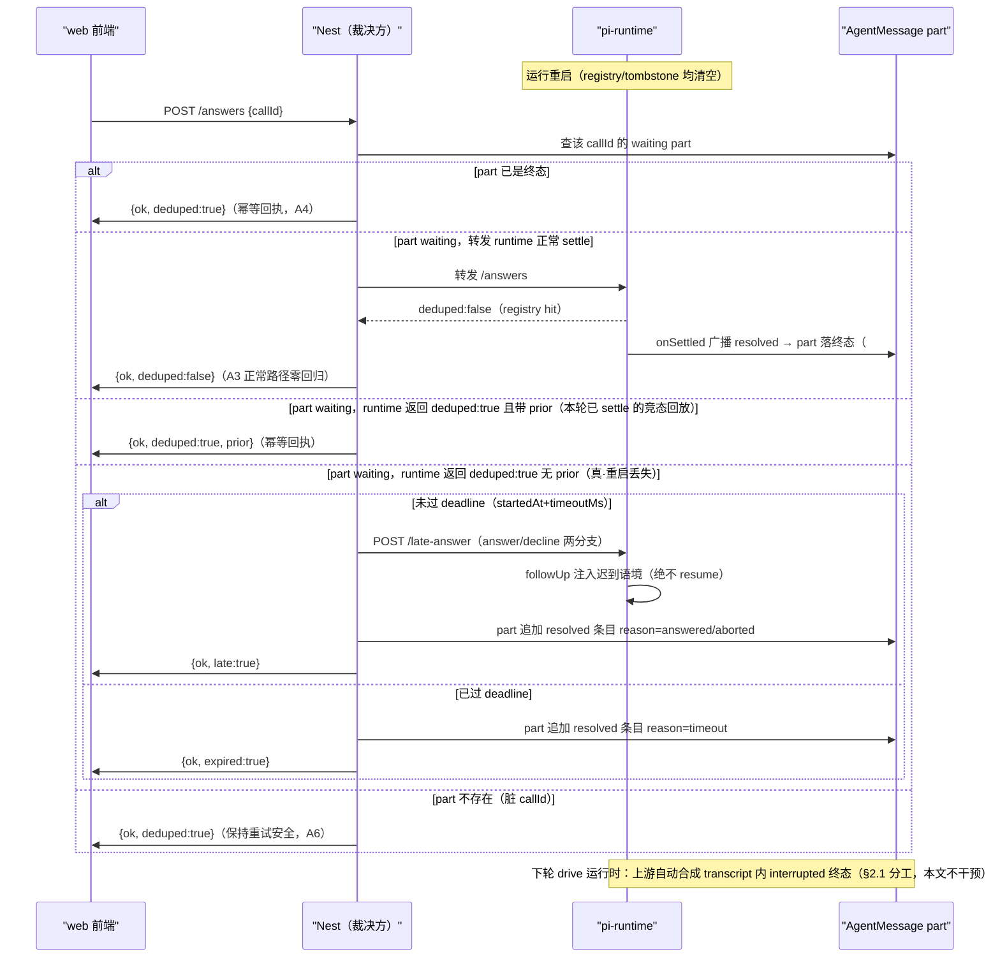

# P1-A 挂起态持久化 实施规格（SDD）v1

状态：待评审（2026-11-01，依据总纲 `2026-10-31-p1-root-cure-roadmap-design.md` §5 深设展开；侦察基线 master=`f9da7446`/#659）
> 定位：本文是 **P1-A 单包实施规格**。对总纲 §5 的两处修订（§3）由侦察实锤驱动，按总纲「§5.4 清单以各包规格为准（展开后复核）」的约定落定。
前置：
- `docs/superpowers/specs/2026-10-31-p1-root-cure-roadmap-design.md`（总纲：目标 M4/M5、不变量 §2、A1-A5 判据雏形）
- `docs/superpowers/specs/2026-10-30-propose-confirm-execution-unity-design.md`（P0 已上线；本文复用其 part 锚与回执语义）
- #648（`57b36dad`）：waiting_user/resolved 落库白名单——**本文 part 翻终态的消费形态即来自它**
- #654（`98794b88`）：web 侧 settled 单飞 + resolved reason 终态映射——**本文 web 收口直接复用其映射表**

## 0. 配图索引

| 编号 | 形式 | 内容 | 位置 | 用途 |
|---|---|---|---|---|
| 图 1 | 内嵌 Mermaid（sequenceDiagram） | /answers 重启后裁决全分支（含上游 settle 分工时序） | §4 | 实施对照 |

## 1. 目标（对齐总纲 M4）

- **M4 挂起态可恢复率 0% → 100%**：运行侧重启后，用户对存留确认卡的确认/取消**不再被静默吞掉**（现状实锤见 §3-1，比总纲 §4-F2 写的「503 悬挂」更严重：是 `{ok:true, deduped:true}` **假成功**），而是翻 part 终态 + 显式 late/expired 回执 + 迟到语境注入新轮。
- 顺带收窄 M5：late 注入走 followUp（服务端事件注入），不引入任何新轮询。

## 2. 前置核实（实施前必须钉死的事实，第一条 = 2026-11-01 拍板的两核对点）

### 2.1 核对点①：上游 drive 的 settle 时机与 rehydrate 分工（结论：正交，零双 settle）

**调用链实锤**（`git show f9da7446` vendor 面）：
- `vendor/.../harness/runtime/drive.ts:68`：`assistant.effect_pending` 状态 → `recoverAssistantGeneration`——**只在 drive 主循环处理该状态时触发**；
- `vendor/.../harness/runtime/drive/tools.ts:538/576`：`interruptedOutcome` 在 `runTools` 阶段落——**同样是 drive 运行时**，不是 session load 时；
- `reconcile.ts:149/160`：cancelled effect 的合成 settle，同属 drive 周期。

**结论**：上游对「重启后未决 tool_call」的合成终态（interrupted/"external outcome is unknown"）**只在下一轮 drive 运行时发生**（load 时不 settle）。分工表：

| 记录面 | 归属 | 内容 |
|---|---|---|
| pi transcript 内未决 tool_call 的 interrupted 合成 | **上游 drive**（下轮运行自动完成） | tool_result=interrupted，回合收口 |
| AgentMessage waiting part 翻终态（answered/declined/expired） | **本文·Nest 裁决** | timeline 重放面，#648 同型 |
| 迟到答案进入模型上下文 | **本文·followUp 注入** | 新轮输入，绝不 resume、不写 tool_result |

三层正交：上游 settle 的是 transcript（工具调用层），本文翻的是 timeline part（呈现层），注入的是新轮 prompt（输入层）。**P1-A 不做 runtime 侧 rehydrate**（对总纲 §5.2-2 的修订，理由见 §3-2）——没有 registry 重建，也就没有「与上游 settle 抢写」的双 settle 竞态面。

### 2.2 核对点②：内核 pin 0.85.1 升级窗口（结论：P1 期间不升级）

**实锤**：上游 `earendil-works/pi` releases 最新 **v1.4.0**（2026-11-01 核对），pin `0.85.1`（2026-10-03，`VENDORED.md` commit `d981de1`）——大版本跨越，中间多版。

**裁决**：P1 全程保持 pin `0.85.1` 不动。理由：①P1 动的恰是 harness drive/tools 密集消费区（pi-runtime 工具层），升级迁移面与治本面重叠，diff 互相污染；②vendored 复制使 pin 固定=语义固定，上游演进不影响本文依赖的 settle 时序结论（§2.1）；③0.85.1 在生产已稳定跑近月。**升级窗口 = P1 四包全部合入后的独立专包**（先盘 drive/session API diff，再定迁移单）。风险登记 §8-5。

### 2.3 其余前置事实（侦察实锤，`git show f9da7446`）

| # | 事实 | 位置 |
|---|---|---|
| P1 | `/answers` miss = 假成功：`registry.answer` 对未知 callId 返回 `{ok:true, deduped:true}`；503 仅在 registry 未配置时（app.ts:462） | `services/pi-runtime/src/pending-registry.ts:116-120` |
| P2 | waiting_user part 载荷已齐备：`callId/toolName/timeoutMs/nodeId/reason`——deadline = part 时间戳 + timeoutMs，**零 schema 变更** | `apps/server/src/agent/pi-runtime/pi-events.ts:200-219` |
| P3 | resolved 也走同型 waiting_user 事件（status:'resolved'）落库；web 重放按 reason 映射终态（answered/aborted/timeout → confirmed/declined/expired） | #648 + #654 |
| P4 | runtime 注入通路既有形态：`notifyGenerationTerminal`（Nest→lane followUp，drainQueued 空 prompt 兜底）——late 注入复用同通路形态 | `services/pi-runtime/src/session-manager.ts:2202`、`followUp:2561` |
| P5 | web /answers 调用与显式确认入口：`agentAnswers.ts`（POST 封装）、`proposeWaitActions.ts`（显式 /answers + #654 单飞） | `apps/web/src/components/agent/` |

## 3. 对总纲的两处修订（侦察驱动，显式留痕）

1. **F2 修正**：总纲 §4-F2 与图 2 写「registry miss → 503 悬挂」。实测：503 仅在 registry 未配置时；registry 配置后 miss = **deduped 假成功**（幂等「重试安全」设计把「重启丢失」误伤为「已处理」）。后果更重（用户看到成功、零反馈丢失），故 A1 判据升级为「不返回假成功」（§6）。
2. **§5.2-2「runtime 侧 registry 重建（rehydrate）」整项退役**：runtime 无 DB 读不到 parts；而 Nest 持有 parts 且已有翻终态消费形态（#648）。裁决权收 Nest 后，runtime 退化条目没有消费方（`/pending` 端点继续如实报告内存态，重启后 `pending:null` 由前端重放兜底——#648 已验证）。删除 rehydrate 反而消灭了「重建条目 vs 上游下轮 settle」的时序耦合面（§2.1）。

## 4. 机制设计

### 4.1 图 1：/answers 裁决全分支

*图 1 · 说明：裁决权在 Nest；runtime 只保留「真 settle」与「late 注入」两个职责。deduped:true 是否携带 prior 是「竞态回放」与「真丢失」的唯一判别器（§4.3 tombstone）。*

### 4.2 Nest 裁决（新增，代理链内插入）

- 入口：现有 `/answers` 代理链（agent.controller → agent.service）。转发 runtime 前先查 part 终态；`deduped:true` 回来后再分流（图 1）。
- **part 翻终态 = 向该消息 `metadata.executionEvents` 追加同型 waiting_user resolved 条目**（reason 沿用 #654 映射表：late 确认→`answered`、late 取消→`aborted`、过期→`timeout`）——**前端重放零新增映射**。写入是 Nest 内部方法（#648 白名单是 SSE 通路；此处是主动追加，形态同源）。
- part 翻终态必须**条件更新（CAS：仅当仍为 waiting）**，与 tombstone 双闸防双裁决（§8-2）。

### 4.3 runtime：settle tombstone（竞态判别器，小改）

- `PendingToolRegistry` settle 时留**内存 tombstone**（callId→resolution，TTL 10min，覆盖 SSE 广播落库延迟；会话关闭随 abortAll 清理）。
- `answer/decline` 对 tombstone 命中返回 `{ok:true, deduped:true, prior:<status>}`；对真未知 callId 仍返回 `{ok:true, deduped:true}`（不带 prior）。**没有 tombstone，并发双 /answers 的第二发会被误判为「真丢失」而双注入**（实锤：entry settle 后即从 Map 删除）。

### 4.4 runtime：late-answer 注入端点（新增）

- `POST /sessions/:sessionId/late-answer`：body `{callId, kind:'answer'|'decline', answers?, note?}` → `session-manager.lateAnswerInject()` → 复用 `notifyGenerationTerminal` 的 followUp 通路形态（P4）。
- 注入文本（草稿，实施可调，语境铁律对齐总纲 §5.2-4）：
  - answer：`[迟到答案] 用户此前对提问（{toolName}）的回应已超过会话等待窗口。以下为迟到回应，仅作背景参考：若该事项已在后续进展中处理，不要重复执行；若尚未处理，按此意图继续。{answers 摘要}`
  - decline：`[迟到取消] 用户取消了此前等待的提问（{toolName}）。不要等待该事项，也不要断定用户已同意。{note}`
- **不写 tool_result、不 resolve 任何 promise、不 `lane.resume()`**（A5 守卫对象）。

### 4.5 web 收口（最小面）

- `agentAnswers.ts`：响应 `late/expired/prior` 字段透传。
- `proposeWaitActions.ts`（协同 #654 settled 单飞）：`late:true` 按已确认收口（reason=answered → confirmed）、`expired:true` → expired、late 取消 → declined——全部走既有 resolved reason 映射，乐观翻态后即可撤销等待 UI。

## 5. 文件级改动清单（实施排期唯一输入）

| # | 文件 | 改动 | 量级 |
|---|---|---|---|
| 1 | `apps/server/src/agent/agent.service.ts`（或独立 `answers-adjudication.ts`） | 裁决逻辑：part 查询 → 转发 → deduped 分流 → part CAS 翻终态 | 主改 |
| 2 | `apps/server/src/agent/agent.controller.ts` / 响应透传 | late/expired/prior 字段透传（先核对现透传是否已 generic） | 小 |
| 3 | `apps/server/src/agent/pi-runtime/pi-runtime.client.ts` | `lateAnswer()` 客户端方法 | 小 |
| 4 | `services/pi-runtime/src/pending-registry.ts` | settle tombstone（TTL 10min）+ answer/decline prior 返回 | 小 |
| 5 | `services/pi-runtime/src/app.ts` | `POST /sessions/:sessionId/late-answer` 端点 | 小 |
| 6 | `services/pi-runtime/src/session-manager.ts` | `lateAnswerInject()`（followUp 注入 + 迟到语境文本） | 中 |
| 7 | `apps/web/src/components/agent/agentAnswers.ts` | 响应字段透传 | 小 |
| 8 | `apps/web/src/components/agent/proposeWaitActions.ts` | late/expired 收口（复用 #654 单飞与映射） | 小 |
| 9 | 测试 | §7 全列 | — |

## 6. 验收判据（行为级，升级总纲 A1-A5）

- **A1 重启恢复（升级）**：等待中重启 runtime → 确认卡重放可见（#648 已达）→ 用户确认 → **响应不得为假成功 deduped**；part 翻 answered；迟到语境注入新轮（注入文本断言含「不要重复执行」）。
- **A2 过期显式化**：deadline 后确认 → `{ok, expired:true}`，part 翻终态（reason=timeout → 前端 expired），无悬挂无假成功。
- **A3 正常路径零回归**：registry hit 时响应形态与现状完全一致（`{ok, deduped:false}`），广播/落库链路不变。
- **A4 幂等**：同一 callId 重复 /answers（含 part 已终态、tombstone 命中两路）→ 同型回执，不双注入。
- **A5 不 resume**：late 路径无 `lane.resume()`、无 tool_result 写、无 promise resolve（grep 守卫 + 评审）。
- **A6 脏 callId**：part 不存在的 callId → deduped 回执，不泄漏探测面、不触发注入。

## 7. 测试策略

- 单测（nvm node24 + `--maxWorkers=1 --no-file-parallelism`）：
  1. Nest 裁决四分支（终态幂等 / 正常 settle / tombstone prior / late-expired 分流）+ CAS 并发用例；
  2. registry tombstone：settle→tombstone→prior 返回→TTL 过期回归 deduped；
  3. runtime late-answer 端点：注入文本断言（两分支）、drainQueued 兜底、幂等；
  4. web 回执契约：late/expired/prior 三态收口（含 #654 单飞协同）。
- 注入「重启」演练：registry 清空 → /answers 全分支断言（CI 可跑，无需真进程重启）。
- 改组件后必跑 `vue-tsc -b`；无提示词改动（不触 prompt 六处同步）。

## 8. 风险

| # | 风险 | 缓解 |
|---|---|---|
| 1 | 迟到答案被模型当新指令重复执行 | 语境文本强制（§4.4）+ 注入文本断言 + eval 用例 |
| 2 | 并发双 /answers 双裁决 | tombstone prior（runtime）+ part CAS（Nest）双闸；图 1 判别器唯一 |
| 3 | runtime 不可达时 late 注入失败 | 返回 503、part 保持 waiting 可重试；不排队（登记 §9） |
| 4 | executionEvents 追加导致膨胀 | 每次 late/expired 追加 1 条，量级可忽略；不加索引不改 schema |
| 5 | P1 期间上游 drive/recovery 语义演进 | pin 固定=语义固定（§2.2）；升级专包时重盘 §2.1 结论 |
| 6 | 部署窗口内旧 web+新 Nest（或反向） | Nest 对旧请求形态全兼容（deduped 语义保留）；窗口分钟级 |

## 9. 明确不做（防膨胀）

- **不做 runtime 侧 rehydrate/退化条目**（总纲 §5.2-2 退役，§3-2 留痕）。
- 不做 part deadline 后台 timer/扫描（查询时判定即够）。
- 不做跨实例分布式协调（总纲 §7 延续）；不新增表/列（零 schema 变更）。
- 不做 ask_user/propose 差异化 late 语境（统一模板，先跑通）。
- 不做 runtime 不可达时的答案排队（503 可重试已够，登记不隐性扩）。
- 不动上游 vendored 代码、不做内核升级（§2.2 裁决）。

## 10. 配图规范自检

本文档含 1 张内嵌 Mermaid 图，无 SVG 附件。`pnpm verify-spec-figures` 结果：**本文 0 错 0 警**（2026-11-01 提交前已跑；全库另有 2 警落在 2026-10-04 metrics 旧文档 R4，与本规格无关）。
