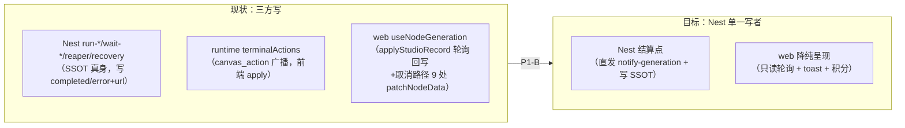
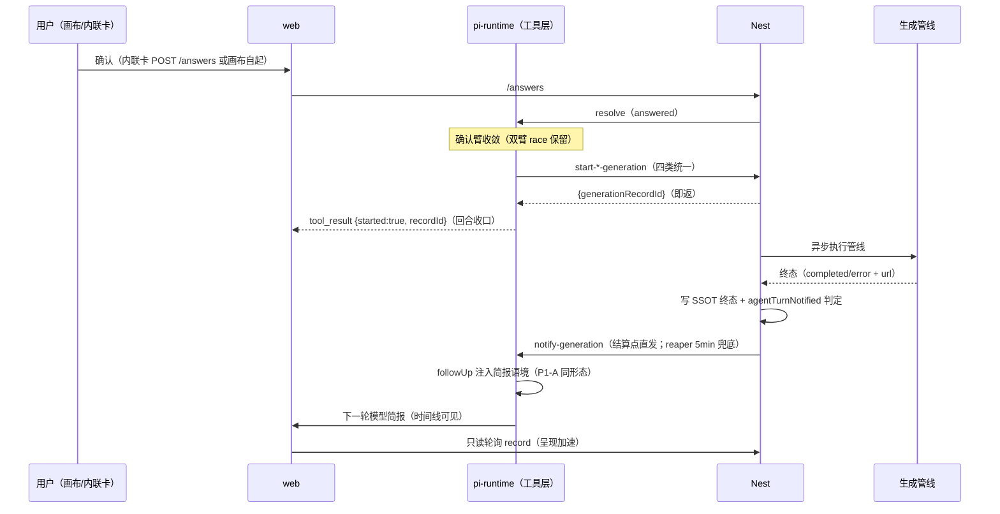

# P1-B 生成 job 化 设计规格（SDD）

状态：评审中（2026-11-01）
上游文档：`2026-10-31-p1-root-cure-roadmap-design.md` §6 P1-B（本规格为其包级展开，冲突时以本文为准）
前置依赖：P1-A 挂起态持久化（已上线 `660c787c`）；内核 0.85.1→0.99.2 升级（已上线 `7c184d82`+`b7a6702a`）
基线：master `b7a6702a`

---

## 0. 配图索引

| 图号 | 类型 | 内容 | 位置 |
|---|---|---|---|
| 图 1 | 结构图（flowchart LR） | 现状 vs 目标的生成终态写者集合 | §2.3 |
| 图 2 | 时序图（sequenceDiagram） | job 化后确认→即返→终态通报→简报注入全链 | §4.1 |

## 1. 背景与问题

propose 确认执行权已收编服务端（P0-1，PR #640 上线），但**确认成功后 runtime 仍持住工具 promise 轮询至生成终态**（`waitForGenerationTerminal`，2s 间隔、capMs 缺省 13min，`PI_RUNTIME_GEN_TERMINAL_WAIT_MS` 可调）。该形态有三层结构性问题：

1. **回合被生成劫持**：image 生成 ~3-8min、video ~11min，LLM 回合在此期间空转占住 SSE 与 lane；capMs 超时后生成继续在 Nest 跑，但「模型不知道、时间线不知道」，只能靠 reaper 5min 巡检兜底通报（`late-generation-notify`，生产在跑）。
2. **写者集合发散**：节点终态（completed/error）的写者实测有三方——Nest 内部端点（run-*/wait-*/reaper/recovery，SSOT 真身）、runtime 工具层（terminalActions 经 canvas_action 广播给前端 apply）、前端 `useNodeGeneration`（轮询回写 + 取消路径，9 处 `patchNodeData`）。三方并发写是 2026-10-12「stale PUT 盖回终态」「假确认」一系列生产事故的根源面。
3. **持轮路径持续增重**：#651/#656/#657 三天在 `canvas-write.ts` +~170 行（live actions 广播、terminalActions 现造兜底、record 轮询改进），每补一个边角都在为「回合挂住」这个错误形状付利息。P1-B 越晚越贵（总纲 §12 复审结论）。

## 2. 前置核实（侦察结论，2026-11-01 于 master `b7a6702a`）

### 2.1 术语修正（推翻总纲两处措辞，方向不变）

| 总纲措辞 | 代码真身 | 结论 |
|---|---|---|
| 「删 `waitForGenerationTerminal` / capMs 假文案 / SSOT 轮询启发式」 | `waitForGenerationTerminal` 在 `services/pi-runtime/src/tools/canvas-write.ts:59`（工具层）；capMs=`genTerminalWaitMs()` 缺省 13min（`PI_RUNTIME_GEN_TERMINAL_WAIT_MS`）；「启发式」= propose 确认双臂 race 中的 SSOT 正证据轮询（draftStreak/errorStreak/record 指纹比对） | 方向证实。⚠️ **确认臂的 SSOT 正证据轮询必须保留**——它是「画布侧直接生成、无 /answers」的唯一确认路径（2026-10-06 事故防线）；P1-B 只删**确认成功后**的终态等待臂 |
| 「notify 通路已在生产（late-generation-notify）」 | `apps/server/src/agent/pi-runtime/late-generation-notify.ts` + `apps/server/src/studio/generation-reaper.service.ts`（5min 巡检）+ runtime `/sessions/:id/notify-generation` 端点 | 证实。reaper 是唯一扫描咽喉点，studio 各终态落点零改动被覆盖 |

### 2.2 链路现状（P0-1 + B2 后的最新形态）

propose_generation 确认成功后（`canvas-write.ts` ~700-870 行）：

- **text / audio**：直调 Nest `run-text-generation` / `run-audio-generation`——**Nest 端点内部持至终态才返回**（管线在 Nest 跑完、SSOT 已写终态），runtime 拿响应直接采用为 runTerminal。
- **image / video**：直调 Nest `start-image-generation` / `start-video-generation`——**即返 `generationRecordId`**（B2，2026-10-31）；随后 runtime 走 `waitForGenerationTerminal` 轮询 **record**（而非节点）至终态或 capMs。
- 等待期：`registerGenerationWait` 登记 → notify-generation 抑制；progress ticker 30s 发 `generation_progress`。
- 终态：terminalActions（Nest 响应 actions 优先，缺则 `buildTerminalActions` 现造）随 tool_result 广播。

**关键结构性事实**：image/video 已经是「start 即返 recordId」的 job 语义，等待臂是纯运行时侧的自杀式挂住；text/audio 的同步持住则在 **Nest 端点内**（Nest 侧 HTTP 请求持至终态，同样占资源）。job 化改动量比总纲预估小：image/video 删等待臂即可，text/audio 需 Nest 拆 start/wait。

### 2.3 写者集合实测（图 1）

*图 1 · 说明：生成终态写者从 Nest/runtime/web 三方并发写收敛为 Nest 单一写者——web 降纯呈现、runtime 等待臂退役，三方并发写是 2026-10-12 系列事故的根源面。*

- **Nest**：`agent-canvas-tools.service.ts` 内 run-*/wait-* 全族在终态写 `status: 'completed'|'error'` + url/errorMessage（~1446/1765/2011/2151/2214/2383/2402/2519 行一带）；reaper 只清历史遗留记录（image 30min/video 独立阈值/text 10min），**不是**终态写者主路径。
- **runtime**：无节点 status 字面量直写（grep 证实）；「写」以 canvas_action 广播形态发生（terminalActions/buildTerminalActions/liveActions）。
- **web**：`useNodeGeneration.ts`（1003 行）`applyStudioRecord`（~475-560 行）按 record 轮询回写 completed/error（含 U6「completed 无产物判 error」判定，2026-10-04）；取消/失败路径 9 处 `patchNodeData`（218/320/370/384/423/482/513/539/553 行一带）。前端手动生成入口 `generateForNode`（697 行）先本地写 generating 再调 studio 管线。

### 2.4 pi-durable 旁路 spike 结论（已做，定案入规格）

`@earendil-works/pi-durable@1.4.0`（2026-10-21 发布，npm 最新）实测：

- README 首行自述 **"Experimental. The API changes without notice between releases."**；1.4.0 有 6 条 Breaking Changes（含 storage schema v2 强制迁移、不可回滚到 1.3.0）。
- 它是**整套 harness 替代**（Conversation/Submission/Task/TaskGraph/durable sleep/crash-loop guard），不是可局部引入的 job 库；与 v0.99.2 的 AgentHarness/Lane/drive 无共存路径（v1.0.0 起上游已删 harness）。
- 概念映射（供未来换轨对照，**不阻塞 P1-B**）：job handle ≈ Submission（durable admission + wait）；终态通报 ≈ wake/report；生成等待臂 ≈ durable sleep/task；agentTurnNotified 去重 ≈ 任务幂等提交。
- **裁决**：P1-B 维持在 v0.99.2 基线上自建，但立一条设计纪律——**不新增任何与 pi-durable 语义冲突的持久化抽象**（job 状态一律挂 GenerationRecord，不建新表/新 registry；与总纲 §7「不新增持久化表」同源）。换轨 1.4 时 P1-B 机器整体作废重映射，成本已最小化。

## 3. 目标与非目标

**目标**：
1. propose 确认（及 run_* 同族四类）确认/调用成功后**立即返回 job handle** `{started:true, recordId}`，回合即刻收口。
2. 生成终态节点写者收归 Nest 单一方；web 降纯呈现；runtime 等待臂与 terminalActions 广播退役。
3. 终态通报收紧：Nest 结算点直发 notify-generation（reaper 5min 降为兜底），模型在下一轮获得产物简报。

**不做**（总纲 §7 复核，随包登记）：
- propose_plan / 批量生成 job 化（量级不同，后续单列）。
- 多端画布并发冲突合并（独立议题）；saveCanvas patch 化属 P1-C。
- 不新增持久化表/列；不动 vendored 上游代码；不做 pi-durable 引入。
- 前端 dock 手动生成入口（`generateForNode`）的本地 UX 状态机不动（它走 studio 管线，与 agent 回合无关；仅其终态回写改走只读化路径，见 §4.3-③）。

## 4. 设计

### 4.1 job 化核心：工具即返（图 2）

*图 2 · 说明：job 化后全链——确认即返 tool_result 收口回合，生成在 Nest 异步跑，终态由 Nest 写库+直发通报，模型经 followUp 注入获得简报；reaper 5min 只作兜底。*

- **propose_generation**：删除确认成功后的 `waitForGenerationTerminal` 等待臂、progress ticker 挂轮、capMs、`buildTerminalActions` 现造与 terminalActions 采集（Nest start 响应的 started actions 仍透传一次，维持「生成中 live 上画布」）；tool_result 即返 `{ok:true, confirmed:true, started:true, generationRecordId, message:"生成已启动，完成后会自动通报结果"}`。
- **run_* 同族四类**（`generation.ts`）：
  - image/video：删 `withGenerationWait` 持轮，改调 start-* 即返（与 propose 同一执行入口）。
  - text/audio：**Nest 新增 `start-text-generation` / `start-audio-generation`**（薄壳：创建 record → 投异步管线 → 即返 recordId；管线体从既有 run-* 复用抽出）；run-text/run-audio 保留为「start + 内部 wait」的兼容形态（端点超时防线语义不变），runtime 工具改调 start-*。
- **取消**：`cancel-generation` 语义不变（Nest 落终态 + 直发 notify）。
- **幂等/epoch**：同 `(sessionId, nodeId)` 活跃 record 幂等去重沿用 P0-1 start 侧守卫；`proposalEpoch` 为**新建面**——节点 data 增 `proposalEpoch`（撤回重提 +1），start 请求携带，Nest 校验非当前 epoch 即拒绝（防撤回后迟到确认抢占；红队风险④）。⚠️ 此为节点 data 新增字段（非新表），随 mergeNodeData 透传，不触碰 §7 红线。
- **SSOT 正证据确认臂保留**（§2.1）：非阻塞兜底路径（无 /answers 的画布自起）语义逐字节不动。

### 4.2 终态通报收紧

- Nest 结算点（run-*/wait-* 终态写库处、cancel、start 系管线的异步完成回调）在写完 SSOT 后**同步直发** `notifyLateGenerationTerminals` 同款判定（有画布会话 + 未通报 → POST notify-generation）；`agentTurnNotified` durable 去重标记先到先得（结算点直发与 reaper 双发不重复，总纲风险④）。
- runtime notify 裁决：工具仍活跃等待 ⇒ 抑制——**job 化后此分支自然消亡**（无等待工具）；P1-A 挂起裁决在前（挂起会话入队缓存）；其余入 lane followUp 注入简报语境（载荷带 nodeId/status/recordId/url/error，复用 P1-A followUp 通道，不 resume、不写 tool_result）。
- reaper 5min 巡检降为纯兜底（逃逸场景：结算点直发自身失败）。

### 4.3 写者收归 Nest（F6 迁移）

1. **runtime**：等待臂/terminalActions/buildTerminalActions 退役（§4.1）；`onNodeStatus` 广播保留单次 generating 快照（start live actions），终态不再由 runtime 广播。
2. **web `useNodeGeneration`**：
   - `applyStudioRecord` 的**终态回写撤除**（completed/error patchNodeData 删除），只保留：UI 态推进（busy/积分/媒体信息派生）与 `useGenerationPolling` 触发。轮询结果改为**只读呈现**：Nest SSOT 是唯一事实源，画布节点数据由既有会话同步/对账通道（Nest 写库后经正常 update_node 广播 + 刷新重载）收敛。
   - 取消/失败路径（9 处）：凡 Nest 已有对应端点（cancel-generation/cancelPlatformFallback），节点终态改由 Nest 落库后广播；前端只发请求不写状态。无 Nest 端点的本地校验失败（如 blobReferenceError）保留本地 error 写（它是纯前端校验，Nest 永远不会看到这次尝试——登记白名单理由）。
   - U6「completed 无产物判 error」判定**随迁 Nest 结算点**（Nest 在写 completed 前判定产物存在性，无产物写 error + errorMessage）；前端 `describeCompletedWithoutOutput` 删除。
3. **grep 守卫（随包落 CI，P1-C2 提前预铺）**：`apps/web` 与 `services/pi-runtime` 不得出现节点 `status` 直写字面量（`status: 'completed'` / `status: NODE_GENERATION_STATUS.completed|error` 等），白名单登记本地校验失败一处 + 测试文件豁免。

### 4.4 时间线/SSE 面

- propose waiting part（P0-2/P0-5 形态）翻终态：确认即返后 part 由 answered 回执翻 confirmed；生成终态不再挂 propose part（它是生成事实，由 notify 简报 + 画布节点呈现承载）。
- SSE 断链对生成零影响（生成在 Nest；断链静默裁决 #655 语义不变）；重连后画布由 SSOT 对账收敛。

## 5. 验收判据（行为级）

| # | 判据 |
|---|---|
| B1 | 确认成功后 tool_result 在 start 返回即收口（<3s），回合内无 13min 挂住；`PI_RUNTIME_GEN_TERMINAL_WAIT_MS` 环境变量退役 |
| B2 | 生成终态后：活跃会话结算点直发即时简报；reaper 兜底 ≤5min；两者零重复（agentTurnNotified 断言） |
| B3 | 写者收敛：grep 守卫过（web/runtime 零节点 status 写，白名单=前端本地校验失败 1 处）；画布行终态仍正确呈现（Nest 广播+对账） |
| B4 | 生成中重启 pi-runtime：生成不受影响（Nest 侧独立），终态照常落库+通报；重启后首轮简报语境正确（P1-A 挂起裁决兼容） |
| B5 | run_* 四类工具文案/语义等价迁移：start 失败 fail 信号、fallback_pending 语义、取消语义逐项不回归 |
| B6 | epoch 抢占：撤回重提后迟到确认被拒（epoch 校验用例）；正常二次确认走幂等去重不误拒 |
| B7 | 全量回归：nvm node24 单线程跑绿；已知 4 个负载时序 flake 单跑豁免口径不变 |

## 6. 文件级改动清单（实施排期唯一输入）

| # | 文件 | 改动 |
|---|---|---|
| 1 | `services/pi-runtime/src/tools/canvas-write.ts` | propose 确认后等待臂/terminalActions/buildTerminalActions/capMs 退役；即返 job handle；SSOT 确认臂保留 |
| 2 | `services/pi-runtime/src/tools/generation.ts` | run_* 四类改 start-* 即返；withGenerationWait 等待面退役 |
| 3 | `services/pi-runtime/src/session-manager.ts` | registerGenerationWait/notify 抑制分支随等待臂退役；followUp 通道复用（P1-A 形态） |
| 4 | `services/pi-runtime/src/app.ts` | notify-generation 裁决简化（无活跃等待分支）；无 schema 变更 |
| 5 | `apps/server/src/agent/agent-canvas-tools.controller.ts` | +start-text-generation / start-audio-generation 端点 |
| 6 | `apps/server/src/agent/agent-canvas-tools.service.ts` | 管线体抽出复用；结算点直发 notify；U6 判定随迁；epoch 校验 |
| 7 | `apps/server/src/studio/generation-reaper.service.ts` | 降兜底（不变更扫描面；直发失败重扫） |
| 8 | `apps/web/src/composables/useNodeGeneration.ts` | applyStudioRecord 终态回写撤除；取消路径改 Nest 落库；U6 前端判定删除 |
| 9 | `apps/web/src/composables/useGenerationPolling.ts` | 降纯呈现（回写依赖断开） |
| 10 | web 画布对账通道 | 确认 Nest 终态写库后 update_node 广播/对账收敛面（复用既有，不足处补） |
| 11 | 测试 | B1-B7 判据用例 + grep 守卫测试 + epoch 用例 + notify 去重用例 |

## 7. 风险与回退

| # | 风险 | 缓解 |
|---|---|---|
| 1 | 模型失去产物因果链（回合早收，简报未到时用户追问） | 工具返回文案明确「完成后会通报」；followUp 注入带 url/ nodeId；B2 时效断言 |
| 2 | notify 直发与 reaper 双发 | agentTurnNotified 先到先得（durable）；B2 去重用例 |
| 3 | 前端撤回写后画布终态延迟可见（对账窗口） | Nest 写库即广播；只读轮询兜底加速；B3 断言 |
| 4 | text/audio 拆 start/wait 引入管线回归 | 管线体纯抽出（run-* 保留兼容），B5 等价性用例 |
| 5 | 范围膨胀（本包最大风险） | §3 不做清单随包复核；dock 手动生成入口不动 |
| 6 | 与 pi-durable 换轨冲突 | §2.4 设计纪律：不新增持久化抽象，job 状态挂 GenerationRecord |

## 8. 配图规范自检

本文含 2 张内嵌 Mermaid 图（图 1 flowchart LR / 图 2 sequenceDiagram），无 SVG 附件。收尾跑 `pnpm verify-spec-figures`。
