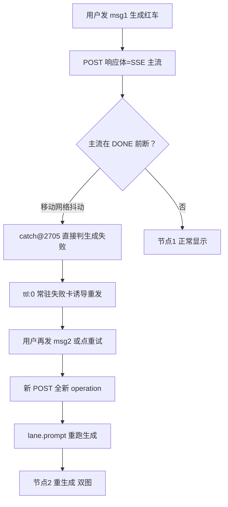
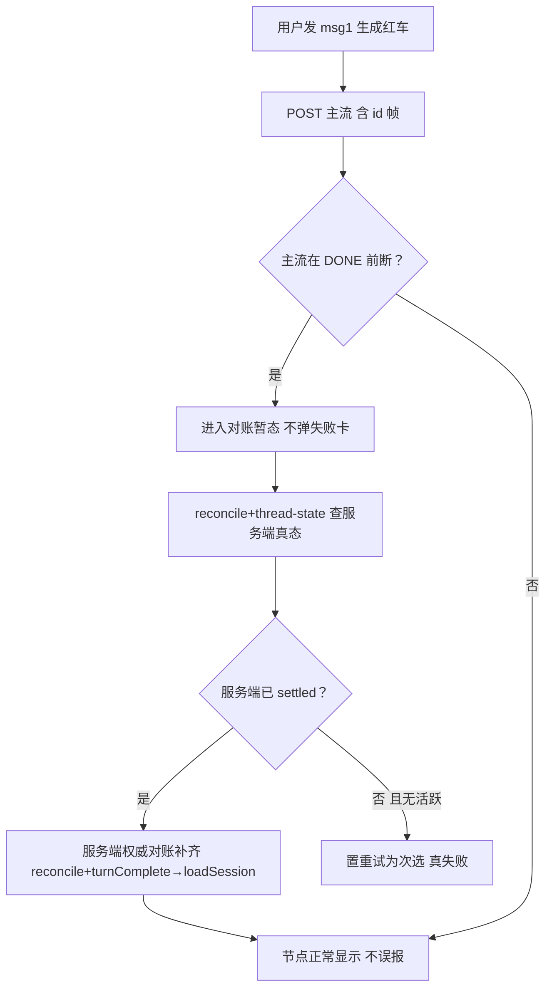
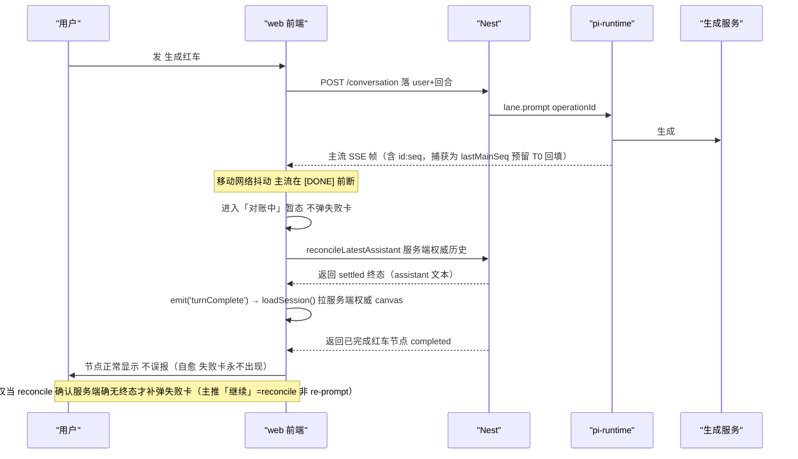
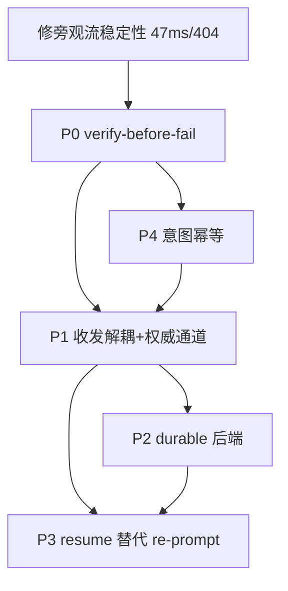

# 「生成红色小汽车」断线误报 + 双图 根治设计规格

状态：待评审（2026-11-01，起因：生产会话 `cmvwkh89b00lgp801xu2fjbrr` 断线误报「生成失败·网络连接不稳定」+ 恢复后重复生成 2 张红车）
> 诊断留痕：`docs/forensics/2026-11-01-red-car-duplicate-root-cause.md`（含一手生产数据、上游 pi-agent-core 0.85.1 源码行号、本项目代码位置；对上游子代理未经证实的「恢复标记机制」已逐条回源码证伪）
前置：
- `docs/forensics/2026-11-01-red-car-duplicate-root-cause.md`（诊断根因，本规格的唯一事实来源）
- `docs/superpowers/specs/2026-10-30-propose-confirm-execution-unity-design.md`（同属「误报清零 / 服务端终态优先」不变量族，本规格复用其 §4.1-3 的三条判据）
- `docs/superpowers/specs/2026-10-28-askuser-mobile-multi-question-redesign.md`（移动端 UX 纪律参考）
分支约定：实现走 feature 分支（基于**最新 origin/master**）+ PR + squash merge；web-only 改动走纯前端 paths-filter，跨层改动走 Nest+runtime+web 三流水线全量。
⚠️ 跨层改动（P1/P2/P3 触碰 pi-runtime）时部署 = API 镜像 + `runtime-deploy`（手工 dispatch tag）+ web 三条流水线；改 db schema 的 PR **禁用 auto-merge**（历史 P3009 停机教训）。

## 0. 配图索引

| 编号 | 形式 | 内容 | 位置 | 用途 |
|---|---|---|---|---|
| 图 1 | 内嵌 Mermaid（flowchart） | 当前错误链路：主流断→误报→诱导重发→双图 | §4 | 实施时对照每一环的缺陷归属（D1-D7）；验收时确认每一环被对应 P 包打断 |
| 图 2 | 内嵌 Mermaid（flowchart） | 目标链路：主流断→先对账（服务端权威）→已 settled 则自愈→不误报 | §5.1 | 验收「断流不再弹失败卡」判据锚点 |
| 图 3 | 内嵌 Mermaid（sequenceDiagram） | 事件流与对账时序：主流带 id 帧→断→服务端权威对账（reconcile+turnComplete→loadSession）→自愈；旁观流 lastEventId 回填为 T0 前置后的增强 | §5.2 | 实施逐段对照接线点；验收「对账后服务端 settled 则自愈、不弹失败卡」 |
| 图 4 | 内嵌 Mermaid（flowchart） | P0-P4 分层依赖与落地顺序 | §12 | 路线图依赖判据，避免隐性范围 |

## 1. 目标（3 条，可验收）

1. **断流不误报**：用户发「生成红车」类回合，移动网络抖动导致主流 `[DONE]` 前断开时，**不**再弹「生成失败 · 网络连接不稳定」；客户端先与服务端对账，服务端已 settled 则 3s 内借旁观流补齐尾包、节点正常显示。
2. **恢复不双生成**：同一 thread 内、归一化意图相同、且存在 in-progress/刚 completed 的同意图生成时，用户因误报失败而重发/连点同一句，**至多产出 1 张图**；其余请求复用既有节点而非新开 operation。
3. **恢复语义正确**：进行中回合断线恢复走「续接同一 operation（不重生成）」，而非重新 `prompt()` 开全新 operation；该行为在 pi-runtime 重启/TTL 后仍可对账成功。

## 2. 范围

### 2.1 本规格做（= 诊断 §6 的 P0-P4）

- **P0（止血·前端）**：`AgentSideRail.vue` 的 catch 改为「先对账再判失败」——主流在 `[DONE]` 前断开时**不**立即标失败，先进入「对账中」暂态，调 `reconcileLatestAssistant()`（服务端权威历史补齐文本）+ `emit('turnComplete')`→`loadSession()`（服务端权威 canvas 节点）对账；服务端已 settled 则自愈（清暂态、不弹失败卡），仅当确认无终态才补弹失败卡；UX 翻转（失败卡主推「继续」=reconcile 对账、**非 re-prompt**，杜绝重发诱导双生成）。主流 `id:seq` 帧捕获（`lastMainSeq`）+ `deriveObserverFromSeq` 纯函数已落地单测，作为 T0 修好旁观流稳定性后的「断点续拉尾包」增强钩子（当前未接线，因为 P0 的根治不依赖它——服务端权威对账已覆盖恢复）。
- **P1（架构·前端+Nest+runtime）**：`POST /conversation` 与收流解耦 + 稳定 `turnId`（=上游 `operationId` 贯穿）；本端回合权威事件源改为旁观流 `/runs/events`（带 `lastEventId` + 快照兜底），主 POST 流降级为「首投加速」。
- **P2（架构·runtime）**：pi-runtime `sessions: Map` + `sessionTtlMs` 换成上游 durable 会话后端（sqlite-node）或等价持久化，operation 元数据 + transcript tail + 已建节点落盘。
- **P3（架构·runtime+Nest+web）**：pi-runtime 暴露 `resume(sessionKey)` 端点（内部 `lane.resume(ctx)`），Nest 透传；客户端恢复先 `resume`（续接同一 operationId），仅 `NothingToResume` 才允许新 `prompt`。
- **P4（兜底·Nest）**：扩展 `IdempotencyRecord` 为意图级去重，在 `streamConversation` 入口对「同 thread + 归一化 prompt 相同 + 存在 in-progress/刚 completed 同意图生成」做去重，复用已建表与唯一索引。

### 2.2 明确不做（登记 §12，不隐性扩范围）

- 不做「断线即 abort 服务端 operation」：上游 operation 绑定 `gate.signal` 而非 socket，断线服务端继续跑完是既定不变量（诊断 §2），本规格延续，不改为「断流即取消」。
- 不做跨 operation 的「生成结果缓存复用」（同一 prompt 返回旧图）：P4 只去重「同一次用户意图在短时间窗内的重复发起」，不缓存历史不同回合的图。
- 不做上游 `lane.prompt` 内部幂等改造：上游本无跨 operation 幂等（诊断 §2 已核实），我们在边界（Nest）补，不 fork 上游。
- 不重排 `LaneSnapshot`/`lane.watch`/`lastEventId`/`retryOnMissing` 等已接线零件：本规格只把它们「组装成权威恢复通道」，不另起炉灶。

## 3. 与既有规格 / 决策的关系

- **对 propose-confirm 规格（#640/#645）的延续而非回滚**：复用其 §4.1 三条不变量——（1）执行入口集合==1、（2）呈现权=只读复制+发意图、（3）**turn 终态判定来源==服务端事件，SSE 连接状态不参与成败归因**。本规格把第（3）条从「propose 等待期」扩展到「普通生成回合主流断流」全域。
- **对 askuser 移动端重构（#627/#630）纪律的对齐**：移动端 UX 翻转沿用其「逃生口收敛 / 触控行」形态，不新建第二套失败卡皮肤。
- **对诊断文档的正式化**：诊断 §6 的 P0-P4 在本规格中被拆成可验收的 §5/§6 条款、§9 文件级清单、§10 测试策略；诊断文档保留为事实溯源，不重写。
- **上游对照（已核实的正统）**：`lane.resume(ctx)`（`vendor/.../agent/src/harness/runtime/lane.ts:1327`）= 续接同一 operationId、已完成工具不重跑，是断线恢复唯一正确入口；本规格 P3 把它从「生产零调用」接回（诊断 §3-D4）。

## 4. 规范与判据（可复用规则）

### 4.1 断流归因三判据（本规格核心不变量，后续任何流式回合直接套用）

1. **服务端终态优先**：SSE 连接状态（断流/重连/超时）**不参与** turn 成败归因；turn 失败判定只来自服务端终态事实（`turn_state_cleared` / 节点 `completed` / `reconcileLatestAssistant` 返回的终态）。
2. **对账先于失败**：catch 到非 Abort 的流错误时，先进入「对账中」暂态（不弹失败卡），调 `reconcileLatestAssistant()` + 查 `thread-state`/节点状态；**仅当服务端确认该 turn 无活跃且无已完成**才标失败。
3. **恢复语义正确**：恢复动作默认「续接同一 operation（resume）或意图去重复用」，而非「重新 prompt 开新 operation」。

### 4.2 对账优先判据（P0 根治核心）

**P0 根治核心 = 服务端权威对账，不依赖旁观流回填。** 主流在 `[DONE]` 前断开时，客户端先进入「对账中」暂态（不弹失败卡），调 `reconcileLatestAssistant()` 拉服务端权威最新 assistant 终态、并经 `emit('turnComplete')`→`loadSession()` 拉服务端权威 canvas 节点（含 `completed` 红车）；服务端已 settled 即自愈（失败卡永不出现）。

主流解析**同时**捕获 `id:` 帧（当前只解析 `data:`，已补 `id:`）记录最后 seq，存入 `lastMainSeq` 并配套 `deriveObserverFromSeq` 纯函数；该 seq 在 T0 修好旁观流稳定性（§11 R1）后，用于把旁观流首连参数由 `from=now` 切到 `lastEventId=<该 seq>` 做尾包断点续拉——但这是**增强**而非 P0 根治的依赖：服务端权威对账已在 P0 阶段完整覆盖恢复，故旁观流回填未接线也不影响根治效果。

### 4.3 意图级幂等判据（P4）

同一 `(threadId, 归一化意图)` 在「存在 in-progress 或 刚 completed（近窗，如 60s）同意图生成」时，Nest `streamConversation` 入口直接复用既有 `GenerationRecord`/节点，返回既有节点而非新开 operation。归一化 = 去空白、转小写、截断的 prompt 指纹；键构成复用已建 `IdempotencyRecord` 表与唯一索引（不造轮子），只改键维度。

### 4.4 当前错误链路（图 1：每环对应一处缺陷）

*图 1 · 说明当前链路每一环落点：C→D 是 D2 误报、D→E 是 D7 UX 诱导、E→G 是 D5 随机幂等键放行 + D4 resume 未用、G→I 是 D1 起收耦合导致只能重发。实施时确认 P0 打断 D→E、P4 打断 E→G、P3 打断 G→H。*

## 5. 架构与契约

### 5.1 目标链路 verify-before-fail（图 2：验收「断流不弹失败卡」）

*图 2 · 说明 P0 把断流处理从「直接失败」改写为「先对账、服务端正终态则旁观流回填」。F=否且无活跃 才走到 H（真失败），H 只作为次选出现（D7 翻转）。验收：模拟主流产失 → 客户端不弹失败卡、3s 内借旁观流拿到 done。*

### 5.2 事件流与对账时序（图 3：实施逐段对照接线点）

*图 3 · 说明 P0 根治路径：主流带 `id:seq` 帧（W 在 reader 里已补 `id:` 解析，见 §9）仅作 T0 回填钩子；**真正的恢复不靠旁观流回填，而靠服务端权威对账**——`reconcileLatestAssistant()` 补齐文本 + `emit('turnComplete')`→`loadSession()` 拉服务端权威 canvas 节点（红车 `completed`）。只要服务端已 settled，客户端自愈、失败卡永不出现（① 误报消除点）。旁观流 `/runs/events` 的 `lastEventId` 断点续拉在 T0 修好其稳定性（§11 R1）后再接线，作为「在途生成实时续显」增强，不影响 P0 根治结论。验收逐拍核对「断→对账→服务端 settled→节点显示→不弹卡」。*

### 5.3 契约变更点

| 契约 | 现状 | 本规格变更 | 所属包 |
|---|---|---|---|
| 主流 SSE 解析 | 仅解析 `data:` | 额外捕获 `id:` 帧记录最后 seq（T0 回填钩子） | P0 |
| 断流 catch 行为 | 直接 `markTurnError` + 失败卡 | 先「对账中」暂态，服务端权威对账（reconcileLatestAssistant + turnComplete→loadSession）后定 | P0 |
| 旁观流首连参数 | `live:true, from=now` | 主流产失后改 `lastEventId=<seq>`（承接 `lastMainSeq`） | T0（依赖 §11 R1 稳定性修复） |
| `POST /conversation` 语义 | 响应体即回合流 | 落 user+turnId 即返回，收流解耦到旁观流 | P1 |
| pi-runtime session 存储 | `sessions: Map` + TTL | durable 后端（sqlite-node/等价） | P2 |
| `resume` 端点 | 不存在 | 新增 `POST /agent/internal/resume-session` 内部端点 | P3 |
| `IdempotencyRecord` 键 | `ik_{threadId}_{Date.now()}_{随机4位}` | `ik_{threadId}_{归一化意图}_{近窗}` + 意图去重入口 | P4 |

## 6. 打样 / 主场景规格（逐项可验收）

### 6.1 主场景 S1（对应 ① 断流误报）

- **输入**：移动网络下，用户发「生成一个红色的小汽车」，主流在 `[DONE]` 前断开（模拟丢尾包）。
- **期望**：客户端进入「对账中」暂态、**不**弹「生成失败」卡；`reconcileLatestAssistant` 返回服务端已 settled → 旁观流 `lastEventId` 补回 `node_status:done` → 节点在 3s 内显示完成。
- **验收**：生产回放该会话同款操作，截图比对「无失败卡 + 节点完成」。

### 6.2 主场景 S2（对应 ② 恢复双图）

- **输入**：S1 之后，用户因历史误报卡/手抖，**再次**发同句或连点「重试」。
- **期望**：P4 意图去重在 Nest 入口命中 → 复用既有节点，至多 1 张图；若服务端确已 settled，前端「恢复」按钮直接对账，根本不发起新 POST。
- **验收**：重复发同句 5 次 → `GenerationRecord` 仅 1 条 `completed`、节点仅 1 个。

### 6.3 主场景 S3（P3 resume 语义）

- **输入**：进行中回合（operation 未完成）断线恢复。
- **期望**：前端调 `resume` 续接同一 operationId，已完成工具不重跑；不产生新 operationId。
- **验收**：恢复前后 `GenerationRecord`/`operationId` 不变，不重复生成。

## 7. 数据与状态变更

- **`IdempotencyRecord`**：键维度扩展（P4），唯一索引需从「请求级随机键」改为「`threadId`+`归一化意图`+`近窗`」复合唯一；历史随机键行不影响（新键空间独立）。**涉及 schema 变更 → 走 Prisma migrate deploy，禁用 auto-merge**。
- **GenerationRecord**：新增可观测字段 `upstreamTaskId`（已在诊断发现两次生成 taskId 不同，建议落库便于 30s 定位），非破坏性 `ALTER`（加可空列）。
- **pi-runtime 持久化**：P2 引入 durable 后端后，`operation` 元数据 + transcript tail + 已建节点快照落盘；`sessionResumes` 维度从 `new|memory` 扩展到含 `disk|rebuilt`（复用现有 metrics 维度，诊断 §2）。
- **GenProgress**：对该类会话当前为空（诊断 §1），P0/P2 补齐写入，使「是否真失败」可由服务端进度交叉核验。

## 8. 纯函数与算法（含单测要求）

1. **`normalizeIntent(prompt)`**：去空白、转小写、截断至 128 字符，输出稳定指纹。单测：同义变体（「生成红色的小汽车」/「生成一个红色小汽车」）指纹一致；不同意图指纹不同。
2. **`shouldVerifyBeforeFail(reconcile, nodeStatus)`**：纯函数，输入对账结果与节点终态，返回 `true`（允许标失败）/ `false`（进入对账暂态/已 settled）。单测：服务端 settled → false；无活跃无完成 → true。
3. **`deriveObserverFromSeq(lastMainSeq)`**：主流断后计算旁观流首连参数（有 seq → `lastEventId`；无 → `from=now`）。单测：有 seq 返回 `lastEventId`、无 seq 返回 `from=now`。
4. **`pickDedupRecord(threadId, intent, windowMs)`**：P4 在 Nest 侧查询「同 thread + 同意图 + 近窗 in-progress/completed」记录。单测：命中返回既有 record、未命中返回 null。

## 9. 文件级改动清单

> 按包分层；§12 排期给出批次。实施前以本清单 + §5.3 交叉核对，判据分层 §4 > §6 > 叙述建议。

**P0（web）**
- `apps/web/src/components/agent/AgentSideRail.vue`：主流 reader 增加 `id:` 帧解析（记录 `lastMainSeq`，T0 回填钩子）；catch 改为「对账中」暂态——**不**立即标失败，先 `reconcileLatestAssistant()`（服务端权威历史补齐文本）+ `emit('turnComplete')`→`loadSession()`（服务端权威 canvas 节点）对账，服务端已 settled 则自愈清暂态、不弹失败卡；仅确无终态才补弹失败卡；UX 翻转（失败卡主推「继续」= `reconnectStream` 走 reconcile **非 re-prompt**，杜绝重发诱导双生成）；已移除旧 `retryLastTurn`/`lastSentMessage` 误触发重发的入口。
- `apps/web/src/components/agent/streamRecovery.ts`：新增 `deriveObserverFromSeq` 纯函数（有 seq→`lastEventId`、无 seq→`fromNow`，绝不拼空值触发全量重放）；已单测，作为 T0 旁观流稳定性修复后的断点续拉钩子（P0 未接线，因根治不依赖它）。
- `apps/web/src/components/agent/follow-up-tail.ts`：旁观流 `lastEventId` 断点续拉**移入 T0**（待 §11 R1 修好其 47ms/404 稳定性后再接线承接 `lastMainSeq`）；P0 恢复靠服务端权威对账，不依赖此文件改动。
- `apps/web/src/components/agent/networkFault.ts`：`classifyRequestError` 已具备 P0 所需分类（network/业务），P0 直接复用，无新增态。
- 测试：`AgentSideRail` 流断对账「服务端 settled→不弹失败卡」用例（与 `historyFetchNoStore` 同规格钉死）、`streamRecovery` 纯函数单测（`deriveObserverFromSeq`）。

**P1（web + Nest + runtime）**
- `apps/web/src/components/agent/AgentSideRail.vue`：`POST /conversation` 仅落 user+turnId，本端回合事件源切到旁观流。
- `apps/server/src/agent/agent.controller.ts` / `agent.service.ts`：`/conversation` 返回 turnId；旁观流 `/runs/events` 已支持 `lastEventId` 与快照。
- `services/pi-runtime/src`：`lane.watch` 快照 + 增量已接线，P1 仅调整「首投加速 vs 权威通道」角色。

**P2（runtime）**
- `services/pi-runtime/src/session-manager.ts`：`sessions: Map` + `sessionTtlMs` → durable 后端（sqlite-node / 等价）；operation 元数据 + transcript tail + 已建节点落盘。

**P3（runtime + Nest + web）**
- `services/pi-runtime/src`：新增 `resume(sessionKey)`（内部 `lane.resume(ctx)`）。
- `apps/server/src/agent/agent.controller.ts`：新增 `POST /agent/internal/resume-session` 内部端点，透传。
- `apps/web/src/components/agent/AgentSideRail.vue`：恢复路径 `resume` 优先，仅 `NothingToResume` 才 `prompt`。

**P4（Nest）**
- `apps/server/src/agent/agent.controller.ts`：`streamConversation` 入口意图去重（调 `pickDedupRecord`）。
- `apps/server/src/agent/agent.service.ts`：`IdempotencyRecord` 键构成改为意图级；`normalizeIntent` 落库查询。
- 迁移：`prisma migrate`（唯一索引复合键）；测试：意图去重命中/未命中、近窗外放行。

## 10. 测试策略与验收标准（含目视验收）

- **单元**：§8 四个纯函数 100% 分支覆盖（归一化/对账判定/旁观参数/去重查询）。
- **契约**：`AgentSideRail` 流断门控用例钉死「主流断 + 服务端 settled → 不弹失败卡」（仿 `AgentSideRail.historyFetchNoStore.test.ts`）。
- **端到端（生产取证）**：用会话 `cmvwkh89b00lgp801xu2fjbrr` 同款复现：① 断流不误报、② 重发同句至多 1 图。`GenerationRecord`/`operationId` 对照断言。
- **回归**：分批（≤12 文件/批，`--maxWorkers=1 --no-file-parallelism`）跑 server/runtime/web 三层 + `vue-tsc -b`；改 db schema 的 PR 禁用 auto-merge。
- **目视**：S1-S3 主场景截图比对（移动端 + PC）。

## 11. 风险

1. **旁观流本身缺陷（诊断 §3-D3）**：`/runs/events` 实测 47ms 断流、15s 心跳未发、`hasKey` 假时返 404。P0 依赖旁观流回填尾包，**必须先修旁观流稳定性**（跟随 P0 或前置 T-0 批次），否则 `lastEventId` 回填会踩同一坑。
2. **对账竞态**：主流断与 `turn_state_cleared` 几乎同时发生，对账可能读到「进行中」→ 误判失败。对策：`reconcileLatestAssistant` 加短暂（如 1.5s）重读 + 节点 `completed` 优先。
3. **P4 误杀正常重发**：用户真想「再生成一张」（如明确说「再画一辆」）应放行。对策：`normalizeIntent` 近窗（60s）+ 仅对「逐字相同重发」去重，语义不同（含「再/第二/另一个」）跳过。
4. **P2 持久化引入 db 依赖**：pi-runtime 当前内存态，接 sqlite-node 增加运维面与迁移风险；可先用「文件/SQLite 轻量持久化 operation 元数据」最小集，不全量迁上游 session-backends。
5. **P3 resume 与已接线 reconcile 冲突**：现有 `reconnectStream` 只回文本不回节点，P3 需让 resume 路径也回填节点终态，避免「resume 成功但画布节点丢失」。

## 12. 后续包 / 路线图（本包外的东西也登记，避免隐性范围）

分层依赖与落地顺序见 图 4：

*图 4 · 说明分层依赖：T0（旁观流稳定性）是 P0 的前置地基；P0/P4 立即消除 ①② 表象；P1/P3 是架构正解消除结构性诱因；P2 加固对账根基（没有它 P0 在重启/TTL 后仍失效）。*

- **P0 + P4 合包（本期首落）**：直接消除 ① 误报与 ② 的主要触发路径（误报诱导重发）+ 兜底（意图去重），风险低、收益高。
- **P1/P3 合包（架构期）**：消除「重发必双生成 / 恢复必重跑」结构性诱因；需跨层部署。
- **P2（加固期）**：持久化后端，恢复 30min/TTL 限制，使对账在重启后仍有效。
- 可观测性补齐（GenProgress 写入、`upstreamTaskId` 落库）随 P0/P2 顺带完成，不在独立包。

## 13. 配图规范自检

> 运行 `pnpm verify-spec-figures --file docs/superpowers/specs/2026-11-01-red-car-disconnect-misreport-duplicate-rootfix-design.md` 的结果贴此（提交前必跑）。人工核对：

- [ ] R1 像素级视觉稿必须是 `.svg`（本文档无视觉稿，全部为内嵌 Mermaid，豁免）
- [ ] R2 图号 1-4 连续唯一 ✓
- [ ] R3 图 1-4 均有图注行 ✓
- [ ] R4 图 1-4 均在正文被引用（§4.4/§5.1/§5.2/§12 各引用）✓
- [ ] R5 §0 配图索引列出全部 4 图 ✓
- [ ] R6 无附件引用（N/A）
- [ ] R7 4 个 Mermaid 块首行均为受支持类型（flowchart/sequenceDiagram）✓
- [ ] R8 无视觉稿（N/A）
