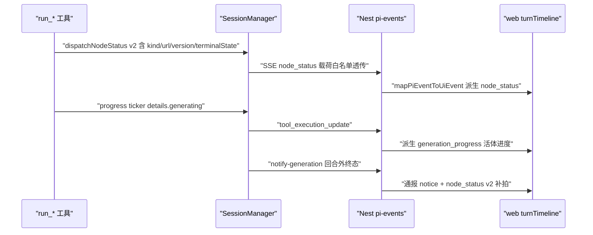
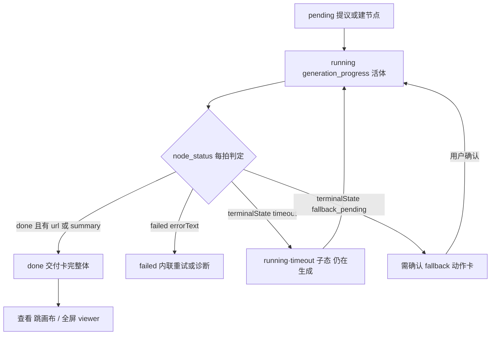
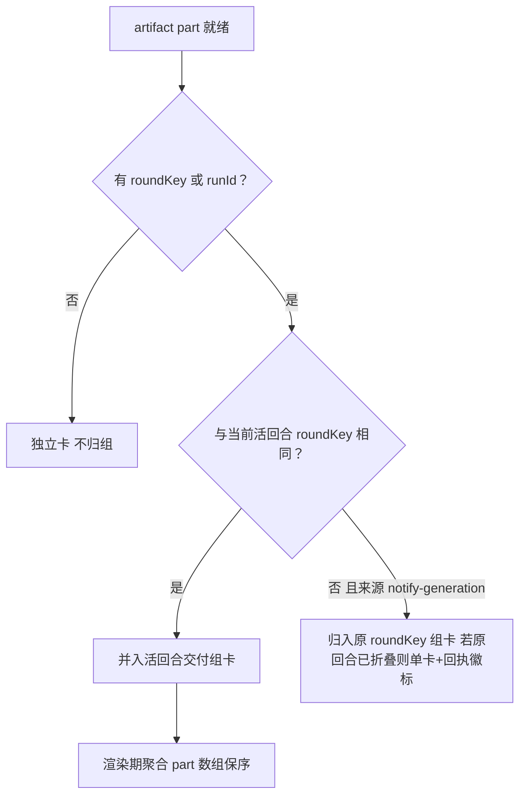

# 对话流内产物交付卡（delivery card v1）设计规格

状态：待评审（brainstorming 产出，2026-11-02）
前置：
- `2026-10-28-agent-wait-timeline-single-source-design.md`（已合入：等待态单一真相，turnTimeline 是对话流 part 的 SSOT）
- `2026-10-28-text-node-html-artifact-design.md`（已合入：文本节点 HTML 产物）
- `2026-11-01-red-car-disconnect-misreport-duplicate-rootfix-design.md`（在途：P0+P4 重复产物根因修复）
- 2026-10-18 上游对齐系列（已合入：node_status / generation_progress 事件链路）
分支约定：实现走 feature 分支 + PR + squash merge。

## 0. 配图索引（结构与视觉两类，均随本文档演进）

本文档不含像素级视觉稿（理由：交付卡复用 `AgentTurnTimeline.vue` 既有产物行槽位，布局非本规格决策点；仅新增字段与子状态，属数据契约与状态机问题，结构图可无损表达）。

| 编号 | 形式 | 内容 | 位置 | 用途 |
|---|---|---|---|---|
| 图 1 | 内嵌 Mermaid（时序） | 交付元数据事件链路（runtime→Nest→web） | §5.1 | 验收：v2 字段从生产到消费不落 Content 面全程走 details/事件 |
| 图 2 | 内嵌 Mermaid（状态机） | artifact 交付状态机（含 timeout / fallback_pending 子态） | §5.3 | 验收：精确终态映射与「有正据才动」口径兼容 |
| 图 3 | 内嵌 Mermaid（判据树） | 批次聚合 roundKey 判定 | §5.4 | 验收：多产物归组不误并回合外通报 |

## 1. 目标

1. **产物在本轮对话流内即可消费**：图可缩略预览、音视频可内联起播、文本有摘要与展开入口，用户不必离开对话面板跳画布才能确认产物。
2. **终态不再失真**：`timeout` / `fallback_pending` 这两种"非终态的终态感"在交付卡上有精确表达与对应动作，用户不再看到无限"生成中"。
3. **交付可归组、可溯源**：同一 run 的多产物聚合为一张交付组卡；每张卡携带产物版本锚，杜绝过期 URL / 重复产物的错位汇报。

## 2. 范围（含明确不做）

**做**：
- `node_status` 载荷 v2：补交付元数据（kind / mimeType / durationMs / posterUrl / version / roundKey / terminalState / summary）。
- `turnTimeline` artifact part 同构扩展 + 交付卡渲染增强（内联媒体、摘要、动作按钮）。
- 批次聚合（roundKey 归组的交付组卡）。
- 交付卡行为埋点（曝光 / 打开 / 内联起播）。

**不做（本包明确排除）**：
- 不新增 agent 工具、不给模型任何"打开展示"职责（展示权在画布的既有裁决不变；agent 回摘要、载荷走 details/事件，PR #65 教训）。agent 显式展示工具的**受限形态**（模型为产物权威的补充通道）作为演进项在 §12 P2-D / P2-E 规划，准入判据见该节，不进本包。
- 不做文本生成期打字机流式进交付卡（tool_update partialResult 通道可用但涉渲染竞态，留 §12 P2）。
- 不做"完成自动弹 viewer / 抢视口"（默认轻提示，见 §12）。
- 不改画布节点本体展示（MediaViewer、节点播放器现状保留）。
- 不碰 `canvasData` PUT（C2a 收官后 PATCH 主通道，本包只读节点不写）。

## 3. 与既有规格的关系

- **继承** `2026-10-28-agent-wait-timeline-single-source-design.md`：交付卡是 turnTimeline part 体系的一员，与 proposal / question 等待卡同层；不引入第二套对话流状态。
- **修订** 2026-10-18 node_status 口径：`NodeStatusData` 三态词表**不变**（generating/done/failed，保「有正据才动」），新增可选元数据字段与 `terminalState` 精确子态；旧消费者忽略新字段，逐字节向后兼容。
- **配合** `2026-11-01-red-car-...-rootfix-design.md`：`version` 字段即该包"产物版本锚"的用户侧呈现出口；两包字段语义对齐，由本包消费、该包生产（若该包未合，本包 version 字段可先空缺，交付卡降级为无版本徽标）。

## 4. 规范与判据

**D-1 交付卡四要素判据**（每张交付卡必须同时具备）：
1. **锚**：`canvasNode` 锚存在，"查看/定位"动作可直达画布节点；
2. **态**：状态词来自统一映射（图 2），禁止渲染层自造状态词；
3. **体**：按 kind 路由的产物本体表达（图缩略 / 音频波形+起播 / 视频首帧+时长 / 文本首行摘要）；
4. **动作**：按状态给且仅给一组动作（见 §6 动作矩阵），失败态必须有"重试"或"诊断"之一。

**D-2 「有正据才动」口径不变判据**：`status` 仍只在有 url（媒体）或文本内容时才 `done`；`terminalState` 是 done/generating 之下的**子态标注**，绝不独立触发终态翻动。timeout / fallback_pending 下发时 `status` 保持 `generating`。

**D-3 版本锚判据**：`version` 缺失（上游未合或旧数据）时交付卡隐藏版本徽标、其余功能不变；`version` 存在时卡片展示 `vN` 且"查看"动作跳转带版本校验（节点当前 version 不一致 → 画布侧定位到最新产物并提示）。

**D-4 不塞 Content 判据**：新增字段全部走 `node_status` 事件 data 与 `details` 面；`content` 文本 JSON 维持既有摘要形态（`ok/type/bytes/truncated`），不因 v2 变长。

**D-5 聚合不吞并判据**：批次组卡是**展示层聚合**（turnTimeline 渲染期归组），artifact part 仍逐个 upsert 存在；重放 / 快照重建后聚合结果必须一致（纯函数，见 §8）。

## 5. 架构与契约

### 5.1 事件链路

*图 1 · 交付元数据全程走既有事件链：不新增事件类型与通道，回合外通报凭 roundKey 归入原回合组卡。*

图 1 判读：v2 元数据从生产（工具域）到消费（turnTimeline）全程走既有事件链，不新增事件类型、不新增传输通道；回合外终态复用 notify-generation 补拍 node_status，批次键保证它归入原回合组卡。

### 5.2 `NodeStatusData` v2 契约（`services/pi-runtime/src/session-manager.ts`）

| 字段 | 类型 | 必填 | 语义 | 消费方 |
|---|---|---|---|---|
| `kind` | `image/video/audio/text` | done/failed 时必填 | 交付卡渲染路由 | 交付卡 |
| `mimeType` | string | 可选 | 内联播放器编解码提示 | 交付卡 |
| `durationMs` | number | 音视频尽量给 | 进度条/时长徽标 | 交付卡 |
| `posterUrl` | string | 可选 | 视频首帧/音频封面 | 交付卡 |
| `version` | number | 可选 | 产物版本锚（D-3） | 交付卡+画布校验 |
| `roundKey` | string | 可选 | 批次键，缺省 = `runId` | 批次聚合 |
| `terminalState` | `timeout/fallback_pending` | 可选 | 精确子态（D-2） | 交付卡动作矩阵 |
| `summary` | string ≤80 字 | text 必填 | 文本首行摘要 | 交付卡 |

### 5.3 artifact 交付状态机

*图 2 · timeout 与 fallback_pending 是 running 的可见子态而非终态：done 唯一入口是「有正据」，子态晚到不回退 done。*

图 2 判读：timeout 与 fallback_pending 是 running 的**可见子态**而非终态，回流到 running 继续等待或经用户确认后重启；`done` 唯一入口是"有正据"。此机与前端既有 `mapNodeStatus` 单调不减守卫（turnTimeline.ts:568）叠加：子态晚到不回退 done。

### 5.4 批次聚合判定

*图 3 · 批次归组判据：roundKey 缺失独立卡兜底、回合外通报归原组、已折叠回合降级单卡。*

图 3 判读：回合外通报（notify-generation → followUp）携带原 roundKey，保证迟到终态不会误开新组卡；原回合已在历史流折叠时降级为单卡 + 「本回合交付」回执徽标，不重开时间线。

## 6. 打样/主场景规格（逐项可验收）

**动作矩阵**（D-1-4 的展开，渲染层唯一动作来源）：

| 状态 | 动作集 |
|---|---|
| done·image | 查看（focus_node）/ 下载 |
| done·video / audio | 内联起播（用户手势触发，禁 autoplay）/ 查看（focus_node） |
| done·text | 首行摘要 + 查看（focus_node）；全屏阅读视图归 P2-A |
| running | 无动作，仅进度词（含 timeout 子态："仍在生成 · 已 N 分钟"） |
| running·fallback_pending | 「去确认」（focus_node，确认面板在画布节点上） |
| failed | 重试（满足 D-1-4「重试或诊断之一」；诊断按钮归 §12 P3 漏斗包） |

场景验收：
1. **单图**：生成 done → 交付卡缩略图 + vN 徽标 + 三动作；SSE 重连重放后卡不重复、不回退。
2. **四格批量**：4 个 done 乱序到 → 归入同一交付组卡，主交付（用户点名的）大图，完成后整卡定格。
3. **timeout**：run_* 返回 timeout → 卡显"仍在生成"，后续 notify-generation 补拍 done → 原地翻正（不重开组卡）。
4. **fallback_pending**：卡显"需确认平台 fallback" + 去确认按钮；确认后回到 running。
5. **音频**：done → 波形卡内联起播，3 秒内可出声（埋点 delivery_inline_play）。
6. **文本 HTML**：done → 首行摘要（≤80 字）+ 定位动作；全屏阅读视图归 P2-A（不在 v1 验收）。

## 7. 数据与状态变更

- `NodeStatusData` 增加可选字段（§5.2 表）；`GenerationTerminalNotice` 增加 `roundKey`、`version` 透传（notify-generation 链）。
- **回合外补拍契约（新增）**：现状 notify-generation 端点只入 followUp、不派 node_status（前端靠 backfill 轮询兜底，turnTimeline 晚到回填）。本包要求 `/sessions/:id/notify-generation` 在 followUp 之外**同步 `dispatchNodeStatus(v2)`**（roundKey 取 Nest 通报体原 runId），使迟到终态原地翻正归组；backfill 轮询保留为降级兜底，两者幂等（mapNodeStatusV2 单调守卫保证重放无害）。
- Nest `pi-events.ts`：node_status 透传白名单增加 v2 字段（既有白名单模式，缺字段不报错）。
- web `turnTimeline.ts`：artifact part 增加 `kind/durationMs/posterUrl/version/roundKey/terminalState/summary` 可选字段；新增 `delivery_batch` **虚拟 part**（渲染期由 artifact 派生，不落 executionEvents，不参与持久化）。
- executionEvents 白名单**不变**：v2 字段持久化仍走节点本体（PATCH op 主通道），时间线刷新后由节点回填 + 下一拍重建。

## 8. 纯函数与算法（含单测要求）

1. **`mapNodeStatusV2(evt, prev)`**：输入 node_status v2 + 既有 part，输出新 part。判据 = D-2 + 单调守卫（status 单调、terminalState 不回退 done、progressElapsedMs 单调不减）。单测：timeout→done 原地翻正、乱序补发不回退、缺 v2 字段逐字节旧行为。
2. **`groupDeliveryCards(parts, currentRoundKey)`**：输入 parts 数组，输出渲染序（聚合视图，不改 parts）。判据 = D-5 + 图 3 分支全覆盖。单测：roundKey 缺失独立卡、回合外通报归原组、已折叠回合降级单卡、重放一致性（同输入两次调用同输出）。
3. **`deliveryActionsOf(part)`**：动作矩阵查表纯函数，渲染层唯一动作来源。单测：六状态 × 动作集快照表。

## 9. 文件级改动清单

- `services/pi-runtime/src/session-manager.ts`：`NodeStatusData` / `GenerationTerminalNotice` 类型扩展（仅类型+dispatch 白名单透传）+ `notifyGenerationTerminal` 内同步补拍 `dispatchNodeStatus(v2)`。
- `apps/server/src/agent/**`（generation-reaper 通报生产点）：`GenerationTerminalNotice` 补 `roundKey`（原 runId）与 `version` 字段。
- `services/pi-runtime/src/tools/generation.ts`：`emitTerminalFromResult` / `withGenSignal` 补 v2 元数据（kind/mimeType/durationMs/version/terminalState/summary，从 Nest 返回体与节点实况取值，fail-soft）。
- `apps/server/src/agent/pi-runtime/pi-events.ts`：node_status 派生分支透传 v2 字段；notify-generation 分支透传 roundKey。
- `apps/web/src/components/agent/turnTimeline.ts`：§7 part 扩展 + §8 三纯函数。
- `apps/web/src/components/agent/AgentTurnTimeline.vue`：交付卡渲染（动作矩阵、内联媒体、版本徽标、组卡）；样式仅用 `--lnk-*` 令牌，浮层走 MobileSheet 基座（移动端）。
- `apps/web/src/stores/agent.ts`：埋点 `observeDeliveryCard(impression/open/inlinePlay)` 接 metrics 上报。

## 10. 测试策略与验收标准

- **契约镜像**：`pi-events` 透传测试 + `turnTimeline` 消费测试共用 fixture（node_status v2 样例），防止两端漂移（canvas-write.contract-mirror 先例）。
- **纯函数单测**：§8 全部；变异测试至少覆盖 mapNodeStatusV2 的单调守卫。
- **目视验收**：§6 六场景在 DevTimelinePreviewPage 增补样例事件流，逐场景截图核对（桌面 + 移动 sheet）。
- **验收判据**：①timeout 场景用户不再看到超过一拍的裸"生成中"（必有子态词）；②四格场景交付卡数 = 1；③旧 runtime + 新前端 / 新 runtime + 旧前端 双向灰度均逐字节兼容；④埋点四指标上报（曝光/打开/内联起播/诊断点击）。

## 11. 风险

1. **Nest 封闭联合再扩容**：node_status v2 走扩字段而非新事件类型，风险已最小化；仍需 Nest/web 同 PR 灰度开关双向兜底（`PI_RUNTIME_DELIVERY_META=off` / 前端 feature flag）。
2. **版本锚依赖 2026-11-01 根因包**：version 生产方未合时字段空缺，交付卡降级——不阻塞本包上线，但重复产物防护不生效，上线顺序建议根因包先行。
3. **内联播放器自动播放策略**：浏览器自动播放限制 → 内联起播一律用户手势触发，禁止 autoplay。
4. **聚合误并**：roundKey 缺省 = runId，但 propose 快捷生成可能无 runId → 判据图 3 Q1 独立卡兜底，禁止猜测归组。

## 12. 后续包 / 路线图

- **P2-A 阅读视图**：文本 HTML 全屏阅读（sheet 层 + reduced-motion），独立小包。
- **P2-B 生成期流式**：tool_update partialResult 文本流式进交付卡（打字机），需先解决 partial 与终拍的竞态守卫。
- **P2-C 完成轻提示**：toast + 节点呼吸态 + 可选"自动聚焦"设置项。
- **P2-D 显式产物交付 `present_artifact`**（借鉴 WorkBuddy `present_files`）：`ui_command` 层新增展示动作，覆盖**节点管线之外**的产物（分析结论卡、批量导出清单、跨节点汇总）。准入判据：①模型当轮自产、模型是产物权威（与 node_status 自动通道的"节点权威"互补不重叠——生成产物禁止走此通道，一律走 v1 自动交付）；②走 `presentResultDual → details.canvasCommands → canvas_command` SSE 既有通道，零新传输面；③载荷不进 content（PR #65）。WorkBuddy 模式成立的前提（模型是权威）在此域满足，在生成产物域不满足——这是 v1 不做成工具、而本项可以做工具的分界线。
- **P2-E 创作方案可视化 `present_visual`**（借鉴 WorkBuddy `show_widget`）：短剧 / 广告创作等创意场景，agent 把创作方案（分镜板、情绪板、结构图、对比稿）以 SVG / HTML 卡**内联进对话流**做澄清与说明——创意方案的权威就是模型本身，属 P2-D 判据的适用域。边界约束：①复用 canvasCommands 通道（`render_canvas_view` 同构，非新通道）；②SVG 优先（沿用 20000 字符上限），HTML 须过白名单消毒（禁 `<script>` / `<iframe>` / 外链资源 / 内联事件属性——模型产出即不可信输入，防 XSS）；③渲染走 `--lnk-*` 令牌 + 主题适配 + reduced-motion，移动端复用 MobileSheet 基座；④与 `render_canvas_view` 分工：后者是画布**结构**的只读视图（view×relation 正交矩阵），本工具是**自由创作方案**卡，二者并存不合并。
- **P3 交付漏斗看板**：曝光→打开→起播→停留四指标看板，验证"产物到用户最后一步"。

## 13. 配图规范自检

`pnpm verify-spec-figures --file docs/superpowers/specs/2026-11-02-delivery-card-v1-design.md` 结果见评审前回填（写作时执行，预期 0 错误）。
