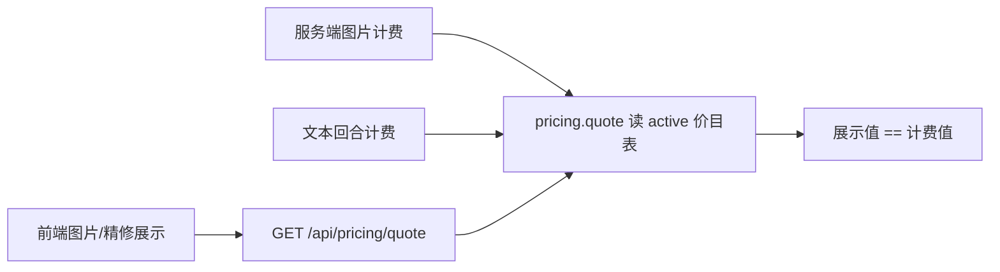
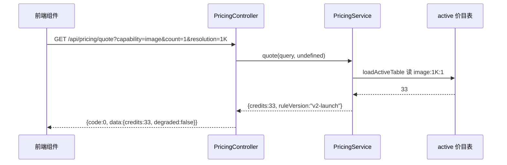

# 积分展示单一真相源（价目表）修复规格

状态：已批准实施（用户 2026-11-02 批准修复方向，含设计意图缺口补位）
前置：无（独立缺陷修复；与 2026-10-13-pricing-baseline-config-design.md 同源，是其「展示层脱节」子问题的根治）
分支约定：实现走 `fix/points-display-single-source` 分支 + PR + squash merge。
核心判据：**管理后台价目表是唯一真相源；本次修复后改价只改表、不动代码。**

## 0. 配图索引（结构与视觉两类，均随本文档演进）

| 编号 | 形式 | 内容 | 位置 | 用途 |
|---|---|---|---|---|
| 图 1 | 内嵌 Mermaid | 修复前/后展示取数链路对比 | §5 | 论证「展示值 == 计费值」如何由同源保证 |
| 图 2 | 内嵌 Mermaid | `GET /api/pricing/quote` 时序 | §5 | 验收端点契约与数据来源 |

## 1. 目标

1. 前端所有「消耗 N 积分 / 预估 N 积分」展示值，必须与计费扣费值**逐分一致**——不再出现「图显 10、账扣 33」「回合显 2、账扣 14/7」。
2. 展示取数**唯一通道** = 服务端 `pricing.quote()`（与计费同源）；管理后台价目表是唯一真相源，后续改价只配置价目表。
3. 文本回合「预估」为瞬时展示，回合结算后由 `turn_settled` 权威值**确定性覆盖**，预估绝不成为落盘/记忆的最终数字。

## 2. 范围（含明确不做）

**做：**
- 新增只读端点 `GET /api/pricing/quote`（复用 `pricing.quote`，与计费同源）。
- 前端新增 `usePricingQuote` 组合式 + `fetchPriceQuote` 服务，统一替换图片/精修面板的硬编码积分展示。
- 锁死「文本回合预估 → 结算权威值覆盖」的契约（补设计意图缺口）。

**不做（明确排除）：**
- 不改 `imageGenerationCredits` / `IMAGE_EDIT_MODEL_PRICING` 常量本身——它们降级兜底保留，但**不再进入任何展示热路径**。
- 不改价目表条目数值（33/14/7 是否正确是运营配置问题，非本修复范围；本修复只保证展示与计费读同一张表）。
- 不动 `CANVAS_TOOL_CREDITS`（画布 inpaint/outpaint 等本地工具操作，非 AI 生成计费，不在账单争议内）。
- 不改文本回合「预估」的 USD 成本算法本身（其作为瞬时预估合理），只保证结算后覆盖。

## 3. 与既有规格的关系

- **显式推翻**：`packages/shared/src/imageCredits.ts` 注释「`shared/imageGenerationCredits` 是单一真源、改档位改 FACTORS 两边自动跟上」——该断言在 `launch-reprice` 上线后**已失效**：计费早已读价目表（33），常量（10）只剩展示兜底。本规格确立**价目表才是唯一真相源**，常量降级为兜底。
- **延续**：`apps/web/src/constants/credits.ts` 的 `estimateImageCredits` 仍作为**离线兜底**保留（网络不可达时），但调用点改为「先取服务端价目表值，失败才回落本地估算」。
- **延续 P2 T7**：`turn_settled` → `turnSettledText` → 状态行 settled 态的链路已存在，本规格将其**契约化锁死**并补防御性清空。

## 4. 规范与判据

- **R-SINGLE-SOURCE**：任何展示积分值，最终必须经 `pricing.quote()` 或其返回的 `chargedPoints` 派生；禁止在展示热路径直接调用 `imageGenerationCredits` / `IMAGE_EDIT_MODEL_PRICING` / `estimateCreditsFromUsdCost` 作为最终数字。
- **R-NO-CODE-CHANGE-ON-REPRICE**：管理后台改价目表条目（如 `image:1K:1` 33→X）后，前端展示与后端计费**同时**生效，无需改代码、无需发版。新增 capability 定价同理（只需在表中加 matchKey）。
- **R-ESTIMATE-TRANSIENT**：文本回合「预估 -N积分」只在 `isStreaming` 时显示；`turn_settled` 到达后，状态行与气泡摘要一律显示权威 `credits`，预设值不得残留为最终数字。
- **R-DEGRADED-PARITY**：价目表缺失/降级时，`quote` 返回 `constants-fallback`（与计费降级一致），前端标记 `isFallback` 让 UI 标注「预估」，仍与计费同值——降级态亦不背离。

## 5. 架构与契约

图 1 说明修复前后取数链路：修复前展示走硬编码常量、计费走价目表，两源脱节；修复后两者收敛到同一 `pricing.quote` 引擎。

图 2 是端点的运行时时序，证明展示值来自价目表而非常量。

**端点契约 `GET /api/pricing/quote`**（全局 prefix `/api` ⇒ 真实路径 `/api/pricing/quote`）：
- 查询参数（全部可选，除 `capability`）：`capability`（必填，取值同 `PricingCapability`）、`modelKey`、`count`、`resolution`、`audioKind`、`duration`、`videoMode`、`referenceImageCount`、`referenceVideoCount`。
- 不传 `userId` ⇒ 走 global 表（与计费非灰度口径一致；灰度折扣不预显，实际扣费以结算为准）。
- 响应信封：`{ code:0, message:"ok", data:{ credits:number, ruleVersion:string, degraded:boolean } }`。
- `degraded=true` 当且仅当 `ruleVersion==="constants-fallback"`（价目表缺失/降级）；前端据此标注「预估」。
- 永不 throw：任何异常由 `pricing.quote` 内部落常量兜底（与计费一致）。

**前端组合式 `usePricingQuote(buildQuery, fallback)`**：
- 入参 `buildQuery: () => PriceQuoteQuery`（getter，内部读响应式 `count`/`resolution`/`modelKey` 以便自动重取）；`fallback: () => number`（离线兜底，初始同步值避免闪烁）。
- 返回 `{ credits: Ref<number>, isFallback: Ref<boolean> }`。
- 行为：初始化即 `credits=fallback()`（无闪烁）；`watch(buildQuery, …)` 命中即取 `/api/pricing/quote`，命中写 `credits` 并 `isFallback=degraded`；失败则回落 `fallback()` 且 `isFallback=true`。模块级 `Map` 按 query JSON 缓存，避免重复请求。

## 6. 打样/主场景规格

- **场景 A 图片生成 dock（ImageDockPanel）**：`credits` 由 `usePricingQuote(()=>({capability:'image',count:imageCount,resolution:imageResolution}), ()=>estimateImageCredits(...))` 提供。打开 dock 先显示本地估算 10，端点返回后翻为 33；`isFallback` 控制「预估」标注。验证：截图显示值 == 账单 `图像生成 -33`。
- **场景 B 精修面板（RefineSidePanel）**：`credits` 由 `usePricingQuote(()=>({capability:'image_edit',modelKey}), ()=>IMAGE_EDIT_MODEL_PRICING[modelKey] ?? estimateImageCredits(1))` 提供；首次让价目表 `image_edit:<model>` 行接管硬编码 `IMAGE_EDIT_MODEL_PRICING`。验证：展示值 == 该模型精修实际扣费。
- **场景 C 文本回合（设计意图缺口补位）**：streaming 显示「· 预估 -N积分」（`liveEstimatedCredits`）；`turn_settled` 到达后 `trackTurnSettled` **防御性清空 `liveEstimatedCredits`**，状态行/气泡摘要切到 `turnSettledText`（权威 `credits`）。验证：回合结束后状态行只显示「已结算 -X积分」，绝不残留「预估」。

## 7. 数据与状态变更

- **无 schema 变更**。价目表（`priceListEntry` / `priceListVersion`）为既有结构，本修复只读取，不写入。
- 新增读取入口：前端经 `GET /api/pricing/quote` 读 active 版本条目；与计费共用 `pricing.quote`，零新增数据表。
- 状态：前端 `liveEstimatedCredits`（既有）在 `turn_settled` 时清零，属既有 store 状态收口，无新状态字段。

## 8. 纯函数与算法（含单测要求）

- `fetchPriceQuote(query: PriceQuoteQuery): Promise<PriceQuoteResult>`——拼 querystring + `fetch(apiUrl('/pricing/quote?...'))` + 解析信封；非 2xx 或 `code!==0` 抛错（由 composable 捕获回落）。
- `usePricingQuote`——见 §5 契约；纯展示组合式，单测用 `vi.mock` 拦截 `fetchPriceQuote` 验证「先 fallback 后权威」「失败回落」「query 变化重取」「缓存命中不重复请求」。
- `PricingController.quote`——纯转发 `pricing.quote`，单测用 sqlite harness（仿 `pricing.controller.sqlite.integration.test.ts`）验证：`image:1K:1` 返回 33、`text` 不在此端点职责（返回 legacy 5 或按需）、空表返回 `degraded:true` + 常量兜底。

## 9. 文件级改动清单

- 新增 `apps/server/src/pricing/pricing.controller.ts`：`@Get('quote') quote()` 方法。
- 新增 `apps/web/src/services/pricing-api.ts`：`fetchPriceQuote` + 类型。
- 新增 `apps/web/src/composables/usePricingQuote.ts`：`usePricingQuote` 组合式。
- 修改 `apps/web/src/components/canvas/dock-studio/panels/ImageDockPanel.vue`：`credits` 改由 `usePricingQuote` 派生（移除 `estimateImageCredits` 直接展示）。
- 修改 `apps/web/src/components/canvas/refine/RefineSidePanel.vue`：`credits` 改由 `usePricingQuote` 派生（移除 `IMAGE_EDIT_MODEL_PRICING` 直接展示）。
- 修改 `apps/web/src/stores/agent.ts`：`trackTurnSettled` 内 `liveEstimatedCredits.value = null`（补设计意图缺口）。
- 新增测试：`apps/server/src/pricing/pricing.controller.quote.sqlite.integration.test.ts`、`apps/web/src/composables/usePricingQuote.test.ts`、`apps/web/src/stores/agent.settled-override.test.ts`（或并入既有 `agent.test.ts`）。

## 10. 测试策略与验收标准

- **服务端单测**：sqlite harness 注入 active 版本 `image:1K:1=33`，断言 `GET /api/pricing/quote?capability=image&resolution=1K` → `{credits:33, degraded:false}`；空表 → `degraded:true` + 常量兜底（与计费 `quote` 同值）。
- **前端单测**：`usePricingQuote` 四项（见 §8）；`agent.settled-override` 断言 `trackTurnSettled({credits:14})` 后 `liveEstimatedCredits===null` 且状态行 settled 态文案含「14」不含「预估」。
- **集成验收（prod-deploy-verify）**：在生产库用同一会话验证「图显值 == 账单 `图像生成 -N`」「回合结算后状态行 = 账单 `对话回合结算 -N`」。
- **目视验收**：打开图片生成 dock，数值由本地估算翻为价目表值（如 33）；精修面板随模型切换为价目表值；文本回合结算后状态行显示权威积分、无「预估」残留。

## 11. 风险

- **端点新增面**：`/api/pricing/quote` 沿用 `pricing.controller` 既有无 guard 公开只读风格（与 `/api/pricing/active` 同），无敏感字段暴露，风险低。
- **离线回落误差**：网络不可达时前端显示本地估算（10），与实时价目表可能不符——但标 `isFallback` 且属异常态，可接受；恢复后自动翻正。
- **灰度差异**：展示走 global 表，灰度用户实际扣费可能更低（灰度折扣）；展示值略高于实际扣费，属预期（提示以结算为准），不背离单一真相源原则。
- **测试资源**：sqlite harness `beforeAll` 需放宽超时（仿既有测试 180s）。

## 12. 后续包 / 路线图

- P-later：提案生成卡（`2026-11-02-propose-card-ux-optimization`）若落地，其 `creditCost` 也须改用 `usePricingQuote`，纳入同一组合式，不再引入本地估算。
- P-later：文本回合「预估」可由 USD 成本改为基于**价目表 token 反比率 + 已累计 token** 的同源估算，使预估与结算同引擎（本规格未做，因涉流式热路径改动，单独评估）。

## 13. 配图规范自检

- 运行 `pnpm verify-spec-figures --file docs/superpowers/specs/2026-11-02-points-display-single-source.md`：预期通过（图 1/2 为内嵌 Mermaid，§0 索引齐备，图注存在，正文引用图 1/图 2）。结果贴于交付记录。
