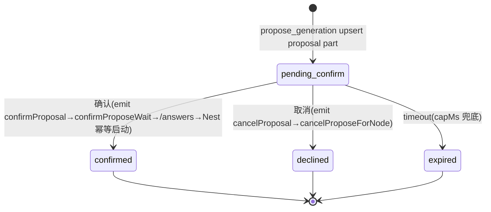
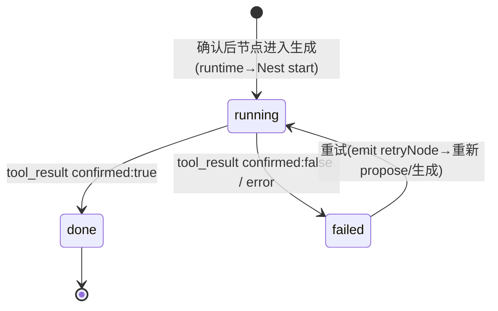
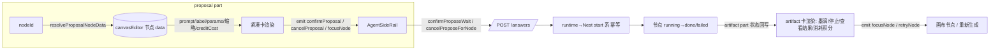

# 提议生成卡片 UX 优化（对话内决策中枢 · 品牌「锚」环）设计规格

状态：待评审（2026-11-02，起因：真机走查「对话里确认生成」交互总感觉拧巴）
修订 v2.1（对齐最终 HTML 原型 `2026-11-02-propose-card-ux-optimization-mockup.html`；**按生产最新代码复核修正**：拆分 proposal / artifact 双生命周期、修接口、积分 A-now + C-later）
前置：
- `docs/superpowers/specs/2026-10-19-propose-confirm-single-surface-design.md`（ADR-0011 单一表面，已落地）
- `docs/superpowers/specs/2026-10-30-propose-confirm-execution-unity-design.md`（P0-1 执行权归一，已上线，执行入口==1）
- `docs/superpowers/specs/2026-10-28-askuser-card-visual-refinement.md`（同门决策卡视觉规范，墨流令牌）
- `docs/superpowers/specs/2026-11-02-propose-card-ux-optimization-mockup.html`（本规格的 UI/UX 落地参照，深/浅可切换、可交互）
- `apps/web/src/components/agent/AgentTurnTimeline.vue`（现状卡片渲染 `:363-404`；emit `confirmProposal`/`cancelProposal`/`focusNode`）
- `apps/web/src/components/agent/turnTimeline.ts`（ProposalPart `:96-101` / ArtifactPart `:61-66`）
- `apps/web/src/components/agent/AgentSideRail.vue`（`confirmProposeWait` `:1223` / `cancelProposeForNode` `:1185`，`defineExpose` `:3916`）
- `apps/web/src/composables/useNodeGeneration.ts`（`cancelGeneration(id)` `:408`，经 `CANVAS_NODE_CANCEL_KEY` 注入）
- `apps/web/src/constants/credits.ts`（`estimateImageCredits(count, resolution?)` `:28`，积分估算唯一前端真源）
- `apps/web/src/constants/brand.ts` + `apps/web/src/components/brand/BrandLogo.vue`（品牌三联叙事与锚 glyph 资产）
分支约定：实现走 feature 分支（基于最新 origin/master）+ PR + squash merge。本期仅 web 改动，路径 filters 限 `apps/web/**`。

## 0. 配图索引

| 编号 | 形式 | 内容 | 位置 | 用途 |
|---|---|---|---|---|
| 表 1 | 表格 + 文字 | 现状 vs 目标态信息架构对照 | §2 | 实施对照每张卡片的区域/元素/数据来源；验收对照两态差异 |
| 图 1 | 内嵌 Mermaid | **proposal part** 状态机 | §4 | 实施逐态对照渲染；验收状态翻面 |
| 图 2 | 内嵌 Mermaid | **artifact part** 状态机（增强） | §4 | 验收 生成中/完成/失败 与 停止/重试/回链 |
| 图 3 | 内嵌 Mermaid（flowchart） | 对话卡 ↔ 画布节点 双向窗口数据流 + 接线 | §5 | 验收「零 wire 变更 + 单执行入口」不变量 |
| 表 2 | 表格 + 文字 | 品牌三联叙事「对话 › 锚 › 画布」**跨双卡**逐段点亮 | §2.5 | 验收品牌叙事承载 |
| 表 3 | 表格 | 逐状态按钮审计（proposal 卡 + artifact 卡） | §4 | 验收每态动作齐备、无遗漏 |

## 1. 目标（可验收）

1. **提案可见且决策信息恒定**：`pending_confirm` 期对话卡以**恒定紧凑形态（≈150px）**呈现——节点名（标题）+ 单行元信息（模型 · 比例 · 预计 N 积分）+ 提示词 1 行预览 + 节点缩略（经 `ProposalPart.nodeId` 解析画布节点 `data`，零 wire 变更）；确认前看得见「用哪个模型、花多少积分、生成什么」。
2. **就地决策 + 旋钮进 Sheet**：对话卡「落锚生成（确认）/ 调整（参数微调 Sheet）/ 取消」经 `AgentTurnTimeline` emit `confirmProposal`/`cancelProposal`，由 `AgentSideRail` 接手调既有 `confirmProposeWait`/`cancelProposeForNode`；所有重旋钮（模型/比例/分辨率·尺寸/张数/风格/提示词）收进**参数微调 Sheet**（复用 `MobileSheet.vue`），对话卡本身不膨胀。
3. **执行面在 artifact 卡**：确认后真正生成发生在画布节点，时间线由独立 `artifact` part 承载 `running → done/failed`；本规格增强该卡——墨滴进度 + 停止生成（`cancelGeneration`）+ 查看结果↗ + 消耗积分 + 失败重试（`retryNode`），与 proposal 卡共享品牌三联叙事（画布段在此点亮）。
4. **品牌叙事承载（跨双卡）**：卡片是品牌三联「对话 › 锚 › 画布」中唯一的「锚」环界面——proposal 卡点亮「对话✓·锚✓」、artifact 卡点亮「画布✓」。通过锚 glyph + 三联链分段点亮 + 「落锚生成」主钮 + 墨滴进度 + 锚链定位把叙事长在卡上，零膨胀。
5. **积分诚实（A-now + C-later）**：A-now 积分 = `estimateImageCredits(count, resolution?)`（来自 `@/constants/credits`，**忽略 model**），模型 chip 仅作信息、不作成本主因强调；C-later 由服务端下发权威 `creditCost`（含 model 维度），卡片优先采用、本地估算兜底。任何态不编造服务端不认账的价格。

## 2. 现状与目标态 UI/UX（本规格核心参照）

### 2.1 现状（拧巴）—— 代码锚点

- **渲染**：`apps/web/src/components/agent/AgentTurnTimeline.vue:363-404`
- **数据**：`apps/web/src/components/agent/turnTimeline.ts` 中 `ProposalPart`（`kind:'proposal'`，`:96`）仅含 `title`+`nodeId`，状态 `:101` = `pending_confirm | confirmed | declined | expired`；**不含 prompt / params**。提示词在画布节点 `data.prompt`（`NodePendingPrompt.vue` 读取）。**注意：本仓时间线实际有「两张卡」**——`artifact` part（`:61` `kind:'artifact'`，状态 `:66` = `pending | running | done | failed`，承载真实生成进度）是独立 part，proposal 卡**没有** `generating` 状态。
- **当前卡片形态**：🎨 + `title`（常为提示词复述）+ 「待确认」tag + 文案「等待你在画布上确认生成，确认后继续输出」+ 三按钮（定位 / 确认生成 / 取消）。
- **十大拧巴根因**（详见 §3）：R1 内容真空、R2 文案自相矛盾、R3 编辑断点、R4 定位/确认并排、R5 确认后死胡同、R6 视觉二等公民、R7 积分不透明、R8 标题=提示词复述、R9 展开后太长、R10 品牌叙事缺位。

### 2.2 目标态信息架构（紧凑 proposal 卡 + 参数微调 Sheet + 增强 artifact 卡）

**A. 紧凑对话卡 — proposal part（恒定 ≈150px，仅 `pending_confirm` 可操作）**

| 区域 | 元素 | 数据来源 | 状态/行为 |
|---|---|---|---|
| Header | **引领锚 glyph**（品牌资产 `anchor-generate.png`，mask/currentColor 随主题反相；可点击定位节点）+ 「画布节点」眉标 + 节点名（标题，**取节点 `title/label`，非提示词**） | `nodeId` → 节点 `title/label` | 常驻；前导图标 `cursor:pointer` + `title="在画布中查看此节点"`，点击 emit `focusNode` |
| Meta 行 | 单行：`模型` chip（**中性**，A-now 不强调为成本主因）· `比例` chip · `预计 N 积分`（credit，琥珀） | 节点 `data.params` / `creditCost`（见 §5） | pending 可见；模型常驻、张数默认 1 不显（>1 才作 chip） |
| Body | 提示词 **1 行 ellipsis 预览**（「证据」非「决策控件」） | 节点 `data.prompt` | pending 可见；完整文本在 Sheet / 画布 |
| Body | 节点微缩预览（小图，对话看得到画布） | 节点 `data` 缩略 | pending 可见 |
| Action（主路径） | **落锚生成**（accent 实心主钮，全仓唯一强调色） | emit `confirmProposal(nodeId)` | pending 可见 |
| Action（次级） | **调整**（滑块图标按钮，开参数微调 Sheet） | emit 本地 Sheet 打开意图 | pending 可见 |
| Action（终止） | **取消**（× 图标按钮） | emit `cancelProposal(nodeId)` | pending 可见 |
| 弱链接 | **在画布查看节点**（chevron + `--lnk-text-secondary`，hover 显 accent） | emit `focusNode(nodeId)` | 全状态（confirmed/declined/expired 仍可用作复盘） |
| 终态 | `confirmed`=「已落锚✓」折叠行；`declined`=「已取消」；`expired`=「已超时」；均显「在画布查看节点」弱链接、积分「未扣减」删除线 | — | 操作禁用 |

**B. 参数微调 Sheet（`ProposeTuneSheet.vue`，复用 `MobileSheet.vue`）**

| 区域 | 元素 | 数据来源 | 行为 |
|---|---|---|---|
| 头部 | grabber + 标题「参数微调」+ 关闭 | — | `MobileSheet` 的 `title` prop + `close` emit |
| 模型 | iOS 列表单选（选中打勾），**A-now 标注「积分暂不含模型维度」** | `data.params.modelId` | 切换 → A-now **不**联动积分（仅分辨率×张数联动）；C-later 服务端下 creditCost 后生效 |
| 比例 | 分段控件（16:9 / 1:1 / 3:4 / 9:16） | `data.params.aspectRatio` | 联动积分（分辨率） |
| 分辨率·尺寸 | 单控件（标准 1024×1024 / 高清 1536×1024 / 超清 2048×2048） | `data.params.imageResolution` | 联动积分 |
| 张数 | 分段（1/2/4），默认 1；选 >1 时主卡 chip 才出现 | `data.params.imageCount` | 联动积分（×张数） |
| 风格 | 分段（写实/扁平/水彩/胶片） | `data.params.style` | — |
| 提示词 | **disclosure 折叠编辑**（次级，默认收起） | `data.prompt` | 结构性大改仍走「在画布精修」 |
| 实时积分 | 「本次预计消耗 N 积分」（随**分辨率×张数**即时重算；A-now 与 model 无关） | `estimateImageCredits(count, resolution)` | 提交走同一确认路径 |
| 操作 | 「保存并确认」（→ emit `confirmProposal`）/ 「在画布精修」（逃生口，开 dock） | — | — |

**A'. 增强 artifact 卡 — `running | done | failed`（执行面，本规格新增增强项）**

| 状态 | 元素 | 数据来源 | 行为 |
|---|---|---|---|
| `running` | 墨滴进度（呼应「一点一滴洒在画布」）+ **停止生成**（■ 图标） + **在画布查看**（emit `focusNode`） + 「预扣 N 积分」（半透明，注记失败自动回填） | 节点 `status` / `creditCost` | 停止生成 → `cancelGeneration(nodeId)`（经 `CANVAS_NODE_CANCEL_KEY`） |
| `done` | **查看结果 ↗**（回链到结果节点）+ 「消耗 N 积分」回显 + 品牌「锚✓·画布✓」 | 节点 `url` / `creditCost` | 点击回链定位节点 |
| `failed` | 错误文案 + **重试**（↻ 图标，emit `retryNode`） + 「未扣减」删除线 | `errorText` | 重试 → 重新 propose/生成 |

### 2.3 现状 vs 目标态视觉对照

- **现状卡**：瘦边框 + warning 色 + 10px 小字 + emoji，像系统通知；只给标题（常为提示词复述）不给内容；确认钮与「去画布确认」文案自相矛盾；「定位」与「确认」并排暗示混乱；确认后仅留「已确认」死胡同；标题与正文重复、确认前对积分一无所知、品牌叙事缺席。
- **目标态卡**：`raised` 面 + `xl` 圆角 + 引领锚 glyph（墨流令牌，复用 AskUserCard 视觉语言）；**对话卡紧凑恒定（≈150px），所有重旋钮进 Sheet**（iOS「对话卡短、设置进 Sheet」范式）；单行元信息恒可见、独立于提示词长度；积分透明（pending 预估 / generating 预扣 / completed 回显 / declined 删除线「未扣减」）；确认后 artifact 卡就地翻态并回链；**品牌三联链跨双卡点亮**。一句话：对话看得到画布，画布看得到对话，卡片本身就是「锚」——双向窗口 + 品牌铰链。

## 3. 问题诊断（10 根因 → 对应优化落点）

| # | 根因 | 现象 | 代码锚 | 优化落点（→ §7） |
|---|---|---|---|---|
| R1 | 内容真空 | 确认前看不到要生成什么，盲点确认 | `ProposalPart` 仅 `title`；prompt 在节点 `data.prompt` | #1/#3 节点 data 解析渲染 |
| R2 | 文案自相矛盾 | 「等待你在画布上确认」vs 确认钮就在旁 | `AgentTurnTimeline.vue:383` | #1 改文案为「创意就绪 · 落锚即洒向画布」 |
| R3 | 编辑断点 | 「改参数再确认」被迫 定位→画布→dock 多跳 | 对话卡无编辑入口 | #1b 参数微调 Sheet |
| R4 | 定位/确认并排 | 既能在这确认又最好去那边，暗示混乱 | `AgentTurnTimeline.vue:386-402` | #1 定位降为弱链接/前导 glyph，不进主操作区 |
| R5 | 确认后死胡同 | 翻「已确认」无结果回链，对话流失联 | `ProposalPart.status` 已支持终态但未用满 | #1 终态呈现 + #1' artifact 卡 查看结果↗ 回链 |
| R6 | 视觉二等公民 | 10px 小字+emoji+warning 边框，不像决策面 | 现状样式 | #1/#7 对齐墨流令牌 + 6 态契约 |
| R7 | 积分不透明 | 确认前对成本一无所知 | 无 credit 展示 | #1 元信息 `预计 N 积分` + Sheet 实时联动（**A-now：`estimateImageCredits(count,resolution)`，忽略 model**） |
| R8 | 标题=提示词复述 | header 在复述 body，且非节点名，窗口映射断裂 | `turnTimeline.ts` 取上游 `d.title` | #1 标题取节点 `title/label`，提示词降级 1 行预览 |
| R9 | 展开后太长 | 内联展开旋钮使卡片膨胀至 ~500px，挤掉后续消息 | — | #1b 旋钮全部进 Sheet，卡恒定 ≈150px |
| R10 | 品牌叙事缺位 | 卡片未承载「对话›锚›画布」三联，丢失品牌铰链 | — | #1 锚 glyph + 三联链 + 落锚生成 + #1' 墨滴进度/画布段点亮（§2.5） |

## 4. 状态机（图 1 proposal / 图 2 artifact）+ 逐状态按钮审计（表 3）

**图 1 · proposal part 状态机（决策中枢，对话卡）**



proposal 卡的状态翻面全部由 emit 链驱动，卡片不自行探测生成状态（判据见上图注）。

**图 2 · artifact part 状态机（执行面，增强项）**



*注 · proposal 与 artifact 是**两张独立 part**（turnTimeline.ts:96 / :61）。原稿把 `pending_confirm→generating→completed` 当成单卡是错误——`generating/done/failed` 属于 artifact part。确认写回 proposal 的 `confirmed`，生成进度在 artifact。*

**逐状态按钮审计（表 3）**

| 卡片 | 状态 | 落锚生成 | 调整 | 取消 / 停止 | 在画布查看（定位） | 结果回链 | 其他 |
|---|---|---|---|---|---|---|---|
| proposal | `pending_confirm` | ✓ 主钮(emit confirmProposal) | ✓ 调整(开 Sheet) | ✓ 取消(emit cancelProposal) | ✓ 弱链接 + 前导 glyph(emit focusNode) | — | — |
| proposal | `confirmed` | ✗ 已落锚 | ✗ | ✗ | ✓ 弱链接 | — | 「已落锚✓」折叠 |
| proposal | `declined` | ✗ 禁用 | ✗ | 已取消 | ✓ 弱链接 | — | 未扣减(删除线) |
| proposal | `expired` | ✗ 禁用 | ✗ | 已超时 | ✓ 弱链接 | — | 未扣减(删除线) |
| artifact | `running` | — | — | ✓ **停止生成**(`cancelGeneration`) | ✓ 弱链接(emit focusNode) | — | 墨滴进度；预扣 N 积分 |
| artifact | `done` | — | — | N/A | （由「查看结果↗」承担） | ✓ 查看结果↗ | 消耗 N 积分 |
| artifact | `failed` | — | — | — | ✓ 弱链接 | — | 重试(emit retryNode)；未扣减 |

**品牌锚滑动轨道（§2.5，跨双卡）**：卡片下方「对话(左端)──锚(进度拇指)──画布(右端)」轨道，锚图标随状态滑动——proposal `pending_confirm` 锚停对话端(0%)；`confirmed` 起锚离对话(~18%)；artifact `running` 沿轨道滑行向画布(~55%)；`done` 落定画布端(100%·绿，画布图标变绿＝墨滴落定)；`declined/expired` 锚留对话端(0%·暗，未扣减)；`failed` 锚卡中途(50%·红，可重试)。由各自卡片根 `state-*` 类经 CSS `--p` 驱动，**位置即叙事进度，无独立点亮段**；reduced-motion 下锚瞬移且保留文字标签。

## 5. 架构与契约（图 3）



*图 3 · 唯一新增数据流是「对话卡经 `nodeId` 解析画布节点 `data`」——纯前端读取，零 wire 变更。确认/取消经 **emit** 由 `AgentSideRail` 接手既有 `confirmProposeWait(nodeId)` / `cancelProposeForNode(nodeId, {note?})`（均为组件 `defineExpose` 方法，非独立 `actions` 模块）；停止生成经 `cancelGeneration(id)`（inject `CANVAS_NODE_CANCEL_KEY`）；定位/重试为 `AgentTurnTimeline` 的 `focusNode` / `retryNode` emit。*

**不变式（继承 P0-1 判据 4.1）**：
1. 执行入口集合 == 1：对话卡确认复用 `confirmProposeWait → /answers → runtime → Nest start`（与画布 overlay 同源），不新增执行/确认语义。
2. 呈现权 = 只读复制 + 发意图：对话卡对节点 `data` 只透传、不发写；编辑走既有 dock 链路（Sheet 仅发「保存并确认」意图，参数写入经 dock/overlay 既有路径）。
3. turn 终态判定来源 == 服务端事件：SSE 断流不参与成败归因（P0-1 判据 3）。

**积分来源（A-now + C-later）**：
- **A-now（当前落地）**：`estimateImageCredits(count = imageCount, resolution = imageResolution?)` 来自 `@/constants/credits`（:28），内部调 `@lnkpi/shared` 的 `imageGenerationCredits({count, resolution})`。**该函数签名不含 model**——故 A-now 积分只随「分辨率×张数」变化，与模型无关。模型 chip 仅作信息展示，不驱动数字。
- **C-later（后端议题，本规格登记）**：建议服务端在节点 `data` 下发权威 `creditCost`（含 model 维度），或在定价接口接收 `modelId`。卡片逻辑改为 `creditCost = node.data.creditCost ?? estimateImageCredits(count, resolution)`——**优先服务端、本地兜底**。届时模型才名正言顺成为成本主因（mockup 的模型 accent 描边在 C-later 再升级）。
- 积分时序：生成前预扣、取消/失败回填（`generationDiagnostic.ts` 实证「已取消，8 积分已返回」），故 pending「预计 N」/ running「预扣 N」/ done「消耗 N」/ declined·expired「未扣减」语义与真实一致。

**双向窗口（第二期）**：对话卡显示节点缩略（对话→画布）；画布 overlay/dock 编辑时顶部回链「来自对话提案 · 第 N 回合」（画布→对话）。

## 2.5 品牌三联叙事承载（表 2，跨双卡）

品牌内核（来自 `constants/brand.ts` + 锚图标计划）：**对话**＝「你体内早就有一囊**墨**」以自然语言流出（slogan LEAD）；**锚**＝品牌中心动词「**锚定**」，吉祥物墨鱼π的 Logo 本体即**锚**（盘+锚+环+浪，`anchor-badge.png`；`anchor-generate.png`/`anchor-locate.png` 为既有品牌资产）；**画布**＝「一点一滴洒在**画布**，让世界记住你的模样」（slogan MAIN）。对话有对话流、画布有画布节点——**唯独「锚」无专属界面，它就是这张提议生成卡片**。故卡片是传递品牌叙事的天然铰链。

| # | 机制 | 表达 | 落点 |
|---|---|---|---|
| 1 | 引领图标 = 品牌锚 glyph | 替代通用 sparkle；生产走 `anchor-generate.png`（mask/currentColor 随主题反相） | proposal 卡 header（§2.2 A） |
| 2 | **锚滑动轨道（进度拇指）** | 卡片下方「对话(左)──锚(滑)──画布(右)」品牌轨道，**锚图标即进度拇指**：由卡片根 `state-*` 类经 CSS `--p` 驱动沿轨道滑动——proposal `pending_confirm` 锚停对话端(0%)→`confirmed` 起锚(~18%)→artifact `running` 滑行(~55%)→`done` 落定画布(100%·绿)；`declined/expired` 留对话端(暗)、`failed` 卡中途(红) | 跨双卡（§4 末段） |
| 3 | 主钮文案「落锚生成」 | 复用品牌中心动词「锚定」 | proposal 卡主钮 |
| 4 | 墨滴进度（running） | 呼应「一点一滴洒在画布」 | artifact 卡（§2.2 A'） |
| 5 | done 文案闭合 slogan | 「查看结果 ↗ 让世界记住你的模样」 | artifact 卡 |
| 6 | 锚链定位弱链接 | 「在画布查看节点」(emit focusNode)，hover 锚链拉拽微动 | 双卡共用 |

*注 · 整卡仍恒定 ≈150px（proposal）/ 执行态受 artifact 卡约束，零膨胀。*

## 6. 范围

### 6.1 本规格做

- **第一期（纯前端、零 wire）**：R1 内容补全 + R2 文案 + R4 降噪 + R5 状态翻面/回链 + R6 视觉对齐 + R7 积分透明(A-now) + R8 标题取节点名 + R9 旋钮进 Sheet + R10 品牌锚承载 + 节点 `data` 解析 + 参数微调 Sheet（承载 R3 高频参数）+ **artifact 卡增强**（R5 回链 / 墨滴 / 停止 / 重试 / 消耗积分）。
- **第二期**：画布侧 provenance 回链（画布→对话）+ 结构性提示词大改的深编辑入口增强 + **C-later 服务端 `creditCost` 接入**。

### 6.2 明确不做

- 不改 `ProposalPart` / `ArtifactPart` wire 契约（仍只靠 `nodeId` 前端解析，不新增字段下发）。
- 不新增确认语义 / 执行路径（复用 `confirmProposeWait` / `cancelProposeForNode` / `cancelGeneration`）。
- 不动 `ask_user` 链路、不动 Nest / pi-runtime。
- 不前端编造 model→积分映射（A-now 积分忽略 model；model 维度计费属 C-later 后端议题）。

## 7. 文件级改动清单（实施排期唯一输入；与 §6.1 / §3 交叉核对）

| # | 文件 | 改动 | 对应 |
|---|---|---|---|
| 1 | `apps/web/src/components/agent/AgentTurnTimeline.vue` | 重制 `proposal` part 渲染（`:363-404`）：引领锚 glyph（可点 emit `focusNode`）+ 「画布节点」眉标 + 节点名标题 + 单行元信息（模型·中性·比例·预计N积分）+ 提示词 1 行预览 + 节点缩略 + 三联链（proposal 段 state-* 驱动）+ 主路径 `落锚生成`(emit confirmProposal)/`调整`(开 Sheet)/`取消`(emit cancelProposal) + `在画布查看节点` 弱链接；终态 `confirmed/declined/expired` 折叠呈现；删「等待你在画布上确认生成」；令牌全 `--lnk-*` + 6 态契约 | R1/R2/R4/R5/R6/R7/R8/R9/R10 |
| 1' | `apps/web/src/components/agent/AgentTurnTimeline.vue`（同文件 artifact 段） | 增强 `artifact` part：`running` 墨滴进度 + **停止生成**(cancelGeneration) + 在画布查看(emit focusNode) + 「预扣 N 积分」；`done` **查看结果↗** + 消耗 N 积分 + 品牌画布段点亮；`failed` 重试(emit retryNode) + 未扣减 | R5/R7/R10 |
| 1b | 新建 `apps/web/src/components/agent/ProposeTuneSheet.vue` | 参数微调 Sheet，复用 `MobileSheet.vue` 基座（`<MobileSheet v-if="open" :title="参数微调" @close="...">`）；模型(iOS列表单选,中性,标注积分暂不含模型)/比例(分段)/分辨率·尺寸(单控件)/张数(分段,默认1)/风格(分段) + 提示词 disclosure 折叠编辑 + 实时积分(`estimateImageCredits(count,resolution)` 联动) + 「保存并确认」(emit confirmProposal)/「在画布精修」；支持 reduced-motion | R3/R7/R9 |
| 2 | `apps/web/src/components/agent/turnTimeline.ts` | `ProposalPart` / `ArtifactPart` 类型**不变**（零 wire）；前端消费既有 `status` 字段即可 | R5 |
| 3 | 新建 `apps/web/src/composables/useProposalNodeData.ts` | 纯函数 `resolveProposalNodeData(nodeId)`：从 `canvasEditor` store 取节点 `data` 的 `prompt`/`label`/`params`/缩略；按 `nodeType` 取对应 params 键；`creditCost = node.data.creditCost ?? estimateImageCredits(imageCount, imageResolution)`；节点未同步返回 null（降级） | R1/R7 |
| 4 | `apps/web/src/components/agent/AgentTurnTimeline.proposal.test.ts` + `.artifact.test.ts` | proposal：标题取节点名/元信息/文案断言/三动作 emit/定位 emit/降级/长提示词 1 行/张数条件/品牌锚 glyph+三联链/积分 A-now；artifact：running 停止 emit cancelGeneration / done 查看结果回链 / failed 重试 emit retryNode / 积分回显 | R1–R10 |
| 5 | `apps/web/src/components/agent/proposeWaitActions.ts` | 新增 `openProposeTuneSheet(nodeId)` 置 Sheet 打开意图（用 `ref` 状态，由父级 `v-if` 控制 `MobileSheet` 显隐）；**不改** `confirmProposeWait`/`cancelProposeForNode`（在 AgentSideRail） | R3 |
| 5' | `apps/web/src/components/agent/AgentSideRail.vue` | 既有 `@confirm-proposal`→`confirmProposeWait` / `@cancel-proposal`→`cancelProposeForNode` 接线确认保留（现状已接，见 `:1185/:1223`）；无需新写 | R5 |
| 6 | `apps/web/src/components/canvas/ProposeConfirmOverlay.vue` 或 dock | 编辑态顶部加 provenance 回链「来自对话提案 · 第 N 回合」（第二期·画布→对话） | R5（二期） |
| 7 | 设计令牌 / 测试 | 复用 `--lnk-*`；跑 `design-token`/`text-token-guard`/`theme-usage`/`dead-styles` 四守卫；移动端触控 44px（按能力集分流）；禁止 `--neo-*` | R6 |

交叉核对：#1/#1'/#1b/#2/#3/#4/#5/#5' = 第一期（R1–R10）；#6 = 第二期（画布→对话回链）；#7 贯穿。

## 8. 测试策略与验收标准

- **分层**：单测 > 叙述。改组件后跑 `vue-tsc -b`；改令牌相关样式跑 design-token 四守卫。
- **单测**（nvm node24 + `--maxWorkers=1 --no-file-parallelism`，分批 ≤12 文件）：#4 用例（proposal + artifact 两份）。
- **验收判据（行为级）**：
  - **A1 提案内容可见**：对话卡渲染节点名 + 元信息（模型·比例·积分）+ 提示词 1 行预览 + 节点缩略（经 `nodeId` 解析画布节点 `data`，非空）。
  - **A2 文案一致**：卡内无「等待你在画布上确认生成」类自相矛盾文案。
  - **A3 就地决策（接线正确）**：对话卡 `落锚生成` emit `confirmProposal` → `AgentSideRail` 调 `confirmProposeWait`；`取消` emit `cancelProposal` → `cancelProposeForNode`；确认后仍走 P0-1 单执行入口。
  - **A4 参数微调 Sheet**：对话卡「调整」唤起 `ProposeTuneSheet`（复用 `MobileSheet`，**`v-if`+`title`+`@close`，无 `:open` prop**）；模型/比例/分辨率·尺寸/张数/风格可调；积分随**分辨率×张数**联动（**A-now 与 model 无关**）；提示词折叠次级；结构性大改「在画布精修」开 dock。
  - **A5 状态翻面+回链**：proposal 翻 `confirmed/declined/expired`；artifact 翻 `running→done/failed`，done 给「查看结果↗」回链，failed 给「重试」；#654 reason 映射显式呈现。
  - **A6 零误报**：SSE 断流不显「生成失败」（P0-1 判据 3）。
  - **A7 视觉对齐**：令牌全 `--lnk-*`；6 态契约；无 10px 小字；移动端触控 44px；四守卫绿。
  - **A8 零 wire 变更（第一期）**：仅 web 改动；Nest/runtime 不动。
  - **A9 积分诚实**：pending「预计 N」/ running「预扣 N」/ done「消耗 N」/ declined·expired「未扣减」；A-now 数字 = `estimateImageCredits(count,resolution)`，**不随模型变化**；C-later 优先 `node.data.creditCost`。
  - **A10 模型常驻中性 + 张数条件**：模型 chip 常驻元信息（**中性，不强调为成本主因**）；张数默认 1 不显，>1 才作 chip，积分随张数联动。
  - **A11 长提示词折叠**：提示词默认 1 行 ellipsis；完整文本进 Sheet/画布。
  - **A12 定位弱链接**：全状态具「在画布查看节点」弱链接 + 前导 glyph 可点（emit `focusNode`），不进主操作区。
  - **A13 品牌锚滑动轨道（跨双卡）**：锚 glyph 常驻；**锚图标即进度拇指**，沿「对话→画布」轨道滑动（pending 停对话端 0% → confirmed 起锚 ~18% → running 滑行 ~55% → done 落定画布 100%·绿；declined/expired 留对话端暗、failed 卡中途红）；主钮「落锚生成」；artifact 墨滴进度；done 文案闭合 slogan；reduced-motion 下锚瞬移且文字标签保真。
  - **A14 紧凑恒定**：proposal 卡各态恒定 ≈150px；artifact 卡受执行态约束；旋钮全进 Sheet，不膨胀。
- **目视验收**：真机走查 S1（pending 内容/元信息可见）– S2（落锚即出图）– S3（artifact 墨滴+停止+回链）– S4（SSE 断流不误报）– S5（移动端纯对话可操作、Sheet 底部上滑）– S6（深/浅主题 token）– S7（品牌三联链跨双卡点亮）。

## 9. 风险

| # | 风险 | 缓解 |
|---|---|---|
| 1 | `nodeId` 解析失败（节点未同步到前端 store） | 降级：仅显节点名 + 「在画布查看」静默链接，不崩 |
| 2 | 参数字段名跨节点类型不一致（image/video/audio） | 解析函数按 `nodeType` 取对应 params 键，缺省跳过 |
| 3 | 大提示词撑爆卡片 | 默认 1 行 ellipsis + 完整文本进 Sheet/画布（R9 已结构性解决） |
| 4 | 移动端画布视图/纯对话视图双态 | 按能力集分流（纯对话可操作、画布视图只读），呼应 AGENTS.md 二维断点 |
| 5 | Sheet 复用 `MobileSheet` 的 z-index/手势冲突 | 复用既有基座，`v-if` 控制显隐，不自造第二套 sheet 皮肤 |
| 6 | 品牌锚 glyph 在深/浅主题反相失效 | 走 `mask`/`currentColor`，不写死色值；四守卫 + 深/浅真机走查 |
| 7 | **误把 model 计入前端积分**（编造服务端不认账价格） | 严禁；A-now 积分仅 `estimateImageCredits(count,resolution)`，model 维度留 C-later 后端 |

## 13. 落地工艺与质量闸门（工具矩阵 + 仓库既有闸门 + 流水线）

> 本节回答「如何把 HTML 原型超预期地落成代码」。结论：**无需 Figma**（连接器市场无 Figma connector；且本仓 `design-tokens.css` 已是令牌 SSOT，原型直接消费真实 `--lnk-*`，token 漂移在架构层已被消除）。质量与超预期杠杆全部在代码侧。

### 13.1 工具矩阵（按到达时机调用，无需预装）

| 工具 | 类型 | 用途 | 何时调用 | 需预装？ |
|---|---|---|---|---|---|
| **Frontend Design Optimizer** | 本地 skill | 八大维度打磨，把「能用」拉到「产品级」；自带 `analyze_screenshot` | 实现首版完成后 polish pass | ❌ 本机已存在 |
| **高品质前端设计** | 本地 skill | 同类前端品质提升 | 可选 | ❌ 本机已存在 |
| **前端开发** | 本地 skill | Vue 模板/references/scripts | 开工搭骨架 | ❌ 本机已存在 |
| **writing-plans** / **using-superpowers** | 本地 skill | 规格派生逐任务执行计划 | 实现前 | ❌ 本机已存在 |
| **4 令牌测试** | 仓库测试 | 强制 `--lnk-*`、禁 `--neo-*`、深/浅双主题 | 改组件/令牌后必跑 | ❌ 已存在 |
| **vue-tsc -b** | 类型闸门 | 改组件后必跑 | 改组件后 | ❌ 已存在 |
| **vitest**（nvm node24） | 单测 | `--maxWorkers=1 --no-file-parallelism`，分批 ≤12 文件 | 改逻辑后 | ❌ 已存在 |
| **workbuddy-browser-use** | Skill（需开 Browser control） | 真机截图 + 交互走查 | 真机验证阶段 | ⚠️ 需在 Settings→Agent→Browser control 开启 |
| Figma | 外部 SaaS/MCP | 设计稿与代码同步 | **本次不需要** | ❌ 市场无 connector；token SSOT 已是 `design-tokens.css` |

### 13.2 仓库既有闸门（强制，落地即生效）

- 令牌：只许 `--lnk-*`，禁 `--neo-*`；深/浅双主题必须成立（4 守卫）。
- 改组件后 `vue-tsc -b`；vitest 用 nvm node24 + `--maxWorkers=1 --no-file-parallelism`。
- 参数微调 Sheet **必须复用 `MobileSheet.vue`**，禁第二套 sheet 皮肤；用 `v-if` 控制显隐 + `title` prop + `@close`，**不设 `:open` prop**。
- `prefers-reduced-motion` 必须支持；触控 ≥44px；图标内联 SVG（24 网格、stroke:2、圆角笔画），零第三方图标库。

### 13.3 落地流水线（超预期路径）

```
规格(v2.1 已完成) → writing-plans 派生逐任务计划
  → 实现 #3 useProposalNodeData + #1 proposal 卡重制 + #1' artifact 卡增强 + #1b ProposeTuneSheet(复用 MobileSheet) + #5 openProposeTuneSheet
  → 加载 Frontend Design Optimizer 做 polish pass
  → 跑 4 令牌测试 + vue-tsc -b + vitest
  → (可选) browser-use 真机截图，与 mockup 逐像素 diff
  → 真机走查 S1–S7
```

### 13.4 环境预检（2026-11-02 已核验，生产最新代码）

| 项 | 状态 |
|---|---|
| Node 24（vitest 必需） | ✅ nvm 有 v24.13.0（默认 v22，跑测试前 `nvm use 24`） |
| pnpm | ✅ 9.15.0 |
| 4 令牌测试 | ✅ 全在 `apps/web/src/styles/` |
| `design-tokens.css` | ✅ 令牌 SSOT |
| `estimateImageCredits`（`@/constants/credits`） | ✅ 前端积分估算唯一真源（**忽略 model**） |
| `confirmProposeWait` / `cancelProposeForNode` / `cancelGeneration` / `focusNode` emit | ✅ 已实证（AgentSideRail / useNodeGeneration / AgentTurnTimeline） |
| 规格 + 原型文件 | ✅ 均在 |
| Browser control（真机截图 diff） | ⚠️ 需手动开启（非阻塞） |

## 10. 与既有规格/决策关系

- **对 ADR-0011（单一表面）：修订而非回滚**。延续「对话可操作」，把「画布唯一可操作面」升级为「**对话决策中枢（proposal 卡）+ 画布执行面（artifact 卡）**」双表面分工。
- **对 P0-1 执行权归一**：不触动执行入口==1，仅新增对话卡这个 UI 入口路由到同一 `confirmProposeWait`。
- **对 AskUserCard 视觉规范（2026-10-28）**：同门决策卡，复用其「主路径唯一显眼 + 逃生口降级」信息架构与墨流令牌；并进一步承载品牌「锚」环。

## 11. 后续包 / 路线图（本规格外，登记防隐性范围）

- 第二期 R3 深编辑增强 + provenance 回链（#6）。
- **C-later 后端议题：模型维度积分**——服务端在节点 `data` 下发权威 `creditCost`（含 model），或在定价接口接收 `modelId`；前端改为优先采用、本地 `estimateImageCredits` 兜底。落成前 A-now 积分与 model 无关，模型 chip 中性。
- P1-3 挂起持久化后，`expired` 可精确判定（当前 timeout 由 capMs 兜底）。

## 12. 配图自检

本文含 3 张内嵌 Mermaid（图 1 proposal 状态机 / 图 2 artifact 状态机 / 图 3 数据流）+ 表格（表 1 信息架构 §2 / 表 2 品牌三联 §2.5 / 表 3 按钮审计 §4）。无 SVG 附件。`pnpm verify-spec-figures` 结果：✓ 通过（图号纯数字连续、图注齐备）。

## 12.5 实施对齐注记（与 mockup / 实施计划互洽）

- **状态类：5 态示意 ↔ 7 态生产真值**。mockup 为单卡 6 态（`state-pending/generating/completed/declined/expired/failed`）便于阅读；生产为双卡 7 态（proposal `pending_confirm/confirmed/declined/expired` + artifact `running/done/failed`）。**品牌叙事改为「锚滑动轨道」：锚图标作为进度拇指，其位置由卡片根 `state-*` 类经 CSS `--p` 驱动（pending=0 / generating=.55 / completed=1 / declined·expired=0 且 dim / failed=.5），不再有三联链分点亮选择器——mockup 与实施计划的「R-A 表」均已改为「状态→锚位」映射，落地直接复用，无需手写逐态点亮。**
- **参数微调 Sheet（A-now）= 预览 + 估算，不写回节点**。生产侧无 web 端写回节点 params 的函数；「保存并确认」沿用节点既有 params 直接 emit `confirmProposal`，真正改参数走「在画布精修」→ dock（既有写路径，§5 不变式 2）。mockup 的 Sheet 为静态示意。
- **`ProposeTuneSheet` 必须挂载**于 `AgentTurnTimeline` 并转发 emit，否则永不出现（实施计划 R-C）。
- **`CANVAS_NODE_CANCEL_KEY`** 来自 `@/composables/canvasNodeActions`（Symbol 注入键），非 `useNodeGeneration`。
