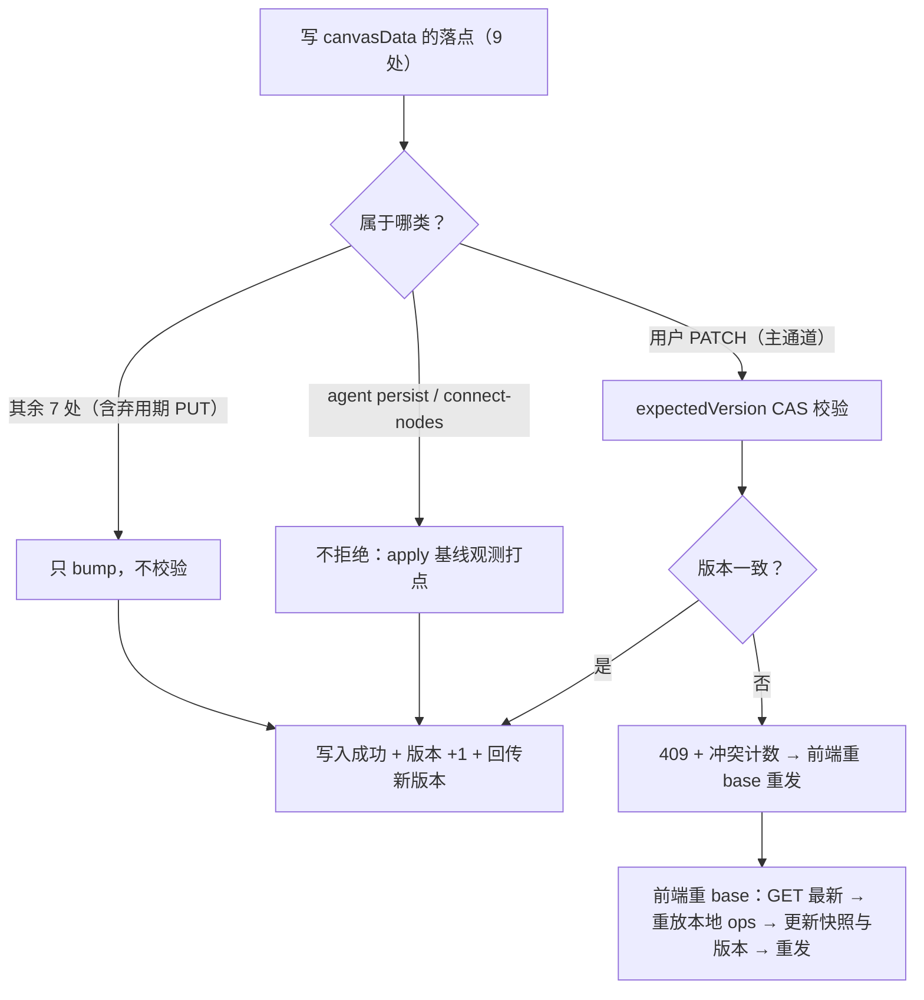
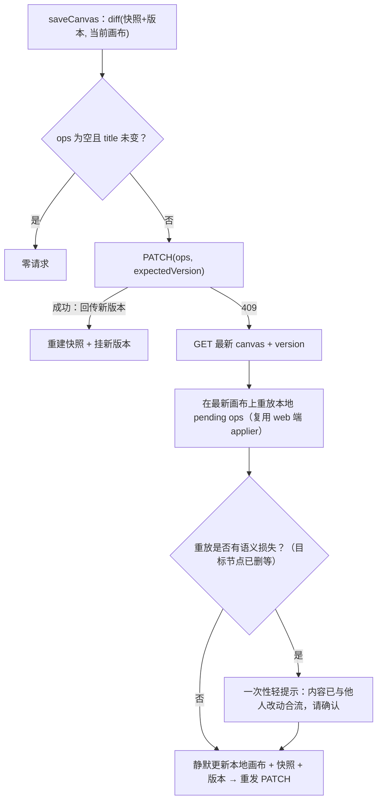

# SP-E · 画布并发写入底座（canvasVersion CAS）设计规格 v2

状态：待评审（v2 重写，2026-11-02，基线 commit `d407ad98`）
前置：SP-A 批量布局（已上线）/ SP-B 对齐（已上线）/ SP-C 视口恢复（已上线）/ SP-D 连线校验（已上线，#610 + ADR-0014）；**P1-C 写路径治理 C0/C1a/C1b/C2a（已上线，#667~#670）**
分支约定：实现走 feature 分支 + PR + squash merge；须走 `prisma migrate deploy`。

> **v1（2026-10-28）作废。** v1 的事实基础取证于写路径治理之前，其收益主体（用户整块 PUT）
> 正被 C1a/C2a 拆除，契约对象、写者矩阵、rebase 表、文件清单均与 `d407ad98` 实况不符。
> 本 v2 基于最新代码逐文件重新取证（见 §3），保留 v1 的 CAS 原语 / 迁移方案 / bump 守卫三块骨架。

> 范围声明：本规格仍是 SP-E 的**第一子项**（并发写入底座），只做 canvasVersion CAS 与冲突可观测；
> stage 暂存 UI / 回合 checkpoint / 语义冲突裁决仍拆为后续子项（§12）。

---

### 0. 配图索引

本文档 2 张图，均为内嵌 Mermaid 结构图，无 SVG 附件。

| 编号 | 形式 | 内容 | 位置 | 用途 |
|---|---|---|---|---|
| 图 1 | 内嵌 Mermaid | 写路径收口范围与 CAS/观测/bump 三分流 | §5.1 | 判定「哪些写点校验、哪些只观测、哪些只 bump」的唯一依据；新增写点照此对号入座 |
| 图 2 | 内嵌 Mermaid | 前端保存与 409 冲突重 base 流程 | §5.4 | 验收用户侧 expectedVersion 契约与重 base 行为 |

---

## 0. v1 → v2 变更摘要（评审重点）

| # | v1 判定 | v2 判定 | 依据（d407ad98 实况） |
|---|---|---|---|
| 1 | 收益主体 = 挡用户整块 PUT 覆盖 | 收益主体 = **暴露 PATCH op 流的过期基线**（PUT 已在弃用期） | web 主路径已零 canvasData PUT（C2a）；`update()` 整块写仅剩弃用期自愈通道并打点 `canvas_put_deprecated`，计划 ~11-16 关闭 |
| 2 | 契约改 `PUT /sessions/:id` 加 `expectedVersion` | 契约改 **`PATCH /sessions/:id/canvas`**：载荷加 `expectedVersion?`，响应回传 `canvasVersion` | PATCH 是唯一用户写主通道（`canvasApi.patchCanvas` 是 web 端唯一调用方） |
| 3 | PUT 做校验核心（三处校验之一） | PUT **不校验只 bump** | 弃用期通道不值得投入校验+前端 409 UX；关闭日期已在轨道上（C2②） |
| 4 | agent `persist()` 做 CAS + rebase 重试（3 次） | persist **不做 CAS 拒绝**，只做「apply 基线版本 ≠ 回合基线版本」的**观测打点** | persist 事务内读最新 → applier.apply（`agent-canvas-tools.service.ts:4083`），**rebase 语义已内建**；事务串行化下 expectedVersion 永远匹配最新，CAS 拒绝是空转。v1 的「rebase 重试 3 次」与现状重合，整机制删除 |
| 5 | 真丢更新风险点 = 用户 PUT | 真丢更新风险点 = **`rewriteCanvasData` 非事务读-改-写**（`agent.service.ts:3284`） | v1 只给它「事务内 CAS」，v2 直接**事务化**（与 persist 同构），比 CAS 更对症 |
| 6 | rebase 重放表 6 类 action | **8 类** | C2a 新增 `set_groups` / `set_composition_run_group`（`packages/shared/src/agentContract.ts:22`） |
| 7 | （无） | **新增前端冲突契约**：diff 基线 `lastSavedCanvasSnapshot` 挂版本；PATCH 409 后重 base 重发 | `CanvasPage.vue:325/:5270` 快照无版本；`canvas-api.ts:17` 响应只取 `{applied}` |
| 8 | 文件清单带精确行号 | 清单以**函数名为锚**（行号随行漂移是 v1 立即过时的原因之一） | v1 的行号全部失效 |

---

## 1. 目标（3 条，均可验收）

1. **过期基线的写不再静默成功**。判据：携带过期 `expectedVersion` 的 `PATCH /sessions/:id/canvas` 返回 409 且不落库。
2. **冲突可观测**。判据：每次基线过期事件（拒绝或 rebase）产生一条计数与日志，字段含 `sessionId / surface / expected / actual`。
3. **新增写 canvasData 的落点不会漏掉版本 bump**。判据：静态守卫测试对「写 canvasData 但未 bump」的落点转红（§8.2）。

## 2. 范围

**做**：`canvasVersion` 列与迁移；CAS 原语；PATCH 通道校验与前端重 base；agent 侧 rebase 观测；`rewriteCanvasData` 事务化；bump 义务静态守卫；三个计数。

**明确不做**（有意为之，非遗漏）：

- PUT 通道的校验与 409 UX（弃用期通道，只 bump，随 C2② 关闭，§5.1）；
- stage 暂存确认 UI（§12.1）；回合 checkpoint（缓议）；语义冲突裁决（§5.6）；
- 跨设备实时同步 / 广播；SP-D `connect-nodes` 通道改造（随 persist 同语义，仅继承观测）。

## 3. 现状取证（基线 `d407ad98`，逐文件核实）

### 3.1 写者矩阵（9 处写点，函数名为锚）

| 写者 | 落点（文件 · 函数） | 事务内 | 落库形态 | v2 处置 |
|---|---|---|---|---|
| 用户 PATCH（主通道） | `sessions.service.ts` · `patchCanvas` | 是 | `$transaction` 读最新 → `applyCanvasActions` → 合并写 | **校验（核心）** |
| 用户整块 PUT（弃用期） | `sessions.service.ts` · `update` | 否 | 整块 `JSON.stringify(guardPendingConfirmStatuses(...))` | 只 bump；打点已有 `canvas_put_deprecated`；随 C2② 关闭 |
| agent persist | `agent-canvas-tools.service.ts` · `persist` | 是 | `$transaction` 读最新 → `applier.apply` → 合并写 | 观测（不拒绝，§0-4） |
| agent commitStage | 同文件 · `commitStage` | 是 | 事务内 apply staged actions | 只 bump |
| agent 侧车 persist ×3 | 同文件 · `persistCanvasData` / `persistCanvasGroups` / `persistLayoutNodes` | 是 | 各自窄域读-改-写 | 只 bump |
| agent 重写 | `agent.service.ts` · `rewriteCanvasData` | **否** | 非事务读-改-写 | **事务化**（本包改动） |
| composition | `agent/composition.service.ts` | 否 | 各自域内 | 只 bump |
| stories | `stories.service.ts` | 否 | 各自域内 | 只 bump |
| persist-remote | `assets/persist-remote.service.ts` | 否 | 各自域内 | 只 bump |

注：SP-D `connect-nodes` 走 `persist`，不另计。服务端 op 应用器两处：PATCH 用 `applyCanvasActions`、agent 用 `applier.apply`（`packages/agent/tools/executor.ts`），同一 `CanvasAction` 契约（`packages/shared/src/agentContract.ts`）。

### 3.2 主通道现状（PATCH）

`patchCanvas`（`sessions.service.ts`）现状语义：

- 载荷 `{ ops }`，`sanitizeClientOps` 白名单收敛 + 服务端五键剥除；
- 409 仅两种：`stagedActions` 未清空；`remove_node` 碰 generating/pending_confirm 节点；
- **无任何版本概念**；响应仅 `{ applied }`；
- 落库为事务内读最新 → apply → 合并写：**技术性丢更新已被 SQLite 事务串行化挡住**。

### 3.3 web 保存链路现状

- diff 基线 = `lastSavedCanvasSnapshot`（`CanvasPage.vue` ref），保存成功/装载后重建，**不含版本号**；
- `saveCanvas`：`diffCanvasData(lastSavedCanvasSnapshot, 当前画布)` → `canvasApi.patchCanvas(id, ops)` → 成功后重建快照；空 diff 且 title 未变 ⇒ 零请求；
- PATCH 响应只消费 `{applied}`，**服务端版本无处回传**；
- 白名单外五键（status/generationRecordId/generationStartedAt/errorMessage/proposalEpoch）客户端 diff 直接丢弃（`canvasDiff.ts` `CLIENT_FORBIDDEN_NODE_DATA_KEYS`）。

### 3.4 为什么 PATCH 通道仍要 CAS（三个语义冲突实例）

事务串行化只保证「不丢整块写」，挡不住**过期基线算出的 op 流静默改写他人改动**：

| # | 场景（A、B 各持 v3 基线） | 无 CAS 的现状行为 | CAS 后 |
|---|---|---|---|
| a | A 删节点 X；B 拖动 X（update_node position） | B 的 op apply 到已无 X 的画布：静默 no-op 但计入 `applied`，B 以为保存成功 | B 得 409 → 重 base 后发现 X 已删，显式处理 |
| b | A 移动节点 Y 到位置 P1；B 移动 Y 到 P2 | 后写赢（P2），A 的改动静默丢失且无人知道发生过冲突 | B 的 409 显式暴露冲突，由用户重 base 决策 |
| c | agent 回合基于 v3 算好一批 op；期间用户 PATCH 改了同一节点 | agent 的 op 静默 rebase 到用户改动之上（键级 merge 可能混合双方意图） | 观测打点记录 rebase 发生（agent 侧不拒绝，§5.5），为后续语义冲突治理提供数据 |

**CAS 的真实价值重述**：不是防技术性丢更新（事务已防），而是**把「基线过期」从静默成功变成显式事件**——用户侧拒绝并重 base，agent 侧观测留痕。

## 4. 判据

- **G-1（bump 义务）**：任何写 `canvasData` 的落点都必须 `canvasVersion + 1`，无一例外（含弃用期 PUT）。版本停滞会让 CAS 假绿。
- **G-2（校验范围）**：只有 `patchCanvas` 做 `expectedVersion` 校验；其余落点只 bump；agent 侧只观测。
- **G-3（用户侧 fail-closed 但 opt-in 进入）**：携带过期版本的 PATCH 一律 409，不提供「强制覆盖」出口；未携带版本放行并计数（§5.3，部署序理由见 §11.1）。
- **G-4（agent 侧不拒绝）**：agent 侧不做 CAS 拒绝与重试机制；只做 apply 基线观测（§0-4 修正）。
- **V-1**：用户 PATCH 与 agent 写交错后，双方合法改动都在，且冲突事件可查。
- **V-2**：`canvas_patch_legacy_total` 连续 7 天为 0 ⇒ 下一轮 PR 关闭 opt-in 转 fail-closed（PATCH 调用方仅 web 一家，收口成本低）。

## 5. 架构与契约

### 5.1 写路径收口范围（见 图 1）

*图 1 · 九处写 canvasData 的落点在「校验 / 观测 / 只 bump」上的分流：仅用户 PATCH 做 CAS 拒绝，agent 侧以观测替代拒绝（v2 修正），其余七处只 bump；无论哪条，成功写入都必须 bump。判「新写点该怎么做」时照此图对号入座。*



### 5.2 CAS 原语（沿用 v1，统一一处）

```ts
const res = await tx.session.updateMany({
  where: { id: sessionId, canvasVersion: expected },
  data: { canvasData: JSON.stringify(next), canvasVersion: { increment: 1 } },
})
if (res.count === 0) throw new ConflictException(/* 冲突 */)
```

`patchCanvas` 内：事务首个 select 同时取 `canvasVersion`（与现有 `canvasData / stagedActions` 一并），写回用上式条件更新。

### 5.3 PATCH 契约变更

- 载荷：`{ ops: CanvasAction[], expectedVersion?: number }`；
- 响应：`{ applied: number, canvasVersion: number }`（版本回传是前端挂基线的前提）；
- 409：版本不匹配（body 带 `expected` / `actual` 便于前端决策）；
- 未携带 `expectedVersion`：放行 + `canvas_patch_legacy_total` +1（opt-in，§11.1）；
- `GET /sessions/:id` 响应经 `formatSession` 增 `canvasVersion`（前端装载点随之取版本）；
- **PUT `update()` 契约不变**：无版本字段、无校验，仅落点加 bump（G-1 对弃用期通道同样生效）。

### 5.4 前端冲突重 base（见 图 2；v1 缺失的契约面）

*图 2 · saveCanvas 的保存三岔口：空差异零请求；带版本成功则回传新版本并重建快照；409 时 GET 最新 → 重放本地 ops → 重发，语义损失给一次性轻提示。*



- 基线版本落点：`lastSavedCanvasSnapshot` 旁增 `lastSavedCanvasVersion`（或快照结构化为 `{canvas, version}`，实施期定，规格只约束语义：**快照与版本必须同源同刻**）；
- 重放复用 web 端既有 `applyActionsToFlow`（独立 switch，与 executor 同步的既有纪律适用于新契约）；
- 自动保存（视口防抖等）冲突走静默重 base；显式编辑保存冲突给一次性轻提示——不弹窗轰炸（继承 v1 S5 判定）。

### 5.5 agent 侧：观测替代拒绝（v2 关键修正）

`persist` 事务内 select `canvasVersion`，与调用方传入的回合基线版本（回合首次装载画布时记录）比较：

- 一致 → 照常；
- 不一致 → `canvas_agent_rebase_total` +1 + 结构化日志（`sessionId / expected / actual`），**照常 apply（读最新）**，不报错、不重试。

v1 的「rebase 重放表 + 重试 3 次 + ConflictException 回 tool_result」整套机制删除：事务内读最新 apply 就是 rebase 本身，重试是对同一逻辑的重复执行。语义冲突的暴露改由观测数据驱动（§12.3 治理入口）。

`rewriteCanvasData`（非事务）**事务化**：改为与 persist 同构的 `$transaction` 读最新 → apply → 写 + bump。这是矩阵中唯一真正的非事务读-改-写丢更新点（§0-5）。

### 5.6 语义冲突的边界声明（不解决，只声明）

同节点同字段双改，重 base 后仍是后写赢/合流语义由 applier 决定。本包只承诺「基线过期显式暴露 + 改动不静默丢失」，裁决策略登记 §12.3。

## 6. 主场景规格（逐项可验收）

| # | 场景 | 期望 | 验收方式 |
|---|---|---|---|
| S1 | 用户持过期版本触发显式保存（PATCH） | 409 不落库；前端重 base 后重发成功，双方改动都在 + 一次性提示 | 集成测试 + 生产复测 |
| S2 | PATCH op 的目标节点已被另一端删除 | 得 409（基线过期）而非静默 no-op 计成功 | 集成测试（§3.4-a 对应） |
| S3 | 未带版本的 PATCH（旧 web） | 放行成功；`canvas_patch_legacy_total` +1 | 单测 |
| S4 | agent 回合期间用户 PATCH | agent 侧 apply 照常，`canvas_agent_rebase_total` +1，双方改动都在 | 集成测试 |
| S5 | 自动保存冲突 | 静默重 base + 重发，无弹窗轰炸 | 目视验收 |
| S6 | 新增写 canvasData 未 bump | 静态守卫转红 | 变异测试 |
| S7 | `rewriteCanvasData` 与用户 PATCH 交错 | 事务化后双方改动都在 | 单测 |

## 7. 数据与状态变更

- `Session` 增列 `canvasVersion Int @default(0)`；存量全 0，无需回填；
- 迁移由 `prisma migrate dev` 生成，部署走 `prisma migrate deploy`。⛔ 禁手工 ALTER（P3009 前科）；出问题用临时容器 `prisma migrate resolve --applied` 兜；
- 不变：`stagedActions` / `stagedAt` 语义（stage 只累积不落 canvasData，不 bump）。

## 8. 纯函数与算法

### 8.1 计数（三个，all 计数器）

| 指标 | 触发 |
|---|---|
| `canvas_cas_conflict_total{surface=user_patch}` | PATCH 版本不匹配 409 |
| `canvas_agent_rebase_total` | persist apply 基线 ≠ 回合基线（不拒绝，只观测） |
| `canvas_patch_legacy_total` | PATCH 未带 expectedVersion 放行 |

v1 的 `canvas_cas_rebase_retry_total`（重试计数）随重试机制一并删除。

### 8.2 bump 义务静态守卫

扫描 `apps/server/src/**` 中 `canvasData: JSON.stringify` 落点（现 9 处，§3.1 矩阵为准），附近未见 `canvasVersion: { increment: 1 }` ⇒ 转红。**必须变异验证**：去掉一处 bump ⇒ 守卫 EXIT=1 且指名该处。

## 9. 文件级改动清单（函数名为锚，行号以实现时实况为准）

| # | 文件 · 函数 | 改动 |
|---|---|---|
| 1 | `apps/server/prisma/schema.prisma` | Session 增 `canvasVersion` |
| 2 | `prisma/migrations/<ts>_add_session_canvas_version` | 新增（migrate dev 生成） |
| 3 | `sessions.controller.ts` · PATCH `:id/canvas` DTO | 增可选 `expectedVersion` |
| 4 | `sessions.service.ts` · `patchCanvas` | 事务内 select 版本 + updateMany CAS + 409 + 响应回传版本 |
| 5 | `sessions.service.ts` · `update`（PUT） | 仅加 bump（无校验） |
| 6 | `sessions.service.ts` · `formatSession` | 响应增 `canvasVersion` |
| 7 | `agent-canvas-tools.service.ts` · `persist` | 事务内 select 版本 + 与回合基线比较 → 观测打点（不拒绝） |
| 8 | `agent-canvas-tools.service.ts` · `commitStage` / `persistCanvasData` / `persistCanvasGroups` / `persistLayoutNodes` | 各加 bump |
| 9 | `agent.service.ts` · `rewriteCanvasData` | 事务化 + bump |
| 10 | `agent/composition.service.ts` / `stories.service.ts` / `assets/persist-remote.service.ts` | 各加 bump |
| 11 | `apps/web/src/services/canvas-api.ts` · `patchCanvas` | 签名增 expectedVersion；响应类型增 canvasVersion |
| 12 | `apps/web/src/pages/CanvasPage.vue` · `saveCanvas` 及快照装载点 | 基线挂版本 + 409 重 base 重发（§5.4） |
| 13 | `apps/server/src/sessions/sessions.cas.test.ts` | 新增：S1/S2/S3 + 版本回传 |
| 14 | `apps/server/src/agent/agent-canvas-tools.cas.test.ts` | 新增：S4 + 观测断言 |
| 15 | `apps/server/src/canvas/canvas-version-guard.test.ts` | 新增：bump 守卫 + 变异验证 |
| 16 | `docs/adr/0016-canvas-write-cas.md` | 新增：记录 opt-in / 用户侧 fail-closed / agent 侧观测化（v2 修正）/ PUT 不校验四项决策 |

## 10. 测试策略与验收标准

**单测**：CAS 命中/冲突；PATCH 版本回传；opt-in 放行计数；观测打点（一致/不一致两分支）；rewriteCanvasData 事务化；bump 守卫及变异。
**集成**：用户 PATCH 与 agent persist 交错 ⇒ V-1；S2 目标已删场景。
**生产复测**（合并部署后）：① 旧 web PATCH（无版本）成功且 legacy 计数增；② 双标签页 A 改 → B（旧基线）改 ⇒ B 409 → 重 base → 双方改动都在；③ agent 回合中用户 PATCH ⇒ agent 观测计数增、无报错。
**目视**：自动保存冲突无弹窗轰炸；显式保存冲突轻提示文案准确。

## 11. 风险

### 11.1 部署序风险（opt-in 化解，继承 v1 结论）

`deploy.yml` 的 api 与 web 是并行 job，无先后保证。若直接 fail-closed，旧 web（不带版本）全部 409。opt-in 使最坏情况退化为现状；V-2 收口。**PATCH 只有 web 一个调用方**，legacy 窗口预期极短。

### 11.2 其它

| 风险 | 处置 |
|---|---|
| 与 C2②（关 PUT，~11-16）时序 | 无硬依赖：PUT 只 bump 不校验，两包可任意先后；建议 SP-E 后行，落地时 PUT 可能已关，矩阵相应减一 |
| 迁移 P3009 | `migrate deploy`；禁手工 ALTER；resolve --applied 兜 |
| opt-in 永久化 | 打点 + V-2 收口 + ADR-0016 登记有主待办 |
| agent 观测被忽略 | 观测数据是 §12.3 语义冲突治理的输入，ADR-0016 记录复评节点 |
| 快照与版本不同源（前端竞态） | 规格硬约束「同源同刻」（§5.4），实现期以单结构承载 |

## 12. 后续包 / 路线图

- **12.1 SP-E2 · stage 暂存确认 UI**：维持 v1 结论——先做「agent 何时进暂存」的产品决策，勿当低风险 UI 任务；
- **12.2 opt-in 收口**：`canvas_patch_legacy_total` 连续 7 天 0 ⇒ 转 fail-closed（有主待办）；
- **12.3 语义冲突裁决**：以 `canvas_agent_rebase_total` + `canvas_cas_conflict_total` 的生产分布为输入，另立规格；
- **12.4 其余写路径收口**：7 处只 bump 落点维持「已知未收口」登记；
- **12.5 SP-F / SP-G**：维持原路线图。

## 13. 配图规范自检

本文档 2 张内嵌 Mermaid 结构图，无 SVG 附件。提交前跑：

```bash
pnpm verify-spec-figures --file docs/superpowers/specs/2026-11-02-sp-e-canvas-write-cas-design-v2.md
```
