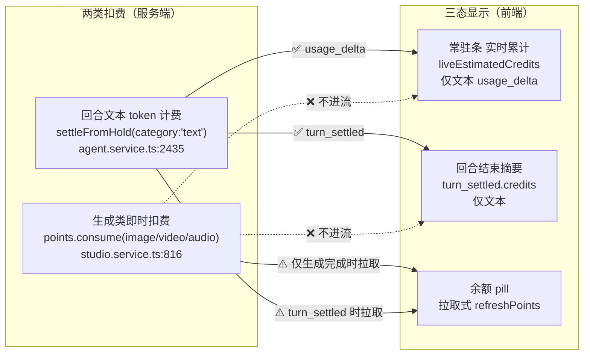
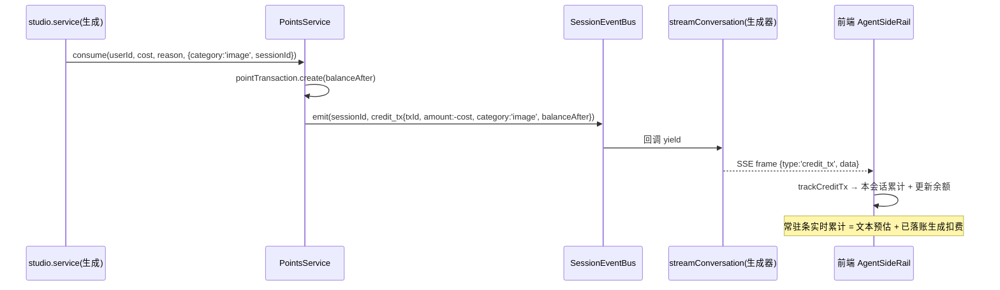
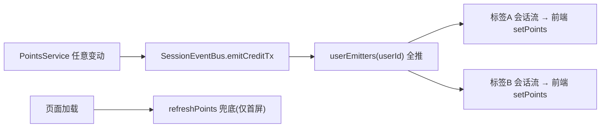
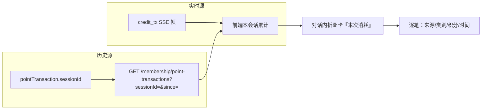
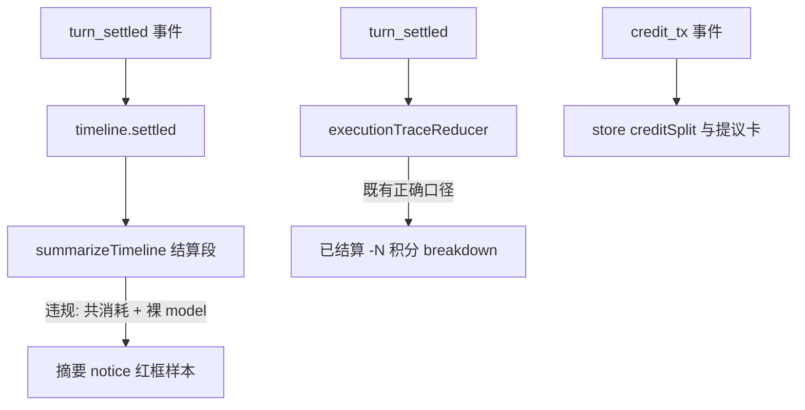

# 积分显示与扣费体验 设计规格

状态：实施中（2026-11-03 产出，代码取证驱动；Epic 1–5 已于 2026-11-04 上线，master `1098f89c`，`CREDIT_TX=on` 已开；**2026-11-04 修订补充 §14 终态结算文案治理，待实施**）
前置：[`docs/superpowers/specs/2026-10-21-multi-device-consistency-design.md`](./2026-10-21-multi-device-consistency-design.md)（已上线，本规格复用其「会话级 SSE 通道」）、[`docs/superpowers/specs/2026-10-13-pricing-baseline-config-design.md`](./2026-10-13-pricing-baseline-config-design.md)（定价等价迁移）、[`docs/superpowers/plans/2026-10-15-p2-token-precise-billing.md`](./2026-10-15-p2-token-precise-billing.md)（P2 回合 token 计费，已上线）
分支约定：实现走 feature 分支 + PR + squash merge；Epic 1 核心经 `CREDIT_TX` flag 门禁（off 时退化为现状，零回归）。

> ⚠️ **本规格的实证前提（代码已核实）**：
> ① 回合级扣费走 `agent.service.ts:2435 settleFromHold`（`category:'text'`），权威值经 `turn_settled` 事件下发（`:2448` 成功 / `:2420` `:2476` `:2491` released 全退）；
> ② 生成类扣费走 `studio.service.ts:816/1126/1296 points.consume`（图/视频/音频/提示词/素材），**独立于回合流**；
> ③ 余额刷新是**纯拉取式**（`auth.ts:185 refreshPoints` 调 `GET /membership/points`），无 SSE 推送；仅 `trackTurnSettled`（`agent.ts:603`）与 `refreshPointsAfterGeneration`（`useNodeGeneration.ts:202`）两处主动拉取；
> ④ `pointTransaction` 表已记录 `balanceAfter/category/kind/amount/reason/model/generationId/ruleVersion`（`points.service.ts:81` 等），`credit_tx` 的数据源现成；
> ⑤ 会话级 SSE 由 `agent.service.ts` 的 `streamConversation` 生成器 `yield` 事件，生成扣费发生在**另一服务/另一 job**，无法自然进入该生成器 ⇒ 必须新增**会话级事件总线**做外部注入。

## 0. 配图索引

| 编号 | 形式 | 内容 | 位置 | 用途 |
|---|---|---|---|---|
| 图 1 | 内嵌 Mermaid | 现状两类扣费 × 三态显示映射与断点 | §4.1 | 评审时确认"常驻条/摘要只统计文本回合费"这一核心错配 |
| 图 2 | 内嵌 Mermaid | 目标 credit_tx 经 SessionEventBus 注入在飞 SSE 的时序 | §5.1 | Epic 1 实现基准与验收时序 |
| 图 3 | 内嵌 Mermaid | 余额事件化（user 广播）替代拉取式刷新 | §5.2 | Epic 2 架构归属 |
| 图 4 | 内嵌 Mermaid | 跨会话聚合卡数据来源（SSE 实时 + 历史查询双源） | §5.4 | Epic 4 对账边界 |
| 图 5 | 内嵌 Mermaid | 消耗数字双通道流向与文案治理切口（§14 修订补充） | §14.2 | 判定「数字退出 LLM 叙事」的设防层次 |

## 1. 目标

1. **任一扣费（文本回合 / 生成类 / 退款）都实时出现在用户正在看的对话里**，不必等回合结束或刷新。
2. **对话内"已消耗/共消耗"显示的口径 = 本次使用真实扣费总额**，不漏算生成类扣费。
3. **余额在任意端、任意会话实时同步**，不依赖轮询/页面加载（多标签、跨设备一致）。
4. **三态（预估 / 按渠道成本估算 / 精确结算）措辞一致、可追溯**，用户清楚"哪个数是真扣的"。
5. **跨会话可对账**：重新打开对话能看到"本次会话共消耗"聚合与逐笔来源；退款统一可见。

五条均可验收，判据见 §10。

## 2. 范围

**在范围内**

- 扣费事件化：新增 `credit_tx` 领域事件，由 `PointsService` 在 `consume/refund/settleFromHold/release` 后统一发出
- 会话级事件总线 `SessionEventBus`：把外部扣费注入在飞会话 SSE（复用 multi-device 规格 §5.3 通道，多端一致免费获得）
- 前端常驻条升级为"本回合实时累计 = 文本预估 + 已落账生成扣费"；摘要行拆"对话 M · 生成 K"
- 余额事件化（user 广播）替代拉取式刷新
- 三态文案对齐 + flag-off 文案修正
- 跨会话聚合卡（SSE 实时累计 + `pointTransaction.sessionId` 历史查询）+ 退款统一进 `credit_tx`

**明确不做**（及理由）

| 不做 | 理由 |
|---|---|
| 改定价模型 / 价目表 | 属 P2 与定价等价迁移范围，本规格只消费其输出（`turn_settled.credits`、`quote.ruleVersion`） |
| 新增积分流水持久化表 | `pointTransaction` 已全量记录；仅追加可空 `sessionId` 列即可关联，不新造表 |
| WebSocket 推送 | 沿用现有 `text/event-stream` 会话通道（multi-device 规格已界定，不重复决策） |
| 把 `credit_tx` 写进 assistant `executionEvents` | 生成扣费可能发生在回合之外、且不总绑定某条 assistant 消息；改为 `pointTransaction.sessionId` 查询，语义更干净 |
| 跨账户/团队对账 | 超出个人积分可视范围，列 §12 |

## 3. 与既有规格的关系

| 既有规格 | 关系 | 说明 |
|---|---|---|
| `2026-10-21-multi-device-consistency-design.md` | **复用通道** | `credit_tx` 经其会话级 SSE 下发 ⇒ 多端一致天然继承；本规格不重造广播机制 |
| `2026-10-15-p2-token-precise-billing.md`（已上线） | **被消费** | `turn_settled.credits` 是文本回合权威值；本规格在其之上补"生成类 + 实时 + 聚合" |
| `2026-10-13-pricing-baseline-config-design.md` | **被消费** | `legacyPriceOf` / `quoteTextTokens` 定价出口不变；`credit_tx.ruleVersion` 直接复用其 `ruleVersion` 字面量 |
| `2026-10-28-canvas-edge-remedy-loop-design.md`（SP-F） | 不冲突 | 生成失败经 `generation-recovery` 退款，退款走 `refund` ⇒ 本规格的 `credit_tx(kind:'refund')` 自然覆盖，不需新事件 |

## 4. 规范与判据

### 4.1 现状：两类扣费只被显示层"看到"了一半

用户观察到的「已消耗 ◇N 和实际扣的余额对不上」不是单个 bug，是**显示口径与扣费事实的结构性错配**（见 图 1）：



*图 1 · 现状错配。生成类扣费（G）既不进常驻条也不进摘要，只改余额；常驻条/摘要只反映文本回合费（T）。这是信任崩塌的根因。*

**关键判据**：修复必须让 G 与 T 走**同一条**显示路径（即 `credit_tx`），而不是给 G 单独做个提示——否则两端口径永远对不齐。

### 4.2 可复用判据

| 判据 | 内容 |
|---|---|
| **C1 扣费单口径** | 任一类扣费（文本/生成/退款）都经 `credit_tx` 一个事件上屏；显示层不写第二套扣费来源 |
| **C2 事件驱动余额** | 余额变化经 SSE 推送，不依赖轮询；`refreshPoints` 仅作页面加载兜底 |
| **C3 会话归属可追溯** | 每笔 `credit_tx` 带 `sessionId`，能回答"这笔扣费发生在哪个对话" |
| **C4 预估≠权威须显式** | 中段"估算中"与结算"精确"在文案/样式上区分，不得混用同一标签 |
| **C5 幂等可重放** | `credit_tx` 以 `txId`（= `pointTransaction.id`）去重；断线重连/重放不重复计入 |
| **C6 flag 兜底零回归** | `CREDIT_TX=off` 时退化为现状（生成扣费不进流、余额仍靠拉取），线上默认 off 灰度 |

### 4.3 失败模式登记

| 模式 | 症状 | 判据 |
|---|---|---|
| **M1 生成扣费漏显** | 用户出图后余额降、常驻条不动 | 生成 `consume` 后对话内出现对应 `credit_tx` 帧 |
| **M2 多标签不同步** | A 标签扣费、B 标签余额不变 | user 广播后所有打开会话的 pill 同步（C2） |
| **M3 重复计入** | 重连后同一笔扣费被算两次 | `credit_tx` 按 `txId` 去重（C5） |
| **M4 会话归属错** | 甲对话的扣费显示在乙对话 | `credit_tx.sessionId` 与订阅会话一致（C3） |
| **M5 预估冒充权威** | 中段"预估"被当成"已扣" | 中段标"估算中"，结算后才标"精确"（C4） |

## 5. 架构与契约

### 5.1 Epic 1（核心）：`credit_tx` 事件契约 + SessionEventBus

见 图 2。核心动作：**让扣费成为一等 SSE 事件，由 `PointsService` 统一发出，经会话总线注入在飞流**。



*图 2 · `credit_tx` 注入时序。生成扣费在 `studio.service` 发生，经 `PointsService` 发到 `SessionEventBus`，由在飞的 `streamConversation` 生成器订阅并 `yield` 给前端——与回合事件共用同一 SSE 通道，多端一致继承。*

**事件契约（新增 `@lnkpi/shared` 类型）**：

```ts
/** credit_tx：一笔积分变动的领域事件，经会话级 SSE 下发（复用 multi-device §5.3 通道）。 */
export interface CreditTxEvent {
  type: 'credit_tx'
  data: {
    /** 幂等键 = pointTransaction.id（C5 去重） */
    txId: string
    userId: string
    /** 关联会话；缺省（如后台赠送）时走 user 广播（Epic 2） */
    sessionId?: string
    /** 有符号：扣费为负、退款为正、冻结/解冻为 0 */
    amount: number
    kind: PointKind        // 'consume' | 'refund' | 'grant' | 'freeze' | 'release'
    category: PointCategory // 'text' | 'image' | 'audio' | 'video' | 'other'
    reason: string
    model?: string | null
    generationId?: string | null
    ruleVersion?: string | null
    /** 交易后全局余额（权威） */
    balanceAfter: number
    ts: number
  }
}
```

**`PointTxMeta` 扩展**（`point-tx.types.ts:13`，键不出现纪律）：

```ts
export interface PointTxMeta {
  // ... 既有字段不动
  /** 关联会话 id（Epic 1）：生成/回合扣费透传，用于会话级 SSE 广播与历史聚合 */
  sessionId?: string | null
}
```

**`SessionEventBus`（新增服务）**：

```ts
@Injectable()
export class SessionEventBus {
  /** sessionId → EventEmitter（多订户）；user 广播另走 userEmitters: Map<userId, EventEmitter> */
  private sessionEmitters = new Map<string, EventEmitter>()
  private userEmitters = new Map<string, EventEmitter>()

  /** PointsService 在 pointTransaction.create 后调用 */
  emitCreditTx(ev: CreditTxEvent['data']): void {
    if (ev.sessionId) this.sessionEmitters.get(ev.sessionId)?.emit('credit_tx', ev)
    // 始终同步推给该用户所有打开的会话（C2 多标签/Epic 2 预备）
    this.userEmitters.get(ev.userId)?.emit('credit_tx', ev)
  }

  /** streamConversation 在流建立时订阅，结束时退订（防泄漏） */
  subscribeSession(sessionId: string, fn: (ev: CreditTxEvent['data']) => void): () => void { /* 返回退订 */ }
  subscribeUser(userId: string, fn: (ev: CreditTxEvent['data']) => void): () => void { /* 返回退订 */ }
}
```

⚠️ **`PointsService` 不依赖会话层**：它只调用 `SessionEventBus.emitCreditTx(...)`，避免在计费原子事务内引入 SSE 依赖。emit 在事务提交**之后**调用（失败只 warn，绝不回滚业务）。

⚠️ **复用上游/既有能力**：会话级 SSE 通道已由 multi-device 规格落地；本规格只在其生成器内**新增一个订阅 + 一个 `yield` 分支**，不新造重连/游标逻辑。

### 5.2 Epic 2（余额事件化）：user 广播替代轮询

见 图 3。



*图 3 · 余额事件化。所有打开会话经 user 广播实时 `setPoints`，`refreshPoints` 退化为首屏兜底（C2）。*

**契约**：`credit_tx.balanceAfter` 即权威余额；前端 `auth.setPoints(balanceAfter)` 直接更新（`auth.ts:181`），移除对 `refreshPoints` 的主动轮询依赖（保留作兜底）。

### 5.3 Epic 3（三态文案对齐）

| 态 | 触发 | 文案/样式 |
|---|---|---|
| 预估（中段） | `usage_delta` 实时 | 状态行标"估算中 · -N 积分"（与结算视觉区分，C4） |
| 按渠道成本估算 | `turn_settled.degraded` | 摘要"已结算 -N 积分（按成本估算）" |
| 精确结算 | `turn_settled` 正常 | 摘要"已结算 -N 积分（输入…·输出…）" 或拆"对话 M · 生成 K" |
| flag-off | `CREDIT_TX=off` / `TEXT_TOKEN_BILLING=off` | 摘要明确"预计消耗（非正式结算）"，不写"已结算" |

**摘要行拆分**（消歧核心）：当本会话累计含生成类扣费时，摘要显式为 `共消耗 N 积分（对话 M · 生成 K）`，数据源为 `credit_tx` 按 `category` 聚合（前端内存累计 + 历史查询）。

### 5.4 Epic 4（跨会话聚合与退款可见性）

见 图 4。



*图 4 · 跨会话聚合双源。实时经 SSE、历史经 `pointTransaction.sessionId` 查询，两者同口径（C3）。*

**契约补充**：

- `pointTransaction` 新增可空列 `sessionId`（`points.service.ts` 各 create 处从 `meta.sessionId` 写入）；迁移纪律同 multi-device §7.1（加列→观察→回填→不急加索引）。
- 新增 `GET /membership/point-transactions?sessionId=&since=` 返回该会话积分流水（按 `ts` 升序，限最近 200 条），供对话重开时聚合卡初始化。
- 退款统一进 `credit_tx`（`kind:'refund'`、`amount>0`），对话级显示"已退回 N 积分"，不再只藏在节点系统事件（`generation-recovery.service.ts:179` 现有文案保留，并额外发 `credit_tx`）。

### 5.5 Epic 5（防御与可观测）

- 前端对比"本会话累计扣费"与"余额变化量"：两者差超过阈值（含其他会话/后台扣费）时，提示"其他会话消耗了 X"，避免用户误判 bug（M2/M4 防御）。
- 变异测试（§10.2）强制每个守卫可证伪。

## 6. 主场景规格

### 场景 A：用户让 agent "出 3 张图"

| 步骤 | 期望 |
|---|---|
| 发消息，agent 调用 run_image_generation ×3 | 每笔 `points.consume` 即时发 `credit_tx`；常驻条实时累计含图费 |
| 3 图生成完成 | 余额经 user 广播同步；摘要显式"共消耗 N（对话 M · 生成 K）" |
| 刷新 / 重开对话 | 聚合卡经历史查询还原，3 笔图费在列 |

### 场景 B：多标签同账号

| 步骤 | 期望 |
|---|---|
| 标签 A 触发扣费 | 标签 B 的 pill 经 user 广播**同一秒**更新（C2） |

### 场景 C：生成失败退款

| 步骤 | 期望 |
|---|---|
| 图生成失败 | `generation-recovery` 退款 → `credit_tx(kind:'refund')`；对话级显示"已退回 N 积分"；余额回补实时可见 |

### 场景 D：回合计费 + 生成混合

| 步骤 | 期望 |
|---|---|
| 一轮对话既聊又出图 | 常驻条 = 文本预估 + 已落账生成费；回合结束 `turn_settled` 后文本费定稿，生成费已从 `credit_tx` 计入，总和不重不漏 |

## 7. 数据与状态变更

### 7.1 Schema 变更

```prisma
model PointTransaction {
  // ... 既有字段不动
  sessionId String?  // Epic 1：关联会话（C3）；可空兼容存量与后台赠送
  @@index([sessionId])  // 查询聚合用；可空列索引 SQLite 下有效（与 multi-device D6 不同场景）
}
```

**迁移纪律**（不可跳过，同 multi-device §7.1）：

| 步 | 动作 | 判据 |
|---|---|---|
| 1 | 加列（可空、无索引） | 生产无报错 |
| 2 | 应用、部署、观察一个迭代 | 存量 `sessionId` 全 NULL，行为与今天一致 |
| 3 | `PointsService` 各 create 写 `meta.sessionId` | 新流水带 sessionId |
| 4 | 确认写入正常后加 `@@index([sessionId])` | 仅加速查询，不影响既有 |

⚠️ `sessionId` 不进唯一性约束（与 multi-device D6 区分：那是消息级 `seq`，此处只是过滤维度）。

### 7.2 `credit_tx` 持久化策略

**不复写进 `executionEvents`**（§2 明确不做）。`credit_tx` 是**传输态事件**；其事实源是 `pointTransaction`（已落库）。前端"本会话累计" = SSE 实时累计（会话内）+ 重开时历史查询（§5.4）。

## 8. 纯函数与算法

| 函数 | 位置 | 单测要求 |
|---|---|---|
| `SessionEventBus.emitCreditTx` / `subscribeSession` / `subscribeUser` | 新增（server） | 订阅收到、退订后不再收、session 与 user 双通道互不串 |
| `PointsService` 的 emit 钩子（事务后调用） | 改（server） | 失败只 warn 不回滚；`txId` 取自 `pointTransaction.id` |
| `consumeMeta` / `refundMeta` 加 `sessionId` | 改（`point-tx.types.ts`） | 键不出现纪律：`sessionId` 缺省不落地 |
| `trackCreditTx(data)` | 新增（`stores/agent.ts`） | 按 `txId` 去重（C5）；累加本会话消耗；`auth.setPoints(balanceAfter)` |
| `aggregateSessionSpend(events)` | 新增（web） | 按 `category` 拆"对话/生成"；与 `turn_settled.credits` 不重复计入 |
| `sessionSpendSummary(pointTransactions)` | 新增（web，历史查询后） | 与 SSE 累计同口径合并 |

## 9. 文件级改动清单

| 文件 | 动作 | 归属 | Epic/Task |
|---|---|---|---|
| `packages/shared/src/agentTrace.ts`（或新增 `creditEvents.ts`） | 改/新增（`CreditTxEvent` 类型） | 契约 | 1 |
| `apps/server/prisma/schema.prisma` | 改（`pointTransaction.sessionId` + 索引） | 数据 | 1 |
| `apps/server/src/points/point-tx.types.ts` | 改（`PointTxMeta.sessionId` + `consumeMeta/refundMeta`） | 契约 | 1 |
| `apps/server/src/points/points.service.ts` | 改（事务后 `SessionEventBus.emitCreditTx`） | 计费 | 1 |
| `apps/server/src/points/session-event-bus.service.ts` | 新增 | 观测 | 1 |
| `apps/server/src/studio/studio.service.ts` | 改（生成 `consume` 透传 `sessionId`） | 生成 | 1 |
| `apps/server/src/agent/agent.service.ts` | 改（回合 settle 透传 `sessionId` + 订阅 `SessionEventBus` 注入 `yield`） | 执行/观测 | 1 |
| `apps/server/src/membership/membership.controller.ts` | 改（新增 `GET /point-transactions?sessionId=&since=`） | 数据 | 4 |
| `apps/web/src/stores/agent.ts` | 改（`trackCreditTx` + 聚合） | 观测 | 1/4 |
| `apps/web/src/components/agent/AgentSideRail.vue` | 改（`case 'credit_tx'` + 常驻条累计 + 摘要拆分） | 观测 | 1/3 |
| `apps/web/src/components/agent/executionTraceReducer.ts` | 改（摘要拆"对话 M · 生成 K"） | 展示 | 3 |
| `apps/web/src/stores/auth.ts` | 改（`setPoints` 由 `credit_tx` 驱动，保留 `refreshPoints` 兜底） | 余额 | 2 |

## 10. 测试策略与验收标准

### 10.1 五条目标的验收判据

| 目标 | 验收方法 | 判据 |
|---|---|---|
| 目标 1 | 集成：触发生成 `consume`，监听会话 SSE | 收到 `credit_tx` 帧且 `category` 正确 |
| 目标 2 | 集成：一轮对话含文本+生成 | 常驻条累计 = 文本预估 + 生成费；摘要"共消耗 N（对话 M · 生成 K）" |
| 目标 3 | 双标签：A 扣费 | B 的 pill 经 user 广播同步更新 |
| 目标 4 | 单元：构造三种 `turn_settled` 形态 | 文案分别为"精确/按成本估算/预计消耗（非正式结算）" |
| 目标 5 | 重开对话 + 查询接口 | 聚合卡含历史 `credit_tx`；退款行显示"已退回 N" |

### 10.2 变异测试要求（防止假绿）

| 守卫 | 变异动作 | 期望 |
|---|---|---|
| 生成扣费进流 | `PointsService` 注释掉 `emitCreditTx` | 场景 A 测试红 |
| 多标签同步 | 去掉 user 广播分支 | 场景 B 测试红 |
| 幂等去重 | 前端去掉 `txId` 去重 | 重连场景测试红 |
| 会话归属 | `credit_tx` 不传 `sessionId` | 场景 M4 测试红 |
| flag 兜底 | `CREDIT_TX=off` 仍发 `credit_tx` | 回归测试红（须退化为现状） |

### 10.3 目视验收

- 出图时底部常驻条实时涨"已消耗 ◇(文本+图)"，不刷新；
- 回合结束摘要显式拆分对话/生成两类；
- 开两个标签，一标签出图，另一标签 pill 同步下降；
- 生成失败退款，对话内出现"已退回 N"且 pill 回补。

## 11. 风险

| 风险 | 等级 | 缓解 |
|---|---|---|
| **R1 计费事务内引入 SSE 依赖** | 高 | emit 严格在事务提交后、失败只 warn；`PointsService` 不直接依赖 `SessionEventBus` 的会话层 |
| `SessionEventBus` 退订泄漏 | 中 | 流结束/finally 必退订；单测 pin"退订后不再收" |
| 生成 `sessionId` 取不到 | 中 | `studio.service` 经 generation record → node → canvas → session 解析；取不到则 user 广播兜底（仅余额同步，不进特定会话聚合） |
| 多实例部署下内存态 bus 失效 | 中 | 本期维持单实例（同 multi-device §12）；后续改 Redis pub/sub |
| 与 P2 flag 叠加复杂度 | 中 | `CREDIT_TX` 与 `TEXT_TOKEN_BILLING` 双 flag 正交：前者管"扣费进流"，后者管"文本回合精确计费"；组合矩阵单列 §12 |
| 前端重构波及移动端贴底壳 | 中 | 改 `AgentSideRail.vue` 后必跑移动端守卫测试（`MobileSheet` / `gestureWiring` 等既有契约） |

## 12. 后续包 / 路线图

| 项 | 为什么不在本包 |
|---|---|
| 多实例 bus（Redis pub/sub） | 当前 `replicas=1`；bus 内存态够用，多实例时再换传输层 |
| 定价模型/价目表改造 | 属 P2 与定价等价迁移，本规格只消费 |
| 团队/跨账户对账 | 超出个人积分可视范围 |
| flag 组合矩阵 | `CREDIT_TX=on/off × TEXT_TOKEN_BILLING=on/off` 四态：off/off=现状；on/off=生成进流但文本仍预估；off/on=文本精确但生成不进流（过渡）；on/on=全量（目标）。灰度从 off/off 逐步开到 on/on |
| tokens breakdown 详情面板（悬停态富呈现） | 点⑤最小 affordance（原生 title 悬停）已随本规格落地（2026-11-04）；富详情面板（展开式 breakdown UI）仍后置，依赖交互设计投入 |

## 13. 配图规范自检

- 校验命令：`pnpm verify-spec-figures --file docs/superpowers/specs/2026-11-03-credit-consumption-display-design.md`
- 结果：见提交时的 CI 输出（配图索引 §0 齐备、图 1–5 连续且均被正文引用、Mermaid 均用受支持类型且标签带引号）

## 14. 修订补充（2026-11-04）：终态结算文案治理

> 背景：用户实测（会话 cmvzzz0dg007vp001it7ugq7m）暴露终态文案五类问题，用户已同意优化方向。本节为对 Epic 1–5 呈现层的**扩展**，不推翻既有契约（`creditEvents.ts` 事件形状、`trackCreditTx` 语义均不变）。

### 14.1 根因取证（2026-11-04 修正版）

截图违规样本：`已生成 1 个产物 · 提议生成 1 张 · 用时 8s · 消耗 85.5k tokens · 共消耗 7 积分 · platform::agnes-2.5-flash`。

> ⚠️ 取证过程教训：最初基于**本地陈旧基线**（#640）全仓搜索「共消耗」得出「LLM 自由叙事」的误判——真实根因在远端 master（`bbf55721`）的并行线「结算摘要」模板里。远端状态一律 gh api 核对，本地 ref 不可信（同 ⭐ 纪律）。

**真实根因**：红框行是机器渲染的 `notice:turn-summary` 摘要条（形态为带边框通知条，非聊天文本）。master `apps/web/src/components/agent/turnTimeline.ts` `summarizeTimeline()` 的结算段（并行 PR 引入的「2026-11-03 结算摘要」）：

```ts
segments.push(`共消耗 ${settled.credits} 积分${settled.model ? ` · ${settled.model}` : ''}`)
```

三处违规：① `settled.model` **原样透出渠道前缀 key**（`platform::agnes-2.5-flash`，C9 违规）；② `settled.credits` 只是**文本回合**结算（turn_settled，7 积分），标签却写「共消耗」——图像 quote 33 单独扣费不在此列 ⇒ 数字打架（33 vs 7）+ 口径事实性错误（C10 违规，且未按 §5.3 聚合生成费）；③ 与 executionTraceReducer 的「已结算 -N 积分（输入…）」口径不一致——同一笔结算在两个表面两种说法。

模型叙事侧核实：`runTextGeneration` 结果仅含 `status/generationRecordId/actions`（无数字）；模型文本只复述了生成记录 ID（C9 呈现问题），**无数字泄漏**。⇒ 原「LLM 叙事治理」取消，工具结果脱敏（原 C8）**不需要**——治本切口全在模板层。

### 14.2 架构：数字双通道与设防层次（修正版）



*图 5 · 消耗数字的双出口。同一笔 turn_settled 走两个渲染面：摘要 notice（违规样本）与 executionTrace（既有正确口径）。治本切口 = 摘要结算段对齐 executionTrace 口径 + 展示名映射 + 「共」字守卫；credit_tx 通道（第三行）供提议卡翻转与跨会话聚合。*

### 14.3 新增判据（C7–C10，接 §4.2）

| 判据 | 内容 |
|---|---|
| **C7 摘要口径对齐** | 摘要结算段与 executionTrace 同口径（「已结算」词族）；同一笔 turn_settled 在两个表面不得出现两种说法 |
| **C8 展示名映射** | `platform::<model>` / `ch_xxx::<model>` 渲染前必须经展示名映射；缺失时降级为剥前缀裸名，禁止原样透出。生成记录 ID 保留在工具结果（`cancel_generation` 依赖）但呈现层收进详情/复制 affordance |
| **C9 「共」字合法性** | 「共消耗」仅在聚合口径包含全部扣费主体时可用；`settled.credits` 只是文本回合费 ⇒ 摘要必须带主体标注（「文本」）或不含「共」。完整聚合（对话 M · 生成 K，§5.3）**已随 credit_tx 事件化史诗 #703/#706 落地**——`AgentSideRail` 常驻条经 `creditSplit`（文本费/生成费按 `category` 累计）拆分渲染「（对话 X · 生成 Y）」，详见 `apps/web/src/stores/agent.ts` 的 `creditSplit` computed；本规格 5 点治理（#711/#714/#717/#719）与之共同覆盖 §1 五条目标，无需本规格再单列实现 |
| **C10 冗余合并** | 单提议单产物时「已生成 1 个产物 · 提议生成 1 张」合并为「已生成 1 张」 |

### 14.4 主场景规格（before → after，验收 = 截图会话重放）

| 层 | 现状（违规样本） | 治理后 |
|---|---|---|
| 摘要结算段 | ~~共消耗 7 积分 · platform::agnes-2.5-flash~~ | 已结算 7 积分（文本 · agnes-2.5-flash）；degraded 态加「按成本估算」 |
| 产物/提议段 | ~~已生成 1 个产物 · 提议生成 1 张~~ | 已生成 1 张（单提议单产物合并） |
| 提议卡 | 消耗 33 积分（quote，生成后不更新） | 结算后原位翻转「已结算 · 实耗 N 积分」（`settledActual` 由 image 类 credit_tx 按 generationId 回填，幂等） |
| 生成记录 ID | ~~生成记录：cmw1h2xe…~~（模型文本） | 约束句走 run_* 工具 description（不占 prompt-registry 预算）；呈现收进详情/复制 affordance |
| tokens | ~~消耗 85.5k tokens（主行保留）~~ | **点⑤已落地（2026-11-04）**：有积分段时主行 tokens 退场，收进摘要 notice `detail` 悬停态（原生 title，`tokens 输入 X · 缓存 X · 输出 X`，与 executionTrace T7 口径一致）；**Q2 降级路径（无积分段）主行 tokens 保留**——它是唯一可用口径，延续「绝不显示 0 积分假象」既有裁定 |

### 14.5 实施清单与测试

- **纯函数**（新 `apps/web/src/utils/model-display.ts`）：`stripChannelPrefix` / `resolveModelDisplayName` 金样 + 变异；`composeSettlementSegment(settled)` 落 C9 守卫（credits 有效但缺主体标注 ⇒ 抛错；model 裸 key 未映射 ⇒ 抛错）。
- **文件级**：`turnTimeline.ts`（结算段改 compose + 产物/提议合并）；`executionTraceReducer.ts`（若有裸 model 透出则同修）；web 渲染 `modelKey` 其余用户可见落点全走映射（全目录扫描 + 静态契约「`platform::` 出现在用户可见文案 = 0」，改白名单 = 审计动作，沿用 #689 纪律）；pi-runtime `tools/generation.ts` run_* description 追加「不要向用户复述计费数字与生成记录 ID」；`AgentTopoCardList`（creditQuote 卡 `settledActual` 翻转）。
- **验收**：① §14.5 纯函数单测；② C7 双表面口径一致性测试（同一 turn_settled 数据喂图 5 的两个渲染函数，断言词族一致）；③ C9 守卫变异（去掉映射/标注 ⇒ 红）；④ 目视重放截图会话五层 before→after。
- **风险**：模型幻觉编数字无法完全根除（模板管住后仅剩低概率路径），呈现层不做 LLM 输出过滤（高误伤）；图像费聚合进摘要的「对话 X · 生成 Y」拆分**已随 credit_tx 事件化史诗 #703/#706 落地**（数据来自 `credit_tx` 按 `category` 累计的 `creditSplit` computed，`AgentSideRail` 常驻条渲染），原「依赖 credit_tx 进时间线、列 §12 不进本包」的判断已失效。

### 14.7 点⑤实施记录（2026-11-04，tokens 移详情独立 web 小包）

用户裁决「5 点方案中 ①③④ 随 §14 主包落地（#711）、② 聚合账列 §12、⑤ 独立小包紧随」后实施：

- **主行退场**：`summarizeTimeline` 有积分段（settled 权威值或预估）时不再产出「消耗 N tokens」段；主行只留积分（点⑤主语义）。
- **详情态承载**：摘要 notice（`notice:turn-summary`）新增可选 `detail` 字段，经 `composeTokensDetail` 产出 `tokens 输入 X · 缓存 X · 输出 X`（cacheWrite 并入输入，与 executionTrace T7 / 终审 I-1 口径同源）；渲染层原生 `title` 悬停 + `cursor-help` 暗示（零新依赖最小 affordance，富详情面板仍列 §12）。
- **Q2 降级例外**：无积分段（渠道未配 pricing）时主行 tokens 保留——Q2 既有裁定「只显示 tokens，绝不显示 0 积分假象」的延续，信息不灭优先于主行极简。
- **测试**：新 `turnTimeline.tokensDetail.test.ts` 5 用例（主行退场 + detail 挂载 + Q2 例外 + replay 同构 + 空值 null）+ 既有 82 用例全绿 + `vue-tsc -b` 全量过 + C8 静态守卫过。

### 14.6 边界

不改变定价/价目表计算（`pricing.service.ts` 只读）；不动 `CREDIT_TX` / `TEXT_TOKEN_BILLING` 开关矩阵；不做 LLM 输出数字过滤；图像 quote 与实耗差异的计费侧解释列 §12 后续包。

### 14.8 结算实时投递根治（2026-11-04 复测：摘要「已结算」实时缺席、刷新才现）

> 实测会话 cmw1oyqww（截图 1/2）：回合结束后正文缺「已结算 -8 积分（文本 · …）」行（卡级「实耗 33」翻转正常），刷新/切回后才出现。落库无恙（`pushTraceEvent`），纯实时投递缺口。

**根因（机制 B，主因）**：flag-on（`STREAM_MAIN_FROM_PIRUNTIME=on`）下终态帧 `done` 由 pi `agent_end` 投影而来（pi-events `agent_end → done`），先于 `turn_settled` 到达 `/runs/events`——结算块含 `pricing.quoteTextTokens` + `points.settle` 两次 DB 往返，`agent_end` 投影恒抢先。web 端 `onEvent` 收到 `done` 即 `finishOwnTurnViaObserver()`（`isTurnTerminal('done')`）翻掉 `ownTurnViaObserver`，随后到达的 settle 帧落入**旁观分支**——该分支只分发 text_delta / canvas_action / 终态 ⇒ **静默丢弃**。对照证据：图像 `credit_tx` 在回合内 emit（终态前）⇒ 走 own-turn 分支正常上屏，形成「33 到、-8 丢」的不对称。

**根因（机制 A，次因/防御面）**：每条 own-turn 消息都 abort 常驻连接 → ack → 重挂 `/runs/events`（`listenFollowUpTail`）；重挂握手窗口内 emit 的结算/扣费在 `SessionEventBus` 上没有任何订阅者 ⇒ 静默丢失（bus 是纯内存即时扇出，无保留）。

**修法（双管齐下，均不触碰事件契约与落库）**：

| 机制 | 层 | 改动 | 幂等依据 |
|---|---|---|---|
| B | web `AgentSideRail.vue` 旁观分支 | 补分发 `turn_settled → agent.trackTurnSettled`、`credit_tx → agent.trackCreditTx`（不跨标签广播——follower 应用语义与 SharedSubscription buffer 重放误标风险独立评估，列后续） | reducer 覆盖写 / `txId` 去重（C5） |
| A | server `SessionEventBus` | `emitTurnSettled` 按会话保留最近一笔（有界 Map，容量 1000，插入序淘汰）；`subscribeSessionTurnSettled` 对新订阅者补投保留窗口（`TURN_SETTLED_REPLAY_MS=15s`，取短以压「紧邻回合旧结算误标新回合时间线」的暂态面，新回合自身结算到达后覆盖自愈）内的事件；回放帧经既有订阅回调进 queue，为主循环首帧 | web `case 'turn_settled'` 覆盖写、重放幂等 |

**测试**：`session-event-bus.turn-settled.test.ts` 重写 B 用例（重订阅 = 回放 + live 两段）+ 新增 R1–R7（同步回放 / last-wins / 超窗不回放 / 窗口边界 / 在册订阅者不受回放影响 / 会话隔离 / 容量淘汰，fake timers 钉窗口）；新 `AgentSideRail.observerSettlementWiring.test.ts` 静态契约钉「旁观分支必须分发两类计费帧、且排在终态判据之前、不得广播」。

**验收**：真机复测会话 cmw1oyqww 同流程——回合结束后**不刷新**即出现「已结算 -N 积分（文本 · …）」行。
