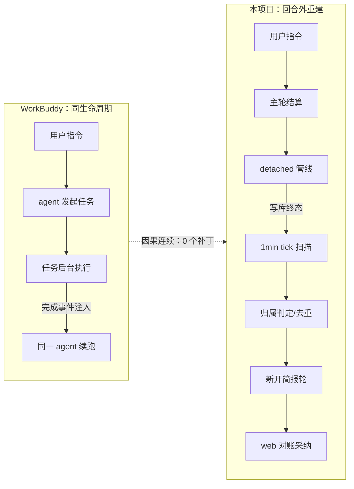
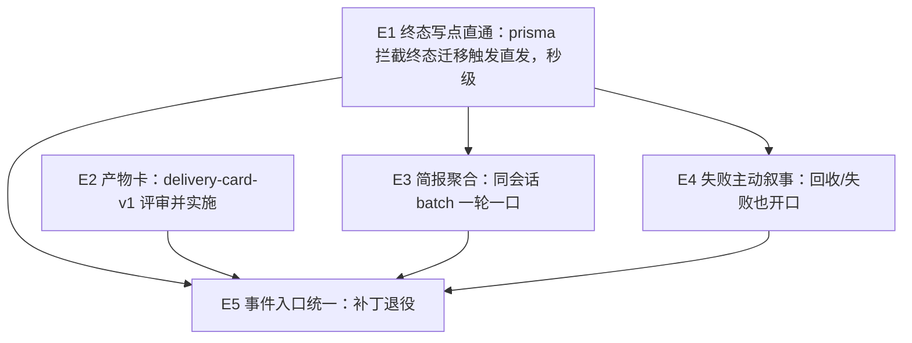

# E-系列演进总纲：对话驱动画布的「始终在场」体验（E1→E5）

状态：待评审（brainstorming 产出，2026-11-03）
来源：2026-11-03 体验对标复盘（WorkBuddy 第一手对比 + PR #685 生产取证 + 红车/黄小龙虾/蓝老虎事故链）
前置：
- `2026-11-02-delivery-card-v1-design.md`（待评审——即本总纲 E2，沿用不重立）
- PR #684 `5583168a`（订阅先于触发，已上线）
- PR #685 `9e66ef84`（1min 快节拍 + web 影子采纳，已上线）
- P1 治本总纲 A/B/C/D 四包（已收官）
分支约定：每期子规格独立 feature 分支 + PR + squash merge；总纲只读不改实现。

## 0. 配图索引

| 编号 | 形式 | 内容 | 位置 | 用途 |
|---|---|---|---|---|
| 图 1 | 内嵌 Mermaid（flowchart） | E1→E5 分期依赖图 | §7 | 验收：分期顺序与依赖不倒置 |
| 图 2 | 内嵌 Mermaid（flowchart） | 因果模型错位诊断（回合边界 vs 创作连续性） | §3 | 验收：补丁清单与根因的对应关系 |

## 1. 背景：为什么是现在立项

**事故链（2026-10 底 → 11-03）**：天鹅事故（回合外简报零落库，P0-A 因果围栏）→ 蓝老虎
复测（Layer 3 订阅时序竞态，整轮静默丢失）→ 黄小龙虾复测（简报延迟 5.5min + 在线影子
气泡被对账冲掉）→ 红/蓝精灵复测（延迟压到 ~30s，链路全通）。

**立项缘起**：红/蓝精灵复测通过后，用户追问「为什么生成后不是秒级收到简报？是机制设计
问题还是刻意设计？」——这把讨论从「修 bug」推进到「对标体验」：与 WorkBuddy 的后台任务
机制（CI/CD 胶囊条、画布生图）逐项对标后，暴露出两者的差距不在功能覆盖，而在**因果模型
错位**（§3）。此前所有修复都是止血（让简报「能到」），本系列是治本（让简报「秒到、该说
的说、不该说的沉默」，并把止血补丁逐步退役）。

**为什么是窗口期**：#684/#685 上线后简报链路已通、体验到达「可用水位」，生产观测手段
（notify reason 打点、automationRun 记录）齐备——此时立项可依赖真实基线数据定义验收，
而非边修边猜。

## 2. 现状盘点：已上线能力、对标结论与存量补丁

### 2.1 已上线机制矩阵（2026-11-03 生产取证）

| 层 | 机制 | 载体 | 状态 |
|---|---|---|---|
| L1 落库 | 回合外简报轮持久化 | registry tombstone + Nest 四分支 + `POST /late-answer`（#661） | ✅ |
| L2 写者 | 生成 job 化 + 写者收敛 | 内核 0.99.2 + B1/B2/B6（#662-#665） | ✅ |
| L3 订阅 | 订阅先于触发 | `onBeforeNotify` + arm（≤3s 等 open）+ TTL 自愈（#684） | ✅ |
| L4 触发 | 直发 + 1min 快节拍兜底 | `notifyTerminalsOnce` 单飞 + `job-generation-notify` tick（#685） | ✅ |
| L5 呈现 | 文字简报（回合外 LLM 轮） | 简报轮 → AgentMessage → web 影子采纳 | ✅（E2 将升级为产物卡） |
| L6 回收 | 失败/超时兜底 | reaper 5min + #686 孤儿节点兜底 + audio 纳收 | ✅（E4 补叙事） |

### 2.2 各产物类型当前送达表现

| 产物 | 链路形态 | 送达路径 | 实测延迟 |
|---|---|---|---|
| 图片（含编辑/放大） | detached 异步 | 直发（agent-canvas-tools 结算）或 ≤1min tick | ~30s（含简报轮 LLM 10~20s） |
| 视频 | detached，管线分钟级 | 1min tick 兜底 | ≤1min + 简报轮 |
| 音频 music | detached | 1min tick 兜底（#686 纳收） | ≤1min + 简报轮 |
| 音频 design/voice | 同步 | 主轮直接回答 | 不走简报（设计如此） |
| 文案 / HTML 产物 | 同步 | 主轮直接回答 | 不走简报（设计如此） |

结构性缺口：studio 管线直写的终态（probe/merge/provider 回调/超时，`studio.service.ts`
内 27 处写点）**零直发**，全靠 tick——这是「0~60s 随机延迟」的根因，E1 治理对象。

### 2.3 WorkBuddy 对标结论（两轮对标汇总，第一手观察）

**第一轮（机制对标）**：
- WorkBuddy 的任务是 agent 自己发起、挂在同一会话；完成信号 = 进程退出 → **事件直接注入
  会话**唤醒 agent 循环续跑（CI/CD 胶囊条即此）。我们 = 写库终态 → Nest 1min tick 全表
  扫描发现 → 归属判定 → 新开简报轮。**事件驱动同轮续跑 vs 终态落库+轮询广播，本质不同。**
- WorkBuddy 的画布生图（ImageGen）/视频（VideoGen）/设计画布是**同步工具调用**——agent
  轮内等待，返回即得产物，不存在「完成→扫描→简报」环节；超长任务才降级到后台胶囊
  （仍是进程级事件回调）。两条路都是**点对点送达**，无中间广播层。

**第二轮（架构启示）**：
- 我们 Layer 3 订阅竞态、归属判定、web 对账冲突的全部复杂度来自「回合外」三个字；
  WorkBuddy 因果链在同一 agent 生命周期内天然连续，零归属问题。
- 差异根源不是「要不要实时」，而是**完成事件的送达路径**：点对点事件注入 vs 写库+定时
  广播扫描（轮询间隔+去重+归属重建都是广播模型的衍生成本）。

**不可照搬边界（总纲级共识）**：WorkBuddy 的任务是秒级命令/文件操作，同步等待与进程回调
都成立；我们面对跨服务分布式创作管线（第三方 provider、轮询、probe、merge），照搬「同步
等」会死（HTTP 挂 8 分钟），照搬「进程回调」须先把 20+ 写点收拢为事件源。**该抄的是因果
模型——「任务即会话内对象、完成即事件注入」，不是它的实现。**

### 2.4 存量补丁清单与退役归属（E5 的输入）

| 补丁 | 引入 | 作用 | 退役条件 |
|---|---|---|---|
| 投影 arm 短命订阅（`armOutOfTurnProjection`） | #684 | 订阅先于触发，简报轮落库 | E1 事件面稳定一周（G-5） |
| `late-answer` 四分支裁决 | #661 | 挂起态迟到答案落库 | E5 事件面唯一化后 |
| web 影子采纳 + 1.5s 补拉 | #685 | 在线简报气泡保序 | E2 产物卡直出后（对账对象消失） |
| 1min tick 扫描 | #685 | 直发覆盖不到的路径兜底 | **永不退役**（降级为纯兜底，G-1） |
| 近 15h no-thread 误标记录 | 事故遗留 | 待清零重发 | Task①（产品确认范围后执行） |

### 2.5 当前体验评分（北极星基线）

- 言出法随 ~60 分：提议卡→确认→生成闭环已有，产物需跳画布确认（E2 提升项）。
- 始终在场 ~60 分：链路已通、延迟 ≤1min，但失败沉默、无聚合、文字转译（E1/E3/E4/E2 提升项）。

## 3. 问题：补丁的总量就是架构缺陷的计量表

Layer 1-3 修复链（#675/#679/#680/#684）、PR #685 的 web 影子采纳、B2 对账、孤儿节点兜底——
过去两周全部「回合外简报」类事故的修复，都是在给同一个架构错位打补丁：

**我们把「回合」做成了架构一等公民，但用户的创作会话不是回合制的。**

用户心智：我在画布上持续创作，agent 一直在场。
系统实现：一问一答的回合制 + 回合外事件打补丁（简报轮、投影 arm、对账、影子气泡）。
产物生成 detached（P1-B）后主轮结算，结果「回合外」回来 ⇒ 归属判定、SSE 订阅时序、
web 对账冲突、durable 去重等全部复杂度都来自「回合外」三个字。

对标结论（§2.3）：WorkBuddy 因果链天然连续，不存在归属判定问题。

（见 图 2）

**图 2 · 回合外重建路径的补丁对应——图中每一段中间环节即一类已发生事故**

图 2 说明了什么：同生命周期路径（上）在任务完成后事件直达同一 agent，零中间层；
回合外路径（下）每一段箭头都对应一类已发生的事故（归属=no-thread 15h、订阅时序=
Layer 3 竞态、对账=影子气泡被冲、扫描=延迟 0~6min）。E-系列的目标是把下图的
中间层从「主路径」降级为「纯兜底」。

## 4. 北极星

**言出法随 + 始终在场。**

- 言出法随：说话→产物出现，本轮对话流内可消费产物（基线见 §2.5）。
- 始终在场：产物变故 agent 主动说（完成/失败/超时），秒级、不打扰、可聚合。

⚠️ 诚实边界：E 系列的「秒级」指**触发**秒级（终态落库→agent 开简报轮 ≤5s）；用户看到
简报仍是 +LLM 回合 10~20s（读上下文写摘要，不可压）。用户可感知的「秒级产物呈现」由
E2 交付卡承接（结构化载荷直出，不走文字转译）。两层叠加后体验才是完整的「始终在场」。

## 5. 总纲判据（G-系列，全期有效）

- **G-1 兜底降级判据**：1min tick 永远保留，但任何 E 期实施后，tick 命中量占通报总量的比例必须下降（观测打点按 reason 分布）；E1 落地后 tick 应 <10%（生产观测一周定阈值）。
- **G-2 单飞与去重不复制判据**：任何新触发路径只准「调用」`notifyTerminalsOnce` 与 durable 去重，禁止各期自建第二套并发守卫。
- **G-3 纯增量判据**：E1-E4 每期实现必须是可独立回滚的纯增量模块（feature flag），不重构既有函数签名；E5 之前禁止删除任何既有补丁（补丁退役只在 E5）。
- **G-4 状态层冻结判据**：不新增第五状态层；新增字段走既有 `node_status` details / GenerationRecord metadata，遵守 delivery-card-v1 D-4（不塞 Content）。
- **G-5 用户感知判据**：每期必须有可从用户侧复现的验收场景（不复现 = 不验收），验收记录写回各子规格。

## 6. 未来研究路线：分期、依赖与开放问题

### 6.1 分期定义

| 期 | 名称 | 一句话 | 状态 | 规格 |
|---|---|---|---|---|
| E1 | 终态写点直通 | 终态迁移即直发，秒级触发；tick 降级兜底 | **本次立项** | `2026-11-03-e1-generation-terminal-write-tap-design.md` |
| E2 | 产物卡 | 对话流内消费产物，消灭文字转译 | 规格已就绪待评审 | `2026-11-02-delivery-card-v1-design.md` |
| E3 | 简报聚合 | 同会话多条未通报合并一轮（连发三张图→「都好了」） | 待 E1 后立项 | 本总纲 §6.3 预埋判据 |
| E4 | 失败主动叙事 | 回收/失败/孤儿置 error 时 agent 开口 + 动作 | 待 E1 后立项 | 依赖 E1 拦截到 reaper 回收迁移 |
| E5 | 事件入口统一 | 一次性收敛回合外补丁，事件面唯一 | 收官期 | 待 E1-E4 生产稳定后立项 |

### 6.2 依赖图

（见 图 1）

**图 1 · E1 是 E3/E4/E5 的共同地基，E2 与 E1 并行，E5 收官**

图 1 说明了什么：E1 是 E3/E4/E5 的共同地基（触发点）；E2 与 E1 并行（交点=交付卡完成
时机从 ≤1min 变秒级，字段契约不变）；E5 是终点，退役补丁（投影 arm 短命订阅、部分
对账兜底）必须在 E1-E4 全部稳定生产一周后。

### 6.3 各期开放研究问题与预埋判据（子规格立项时引用）

- **E1**：开放问题——`$extends` extended client 类型兼容面（挂载收在 PrismaService 内）；
  批量 `updateMany` 风暴下的触发节流（预期由单飞守卫吸收，需生产验证）。预埋判据见其子规格 D-1~D-5。
- **E3**：开放问题——聚合窗判定（同轮扫描 batch 天然成窗 vs 显式延迟窗）；跨 run 多产物
  计数与逐项摘要的上下文成本。预埋判据：聚合 = notifyTerminalsOnce 单次扫描内同会话记录
  合并为一次 notify / 一条简报，不引入新定时器；文案含产物计数与逐项一行摘要。
- **E4**：开放问题——失败文案的语气与动作矩阵（重试/诊断，与 delivery-card 失败态动作
  同源）；「超时未完成」与「生成失败」的区分叙事。预埋判据：失败简报必须携带动作；
  孤儿兜底置 error 时 reason 传 `orphan-reap`。
- **E5**：开放问题——退役顺序（先对账兜底还是先投影 arm）；每项退役的回归观测窗口。
  预埋判据：退役清单逐项列出（§2.4 表），每项退役前须证明其被事件面替代且生产观测
  零回归一周。

## 7. 明确不做（总纲级）

- 不照搬 WorkBuddy 的同步等待形态（视频 8min 管线，HTTP 挂等待不可行）。
- 不做跨会话聚合（简报归属是单会话语义，跨会话属通知中心另一产品面）。
- 不在本系列内改 `canvasData` 写通道（C2a/C2b 已治理，E2 只读节点）。
- 不在 E1-E4 期间退役任何既有补丁（G-3）。

## 8. 里程碑与验收口径

1. **M1（E1 上线）**：生产生成完成后简报触发延迟 P95 ≤ 5s（直发路径）；tick 命中占比 <10%（G-1）。
2. **M2（E2 上线）**：图/视频/音频产物在对话流内可预览，零跳画布确认率 ≥ 80%（埋点）。
3. **M3（E3+E4 上线）**：连发多产物场景简报条数 = 聚合轮数（非产物数）；失败场景 100% 有 agent 叙事。
4. **M4（E5 收官）**：补丁退役清单清零，回合外重建代码面 ≤ 现状 50%。
