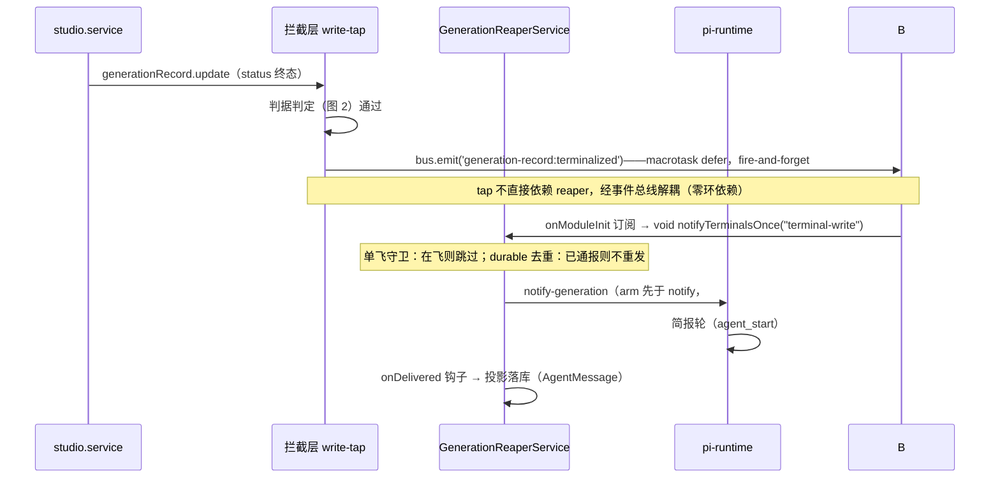
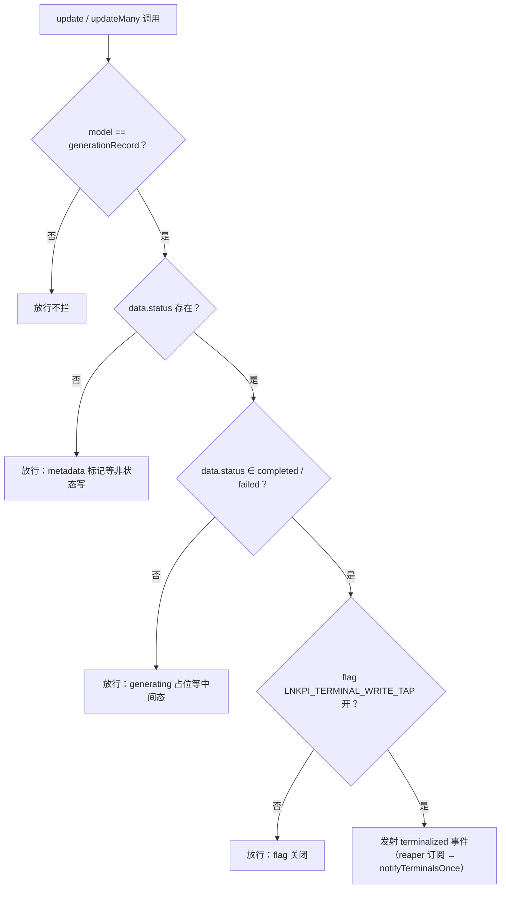

# E1：生成终态写点直通（terminal write tap）设计规格

状态：待评审（brainstorming 产出，2026-11-03，方案 A 拍板见 §4）
前置：
- `2026-11-03-e-series-conversation-driven-canvas-evolution-design.md`（总纲，G-1~G-5 判据全期有效）
- PR #684 `5583168a`（订阅先于触发：`onBeforeNotify`/arm 机制）
- PR #685 `9e66ef84`（`notifyTerminalsOnce` 抽取 + `notifyInFlight` 单飞 + job-generation-notify 1min tick）

⚠️ **实施基线（评审补充）**：#684/#685 须已合入当前基线。本规格机制（单飞 / 去重 / arm）
  依赖之；若本地工作树落后于 `origin/master`（如停在 #640），须先 `git fetch` 并基于含
  #684/#685 的提交起 feature 分支，否则编译与 D-4 验证均无法成立。
分支约定：feature 分支 + PR + squash merge；feature flag `LNKPI_TERMINAL_WRITE_TAP`（缺省开）。

## 0. 配图索引

| 编号 | 形式 | 内容 | 位置 | 用途 |
|---|---|---|---|---|
| 图 1 | 内嵌 Mermaid（时序） | 拦截→直发→简报轮全链路时序 | §5 | 验收：触发点与守卫的相对位置 |
| 图 2 | 内嵌 Mermaid（判据树） | 终态迁移判定（拦截 vs 放行） | §5.2 | 验收：判据穷举、metadata 更新不误触 |

## 1. 背景与取证

**背景**（详见总纲 §1-§2）：天鹅→蓝老虎→黄小龙虾事故链修复后简报链路已通，但
WorkBuddy 对标结论表明差距在「完成事件的送达路径」——它是进程级事件点对点注入，我们是
「写库→1min tick 全表扫描」广播模型。E1 把送达路径升级为「终态迁移即触发」，tick 降级纯兜底。

**延迟构成**（2026-11-03 生产取证，蓝/红精灵会话）：

| 产物类型 | 直发路径 | 延迟 |
|---|---|---|
| text 及 agent-canvas-tools 结算的生成 | `notifyTerminalNow` 10 个调用点（全部在 agent-canvas-tools.service.ts） | 秒级（终态写入同毫秒触发） |
| **studio 管线直写的终态**（image/video/audio 的 probe/merge/provider 回调/超时分支） | **零直发**，只靠 1min tick 扫描 | 0~60s 随机（黄小龙虾旧版 5.5min 即此根因） |

**写点分布**（`git grep` 取证）：`generationRecord.update/updateMany` 生产代码共 29 处
—— studio.service.ts 27 处（completeImage/Video/Music 的成功、失败、超时、fallback 各
分支，无公共 helper）+ generation-reaper.service.ts 1 处（回收）+ late-generation-notify
1 处（`agentTurnNotified` metadata 标记，**非终态迁移，不应触发**）。

## 2. 目标

1. 终态落库 → 直发触发延迟 **P95 ≤ 5s**（当前 tick 路径 0~60s）。
2. studio 写点 **零改动**（B2 当年放弃逐点挂钩的教训：漏改 = 静默丢简报）。
3. tick 降级为纯兜底（总纲 G-1：上线一周后 tick 命中占比 <10%）。
4. 新增生成类型/新写点**自动被覆盖**（写咽喉性质，与 reaper 读咽喉同构）。

## 3. 范围（含明确不做）

**做**：
- 新模块 `apps/server/src/studio/terminal-write-tap.ts`：Prisma `$extends` 拦截 +
  终态迁移判据 + **向领域事件总线发射 `generation-record:terminalized`**（不直接依赖
  `GenerationReaperService`，规避 PrismaService→reaper 环依赖；详见 §5.1 / §5.2）。
- 事件总线 `apps/server/src/studio/terminal-events.ts`：Node `EventEmitter` 薄封装
  （leaf module，无对外依赖），唯一事件 `terminalized`。`GenerationReaperService.onModuleInit`
  订阅该事件后调用既有 `notifyTerminalsOnce('terminal-write')`，单飞 / 去重 / arm 全复用。
- feature flag `LNKPI_TERMINAL_WRITE_TAP`（env，缺省开；关 = 行为与今天逐字节一致，且不挂扩展）。
- reason 度量计数器 `NotifyMetrics`（server 当前无 prom/otel 设施，须新增）：按**已通报记录数**
  累加 `generation_notify_records_total{reason}`（`terminal-write` / `notify-tick` / `periodic` /
  `startup` / `manual` / `orphan-reap` 预留），供 G-1 按记录数（非扫描调用次数）度量。

**不做**：
- 不改 studio.service.ts 任何一处 update 调用（零写点改动是本规格的存在理由）。
- 不改 `notifyTerminalsOnce` 内部（直发、去重、单飞守卫、arm/onDelivered 钩子全部原样复用）。
- 不引入 outbox 表 / 新 worker / 新定时器。
- 不做同会话聚合（E3）、不做失败文案（E4）——本包只保证「触发」。
- 不拦截 reaper 对 canvasData/Session 的写（只挂 GenerationRecord 模型）。

## 4. 方案裁决（A / B / C 对比，拍板 A）

| 方案 | 改造面 | 风险 | 裁决 |
|---|---|---|---|
| **A. Prisma `$extends` 终态迁移拦截** | 1 个新模块，零写点改动 | 判据需精确（§5.2 给出运行时白名单判据） | **拍板** |
| B. 收拢 27 处为 settle helper 再挂钩 | 27 处 × 各分支测试 | 漏改 = 静默丢简报（B2 已证明逐点路线维护性差） | 否决 |
| C. tick 提频 30s | 极小 | 不治本，扫描频率换延迟 | 否决 |

**拍板 A 的五条理由**：① 改造面即交付风险（1 vs 27）；② 「读咽喉→写咽喉」哲学同构，
新写点自动覆盖是已验证性质；③ 净新增面最小（直发/去重/单飞/钩子全复用 #684/#685）；
④ 判据是运行时白名单数组（已对 27 写点取证，零语义猜测）；⑤ 纯增量 + flag 可回滚（总纲 G-3）。

**A 路线下的耦合方式（评审修正）**：tap 经**领域事件总线**间接触发 `notifyTerminalsOnce`，
而非规格初稿的「tap 直调 reaper」。理由：PrismaService 是 reaper 的依赖（reaper 注入
PrismaService），若扩展反向依赖 reaper 即构成初始化环；事件总线是 leaf 模块、零环，
且天然为总纲 E5「事件入口统一」铺路（上游 `generation.ts:124` 已写明「结算点直发
notify-generation + ticker 退役」）。

## 5. 详细设计

### 5.1 全链路时序

（见 图 1）



**图 1 · 拦截层只做触发器——并发治理全部在既有 notifyTerminalsOnce 一侧**

图 1 说明了什么：拦截层只是「触发器」，且只发事件、不持有通知逻辑——通报的全部并发治理
（单飞、去重、订阅先于触发、投影落库）都在既有 `notifyTerminalsOnce` 一侧。`terminal-write-tap`
自身无状态、无锁、无重试，fire-and-forget 保证写路径零阻塞（判据 D-2）。**关键修正**：
tap 经由领域事件总线间接驱动 reaper 订阅，而非直调 `GenerationReaperService`——因
PrismaService 是 reaper 的依赖，反向直调会构成模块初始化环（判据 D-6）。

### 5.2 终态迁移判据（图 2）

（见 图 2）



**图 2 · 终态迁移判据四层判定——全部配置级/运行时白名单，无语义猜测**

图 2 说明了什么：判据四层全部是**配置级/运行时白名单**断言，无业务语义猜测——
`data.status` 字段存在性天然区分「终态迁移」与「`agentTurnNotified` 标记更新」（后者
只写 metadata，不含 status，即 §1 取证中 late-generation-notify 的那 1 处不误触）；
状态终态集合为运行时白名单 `TERMINAL = ['completed','failed']`（`generationRecord.status`
是自由 `String` 字段，非 Prisma enum；已对 studio 27 个写点取证，终态仅 completed/failed，
`fallback_pending` 为中间态、reaper 的 `error` 只改 canvas node 不改 record，均不误触）。

**边界语义**：
- reaper 回收（generating→completed/failed）**同样触发**——回收是超时终态，正为 E4
  「失败主动叙事」供事件；本包不改文案，简报内容与今天一致。
- 同一 update 内 `metadata` 与 `status` 同时写：含 status 即触发，metadata 部分照常写入（拦截是旁路观察者，不改写调用参数）。
- `$extends` 挂载点：在 `PrismaModule` 的 `useFactory` 内按 flag 挂载（§5.2 生命周期陷阱配方），
  flag 关 = 返回 base（不挂扩展，client 保持 base 类型）；与其他 `$extends`（如存在）叠加顺序无关
  （拦截只读参数不修改，且扩展仅作用于 GenerationRecord 模型）。
  ⚠️ 实现注意（生命周期陷阱，评审修正）：`$extends` 返回**新 client，不带**
  `PrismaService` 的 `onModuleInit/onModuleDestroy`——若在其内部 `this=extended` 或直接
  把扩展当 PrismaService 注入，会导致 `$connect` 永不调用、DB 静默断连。安全挂载点在
  `PrismaModule` 的 `useFactory`：
  ```ts
  {
    provide: PrismaService,
    useFactory: (bus: TerminalEventBus) => {
      const base = new PrismaService()
      if (process.env.LNKPI_TERMINAL_WRITE_TAP === 'false') return base
      const ext = base.$extends(createTerminalWriteTap(bus))
      ext.onModuleInit = () => ext.$connect()      // 重绑丢失的生命周期
      ext.onModuleDestroy = () => ext.$disconnect()
      return ext as unknown as PrismaService
    },
    inject: [TerminalEventBus],
  }
  ```
  消费者类型保持 `PrismaService` 不变（cast 不外泄），server 全量 `tsc` 仍须跑一遍确认。
  flag 关 = 返回 base（不挂扩展，行为逐字节一致）。
  ⚠️ 事务鲁棒性（评审补充，非当前必现）：studio 当前终态写均为 autocommit、`$transaction`
  包裹，故 after-callback 在提交后触发、扫描可见该行；作为对未来重构的保险，事件发射应
  `defer` 到 macrotask（`setTimeout(0)`），零成本且不影响 D-2 零阻塞。

### 5.3 观测（评审修正：补度量基础设施 + 修正口径）

- 复用既有日志：`[${reason}] 回合外生成终态通报已处理 N 条`（notifyTerminalsOnce 原样）。
- **新增计数器 `NotifyMetrics`**（server 当前无 prom/otel/counter 设施，须随本包落地）：
  在 `notifyTerminalsOnce` 内按**实际已通报记录数 `notified`** 累加
  `generation_notify_records_total{reason}`（terminal-write / notify-tick / periodic /
  startup / manual / orphan-reap 预留）。
- ⚠️ **G-1 度量口径（评审修正）**：占比必须按「**已通报记录数**」而非「扫描调用次数」计算。
  每次终态写都会发起一次 `terminal-write` 扫描（即便 `notified=0`），若按调用次数计，
  `terminal-write` 轻易碾压 `notify-tick` 造成 vacuous pass。正确公式：
  `tick占比 = Σnotified{notify-tick} / Σnotified{all-reason}`，上线一周出基线（目标 <10%）。

## 6. 判据（D-系列）

- **D-1 零写点改动判据**：PR diff 中 `studio.service.ts`、`generation-reaper.service.ts`、
  `late-generation-notify.ts` 的 update 调用零行变更（review 硬检查）。
- **D-2 零阻塞判据**：拦截层对 update 的返回值透传原样（不改参数/不改返回），触发走
  `void … catch(warn)`，写路径不 await 通报（变异：把 void 改 await ⇒ 写路径延迟测试必须红）。
- **D-3 判据穷举判据**：图 2 的每个「放行」分支各有至少一个测试用例（含
  `agentTurnNotified` metadata 更新不触发的反例——即 §1 的第 29 处写点）。
- **D-4 守卫复用判据**（总纲 G-2）：并发两条终态 update ⇒ `notifyInFlight` 使第二次
  触发跳过；已通报记录 ⇒ durable 去重跳过。测试复用 #685 既有单飞/去重用例形态。
- **D-5 flag 语义判据**：flag 关闭时 `$extends` 不挂载（非空转判断），行为与今天逐字节一致。
- **D-6 解耦判据（评审新增）**：`terminal-write-tap` 不直接 import / 调用
  `GenerationReaperService`；仅向 `TerminalEventBus` 发射事件，订阅方在 reaper 一侧。
  用「模块初始化顺序测试 + 环依赖静态检查」验证无 PrismaService→reaper 环（违反 G-2 第二套
  守卫禁令的变体：此处禁止的是反向依赖，而非新建守卫）。
- **D-7 度量口径判据（评审新增）**：`NotifyMetrics` 仅在 `notified>0` 时按 `notified` 计数；
  G-1 验收按「已通报记录数」口径，禁止按扫描调用次数判定。

## 7. 测试策略

1. **单元**：判据树全分支（图 2 六路）+ flag 开关 + 返回值透传。
2. **变异测试**（守卫必须行为级）：① 判据去掉 `status ∈` 检查 ⇒ D-3 用例必须红；
   ② 触发改 await ⇒ D-2 用例必须红；③ flag 判断取反 ⇒ 开关用例必须红。
3. **集成**：completeImage 成功 / 失败 / 超时三分支各触发一次（断言 notify mock 收到
   `terminal-write`）；reaper 回收路径触发一次（E4 铺垫）。
4. **回归**：generation-reaper.service.test.ts 全量 31 用例不动；notify-tick 用例语义不变。
5. **解耦（D-6）**：单元测试断言 `terminal-write-tap` 在终态写后向 bus 发射事件，且**不**
   直接调用 reaper（mock reaper 未被直接引用）；reaper 订阅测试断言收到事件后调用
   `notifyTerminalsOnce('terminal-write')`。验证模块初始化无环（可用 import 顺序断言）。
6. **挂载与生命周期（§5.2）**：flag 关→工厂返回 base（无扩展，且 `$connect` 正常）；
   flag 开→扩展挂载且 `onModuleInit/onModuleDestroy` 仍触发 `$connect/$disconnect`
   （断言 DB 可连）。server 全量 `tsc` 通过。
7. **度量（D-7）**：`notifyTerminalsOnce` 在 `notified=0` 时不计 `terminal-write`；
   `notified=3` 时 `generation_notify_records_total{terminal-write}=3`。

## 8. 回滚

- `LNKPI_TERMINAL_WRITE_TAP=false` → `$extends` 不挂载，等同回滚。
- 模块独立文件（`terminal-write-tap.ts` + `terminal-events.ts`），回滚 = 删两文件 +
  摘 `PrismaModule` 挂载行与 reaper 订阅行 + 摘 `NotifyMetrics`，无遗留。

## 9. 验收（生产）

| 项 | 判据 |
|---|---|
| 直发延迟 | 蓝精灵式复测：图片 probed 完成 → 简报触发 ≤ 5s（取 3 次样本） |
| tick 占比 | 上线一周按「已通报记录数」口径：`Σnotified{notify-tick} / Σnotified{all}` <10%（G-1，D-7 口径） |
| 零回归 | 一周内无重复简报（durable 去重无击穿）、无通报风暴（单飞守卫日志零跳过异常） |
| 写路径 | studio 生成接口 P99 延迟环比无劣化（D-2 生产面） |
