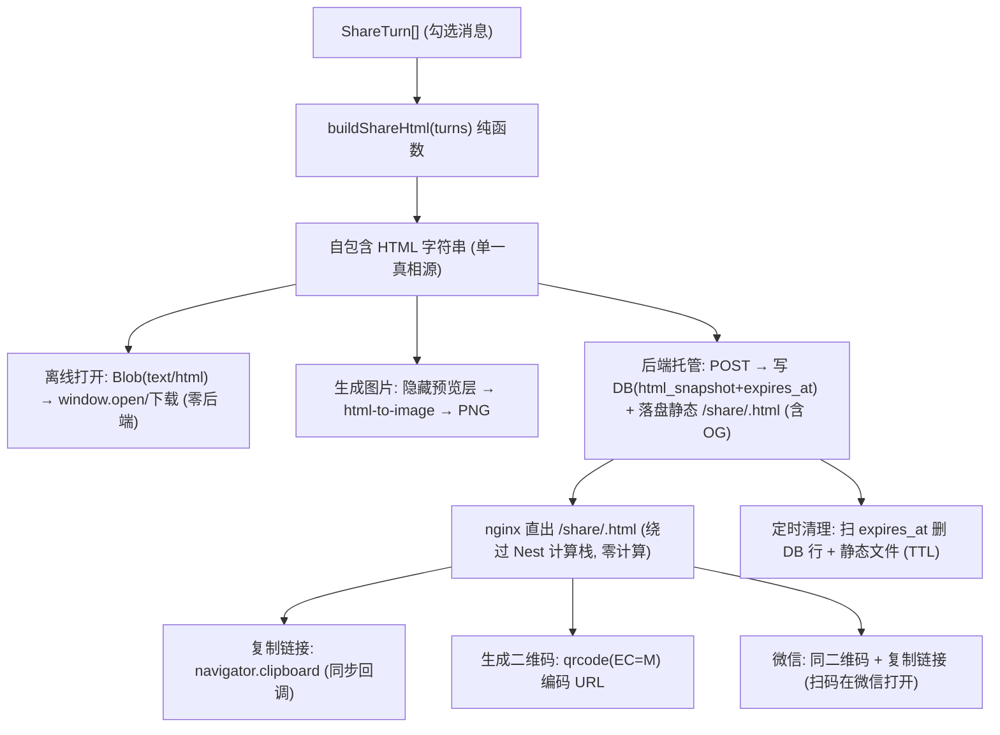
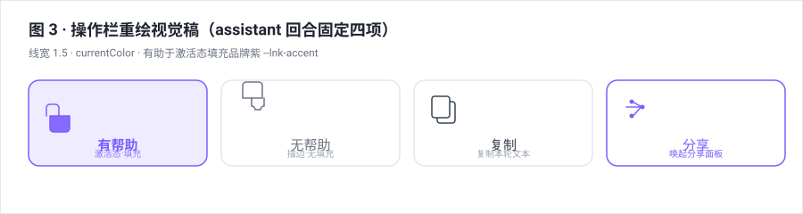
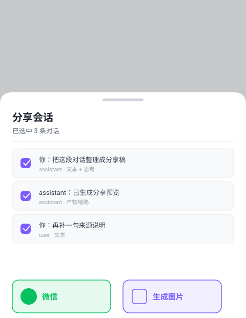

# SSE 对话回合 · 反馈图标重绘 + 分享能力（复刻 WorkBuddy） 设计规格

状态：待评审（brainstorming 产出，2026-11-04）
前置：
- `docs/design/Design_system.md` §2.11 图标规范（24 网格 / 线宽 1.5 / currentColor / 无填充 / 禁 emoji）
- `AGENTS.md` 移动端立规（移动端浮层唯一基座 = `MobileSheet.vue`）
- `apps/web/src/components/agent/AgentSideRail.vue`（`agent-msg-actions`，现行 3 按钮 + stroke 1.75 偏离）
- `apps/web/src/pages/SharePage.vue` + `works-api.ts`（既有分享页/作品分享模式，供复用）
- `apps/web/src/composables/useQrDataUrl.ts`（已装 `qrcode` 包，供复用）
分支约定：实现走 feature 分支 + PR + squash merge。

## 0. 配图索引（结构与视觉两类，均随本文档演进）

本文档的图分两类：**结构图**一律以 Mermaid 内嵌；**视觉稿**以 `assets/` 下的 SVG 附件承载（相对路径引用）。

| 编号 | 形式 | 内容 | 位置 | 用途 |
|---|---|---|---|---|
| 图 1 | SVG 附件 `assets/2026-11-04-conversation-share-1-share-panel.svg` | 分享面板：移动端 `MobileSheet` 底部弹层（桌面端变体 PC 后续） | §6.2 | 面板布局 / 两行网格 / 多选区验收基准 |
| 图 2 | 内嵌 Mermaid | 分享架构数据流（单模板 → 三消费者） | §5 | 确认「一份自包含 HTML 模板」为唯一真相源 |
| 图 3 | SVG 附件 `assets/2026-11-04-conversation-share-3-action-bar.svg` | 操作栏重绘：有帮助/无帮助/复制/分享 | §6.1 | 图标线宽/激活态/新增分享按钮验收基准 |
| 图 4 | 内嵌 Mermaid | 多选分享流程（默认全选 → 已选中 N 条 → 选模式） | §6.2 | 多选与五种模式触发链验收 |

## 1. 目标

> **本期范围限定：仅移动端**（PC / WEB 端暂不做，详见 §2 Out 与 §12）。所有入口、面板、图标重绘均先在移动端落地；PC 端双入口与桌面抽屉变体列入后续包。两个分享层级共用同一 `ConversationShareSheet` 面板，区别仅在「默认勾选集合」。

1. **反馈图标重绘（移动端）**：把 mobile 对话流 assistant 回合操作栏的「有帮助 / 无帮助」图标按设计系统重绘为清晰可辨的内联 SVG（24 网格 / stroke 1.5 / currentColor / 无填充），并补**激活态**（填充品牌紫 `--lnk-accent`），校正现行 stroke 1.75 的偏离。
2. **分享能力落地**：在操作栏新增「分享」入口，复刻 WorkBuddy 制品分享——把对话内容生成**自包含 HTML**，支持五种模式：① 微信 ② 生成图片 ③ 复制链接 ④ 生成二维码 ⑤ 浏览器离线打开。
3. **多选分享（抄 WorkBuddy 5.1.0）**：支持勾选多条消息，**默认全选**，实时显示「已选中 N 条对话」。

## 2. 范围（含明确不做）

**本期做（In）：**
- 操作栏图标重绘（有帮助/无帮助，**移动端**）+ 移动端操作栏新增「分享」按钮。
- 分享面板（移动端 `MobileSheet` 底部弹层；桌面端右侧抽屉/居中卡变体**本期不做**）。
- 自包含 HTML 模板（纯函数 `buildShareHtml`）。
- 五种分享模式全部落地：① 微信 ② 生成图片 ③ 复制链接 ④ 生成二维码 ⑤ 浏览器离线打开（朋友圈/QQ/企业微信首期为微信模式的占位入口，均落地为"二维码+链接"，见 §2 Out）。后端托管页（nginx 静态直出）支撑 ①③②④ 所需的公开静态 URL。
- 多选勾选（默认全选；**回合级入口默认选本轮，会话级入口默认全选全部回合**）。
- 后端分享存储：`conversation_shares` 表 + `POST /api/share/conversation` + 公开 `GET /api/share/conversation/:id`。
- **两个移动端入口**：
  - ① 回合级 = 移动端对话流 assistant 回合操作栏「分享」按钮，范围 = **本轮 SSE 对话内容**（用户本轮提问 + assistant 本轮文本回复 + 附件缩略；不含画布节点图）。
  - ② 会话级 = 移动端对话页顶栏右上角 `⋯` 菜单新增「分享会话」，范围 = **当前会话全部回合**。

**明确不做（Out）：**
- **PC / WEB 端（本期不做）**：`WorkspaceTopBar` 顶栏「分享会话」、`AgentSideRail` 桌面操作栏分享按钮、桌面右侧抽屉/居中卡变体——均列入 §12 后续包，避免与 ADR-0015 桌面收敛冲突。
- 喇叭/朗读、画布节点重生成、操作栏「更多」菜单——这些属画布节点/其他上下文，不在本包（探查确认其真实归属在 `MobileNodeViewer` / `MultiSelectToolbar` 等）。
- 右侧「耗时 / 模型 / 时间」统计——`AgentStreamMessage` 无此字段，属独立数据补全包。
- 微信/朋友圈**原生分享卡片**（JSSDK + 服务端签名 + 域名白名单）——本期采用「二维码 + 链接」务实方案（与用户确认，且为 WorkBuddy 实际主流做法）。
- QQ / QQ空间 / 企业微信**独立 SDK**——首期入口占位，落地同为「二维码 + 链接」（无对应 SDK）；真实 SDK 另立后续包。

## 3. 与既有规格的关系

- **`Design_system.md` §2.11 图标规范**：本包把现行 `stroke-width="1.75"` 校正回规范的 **1.5**；并提议把散落的 199 处内联 SVG 收敛为 `<AppIcon>`——若本期不落地收敛，则在 §12 登记为后续包（不阻塞本包）。
- **`AGENTS.md` 移动端立规**：分享面板移动端**必须**走 `MobileSheet.vue`（移动端浮层唯一基座），不得在主组件里长媒体查询补丁。
- **复用既有资产**：`SharePage.vue` 的路由/页面模式、`works-api.ts` 的服务写法、`useQrDataUrl.ts`（`qrcode` 包）、`@/utils/copyToClipboard`。

## 4. 规范与判据（可复用规则，后续同类需求直接套）

- **图标判据**：viewBox `0 0 24 24`；`stroke-width="1.5"`（用令牌 `--lnk-icon-stroke`）；`stroke-linecap="round"` `stroke-linejoin="round"`；`fill="none"`；`stroke="currentColor"`；激活态 = 填充 `--lnk-accent` + `stroke="currentColor"`。禁用 emoji、禁用第三方图标库、禁用裸 hex（用令牌或 currentColor）。
- **分享模板判据**：自包含——内联 `<style>`，**零外链 `<script>`/`<link>`、零运行时 CSS 变量依赖**（离线打开无站点样式，必须用内联具体色值）；内容含对话文本 + 图片缩略（用 URL 呈现）；体积受控（见 §11 按需上传）。
- **复制链接判据**：**必须在用户点击事件的同步回调里**调 `navigator.clipboard.writeText`（iOS 上放异步后调用会静默失败，已踩坑确认）。
- **二维码判据**：容错级 **`M`**（~15%；`L` 被微信压缩后常扫不出，`H` 过密），尺寸 180–240，margin 2；复用 `qrcode` 包。
- **微信落地判据**：生成**托管 URL** 的二维码 + 复制链接，用户在微信内扫码打开托管 HTML 原文（WorkBuddy 实际做法）；不接 JSSDK。
- **多选判据**：进入面板默认全选；勾选实时更新「已选中 N 条」；分享内容 = 勾选消息的有序集合（按时间升序）。
- **安全判据（XSS）**：对话文本进模板**必须 HTML 转义**（`escapeHtml`），禁止 `innerHTML` 注入未转义内容。

## 5. 架构与契约

**唯一真相源 = 一份自包含 HTML 模板**，三个消费者复用（见 图 2）：



**图 2 · 分享架构数据流：单份自包含 HTML 模板为唯一真相源，由离线打开 / 生成图片 / 后端托管三路消费者复用**

- **前端组件 / 模块（仅移动端）：**
  - 回合级入口：`agent-msg-actions`（`AgentSideRail.vue` 内）**移动端**操作栏在「有帮助 / 无帮助 / 复制」之后加「分享」按钮（内联 SVG，按 §4 图标判据）；图标重绘有帮助/无帮助。PC 端操作栏暂不加（§2 Out）。
  - 会话级入口：移动端对话页顶栏 `MobileTopBar.vue` 的 `⋯` 菜单（chat tab 会话级操作聚合点，与「发布作品 / 导出工作流」并列）新增「分享会话」项 → `emit('share')` → `MobileCanvasShell` 转发 `@share="onShare"` → `CanvasPage.openShare()` 唤起面板。范围 = 当前会话全部回合。
  - 新组件 `ConversationShareSheet.vue`：**仅 `MobileSheet` 底部弹层**（移动端浮层唯一基座，G-15 约束）。内含多选列表（默认全选）+ 两行模式网格（对齐 图 1）。桌面抽屉变体本期不做。
  - **数据流入契约**：`ConversationShareSheet.vue` 通过 `turns: ShareTurn[]` prop 接收待分享消息（回合级入口传 `[当前 turn]`，会话级入口传 `[全部 turns]`）；**数据组装责任在调用方**——从各自对话上下文取 turns 后传入，面板内部只做"多选增删 + 模式触发"，不负责拉取会话数据（具体 store/字段实施时 grep 确认，不在 spec 臆造名称）。
  - 新 `useShareActions.ts` composable：封装五种模式动作（`openOffline` / `toImage` / `copyLink` / `toQr` / `toWeChat`）。
  - 新 `lib/share/shareTemplate.ts`（纯函数）：`buildShareHtml(turns: ShareTurn[], opts?: ShareHtmlOptions): string` + `buildSharePayload(turns)`。
    - `ShareHtmlOptions = { inlineMedia?: 'online' | 'offline'; includeOg?: boolean }`：`inlineMedia:'offline'` → 图片附件内联 `data:` URI（base64）、thinking 默认收起；`'online'`（默认）→ 图片用外链 URL；`includeOg` → `<head>` 注入 OG meta（托管页用）。纯函数**不发起网络请求**，离线图片内联由调用方预抓取 base64 后作为 `attachments[].url` 传入（见 §5.2）。
  - 新 `lib/share/escapeHtml.ts`（纯函数）：HTML 转义。
- **后端（Nest，复用 `works` 模式；托管页采用「静态化逃逸」直出，本期默认）：**
  - `POST /api/share/conversation` body `{ sessionId: string; turns: ShareTurn[] }` → `{ shareId: string; url: string }`（**按需上传**，带 loading 提示；大内容不阻塞 UI，抄 WorkBuddy 4.24.2）。**鉴权**：用现有 `AuthGuard` 鉴权 + `ThrottlerGuard` 限频（防滥用，呼应 §11 滥用风险）。
    - **生成即双写**：① 存 `conversation_shares`（含 `expires_at` TTL）；② **把 `buildShareHtml` 结果落盘到 nginx 与 Nest 共享的静态目录**（docker volume 挂载 `/app/share` ↔ nginx root，如 `/app/share/<shareId>.html`），`og:title`/`og:description`/默认分享卡 `og:image` 在落盘时即写进 `<head>`。
  - **公开访问走 nginx 直出（绕过 Nest，零计算）**：nginx 新增 `location /share/ { ... try_files ... }` 直接返回静态文件为 `text/html`。URL 即 `https://<域名>/share/<shareId>.html`——查看者打开**完全不进 Nest 计算栈**，仅耗 CVM 磁盘+出网带宽（资源模型见 §5.1）。
  - 保留轻量 `GET /api/share/conversation/:id`（仅前端拉取元数据/校验，非公开访问主路径，可选）。
  - **TTL 清理（本期纳入）**：Nest 定时任务（`@nestjs/schedule`）或独立 cron 扫 `expires_at` 过期行，**删除 DB 记录 + 同步删除静态文件**，控制磁盘增长。
  - 新增表 `conversation_shares(id, session_id, html_snapshot, static_path, created_at, expires_at)` + Prisma migration。
- **数据结构 `ShareTurn`**：`{ id: string; role: 'user'|'assistant'; contentText: string; createdAt: number; attachments?: { kind: 'image'|'video'|'file'; url: string; thumbUrl?: string }[] }`。
- **反馈上报（可选增强）**：现行 `messageFeedback` 仅本地 `ref`。本包**默认保持本地反馈**；若需后端上报（复用 sessions controller 加 `POST /api/sessions/:id/messages/:mid/feedback`），列为可选，不阻塞分享主线。

### 5.1 托管模式的 CVM 资源占用模型（澄清：何种模式才"零后端"）

用户分享后的资源占用**取决于所选模式**，两种模式资源模型完全不同：

- **离线浏览器打开模式（零 CVM 计算/内存，真离线）**：走 `Blob(text/html)` 本地 `window.open`/下载，**完全不触碰 CVM**。分享者生成、查看者打开全程零后端——这是唯一"分享后不依赖后端"的模式。占用的只是分享者本机磁盘（下载的文件）。
- **云端托管模式（链接 / 二维码 / 微信，必然占用 CVM）**：与 WorkBuddy 的"云端备份+托管"本质相同，**分享者与查看者两端都会触碰 CVM**，因为托管页 URL 指向你的服务器：
  - **分享者生成时**：`POST /api/share/conversation` 一次，后端把 HTML 字符串写入 `conversation_shares.html_snapshot`（SQLite 磁盘占用，一次性、静态）。
  - **查看者打开链接时**：`GET /api/share/conversation/:id` 一次，Nest 从 SQLite 读字符串返回 `text/html`。这是**极轻量的静态读取**：不跑 agent、不跑 LLM、不跑 pi-runtime、不碰画布计算栈——与主对话业务的计算完全隔离，CPU/内存占用可忽略。
  - **带宽**：每次打开消耗 CVM 出网流量（HTML 本身 + 离线模式下内联的 base64 图片）。这是托管模式的主要可变成本。

**降低 CVM 占用的优化策略（建议落地，写入 §12 跟踪）：**
1. **静态化逃逸 Nest（本期默认采用）**：生成的 HTML 直接落盘到 nginx 与 Nest 共享的静态目录（docker volume 挂载 `/app/share` ↔ nginx root），由 nginx `location /share/ { try_files }` 直接返回静态文件，**完全绕过 Nest 计算栈** → CPU/内存趋零，仅耗磁盘+带宽。实现见 §5 后端契约（托管页直出）。
2. **CDN/边缘缓存**：HTML 推到 CDN，CVM 只负责写一次，读全走边缘节点 → 连 CVM 出网带宽也省。**本期不做**（需 CDN 基础设施），列入 §12 后续。
3. **缓存头（本期随 nginx 直出一并加）**：nginx `/share/` location 对静态文件加 `Cache-Control: public, max-age=86400`（一天），重复访问不回源；与 TTL 清理协同（过期文件被删、缓存自然失效）。
4. **过期与清理**：`conversation_shares` 设 `expires_at` TTL，定时清理，控制磁盘增长。
5. **图片内联取舍**：离线打开模式内联 base64 会胀大 HTML（§11 体积权衡）；托管模式若主要被在线打开，可策略化保留外链（不内联）以省带宽，离线可见性由"离线打开"专属副本承担。

> 结论：你记忆中"分享后不依赖后端"= 离线打开模式；"云端托管"是另一种**有意占用 CVM** 的模式。两者并存，由用户在面板里选择——离线打开是零后端逃生舱，云端托管是 WorkBuddy 式可传播托管。

### 5.2 分享内容渲染规则（对应边界问题 2 / 3 / 4）

分享模板把对话内容序列化进自包含 HTML，按以下规则处理三类边界内容（现状探查确认：折叠块在 `AgentTurnTimeline.vue`/`turnTimeline.ts`/`useDisclosure.ts`，媒体结构在 `sidebarAttachments.ts`，HTML 产物在 `CanvasNodeText.vue`/`HtmlNodePreview.vue`/`htmlNodePreviewContract.ts`，自包含范式在 `node-graph-export.ts`）：

- **折叠内容（问题 2 · 离线可收缩展开）**：统一用原生 `<details>/<summary>` 渲染所有折叠块，**零 JS、离线天然可点开收起**。映射规则：
  - thinking / tool / topo 卡已是原生 `<details>`，直接映射；thinking 按 finalize 后 `done` 固定为**默认收起**（不搬 `useDisclosure` 的 JS 状态机，离线静态无重渲染）。
  - `AgentProseBlock` 的 Vue `expanded` 开关改为 `<details>`（或只读场景直接全量渲染，无需省略后两段）。
  - Mermaid 懒渲染（依赖 mermaid 库 + JS）改为**内联已渲染 SVG**（`svg-sanitize` 白名单净化）后包进 `<details>`。
- **媒体附件（问题 3 · 离线是否看得到图）**：附件结构仅 `url` 字段（无 `thumbUrl`/`posterUrl`）；所有 url 为绝对 http(s) 外链或同源 `/api/uploads`，**离线（无网络）下外链必坏链**。策略：
  - 在线模式（托管页 / 微信打开）：直接用外链 URL（联网可见、体积小）。
  - 离线打开模式：**图片默认内联为 `data:` URI (base64)**，离线可见；体积权衡见 §11。内联由**调用方（前端）在生成期预抓取**媒体→base64 后作为 `attachments[].url` 传入 `buildShareHtml`（纯函数不发起网络请求）；`buildShareHtml` 的 `inlineMedia:'offline'` 选项决定输出 `data:` URI 还是外链 URL。
  - 视频：对话无 poster 首帧字段（现靠 `preload=metadata` 联网取首帧）→ **本期离线视频显示占位卡（标题+时长+在线观看链接）**；「视频首帧抽帧内联」列入 §12 后期（依赖媒体抽帧服务）。
  - 抓取需鉴权（`fetchMediaBlob` 带 `Authorization` 走 `/api/media/stream-download`），生成器须具备取媒体能力；抓取失败降级为占位图/卡。
- **agent HTML 产物（问题 4 · 边界与关联）**：
  - 边界：分享 HTML 模板 = **对话外壳/容器**（传输载体，承载文本/媒体/思考/工具/产物缩略）；agent HTML 产物 = 对话中一类 `artifact` 内容节点（`text` 节点 `format='html'`，源码在画布节点 `data.content`）。
  - 关联处理：遇到 HTML 产物，**内联完整 HTML** 进 `<iframe srcdoc sandbox="allow-scripts">` + 复用项目 `HTML_NODE_CSP`（`htmlNodePreviewContract`）——离线可运行且安全（脚本可跑、禁止同源/顶层导航），**不做「缩略卡+查看链接」**（产物无现成公开 URL，且本就要求 self-contained 内联）。
  - 数据链路硬约束：对话 `artifact` part **不含 `data.content` 全文**，生成器必须从画布节点（`get_node`）取得 HTML 全文才能内联，否则退化为标题卡——实现须打通此链路。
  - 复用既有：`escapeHtml` / `buildNodeGraphHtml`（`node-graph-export.ts`，零依赖范式）、`svg-sanitize.ts`（内联 SVG 净化）、`htmlNodePreviewContract.ts`（iframe 沙箱常量）。

## 6. 打样 / 主场景规格（逐项可验收）

### 6.1 操作栏重绘（见 图 3）



**图 3 · 操作栏重绘视觉稿：有帮助（激活态填充品牌紫）/ 无帮助（描边）/ 复制 / 分享，标注线宽 1.5 与激活填充**

assistant 回合操作栏固定四项：`[有帮助][无帮助][复制][分享]`；沿用现有 hover/focus 显形规则。
- 有帮助 / 无帮助：重绘为清晰拇指图标，stroke 1.5 / currentColor / 无填充；激活态填充 `--lnk-accent`。
- 分享：新增内联 SVG 图标（如 图 3 ③ 的分享箭头），点击唤起 `ConversationShareSheet`。

### 6.2 分享面板（移动端 `MobileSheet` 底部弹层，见 图 1，流程见 图 4）



**图 1 · 分享面板视觉稿：移动端底部弹层（多选区默认全选 + 两行网格）；桌面端右侧抽屉变体本期不做（见 §2 Out / §12）**

```mermaid
flowchart TD
  A["点击操作栏「分享」"] --> B["打开面板: 默认全选"]
  B --> C["实时计算 已选中 N 条对话"]
  C --> D{"用户选模式"}
  D -->|微信| E["按需上传 → 托管URL → 二维码(EC=M)+复制链接"]
  D -->|生成图片| F["模板→隐藏预览→html-to-image→PNG"]
  D -->|复制链接| G["按需上传 → 同步回调 clipboard.writeText(url)"]
  D -->|生成二维码| H["同微信二维码, 独立大图可保存"]
  D -->|浏览器离线打开(更多内)| I["buildShareHtml→Blob→window.open/下载"]
```

**图 4 · 多选分享流程：默认全选 → 实时「已选中 N 条」→ 选模式触发五种动作（微信/图片/链接/二维码/离线打开）**

- **多选区**：顶部「全选」勾选 + 每条消息勾选框；默认全选；标题实时显示「已选中 N 条对话」。
- **两行模式网格**：行 1 彩色品牌渠道（微信/朋友圈/QQ/企业微信）；行 2 深灰功能操作（生成图片/复制链接/生成二维码/更多）；「更多」内含「浏览器离线打开」。
- **五种模式行为：**
  1. **微信**：若未上传则先按需上传 → 显示托管 URL 二维码（EC=M）+ 「复制链接」按钮；提示「微信扫码打开」。
  2. **生成图片**：模板渲染进隐藏预览层 → `html-to-image` → 弹窗预览 / 下载 PNG。
  3. **复制链接**：按需上传 → `navigator.clipboard.writeText(url)`（**点击同步回调**）→ toast「链接已复制」。
  4. **生成二维码**：同微信的二维码，独立大图，可长按/保存。
  5. **浏览器离线打开**：`buildShareHtml` → `Blob('text/html')` → `window.open(blobURL)` 或下载 `.html`；**零后端、真离线**。

## 7. 数据与状态变更

- 新增 Prisma 表 `conversation_shares` + migration。
- 新增 `POST /api/share/conversation`（需登录 + 限频，双写 DB + 静态文件）。**公开访问由 nginx 静态直出 `/share/<id>.html`（绕过 Nest，零计算），不经 Nest GET**；保留可选轻量 `GET /api/share/conversation/:id`（仅元数据，需登录/限频）。
- 前端新增（仅移动端）：`ConversationShareSheet.vue`（`MobileSheet` 封装）、`useShareActions.ts`、`lib/share/shareTemplate.ts`、`lib/share/escapeHtml.ts`；改 `AgentSideRail.vue`（移动操作栏分享按钮 + 图标重绘）、`MobileTopBar.vue`（`⋯` 菜单分享会话项）、`MobileCanvasShell.vue`（转发 `share`）、`CanvasPage.vue`（`openShare`）。本期仅移动端，PC 端文件不改。
- 新增前端依赖：`html-to-image`（`qrcode` 已装）。设计令牌无需新增（复用现有语义令牌）。

## 8. 纯函数与算法（含单测要求）

- `escapeHtml(s: string): string`：转义 `& < > " '`，单测覆盖五类字符。
- `buildShareHtml(turns: ShareTurn[]): string`：单测覆盖：
  ① 自包含（产物中无外链 `<script src>` / `<link href>`，除内联 `<style>`）；
  ② 空 `turns` 兜底（返回带提示的空态 HTML，不抛错）；
  ③ 用户文本经 `escapeHtml`，注入 `` 等不触发执行；
  ④ 图片附件以 `` 正确呈现；
  ⑤ 离线打开副本不依赖运行时 CSS 变量（断言样式为内联具体色值）。
  ⑥ 折叠块渲染为原生 `<details>/<summary>`，离线无 JS 可展开收起；已 finalize 的 thinking 默认收起（不依赖 `useDisclosure`）。
  ⑦ Mermaid / 画布 SVG 内联为已净化 SVG（`svg-sanitize`），不引 mermaid 库、不依赖运行时 JS。
  ⑧ 图片附件在 `inlineMedia:'offline'` 下以 `data:` URI 内联（断言产物含 `data:image`）；`inlineMedia:'online'`（默认）保留外链 URL。
  ⑨ agent HTML 产物内联为 `<iframe srcdoc sandbox="allow-scripts">` + `HTML_NODE_CSP`；注入脚本不获取父页面（沙箱断言）。

## 9. 文件级改动清单

| 文件 | 动作 | 说明 |
|---|---|---|
| `apps/web/src/components/agent/AgentSideRail.vue` | 改 | **移动端**操作栏加「分享」按钮；重绘有帮助/无帮助图标（stroke 1.5 + 激活态）。PC 端暂不改 |
| `apps/web/src/components/mobile/MobileTopBar.vue` | 改 | 对话页顶栏 `⋯` 菜单（chat tab）新增「分享会话」项，`emit('share')` |
| `apps/web/src/components/mobile/MobileCanvasShell.vue` | 改 | 转发 `@share="onShare"` 到 `CanvasPage` |
| `apps/web/src/pages/CanvasPage.vue`（移动壳层承载） | 改 | 新增 `openShare()` 唤起 `ConversationShareSheet` |
| `apps/web/src/components/agent/ConversationShareSheet.vue` | 新增 | 分享面板（`MobileSheet` 封装 + 多选 + 两行网格） |
| `apps/web/src/composables/useShareActions.ts` | 新增 | 五种模式动作封装 |
| `apps/web/src/lib/share/shareTemplate.ts` | 新增 | `buildShareHtml` 纯函数 |
| `apps/web/src/lib/share/escapeHtml.ts` | 新增 | HTML 转义纯函数 |
| `apps/web/src/router/index.ts` | 不改 | 本期不新增 SPA 路由（托管页为 nginx 直出的独立静态 `/share/<id>.html`，外部查看者不进 SPA；app 内预览非本期范围） |
| `apps/server/src/share/share.controller.ts` | 新增 | `POST`/`GET /api/share/conversation`（POST 双写 DB + 落盘静态 `/share/<id>.html` 含 OG；AuthGuard + Throttler 限频） |
| `apps/server/src/share/share.service.ts` | 新增 | 双写逻辑 + `expires_at` TTL 定时清理（删 DB 行 + 静态文件）+ 静态文件读写 |
| `apps/server/src/share/share.module.ts` | 新增 | 注册 controller/service + `ScheduleModule.registerForFeature()`（TTL 清理定时任务） |
| `apps/server/prisma/schema.prisma` + migration | 改 | `conversation_shares` 表（`html_snapshot` + `static_path` + `expires_at`） |
| `deploy/nginx.conf` | 改 | 新增 `location /share/ { ... try_files ... add_header Cache-Control ... }` 静态直出 + 共享卷挂载 `/app/share` ↔ nginx root（绕过 Nest） |
| `package.json`（web） | 改 | 新增 `html-to-image` |

## 10. 测试策略与验收标准（含目视验收）

- **单元**：`escapeHtml` / `buildShareHtml`（自包含 / 转义 / 空 / 附件 / 离线内联）覆盖 §8。
- **组件**：操作栏图标激活态切换；分享面板默认全选 + 「已选中 N 条」实时更新；五种模式各自触发正确动作（mock 后端 / Blob / html-to-image）。
- **托管静态化（集成/部署验收）**：`POST` 后断言静态文件 `/share/<id>.html` 落盘且 `<head>` 含 OG meta（`og:title`/`og:description`/默认卡 `og:image`）；`curl /share/<id>.html` 经 nginx 直出为 `text/html` 且不命中 Nest 业务路由（验证绕过计算栈）；TTL 清理任务触发后断言 DB 行与静态文件均被删除。
- **守卫**：若动令牌跑 `design-token.test.ts`；图标线宽 1.5 / 对比度走设计系统校验。
- **目视验收**：操作栏图标在浅/深主题均清晰可辨；分享面板两行网格对齐 WorkBuddy 参考（图 1）；离线打开的 HTML 在浏览器独立渲染、无破图、无外链请求（DevTools Network 为空）。

## 11. 风险

- **微信原生卡片**需 JSSDK + 域名白名单 → 本期务实用「二维码 + 链接」，功能等价但非原生卡片（已与用户确认）。
- **QQ / 朋友圈 / 企业微信** 首期入口占位，落地同为二维码/链接（无对应 SDK）；真实 SDK 另立包。
- **媒体外链（自包含离线 HTML 的最大硬约束）**：对话附件仅 `url` 字段、无本地副本/缩略图/视频 poster，离线（无网络）下外链必坏链。在线模式用外链（体积小）；离线打开模式**图片默认内联 `data:` URI (base64)**，体积权衡见下；视频本期离线仅显示占位卡+在线链接（无 poster 字段）。抓取需鉴权（`/api/media/stream-download`），生成器须具取媒体能力；抓取失败降级为占位。
- **离线打开体积**：图片 base64 内联使长对话 HTML 偏大 → 按需上传 + 加载提示；后端设单条大小上限 + 过期；可后续提供「离线只读文本、图片按需联网」开关（体积/离线可见权衡）。
- **自包含 HTML 体积**：长对话偏大 → 按需上传 + 加载提示（抄 WorkBuddy 4.24.2）；后端设单条大小上限 + 过期。
- **html-to-image 兼容性**：对 CSS 变量/渐变敏感 → 模板用内联具体色值，不引运行时变量。
- **本期仅移动端**：PC / WEB 端（`WorkspaceTopBar` 分享会话、桌面操作栏分享按钮、桌面抽屉变体）均不做，避免与 ADR-0015 桌面收敛冲突；PC 双入口列入 §12 后续包。
- **分享内容滥用**：公开 GET 无鉴权 → 加内容大小上限 + 过期 + 登录限频（后续强化审核）。

## 12. 后续包 / 路线图（本包外的东西也登记，避免隐性范围）

- **PC / WEB 端双入口**：`WorkspaceTopBar` 顶栏「分享会话」+ 桌面 `AgentSideRail` 操作栏分享按钮 + 桌面右侧抽屉/居中卡变体（本期仅做移动端，见 §2 Out）。
- 反馈后端上报（多选/批量反馈，复用 sessions controller）。
- QQ / 朋友圈 / 企业微信原生 SDK 接入。
- **OG image 升级为对话首图**：本期 OG title/description + 默认分享卡图已落地（见 §5 后端契约：落盘时即写 OG `<head>`，nginx 直出生效）；要取对话首图作 og:image，需公开可访问图源（对象存储公开读 / CDN / 无头截图服务）——无此依赖则维持默认卡。
- **视频首帧抽帧内联**：对话视频无 poster 字段，本期离线视频仅占位卡+在线链接；要离线显示首帧需媒体抽帧服务（ffmpeg / 无头浏览器），列入后期。
- 分享内容过期与配额管理、滥用审核。
- `<AppIcon>` 收敛（图标 199 处重复，消除 stroke 漂移）。

## 13. 配图规范自检

- 执行：`pnpm verify-spec-figures --file docs/superpowers/specs/2026-11-04-conversation-turn-share-and-feedback-icons.md`
- 结果（2026-11-04）：✓ 通过，**0 错误 0 警告**。图 1/图 3 为 `assets/` 下真实 `.svg`（R1/R6 通过，无越界）；图号 1–4 连续且被正文引用（R2/R4 通过）；§0 索引齐全（R5 通过）；Mermaid 块首行合法（R7 通过）。
- **2026-11-04 第二次修订（移动端限定 + 双入口）**：按用户拍板——① 本期范围限定**仅移动端**（PC 端 `WorkspaceTopBar` 分享会话、桌面操作栏分享按钮、桌面抽屉变体移入 §12 后续包）；② 明确**两个移动端入口**：回合级=移动操作栏「分享」按钮（范围=本轮 SSE 内容：用户提问+assistant 回复+附件），会话级=移动对话页顶栏 `⋯` 菜单「分享会话」（范围=当前会话全部回合），两者共用 `ConversationShareSheet`、仅默认勾选集合不同；③ 图 1 右半由"桌面端变体"改为"PC 端·本期不做"虚线标注。复跑自检仍 ✓ 通过（0 错误 0 警告）。
- **2026-11-04 第三次修订（4 个边界问题）**：新增 §5.1 分享内容渲染规则，回答：① 折叠内容统一用原生 `<details>/<summary>`（离线零 JS 可展开；thinking 按 done 固定收起；Mermaid 改内联净化 SVG）；② 媒体附件仅 `url` 字段、离线必坏链——在线用外链、离线图片默认内联 `data:` URI、视频首帧抽帧后期；③ agent HTML 产物边界=对话外壳 vs 内容节点，处理=内联 `<iframe srcdoc sandbox>` + `HTML_NODE_CSP`，须从 `get_node` 取 `data.content`；④ OG meta 决策=title/description+默认卡本期做，og:image 对话首图升级后期。§8 单测扩 ⑥⑦⑧⑨；§11 加媒体外链硬约束+体积权衡；§12 改 OG 升级/视频抽帧条目。复跑自检仍 ✓ 通过（0 错误 0 警告）。
  - **2026-11-04 第四次修订（自审整改，spec-driven-doc-hardening）**：消除内部矛盾与不可执行缺口——① 修 §7「GET 公开」与 §5「nginx 直出」矛盾（公开访问改 nginx 静态直出，不经 Nest GET）；② `buildShareHtml` 增 `ShareHtmlOptions{inlineMedia,includeOg}`（纯函数不 fetch，离线内联由调用方预抓取 base64 传入）；③ 补数据流入契约（ConversationShareSheet 经 `turns` prop 接收，组装责任在调用方）；④ 后端路径精确为 `apps/server/src/share/{controller,service,module}.ts`、nginx 落 `deploy/nginx.conf`、删冗余 SPA 路由（改「不改」）；⑤ POST 加 AuthGuard+Throttler 限频；⑥ §5.1 第2条(CDN)降为后续、第3条(Cache-Control)本期随直出加。复跑自检仍 ✓ 通过（0 错误 0 警告）。
