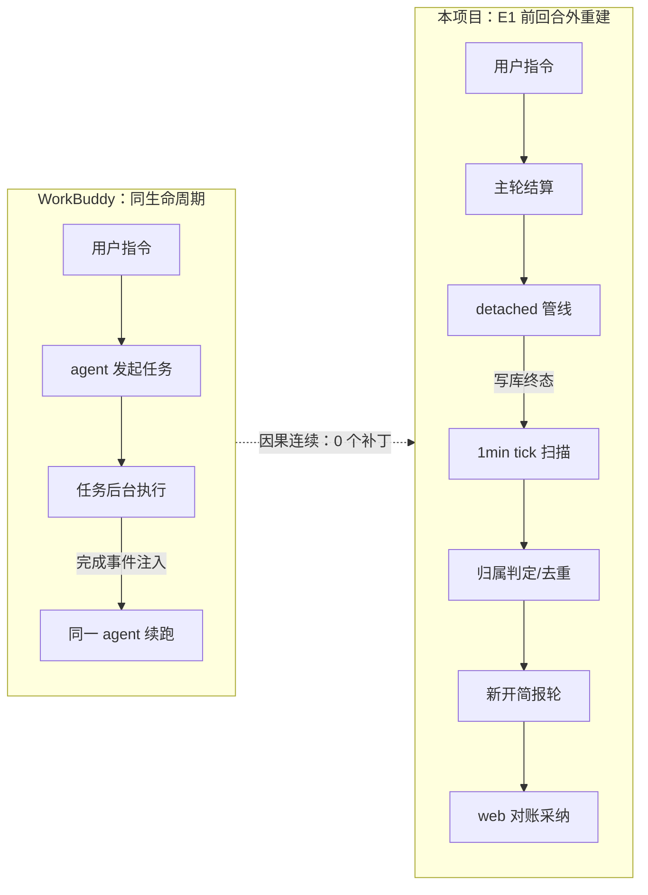
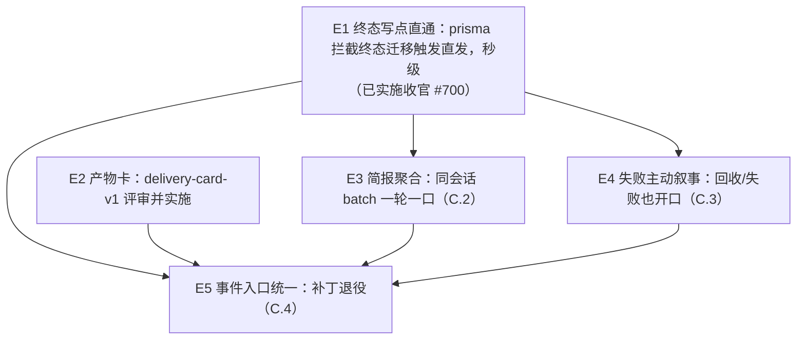
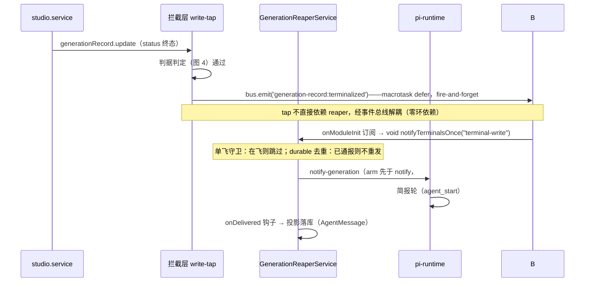
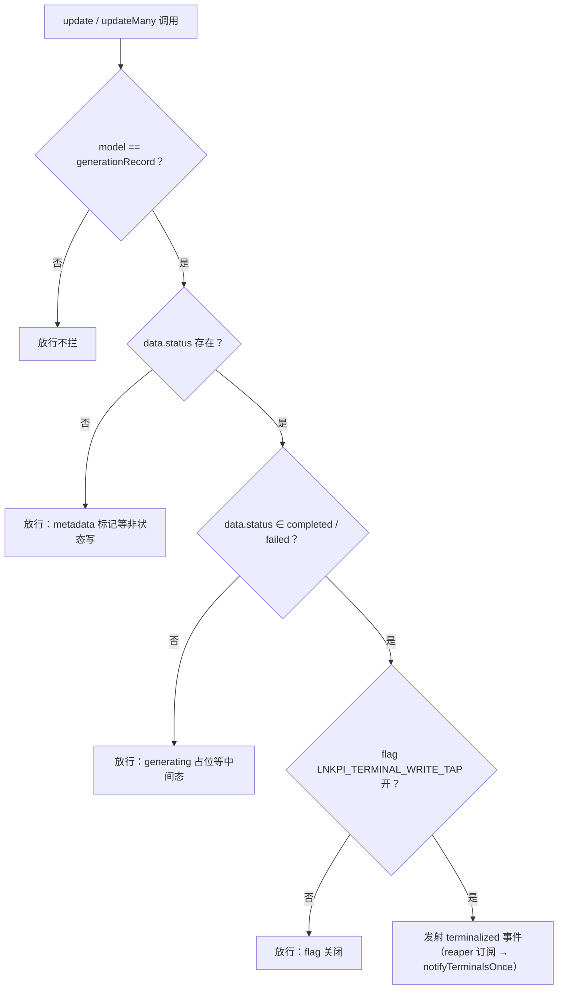
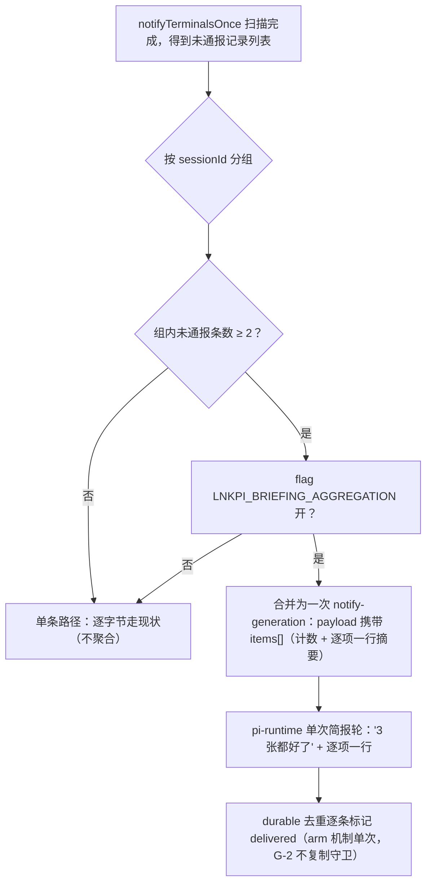
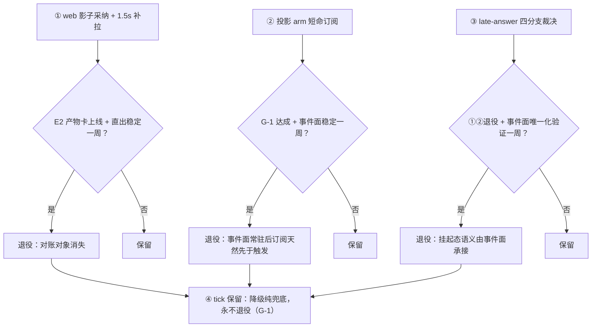

# E-系列演进路标：对话驱动画布的「始终在场」（E1→E5 合一载体）

状态：**演进中（单一载体）**（2026-11-04 由总纲 + E1 子规格合并为本文档，并补齐 E2-E5 路线；合并评估记录见 Part D）
- **E1 已实施收官**：PR #700 squash `14f5de6d`，flag on 生产生效，**G-1 观测中、2026-11-11 终审**（Part B §E1.10）
- **E2 规格就绪待评审**：独立载体 [`2026-11-02-delivery-card-v1-design.md`](./2026-11-02-delivery-card-v1-design.md)，本文 C.1 只做 E1 后交点修订，不重写
- **E3 / E4 / E5**：本文 Part C 立项规格（待评审、未排期；E4 具备提前立项条件，见 D.2-④）
来源：2026-11-03 体验对标复盘（WorkBuddy 第一手对比 + PR #685 生产取证 + 红/黄小龙虾/蓝老虎事故链）+ 2026-11-04 E1 收官复盘
前置：
- PR #684 `5583168a`（订阅先于触发，已上线）
- PR #685 `9e66ef84`（1min 快节拍 + web 影子采纳，已上线）
- PR #700 `14f5de6d`（E1 终态写点直通，已上线，本文 Part B）
- P1 治本总纲 A/B/C/D 四包（已收官）

分支约定：每期实施独立 feature 分支 + PR + squash merge；本文是路标载体，实现类变更在各期 PR 内完成。

## 0. 配图索引

| 编号 | 形式 | 内容 | 位置 | 用途 |
|---|---|---|---|---|
| 图 1 | 内嵌 Mermaid（flowchart） | E1→E5 分期依赖图 | A.6.2 | 验收：分期顺序与依赖不倒置 |
| 图 2 | 内嵌 Mermaid（flowchart） | 因果模型错位诊断 | A.3 | 验收：补丁清单与根因的对应关系 |
| 图 3 | 内嵌 Mermaid（时序） | E1 拦截→直发→简报轮全链路时序 | B/E1.5 | 验收：触发点与守卫的相对位置 |
| 图 4 | 内嵌 Mermaid（判据树） | E1 终态迁移判定（拦截 vs 放行） | B/E1.5.2 | 验收：判据穷举、metadata 更新不误触 |
| 图 5 | 内嵌 Mermaid（flowchart） | E3 扫描内聚合判定 | C.2 | 验收：单条旁路、成组条件、去重逐条 |
| 图 6 | 内嵌 Mermaid（flowchart） | E5 补丁退役顺序 | C.4 | 验收：退役门与观测窗口不倒置 |

---

# Part A 总纲（E1 后事实刷新，2026-11-04）

## A.1 背景：为什么是现在立项

**事故链（2026-10 底 → 11-03）**：天鹅事故（回合外简报零落库，P0-A 因果围栏）→ 蓝老虎
复测（Layer 3 订阅时序竞态，整轮静默丢失）→ 黄小龙虾复测（简报延迟 5.5min + 在线影子
气泡被对账冲掉）→ 红/蓝精灵复测（延迟压到 ~30s，链路全通）。

**立项缘起**：红/蓝精灵复测通过后，用户追问「为什么生成后不是秒级收到简报？是机制设计
问题还是刻意设计？」——这把讨论从「修 bug」推进到「对标体验」：与 WorkBuddy 的后台任务
机制（CI/CD 胶囊条、画布生图）逐项对标后，暴露出两者的差距不在功能覆盖，而在**因果模型
错位**（A.3）。此前所有修复都是止血（让简报「能到」），本系列是治本（让简报「秒到、该说
的说、不该说的沉默」，并把止血补丁逐步退役）。

**为什么是窗口期**：#684/#685 上线后简报链路已通、体验到达「可用水位」，生产观测手段
（notify reason 打点、notify-metrics 端点、automationRun 记录）齐备——此时立项可依赖
真实基线数据定义验收，而非边修边猜。**E1 已于 2026-11-04 收官上线**（Part B），本路标
进入 E2 评审 + E3/E4/E5 立项阶段。

## A.2 现状盘点（E1 上线后刷新）

### A.2.1 已上线机制矩阵

| 层 | 机制 | 载体 | 状态 |
|---|---|---|---|
| L1 落库 | 回合外简报轮持久化 | registry tombstone + Nest 四分支 + `POST /late-answer`（#661） | ✅ |
| L2 写者 | 生成 job 化 + 写者收敛 | 内核 0.99.2 + B1/B2/B6（#662-#665） | ✅ |
| L3 订阅 | 订阅先于触发 | `onBeforeNotify` + arm（≤3s 等 open）+ TTL 自愈（#684） | ✅ |
| L4 触发 | **终态迁移即直发**（E1）+ 1min 快节拍兜底 | Prisma `$extends` 拦截 → TerminalEventBus → `notifyTerminalsOnce`（#700）；单飞 + tick（#685） | ✅ |
| L5 呈现 | 文字简报（回合外 LLM 轮） | 简报轮 → AgentMessage → web 影子采纳 | ✅（E2 将升级为产物卡） |
| L6 回收 | 失败/超时兜底 | reaper 5min + #686 孤儿节点兜底 + audio 纳收 | ✅（**E4 补叙事；回收终态已被 E1 纳入事件面**） |

### A.2.2 各产物类型送达表现（E1 后刷新，原表为 E1 前现状）

| 产物 | 链路形态 | 送达路径（E1 后） | 预期延迟 |
|---|---|---|---|
| 图片（含编辑/放大） | detached 异步 | E1 拦截秒级触发（原 agent-canvas-tools 直发点不变，两路并存由 durable 去重收口） | 秒级触发 + 简报轮 10~20s |
| 视频 | detached，管线分钟级 | **E1 拦截秒级触发**（studio 写点原零直发、靠 tick——已被拦截覆盖） | 秒级触发 + 简报轮 |
| 音频 music | detached | **E1 拦截秒级触发**（#686 纳收的写点同被覆盖） | 秒级触发 + 简报轮 |
| 音频 design/voice | 同步 | 主轮直接回答 | 不走简报（设计如此） |
| 文案 / HTML 产物 | 同步 | 主轮直接回答 | 不走简报（设计如此） |

⚠️ 上表为机制推演（E1 判据 = status∈{completed,failed} 即触发，不分产物类型，A.2.2 原
「视频/音频走 1min tick」的陈述随 E1 上线过期）。**待 G-1 观测期用 notify-metrics 的
reason 分布实证**：`terminal-write` 占比应压至 tick <10%（2026-11-11 终审，Part B §E1.10.4）。

### A.2.3 WorkBuddy 对标结论（两轮对标汇总，第一手观察）

**第一轮（机制对标）**：
- WorkBuddy 的任务是 agent 自己发起、挂在同一会话；完成信号 = 进程退出 → **事件直接注入
  会话**唤醒 agent 循环续跑（CI/CD 胶囊条即此）。我们（E1 前）= 写库终态 → Nest 1min tick
  全表扫描发现 → 归属判定 → 新开简报轮。**事件驱动同轮续跑 vs 终态落库+轮询广播，本质不同。**
- WorkBuddy 的画布生图（ImageGen）/视频（VideoGen）/设计画布是**同步工具调用**——agent
  轮内等待，返回即得产物，不存在「完成→扫描→简报」环节；超长任务才降级到后台胶囊
  （仍是进程级事件回调）。两条路都是**点对点送达**，无中间广播层。

**第二轮（架构启示）**：
- 我们 Layer 3 订阅竞态、归属判定、web 对账冲突的全部复杂度来自「回合外」三个字；
  WorkBuddy 因果链在同一 agent 生命周期内天然连续，零归属问题。
- 差异根源不是「要不要实时」，而是**完成事件的送达路径**：点对点事件注入 vs 写库+定时
  广播扫描（轮询间隔+去重+归属重建都是广播模型的衍生成本）。

**不可照搬边界（总纲级共识）**：WorkBuddy 的任务是秒级命令/文件操作，同步等待与进程回调
都成立；我们面对跨服务分布式创作管线（第三方 provider、轮询、probe、merge），照搬「同步
等」会死（HTTP 挂 8 分钟），照搬「进程回调」须先把 20+ 写点收拢为事件源。**该抄的是因果
模型——「任务即会话内对象、完成即事件注入」，不是它的实现。**（E1 已完成「写点收拢为
事件源」这一步：拦截层即事件源。）

### A.2.4 存量补丁清单与退役归属（E5 的输入）

| 补丁 | 引入 | 作用 | 退役条件 | 现状（2026-11-04） |
|---|---|---|---|---|
| 投影 arm 短命订阅（`armOutOfTurnProjection`） | #684 | 订阅先于触发，简报轮落库 | 事件面稳定一周（G-1 达成） | E1 已上线，观测窗口 11-11 |
| `late-answer` 四分支裁决 | #661 | 挂起态迟到答案落库 | E5 事件面唯一化后 | 保留 |
| web 影子采纳 + 1.5s 补拉 | #685 | 在线简报气泡保序 | E2 产物卡直出后（对账对象消失） | 保留，E2 评审项 |
| 1min tick 扫描 | #685 | 直发覆盖不到的路径兜底 | **永不退役**（降级为纯兜底，G-1） | 保留，占比观测中 |
| 近 15h no-thread 误标记录 | 事故遗留 | 待清零重发 | 产品确认范围后执行 | 待执行 |

### A.2.5 当前体验评分（北极星基线，E1 后）

- 言出法随 ~60 分：提议卡→确认→生成闭环已有，产物需跳画布确认（E2 提升项）。
- 始终在场 ~60 → **~75 分**（E1 后重估）：触发秒级已达成、全产物类型覆盖；失分项 =
  文字转译（E2）、失败沉默（E4）、连发流水账（E3）、补丁未退役（E5）。

## A.3 问题：补丁的总量就是架构缺陷的计量表

Layer 1-3 修复链（#675/#679/#680/#684）、PR #685 的 web 影子采纳、B2 对账、孤儿节点兜底——
过去两周全部「回合外简报」类事故的修复，都是在给同一个架构错位打补丁：

**我们把「回合」做成了架构一等公民，但用户的创作会话不是回合制的。**

用户心智：我在画布上持续创作，agent 一直在场。
系统实现：一问一答的回合制 + 回合外事件打补丁（简报轮、投影 arm、对账、影子气泡）。
产物生成 detached（P1-B）后主轮结算，结果「回合外」回来 ⇒ 归属判定、SSE 订阅时序、
web 对账冲突、durable 去重等全部复杂度都来自「回合外」三个字。

（见 图 2）



**图 2 · 回合外重建路径的补丁对应——图中每一段中间环节即一类已发生事故**

图 2 说明了什么：同生命周期路径（上）在任务完成后事件直达同一 agent，零中间层；
回合外路径（下）每一段箭头都对应一类已发生的事故（归属=no-thread 15h、订阅时序=
Layer 3 竞态、对账=影子气泡被冲、扫描=延迟 0~6min）。E1 已把「写库→扫描」段替换为
「拦截→直发」（Part B），E 系列的剩余目标是把其余中间层从「主路径」降级为「纯兜底」。

## A.4 北极星

**言出法随 + 始终在场。**

- 言出法随：说话→产物出现，本轮对话流内可消费产物（基线见 A.2.5）。
- 始终在场：产物变故 agent 主动说（完成/失败/超时），秒级、不打扰、可聚合。

⚠️ 诚实边界：E 系列的「秒级」指**触发**秒级（终态落库→agent 开简报轮 ≤5s，E1 已交付）；
用户看到简报仍是 +LLM 回合 10~20s（读上下文写摘要，不可压）。用户可感知的「秒级产物
呈现」由 E2 交付卡承接（结构化载荷直出，不走文字转译）。两层叠加后体验才是完整的
「始终在场」。

## A.5 总纲判据（G-系列，全期有效）

- **G-1 兜底降级判据**：1min tick 永远保留，但任何 E 期实施后，tick 命中量占通报总量的比例必须下降（观测打点按 reason 分布）；E1 落地后 tick 应 <10%（**按「已通报记录数」口径，Part B §E1.5.3 / D-7**；生产观测一周定阈值）。
  ⭐ **观测口径补强（2026-11-04 实证）**：`NotifyMetrics` 计数器为进程内存态，**容器重启即归零**——G-1 终审按「最后一段连续无重启窗口」的累计值出数，窗口内出现重启则该段作废重算（automation 巡检记录 restart 事件）。
- **G-2 单飞与去重不复制判据**：任何新触发路径只准「调用」`notifyTerminalsOnce` 与 durable 去重，禁止各期自建第二套并发守卫。
- **G-3 纯增量判据**：E1-E4 每期实现必须是可独立回滚的纯增量模块（feature flag），不重构既有函数签名；E5 之前禁止删除任何既有补丁（补丁退役只在 E5）。
- **G-4 状态层冻结判据**：不新增第五状态层；新增字段走既有 `node_status` details / GenerationRecord metadata，遵守 delivery-card-v1 D-4（不塞 Content）。
- **G-5 用户感知判据**：每期必须有可从用户侧复现的验收场景（不复现 = 不验收），验收记录写回本文 Part C 对应节。

## A.6 未来路线：分期、依赖与开放问题

### A.6.1 分期定义

| 期 | 名称 | 一句话 | 状态 | 规格 |
|---|---|---|---|---|
| E1 | 终态写点直通 | 终态迁移即直发，秒级触发；tick 降级兜底 | **已实施收官**（PR #700，G-1 观测至 11-11） | 本文 Part B |
| E2 | 产物卡 | 对话流内消费产物，消灭文字转译 | 规格就绪待评审（E1 后交点修订见 C.1） | [`2026-11-02-delivery-card-v1-design.md`](./2026-11-02-delivery-card-v1-design.md) |
| E3 | 简报聚合 | 同会话多条未通报合并一轮（连发三张图→「都好了」） | **本文立项待评审** | C.2 |
| E4 | 失败主动叙事 | 回收/失败/孤儿置 error 时 agent 开口 + 动作 | **本文立项待评审**（事件源已被 E1 预埋，具备提前立项条件） | C.3 |
| E5 | 事件入口统一 | 一次性收敛回合外补丁，事件面唯一 | 收官期（E1-E4 生产稳定一周后实施） | C.4 |

### A.6.2 依赖图

（见 图 1）



**图 1 · E1 已落地，E2 与 E3/E4 可并行评审，E5 收官**

图 1 说明了什么：E1 是 E3/E4/E5 的共同地基（触发点），已交付；E2 与 E1 并行（交点=交付卡
完成时机从 ≤1min 变秒级，字段契约不变，C.1 已核查）；E3/E4 均依赖 E1 的触发点与事件源，
可与 E2 并行进入实施；E5 是终点，退役补丁必须在 E1-E4 全部稳定生产一周后。

### A.6.3 各期开放研究问题（子规格立项时引用；E3/E4/E5 已在 Part C 收敛为规格）

- **E1**（已闭卷）：`$extends` 类型兼容面已按 Part B §E1.5.2 配方解决；updateMany 风暴
  节流由单飞守卫吸收（生产验证随 G-1 窗口）。
- **E3**：聚合窗判定、跨 run 多产物计数与逐项摘要的上下文成本 → 已收敛为 C.2 方案 A
  （扫描内成组，零新定时器）；开放问题余项见 C.2「开放问题」。
- **E4**：失败文案语气与动作矩阵、「超时未完成」与「生成失败」的区分叙事 → 已收敛为 C.3
  语气矩阵 + reason 判据字段；开放问题余项见 C.3「开放问题」。
- **E5**：退役顺序 → 已收敛为 C.4 图 6 三阶段顺序 + 逐项退役门；开放问题余项见 C.4。

## A.7 明确不做（总纲级）

- 不照搬 WorkBuddy 的同步等待形态（视频 8min 管线，HTTP 挂等待不可行）。
- 不做跨会话聚合（简报归属是单会话语义，跨会话属通知中心另一产品面）。
- 不在本系列内改 `canvasData` 写通道（C2a/C2b 已治理，E2 只读节点）。
- 不在 E1-E4 期间退役任何既有补丁（G-3）。
- 不做同会话外的通知中心/消息中心（简报即会话内叙事，聚合边界 = 单会话单扫描窗）。

## A.8 里程碑与验收口径

1. **M1（E1 上线）— 达成判定进行中**：触发延迟 P95 ≤ 5s（直发路径，机制已上线待 3 次样本正式采样）；tick 命中占比 <10%（G-1，**2026-11-11 终审**，观测口径见 A.5 G-1 补强）。
2. **M2（E2 上线）**：图/视频/音频产物在对话流内可预览，零跳画布确认率 ≥ 80%（埋点）。
3. **M3（E3+E4 上线）**：连发多产物场景简报条数 = 聚合轮数（非产物数）；失败场景 100% 有 agent 叙事。
4. **M4（E5 收官）**：补丁退役清单清零，回合外重建代码面 ≤ 现状 50%。

---

# Part B E1 子规格（已实施，全文存档）

> 本 Part 为 2026-11-03 E1 规格全文 + §E1.10 实施收官记录，随合并并入本载体（2026-11-04）。
> 原独立文件退役，引用统一指向本文 Part B。

## E1.1 背景与取证

**背景**（详见 Part A §A.1-A.3）：天鹅→蓝老虎→黄小龙虾事故链修复后简报链路已通，但
WorkBuddy 对标结论表明差距在「完成事件的送达路径」——它是进程级事件点对点注入，我们是
「写库→1min tick 全表扫描」广播模型。E1 把送达路径升级为「终态迁移即触发」，tick 降级纯兜底。

**延迟构成**（2026-11-03 生产取证，蓝/红精灵会话）：

| 产物类型 | 直发路径 | 延迟 |
|---|---|---|
| text 及 agent-canvas-tools 结算的生成 | `notifyTerminalNow` 10 个调用点（全部在 agent-canvas-tools.service.ts） | 秒级（终态写入同毫秒触发） |
| **studio 管线直写的终态**（image/video/audio 的 probe/merge/provider 回调/超时分支） | **零直发**，只靠 1min tick 扫描 | 0~60s 随机（黄小龙虾旧版 5.5min 即此根因） |

**写点分布**（`git grep` 取证）：`generationRecord.update/updateMany` 生产代码共 29 处
—— studio.service.ts 27 处（completeImage/Video/Music 的成功、失败、超时、fallback 各
分支，无公共 helper）+ generation-reaper.service.ts 1 处（回收）+ late-generation-notify
1 处（`agentTurnNotified` metadata 标记，**非终态迁移，不应触发**）。

## E1.2 目标

1. 终态落库 → 直发触发延迟 **P95 ≤ 5s**（当前 tick 路径 0~60s）。
2. studio 写点 **零改动**（B2 当年放弃逐点挂钩的教训：漏改 = 静默丢简报）。
3. tick 降级为纯兜底（G-1：上线一周后 tick 命中占比 <10%）。
4. 新增生成类型/新写点**自动被覆盖**（写咽喉性质，与 reaper 读咽喉同构）。

## E1.3 范围（含明确不做）

**做**：
- 新模块 `apps/server/src/studio/terminal-write-tap.ts`：Prisma `$extends` 拦截 +
  终态迁移判据 + **向领域事件总线发射 `generation-record:terminalized`**（不直接依赖
  `GenerationReaperService`，规避 PrismaService→reaper 环依赖；详见 E1.5.1 / E1.5.2）。
- 事件总线 `apps/server/src/studio/terminal-events.ts`：Node `EventEmitter` 薄封装
  （leaf module，无对外依赖），唯一事件 `terminalized`。`GenerationReaperService.onModuleInit`
  订阅该事件后调用既有 `notifyTerminalsOnce('terminal-write')`，单飞 / 去重 / arm 全复用。
- feature flag `LNKPI_TERMINAL_WRITE_TAP`（env，缺省开；关 = 行为与今天逐字节一致，且不挂扩展）。
- reason 度量计数器 `NotifyMetrics`（server 当前无 prom/otel 设施，须新增）：按**已通报记录数**
  累加 `generation_notify_records_total{reason}`（`terminal-write` / `notify-tick` / `periodic` /
  `startup` / `manual` / `orphan-reap` 预留），供 G-1 按记录数（非扫描调用次数）度量。

**不做**：
- 不改 studio.service.ts 任何一处 update 调用（零写点改动是本规格的存在理由）。
- 不改 `notifyTerminalsOnce` 内部（直发、去重、单飞守卫、arm/onDelivered 钩子全部原样复用）。
- 不引入 outbox 表 / 新 worker / 新定时器。
- 不做同会话聚合（E3）、不做失败文案（E4）——本包只保证「触发」。
- 不拦截 reaper 对 canvasData/Session 的写（只挂 GenerationRecord 模型）。

## E1.4 方案裁决（A / B / C 对比，拍板 A）

| 方案 | 改造面 | 风险 | 裁决 |
|---|---|---|---|
| **A. Prisma `$extends` 终态迁移拦截** | 1 个新模块，零写点改动 | 判据需精确（E1.5.2 给出运行时白名单判据） | **拍板** |
| B. 收拢 27 处为 settle helper 再挂钩 | 27 处 × 各分支测试 | 漏改 = 静默丢简报（B2 已证明逐点路线维护性差） | 否决 |
| C. tick 提频 30s | 极小 | 不治本，扫描频率换延迟 | 否决 |

**拍板 A 的五条理由**：① 改造面即交付风险（1 vs 27）；② 「读咽喉→写咽喉」哲学同构，
新写点自动覆盖是已验证性质；③ 净新增面最小（直发/去重/单飞/钩子全复用 #684/#685）；
④ 判据是运行时白名单数组（已对 27 写点取证，零语义猜测）；⑤ 纯增量 + flag 可回滚（G-3）。

**A 路线下的耦合方式（评审修正）**：tap 经**领域事件总线**间接触发 `notifyTerminalsOnce`，
而非规格初稿的「tap 直调 reaper」。理由：PrismaService 是 reaper 的依赖（reaper 注入
PrismaService），若扩展反向依赖 reaper 即构成初始化环；事件总线是 leaf 模块、零环，
且天然为 E5「事件入口统一」铺路。

## E1.5 详细设计

### E1.5.1 全链路时序

（见 图 3）



**图 3 · 拦截层只做触发器——并发治理全部在既有 notifyTerminalsOnce 一侧**

图 3 说明了什么：拦截层只是「触发器」，且只发事件、不持有通知逻辑——通报的全部并发治理
（单飞、去重、订阅先于触发、投影落库）都在既有 `notifyTerminalsOnce` 一侧。`terminal-write-tap`
自身无状态、无锁、无重试，fire-and-forget 保证写路径零阻塞（判据 D-2）。**关键修正**：
tap 经由领域事件总线间接驱动 reaper 订阅，而非直调 `GenerationReaperService`——因
PrismaService 是 reaper 的依赖，反向直调会构成模块初始化环（判据 D-6）。

### E1.5.2 终态迁移判据（图 4）

（见 图 4）



**图 4 · 终态迁移判据四层判定——全部配置级/运行时白名单，无语义猜测**

图 4 说明了什么：判据四层全部是**配置级/运行时白名单**断言，无业务语义猜测——
`data.status` 字段存在性天然区分「终态迁移」与「`agentTurnNotified` 标记更新」（后者
只写 metadata，不含 status，即 E1.1 取证中的第 29 处写点不误触）；
状态终态集合为运行时白名单 `TERMINAL = ['completed','failed']`（`generationRecord.status`
是自由 `String` 字段，非 Prisma enum；已对 studio 27 个写点取证，终态仅 completed/failed，
`fallback_pending` 为中间态、reaper 的 `error` 只改 canvas node 不改 record，均不误触）。

**边界语义**：
- reaper 回收（generating→completed/failed）**同样触发**——回收是超时终态，正为 E4
  「失败主动叙事」供事件；本包不改文案，简报内容与今天一致。
- 同一 update 内 `metadata` 与 `status` 同时写：含 status 即触发，metadata 部分照常写入（拦截是旁路观察者，不改写调用参数）。
- `$extends` 挂载点：在 `PrismaModule` 的 `useFactory` 内按 flag 挂载（下方配方），
  flag 关 = 返回 base（不挂扩展，client 保持 base 类型）；与其他 `$extends`（如存在）叠加顺序无关
  （拦截只读参数不修改，且扩展仅作用于 GenerationRecord 模型）。
  ⚠️ 实现注意（生命周期陷阱，评审修正）：`$extends` 返回**新 client，不带**
  `PrismaService` 的 `onModuleInit/onModuleDestroy`——若在其内部 `this=extended` 或直接
  把扩展当 PrismaService 注入，会导致 `$connect` 永不调用、DB 静默断连。安全挂载点在
  `PrismaModule` 的 `useFactory`：
  ```ts
  {
    provide: PrismaService,
    useFactory: (bus: TerminalEventBus) => {
      const base = new PrismaService()
      if (process.env.LNKPI_TERMINAL_WRITE_TAP === 'false') return base
      const ext = base.$extends(createTerminalWriteTap(bus))
      ext.onModuleInit = () => ext.$connect()      // 重绑丢失的生命周期
      ext.onModuleDestroy = () => ext.$disconnect()
      return ext as unknown as PrismaService
    },
    inject: [TerminalEventBus],
  }
  ```
  消费者类型保持 `PrismaService` 不变（cast 不外泄），server 全量 `tsc` 仍须跑一遍确认。
  flag 关 = 返回 base（不挂扩展，行为逐字节一致）。
  ⚠️ 事务鲁棒性（评审补充，非当前必现）：studio 当前终态写均为 autocommit、`$transaction`
  包裹，故 after-callback 在提交后触发、扫描可见该行；作为对未来重构的保险，事件发射应
  `defer` 到 macrotask（`setTimeout(0)`），零成本且不影响 D-2 零阻塞。

### E1.5.3 观测（评审修正：补度量基础设施 + 修正口径）

- 复用既有日志：`[${reason}] 回合外生成终态通报已处理 N 条`（notifyTerminalsOnce 原样）。
- **新增计数器 `NotifyMetrics`**（server 当前无 prom/otel/counter 设施，须随本包落地）：
  在 `notifyTerminalsOnce` 内按**实际已通报记录数 `notified`** 累加
  `generation_notify_records_total{reason}`（terminal-write / notify-tick / periodic /
  startup / manual / orphan-reap 预留）；暴露面 = `GET /api/health/notify-metrics`（实施补充，见 E1.10.2）。
- ⚠️ **G-1 度量口径（评审修正）**：占比必须按「**已通报记录数**」而非「扫描调用次数」计算。
  每次终态写都会发起一次 `terminal-write` 扫描（即便 `notified=0`），若按调用次数计，
  `terminal-write` 轻易碾压 `notify-tick` 造成 vacuous pass。正确公式：
  `tick占比 = Σnotified{notify-tick} / Σnotified{all-reason}`，上线一周出基线（目标 <10%）。

## E1.6 判据（D-系列）

- **D-1 零写点改动判据**：PR diff 中 `studio.service.ts`、`generation-reaper.service.ts`、
  `late-generation-notify.ts` 的 update 调用零行变更（review 硬检查）。
- **D-2 零阻塞判据**：拦截层对 update 的返回值透传原样（不改参数/不改返回），触发走
  `void … catch(warn)`，写路径不 await 通报（变异：把 void 改 await ⇒ 写路径延迟测试必须红）。
- **D-3 判据穷举判据**：图 4 的每个「放行」分支各有至少一个测试用例（含
  `agentTurnNotified` metadata 更新不触发的反例——即 E1.1 的第 29 处写点）。
- **D-4 守卫复用判据**（G-2）：并发两条终态 update ⇒ `notifyInFlight` 使第二次
  触发跳过；已通报记录 ⇒ durable 去重跳过。测试复用 #685 既有单飞/去重用例形态。
- **D-5 flag 语义判据**：flag 关闭时 `$extends` 不挂载（非空转判断），行为与今天逐字节一致。
- **D-6 解耦判据（评审新增）**：`terminal-write-tap` 不直接 import / 调用
  `GenerationReaperService`；仅向 `TerminalEventBus` 发射事件，订阅方在 reaper 一侧。
  用「模块初始化顺序测试 + 环依赖静态检查」验证无 PrismaService→reaper 环。
- **D-7 度量口径判据（评审新增）**：`NotifyMetrics` 仅在 `notified>0` 时按 `notified` 计数；
  G-1 验收按「已通报记录数」口径，禁止按扫描调用次数判定。

## E1.7 测试策略

1. **单元**：判据树全分支（图 4 六路）+ flag 开关 + 返回值透传。
2. **变异测试**（守卫必须行为级）：① 判据去掉 `status ∈` 检查 ⇒ D-3 用例必须红；
   ② 触发改 await ⇒ D-2 用例必须红；③ flag 判断取反 ⇒ 开关用例必须红。
3. **集成**：completeImage 成功 / 失败 / 超时三分支各触发一次（断言 notify mock 收到
   `terminal-write`）；reaper 回收路径触发一次（E4 铺垫）。
4. **回归**：generation-reaper.service.test.ts 全量不动；notify-tick 用例语义不变。
5. **解耦（D-6）**：单元测试断言 `terminal-write-tap` 在终态写后向 bus 发射事件，且**不**
   直接调用 reaper（mock reaper 未被直接引用）；reaper 订阅测试断言收到事件后调用
   `notifyTerminalsOnce('terminal-write')`。验证模块初始化无环（可用 import 顺序断言）。
6. **挂载与生命周期（E1.5.2）**：flag 关→工厂返回 base（无扩展，且 `$connect` 正常）；
   flag 开→扩展挂载且 `onModuleInit/onModuleDestroy` 仍触发 `$connect/$disconnect`
   （断言 DB 可连）。server 全量 `tsc` 通过。
7. **度量（D-7）**：`notifyTerminalsOnce` 在 `notified=0` 时不计 `terminal-write`；
   `notified=3` 时 `generation_notify_records_total{terminal-write}=3`。

## E1.8 回滚

- `LNKPI_TERMINAL_WRITE_TAP=false` → `$extends` 不挂载，等同回滚。
- 模块独立文件（`terminal-write-tap.ts` + `terminal-events.ts`），回滚 = 删两文件 +
  摘 `PrismaModule` 挂载行与 reaper 订阅行 + 摘 `NotifyMetrics`，无遗留。

## E1.9 验收（生产）

| 项 | 判据 |
|---|---|
| 直发延迟 | 蓝精灵式复测：图片 probed 完成 → 简报触发 ≤ 5s（取 3 次样本） |
| tick 占比 | 上线一周按「已通报记录数」口径：`Σnotified{notify-tick} / Σnotified{all}` <10%（G-1，D-7 口径） |
| 零回归 | 一周内无重复简报（durable 去重无击穿）、无通报风暴（单飞守卫日志零跳过异常） |
| 写路径 | studio 生成接口 P99 延迟环比无劣化（D-2 生产面） |

## E1.10 实施收官记录（2026-11-04）

### E1.10.1 落地与部署

- **PR #700**（分支 `feature/e1-terminal-write-tap`，squash merge `14f5de6d`）→ deploy.yml 自动发布 → 容器 `lnkpi-api:14f5de6d` healthy。此后随 #708/#710 两轮部署持续在位，生产现网运行。
- **生产取证四锚**：`GET /api/health/notify-metrics` 返回 `terminalWriteTapEnabled:true`；容器 bundle 含 E1 三模块（terminal-events / notify-metrics / terminal-write-tap）；flag `LNKPI_TERMINAL_WRITE_TAP` 生产未设 = 缺省开（E1.5.2 语义）；`/api/health` ok。

### E1.10.2 实现映射（规格条目 → 落点）

| 规格条目 | 落点 |
|---|---|
| E1.3 拦截模块 | `apps/server/src/studio/terminal-write-tap.ts`（`$extends` 四层判据，图 4 逐分支实现） |
| E1.3 事件总线 | `apps/server/src/studio/terminal-events.ts`（leaf EventEmitter，唯一事件 `terminalized`） |
| E1.5.2 挂载点 | `prisma.module.ts` `useFactory` 按 flag 挂载 + 重绑 `$connect/$disconnect`（flag 仅精确 `'false'` 关） |
| E1.5.3 计数器 | `apps/server/src/studio/notify-metrics.ts`（`generation_notify_records_total{reason}`，仅 `notified>0` 按 `notified` 计） |
| E1.3 订阅方 | `generation-reaper.service.ts` `onModuleInit` 订阅 → `notifyTerminalsOnce('terminal-write')`（D-1 核验：reaper 通报逻辑零改动） |
| E1.5.3 观测暴露 | `health.controller.ts` 新增 `GET /api/health/notify-metrics`（实施补充：规格只定了计数器，未指定读取面） |

### E1.10.3 判据落实（D-1 ~ D-7）

- **测试 8 文件 75 例全绿**（terminal-events 4 / notify-metrics 3 / terminal-write-tap 15 / mutation 7 / integration 3 / prisma.module 4 / reaper 35 / health 4）+ server `tsc --noEmit` 0 error + server 全量 2392 例通过。
- D-1 零写点改动：studio.service.ts / late-generation-notify.ts 的 update 调用零行变更（review 核验）。
- D-2/D-3/D-5 变异三件套反例全红（await 化 / 去判据 / flag 取反）；D-6 静态解耦守卫（tap 不 import reaper，仅发 bus）。
- D-4：复用 #685 既有单飞/去重用例形态，reaper 回归 35 例全过（规格写 31 例，实施期间随订阅用例自然增至 35，语义不变）。
- D-7：`notified=0` 不计数；按「已通报记录数」口径（G-1 公式见 E1.5.3）。

### E1.10.4 §E1.9 生产验收进度

| 项 | 状态 |
|---|---|
| 直发延迟 ≤5s（3 次样本） | 待正式采样（机制已在生产运行，采样随 G-1 观测期完成） |
| tick 占比 <10%（G-1） | **观测中**：计数器为进程内存态，2026-11-04 因 #708/#710 部署与容器重建多次归零，基线自最后一轮重建（11-04 午后）起算；每日 10:00 巡检 automation（id `35c208b9`）取快照，**2026-11-11 终审**（口径补强见 A.5） |
| 零回归（无重复简报/风暴） | 观测中（同窗口） |
| 写路径 P99 环比 | 观测中（同窗口） |

### E1.10.5 回滚面确认

- `LNKPI_TERMINAL_WRITE_TAP=false` → 工厂返回 base client，不挂扩展，行为与今天逐字节一致（D-5 测试覆盖）。
- 模块独立三文件 + 挂载行 + 订阅行，回滚无遗留（E1.8 判据保持有效）。

---

# Part C 路线补齐（E2 交点修订 + E3/E4/E5 立项规格）

## C.1 E2 产物卡：E1 后交点修订（不重写，规格本体见独立载体）

E2 规格本体 = [`2026-11-02-delivery-card-v1-design.md`](./2026-11-02-delivery-card-v1-design.md)
（待评审），本节只登记 **E1 上线后对 E2 的交点核查结论**，作为 E2 评审输入：

| 核查项 | 结论 | 依据 |
|---|---|---|
| E2 事件链路对触发节拍有无假设 | **零假设**——E2 契约是 progress ticker（`details.generating`）+ `NodeStatusData` v2 + artifact 交付状态机，全部事件驱动，不依赖 tick 周期 | delivery-card-v1 全文无 tick/1min 依赖（2026-11-04 取证） |
| E1 对 E2 的收益 | `running→completed` 的到达时间从 ≤1min（tick）变秒级（E1 拦截）；产物卡出现时机同步提前，无需改契约 | E1 判据不分产物类型（图 4） |
| 失败态动作与 E4 的同源接缝 | delivery-card §5.3 artifact 交付状态机的 `failed` 态动作枚举 = E4 失败叙事的动作源（C.3），前端一处实现两处消费 | 两规格共享动作语义，E4 评审须与 E2 互认 |
| E2 评审须补的登记项 | 在其「与既有规格的关系」节登记：E1 已上线（#700）、notify-metrics 观测面可用、本载体（Part C.1）为交点记录 | 引用完整性 |

## C.2 E3 简报聚合：同会话多条未通报合并一轮（立项规格，待评审）

### C.2.1 背景与取证

连发「生成红色小精灵」「生成蓝色小精灵」「再生成一只黄色小恐龙」⇒ 三条流水账简报
依次刷屏（每条一轮独立 LLM 简报轮）。用户心智是「三张都好了」，不是三条独立播报。
取证：`notifyTerminalsOnce` 单次扫描**逐条遍历**未通报记录、每条独立 notify-generation
→ pi-runtime 各开一轮简报——同 scan batch 天然同窗，聚合的自然切面就在这里。

### C.2.2 方案裁决

| 方案 | 做法 | 裁决 |
|---|---|---|
| **A. 扫描内成组合并**（推荐） | 单次扫描结果按 sessionId 分组；组内 ≥2 条未通报 → 合并为一次 notify（携带 items[]） | **拍板**：零新定时器（G-2/G-3），窗口天然来自扫描 batch，实现面最小 |
| B. 显式延迟聚合窗 | 等 N 秒收窗再发 | 否决：新定时器 + 窗口调参，违反 G-3「不引入新定时器」 |
| C. 前端聚合展示 | agent 仍逐条简报，web 合并渲染 | 否决：治标——N 轮 LLM 成本、N 条消息落库、对账复杂度全都还在 |

### C.2.3 设计（方案 A）

（见 图 5）



**图 5 · E3 聚合判定——单条旁路、成组条件、去重逐条三关卡**

图 5 说明了什么：聚合只发生在「同会话 + 同一次扫描 + 组内 ≥2 条 + flag 开」四条件齐备时；
单条路径与 flag 关闭路径**逐字节等于现状**（回滚面）；durable 去重仍逐条落标记，
differ 是「通报次数」而非「记账次数」，账实分离保证对账与重发语义不变形。

**要点**：
- items[] 元素 = `{nodeId, kind, 一行摘要}`，摘要由既有记录字段拼装（prompt 截断 + 状态词），**不在简报轮额外调 LLM 生成摘要**（上下文成本受控）。
- 与 E2 §5.4 批次聚合的关系：E2 聚合的是**前端产物卡渲染批次**，E3 聚合的是**agent 简报轮次数**——两层不重叠，但产物计数与逐项摘要必须同源（同一 items[] 语义），评审两规格时互认字段。
- 组内产物类型混合（图+视频）允许，摘要词序按完成时间排序。

### C.2.4 判据（E3-D 系列）

- **E3-D1 轮数判据**：连发 N 条同会话产物 ⇒ 简报轮 = 1（聚合路径），AgentMessage 落库 1 条；单条场景 = 现状 1 轮。
- **E3-D2 零定时器判据**：不新增任何 timer/worker（G-3）；窗口 = 单次扫描 batch。
- **E3-D3 守卫复用判据**（G-2）：并发两条扫描的聚合互斥由既有 `notifyInFlight` 单飞收口，禁自建锁。
- **E3-D4 单条旁路判据**：组内 =1 或 flag 关 ⇒ 通知路径逐字节等于现状（变异：去掉条数判断 ⇒ 用例必须红）。
- **E3-D5 账实分离判据**：聚合轮发出后 durable 去重**逐条**标记 delivered（不整组一条标记），重发/对账按记录粒度不变形。

### C.2.5 测试策略与回滚

- 单元：分组纯函数（同会话成组/跨会话隔离/≥2 判定/单条旁路）；payload 组装（计数+items 截断 >5 条）；变异三件套（去分组/去条数判断/flag 取反）。
- 集成：scan mock 返回同会话 3 条 → 断言 notify 调用 1 次 + items 长度 3 + 去重标记 3 条。
- 回滚：`LNKPI_BRIEFING_AGGREGATION=false` → 全部走单条现状路径。
- 验收（G-5 用户侧）：连发 3 图场景，简报条数 = 1 且语义含计数（「3 张都好了」式）。

### C.2.6 开放问题（实施前须答）

- 组内上限：>5 条截断策略（建议 items 全量落库、简报文本只展开前 5 条 + 「…另有 N 件」）。
- 聚合轮的简报归属：与 E1 链路的 onDelivered 投影落库共享 `agentMessage` 写方，须确认 `seq` 补齐（跨规格接缝，见 multi-device-consistency 规格接缝行）。
- E4 失败叙事上线后，失败记录是否进聚合组（建议：同会话同窗失败可合并，见 C.3 开放问题）。

## C.3 E4 失败主动叙事：回收/失败/孤儿置 error 时 agent 开口 + 动作（立项规格，待评审）

### C.3.1 背景与事件源（E1 已预埋）

现状：生成失败/超时/孤儿兜底时，agent **沉默**——用户只看到画布节点置红，没有任何解释，
更没有「要重试吗」。E1 的边界语义已把 reaper 回收（generating→completed/failed）纳入
事件面（图 4 判据不分成败），**失败叙事的事件源已经存在**，E4 只补「说什么 + 给什么动作」。

### C.3.2 设计

**语气与动作矩阵**（配置表落地，禁止散落硬编码）：

| 场景 | reason | 事件源 | 文案基调 | 动作集 |
|---|---|---|---|---|
| provider 生成失败 | terminal-write（status=failed） | E1 拦截 studio 写点 | 「XX 生成失败了，原因是 …」 | 重试（同 prompt+params 重新入队）/ 诊断（展开失败 detail） |
| 超时回收 | terminal-write（reaper 回收） | E1 拦截 reaper 写点 | 「等了太久没出结果，已停止，可重试」 | 重试 / 换参数建议 |
| 孤儿兜底置 error | orphan-reap（预留 reason） | #686 孤儿节点兜底 | 「发现一个没处理完的任务，已标记失败」 | 重新发起 |

- 动作枚举与 delivery-card §5.3 `failed` 态**同源**（C.1 互认项）：前端一处实现，简报文本内联动作提示 + 产物卡按钮两处消费。
- 「超时未完成」vs「生成失败」的判据字段：reaper 回收记录携带 `timeout: true` metadata（现状 reaper 写入语义待实施时核实，开放问题 ①）。
- 失败叙事**可被 E3 聚合**：同会话同窗多条失败合并为一轮（「2 个任务失败了」+ 逐项动作）。

### C.3.3 判据（E4-D 系列）

- **E4-D1 全覆盖判据**：失败场景 100% 有 agent 叙事（M3 口径；变异：注释叙事分支 ⇒ 集成用例必须红）。
- **E4-D2 动作可执行判据**：叙事携带的动作真实可执行（重试=重新发起 run，非死文案）。
- **E4-D3 配置表判据**：语气矩阵为单一配置表（测试断言全部场景走表驱动，无散落字符串）。
- **E4-D4 flag 判据**：`LNKPI_FAILURE_NARRATIVE` 关 ⇒ 失败行为与今天逐字节一致（沉默 + 节点置红）。

### C.3.4 开放问题

- ① 超时/失败判据字段的现状核实（reaper 是否已写 timeout 标记，若无须在 E4 内补——注意 G-3 纯增量边界，reaper 写点改动须单列评审）。
- ② 失败叙事的打扰抑制：与「回合外让路」机制（宁晚勿扰）的叠加顺序。
- ③ 重试动作的授权面：重试是否需用户确认（建议：确认门沿用生成动作既有审批分级 P1-D）。

## C.4 E5 事件入口统一：补丁退役收官（立项规格，待 E1-E4 稳定一周后实施）

### C.4.1 目标与退役清单

把回合外补丁收敛为常驻事件面（E1 拦截 + notifyTerminalsOnce 唯一入口），退役清单逐项
带走（A.2.4 表为完整输入）。**回合外重建代码面 ≤ 现状 50%**（M4 口径）。

（见 图 6）



**图 6 · E5 退役顺序——每项有独立退役门，tick 永远保留**

图 6 说明了什么：退役按依赖序三阶段执行（影子采纳最先——E2 直出后对账对象消失；
投影 arm 次之——G-1 证明事件面覆盖后订阅不再需要短命补丁；late-answer 最后——
须等事件面唯一化验证）；每项退役是**独立 PR、独立回滚**；tick 在任何阶段都不退役。

### C.4.2 判据（E5-D 系列）

- **E5-D1 逐项门判据**：每项退役前须证明其被事件面替代 + 生产观测零回归一周（图 6 门条件），缺一不退。
- **E5-D2 独立回滚判据**：每项退役 = 独立 PR（可单独 revert），禁止捆绑退役。
- **E5-D3 兜底保留判据**：1min tick 在 E5 及以后永续保留（纯兜底），退役 PR diff 含 tick 删除即拒绝。

### C.4.3 开放问题

- ① 退役后的回归观测窗口期间，notify-metrics reason 分布是否出现回弹（terminal-write 占比应不降——若降说明事件面未真覆盖）。
- ② late-answer 退役前，P1-A 挂起态语义（registry tombstone + 四分支）须有等价事件面路径的规格补写。

---

# Part D 自上而下全盘自审（2026-11-04 重新审视评估记录）

> 按评审纪律：交付前自上而下全盘自审，落成章节。本 Part 是「以 E1 为唯一载体、补齐路线」
> 这次合并动作本身的评估产出，供下一轮评审质疑。

## D.1 本次合并的修订清单

| # | 修订 | 性质 |
|---|---|---|
| 1 | 总纲 + E1 子规格合并为单一载体（本文），原两文件退役，引用统一改指本文 | 结构 |
| 2 | A.2.2 送达表现表刷新为 E1 后事实（原「视频/音频走 1min tick」已过期——E1 拦截不分产物类型全覆盖） | 事实刷新 |
| 3 | A.2.4 补丁表增加「现状」列；A.2.5 评分重估（始终在场 60→~75）；A.8 M1 转进行中并钉死 G-1 终审日期 | 事实刷新 |
| 4 | A.5 G-1 增加观测口径补强（计数器内存态、重启归零，按连续无重启窗口出数——11-04 实证教训） | 口径修正 |
| 5 | E1 全文并入 Part B 并保留原 §E1.10 收官记录；E1.5.3 补观测暴露面登记 | 存档 |
| 6 | E2 交点核查（C.1）：delivery-card 对节拍零假设，契约无需修订，仅登记互认项 | 评审增量 |
| 7 | E3/E4/E5 从「预埋判据」升级为完整立项规格（方案裁决/判据/测试/回滚/验收），并新增图 5/图 6 | 路线补齐 |
| 8 | A.6.3 开放研究问题收卷：E3/E4/E5 的开放问题已在 Part C 收敛，总纲节降级为索引 | 路线补齐 |

## D.2 重新审视发现（评审增量，按重要性排序）

1. **A.2.2 原表是一处已过期的「现状陈述」**：E1 上线后「视频/音频走 1min tick 兜底」不再成立
   （拦截判据 status∈{completed,failed} 与产物类型无关）。已刷新，但标注为机制推演——
   **最终以 G-1 观测期 notify-metrics 的 reason 分布实证为准**，避免再用推演当现状。
2. **E4 立项条件提前成熟**：总纲原写「待 E1 后立项」——实际上 E1 的边界语义已把 reaper
   回收纳入事件源，E4 缺的只是文案/动作层，**可与 E2/E3 并行评审**（依赖图不变，排期可前移）。
3. **E3 与 E2 §5.4 存在双层聚合交点**：E2 聚合前端产物卡批次、E3 聚合 agent 简报轮——
   不重叠但必须同源（同一 items[] 语义），已在 C.2.3 写入互认要求，防止两处计数各说各话。
4. **跨规格接缝存续**：E3 聚合轮与 E1 链路共享 `agentMessage` 写方（onDelivered 投影），
   `seq` 补齐接缝（multi-device-consistency 规格接缝行）对 E3 同样有效，已在 C.2.6 登记。
5. **G-1 观测有两个此前未写的坑**：计数器内存态重启归零（11-04 一天四次容器重建实证）+
   「直发延迟 3 次样本」尚未正式采集。均已落 A.5 / E1.10.4 / A.8 M1。
6. **本载体的边界**：本文是路标 + E1 存档 + E3/E4/E5 立项规格；E2 仍是独立载体（206 行
   完整规格 + 自有判据体系，重复收录只会制造双 SSOT）。若 E2 评审通过实施，其收官记录
   写入其自身文档，本文 A.6.1 分期表同步状态即可。

## D.3 遗留待办（本路标的活口）

- [ ] G-1 终审（2026-11-11）：按 A.5 口径出 tick 占比 + 直发延迟 3 样本 + 零回归 + P99 四项结论，写回 E1.10.4。
- [ ] E2 评审：C.1 登记项并入 delivery-card-v1 评审议程。
- [ ] E3/E4/E5 评审：Part C 三节按各自开放问题收敛后排期（E4 可前移）。
- [ ] no-thread 误标记录清理：产品确认范围后执行（A.2.4 尾行）。
