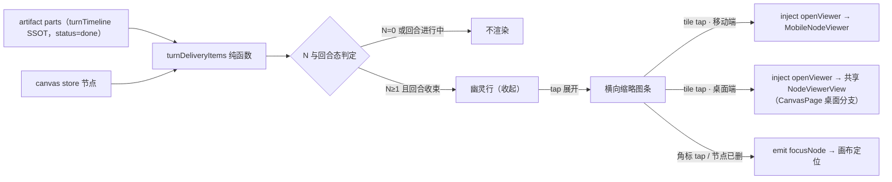

# E2-a 回合产物幽灵摘要（ghost delivery summary）设计规格

状态：已拍板（2026-11-04，用户提议 + 评审会商；待实施）
前置：
- `2026-11-02-delivery-card-v1-design.md`（本规格是其 **拆分包 E2-a**；原 v1 重构为 E2-b，凭本包埋点数据准入，见 §9）
- `2026-10-28-agent-wait-timeline-single-source-design.md`（turnTimeline part SSOT）
分支约定：feature 分支 + PR + squash merge。

## 0. 配图索引

| 编号 | 形式 | 内容 | 位置 | 用途 |
|---|---|---|---|---|
| 图 1 | 内嵌 Mermaid（结构） | 幽灵摘要派生数据源与两态路由 | §4 | 验收：清单/计数为渲染期纯派生，viewer 直开按端路由 |

## 1. 目标

1. **产物可发现**：回合结束后，对话流内一行幽灵摘要「查看本轮产物 · N」即可感知本轮交付，默认零噪音（iOS 渐进披露：默认收起，按需展开）。
2. **产物可直达**：展开清单点缩略图**一跳打开原生 viewer**（MobileNodeViewer，四类产物均支持），消灭「定位→再点节点」两跳；点定位角标跳画布节点。
3. **零后端改动**：清单与计数全部为前端渲染期纯派生（本回合 artifact parts ∩ canvas store 节点解析），不新增事件、不新增通道、不改 pi-runtime / 事件契约。

## 2. 范围（含明确不做）

**做**：
- `AgentTurnTimeline.vue` 回合尾部幽灵摘要行（收起/展开两态）+ 展开横向缩略图条。
- 纯函数 `turnDeliveryItems(timeline)`：派生清单（无副作用、重放一致）。
- viewer 直开路由：两端都 inject `MOBILE_NODE_OPEN_VIEWER_KEY`（CanvasPage 无条件 provide）；移动端由 `MobileCanvasShell` 承接，桌面端由 `CanvasPage` 直接挂载共享 `NodeViewerView` 承接（2026-11-23 修订，见 §9.3）；节点已删 / 类型不可查看才降级 focus_node 定位。
- 四指标埋点（曝光/展开/viewer 打开/定位），服务端小端点（原 E2 Task 5 保留，E2-b 准入判据数据源）。

**不做（本包明确排除）**：
- 不做逐产物交付卡 / 媒体竖卡 / 卡内联播（原 E2 v1 内容，归 E2-b）。
- 不做 timeout / fallback_pending 子态表达、roundKey 补拍、常驻订阅（归 E2-b，§9 准入）。
- 不做**桌面专用 viewer 组件 / 第二套渲染实现**（桌面复用设备无关的共享 `NodeViewerView`，只做挂载接线；原「桌面不进 viewer」裁决已于 2026-11-23 作废，见 §9.3）。
- 不新增 part kind / 不改 `NodeStatusData` / 不碰 `canvasData` PUT。
- running / failed / proposal 卡现状保留不动（失败即时可见是渐进披露的唯一例外）。

## 3. 判据

**D-a 派生纯函数判据**：`turnDeliveryItems(timeline)` 输入本回合 timeline，输出 `Array<{ nodeId, nodeType, title }>`（仅 `kind:'artifact'` 且 `status==='done'` 且有 nodeId 的 part，保序）；同输入两次调用同输出；不改 parts；历史重放/快照重建结果一致（继承原规格 D-5 纪律）。

**D-b 计数与显隐判据**：幽灵行 N = items 长度；N=0 整行不渲染（含 failed——failed 不计入，保留既有行内重试卡）；N>9 显示 9+；回合进行中（存在 running artifact）幽灵行**不渲染**（生成中的可见性由既有 running 行内卡承担）。

**D-c viewer 直开路由判据**：tile tap → 按 nodeId 从 canvas store 解析节点本体，经 `inject(MOBILE_NODE_OPEN_VIEWER_KEY)` 传 `{ id, type, data }`（与 `NodeRenderer.vue:72` 同款契约，type 映射 image/video/audio/text；路由见图 1）；节点缺失（已删）或类型不可查看 → 降级 focus_node 定位（emit 既有 `focusNode`，与定位角标同路由）。**桌面端同样直开 viewer**：`CanvasPage` 以 `v-if="!isMobileLayout && mobileViewerNode"` 挂载共享 `NodeViewerView`，四类节点与移动端同构；定位角标始终走 focus_node（ viewer 与定位两条路由互不吞并）。文本节点 tap 直开阅读器（不复制画布上 MobileNodeTile 的长文 TTS 分流——对话流语义=阅读）。

**D-d 展开清单排列判据（2026-11-22 v2 媒体卡修订）**：横向滑动媒体卡条，96px 卡 = 媒体区 64px 高 + 名称行（11px `--lnk-text-primary`，单行截断 + `title` 悬停全文；圆角 `--lnk-radius-md`——旧版误用 `--lnk-control-sm`=32px 致正圆，见 §9.2）；媒体自明——image=内容铺满 / video=首帧+**恒显 ▶**（22px 圆 `--lnk-hi-bg`，不依赖时长元数据）/ audio=波形 / text=文档 / html=代码 / digest=网格，**左下类型小字退役**，类型移入 `aria-label` + `title`（读屏/悬停可及）；video 右下时长徽标（节点实况，缺省隐藏）；定位 = 20px 圆形角标贴卡右上，透明外扩凑满 44px 命中区（`AgentSideRail` mic 先例）。

**E-d 交互形态判据（iOS 极简）**：幽灵行 = accent tint 文本行 + chevron，非按钮堆；展开/收起 chevron 旋转 + 高度过渡（`--lnk-duration-fast` + `--lnk-ease-decelerate`，reduced-motion 降级为直切）；样式仅 `--lnk-*` 令牌（禁 `--neo-*` / 新增 hex）；图标内联 SVG 24 网格 stroke:2（零图标库纪律）；触控目标移动端 ≥44px。

## 4. 架构与数据源

*图 1 · 清单与计数均为渲染期派生：artifact part 只提供 nodeId/nodeType/状态，产物本体（url/封面/时长/文本内容）按 nodeId 从 canvas store 解析——与 viewer 版本正确性同源。*

要点：
- **幽灵行渲染在回合尾部**（AgentTurnTimeline 全部 parts 之后，简报 text part 之下），不新增 part kind、不落 executionEvents、不参与持久化——比原 E2 的 `delivery_group` 虚拟 part 更轻（连虚拟 part 都不需要）。
- **viewer 打开入口已存在**：`CanvasPage.vue` 无条件 `provide(MOBILE_NODE_OPEN_VIEWER_KEY)`，对话面板（AgentSideRail→AgentTurnTimeline）在其 provide 树内，inject 直达；**桌面端 inject 同样命中**（这就是 2026-11-23 静默 no-op 的前提，不再是「桌面 inject 缺省」）；DevTimelinePreviewPage 无此 provide ⇒ inject 默认值降级为定位，预览页不受阻。
- **回合态判定**：复用本回合 parts 内 running artifact 存在性（既有状态，无需新事件）。

## 5. 场景验收

1. **单图**：done 后幽灵行出现「查看本轮产物 · 1」；展开 1 tile；tap 开 viewer 显示该图。
2. **四格批量**：4 个 done → N=4，横向条 4 tile 可滑；各自 tap 开对应 viewer。
3. **混合类型**：图+视频+音频+文本同回合 → tile 分别为缩略图/首帧+时长/波形/文档图标；文本 tap 开阅读器。
4. **回合外补拍**：backfill 回填晚到 done → N 反应式更新（收起态计数变、展开态清单增长），无需任何新事件。
5. **失败不进清单**：failed 产物不计 N、不出 tile，行内重试卡照旧。
6. **桌面**：tile tap 打开共享 `NodeViewerView`（文本/图/音/视频同源阅读面，右上 X 退出）；定位角标仍走画布定位；节点已删时 tile tap 走定位并显示既有提示。

## 6. 埋点（E2-b 准入判据数据源）

四指标：`impression`（幽灵行首渲）、`expand`（展开）、`viewer_open`（viewer 直开）、`locate`（定位）。服务端端点沿用原 E2 Task 5 设计（`POST /api/agent/metrics/delivery`，进程内存计数并入 `GET /api/health/notify-metrics`）；前端批量缓冲（50 条或 5s flush），失败静默丢弃。

## 7. 文件级改动清单

- `apps/web/src/components/agent/deliverySummary.ts`（新建）：`turnDeliveryItems` 纯函数 + type 映射助手。
- `apps/web/src/components/agent/AgentTurnTimeline.vue`：回合尾部幽灵行/展开条渲染 + viewer inject + 打点接线。
- `apps/web/src/components/agent/deliveryMetrics.ts`（新建）+ `apps/server/src/agent/delivery-metrics.controller.ts`（新建，原 E2 Task 5 原样）+ `agent.module.ts` 注册。
- `apps/web/src/pages/DevTimelinePreviewPage.vue`：六场景样例。

## 8. 测试策略与验收

- `deliverySummary.test.ts`：纯函数快照（保序/过滤/重放一致性/变异：过滤条件改动⇒组数变化被抓）。
- `AgentTurnTimeline.deliverySummary.test.ts`：静态契约（幽灵行判据 D-b 显隐、D-d 排列、E-d 令牌与触控正则、tap 路由 D-c）。
- `delivery-metrics.controller.test.ts`：原 E2 Task 5 用例。
- 目视验收：§5 六场景 DevTimelinePreview + 移动 sheet 真机走查（44px 命中、横滑、reduced-motion）。

## 9. 与 E2-b 的拆分关系

原 `2026-11-02-delivery-card-v1-design.md` 拆分：
- **E2-a（本包，先做）**：零后端增量，即时交付「可发现 + 可直达」。
- **E2-b（原 v1 剩余：v2 元数据、补拍、常驻订阅、单调守卫、媒体竖卡、组卡、timeout/fallback 子态）**：**准入判据 = E2-a 埋点数据**——expand 率与 viewer_open 率证明「卡内轻消费 / 富卡」有真实需求，且 timeout「裸生成中」投诉出现时，子态表达随包先行。原规格 §5.3 修正（前端无既有单调守卫）与 §5.5 常驻订阅设计**原样有效**，E2-b 实施时仍须先落守卫。
- **P2 项（桌面端统一 viewer）**：2026-11-23 闭环——复用 `presentation/NodeViewerView`（设备无关、零 isMobileLayout），`CanvasPage` 桌面分支直接挂载，零新查看器组件；原登记项作废。

## 9.1 真机修复记录（2026-11-05，PR 后第一轮实测三缺陷）

1. **文本/HTML 产物不进交付条**：根因三段——文本生成自动审批（P1-D）无确认点建卡 + 完成通报走 `notifyGenerationTerminal` 只入 followUp 不派 node_status + 画布对账回填（`reconcileFromNodes`）的归属预筛只认「已有 artifact part」。修复 = 归属集并入 `pendingNodeMeta`（`collectBackfillOwnableNodeIds`，归属≠判 done，W11 probe 仍要求 content/url 正据）。E2-b 的「补拍派 node_status」届时仍做（秒级翻正），本修复只解决「有没有」。
2. **已删节点残留在展开清单**：`remove_node` 不回写事件投影（part 恒 done）。修复 = `turnDeliveryItems(parts, canvasNodes?)` 画布存在性过滤；null/undefined（未接线/预览）保守不过滤。
3. **交付条上沿裁切**：`.delivery-locate` 角标 `top:-5px` 上溢，`overflow-x:auto` 令 overflow-y 同为 auto ⇒ 被滚动容器裁掉。修复 = strip 头部 `padding-top:11px`（margin 换 padding：padding 在滚动内容盒内不裁），静态契约锁定 ≥6px。

## 9.2 v2 媒体卡改造状态注（2026-11-22）

用户走查发现生产 tile 呈**正圆**：`.delivery-tile` 的 `border-radius: var(--lnk-control-sm)`（=32px）作用在 64×64 方块上恰为半径——控件胶囊圆角令牌被误用为 tile 圆角，属令牌语义错位而非有意设计；顺带两处瑕疵：预览被圆形裁切、左下类型 pill 被弧线切角（overflow:hidden）。本次改造（用户逐轮拍板）：

1. **tile → 96px 媒体卡**：媒体区保持 64px 高（预览辨识力不变），名称行 11px 单行截断——`DeliveryItem.title`（D-a 已派生，此前只进 aria-label）提升为可见层；圆角回归 `--lnk-radius-md`。
2. **类型字退役、媒体自明**：图片=内容自明；视频补**恒显 ▶**（首帧与图片同貌，▶ 是唯一稳定区分器，不依赖时长元数据——时长缺省隐藏是既有口径）；音频=波形唯一形态；文本/HTML/总览图标既有分叉不变。类型移入 aria-label + title 保可及性。
3. **音频不补 ▶**：波形已是交付条唯一形态零歧义；▶ 会制造「就地播放」预期差（tap 语义=开 viewer 一跳）而信息增量为零；内联起播归 E2-b（埋点准入后按数据决策）。
4. **rule-of-three 备注**：▶ 为全仓第 3 处内联 glyph（AgentCanvasOutputs / AgentAssetPicker / 本次），暂不抽共享组件；出现第 4 处消费再收敛。

等价物检索结论（第一原则）：名称=`DeliveryItem.title`（零新字段）；类型文案=`deliveryTypeLabel`（转 aria 用途）；时长=`deliveryDurationLabel`；缩略=`deliveryThumbOf`；首帧=`video#t=0.1` 既有形态；▶=`AgentCanvasOutputs` 同款内联 glyph 形态；音频播放器=MobileNodeViewer+MobileNodeWaveform+useNodeWaveform+audioPlayback（不进交付条）。**零新组件、零新字段、零新令牌**。

## 9.3 桌面 tile 静默 no-op 根治（2026-11-23）

**现象**：PC 对话页「查看本轮产物」展开后，点【短剧剧本】等文本 tile 无任何反应；移动端同类节点可开 viewer。

**根因（规范-实现漂移，非偶发）**：本规格原 §2/§5 裁决「桌面降级 focus_node 定位」，前提是「桌面 inject 缺省」；但 §4 同时记录了 `CanvasPage` **无条件** provide `MOBILE_NODE_OPEN_VIEWER_KEY`，且对话面板就在 provide 树内 ⇒ 桌面 inject 必命中，走 `deliveryViewer(node)` 把状态写进 `mobileViewerNode`，而唯一消费者 `MobileCanvasShell` 被 `v-if="isMobileLayout"` 挡住 ⇒ PC 上没有任何组件渲染该状态，`focusNode` 降级分支也永远进不去，形成静默 no-op。测试 `AgentTurnTimeline.deliverySummary.test.ts` 用「不 provide」模拟桌面，因此全绿却覆盖不到真实 PC 路径（伪绿）。

**修复（接线，零新造）**：`CanvasPage` 在桌面分支挂载 `v-if="!isMobileLayout && mobileViewerNode"` 的共享 `NodeViewerView`（`presentation/`，设备无关、已 Teleport 到 body），`@close` 复用 `closeMobileViewer`。四类节点与移动端同一份阅读面；节点已删 / 类型不可查看仍走原 focus_node 定位兜底；定位角标语义不变。

**判据**：`CanvasPage.pcDeliveryViewer.test.ts` 锁死「import 共享 view + `!isMobileLayout` 门控 + `:type`/`:data` 透传 + close 回写 + provider 无条件存在」；变异（门控反转）实测转红。既有 `AgentTurnTimeline.deliverySummary.test.ts`（23）、`NodeViewerView.test.ts`（6）、`MobileNodeViewer.test.ts`（87）全绿，`vue-tsc -b` 0 错误。

**等价物检索结论（第一原则）**：PC 已有 `MediaPreviewOverlay` 只覆盖 image/video（且经 store `previewTarget`，与对话 tile 的 nodeId 数据面不同源），不覆盖文本；`NodeViewerView.vue` 头部明确「供 PC 查看器复用」⇒ 直接接线共享 view，零新组件 / 零新字段 / 零新令牌。

## 10. 配图规范自检

`pnpm verify-spec-figures --file docs/superpowers/specs/2026-11-04-e2a-ghost-delivery-summary-design.md` 写作时执行，预期 0 错误。
