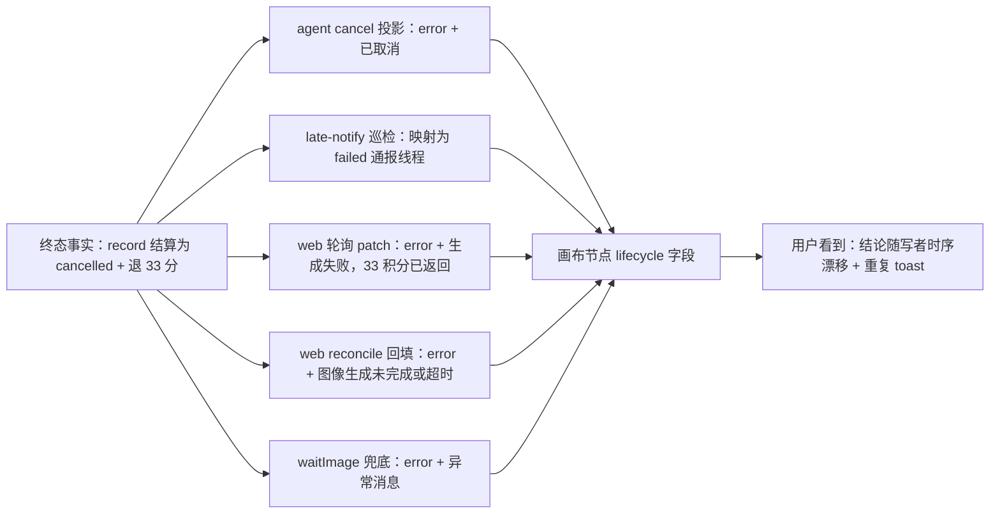
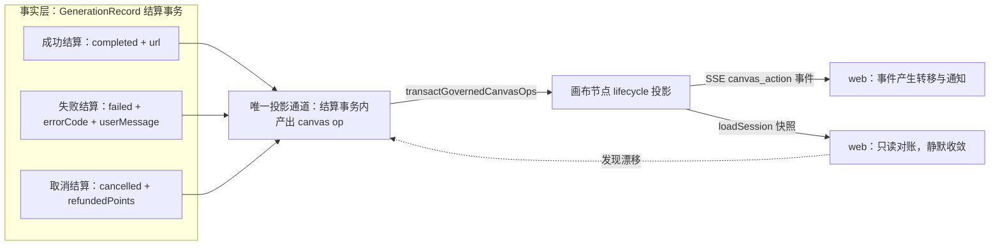
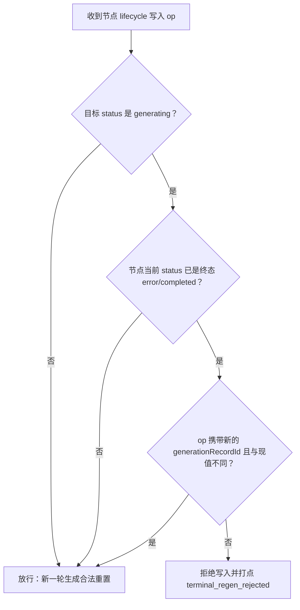
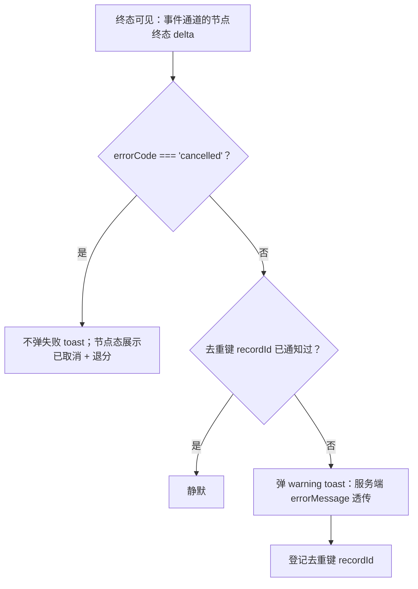

# 生成生命周期终态投影与取消语义治理设计规格（「取消刷屏」事故根治）

状态：待评审（2026-11-04）
前置：
- P1-C 写路径治理（#667/#668/#669/#670/#687/#689/#694-696，已收官）——本规格是其治理对象之外的**第二条写路径**的收编；
- P0 propose 执行权归一（#640，已上线）；
- B1 生成 job 化（#663）+ late-generation-notify 巡检（已上线）；
- P0 abort cascade（spec 2026-09-29，v1 语义「中断等待 ≠ 取消生成」）；
- SP-E 画布并发 CAS 规格 v2（PR #625，待评审）——本规格不强依赖，见 §3。
基线说明：本规格基于远端 master `43443b5d`（2026-11-04 08:32）核实；本地检出 `27b06658` 较陈旧，关键差异文件已逐一经 gh api 对照远端确认（`generationDiagnostic.ts` 远端已含 B2 投影纯化，缺陷仍在，见 §4.3）。

## 0. 配图索引（结构与视觉两类，均随本文档演进）

本文档的图分两类：**结构图**一律以 Mermaid 内嵌；无视觉稿（本文档不涉及空间布局）。

| 编号 | 形式 | 内容 | 位置 | 用途 |
|---|---|---|---|---|
| 图 1 | 内嵌 Mermaid | 现状写者地图：一个终态事实、五个投影写者 | §4.2 | 指认「多重解释」病灶，作为收编范围的验收基准 |
| 图 2 | 内嵌 Mermaid | 收敛后契约：事实层 → 唯一投影通道 → 双端消费 | §5.1 | 治本包的目标架构，分包落地的对照锚点 |
| 图 3 | 内嵌 Mermaid | 前端终态通知决策树（语义通道 + 去重键） | §5.3 | 止血包 P0-1/P0-2 的行为级验收判据 |
| 图 4 | 内嵌 Mermaid | 终态吸收态守卫判定流程 | §5.2 | P1-2 双端守卫的判据锚点与测试表驱动依据 |

## 1. 目标

1. **同因不再现**：任何一次「取消/失败/超时」结算后，画布节点的终态投影在有限时间内收敛到唯一正确结论，且不随画布重载次数增长产生重复用户打扰（0 次重复 toast）。
2. **取消是一等状态**：`cancelled` 作为领域语义在结算协议、通报协议、前端展示三层贯通，不再降级为 `failed`、不再靠展示文案字符串嗅探识别。
3. **投影写者归一**：画布节点 lifecycle 字段（status/errorCode/errorMessage/generationRecordId/url）的写入通道收敛为「结算事务内投影」一条主路 + 前端只读对账一条兜底路，其余写入按越权治理（承接 P1-C 纪律）。

## 2. 范围（含明确不做）

**做**：结算→投影的契约与守卫（服务端 + web 双端）；cancelled 语义贯通；前端通知决策与去重策略；行为级守卫测试 + 变异测试。

**不做**：
- 不动积分/退款/扣分逻辑（AGENTS.md 边界：动积分/扣分/退款逻辑不在本包）；
- 不做通知中心/消息聚合 UI（产品侧另立项）；
- 不实现 SP-E CAS 版本化（吸收态规则是其可先行子集，见 §3）；
- 不追溯修复历史脏数据（存量 `failed`+空文案节点可被 §6 对账路径自然收敛，不写迁移）。

## 3. 与既有规格的关系

| 规格 | 关系 |
|---|---|
| P1-C 写路径治理（已收官） | **同纲延伸**。P1-C 收编了「绕过 PATCH 主通道的写者」；本事故证明：走主通道的写者之间**彼此也不构成收敛**，需要投影契约层。白名单即审计动作的纪律沿用。 |
| SP-E CAS（#625，待评审） | **互补不强依赖**。CAS 解决「丢失更新」（并发写互覆）；吸收态规则解决「终态被回写」（单调性）。本规格先落地单调性子集，CAS 后行合并时吸收态守卫退化为 CAS 的一个校验维度，不冲突。 |
| abort cascade v1（2026-09-29） | **语义保持**。「中断等待 ≠ 取消生成」不变；本规格补的是取消结算后投影缺失的闭环（§5.4）。 |
| 2026-10-30 propose 确认即执行（#640） | **消费方确认**。P0-2 锚点换源、P0-5 时流断不标失败与本规格的通知策略同向：快照/重连不产生用户可见的失败转移。 |

## 4. 问题抽象：从个案到问题类

### 4.1 事故复盘（生产取证，2026-11-04 会话 `cmw1oyqww00b9tm01rpum6z5k`）

| 时刻 | 事实 | 来源 |
|---|---|---|
| 16:39:45 | 用户：「生成一个蓝色眼睛的美女」 | AgentMessage |
| 16:39:45 | propose 落锚，节点启动，record `cmw1v8ptp001…` 创建 | GenerationRecord.createdAt |
| 16:39:48 | 用户点「取消生成」，record 结算：`errorCode:"cancelled"`、`refundReason:"cancelled"`、`errorRaw:"已取消"`、`refundedPoints:33` | record metadata |
| 其后 ~数分钟 | 画布节点先后被写成：`error`+「已取消」→ `error`+「生成失败，33 积分已返回」→ `failed`+空文案；期间服务端节点状态反复回到 `generating` | 生产 DB canvasData 终值 + 截图 |
| 全程 | **本会话仅此 1 条失败记录**——不存在多次真实生成失败 | `SELECT … WHERE sessionId=…` |

用户可见后果：5+ 条「蓝眼美女 生成失败：生成失败，33 积分已返回」toast 刷屏；「画布尚未加载完成，已暂停自动保存」伴随出现。**资损为零**（33 积分仅退一次），伤害全部在「信任」层：系统把自己的取消操作当故障反复广播。

### 4.2 病灶一：一个事实，五个解释（终态投影无收敛契约）

图 1 是取证确认的写者地图。同一次取消结算，五个写者按各自的局部视角投影同一张画布节点：

*图 1 · 说明了什么：节点上没有「谁说了算」，五个写者全部直写，最后落哪个值取决于时序——这是刷屏的结构性根源，不是某个 if 写错。*

关键代码锚点（均在远端 `43443b5d` 复核）：

| 写者 | 位置 | 写入值 | 语义正确性 |
|---|---|---|---|
| W1 agent 取消投影 | `agent-canvas-tools.service.ts:2513-2523` | `{status:'error', errorMessage:'已取消'}` | ✅ 唯一正确者，但很快被覆盖 |
| W2 巡检通报 | `late-generation-notify.ts:226` | `status === 'completed' ? 'completed' : 'failed'`——**cancelled 被硬映射为 failed** 通报 agent 线程 | ❌ 协议层降级 |
| W3 轮询 patch | `generationDiagnostic.ts` `buildPollingFailurePatch` | `refundedPoints ? '生成失败，N 积分已返回' : serverMessage ?? '生成失败'`——**refundedPoints 分支优先级高于 errorCode 与 serverMessage**（远端 B2 改造后仍是此序） | ❌ 把取消渲染成故障 |
| W4 reconcile 回填 | `CanvasPage.vue:5583` | `{status:'error', errorMessage:'图像生成未完成或超时'}` | ❌ 一刀切超时文案 |
| W5 wait 兜底 | `agent-canvas-tools.service.ts:2004-2018` | `err.message`（可能是 AbortError 噪音） | ⚠️ 不可控 |

### 4.3 病灶二：语义靠文案承载，cancelled 三层缺席

这是本事故最值得产品经理警惕的设计债：**「已取消」作为一个领域概念，在三层协议里都不是一等公民，只能靠展示字符串反推**。

- **通报协议层**（图 1 W2）：notify 协议只有 `completed | failed`，cancelled 无位可坐 → 被迫谎报 failed；
- **展示渲染层**（W3）：`buildPollingFailurePatch` 的分支优先级是「有退分 → 按失败渲染」，errorCode 明明就在同一份 metadata 里却不消费；
- **豁免判据层**：`useGenerationFailureToast.ts:10-13` 用 `msg.startsWith('已取消')` 识别取消——**用用户可见文案做领域判据**，于是 W3 改一个字（「已取消」→「生成失败，…」）就击穿了整条防线。这不是 W3 的错，是判据选错了承载层：文案是展示的输出，永远不该是语义的输入。

### 4.4 病灶三：快照被当成事件，去重被重载打穿

前端通知层的两个结构性缺陷叠加成「刷屏」：

1. **快照 ≠ 事件**：`loadSession`（回合后最多 15 次轮询重载，`CanvasPage.vue:713` 注释）与移动端 tab 切换重挂载，都会把服务端画布快照（还是 generating）整表拉回。Watcher 把「快照回到 generating」当成了新的状态转移 → 清掉该节点 toast 去重（`CanvasPage.vue:4517`）→ 轮询写 error → 再 toast。**重载几次就弹几次**，弹窗数量与用户操作无关，只与重载次数相关。
2. **去重键太弱**：去重键是 nodeId，生命周期挂在「→generating 边」上，而该边可以被陈旧快照伪造。去重的对象搞错了——应该去重的是「同一个生成记录终态的通知」，键是 recordId，不是「这个节点这次变红」。

### 4.5 设计原则审视（破防了什么）

| 原则 | 现状破防点 | 本规格的恢复动作 |
|---|---|---|
| 单一事实源 + 单一投影 | 5 写者直写投影层，各按局部视角重解释（图 1） | §5.1 投影契约：投影由结算事务原子产出 |
| 状态单调性（终态吸收） | `failed`/`error` 可被陈旧快照回写成 `generating`，无任何守卫 | §5.2 吸收态规则，双端落地 |
| 语义与展示分离 | errorCode 存在但不被消费；取消靠字符串嗅探 | §5.3 errorCode 一等公民化 |
| 快照幂等（对账 ≠ 事件） | loadSession/reconcile 产生用户可见转移与通知 | §5.3 快照静默收敛纪律 |
| 通知产品分级 | 取消（用户自己的动作）走了故障告警通道 | §5.3 通知三分法 |

## 5. 架构与契约（收敛后）

### 5.1 投影契约（治本核心）

收敛后的目标结构见图 2：

*图 2 · 说明了什么：投影只从结算事务出发，经既有 governed 通道单向流出；前端两条消费路里只有事件路可以产生用户可见通知，对账路永远静默——这是「同因不再现」的结构保证。*

契约条款（可验收）：

1. **投影原子性**：record 结算（completed/failed/cancelled）与其画布节点投影必须在同一事务/同一 persisted op 批次内产出。取消同理：`studio.cancelGeneration` / `material.cancelGeneration` 结算事务内产出投影 op，`agent-canvas-tools.cancelGeneration` 不再自带第二份投影（复用之）。
2. **投影词汇表**：投影 op 的 payload 统一为 `{status, errorCode, errorMessage, generationRecordId?}`；`errorMessage` 由服务端从 errorCode 单一映射表产出（§5.3），前端不再自行组装失败文案。
3. **对账只读化**：`reconcileMissingGenerationRecords` / `buildStudioRecordPatch` 保留，但其写被视为「漂移修复」，且修复动作**不触发通知**（§5.3 判据）；长期看它是 W3/W4 的退役候选，只兜「投影通道失联」的底。

### 5.2 终态吸收态规则（单调性守卫）

守卫判定流程见图 4：

*图 4 · 说明了什么：吸收态守卫把「终态被回写成 generating」在写入侧直接拒绝，仅放行携带新 recordId 的合法重置——陈旧快照回灌由此被结构性阻断；实现为纯函数 `isTerminalRegen`。*

*（正文判据优先于图：`error`/`completed` 是吸收态；任何通道把吸收态节点写回 `generating`，仅当携带**不同的新 recordId**（新一轮生成）才放行，否则拒绝并打点。双端落地：服务端 `transactGovernedCanvasOps` 与 web `applyActionsToFlow` 同一判据——不是「弹不弹 toast」的问题，而是「回写根本不生效」。）*

### 5.3 语义通道与通知决策（前端）

*图 3 · 说明了什么：取消在通知层被分流到非故障通道，且判定依据是 errorCode 而非文案；失败 toast 的去重键从 nodeId 升级为 recordId。*

条款（可验收，决策树见图 3）：

1. **errorCode 一等公民化**：取消判据 = `errorCode === 'cancelled'`（节点 data.errorCode 或 record metadata.errorCode）；`startsWith('已取消')` 字符串嗅探退役为**兼容旧数据的 or 分支**，并在注释里标注退役条件（存量记录被对账收敛后删除）。
2. **文案单一映射表**：`errorCode → 用户文案` 全局唯一（cancelled →「已取消，N 积分已返回」；upstream_timeout →「上游响应超时」…）。`buildPollingFailurePatch` 的分支优先级重排为：**errorCode 语义 > serverMessage（metadata.userMessage）> 退分补充说明 > 兜底**；refundedPoints 只是 cancelled/failed 文案里的一个数字，不再是分支开关。
3. **通知三分法**（产品策略，本规格的 PM 判断核心）：
   - **用户动作确认**（取消、拒绝回退）：不在故障通道。节点态轻量呈现即可，不弹 warning；
   - **系统故障**（failed/upstream_*）：warning toast，去重键 recordId，一轮生成至多一次；
   - **进行中**：不通知（已有任务卡片承载）。
4. **快照静默**：`loadSession` 应用快照、reconcile 回填、SSE 重连重放，均不产生通知、不清去重键；去重键的清除只由「**新的生成开始**」事件（新 recordId 绑定节点）触发。

### 5.4 取消链路闭环（与 abort 语义的边界）

保持 abort cascade v1 语义（回合中止 ≠ 取消生成）；本规格补两条：

1. 取消端点（agent internal + web 直接调用两路）统一走 §5.1 条款 1 的事务投影，取消成功即节点收敛，消灭「记录已 cancelled、节点还 generating」的空窗；
2. late-notify 协议增加 `cancelled` 终态：通报内容为「已取消 + 退分」，不再映射 failed；其消费方（agent 转述）如实说「已取消」，不再出现截图里「生成已取消，但状态仍显示在生成中」的自相矛盾。

## 6. 分包落地

### P0 止血包（纯前端 + notify 协议小改，1 个 PR）

| # | 改动 | 判据 |
|---|---|---|
| P0-1 | `buildPollingFailurePatch` 分支重排（errorCode 优先）+ cancelled 文案 | cancelled 记录 → errorMessage 以「已取消」开头且含退分数 |
| P0-2 | `shouldToastForFailure`/`isCancellation` 判据升级为 errorCode 优先 | 有 errorCode='cancelled' 的节点 0 toast（行为级测试 + 变异测试） |
| P0-3 | 通知去重键 nodeId → recordId；`clearNodeDedupe` 仅由新 recordId 绑定触发 | 同一 record 重复重载 20 次至多 1 次通知（测试模拟 loadSession×20） |
| P0-4 | late-notify 协议加 cancelled，消费方如实转述 | cancelled record 不再通报为 failed（pi-runtime 侧测试） |

### P1 治本包（投影契约 + 吸收态守卫）

| # | 改动 | 判据 |
|---|---|---|
| P1-1 | 取消/失败结算事务内投影（studio + material 两 service），agent cancel 复用 | 取消后 ≤2s 节点终态正确；空窗期复测为 0 |
| P1-2 | 吸收态守卫双端落地（`isTerminalRegen` 纯函数 + 两端调用 + 打点） | 陈旧 generating op 被拒（双端行为级测试 + 变异测试；改白名单/判据 = 审计动作，P1-C 惯例） |
| P1-3 | 前端失败文案映射表统一（W3/W4 文案退役） | 全目录扫描无第二处失败文案组装点（守卫测试） |
| P1-4 | reconcile 定位降级为纯对账（不触发通知，已在 P0-3 覆盖判据） | 对账写不产生 toast |

## 7. 数据与状态变更

- 节点 data 新增/启用字段：`errorCode`（沿用既有 `ErrorCode` 联合类型，含 `cancelled`）；`errorMessage` 语义收窄为纯展示。
- record metadata 不改结构（`errorCode`/`refundedPoints`/`userMessage` 均已存在），只改**消费优先级**。
- late-notify 协议 payload 增加 `status: 'cancelled'` 枚举值（消费方为 pi-runtime 工具结果转述，向后兼容：未知值按 failed 处理的旧消费方不受损）。
- 打点新增：`terminal_regen_rejected`（吸收态守卫拒绝）、沿用既有 `canvas_put_rejected` 风格。

## 8. 纯函数与算法（含单测要求）

| 纯函数 | 位置 | 单测要求 |
|---|---|---|
| `isTerminalRegen(currentData, incomingPatch)` | shared 或 web/utils（双端共享优先） | 吸收态×目标态×recordId 变化 全组合表驱动；变异测试（改任一比较符必红） |
| `shouldToastForFailure`（升级） | `useGenerationFailureToast.ts` | errorCode 优先判据 + 旧数据 message 兼容分支；表驱动 |
| `buildPollingFailurePatch`（重排） | `generationDiagnostic.ts` | cancelled/refunded/serverMessage/兜底四分支优先级表驱动 |
| `formatGenerationFailureMessage`（收敛） | `generationPointsMessage.ts` | 与映射表一致性测试（同一 errorCode 两处产出必须同文） |

## 9. 文件级改动清单

**P0**：`apps/web/src/utils/generationDiagnostic.ts`、`apps/web/src/composables/useGenerationFailureToast.ts`、`apps/web/src/pages/CanvasPage.vue`（watcher 去重触发条件）、`services/pi-runtime/src/**`（late-notify 协议与转述）、对应测试文件。

**P1**：`apps/server/src/studio/studio.service.ts`（cancelGeneration/settle 投影）、`apps/server/src/canvas/material.service.ts`（同）、`apps/server/src/agent/agent-canvas-tools.service.ts`（cancel 复用投影、wait 兜底文案治理）、`packages/shared`（errorCode 映射表 + `isTerminalRegen`）、`apps/web/src/**` applier 守卫、守卫测试目录。

⭐ 部署纪律：碰 `services/pi-runtime/**` 须手动 dispatch runtime-deploy（memory 纪律）；P0-4 与 P0-1~3 可解耦分批上线。

## 10. 测试策略与验收标准

1. **行为级复现测试**（P0 验收）：模拟「启动 → 取消 → loadSession×20 → tab 重挂载×5」，断言失败 toast = 0、取消态展示正确；
2. **双端守卫**：服务端 persist 与 web applier 各一条「终态回写被拒」行为测试；对守卫做变异测试（回写判据任一字符变异必须红）；
3. **生产复测锚点**：真机重复事故路径（propose → 秒取消），断言：① 节点 ≤2s 内显示「已取消，33 积分已返回」；② 任意重载/切 tab 无失败 toast；③ 生产 DB 无 `terminal_regen_rejected` 误伤（合法重试仍可发起）；
4. **回归边界**：既有 `useGenerationFailureToast.test.ts`、`useGenerationPolling.test.ts`、`generationDiagnostic.test.ts` 全绿；改组件后跑 `vue-tsc -b`（memory 纪律）。

## 11. 风险

| 风险 | 缓解 |
|---|---|
| 吸收态守卫误伤合法「重试」 | 重试路径本就新开 recordId（start 即新建记录），判据放行不同 recordId；测试覆盖重试场景；打点可观测误伤 |
| 旧记录无 errorCode，取消识别退化为字符串 | 兼容分支保留至对账收敛；§5.3 条款 1 标注退役条件 |
| notify 协议变更涉及 pi-runtime 部署链 | P0-4 独立分批；runtime-deploy 走既有手动 dispatch + 闸门自批流程 |
| 文案映射表两处产出漂移 | §8 一致性测试钉死；映射表单文件 SSOT |
| 本地/远端基线差（27b06658 vs 43443b5d） | 实施分支必须自最新 master 拉出；PR 前 diff 零夹带 |

## 12. 后续包 / 路线图

- SP-E CAS 合入后：吸收态守卫并入 CAS 校验维度，`isTerminalRegen` 保留为快捷判据；
- 通知中心/聚合（产品侧）：本规格的三分法是其输入；
- W3/W4（前端轮询写、reconcile 写）的彻底只读化：待 P1-1 稳定一个版本后评估退役。

## 13. 配图规范自检

`pnpm verify-spec-figures --file docs/superpowers/specs/2026-11-04-generation-terminal-projection-design.md` 结果：待跑（见 PR 描述回贴）。

## 14. 自审（交付前全盘追问）

- **充分性**：三分法是否覆盖 audio/material/video 全类型？——是，投影契约按 record 类型无关设计；W1-W5 清单已按生产取证穷举，若有第 6 写者，P1-2 守卫会以 `terminal_regen_rejected` 打点暴露。
- **遗漏追问 1**：取消后节点最终值应为「error + 已取消」还是独立 `cancelled` 态？——本规格裁决：**status 词汇表不扩**（error/completed/generating/pending_confirm/fallback_pending 维持，避免五端消费方连锁改动），cancelled 由 `errorCode` 承载。若未来产品要求磁贴区分「我取消的」与「故障的」，再议独立 status，成本可控。
- **遗漏追问 2**：多端（移动端浮层/桌面）是否共用同一 watcher？——是，CanvasPage 单点；`MobileSheet.vue` 不重复订阅。
- **遗漏追问 3**：P0-3 改去重键后，「失败→重试→再失败」第二次必须 toast 的既有契约是否保留？——保留：重试=新 recordId=新去重键，既有测试场景平移到 recordId 维度。
