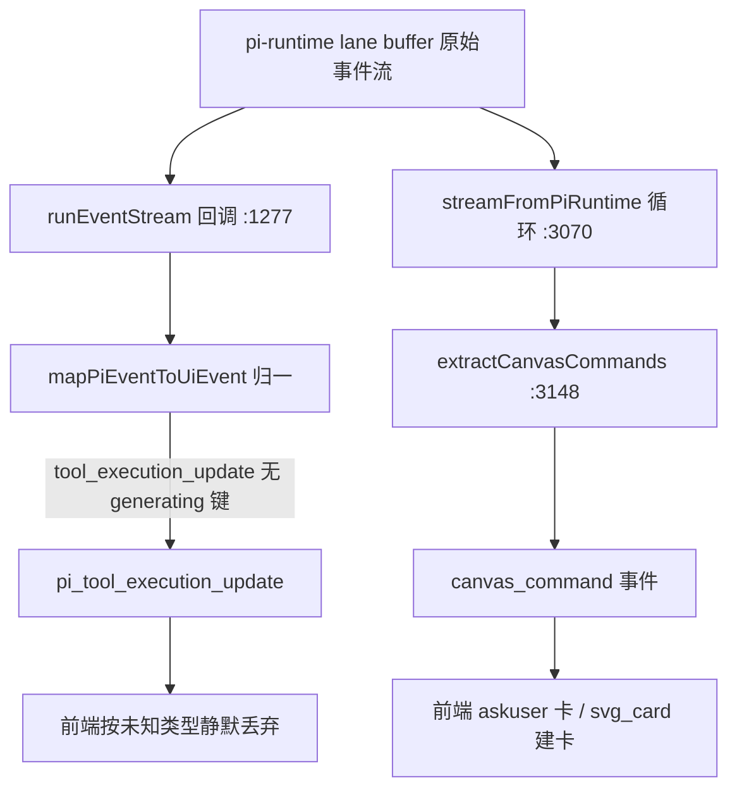
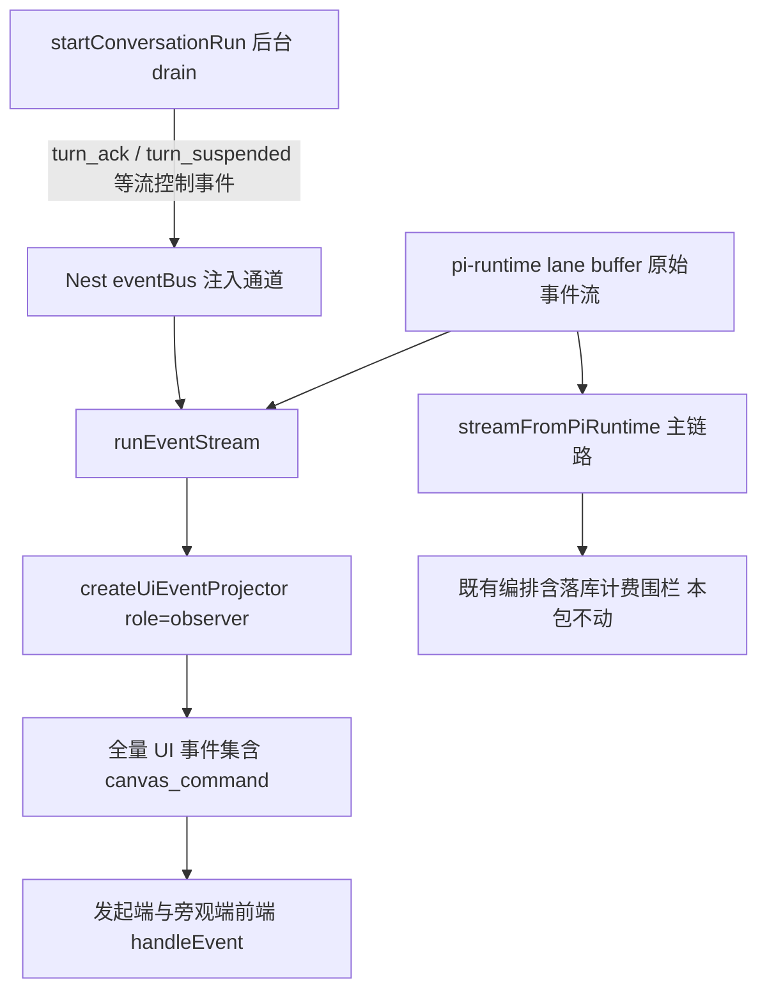

# 统一事件通道派生缺失（askuser 卡不显示）设计规格

状态：已实施收官（P0 = PR #716 `f4d4ff73`；实施分工与 #714（`53f6f740`）边界见 §6.8 实施注记；P1 注入通道由 #714 的 turn_settled 专用桥先行落地，turn_ack/turn_suspended 桥登记后续包）
前置：`docs/superpowers/specs/2026-10-21-multi-device-consistency-design.md`（2026-11-04 修订版，#704/#708 已上线）；`docs/superpowers/plans/2026-11-04-multi-device-consistency-p0-p1.md`（已收官）
分支约定：实现走 feature 分支 + PR + squash merge。

## 0. 配图索引（结构与视觉两类，均随本文档演进）

本文档的图分两类：**结构图**一律以 Mermaid 内嵌；本文档无视觉稿（纯后端事件编排变更，无空间关系诉求）。

| 编号 | 形式 | 内容 | 位置 | 用途 |
|---|---|---|---|---|
| 图 1 | 内嵌 Mermaid | 两条消费编排对同一 raw 事件流的派生差异（根因） | §4.2 | 验收根因定性：缺失发生在编排层而非提取函数层 |
| 图 2 | 内嵌 Mermaid | 修复后：共享投影编排 + Nest 注入通道 | §5.2 | 修复架构验收基准：单一派生源 + 流控制事件归属 |

## 1. 目标

1. **补齐统一通道事件全集**：flag on（`STREAM_MAIN_FROM_PIRUNTIME=on`）下，发起端与旁观端经 `GET /runs/events` 收到的事件集，与 flag off 主链路（`POST /chat/conversation` 响应体流）**语义等价**——askuser 卡、svg_card、canvas_action、task_list/task_update、thinking、usage/turn_usage、结构化 error 全部恢复。
2. **根治"两套编排漂移"这一缺陷类**：同一 raw 事件流的 UI 派生编排收敛为**单一实现**（pi-events.ts 投影编排），并以**事件集等价契约测试**把两条通道钉死，杜绝未来再次单边演进。
3. **不回归、不扩大**：flag off 路径行为逐字节不变；落库/计费/围栏副作用零改动；pi-runtime（含 runtime-deploy 流水线）零改动。

## 2. 范围（含明确不做）

**做**：
- `apps/server/src/agent/pi-runtime/pi-events.ts`：新增**投影编排工厂** `createUiEventProjector`，封装既有提取函数（`extractCanvasCommands` / `extractCanvasActions` / `extractTaskEvents` / thinking / usage accumulator / `classifyPiRunError`）为单次调用产出 0..n 个 UiEvent 的编排单元。
- `apps/server/src/agent/agent.service.ts`：`runEventStream` 的 raw 事件回调接入投影编排（P0）；新增 **Nest 注入通道**把流控制事件（`turn_ack` / `turn_not_submitted` / `turn_suspended` / `turn_settled`）旁路广播给本 thread 的 runEventStream 订阅者（P1）。
- 契约测试：同一 lane 事件 fixture 双跑两通道、断言 UI 事件集等价 + 变异测试。

**不做**（显式排除，防规格范围蔓延）：
- **不把派生下沉 pi-runtime**：`extractCanvasCommands` 的产物消费、plan 标记剥离（`stripPlanMarkers`，prompt-registry 语义）、usage→积分折算（依赖 Nest DB 的 MarginPolicy/FX）、错误分类日志，全部是 **Nest 业务域**概念；下沉会把 Nest DB/pricing 耦合进 runtime 并平添 runtime-deploy 流水线成本（详见 §4.3 边界论证）。
- **不动落库与计费**：`startConversationRun` 后台 drain 保留 `streamConversation` 全部副作用（落库 / finalizeTurn / hold 结算）——这是 P1 Task 4 的既有裁决，本包不重设计。
- **不改前端 reducer 契约**：前端 `handleEvent` 本就按全量语义设计（`AgentSideRail.vue:3002` 注释明示"订阅流的全量事件走 handleEvent（proposal / ask_user / task_* 等完整语义）"）——是服务端少发，不是前端缺能力。
- **不改 pi-runtime / vendor**：不触碰 `services/pi-runtime/**` 与 `vendor/**`，无 runtime-deploy。

## 3. 与既有规格的关系

- **显式修订** `2026-10-21-multi-device-consistency-design.md` 的**目标 1 验收判据**：原判据「B 收到的事件序列与 A **逐条相同**」只保证两端互等，不保证与旧主流等价——本次修订为双重等价：**A==B（两端互等）且 A==旧主流事件集（语义等价，落库专属字段除外）**。原规格 §风险表里的 **M2 假同步**（"两端刷新后一致，但都缺内容——『一致』必须叠加判据验收"）正是本次事故形态，修订即把 M2 判据从"刷新后"扩展到"实时流"。
- **不推翻** 统一传输架构本身：`GET /runs/events` 权威通道、`id:` 帧 + `lastEventId` 续传、ack `{threadId, sinceSeq}`、后台 drain 保留副作用——全部保留。本包是对该架构的**事件契约补全**，不是回滚。
- **引用不修改**：ask-user 阻塞契约（`2026-09-30-ask-user-blocking-design.md` B-6：卡片经 onUpdate 快照 → tool_execution_update → canvas_command 下发）、P1#7 落库重放（canvas_command ask_user 落 metadata.executionEvents）。

## 4. 规范与判据

### 4.1 事故定性（生产实证）

- 会话 `cmw1mb7wc006jtm0173uz3l1w`：askuser 回合仅显示「向你确认 / 等待你确认后继续」notice 行 + composer「正在向你确认」，问题卡不出。生产库 `AgentMessage` 仅 2 条（user + assistant 文本），卡片数据不在消息体——**卡片唯一实时载体是 SSE 的 `canvas_command` 事件**（ask-user.ts:122 经 onUpdate 快照下发 → pi-events `extractCanvasCommands` 派生 → 前端 `AgentSideRail.vue:3866→4018` 建卡）。
- 判别特征：**刷新后卡片恢复、实时不显示**——canvas_command{ask_user} 已落 metadata.executionEvents（P1#7），历史重放路径完好；只有实时通道断供。

### 4.2 根因（引入链 + 机制）

引入链：`runEventStream` 作为**旁观通道**诞生时（multi-device Task 4 前）就只做 `mapPiEventToUiEvent` 最小归一——旁观者当时看不到实时派生事件是**既有局限**；#704（P0，`c7a3a80e`）建立统一通道、#708（P1，`bbf55721`）把**发起端主流**也切到该通道（plan Task 4/5 + canary 2026-11-04 flag on）——**旁观期的既有局限被升级成了主链路缺陷**。plan/spec 从未枚举「统一通道事件契约白名单」，Task 7 验收（A==B 逐条相同）在两端同为贫化流的条件下**假绿**；canary 六锚（ack Content-Type / seq 单调 / sinceSeq / SSE 形态 / healthy / 现网生效）不含 askuser 卡与 canvas_action 锚，未拦截。

机制（图 1）：ask_user 的卡片载荷只在 `tool_execution_update` 快照的 `details.canvasCommands` 键上（与进度拍 `details.generating` 同通道不同键）；`mapPiEventToUiEvent` 对无 `generating` 键的 update 落 default 分支 → 改名 `pi_tool_execution_update` → 前端按未知类型**静默丢弃**。主链路 `streamFromPiRuntime`（agent.service.ts:3148）在同一点位有 `extractCanvasCommands(event)` 派生循环，`runEventStream`（agent.service.ts:1277-1302）的回调**没有**——缺失发生在**编排层**，不在提取函数层（提取函数一直是两路径共享的单一实现）。



*图 1 · 这张图说明了什么：同一个 raw 事件进入两条编排后命运分叉——主链路派生出 canvas_command 建卡，统一通道只产出被前端丢弃的 `pi_` 前缀事件；缺陷在编排层缺失调用，不在任何提取函数内部。*

### 4.3 影响面矩阵（统一通道缺失派生的完整清单）

| # | 派生能力 | 主链路位置 | runEventStream | 用户可见症状（flag on） | 分级 |
|---|---|---|---|---|---|
| 1 | `canvas_command`（ask_user 卡 / svg_card / focus_node / undo / arrange_nodes / open_image_editor） | :3148 | ❌ 未调用 | **askuser 问题卡不出现**（本次复测）；svg_card 不出现 | **P0** |
| 2 | `canvas_action`（节点数据动作 + 节点状态实时） | :3173 | ❌ | 画布节点状态实时推进缺失（轮询/对账兜底，故 canary 未暴露） | **P0** |
| 3 | `task_list` / `task_update`（⟦plan⟧ 派生 + todo_write diff） | :3180 | ❌ | 计划面板实时不更新 | **P0** |
| 4 | thinking 折叠事件 | :3188 | ❌ | 思考过程不显示 | **P0** |
| 5 | `usage_delta` / `turn_usage`（积分预估行） | :3198 | ❌ | 「预估 -N 积分」不更新（`credit_tx` 经 eventBus 单独注入，**不受影响**） | **P0** |
| 6 | `classifyPiRunError` 结构化 error（error_type / retry_hint / provider / model + 日志） | :3126 | ❌（仅 map 的裸 error 透传） | 失败缺精确文案与重试提示，降级为通用兜底 | **P0** |
| 7 | `turn_suspended`（挂起 ≠ 断链显式信号） | :3285 | ❌（结构性不可派生，见 §5.3） | 挂起与断链不可区分（2026-10-31 修复在 flag on 回归） | **P1** |
| 8 | `turn_ack` / `turn_not_submitted`（回合归属裁定） | :2980/:3379 | ❌（结构性） | 「已并入进行中的任务」提示缺失 | **P1** |
| 9 | `turn_settled`（权威结算值） | :3427 | ❌（结构性） | live 摘要停在预估（credit_tx 已示扣减；刷新后重放取权威值） | **P1** |
| 10 | P0-B runId 回合围栏（跨 run 文本黏连防护） | :3099 | ❌（observer 语义本无 owner 围栏） | 重放窗口含回合外 run 时文本可能黏进当前气泡（低概率，登记观测） | **P2** |

缓解项（解释为何 canary 六锚全绿）：文本 / done / waiting_user（propose 卡）/ credit_tx 在统一通道上完好；缺失面恰好全部落在 canary 锚之外。

### 4.4 判据（可复用规则）

1. **单一派生源判据**：同一 raw 事件的 UI 派生编排只允许存在一份实现；任何新 SSE 通道必须消费同一投影编排，禁止第二套逐事件 switch。
2. **事件契约白名单判据**：统一通道的**对外事件类型全集**必须显式成文（本规格 §4.3 即初版）并受 golden fixture 契约测试锁定；新增事件类型 = 先改白名单与 fixture，再改实现。
3. **双重等价验收判据**：传输类变更的集成验收必须是「两端互等 **且** 与旧主流事件集语义等价」，只测前者视为验收未覆盖。
4. **派生帧 seq 语义**：投影派生事件继承宿主 raw 事件的 `seq`（同宿主多派生事件共享同 seq）；SSE `id:` 行沿用 controller 既有纪律（无 seq 的合成事件不写 id 行）——重放游标始终以 raw seq 为准，续传由 lane buffer 重放 + 重新投影达成。

### 4.5 上游能力与业界实践对齐（修复方向论证）

- **上游边界已成立**：pi-runtime 自派生 **runtime-owned** 语义（waiting_user / node_status / activity / progress-ticker 进度拍 / snapshot / queue_update）；Nest 派生 **business-owned** 语义（canvas_command 提取、plan 标记、积分折算、错误分类、持久化）。修复沿此边界把 Nest 侧编排收敛为单一实现，**不越界下沉**（下沉 = 把 Nest DB/pricing 耦合进 runtime + 平添 runtime-deploy，违背 §2 不做项）。
- **vendor 演进边界**：内核 0.99.2（v1.0.0 删 AgentHarness/Lane/drive，升级审计已裁决 A/B 间不升）。lane buffer 按 seq 重放原始事件是上游已提供且稳定的能力——**重放 + 重新投影**即天然获得断线续传后的派生事件恢复，无需上游新增任何 API。
- **业界实践**：① **边界单点归一**（Vercel AI SDK data stream protocol / OpenAI Assistants streaming 的共同形态：provider 原始事件在服务端归一一次，下游只消费类型化 UI 事件）；② **schema 化事件契约 + golden fixture**（Slack Events API 的 event type whitelist 模式）；③ **SSE Last-Event-ID 只锚定源事件序**（派生帧不独立编号，防游标错位）。本规格 §4.4 判据 1-4 即三者在本仓的落法。

## 5. 架构与契约

### 5.1 投影编排工厂（P0 核心契约）

```ts
// apps/server/src/agent/pi-runtime/pi-events.ts
export interface UiEventProjectorOptions {
  /** owner：主链路（runId 回合围栏 + 落库钩子位）；observer：统一通道（无围栏、无落库） */
  role: 'owner' | 'observer'
  /** usage 积分折算回调（Nest business-owned）；P0 实施时 observer 必须注入——
   *  runEventStream 在 AgentService 内可直取折算依赖，不注入则 §6 场景 8（usage 预估行）不可达。 */
  estimateTurnCredits?: (...) => Promise<number | null>
}
export function createUiEventProjector(opts: UiEventProjectorOptions): {
  /** 输入一条 raw 事件，产出 0..n 个 UI 事件（顺序 = 主链路既有顺序：canvas_command → canvas_action → task → thinking → usage → map 归一） */
  feed(event: PiRuntimeEvent): UiEvent[]
  /** 流收尾：flush 残留（thinking done 等） */
  flush(): UiEvent[]
}
```

- 内部**逐字复用**既有提取函数与 accumulator（`extractCanvasCommands` / `extractCanvasActions` / `extractTaskEvents` / `createThinkingAccumulator` / `createUsageAccumulator` / `classifyPiRunError`）——本包不改它们的实现与产物形状。
- `streamFromPiRuntime` **本包不切换**（其编排与落库/计费/围栏强耦合，40+ 按位置调用的测试是回归面）：它保持原编排，但由 §10 的**等价契约测试**与 projector 互钉；切换为消费 projector 属 P2 演进（契约测试护航后单独立包）。

### 5.2 修复后数据流（图 2）



*图 2 · 这张图说明了什么：修复后统一通道与主链路共享同一批 pi-events 提取实现（单一派生源）；结构上不可从 raw 事件派生的流控制事件由 drain 侧经 eventBus 注入通道补齐——两条补给线合流后前端收到与旧主流语义等价的全集。*

### 5.3 流控制事件的注入通道（P1）

`turn_ack` / `turn_not_submitted` / `turn_suspended` / `turn_settled` 是**发起流的生命周期合成事件**，不存在于 lane buffer，任何基于 raw 事件的投影都不可达。裁决：复用 `credit_tx` 的既有先例（`eventBus.subscribeSession`，agent.service.ts:1271-1276），drain 侧（`startConversationRun` 消费 `streamConversation` 处）把这几类事件同步发布到 eventBus，runEventStream 订阅并推入队列。

- 注入事件**不带 seq**（controller 既有纪律：无 seq 合成事件不写 `id:` 行）⇒ 不参与游标续传；断线重连后由 reconcile / 历史重放覆盖——这是可接受的降级（登记 §11）。
- 注入面按 threadKey 订阅隔离，防跨会话串台（同 credit_tx 的 `subscribeSession` 语义）。

## 6. 打样/主场景规格（逐项可验收）

**主场景 = askuser 阻塞回合（本次事故场景），flag on**：

1. 用户发消息 → 模型调 `ask_user` → 统一通道到达 `canvas_command{type:'ask_user', callId, questions}` → 时间线 question part 建卡（AskUserCard 内联渲染）——**无需刷新**。
2. 同回合 `waiting_user{waiting}` 照常到达（现状已通）→ notice 行 / composer「正在向你确认」不变。
3. 用户作答（POST /answers）→ resolved 事件 → question part 翻 answered → 回合同 turn 续行。
4. 刷新恢复路径（P1#7 历史重放）行为不变（回归项）。

**伴随验收场景**（同一次部署内逐项过）：
5. propose_generation 卡（waiting_user 驱动）回归不变。
6. 生成回合：canvas_action 实时到达，节点状态由事件推进（非仅轮询）。
7. thinking 开启的回合：思考折叠行实时出现。
8. 文本回合：agent_end 前 turn_usage 到达（tokens 权威计数）。
   > **实施注记（2026-11-04，#714/#716 分工落地后修订）**：observer 不注入
   > estimateTurnCredits（旁观不复制回合计费上下文，#714 裁决）⇒ Q2 纪律下
   > usage_delta 快照**不产**（无预估快照无意义、绝不显示 0 积分假象），
   > turn_usage 照发但无 estimatedCredits——「预估 -N 积分」行的实时性由
   > credit_tx（SessionEventBus 扇出）承担，本场景的预估行走动让位于计费领域
   > 事件通道，属规格范围的有意收窄而非缺失。
9. 失败回合（构造 provider 错）：error 事件带 error_type/retry_hint。

## 7. 数据与状态变更

无 DB schema 变更、无新表、无迁移。`metadata.executionEvents` 落库契约不变（canvas_command ask_user/svg_card、canvas_action、waiting_user 既有落库路径均在 drain 侧保留）。eventBus 注入通道为纯内存进程内广播，不落库。

## 8. 纯函数与算法（含单测要求）

- `createUiEventProjector.feed` 为**同步纯编排**（accumulator 状态除外）：同输入序列 ⇒ 同输出序列。单测要求：
  - 逐类 fixture（ask_user update 快照 / 进度拍 update / canvas_action / plan 标记文本 / usage / error / waiting_user）断言产出事件类型与字段白名单；
  - **顺序断言**：单宿主事件多派生（如一条 update 同时含 generating 与 canvasCommands）的产出顺序与主链路一致；
  - `role: 'observer'` 不产出落库专属副作用（纯产出，无持久化调用）。
- mid-join 语义界定（单测锁定）：observer 从游标中途接入时，usage/thinking accumulator 只从接入点起算（部分值）——与旧旁观行为一致，属已知接受项（§11）；canvas_command 幂等（前端按 callId upsert）不受 mid-join 影响。

## 9. 文件级改动清单

| 文件 | 改动 | 包 |
|---|---|---|
| `apps/server/src/agent/pi-runtime/pi-events.ts` | 新增 `createUiEventProjector`（复用既有提取函数） | P0 |
| `apps/server/src/agent/agent.service.ts` | `runEventStream` 回调接入 projector；`startConversationRun` drain 侧发布流控制事件到 eventBus；`runEventStream` 订阅注入通道 | P0 + P1 |
| `apps/server/src/agent/pi-runtime/pi-events.projector.test.ts` | 新建：投影编排 fixture 单测 + 顺序断言 + 变异锁定 | P0 |
| `apps/server/test/integration/multi-device-stream.consistency.spec.ts` | 扩展：事件集双重等价断言（A==B 且 A==旧主流） | P0 |

## 10. 测试策略与验收标准

1. **单元**（pi-events.projector.test.ts）：§8 全部用例；变异测试——从 projector 编排中删去 `extractCanvasCommands` 调用 ⇒ ask_user fixture 红；删去 usage feed ⇒ usage fixture 红。
2. **契约等价**（核心防回归）：同一份 lane 事件 fixture（覆盖 §6 场景 1/5/6/7/8/9 的原始事件序列）分别喂 `streamFromPiRuntime` 编排与 projector，断言两者 UiEvent 序列在剥离落库专属字段（gSeq/messageIndex/trace 顺序）后 **type+data 逐条等价**。实施方式约束：主链路侧必须经 **mock pi client 驱动 `streamFromPiRuntime` 全真路径**取事件，禁止把其编排逻辑复制到测试里当对照实现（否则测试本身成为第三套编排，复刻被钉住的缺陷）。
3. **集成**（multi-device spec 扩展）：A 发起（flag on）+ B 订阅，除原 A==B 断言外，新增「A 收到的事件类型集合 == flag off 主流事件类型集合」（M2 判据落地）；askuser 场景端到端：A 上 question part 出现且 callId 可作答。
4. **目视验收**：生产复测 §6 场景 1-9（清单化截图留档）。
5. **canary 锚扩充**（随部署）：在六锚之外加第 7 锚「askuser 回合实时建卡」与第 8 锚「canvas_action 到达」。

## 11. 风险

| 风险 | 概率/影响 | 缓解 |
|---|---|---|
| 主链路与 projector 编排未来再次漂移 | 中/高 | §10.2 契约等价测试进 CI；P2 切换主链路消费 projector 后根除 |
| observer mid-join 时 usage/thinking 为部分值 | 高/低 | 与旧旁观行为一致；UI 侧按「预估」呈现；登记不修 |
| 注入通道事件无 seq，断线重连丢 turn_ack/turn_suspended | 中/低 | 重连后 reconcile + 历史重放覆盖终态语义；挂起态由 waiting_user 兜底呈现 |
| 派生事件共享宿主 seq，`id:` 行重复 | 确定/无 | EventSource 协议容忍重复 id；游标单调性以 raw seq 为准（§4.4 判据 4） |
| 每观察者每事件跑全量提取的性能开销 | 低/低 | 提取函数均为轻量字段判空；单实例 + 低并发；如需可后续按事件类型短路 |
| flag off 回归 | 低/高 | flag off 路径零改动（本包只动 runEventStream 与 drain 的发布侧）；off 行为测试保留 |

## 12. 后续包 / 路线图

- **P2**：`streamFromPiRuntime` 切换为消费 projector（根除双编排，契约测试护航）；runId 围栏的 observer 侧等价物（lane 重放窗口跨 run 防黏连）评估。
- **上游演进项**：向 pi-runtime 提议 lane 挂起边界显式 raw 事件（`turn_suspended` 语义下沉 runtime，替代 Nest drain 合成）——登记到升级审计的 0.99.x 边界备忘，随下一次内核对齐评估。
- **canary 锚制度化**：多端一致性类变更的 canary 锚清单纳入「交互卡片实时性」锚位（askuser / propose / canvas_action）。

## 13. 配图规范自检

`pnpm verify-spec-figures --file docs/superpowers/specs/2026-11-04-unified-channel-event-projection-design.md`：通过（2 图，图号连续、图注齐、§0 索引齐、Mermaid 首行合法）。

## 14. 全盘自审（自上而下逐节追问）

1. **目标是否可验收？** 三条目标分别锚定 §10.3 双重等价、§10.1 变异、§2 不做项——均有机器判据，无「显著改善」类虚目标。✅
2. **根因是否唯一且被证据锁死？** 编排缺失的定性有三重实证：生产会话取证（卡片数据不在消息体）、代码点位（:1277 回调 vs :3148 循环）、行为判别特征（刷新恢复/实时缺失）。引入链定位到 #708 把发起端切上贫化通道，而非 #704 建通道本身。✅
3. **影响面是否有遗漏？** 逐项盘点主链路循环体的每类 yield（canvas_command/canvas_action/task/thinking/usage/error/waiting_user/turn_*）与 runEventStream 产出对照（§4.3 十行矩阵）；credit_tx 单独核对（不受影响）；textPersister/text_end 为落库专属、observer 不适用——已注明而非漏列。✅
4. **是否修了表象漏了根因？** 若只给 ask_user 开特例（如把 questions 塞进 waiting_user）会制造第二张特例补丁并偏离 B-6 契约；本规格补的是**编排完整性**，一次恢复全部九类派生。✅
5. **是否违背既有裁决？** flag off 逐字节不变（canary 回滚面）、runtime 零改动（免 runtime-deploy）、前端零改动（少发非缺能力）、落库计费不动（Task 4 裁决）——四条红线全部避开。✅
6. **方案是否沿演进方向？** 单一派生源是 §4.4 判据也是业界形态（§4.5）；主链路切换分两步走（先契约钉住后切换）是为回归面让路的显式取舍而非遗漏，登记 §12。✅
7. **P1 注入通道是否过度设计？** 反例是不做——则挂起/归属/结算三类语义在 flag on 永久缺失（其中 turn_suspended 是已付过生产代价的修复回归）。eventBus 注入复用 credit_tx 既有机制，增量小。✅
8. **测试是否会被假绿？** 等价测试的 fixture 覆盖六场景且断言 type+data 逐条（非仅条数）；变异测试验证测试自身敏感度（删调用必红）。✅
9. **残留风险是否都落到可见处？** §11 六项均有概率/影响/缓解三列；mid-join 部分值与无 seq 注入是显式接受而非隐性忽略。✅
