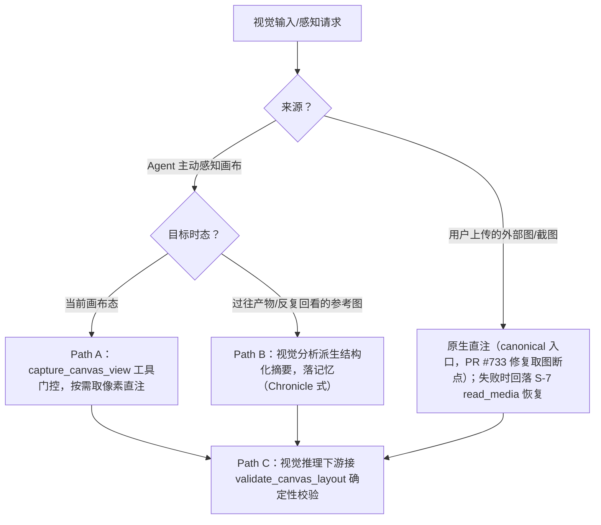
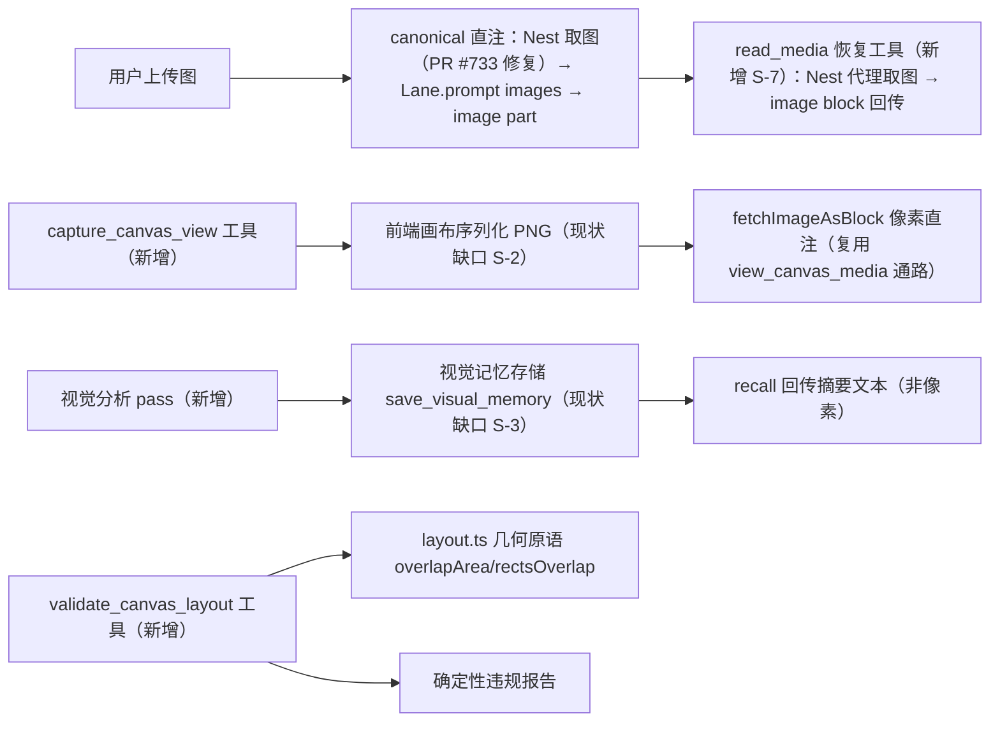
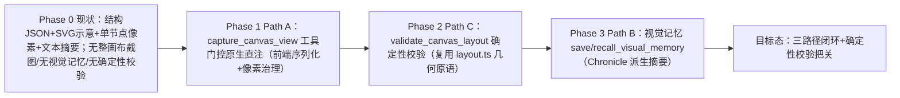

# Agent 视觉感知：工具门控直注 + Chronicle 派生记忆 + 确定性校验 — 设计规格

状态：**部分实施**（Phase 1a S-7 `read_media` 已上线并完成生产终验，2026-11-06；其余待实施）
修订：**R2/R3**（2026-11-05）——R2：基于生产事故取证 + 上游 **0.99.2**（实际部署版本，非 vendor 镜像 0.85.1）源码实证回写：修正「用户图直注现状已有」的错误结论（N-4 / R-V1 / 关键澄清 / M-1 / A-1）；新增 S-7 `read_media` 恢复工具；新增 §12.1 上游基线与升级红利。R3：自审修补——S-2 触发通道（Nest→web 事件 + 关联 id 回执）定为硬前置 Spike；澄清 R-V3 预设降级 vs R-V1 故障静默边界；新增 R-V9（取图工具分工）/ R-V10（分层与 L6 预算纪律）；补 M-9 / A-9 恢复闭环场景与 `read_media` 单测要求。
修订：**R4**（2026-11-06，实施回写）——Phase 1a（S-7 + PR #733/#737/#745）已上线：A-1/A-9 生产终验通过（会话 cmw4jld86，直注成功 + 模型零工具调用直接描述）。据此回写：R-V9 升级为运行时强制（`view_canvas_media` 对 uploads 引用 fail-fast 指路）；S-7/M-9 恢复闭环补**成功侧明示块**（`buildImageInjectedNotice`，终验实证的决定性引导）；§9 文件清单对齐实际落点（Nest `read-media.ts` 独立模块 + internal guard；shared `sidebarAttachments.ts`）；新增 R-V11（web 侧展示注册硬前置，#737 CI 实证遗漏）；§10 补工具计数断言同步；§12 标注进度。
代号：**VISP**
前置：
- [`2026-10-06-selection-as-default-reference-design.md`](./2026-10-06-selection-as-default-reference-design.md)（SEL-REF，R-S8「回执由确定性 UI、不靠模型自述」是本规格 Path C 的同构约束）
- 跨产品机制调研（见「调研输入与决策依据」）：WorkBuddy `ViewImage` 工具门控 + 多模态直注、OpenAI Codex 原生直注 + Chronicle 派生记忆、Claude Code 视觉 MCP 委派、nekro-agent `view_image` 委派
分支约定：实现走 feature 分支 + PR + squash merge。

> 一句话产品定义：**agent 何时"看"画布由它自己决定（工具门控），看的时候拿原生像素（直注）；过往/反复回看的产物用视觉分析派生的摘要记忆（Chronicle 式），而非裸像素；任何视觉推理的下游都由程序化确定性校验把关，不采信模型自述。**

---

## 调研输入与决策依据（跨产品机制对比 + 项目现状）

### 1. 跨产品机制调研结论（决策依据）

业界处理"对话中的图片/截图"并非二选一，而是两个正交维度的组合：

- **注入形态**：图片以「像素直注上下文」还是「视觉模型派生文本」进入 LLM；
- **决策时机**：图片「随每条消息自动进上下文」还是「agent 按需调工具才看」。

| 产品 | 机制 | 关键事实 |
|---|---|---|
| **WorkBuddy（我方同类）** | 工具门控 + 混合 | 用户发图拿到的是**路径**，需要时调 `ViewImage`：底层多模态模型则**原样返回像素进上下文**；无视觉能力模型则由视觉模型读图后**回传文字**。即"工具决定何时看，看时尽量直注"。 |
| **OpenAI Codex** | 原生直注为主 + Chronicle 派生记忆 | `codex -i screenshot.png` 把截图作原生多模态输入；另有 Chronicle：后台截屏 → OCR/视觉 → Markdown 摘要持久化为上下文（原始截图仅本地留 6h，派生摘要永久）。 |
| **Claude Code** | 默认文本，社区用视觉 MCP 委派 | 模型本身多模态，但实践中常走 `vision MCP`：图片交独立视觉模型转文字回传。 |
| **nekro-agent 等开源** | 纯委派 | 主模型 text-only 时 `view_image()` 调独立视觉模型回传描述；主模型有视觉时直注。与 WorkBuddy 同构。 |

**行业 2026 共识**（SFAI Labs 能力矩阵、agentmarketcap 架构报告）：
- 前沿模型原生 image-in 已成标配（GPT-5 / Claude Opus 4.8 / Gemini 2.5 Pro 均原生支持图像输入），"视觉"本身不再是差异化，**差异在成本与视觉任务质量**。
- 但 agent 系统**最佳实践 = 混合（工具门控 + 原生直注）**：图片贵（一张 1024×1024 ≈ 1000–2000 文本 token，整体是纯文本查询的 5–20 倍成本），不能每条消息无脑注入；一旦要看就给完整像素而非压缩描述。
- **确定性校验不可省**：视觉推理下游必须接程序化校验层（布局越界、元素重叠等可程序化判定的），**绝不依赖模型"置信度"或自述判断幻觉**。

### 2. 项目现状深度调研（缺口地图）

对 `pi-lnk` 全仓的 6 大领域排查（真实路径 + 行号）结论：**agent 当前对画布的感知 = 结构化 JSON + SVG 示意 + 按需单节点像素 + 一句话文本摘要，全程无整画布像素/截图、无视觉记忆、无确定性校验。**

| 能力 | 现状（证据） | 缺口（本规格目标态） |
|---|---|---|
| 整画布截图导出 | ABSENT：仅 `CanvasPage.vue:4384` 等单节点/toBlob 精修产物；无 `html2canvas`、无视口 `toDataURL`、无 canvas 缩略图 | 前端画布序列化 PNG 能力 |
| 用户上传图的主动视觉分析 | 出站治理层有多模态（`payload-images.ts` 治理）；但**直注取图存在生产断裂点**（绝对 URL 判据不匹配 → hairpin 挂死 → 静默 skip，image part = 0，已修 PR #733）；**无恢复路径**；`read_document` 仅文本且不可达（`read-document.ts:68`）；`view_canvas_media` 仅限画布节点（`view-canvas-media.ts:31`） | 直注取图与上游同语义（PR #733）+ `read_media` 恢复工具（S-7） |
| agent 看画布 | 结构化 JSON（`canvas-read.ts` 的 `get_canvas_summary`/`get_node`/`get_canvas_layout`）+ SVG 示意（`render-canvas-view.ts`）+ 单节点像素（`view_canvas_media`）+ 文本摘要（`agent-canvas-tools.service.ts:650` `summarizeCanvas`） | 无整画布像素流/截图 |
| 确定性视觉校验 | 仅放置避让原语：`layout.ts:106` `overlapArea` / `rectsOverlap`（用于批量新建避让，**非渲染态校验**）；`render-canvas-view.ts` 仅做 `SVG_MAX_CHARS` 体积预算 + `severity`，**无几何/布局违规检测** | overlap/越界/溢出的程序化检测（落点 `packages/shared/src/canvas/layout.ts`） |
| 过往产物回看 | 文本记忆 `memory.ts:155`（`save/recall_memory`，内容纯文本事实）；`compaction-images.ts:33` 图片退化为文字指针；前端 `StoriesPage.vue` 画廊是用户侧浏览，**agent 不可引用** | agent 可回看的产物视觉记忆 |

**关键澄清（R2 修正，原结论有误）**：初版曾写"用户上传图已经 `payload-images.ts` 原生直注，本规格不重复造"。**生产取证推翻了它**：会话 `cmw33xj7t00komy019xm4jiva` 实测，composer 上传图的直注链路在取图一步静默断裂——附件 url 为绝对公网形态（`http://…:8888/api/uploads/…`），Nest 侧 `readUploadsBuffer` 只认 `/uploads/` 相对形态 → 回落容器内 fetch 宿主 IP（hairpin 挂死）→ 逐图 catch 静默 skip → **pi transcript 中 image part 出现 0 次**，模型只拿到识图文本摘要（修复见 PR #733）。正确的现状结论是：**直注机制存在但被旁路架构侵蚀**——全仓共有六条并行图片路径（Nest 直通 / 识图兜底 / `payload-images` 出站治理 / `view_canvas_media` / `compaction-images` / `upstream-ref-inline`），URL 解析判据互不一致（4 套取图实现）、vision 判定重复（Nest `supportsVisionModel` 白名单 vs 上游 SSOT `Model.input`）、失败全程静默。因此本规格新增 S-7（`read_media` 恢复路径）与 §12.1（上游基线收敛），而不仅是"不重复造"。

---

## 0. 配图索引（结构与视觉两类，均随本文档演进）

本文档的图分两类：**结构图**一律以 Mermaid 内嵌；本文档**不含视觉稿**（理由：全部为数据流 / 判据 / 路标，无空间比例信息，符合 SPEC-CONVENTIONS §1 反面判据）。

| 编号 | 形式 | 内容 | 位置 | 用途 |
|---|---|---|---|---|
| 图 1 | 内嵌 Mermaid | 视觉输入/感知的三路径路由决策树 | §4.2 | 新工具接入与提示词措辞的验收基准 |
| 图 2 | 内嵌 Mermaid | 三路径接入架构（含现状缺口标注） | §5.1 | 改动面定位基准，标注哪些是现状已有、哪些是缺口 |
| 图 3 | 内嵌 Mermaid | 现状 → 目标态演进路标 | §12 | 分期交付与验收节奏依据 |

---

## 1. 目标

1. **主路径（工具门控原生直注）**：agent 能通过工具**主动**捕获画布当前视觉态并拿到原生像素（直注上下文），且**由 agent 决定何时调用**（不在每轮自动注入），控制 token/上下文成本。
2. **视觉记忆（Chronicle 式派生摘要）**：对"两周前的产物""反复回看的参考图"等，走视觉分析 → 结构化摘要 → 持久记忆，**回看时回传摘要文本而非裸像素**。
3. **确定性校验（Path C 跨切）**：任何视觉推理/画布改动下游，接程序化布局校验（重叠/越界/溢出），**结果以确定性报告为准，不采信模型自述**。
4. **可验证**：校验结果与"agent 看过/校验过"的事实由**系统侧确定性输出**呈现（同 SEL-REF R-S8 精神），不依赖模型复述。

## 2. 范围

### 2.1 做

| # | 内容 |
|---|---|
| S-1 | **Path A**：新增 `capture_canvas_view` 工具（tier=present），按需返回画布当前态像素，复用 `view_canvas_media` 的 `fetchImageAsBlock` 像素通路（`view-canvas-media.ts:24-125`，2MB 上限 + mime 白名单 + fail-soft）。 |
| S-2 | **前端缺口补齐**：画布视口序列化为 PNG（现状 ABSENT），作为 `capture_canvas_view` 的像素来源；大画布降采样、封顶分辨率，避免 token 爆炸。**触发通道是硬前置（R3 补）**：runtime 工具在 pod 内、Konva stage 在浏览器——须复用既有 Nest→web 事件通道 + 关联 id 回执（web 收到快照请求 → 序列化 → 上传 `/api/uploads` → 以 url 回执），Phase 1 以此为首个技术验证项（Spike）。 |
| S-3 | **Path B**：新增视觉记忆 `save_visual_memory` / `recall_visual_memory`（扩展 `memory.ts:155` 的记忆工具），存派生摘要 + 缩略图引用，**recall 回传摘要文本（非像素）**。 |
| S-4 | **Path C**：新增 `validate_canvas_layout` 工具（tier=present），复用 `packages/shared/src/canvas/layout.ts` 的 `overlapArea` / `rectsOverlap` / `getNodeSize` / `getAbsolutePosition` 计算重叠/越界/溢出，输出确定性违规报告。 |
| S-5 | **跨切守卫**：在 `propose_generation` 落位、批量 `arrange_nodes`、以及 agent 视觉自述（"这个没重叠吧"）之后，建议性接 `validate_canvas_layout`，把确定性报告作为事实源。 |
| S-6 | **像素治理复用**：`capture_canvas_view` 产出的图片 part 统一走 `payload-images.ts` 的出站治理（超大剔除、历史降级、本轮优先）。 |
| S-7 | **`read_media` 恢复工具（R2 新增）**：agent 直注失败或事后回看时的恢复路径——工具调 Nest 内部端点（`parseUploadRefPath` 本地盘直读，**唯一取图点**）→ base64 → 以 **image block 回传 tool result**（同上游 harness `read` 工具模式，v0.99.2 harness/tools/read.ts:47-99）。tier=present。**必须走 Nest 代理**：pi-runtime pod 对宿主公网 IP:8888 不可达（实测 fetch failed），pod 侧自取图不可行。参数形态：`ref` 接受侧栏标记 `I{n}` 或完整 url（事故实证模型只能拿到 `[I1=文件名]` 级别的线索）；像素上限沿用 `fetchImageAsBlock` 语义（2MB + mime 白名单），超限走缩图而非报错。**恢复闭环（R3 补）**：直注失败/被治理剔除时，识图兜底动态块追加一行「原图未能注入，可用 `read_media(I{n})` 查看」，让模型知道恢复入口存在。**成功侧明示块（R4 补，PR #745）**：直注**成功**时同步注入明示块（`buildImageInjectedNotice`：告知「原图已注入上下文，直接描述即可」+ `read_media(ref:"I{n}")` 重读入口）——生产终验实证这是决定性引导：模型得知图已在 context 后零工具调用直接描述，从源头消除误调。 |

### 2.2 明确不做

| # | 不做 | 理由 |
|---|---|---|
| N-1 | **环境截屏 / 后台屏幕录制**（Chronicle 的"看屏幕"形态） | 隐私与数据合规：Chronicle 把截图传 OpenAI 服务器，本仓不可接受。本规格的"派生记忆"**只作用域画布产物与用户显式选定的参考图**，绝不静默录屏。 |
| N-2 | **每条消息自动注入整画布截图** | 成本是原生直注的 5–20 倍，且无差别注入违背"工具门控"决策（§调研输入）。 |
| N-3 | **用视觉模型替换 `render_canvas_view` 的 SVG 示意** | SVG 示意是结构化、可 diff、零 token 成本的"看布局"通道，与像素直注互补而非替代。 |
| N-4 | **把用户上传图重做一遍多模态接入，或整包搬上游 coding-agent 的 `read`/`write` 文件系统工具** | 直注机制已存在（PR #733 修复取图断点后可用），不重建；`read`/`write` 是 coding-agent 文件系统范式，与画布范式冲突且违反工具分层点名纪律（tiering 要求每个常驻工具有资产点名）。要搬的是**机制**：上游 `read` 的「tool result 回传 image block」模式 → 落 S-7 `read_media`（走 Nest 唯一取图点）。 |
| N-5 | **校验结果再交给模型"判断严重性"** | 严重程度由确定性规则（阈值 + 几何原语）定，模型只消费报告，不生产报告（同 R-S8 不采信自述）。 |
| N-6 | 改 L6 静态提示词承载视觉描述 | 视觉走动态块/像素通道，不挤占静态预算（参照 SEL-REF N-6）。 |

## 3. 与既有规格的关系

| 既有决策 | 关系 | 说明 |
|---|---|---|
| SEL-REF **R-S8**（回执由确定性 UI、不靠模型自述） | **同构承接** | 本规格 Path C 是 R-S8 在"视觉推理"维度的延伸：确定性输出 = 系统事实源，模型自述不可作担保。 |
| SEL-REF **N-2**（指代是情境、不做成工具） | **不冲突** | Path A 是"动作"（agent 决定看画布），属工具合理域；与"选中=指代"的情境层正交。 |
| `render_canvas_view`（SVG 示意） | **互补** | 它继续作为"结构化看布局"通道；Path A 是"像素级看当前态"的补充通道，二者并存。 |
| `view_canvas_media`（单节点像素） | **复用其像素通路** | `fetchImageAsBlock` 是 Path A 的像素传输底座；Path A 新增的是"整画布来源"而非新传输协议。 |
| `payload-images.ts` 出站治理 | **复用** | Path A 产出图片 part 直接进既有治理链路。 |
| `memory.ts` 文本记忆 | **扩展** | Path B 在既有 save/recall 上增加视觉记忆变体，scope（canvas/user）与既有一致。 |

## 4. 规范与判据

### 4.1 术语

| 术语 | 定义 |
|---|---|
| **原生直注** | 图片以像素 `image` part 进入模型上下文，模型在同一次注意力里看到图（非文本描述）。 |
| **工具门控** | agent 仅在调用 `capture_canvas_view` 时才取得画布像素；不调用则不占上下文/token。 |
| **Chronicle 式派生摘要** | 对过往/反复回看的图像，先经视觉分析 pass 产出结构化文本摘要并持久化；回看时回传摘要，裸像素不进上下文。 |
| **确定性校验** | 用几何原语（非模型）计算布局违规（重叠/越界/溢出），输出可程序化判定的报告。 |

### 4.2 路由判据（决策树）

路由的完整分支与每条出边的实现落点见 图 1。



*图 1 · 视觉输入/感知的三路径路由。这张图是新增工具接入与提示词措辞的验收基准：每条出边都要能在实现里找到对应分支，不允许"图上没有、代码里有"的隐式路径。*

### 4.3 规范（产品级，可复用）

| 规则 | 内容 |
|---|---|
| **R-V1** | **用户上传图走原生直注，走 canonical 入口，不新增平行链路**：像素以 `ImageContent` 经 pi canonical 入口（`Agent.prompt(text, images)` / `Lane.prompt`，v0.99.2 agent.ts:372-427、lane.ts:511/1135）进入 user 消息；vision 判定收敛上游 SSOT（`Model.input.includes("image")`，v0.99.2 transform-messages.ts:36），Nest 侧 `supportsVisionModel` 白名单降级为"成本门控"（避免给 text 模型白送 5MB base64），判定来源必须与上游一致；直注失败必须显性（逐图结果 + turn 级遥测），禁止静默降级到文本摘要。 |
| **R-V2** | **Path A 必须工具门控**：`capture_canvas_view` 由 agent 主动调用；未调用时画布像素**绝不**进入上下文（成本控制，§调研输入）。 |
| **R-V3** | **Path A 看时给原生像素**：底层模型多模态则直注像素；非多模态降级为视觉模型描述（同 WorkBuddy `ViewImage` 混合形态），但**默认目标态是多模态直注**。**与 R-V1 的边界（R3 澄清）**：R-V3 是*预设降级*（可预期的设计路径，返回带明确文案"以下为视觉模型描述，非原始像素"），R-V1 禁止的是*故障静默*（取图失败却无任何信号地退化）——预设降级必须自报身份，故障必须显性留痕，二者都不允许"无信号降级"。 |
| **R-V9** | **两个取图工具的分工（R3 新增；R4 升级为运行时强制）**：`view_canvas_media` 面向**画布节点产物**（node_id/url，既有契约不动）；`read_media` 面向**用户附件与恢复路径**（`I{n}` 标记/uploads 引用）。二者不合并、不互相替代；`read_media` 不接受画布节点引用（节点走 `view_canvas_media`），避免语义重叠。**运行时强制（R4，PR #745）**：`view_canvas_media` 以 `isUploadsRefUrl` 检测 `/api/uploads/` 引用（绝对/相对形态均匹配）→ 零网络请求直接返回 `{ok:false, error:"…请改用 read_media(ref:…)", redirect:"read_media"}`；工具描述同步收敛（删除 "sidebar attachment" 引导语），使 uploads 引用只可能到达 `read_media`。生产事故实证：旧描述的 "url (e.g. from a sidebar attachment)" 会主动把模型引向错误工具 + hairpin 死路。 |
| **R-V10** | **新工具的分层与预算纪律（R3 新增）**：本规格 5 个新工具全部 tier=present（**不进延迟集**，规避「哪个资产点名了它」判据——未点名工具进延迟集即不可达）；**不新增静态规则文案**（L6 预算余量仅 68 字符，见 AGENTS.md 变更影响面矩阵），恢复提示等引导语一律走动态块；若未来需要在 prompt 规则中点名，必须走 6 处同步 + `pnpm prompt:lint` 预算检查。 |
| **R-V11** | **新增常驻工具必须登记 web 侧展示注册（R4 新增，#737 CI 实证遗漏）**：每个新工具必须在 `apps/web/src/components/agent/toolPresentation.ts` 登记展示项（icon + verb 人话），否则 agent 执行时间线对该工具**零显示**（用户看不到调用发生）。同时必须同步 `services/pi-runtime/src/tools/config.test.ts` 的三计数断言（工具计数 48/50/48，每 +1 工具 ×3）。剩余 4 个工具（`capture_canvas_view` / `validate_canvas_layout` / `save_visual_memory` / `recall_visual_memory`）均适用。 |
| **R-V4** | **Path B 只存派生摘要，不存裸像素进上下文**：`recall_visual_memory` 回传摘要文本 + 缩略图引用，裸图不进上下文（Chronicle 式，控制成本 + 可检索）。 |
| **R-V5** | **Path B 作用域受限**：仅画布产物与用户显式选定的参考图；**禁止**环境截屏/后台录屏（N-1）。 |
| **R-V6** | **Path C 是事实源**：任何视觉自述/改动后，违规判定以 `validate_canvas_layout` 确定性报告为准，模型**可表达**但不能**担保**（同 R-S8）。 |
| **R-V7** | **像素治理复用**：`capture_canvas_view` 产出图片 part 必须过 `payload-images.ts` 治理（超大剔除/历史降级），不得绕过。 |
| **R-V8** | **降级不编造**：序列化失败/超分辨率/视觉分析失败 → 返回明确错误（参照 `render-canvas-view.ts:692-738` 超界报错、不编造行），不得注入半截或假数据。 |

## 5. 架构与契约

### 5.1 三路径接入架构（含现状缺口标注）

三路径的链路划分、哪些现状已有、哪些是缺口，见 图 2。



*图 2 · 三路径接入架构（R2 修订）。U→PI 是 canonical 直注链路（事故断点已由 PR #733 修复，vision 判定与失败显性化按 R-V1 收敛）；RM 是直注失败/事后回看的恢复路径（S-7，Nest 唯一取图点）；CA→FE→FB 是 Path A（FE 为前端缺口）；CH→VM→RC 是 Path B（VM 为记忆缺口）；VL→GEO/REP 是 Path C（复用 `packages/shared/src/canvas/layout.ts`）。本图是改动面定位基准。*

### 5.2 契约增量

| 层 | 文件 | 增量 |
|---|---|---|
| 前端 | `apps/web/src/pages/CanvasPage.vue` 或新建 `apps/web/src/canvas/canvasSnapshot.ts` | **新增**画布视口序列化 PNG（S-2）；大画布降采样、封顶分辨率；fail-soft 返回错误供 `R-V8`。 |
| runtime 工具 | `services/pi-runtime/src/tools/capture-canvas-view.ts` | **新建**（S-1）：调前端序列化接口拿 PNG → `fetchImageAsBlock` → 返回 `ImageContent`（像素直注）。tier=present。 |
| runtime 工具 | `services/pi-runtime/src/tools/validate-canvas-layout.ts` | **新建**（S-4）：读画布节点绝对位置/尺寸 → 调 `validateCanvasLayout` 纯函数 → 返回违规报告。tier=present。 |
| runtime 工具 | `services/pi-runtime/src/tools/visual-memory.ts` | **新建**（S-3）：`save_visual_memory`（摘要 + 缩略图引用）、`recall_visual_memory`（回传摘要文本）。 |
| runtime 工具 | `services/pi-runtime/src/tools/read-media.ts` | **新建**（S-7）：`read_media(ref)` → 调 Nest 内部端点取 base64 → 以 `{type:"image"}` block 回传 tool result（上游 `read` 模式）。tier=present。 |
| Nest 内部端点 | `apps/server/src/agent/read-media.ts`（**实际落点，R4 修正**；规格初版写 `agent.controller.ts`） | **新增** `POST /agent/internal/read-media`：入参 attachment ref/url → `parseUploadRefPath` 本地盘直读（唯一取图点）→ 返回 base64 + mimeType；pod 不可达宿主 IP，必须 Nest 代理（S-7）。鉴权走既有 `agent-internal.guard.ts`（header `x-lnkpi-service-token` + env `LNKPI_INTERNAL_SERVICE_TOKEN`，非用户 JWT）；uploads 引用形态校验 + mime 白名单 + 超 2MB 缩图 + 穿越守卫（非法 ref 绝不发起网络 fetch）。 |
| 几何原语 | `packages/shared/src/canvas/layout.ts` | **新增** `validateCanvasLayout` 纯函数（§8），复用 `overlapArea`/`rectsOverlap`/`getNodeSize`/`getAbsolutePosition`。 |
| 出站治理 | `services/pi-runtime/src/payload-images.ts` | **复用**（R-V7）；若画布截图常 >8MB 阈值，评估对"画布态"类的专门上限（不绕过治理）。 |
| 工具注册 | `services/pi-runtime/src/tools/registry.ts` | 注册 `capture_canvas_view` / `validate_canvas_layout` / `save_visual_memory` / `recall_visual_memory` / `read_media`。 |
| 分层 | `services/pi-runtime/src/tools/tiering.ts` | 分类：`capture_canvas_view`=present/read，`validate_canvas_layout`=present，`visual_memory`=read/memory，`read_media`=present/read。 |
| 记忆存储 | `services/pi-runtime/src/tools/memory.ts` | 扩展记忆 scope 支持视觉记忆条目（摘要 + 缩略图引用），scope（canvas/user）与既有一致。 |

### 5.3 Path A 的像素来源与降级

- **来源**：前端把当前画布视口（Konva stage / 渲染树）序列化为 PNG。现状仅 `CanvasPage.vue:4384` 等单节点 `canvas.toBlob`，**整画布序列化缺失** ⇒ S-2 是硬前置。
- **降级链**：① 多模态模型 → 像素直注（目标态）；② 非多模态 → 视觉模型读图转描述（混合，R-V3）；③ 序列化失败/超分辨率 → 返回错误（R-V8），agent 退化为 `render_canvas_view` SVG 示意。
- **预算**：与 SEL-REF §5.4 同理，`dynamic-budget` 的 `vision` 份额（25%）约束像素块的上下文占比；接线前须补 `classifyBlock` 映射，避免静默截断。

### 5.4 Path C 的确定性报告形态

```text
【布局校验】画布 1920×1080，检出 2 处违规：
- OVERLAP n_8f3a × n_1c02：交集 120×80px（severity=high）
- OVERFLOW n_3d91：右边界超出画布 40px（severity=medium）
建议：arrange_nodes 对齐或缩小 n_3d91。
```

报告字段：`type`（OVERLAP/OVERFLOW/…）、`nodeIds`、`metric`、`severity`。**severity 由几何阈值定，不由模型定**（R-V6）。

## 6. 主场景规格（逐项可验收）

| # | 场景 | 期望 |
|---|---|---|
| M-1 | 用户上传报错截图问"这个错怎么修" | 截图像素经 canonical 直注进模型上下文（R-V1；取图断点已由 PR #733 修复，须生产复测确认）；回答可对上图里的内容。 |
| M-2 | 生成落位后 agent 说"我看看效果" | 调 `capture_canvas_view` → 拿到当前画布像素直注；**未调用前**上下文不含画布截图（R-V2）。 |
| M-3 | 大画布（5000×3000）被 agent 查看 | 前端降采样封顶；像素 part 过 `payload-images` 治理（R-V7），不爆 token。 |
| M-4 | "把两周前那个产品调成同样风格" | `recall_visual_memory` 回传该产物的派生摘要文本（非裸像素），agent 据此行动（R-V4）。 |
| M-5 | 用户显式"记住这个参考图的风格" | `save_visual_memory` 落摘要 + 缩略图引用；作用域仅该参考图（R-V5，无录屏）。 |
| M-6 | agent 视觉自述"这两个没重叠" | `validate_canvas_layout` 报告实际有重叠 → 以报告为准纠正（R-V6）。 |
| M-7 | 序列化失败（画布渲染异常） | `capture_canvas_view` 返回明确错误（R-V8），agent 退化为 SVG 示意，不编造。 |
| M-8 | 视口外触发录屏类需求 | 明确拒绝环境截屏，仅限画布产物（N-1）。 |
| M-9 | 直注失败（取图断点回归 / 图被治理剔除） | 识图兜底动态块含「可用 `read_media(I{n})` 查看」提示（S-7）；agent 调用后经 Nest 代理拿到 image block，恢复成功（R-V9 分工内）。✅ 2026-11-06 生产终验：直注成功场景模型零工具调用直接描述（明示块生效），误调场景 fail-fast 指路生效（PR #745）。 |

## 7. 数据与状态变更

| 项 | 变更 |
|---|---|
| Prisma schema / 迁移 | **可能**：视觉记忆条目需存储（摘要 + 缩略图引用 + scope），若 `memory.ts` 现有表不兼容则加列/新表。 |
| 前端持久化（画布 JSON） | **无**（序列化是运行时瞬时，不落画布数据）。 |
| 会话状态 | runtime turn state 增加 `capture_canvas_view` 调用记录（内存态）。 |
| 服务端配置 | 可选 env 开关（参照 `SEL_REF_ENABLED`），默认关灰度。 |

## 8. 纯函数与算法（含单测要求）

新增纯函数，置于 `packages/shared/src/canvas/layout.ts`（几何原语已在此）：

```ts
export type LayoutViolationType = 'OVERLAP' | 'OVERFLOW' | 'MIN_SPACING'
export interface LayoutViolation {
  type: LayoutViolationType
  nodeIds: string[]
  metric: string          // 人类可读的量化结果，如 "交集 120x80px" / "右边界超 40px"
  severity: 'low' | 'medium' | 'high'
}
export interface NodeBox { id: string; x: number; y: number; width: number; height: number }
export interface ValidateInput {
  nodes: NodeBox[]
  canvas: { width: number; height: number }
  /** 可选：最小间距阈值，默认 0 */
  minSpacing?: number
}
export function validateCanvasLayout(input: ValidateInput): LayoutViolation[]
```

| 单测 | 期望 |
|---|---|
| 无节点 | 返回 `[]` |
| 两节点不重叠、在界内 | `[]` |
| 两节点重叠 120×80 | 1 条 `OVERLAP`，`metric` 含交集尺寸，`severity=high` |
| 一节点右边界超画布 40px | 1 条 `OVERFLOW`，`severity=medium` |
| `minSpacing=20` 且间距 10 | 1 条 `MIN_SPACING` |
| 同输入重复 3 次 | 3 次输出逐字节相同（无随机源） |
| 边界相切（重叠面积 0） | 不计 `OVERLAP`（>0 才计） |

> 判据形态同 SEL-REF §8：卡**类别**（是否有违规、类型、severity 来源），不卡具体 id/字符数。

## 9. 文件级改动清单

| 文件 | 变更 | 备注 |
|---|---|---|
| `apps/web/src/canvas/canvasSnapshot.ts`（新建） | 画布视口序列化 PNG + 降采样 + fail-soft | S-2，前端缺口 |
| `apps/web/src/pages/CanvasPage.vue` | 暴露序列化接口给 runtime 工具 | 复用现有渲染上下文 |
| `services/pi-runtime/src/tools/capture-canvas-view.ts` | 新建 | S-1，复用 `fetchImageAsBlock` |
| `services/pi-runtime/src/tools/validate-canvas-layout.ts` | 新建 | S-4 |
| `services/pi-runtime/src/tools/visual-memory.ts` | 新建 | S-3 |
| `services/pi-runtime/src/tools/read-media.ts` | 新建 | S-7，Nest 代理取图 → image block 回传 |
| `apps/server/src/agent/read-media.ts`（**实际落点**） | 加 `POST /agent/internal/read-media`（+ `read-media.test.ts`） | S-7，`parseUploadRefPath` 唯一取图点；鉴权 `agent-internal.guard`（R4 修正：初版写 agent.controller.ts） |
| `packages/shared/src/sidebarAttachments.ts`（**实际落点**） | 加 `resolveSidebarRef` / `imageSidebarRefKeys`（+ test） | S-7，`I{n}` 标记 ↔ 附件 url 双端同源、与侧栏块编号同源（R4 补：初版遗漏） |
| `apps/web/src/components/agent/toolPresentation.ts` | 登记新工具展示项（icon + verb） | R-V11，#737 实证：漏登 = 时间线零显示（R4 补） |
| `packages/shared/src/canvas/layout.ts` | 加 `validateCanvasLayout` | §8 |
| `packages/shared/src/canvas/layout.test.ts` | 加用例 | §8 |
| `services/pi-runtime/src/tools/registry.ts` | 注册 3 个新工具 | §5.2 |
| `services/pi-runtime/src/tools/tiering.ts` | 分类新工具 | §5.2 |
| `services/pi-runtime/src/payload-images.ts` | 复用（评估画布类上限） | R-V7 |
| `services/pi-runtime/src/dynamic-budget.ts` + `.test.ts` | 补 `classifyBlock` 映射（像素块归 vision） | 参照 SEL-REF §5.4 |
| `services/pi-runtime/src/tools/memory.ts` | 扩展视觉记忆条目 | S-3 |

## 10. 测试策略与验收标准

### 10.1 单测

- `validateCanvasLayout` 全量用例（§8）。
- `capture_canvas_view`：mock 前端序列化返回 PNG → 断言走 `fetchImageAsBlock` 且返回 `ImageContent`；序列化失败 → 返回错误（R-V8）。
- `save/recall_visual_memory`：存摘要 → recall 回传**文本非像素**；scope 隔离（canvas 不跨画布）。
- `read_media`：`I{n}` 标记 / url 两种 ref → Nest 端点返回 base64 → tool result 含 `{type:"image"}` block；超 2MB → 缩图不报错；非法 ref → 明确错误（R-V8）；画布节点 ref → 拒绝并指引 `view_canvas_media`（R-V9）。

### 10.2 目视 / E2E 验收

| # | 验收 |
|---|---|
| A-1 | M-1：用户上传截图，模型回答能对上图内容（PR #733 合并部署后生产复测；pi transcript 中 image part ≥ 1 为机检判据）。✅ **2026-11-06 生产终验通过**（会话 cmw4jld86：image part=1（566KB base64 在 prompt）、模型直接输出构图描述、input=7822+cacheRead=8192）。 |
| A-2 | M-2：未调 `capture_canvas_view` 前，上下文中**无**画布截图；调用后才出现（R-V2）。 |
| A-3 | M-3：大画布查看，token 占用在预算内（降采样 + payload 治理生效）。 |
| A-4 | M-4：`recall_visual_memory` 回传摘要文本，裸像素不进上下文（R-V4）。 |
| A-5 | M-5：显式保存参考图记忆，作用域正确，无录屏（R-V5）。 |
| A-6 | M-6：`validate_canvas_layout` 检出的重叠，模型自述被纠正（R-V6）。 |
| A-7 | M-7：序列化失败返回错误、退化为 SVG 示意（R-V8）。 |
| A-8 | S-7：直注失败场景下（或显式回看），`read_media` 经 Nest 代理取图，tool result 含 image block，模型能看到像素（pod 侧无外网依赖）。✅ 2026-11-06 生产取证通过（read-media 端点三连探针全绿；生产复测脚本 23/23 PASS）。 |
| A-9 | M-9：直注失败 → 动态块出现 `read_media` 恢复提示 → agent 调用成功（恢复闭环全链路）。✅ 2026-11-06 生产终验通过（成功侧明示块路径：模型零工具调用直接描述——恢复闭环未触发即最优结果；fail-fast 指路经回归测试钉死）。 |

### 10.3 回归（必须绿）

- `pnpm --filter @lnkpi/shared test`（`layout` 用例）
- `services/pi-runtime` 的 `tiering` / `payload-images` / `dynamic-budget` 用例（除 §9 映射新增）
- 新增/移除工具时同步 `tools/config.test.ts` 三计数断言（当前基线 48/50/48，R4 补：漏改 = CI 红，#737 实证）
- 新增工具展示登记（R-V11）后 web 侧 A5 门禁通过
- `render_canvas_view` 既有 SVG 示意用例**不变**（N-3 互补而非替代）
- `pnpm prompt:lint`（静态规则未动，N-6）

## 11. 风险

| 风险 | 缓解 |
|---|---|
| **前端整画布序列化缺失** | S-2 是 Path A 硬前置；先用单节点 `toBlob` 验证通路，再补 stage 序列化。 |
| **token 成本失控** | R-V2 工具门控 + S-2 降采样 + R-V7 payload 治理三道闸。 |
| **校验误判（漏检/误检）** | 几何原语已有生产使用（`overlapArea` 等）；阈值（severity/minSpacing）单测覆盖；先 low-strict 上线。 |
| **隐私合规** | N-1 明确禁止环境录屏；Path B 仅画布产物/用户显式选定。 |
| **降级编造** | R-V8 显式错误 + fail-soft，参照 `render-canvas-view` 超界报错范式。 |
| **预算接线后静默截断** | 同 SEL-REF §5.4：`classifyBlock` 映射先落地，像素块归 vision。 |
| **记忆越界/跨画布注入** | `recall` 作用域校验同 `memory.ts` 既有 canvas/user scope。 |
| **pi-runtime pod 出口受限（R2 实测）** | pod 对宿主公网 IP:8888 不可达（hairpin）⇒ `read_media` 必须经 Nest 代理取图（S-7），pod 侧直 fetch 一律不做；直注主路径的取图在 Nest 侧完成（PR #733），不依赖 pod 出口。 |
| **`read-media` 端点无会话作用域（评审 #5，accepted risk）** | 内部端点仅校验 uploads 引用形态，不校验该 url 归属当前会话/用户——理论上已知他人 `userId/fileName` 可读取其 uploads 图片。缓解：端点仅供 pi-runtime pod 内网调用（非公网暴露）、引用串只来自本轮对话的 composer 附件（模型无法枚举他人文件名）；Path A 全量接线时升级为会话内附件白名单校验（复用 `sidebarAttachments` 解析链）。 |

## 12. 后续包 / 路线图（现状 → 目标态演进路标）



*图 3 · 现状到目标态的演进路标。交付节奏：Phase 1 先打通"agent 能主动看画布"（补齐最大缺口），Phase 2 接确定性校验（把关质量），Phase 3 补视觉记忆（长期回看）。每期独立可验收、可灰度。*

| 阶段 | 交付 | 前置 | 验收锚点 |
|---|---|---|---|
| **Phase 1（Path A + 恢复路径）** | 前端画布序列化 + `capture_canvas_view` + `read_media`（S-7）+ 像素治理 | 无（S-2 本阶段内解决；S-7 依赖 PR #733 已合并） | A-2 / A-3 / A-7 / A-8。**进度（R4）：S-7 已完成**（PR #733/#737/#745，A-1/A-8/A-9 生产终验通过 2026-11-06）；**剩余 Path A**（S-2 Spike + S-1 `capture_canvas_view`，A-2/A-3/A-7 待验收） |
| **Phase 2（Path C）** | `validate_canvas_layout` + `validateCanvasLayout` 纯函数 | Phase 1 像素通路（校验对象来自同一画布状态） | A-6 + §8 单测 |
| **Phase 3（Path B）** | `save/recall_visual_memory` + 视觉分析 pass | Phase 2 校验（记忆摘要可由校验增强） | A-4 / A-5 |

### 12.1 上游基线核验（0.99.2 实证）与升级红利（R2 新增）

**基线声明**：生产实际部署 = `@earendil-works/pi-agent-core@0.99.2` + `@earendil-works/pi-ai@0.99.2`（远端 master `services/pi-runtime/package.json`）+ 2 个 pnpm patch（`patches/@earendil-works__pi-agent-core@0.99.2.patch` 5KB / `pi-ai@0.99.2.patch` 0.7KB，均为工具分层相关、不触图片路径）。`vendor/earendil-works/pi` 目录是 0.85.1 只读镜像，**引用上游行为以 0.99.2 npm 实装为准**（本节行号均出自 v0.99.2 tarball 实证）。

**图片 API 面三版稳定性**（0.85.1 → 0.99.2 → 1.4.0 逐一比对）：

| 机制 | v0.99.2（部署中） | v1.4.0 | 升级影响 |
|---|---|---|---|
| canonical 图片入口 `Agent.prompt(text, images?)` / `Lane.prompt/steer` | agent.ts:372-427；lane.ts:511/1135-1140/1418 | 保留（coding-agent `AgentSession.prompt` images 同在） | **零迁移** |
| 非 vision 统一降级占位（`transform-messages`） | transform-messages.ts:12-13/35-44 | 同款占位（transform.ts），v1.4 agent CHANGELOG 零 image 条目 | **零迁移** |
| vision 判定 SSOT `Model.input.includes("image")` | types.ts | 不变 | **零迁移** |
| harness `read` 工具回传 image block | harness/tools/read.ts:47-99 | harness 层随 v1.0 删除，机制由 `AgentSession`/扩展层承接 | 机制不变，落点变化 |
| harness/Lane/drive | 存在 | **v1.0.0 删除**（agent/src 仅剩 agent-loop/agent/proxy/stream-fn/types） | upgrade audit 已裁 XL 换轨，维持 0.99.2 |

**v1.4 两笔待领红利**（upgrade audit 文档原未覆盖图片维度）：

1. **`inputLimits.images.resize`**（coding-agent agent-session.ts:706）：模型级图片缩放配置 + `_normalizePromptImages` 扩展钩子（:1950，before_agent_start 后统一规范化）。未来可替换 Nest 侧手写 sharp 2048 缩图与 `payload-images` 的一部分出站治理，**自建层进一步变薄**。
2. **升级减负原理**：自建层与上游重复的部分（vision 判定 / 取图解析 / 缩图治理）越多，升级重放面越大；R-V1 把这三类归还上游 canonical 机制，既是治本，也把未来 1.x 升级的图片链路迁移成本压到接近零。当前升级重放面 = 2 个 patch 文件 + `payload-images` 治理 + session-manager 驱动层。

**纪律**：后续任何引用上游行为的规格/审计，须注明「生产实装版本 + 取证来源（npm 实装 / tarball / vendor 镜像）」三者之一，禁止把 vendor 镜像行号当生产行为（本次 R2 修订的起因）。

**明确不在本规格内**：图生视频/分镜等垂类流程改动、画布 UI 选中交互改动、环境录屏/跨应用截屏、任何 schema 与计费改动（视觉记忆存储除外）、`dynamic-budget` 的接线本身（只补映射）、整包迁移上游 coding-agent 工具集（N-4）。


## 13. 配图规范自检

本地校验（提交前必跑）：

```bash
pnpm verify-spec-figures --file docs/superpowers/specs/2026-11-05-agent-canvas-visual-perception-design.md
```

预期：**通过**（图 3 张，均为内嵌 Mermaid；图号连续、均有图注、均被正文引用、§0 索引齐备；无附件类检查项）。若后续新增视觉稿，须同步补 `assets/` 与 §0 索引。

> 注：本规格按 SPEC-CONVENTIONS 落盘于 `docs/superpowers/specs/`；若仓库有 `gen_index` 索引流程，应在评审通过后一并登记（参照既有 spec 的索引维护惯例）。
