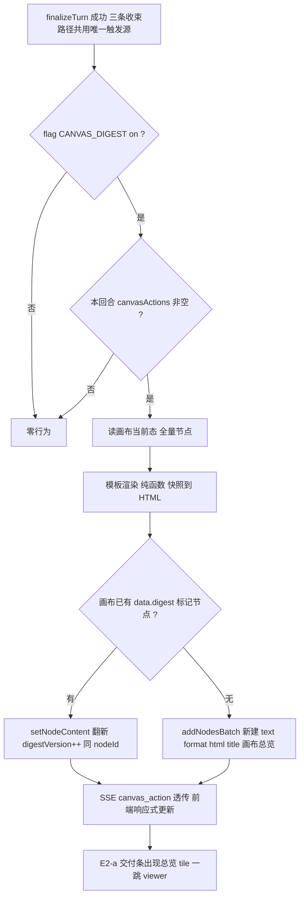
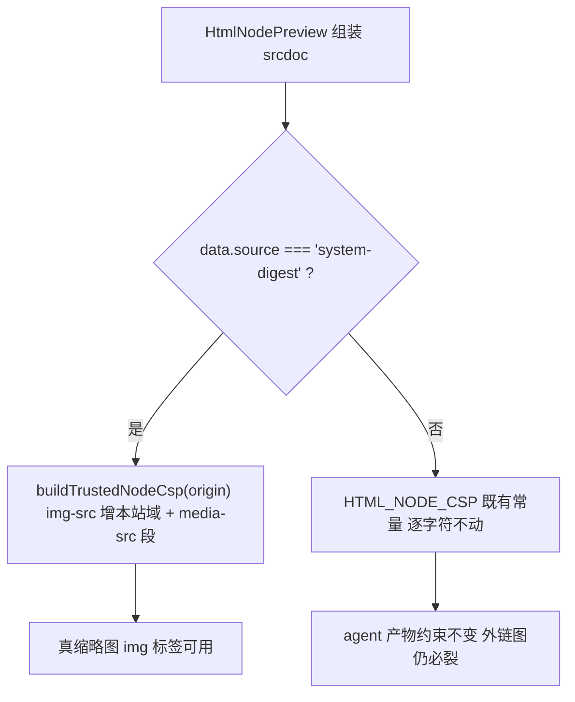

# 画布总览产物（Canvas Digest）设计规格

状态：已拍板（2026-11-05，用户提议 + 评审会商；待实施）
前置：
- **`2026-10-28-text-node-html-artifact-design.md`（母规格，#636）**：HTML 节点形态（`data.format:'html'`）、`HtmlNodePreview` 沙箱预览、CSP 契约常量、`addNodesBatch`/`setNodeContent` 写入通道——本规格全部复用，不改其契约。
- **`2026-11-04-e2a-ghost-delivery-summary-design.md`（E2-a）**：回合末交付条（幽灵摘要行 + tile 一跳 viewer）——总览节点的对话流出口。
- **P1-C 写路径治理**：画布写入单一通道纪律；**P1-D 自动审批**：文本生成无确认点（digest 与其无关，但决定了不能依赖 agent 建卡）。
- NodeType 收敛纪律：白名单 4 项三层拦截——本规格**不新增节点类型**（扩的是系统渲染来源，不是类型）。

分支约定：feature 分支 + PR + squash merge。

**修订记录**：
- v1（2026-11-05）：用户真机体验 html-craft 富版图鉴后提议「每轮固定输出」；评审裁决系统管道形态，P0-P2 分期定稿。
- v1.3（2026-11-07，收束点归位）：① 的「owner 流 + drain 两处挂载」裁决**漏掉 detached 断连路径**，而 §5.1 图 1 / D6 明定三条收束路径共用 finalizeTurn ⇒ 断连轮 `turnSettled` 置 true 后 owner 块被跳过，总览停在上一版。修复为 **触发下沉进 `finalizeTurn` 内部（唯一触发源）**，返回值 `CanvasAction[]` 交 owner 流 yield 上屏；detached / out-of-turn drain 无流可 yield，只落库，由前端刷新恢复。② `finalizeTurn` 的 duplicate runId early return 不触发 digest（图 1「成功后挂载」）。③ 触发必须在画布实体/画布态写完之后，保证快照最新。
- v1.2（2026-11-05，实施回写，① 已被 v1.3 修正）：① D2 注「复用 controller 层 canvas_action 广播」系误设（取证无 controller emit 点）⇒ 定稿 owner 流 finalizeTurn 后 yield（不进 executionEvents 零噪音），drain 路径只落库；② §5.2 受信级 CSP 以 `buildTrustedNodeCsp(origin)` 函数形态落地（srcdoc opaque origin 下 'self' 不可用，静态常量无法携带 origin），且新增 media-src 段（video tile 用 `<video>` 首帧而非 img）；③ D4 时长字段实证为 `data.mediaInfo.output.durationSec`（秒），非 durationMs；④ D9 文本收录判据收窄为 title/content 任一存在（与「未命名文档」兜底互斥成死判据的修正）。
- v1.1（2026-11-05，自审核）：发现 2 个 P0 级硬伤（XSS 转义缺失 D7、相对 URL 在 srcdoc 必裂 D8）+ 交付质量补强（trusted CSP 前移进 P0、模板信息架构 §6.0 定稿、有正据才动 D9、双主题策略、「轮次号」改版本+时间）。

## 0. 配图索引

| 编号 | 形式 | 内容 | 位置 | 用途 |
|---|---|---|---|---|
| 图 1 | 内嵌 Mermaid | Canvas Digest 回合末管道全链路 | §5.1 | 实施接线点对照 |
| 图 2 | 内嵌 Mermaid | CSP 分级判据决策树 | §5.2 | P1 缩略图实施的判据锚点 |

## 1. 目标

| # | 目标 | 验收 |
|---|---|---|
| G1 | 每回合画布有变更 ⇒ 回合末自动产出/翻新「画布总览」HTML 节点，**零 LLM 参与**、秒级 | 生成图片/文本/视频的回合结束后，画布出现（或原地翻新）总览节点 |
| G2 | 总览从对话流一跳可开（E2-a 交付条）+ 画布可定位 | 交付条出现「画布总览」tile，tap 开 viewer |
| G3 | 零 prompt 预算占用 | L6 / 工具描述 / skill 零改动 |
| G4 | agent 无感知：不进审批闸门、不进计费、不触发 propose | 回合事件流无 digest 相关 agent 事件 |
| G5 | 确定性渲染：同画布态 ⇒ 同 HTML（纯函数） | 渲染函数快照单测锁定 |
| G6 | flag off ⇒ 行为完全不存在 | 零回归 |

## 2. 核心裁决：为什么不是 agent 工具

用户提议「每轮固定输出总览」。评审裁决：**固定输出的总览 = 系统管道（本规格）；带策展的富版图鉴 = 技能路径（母规格 S9，保持现状）**。理由（落盘防翻案）：

1. **固定性靠模型自觉不成立**：工具每轮被调用须 prompt 规则约束，而 L6 预算余量仅 68 字符（AGENTS.md 机器复核值），规则塞不进且模型会漏调。
2. **成本错位**：LLM 写一页 HTML = 数千 token + 30~60s；总览是画布状态的投影，确定性工作，LLM 零增值。
3. **质量漂移**：同画布每轮长得不一样，违背「总览 = 稳定索引」心智。
4. **富版图鉴不废弃**：用户主动要求策展式图鉴（分类/文案润色）仍走 html-craft（S9），那是 LLM 有真实增值的场景。

## 3. 与存量规格的关系（含最小交叉修订）

- **母规格 #636**：本规格是其「V2 路线图」外的并行扩展——复用 format 通道与渲染层，**唯一交叉改动** = 母规格 §12 登记一行交叉引用（防范围隐性）+ `htmlNodePreviewContract.ts` **新增**第二个 CSP 常量（P1，扩展非修改，既有常量逐字符不动）。
- **E2-a**：`turnDeliveryItems` 扩展 digest tile 来源（D6）；E2-a 规格不做修订（其纯函数签名本就留了扩展位）。
- **E 系列路标**：登记为交付面新项（Canvas Digest），与 E2-b（富卡）互不阻塞。

## 4. 范围

### 4.1 做（P0）

- Nest `canvas-digest` 模块：变更集提取 → 画布态快照 → 模板渲染（纯函数）→ 系统写入。
- `finalizeTurn` 成功后挂载（**三条收束路径共用**：owner 同步 / detached 断连 / out-of-turn drain；触发源唯一，见 v1.3），flag `CANVAS_DIGEST`（env `=== 'on'`，同 `TEXT_TOKEN_BILLING` 模式；**定稿默认 on**——digest 由数据派生无破坏面）。
- **trusted CSP 分级**（v1.1 自审前移）：`htmlNodePreviewContract.ts` 新增 `HTML_NODE_CSP_TRUSTED` + `HtmlNodePreview` 按 `data.source==='system-digest'` 分流——**真缩略图是 P0 交付物**（用户核心诉求「图文并茂一览可见」，类型图标版不达标）。
- web 交付条接入（digest tile）+ DevTimelinePreview 样例 + `digest_open` 埋点（复用 delivery metrics 通道，E2-b 同款准入判据）。

### 4.2 不做（登记 §9）

- 不新增工具 / 不动 prompt-registry / 不动 vendor / 无 DB 迁移（digest 标记走 `node.data` 自由 bag）。
- 不做 LLM 润色、不做用户编辑总览、不做导出。

## 5. 架构与契约

### 5.1 回合末管道（图 1）



*图 1 · Canvas Digest 回合末管道：finalizeTurn 是既有回合收束的唯一点（**owner 同步 / detached 断连 / out-of-turn drain 三处调用共用**），变更集 canvasActions 现成累积，零额外扫描；渲染失败 fail-soft（warn 日志，不影响回合落库）。*

*v1.3 实施注：触发点唯一地落在 `finalizeTurn` 内部、且位于画布实体/画布态写入之后；`finalizeTurn` 返回 `CanvasAction[]`，owner 流只负责把 actions 转成 `canvas_action` SSE 帧（不进 executionEvents，刷新重放不重复）。detached（fire-and-forget `void` 链）与 out-of-turn drain 无流可 yield ⇒ 只落库，前端经 `Session.canvasData` 刷新恢复；detached 的 digest 异常自带 catch，不产生 unhandled rejection。duplicate runId 的 early return 不走此管道。*

### 5.2 CSP 分级（图 2，v1.1 前移进 P0）



*图 2 · CSP 分级判据：信任级以 `data.source` 显式标记分流（fail-closed——无标记即受信级不生效），既有 `HTML_NODE_CSP` 常量与守卫测试逐字符不动，受信级由 `buildTrustedNodeCsp(origin)` 生成（img-src 扩展 + media-src 新增，其余段逐字符保留——测试钉死等价性）。*

### 5.3 关键判据

- **D1 触发判定**：本回合 `canvasActions` 非空即触发（create/update/remove 都算——删除也要反映进总览）；无画布动作的纯聊天回合跳过。
- **D2 原地翻新**：扫描画布节点 `data.digest === true` 标记；命中 ⇒ `setNodeContent` 翻新（`data.digestVersion++`，nodeId 稳定）；未命中 ⇒ `addNodesBatch` 新建（`title:'画布总览'`，`format:'html'`，`data.source:'system-digest'`，`data.digest:true`）。写入统一打 system 来源标记（不进 agent 工具统计 / 不触发审批 / 不进计费）。⚠️ `addNodesBatch`/`setNodeContent` 的 SSE 发射在 controller 层——**内部调用必须复用同一 canvas_action 广播路径**（实施时定位 controller emit 点），否则其他端与换页后画布不同步。
- **D3 封顶**：节点 >100 截断 + 「其余 N 项未收录」计数条，防 HTML 体积失控。
- **D4 内容边界**：P0 只用画布态字段（id/type/title/url/mediaInfo.output.durationSec/缩略图），**不读节点正文**（与 S9 数据边界同源纪律：取不到不编造）；title 缺失兜底「未命名图片/视频/音频/文档」。
- **D5 交付条接入**：`turnDeliveryItems` 扩展——digest 节点（从 canvasNodes 按 `data.digest` 派生）作为固定一枚 tile 参与 E2-a 幽灵行计数与展开条；`deliveryViewerNodeOf` 既有 inject 路由直开 viewer。
- **D6 幂等**：digest 渲染幂等（同 nodeId upsert、最后写赢）；detached finalizeTurn 并发竞态由 upsert 语义吸收。
- **D7 全量转义（v1.1，安全硬伤修补）**：title/prompt 是 LLM/用户自由文本，模板**全部插值**（文本节点与属性上下文）必须经 `escapeHtml` 纯函数处理——srcdoc 最外层文档虽在 sandbox 内，注入内容仍可执行脚本（allow-scripts）与破坏布局。单测覆盖 `<script>`、引号、`` 三类 payload；变异验证（摘除转义 ⇒ 红）。
- **D8 媒体 URL 绝对化（v1.1，交付硬伤修补）**：`data.url` 是裸字符串（页面 origin 相对解析，`MobileNodeTile.vue:651` 实证）——srcdoc opaque origin 下相对路径**必裂**。渲染时经 `publicBaseUrl` 绝对化（`share.service.ts:50-53` 既有解析 `SHARE_PUBLIC_BASE_URL ?? API_PUBLIC_URL ?? fallback` 抽取复用）；已是绝对 URL 透传。变异验证（摘除绝对化 ⇒ 缩略图断言红）。
- **D9 有正据才动（对 digest 同样适用，v1.1）**：仅收录有正据的节点（媒体 = url 存在；文本 = title 存在）；draft/pending 无 url 节点不进总览（防裂图），以一行计数说明「N 项生成中未收录」。
- **D10 埋点（v1.1）**：digest tile 在交付条被打开 ⇒ `observeDeliveryCard('digest_open')`（复用既有四指标通道，零新端点）——总览价值的准入判据数据源。

## 6. 场景（逐条可验收）

### 6.0 模板信息架构定稿（v1.1，移动端 viewer 为第一公民）

视觉目标：**一览可见、简洁大方**——移动端 viewer 打开即全文景，无需横滑。设计纪律锚定 html-craft（模板作者 = 本规格实施者，交付自检按其清单执行）：≤2 色系 ramp、禁渐变/投影/发光、圆角一档 8-12px、间距阶梯 4/8/12/16/24、字号 ≥11px、对比度 ≥4.5:1。

```
┌──────────────────────────────┐
│ 画布总览            更新 14:32 │  Header：标题 + 更新时间（HH:mm）+ 第 N 版
│ 6 图片 · 2 视频 · 1 音频 · 3 文本│  Stats：分类型计数行（中性 secondary）
├──────────────────────────────┤
│ 图片                          │  分区标题（固定顺序：图片→视频→音频→文本）
│ ┌────────┐  ┌────────┐       │  媒体区 2 列网格（≥360px 恒 2 列）
│ │ 缩略图   │  │ 缩略图  │       │  tile = 16:10 cover 图 + 底部标题≤1行省略
│ │ 标题…    │  │ 标题 0:42│      │  video 右下时长徽标（复用 delivery 语义）
│ └────────┘  └────────┘       │
│ 视频                          │
│ ┌────────┐ …                 │
├──────────────────────────────┤
│ 文本                          │  文本区 = 列表行（文档图标 + 标题一行）
│ 📄 角色设定文案                │
├──────────────────────────────┤
│ 2 项生成中未收录 · 系统生成      │  Footer：D9 计数 + 系统标记（非按钮纯文本）
└──────────────────────────────┘
```

- **主题策略**：iframe 读不到宿主主题（opaque origin）且服务端不知客户端主题 ⇒ 深色为主设计（对齐应用默认 dark + 用户截图审美），`prefers-color-scheme: light` 提供浅色变体；诚实登记：跟随**系统**偏好而非应用手动切换，极端场景可能与应用主题相反（可接受，登记不修）。
- **交互克制**：digest 是只读索引（沙箱无外链、无宿主协议）⇒ tile **零点击行为、零按钮态**（不做假 affordance）；消费走交付条/画布。tile 内定位回画布归 P2（须宿主 postMessage 协议）。
- **性能**：``；viewport meta；字体系统栈；零外部资源请求（trusted CSP 下 img 仅本站媒体域）。
- **排序 = 画布空间序**（y→x 扫描序）：总览是画布的空间投影，空间序与画布心智一致（v1.1 修订，替代 v1 的「时间序」表述）。

- **S1 首个产物回合**：生成 1 张图 ⇒ 回合末画布出现「画布总览」HTML 节点。**验收（可断言）**：HTML 含 Header（标题/更新时间/版本）、分类型 Stats 行、分区顺序固定（图片→视频→音频→文本）、tile 字段（图 + 标题兜底 + video 时长徽标）、viewport meta、`escapeHtml` 生效、媒体 URL 为绝对地址、双主题 CSS 在位、Footer 计数。
- **S2 翻新**：第二轮再生成 ⇒ **同一 nodeId** 原地更新（digestVersion++，Header「第 N 版」随动），画布不新增节点，交付条计数含总览。
- **S3 纯聊天**：无画布动作的回合 ⇒ 不出总览、不翻新（version 不变）。
- **S4 删除反映**：remove_node 后回合末 ⇒ 总览不再含该节点 tile。
- **S5 一跳消费**：交付条「画布总览」tile tap ⇒ 移动端直开 viewer（既有 inject 路由）、桌面降级定位。
- **S6 flag off**：`CANVAS_DIGEST` 未设 ⇒ 全链路零行为，与改前逐项一致。
- **S7 渲染失败**：模板渲染抛错 ⇒ warn 日志 + 回合正常收束（fail-soft，不影响落库）。

## 7. 文件级改动清单（P0）

| # | 文件 | 动作 | 内容 |
|---|---|---|---|
| 1 | `apps/server/src/agent/canvas-digest.service.ts` | 新增 | 变更集判定 + 快照采集 + `renderDigestHtml` 纯函数（含 `escapeHtml`/URL 绝对化，D7/D8）+ upsert 编排 |
| 2 | `apps/server/src/agent/canvas-digest.service.test.ts` | 新增 | 纯函数快照测试 + XSS payload 用例（D7）+ 触发判定 + 封顶 + 变异 |
| 3 | `apps/server/src/agent/agent.service.ts` | 修改 | finalizeTurn 收束路径挂载（flag + fail-soft catch） |
| 4 | `apps/server/src/share/share.service.ts` | 修改 | `publicBaseUrl` 解析抽取为可复用导出（digest 复用，行为不变） |
| 5 | `apps/web/src/components/canvas/htmlNodePreviewContract.ts` | 修改 | 新增 `HTML_NODE_CSP_TRUSTED`（既有常量逐字符不动） |
| 6 | `apps/web/src/components/canvas/HtmlNodePreview.vue` + 契约测试 | 修改 | `data.source==='system-digest'` 分流（fail-closed）+ trusted 常量守卫 |
| 7 | `apps/web/src/components/agent/deliverySummary.ts` | 修改 | digest tile 派生（D5） |
| 8 | `apps/web/src/components/agent/deliverySummary.test.ts` + `AgentTurnTimeline.deliverySummary.test.ts` | 修改 | digest 用例 + `digest_open` 打点（D10）+ 变异 |
| 9 | `apps/web/src/pages/DevTimelinePreviewPage.vue` | 修改 | digest 场景样例 |
| 10 | `docs/superpowers/specs/2026-10-28-text-node-html-artifact-design.md` | 修改 | §12 登记一行交叉引用 |

P1 追加：模板真缩略图的加载失败降级打磨（类型图标 fallback）、digest 节点只读分支（防用户编辑被下轮覆盖）、空间序排序的稳定性打磨。

## 8. 测试策略

- 纯函数快照：固定画布态 fixture ⇒ HTML 断言（结构 + 关键内容 + 封顶），变异验证（过滤条件/封顶值改坏必红）。
- 触发判定：canvasActions 空/非空、flag on/off 分支。
- E2-a 扩展：digest tile 计数、viewer 路由、S3 无总览场景。
- 守卫：既有 `HTML_NODE_CSP` 守卫测试**逐字符不动**（P1 新常量另立断言）。
- 回归线：finalizeTurn 既有测试全家（turn-settle-detached 等）零改动通过；E2-a 三修测试 249 全绿。
- 纪律：vitest node24 + `--maxWorkers=1 --no-file-parallelism`；`npx tsc --noEmit`（server）与 `vue-tsc -b`（web）。

## 9. 分期与后续包

| 期 | 内容 | 准入 |
|---|---|---|
| **P0** | 管道 + 完整视觉模板（§6.0 定稿：真缩略图/分区/双主题/D7-D10 全量）+ trusted CSP + flag on + 交付条接入 | 本规格即排期 |
| **P1** | 缩略图失败降级打磨、digest 节点只读分支、空间序稳定性 | P0 上线复测通过 |
| **P2（登记不做）** | 富版图鉴（html-craft S9 已覆盖，用户主动触发）、轻 LLM 润色、agent 读工具过滤 digest 节点、tile 定位回画布（宿主 postMessage 协议）、**F5 多 digest 节点治理（见 §10）** | 凭使用证据（含 `digest_open` 率） |

## 10. 风险

- **用户编辑被覆盖**：digest 节点下轮翻新会覆盖用户改动 ⇒ P1 落只读分支；P0 期节点卡显示「总览」徽章提示系统产物性质。
- **agent 可见性**：`get_canvas_layout` 会列出 digest 节点 ⇒ 接受（它是真实节点，agent 可引用）；过滤归 P2。
- **渲染体积**：D3 封顶兜底。
- **并发翻新**：同会话并发 run 的 detached finalizeTurn ⇒ upsert 幂等吸收（D6），最后写赢可接受（总览本就是最新态投影）。
- **媒体 URL 生命周期**：viewer 既有同源消费，无新增依赖。
- **副本污染单节点契约（P1 部分收紧，F5 遗留）**：`duplicateSubgraphCore` 深拷贝 `data` ⇒ 副本会带
  `digest:true`，画布出现第二个「总览」。P1 已收紧移动端长按菜单（剔除 `duplicate` /
  `duplicate-upstream`）、viewer 底栏（digest ⇒ 空动作集）与桌面/移动写回路径。**遗留 F5（P2）**：
  PC `CanvasContextMenu` 仍可复制；且服务端 `buildDigestUpsertActions` 用
  `find(n => n.data?.digest === true)` 按数组序命中，副本若排到前面会翻新错节点 ⇒ 应改为**优先按
  确定性 id `digest-canvas` 查找** + 多 digest 节点清理，并补「两个 digest 节点」回归用例。
  （P1 不扩面：移动端入口收紧后，副本只能来自 PC，且副本通常追加在数组末尾，不影响当前翻新目标。）

## 11. 配图规范自检

实施分支提交前跑：`pnpm verify-spec-figures --file docs/superpowers/specs/2026-11-05-canvas-digest-design.md`，结果回填本节。
