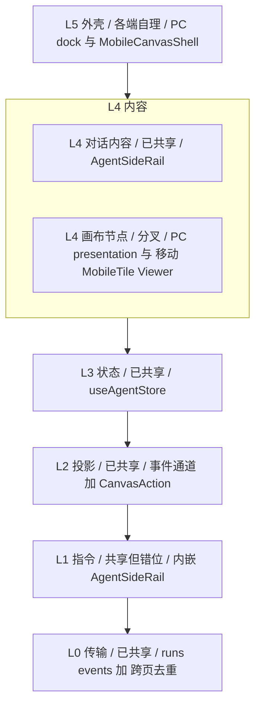
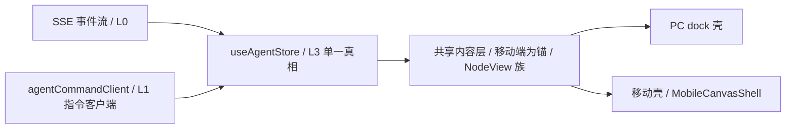

# SSE 对话页视图层统一设计规格（移动端为锚）

状态：已复核待开工（方向已验证 · WIP 已接管 · 统一 worktree 基于 origin/master，2026-11-06 复核）
前置：
- `2026-10-21-multi-device-consistency-design.md`（多端同会话一致性 · 执行/观测/投影/队列四层）
- `2026-10-25-mobile-node-lifecycle-design.md`（移动端节点生命周期与载体分工）
- `2026-10-06-selection-as-default-reference-design.md`（画布选中 = Agent 默认指代）
- 关联取证：`docs/architecture/sse-conversation-readonly-analysis.md`（只读取证，未搬入本规格）
分支约定：实现走 feature 分支 + PR + squash merge。
复核依据：2026-11-05 初核 + 2026-11-06 生产态（origin/master 676c5a64）复核，见 §13 / §13.1。

---

## 0. 配图索引（结构与视觉两类，均随本文档演进）

本文档的图分两类：**结构图**一律以 Mermaid 内嵌；无视觉稿附件（架构为结构关系，不涉及像素比例）。

| 编号 | 形式 | 内容 | 位置 | 用途 |
|---|---|---|---|---|
| 图 1 | 内嵌 Mermaid | 对话页 6 层栈与共享边界（L0–L5） | §1.5 | 一眼看清「已共享 / 分叉 / 各端自理」落在哪一层 |
| 图 2 | 内嵌 Mermaid | 目标架构：一套内容（移动为锚）+ 多端外壳 + 共享底座 | §3 | 验收「Content/Shell/底座」三者边界 |

---

## 1. 目标

1. **共享视图层以移动端为锚**：把移动端已写好的内容组件提升为设备无关共享层（行为逐字节不变），PC 删掉自己那份冗余渲染而瘦身。
2. **解决 L1 指令错位**：把内嵌在 God Component 的后端指令调用上收为共享 `agentCommandClient`，让「对话内容」与「后端命令」解耦。
3. **未来每个功能只写一次**：消除「对话页在 PC/移动端做两/三遍」的乘法级成本，根治反复出现的移动端专属 bug。

## 2. 范围（含明确不做）

- **做**：抽视图锚（Content 层，移动为锚）+ 抽 L1 指令客户端 + 拆 `AgentSideRail` God Component + 收敛 PC 冗余渲染 + 收敛双 applier。
- **不做**：改动 SSE 拉流底层（`follow-up-tail.ts` 等已共享，本规格不碰）；改动内核事件投影与 `CanvasAction` 契约（`packages/agent` 已统一）；移动端壳层交互重构（`MobileCanvasShell`/手势/页签已满意，零触碰）；新增 agent 工具或后端接口。

## 3. 与既有规格的关系

- **继承** `multi-device-consistency-design` 的「执行/观测/投影/队列」四层结论：本规格只动**前端观测面（视图层）**，不动其执行/投影/队列层。
- **加速** `AGENTS.md` 移动端呈现规则②：`AgentSideRail` 的 `isMobileLayout` 属历史遗留三处之一，本规格彻底删除它（是既有迁移意图的兑现，非冲突）。
- **对齐** `mobile-node-lifecycle-design` 的「跨端组件哲学」（内联 SVG、触控 44px、`MobileSheet` 浮层基座）：共享层落地时沿用，不另起。
- **不重复** `selection-as-default-reference-design`：指代语义已是产品契约，本规格只消费、不重定义。

## 4. 规范与判据（可复用，后续同类需求直接套）

- **判据 A（内容 vs 壳）**：一个组件若同时读 `isMobileLayout` 与渲染业务内容 ⇒ 必须拆。内容进共享层（只吃 props/store，禁读 `isMobileLayout`），形态进壳。
- **判据 B（锚定方向）**：重构存量分叉时，优先把**更新、更干净、你更满意**的那套实现升级为共享层，另一端去消费它，而非另起中立层。
- **判据 C（指令归位）**：任何 `fetch`/网络调用不得出现在渲染组件内；必须落在 `agentCommandClient` 这类设备无关客户端。
- **判据 D（落地区）**：前端内容组件统一落在 `components/agent/presentation/`（PC 内容组件已在此），不与 `components/canvas/`（画布世界组件）混用。

## 5. 架构与契约（配结构图）

### 5.1 现状分层（图 1）

两端共用同一套 6 层栈：**L0 传输 → L1 指令 → L2 投影 → L3 状态 → L4 内容 → L5 外壳**。区别只在 L4 画布节点那一支与 L5 外壳。

**图 1 · 对话页 6 层栈与共享边界（L0–L5）**



**共享边界表（按层，已代码核实 2026-11-05）：**

| 层 | 内容 | 共享状态 | 落点 / 调用点 |
|---|---|---|---|
| **L0 传输** | SSE `GET /api/agent/runs/events` + 跨页去重 | ✅ 已共享 | `follow-up-tail.ts` / `observer-stream.ts` / `shared-subscription.ts` |
| **L1 指令** | `POST chat/conversation`、`steer`/`followup`、`cancel` | ⚠️ **共享但错位** | 内嵌 `AgentSideRail.vue`（约 L2625 等，行号随版本漂移，以端点串定位） |
| **L2 投影** | 事件→UI 投影 + `CanvasAction` 契约 | ✅ 已共享 | 统一事件通道（`packages/agent` 内核）+ `packages/shared/src/agentContract.ts` |
| **L3 状态** | `useAgentStore`（messages/nodes/runs） | ✅ 已共享 | `stores/agent.ts`（`useAgentStore`） |
| **L4·对话内容** | 回合时间线 / 气泡 / composer | ✅ 已共享 | `AgentSideRail` 内部（PC/移动共用，`CanvasPage.vue:6389` 挂载，`:mobile-app-tab` 驱动页签切换） |
| **L4·画布节点** | 节点 / 交付 / 查看器渲染 | ❌ **分叉** | PC `components/agent/presentation/`（AgentNodeGraph 等）vs 移动 `MobileNodeTile`/`MobileNodeViewer` |
| **L5 外壳** | 形态 / 手势 / 页签 | ❌ 各端自理 | PC dock vs `MobileCanvasShell` |

**后端 / 画布交互 / 消息 / 事件的真实落点（2026-11-05 核实）：**

- **后端通信**：SSE 拉流在 **L0**（`AgentSideRail.vue:2964` 发起，底层 `follow-up-tail.ts`）；指令回写在 **L1**（POST 直接写在 `AgentSideRail` 内）。
- **与画布页的交互**：对话页与画布页都订阅**同一条 L0 连接**（由 `shared-subscription.ts` 去重，解决「同一 thread 开 6 条连接」——2026-10-26 生产事故，Chrome 同源 HTTP/1.1 6 连接硬上限），经 **L2 投影**把 `CanvasAction` 写进 **L3 store**；画布（`CanvasPage.vue` 的 `handleAgentActions` → `applyActionsToFlow`，数据源即 store 的 `node_graph`）从 L3 读。耦合点 = **L3 store + L2 CanvasAction 契约**。
- **消息（回合/气泡）**：存于 **L3**（`useAgentStore` 的 messages，单一真相），由 **L4** 渲染——两端共用。
- **事件（SSE→UI）**：**L0 → L2（投影）→ L3（落库）→ L4（渲染）**，整条管道共享，仅 L4 画布节点那一步分叉。

> 本视图直接回答「已共享哪些层」：L0/L2/L3/L4对话内容共 4 块已共享；L1 实际共享但**放错了层**（内嵌 God Component）；真正分叉只在 **L4 画布节点**这一小块 + L5 外壳。L1 错位问题的解法见 §9 Phase 2。

### 5.2 目标架构（图 2）

**图 2 · 目标架构：一套内容（移动为锚）+ 多端外壳 + 共享底座**



- **Content（以移动端为锚）**：`MobileNodeViewer`/`MobileNodeTile` 等提升为共享 `NodeView` 族，落 `components/agent/presentation/`，复用并扩展既有 `presentation` 枚举（PC 已有 svgCard / node-graph 切换，见 `stores/agent` 的 `setPresentation`）。**只吃 props/store + 一个 `presentation` 密度/布局参数，绝不读 `isMobileLayout`**。
- **Shell（各端自理）**：PC dock 壳（瘦身后）；移动 `MobileCanvasShell` + 页签 + 手势（**原样保留**）。
- **共享基础设施（Content 之下、传输之上）**：`agentCommandClient`（**L1 指令客户端，本期新增**）与既有的 L0 传输、`useAgentStore`（L3）、事件投影（L2）共同构成「设备无关底座」——Content 层只消费它们、不再持有任何 `fetch`/网络调用。
- **非「PC 照搬移动视觉」**：PC 用更密桌面密度参数渲染同一套内容。

## 6. 打样 / 主场景规格（逐项可验收）

### 6.1 锚组件抬升（Phase 1 验收）
- `MobileNodeViewer` + `MobileNodeTile` 提升为 `components/agent/presentation/NodeView*`；接口保持 prop 驱动（`data`/`presentation`/`bottom-actions` 等）。
- 移动画布页切到它（`presentation='mobile-tile' | 'mobile-viewer'`），**移动端现有测试零回归**为门槛（见 §10）。
- PC 画布节点随后切（`presentation='svg-card' | 'node-graph'`）。

### 6.2 L1 指令客户端（Phase 2 验收）
- 新增 `agentCommandClient`（落 `packages/agent` 或 `apps/web/src/.../command/`），把 `AgentSideRail` 内联的 `POST chat/conversation`、`steer`/`followup`、`cancel` 上收为设备无关客户端。
- PC 与移动 chat 均经 `agentCommandClient` 发起指令，原内联 `fetch` 删除；`AgentSideRail` 不再持有任何网络调用。
- 只动**指令回写**侧，不动 SSE 拉流底层（L0 已共享）。

### 6.3 拆 God Component（Phase 3 验收）
- 移动 chat 子树从 `AgentSideRail` 迁出（移动 chat 改走共享 Content + 移动壳 + `agentCommandClient`）。
- 原文件降级为 `PCDockShell`，**删除 30 处 `isMobileLayout` 分支**。
- ⚠️ **生命周期坑**：`AgentSideRail` 当前是**常驻挂载**（移动端靠 CSS `hidden` 切非 chat 页签），其 `onMounted` 负责加载历史（见 `CanvasPage.vue:6384-6387` 注释）。抽离对话内容时必须把「历史加载 + SSE 订阅 bootstrap」一并迁入共享内容组件，**不能简单 `v-if` 删掉**，否则移动端 chat 历史永不加载。

## 7. 数据与状态变更

- `useAgentStore`（L3）**不新增字段**：内容组件只消费既有 `messages`/`nodes`/`runs`。
- 新增 `presentation` 参数仅作为组件 props / 渲染开关，不进全局 store（保持状态单一真相不被形态污染）。
- `agentCommandClient` 为纯函数/类模块，不持有响应式状态。

## 8. 纯函数与算法（含单测要求）

- **双 applier 收敛（Phase 5）**：`apps/web/src/composables/useCanvasActions.ts` 的 `applyActionsToFlow`（L47）与 `packages/agent/src/tools/executor.ts` 的 `applyCanvasActions` 是当前「独立 switch 必须手动同步」的漂移点。收敛为单一 applier，配变异测试锁双端一致（`useCanvasActions.test.ts` 已覆盖 6 种 action 路由，须全绿）。
- **`agentCommandClient`**：指令构造（幂等键、`threadId`/`sessionId` 拼装）须有单测覆盖 `chat/conversation` 与 `steer`/`followup`/`cancel`。

## 9. 文件级改动清单

- **新增**：`components/agent/presentation/NodeView*.vue`（由 `MobileNodeViewer`/`MobileNodeTile` 提升）；`agentCommandClient` 模块。
- **修改**：`AgentSideRail.vue`（删 30 处 `isMobileLayout` + 删内联 `fetch` + 降级为 dock 壳）；`CanvasPage.vue`（移动 chat 改接共享 Content）；`MobileCanvasShell.vue`（移动 chat 经 Content 渲染的桥接）。
- **删除**：PC 冗余画布节点渲染 `components/agent/presentation/` 下被共享层取代的部分（约 1100–1450 行，见 §1.6 实测）。
- **保留零触碰**：`MobileCanvasShell` 壳层、`MobileTabBar`、`MobileNodeViewer` 内的手势接线（迁走后改由壳层注入）。

## 10. 测试策略与验收标准（含目视验收）

- **双端契约测试**：同一份 store 快照 → PC/Mobile 渲染断言一致（快照契约）。
- **`isMobileLayout` 单向收敛**：仅 Shell 读布局断点，Content 层一律不读；新代码触到即 CI 红。本方案通过删除 AgentSideRail 分支 + CI 守卫直接达标。
- **移动回归零容忍**：下列移动专属测试须在 Phase 1/3 后全绿（它们是历史分叉债的护栏，随内容迁出须一并迁移）：`AgentSideRail.mobileUserBubbleActions.test.ts`、`AgentSideRail.mobileEntryWiring.test.ts`、`AgentSideRail.mobileSelectionWiring.test.ts`、`AgentSideRail.mobileWalkthroughRound2.test.ts`、`MobileNodeViewer.test.ts`（含 `.fit.test.ts`）。
- **设计令牌**：沿用 `design-tokens.css` 的 `--lnk-*` 与四测试守卫（`design-token.test.ts` / `text-token-guard.test.ts` / `dead-styles` 等），禁形态专属硬编码。
- **目视验收**：移动端画布页（节点卡片 / 交付 / 查看器 / 状态栏 / 长按动作 sheet）与 PC dock 面板逐项对照，行为逐字节不变。

## 11. 风险

- **R1 生命周期耦合**：`AgentSideRail` 常驻挂载 + `onMounted` 历史加载，抽离不当会让移动端 chat 历史丢失（见 §6.3 护栏）。
- **R2 行为漂移**：Content 抬升时若把移动手势接线（长按/横滑）误带进共享层 ⇒ 污染 PC；必须用「注入回调」模式让 PC 壳以 click 替长按。
- **R3 过渡期双实现**：Phase 1–4 期间 PC 旧组件与共享层短期并存，删旧组件放 Phase 4 收口，禁止保留「以防万一」副本。
- **R4 测试迁移遗漏**：移动专属 `AgentSideRail.*.test.ts` 若不随内容迁出而迁移/改写，CI 会静默失守。

## 12. 后续路线图（本包外，登记避免隐性范围）

- **P4（finalizeTurn 落库解耦）**：多端一致性后续包，待立项（见 `multi-device-consistency-design`）。
- **SP-E 画布并发 CAS**：`PR #625` 规格评审中（CAS=暴露 PATCH op 流过期基线），未实施。
- **PC dock 面板 chrome 编排**：历史列表 / 设置 / agent 面板 chrome 仍属 PC 自有，本期只瘦身不重做。

---

## 13. 现状取证复核（2026-11-05 代码核对 · 本轮新增）

本轮对最新代码「深入摸爬」，对 v1/v2 草稿做了一轮校正，避免规格与代码脱节：

| # | 草稿旧表述 | 代码实测（2026-11-05） | 处置 |
|---|---|---|---|
| 1 | PC 画布节点 = `NeoBaseNode`331 + `NodeRenderer`126 | 二者已**退役**，PC 节点/交付渲染已重构进 `components/agent/presentation/`（`AgentNodeGraph`617 / `AgentSvgCard`74 / `AgentDeliveryCards`69 / `AgentPresentationHost`248）+ `components/agent/` 根（`AgentCanvasOutputs`190 / `AgentExecutionTrace`233） | 组件名全改，落点区定为 `presentation/` |
| 2 | 共享层落点 = `components/canvas/` | `components/canvas/` 是画布世界组件（NodePanelDock/MentionInput 等），与内容渲染不同命名空间 | 改定为 `components/agent/presentation/` |
| 3 | `agentContract.ts` 路径含糊（`shared/`） | 真路径 `packages/shared/src/agentContract.ts` | 修正 |
| 4 | 双 applier 仅称「web vs executor」，路径不明 | `packages/agent/src/tools/executor.ts`（`applyCanvasActions`）↔ `apps/web/src/composables/useCanvasActions.ts:47`（`applyActionsToFlow`） | Phase 5 精确化 |
| 5 | 移动 chat 走 `AgentSideRail` + `mobileAppTab`（核心前提） | **复核仍成立**：`CanvasPage.vue:6389` 始终挂载 `AgentSideRail` 并传 `:mobile-app-tab`；移动 `chat` 页签即它渲染，非 chat 页签靠 CSS `hidden`（移动端壳不包 AgentSideRail，二者是 CanvasPage 内的兄弟节点） | 前提保留，并补充「常驻挂载」隐患（R1/§6.3） |
| 6 | L0/L1 行号 L2964/L2625/L2121/L2026 | `runs/events` @ `AgentSideRail.vue:2964`、`chat/conversation` @ `:2625` 命中；`steer`/`followup`/`cancel` 同为内联（行号随版本漂移） | 行号标注为「约/以端点串定位」，避免硬编码失效 |
| 7 | L1「内联 POST」存疑 | 确认 `AgentSideRail.vue:2625` 确有 `fetch(apiUrl('/api/agent/chat/conversation'))` | 前提坐实 |
| 8 | 共享层"另起中立层" | PC 已有 `presentation` 概念（`setPresentation` / svgCard vs node-graph），锚定移动端后应**复用并扩展**该枚举 | 目标架构改用既有枚举 |

**仍只读的开放项（待办）**：`AgentSideRail` 逐行分类的精确瘦身账单（当前 6574 行 / 30 处 `isMobileLayout`）；移动端 24 组件的可抬升性矩阵（是否纯内容 / 夹带哪些移动 composable）。

### 13.1 2026-11-06 开工前复核（基于生产态 origin/master）

> ⚠️ **基线纠正**：本地 `master`（#640, `27b06658`）落后生产 `origin/master`（`676c5a64`）约 106 个已合入 PR（#641–#746）。本轮复核一律以**生产态 `origin/master`** 为准；下文数字为生产态实测，非本地陈旧基线，规格正文 §1 等处旧数字（如 6574/30）以本节为准。

规格基准 2026-11-05；期间多端一致性 P0–P4 等已合入生产。开工前对核心前提与依赖落地做了生产态复核：

| # | 复核项 | 生产态（origin/master）结论 | 处置 |
|---|---|---|---|
| 1 | 核心前提：移动 chat 仍走 `AgentSideRail`（mobileAppTab） | **仍成立**：`AgentSideRail.vue` 内 `mobileAppTab` 3 处、`CanvasPage.vue` 11 处；组件 **7087 行 / 29 `isMobileLayout`**（注：2026-11-05 草稿记 6574/30，系本地 #640 陈旧基线；生产态已演进为 7087/29） | 前提保留，数字以生产态为准 |
| 2 | 依赖底座（多端一致性 P0–P4） | **已在生产态落地**：#716 P0 统一事件通道 / #720 P2 durable / #726 P3 ack / #729 P4 projection —— 规格「不做」的底层已稳定，方向得到验证 | 战略 GO |
| 3 | 锚定落点 `components/agent/presentation/` | **仍成立**：目录存在（AgentNodeGraph 617 / AgentSvgCard 74 / AgentDeliveryCards 69 / AgentPresentationHost 248 + 新增 AgentProseBlock 59 / AgentShotTable 54 / AgentStepper 44 / AgentMacroSchemeCards 75 / AgentDeliverySummaryTable 113 / AgentTopoCardList 95） | 落点保留 |
| 4 | 移动锚组件 | **仍存在且为更优锚**：`MobileNodeViewer` **1234**、`MobileNodeTile` **1348**、`MobileReadingSurface`278/`MobileViewerChrome`228/`MobileNodeStatusBar`198（生产态实测；本地 #640 曾见 1315/1406，已被后续 PR 收敛） | 锚更稳，Phase 1 抬升收益更大 |
| 5 | 内容层结构演进（#637） | `AskUserCard` 已迁入 `AgentTurnTimeline.vue`（3 处引用）—— L4 对话内容子树内部迁移，未改变「对话内容已共享 `AgentSideRail`」前提 | Phase 3 抽离须吸收此结构 |
| 6 | 双 applier 漂移（Phase 5） | **仍存在**：`packages/agent/src/tools/executor.ts` 的 `applyCanvasActions` 仍独立实现；server 侧 `canvas-action-applier.ts` 注入 seam（path A 拆分）。web `applyActionsToFlow`（`useCanvasActions.ts:47`）待 Phase 5 前再用 Grep 复核 | 远忧，Phase 5 前再确认 |

**✅ 开工阻塞已解除（WIP 已接管）**：本地 `master` 的未提交 WIP（原 43 文件 / +1758 行，命中 `AgentSideRail.vue`/`MobileNodeViewer.vue`/`MobileNodeTile.vue`/`CanvasPage.vue`/`turnTimeline.ts`/`stores/agent.ts` 等目标文件）已安全接管至 **`feat/propose-exec-inline`** 分支（基于 #640，commit `e37c8c12`），主仓 `master` 工作区已清空、零触碰。

- ⚠️ **WIP 分支落后生产**：`feat/propose-exec-inline` 基于 #640，现落后 `origin/master` 约 106 PR；后续按特性拆分前须先 rebase 到 `origin/master`（可能与 #641–#746 中同类文件改动冲突，需人工解）。
- **统一 worktree 须基于 `origin/master`（676c5a64）**：不得基于本地陈旧 #640，否则将在旧代码上开工。

---

## 14. 配图规范自检

`pnpm verify-spec-figures --file docs/superpowers/specs/2026-11-05-sse-conversation-view-unification-design.md` 已于 2026-11-05 运行通过：

```
校验完成：1 篇在范围内，0 篇历史文档跳过（< 2026-09-22），0 个错误，0 个警告
```

- ✓ 图 1 / 图 2 均为 Mermaid 内嵌 `flowchart`，非空。
- ✓ 图号从 1 连续，§0 索引列出全部图号，每图有图注且在正文被引用（§1.5 引图 1、§5.2 引图 2）。
- ✓ 无 PNG/JPG 附件（结构图全 Mermaid）。
- ✓ 退出码 0。
