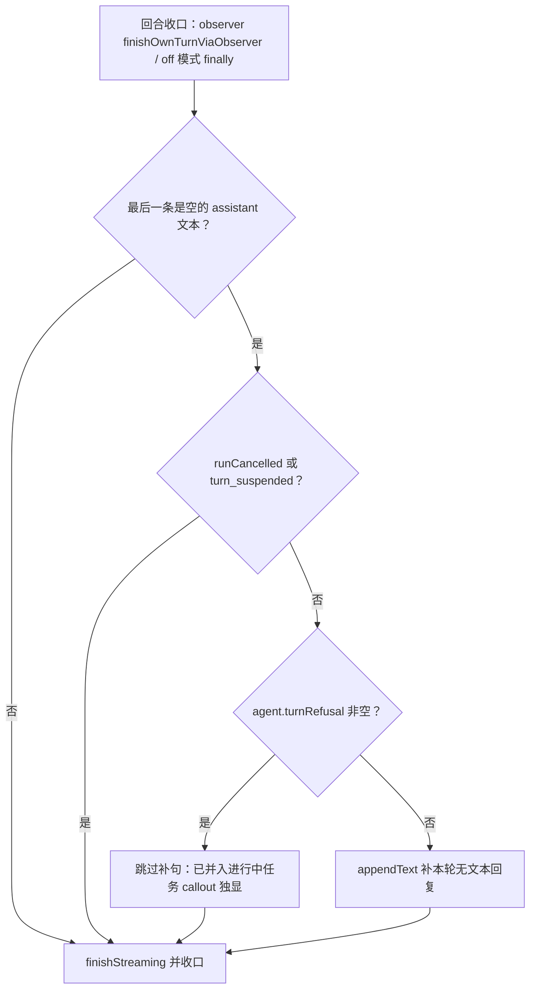
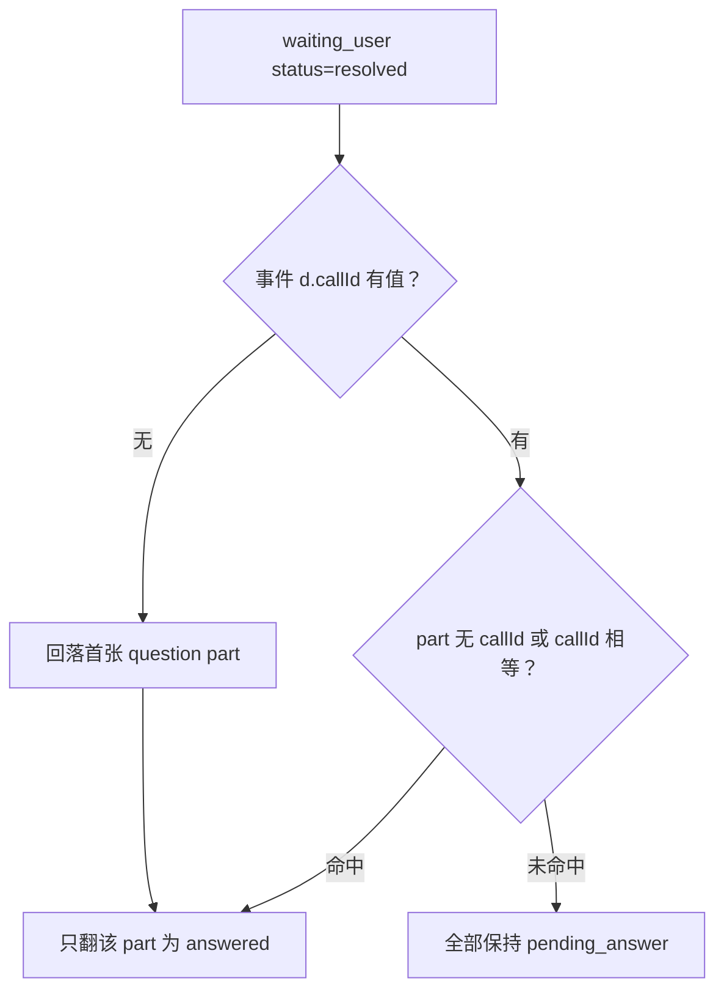

# 发言被拒豁免与 question callId 精确配对（P0+P3 修复固化）设计规格

状态：待评审（brainstorming 产出，2026-11-08）；用户已明确「按 superpowers skills 规范先出规格和计划」「按 native 走」「继续推进」，据此本刀规格与计划一并产出、实现紧随，逐阶段审阅闸门由用户指令一次性覆盖。
前置：`docs/superpowers/specs/2026-11-08-agent-siderail-p4-gates-design.md`（#3 P4 门禁化，§12 路标）、`docs/superpowers/specs/2026-11-08-agent-siderail-phase3-closeout.md`（Phase 3 结项，§4.1 冻结边界 / §5 交接）、`docs/ops/2026-11-08-phase3-prod-smoke.md`（P0 五层生产验收，§6 优先级）、2026-11-08 17:47 生产会话 `cmw7kmv3x01q4r401i7ir33b4` 的 PM/架构诊断（结论复述见本文 §3.4）。
实施计划：`docs/superpowers/plans/2026-11-08-agent-observer-refusal-exempt.md`
分支约定：feature 分支 + PR + squash merge；`gh api` Git-Data 链提交。
适用规范：`docs/superpowers/SPEC-CONVENTIONS.md`、`docs/agent/delivery.md`、`AGENTS.md`。
真值基线：master `45568b8c97b9d42bd804ebb785851b196c378844`（`gh api` 读取，2026-11-08，#784 归档后的 HEAD）。

## 0. 配图索引

本文档只有结构图，一律以 Mermaid 内嵌，无 SVG 附件。

| 编号 | 形式 | 内容 | 位置 | 用途 |
| --- | --- | --- | --- | --- |
| 图 1 | 内嵌 Mermaid | 两条 finally 路径共享的空回合兜底判定链与 `turnRefusal` 守卫插入点 | §5 | 验收时确认新增豁免既不破坏 `runCancelled` / `turn_suspended` 两条既有分支，也不改既有补句文案 |
| 图 2 | 内嵌 Mermaid | `waiting_user.resolved` 翻 question part 的 callId 三态配对判据 | §8 | 验收时对照 3 个行为级用例，并核对 proposal 分支是否同口径 |

## 1. 目标（3 条以内，均可验收）

1. **固化**：把 2026-11-08 18:29 已实现并验证、但仍落在 `/tmp/pi-lnk-master/sev7n4-pi-lnk-21056b8/` 这个**非 git 副本**（`apps/web` 是符号链接）里的 3 处产品修复，以 true master `45568b8c` 的 blob 为基重放并推进到版本库，消除「已验证改动随时被快照重建覆盖而永久丢失」的风险。
2. **P0 行为**：两条空回合兜底路径在 `agent.turnRefusal` 非空时不再补「本轮无文本回复」，让已建成的「你的消息已并入进行中的任务」callout 成为唯一反馈，消除用户同时看到两条互相矛盾文案的生产症状。
3. **P3 行为**：`waiting_user` resolved 翻 question part 时按 `callId` 精确配对，多张 `ask_user` 卡场景下只翻被答复的那张，其余不被误翻、也不停留在错误终态。

## 2. 范围（含明确不做）

**做**：

- 改 `apps/web/src/components/agent/useAgentObserver.ts`：`finishOwnTurnViaObserver` 的空回合兜底条件加 `!agent.turnRefusal`。
- 改 `apps/web/src/components/agent/AgentSideRail.vue`：off 模式 `finally` 的同型条件加 `!agent.turnRefusal`。
- 改 `apps/web/src/components/agent/turnTimeline.ts`：`waiting_user` resolved 分支的 question `find` 改为与上方 proposal 同口径的三态条件。
- 新增 `apps/web/src/components/agent/turnTimeline.callIdResolve.test.ts`（3 例行为级）；在 `AgentSideRail.mainAckWiring.test.ts` / `AgentSideRail.turnSuspended.test.ts` 各加 1 例源级契约断言。3 个实现文件 + 3 个测试文件，合计 6 个产品文件。
- 本规格、实施计划；**追加式**衔接 3 份既有文档：`#3 P4 规格 §12` 登记插队刀与 #4 顺延、结项规格 §5 交接表登记「非 git 副本未固化」风险由本刀承接、P0 报告 §6 追加第 4 条状态演进。
- 合并后核验 master 合并树逐文件 blob sha、自动部署、生产 CDP 行为复核、分支清理、工作日志回写。

**明确不做**：

- **不改** `agent.turnRefusal` 的产生/清除语义、`setTurnRefusal`、`turn_not_submitted` → steer 的后端与 store 链路；**不改** callout 文案；**不改**「本轮无文本回复」补句本身（只加门禁）。
- **不做**诊断结论里的 P1（agent 侧批量澄清卡、接入 `confirmedPreferences` 去重同维度追问、缩短阻塞超时并按默认继续）与 P2（steer/followUp 新鲜度窗口）：那是根治 20min 死挂的独立大刀，塞进本刀会夹带未验收的提示词与状态机改动，登记在 §12。
- **不改** `sendMessage` / `handleEvent` / `canvas_command` 分支 / `defineExpose` 11 项 Phase 3 §4.1 冻结契约；不改 `deploy.yml`、`deploy/**`、`package.json`、CI 工作流，不改 `docs/agent/*.md`（避免 `verify-claims` 无关改动面）。
- **不精简**已落地的实现注释：注释里保留了当时的临时分支名 `fix/observer-refusal-exempt`，属事故归因留痕；本刀是「固化已验证改动」，任何额外编辑都会改变已通过判据的 blob，注释整理登记 §12、不夹带。
- **不把 CDP 生产冒烟挂进 required check**：沿用 #3 规格 §3.3 决策 1 与门禁准入三问（零外部依赖 / 确定性 / 可失败）；本刀的产品行为判据落在 CI 内确定性单测，生产 CDP 只作合并后复核。
- **不追溯改写** P0 报告、结项规格、#3 规格当时的验收结论，只追加状态演进行/行内注记。

## 3. 与既有规格的关系

### 3.1 承接

- 结项规格 §4.1 冻结边界与 §5 交接表（含「本地工作树大面积漂移」一行）；#3 规格 §12 的后续包清单；P0 报告 §6 第 3 条的优先级排序与「CDP 冒烟拆 #4」显式修订。
- 判据纪律继承 `docs/agent/delivery.md`：行为级或类别化判据、基线 RED、逐条变异 RED、恢复后裸 blob sha 全等；推前 `gh api` 全树 blob 核对。
- #3 规格 §3.2 的「基线重定义」纪律：二手结论必须先对源码/生产复核再写规格，本刀 §3.4 沿用。

### 3.2 显式修订：本刀是插队刀，#4 顺延不取消

#3 规格 §12 列出的后续包是「#4 CDP 五层冒烟脚本化 / 原子 staging 发布 / 上传字节数写 step summary / P2 状态写者收敛」，**不含本刀**。本刀由 17:47 的生产会话诊断触发，按 PM/架构优先级插队，理由三条：

| 判据 | 结论 |
| --- | --- |
| 数据保全 | 已验证的 6 文件改动位于 `/tmp` 非 git 副本（该快照 HEAD `21056b8` 落后 true master 149 提交），任何一次 true-master 快照重建都会永久丢失；且本地 `apps/web` 是符号链接，常规 `git worktree add` 会检出落后且缺 `useAgentObserver.ts` 的旧版，不能用 |
| 用户价值 | 修的是生产真实症状（误导文案、多卡误显），高于纯 ops 文档参数化 |
| 漂移治理 | 未固化改动使本地工作树与 master 持续分叉，会污染后续每一刀的推前 blob 核对 |

⇒ **#4 顺延到本刀合并后，不取消、仍不挂 CI**；其余后续包顺序不变。本条以追加行写入 #3 规格 §12，不改写其原文。

### 3.3 与 P4 门禁准入三问的关系

本刀含产品行为变更，判据分两层，与 #3 的门禁边界不冲突：

- **L1（CI 内，确定性）**：`turnTimeline.callIdResolve.test.ts` 的 3 例是真实调用 `applyTimelineEvent` 的行为级断言；两处 `!agent.turnRefusal` 因位于 SFC / composable 的收尾闭包，按本仓既有范式用**源级类别化契约**钉住守卫位置，且各自配肯定断言防「切空窗口假绿」。诚实标注：源级断言不等于运行时行为，故需 L3。
- **L3（合并后，生产）**：自签 JWT + headless Chrome CDP 复核真实页面零 `Runtime.exceptionThrown`、常规真实回合不回归；`turnRefusal` 场景需要 409 steer 窗口，若当次不可稳定构造，则只报「零异常 + 常规回合不回归」，**不宣称复现了 steer 场景**。

### 3.4 诊断结论的三条纠偏（本刀的需求来源，必须随规格留存）

| 旧二手结论 | 生产/源码实证后的结论 |
| --- | --- |
| 「execute 被静默吞掉 / run 永久 not_idle」 | 错。`agent.service.ts:2044-2087` 的 409 路径是 steer 并入在跑 run 的 durable 队列 + followUp 兜底 + `turn_not_submitted` + 流末 `turn_ack{mode:'steer'}`；steer 消息本就不生成新 `AgentMessage`，run 也确实 settled |
| 「重复画风卡 = 前端渲染 dup」 | 错。生产 `executionEvents` 四个 `ask_user` callId 各出现 1 次，`applyTimelineEvent` 已按 `question:${callId}` upsert；用户看到的「两条画风卡」是 agent 真把画风问了两遍 |
| 「22 分钟不落库 = 清卡死 run / 改占位文案即可」 | 错。真因是单次 run 串行堆叠 8 张确认卡（4 ask_user + 1 propose_plan + 3 propose_generation），其中 4 张 × 5min 超时 = 20 分钟非生产性硬等；前端空气泡兜底与已建成的 `turnRefusal` callout 自相矛盾是**并列的展示层缺陷**，不是根因 |

⇒ 本刀只修「并列的展示层缺陷（P0）」与「潜伏的多卡配对脆弱点（P3）」；**不敢宣称**已解决 20min 死挂，后者归 §12 的 P1 大刀。

## 4. 规范与判据（可复用规则）

- **R1 · 双路径豁免同口径**：`finishOwnTurnViaObserver` 与 off 模式 `finally` 是同一「空回合补句」语义的两条实现，豁免集合必须一致（`runCancelled` / `wasSuspended` 或 `mainTurnSuspended` / `turnRefusal`）。今后新增/删除任一豁免，**两处必须同步**，且两处各有一条源级契约断言；只改一处即判不合格。
- **R2 · 配对三态条件**：timeline 中「事件携带 `callId` 且需翻某个 part 终态」的 `find` 一律使用 `(!d.callId || !p.callId || p.callId === d.callId)`，与 §5 的 proposal 分支同口径；禁止裸写 `find(p => p.kind === '...')`。`!d.callId` 与 `!p.callId` 是 legacy 兼容回落，不是精确匹配，调用方必须知道这一点（§11 风险 3）。
- **R3 · 判据分层与注释剥离**：源级文本断言只证明「守卫在源码里」，不证明运行时行为；凡以此为主判据的改动，规格必须显式列出运行时代替/补充判据（本文 §10 的 L1 行为级 + L3 生产 CDP），不得写成 `ALL_PASS` 式笼统结论。**且断言前必须先 `stripComments`**：本仓既有的 `AgentSideRail.observerRefusalExempt.test.ts`（覆盖旁观分支 `turn_not_submitted` 豁免，与本刀 P0 是**不同契约**，不是重复造轮子）与 `turnSuspended.test.ts` 已立此纪律——注释里出现 `!agent.turnRefusal` 字面量会让「只查字符串存在」的守卫假绿。本刀 `mainAckWiring.test.ts` 的新断言按此加固，并由 §10 的 M7 变异钉死。
- **R4 · 非 git 副本固化纪律**：`apps/web` 为符号链接时，改动必须先与 `gh api` 的 master 全树逐路径比对裸 blob sha，下载 master blob 落盘后**重放**改动，禁止直接把 `/tmp` 文件当提交源；合并后把 master 版本同步回 `/tmp` 副本，消除漂移。
- **R5 · 推前/合并后双核对**：改动文件 worktree-HEAD vs master blob 逐路径核对；并行 PR 造成的基线前移以新 master tree 作 `base_tree`、新 HEAD 作 parent，只覆盖自己的文件。

## 5. 架构与契约

无接口、无 store schema、无网络协议变更。三处改动全部落在既有前端收尾链的条件表达式上：

| 落点 | 现状 | 改动 | 契约影响 |
| --- | --- | --- | --- |
| `useAgentObserver.ts` / `finishOwnTurnViaObserver` | 空 assistant 文本 + 非取消 + 非挂起 ⇒ `agent.appendText(补句)` | `if` 增加 `!agent.turnRefusal` | 只读 `agent.turnRefusal`；`appendText` 调用次数在 steer 场景由 1 变 0 |
| `AgentSideRail.vue` / off 模式 `finally` | 同上，豁免为 `!runCancelled` + `!mainTurnSuspended` | `if` 增加 `!agent.turnRefusal` | 同上；两条路径豁免集合对齐（R1） |
| `turnTimeline.ts` / `waiting_user` resolved | `parts.find(p => p.kind === 'question')` 一律翻首张 | 改为三态 `callId` 条件，镜像 680 行 proposal | `question.status` 的写入目标由「首张」变为「匹配张」；不增删 part、不动 notice |

两条 finally 路径共享的判定链见 图 1；`turnRefusal` 守卫插在既有豁免之后、补句之前，因此 `runCancelled` 与 `turn_suspended` 两条既有分支的短路顺序不变。

*图 1 · 两条 finally 路径共享的空回合兜底判定链，说明 `turnRefusal` 守卫插在既有豁免之后、补句之前；验收时用它确认新增豁免既不破坏 `runCancelled` / `turn_suspended` 的短路顺序，也不改「本轮无文本回复」文案本身。*

## 6. 主场景规格（逐项可验收）

| 场景 | 前置 | 期望 | 判据层 |
| --- | --- | --- | --- |
| A · steer 并入 | `turnRefusal ≠ null`，最后一条 assistant 文本为空，未取消未挂起 | 不追加「本轮无文本回复」；callout「你的消息已并入进行中的任务」独显 | 两处源级契约 + L3 生产复核 |
| B · 普通空回合 | `turnRefusal === null`，其余同 A | 仍追加原补句，文案逐字不变 | 源级肯定断言（文案存在）+ 守卫顺序断言 |
| C · 取消 / 挂起 | `runCancelled` 或 `mainTurnSuspended` 为真 | 不追加补句（既有行为，不回归） | 既有 `turnSuspended.test.ts` 6 例 + `mainAckWiring.test.ts` 8 例 |
| D · 多卡精确翻 | 时间线含 `question:c1` / `question:c2`，resolve `callId=c2` | `c2` → `answered`，`c1` 保持 `pending_answer` | `callIdResolve.test.ts` 例 1（行为级） |
| E · 不匹配 | 只有 `question:c1`，resolve `callId=nope` | `c1` 保持 `pending_answer` | `callIdResolve.test.ts` 例 2（行为级） |
| F · legacy 回落 | 两张卡，resolve 不带 `callId` | 首张 `c1` → `answered`，`c2` 保持 `pending_answer` | `callIdResolve.test.ts` 例 3（行为级） |

## 7. 数据与状态变更

- 无数据库 schema、无持久化字段、无 API 请求/响应字段、无 store 新增状态。
- `agent.turnRefusal`：只读消费，不写入、不清空（清空仍由既有 `setTurnRefusal` 链路负责）。
- `TimelinePart & { kind: 'question' }` 的 `status`：`pending_answer → answered` 的**目标 part**改变，取值域不变。
- 无新增导出、无新增注入依赖、无新增 composable；`defineExpose` 11 项与 #3 门禁的 10 注入点 / 81 顶层键 / 17 回调型键均不变，故 `verify-agent-rail-gates` 应维持 11/11。

## 8. 纯函数与算法

配对判据与 proposal 分支逐字同口径，真值表如下（`d` = 事件 data，`p` = 候选 part）：

| `d.callId` | `p.callId` | `p.callId === d.callId` | 是否命中 | 语义 |
| --- | --- | --- | --- | --- |
| 空 | 任意 | 不适用 | 命中 | legacy 回落首张 |
| 有值 | 空 | 不适用 | 命中 | legacy part 兼容 |
| 有值 | 有值 | 相等 | 命中 | 精确配对 |
| 有值 | 有值 | 不等 | 不命中 | 跳过该 part |

算法复杂度不变：仍是一次 `Array.prototype.find`，O(n)；`find` 的谓词由单条件变为三态合取，无额外遍历、无副作用。配对判据见 图 2。

*图 2 · `waiting_user.resolved` 翻 question part 的三态配对判据，区分精确命中、legacy 回落与不匹配三条路径；验收时用它对照 §6 场景 D/E/F 的 3 个行为级用例，并确认与 proposal 分支条件逐字一致。*

## 9. 文件级改动清单（按内容锚点定位，不用行号）

| 文件 | 动作 | 锚点 |
| --- | --- | --- |
| `apps/web/src/components/agent/useAgentObserver.ts` | 改 | `function finishOwnTurnViaObserver` 内、`agent.appendText('（本轮无文本回复` 之前的 `if (` 条件块 |
| `apps/web/src/components/agent/AgentSideRail.vue` | 改 | off 模式 `finally` 内、`// turn_suspended：挂起回合` 注释之后的同型 `if (` 条件块 |
| `apps/web/src/components/agent/turnTimeline.ts` | 改 | `waiting_user` resolved 分支、`const q = timeline.parts.find(` 的谓词 |
| `apps/web/src/components/agent/turnTimeline.callIdResolve.test.ts` | 新增 | 全文，3 例 |
| `apps/web/src/components/agent/AgentSideRail.mainAckWiring.test.ts` | 改 | `describe` 内追加 1 例针对 `OBS` 的守卫断言 |
| `apps/web/src/components/agent/AgentSideRail.turnSuspended.test.ts` | 改 | `describe` 内追加 1 例针对 `sfcCode` 的守卫断言 |
| `docs/superpowers/specs/2026-11-08-agent-observer-refusal-exempt-design.md` | 新增 | 本文 |
| `docs/superpowers/plans/2026-11-08-agent-observer-refusal-exempt.md` | 新增 | 实施计划 |
| `docs/superpowers/specs/2026-11-08-agent-siderail-p4-gates-design.md` | 改（追加） | §12 后续包首行之前插入「插队刀」条目 |
| `docs/superpowers/specs/2026-11-08-agent-siderail-phase3-closeout.md` | 改（追加） | §5 交接表「本地工作树大面积漂移」行现状追加注记 |
| `docs/ops/2026-11-08-phase3-prod-smoke.md` | 改（追加） | §6 结论追加第 4 条 |

`deploy.yml` 的 `push.paths` 含 `apps/web/**` ⇒ 本刀合并**会**自动触发生产部署，这是产品行为变更上线所期望的，不绕过、不改 paths；增量上传脚本由 #2 承接，本刀不改其代码。

## 10. 测试策略与验收标准

### L1 · CI 内确定性判据（合并闸门）

- **基线 RED**：把 3 个实现文件换成 master `45568b8c` 原版（即未修复态，3 个测试文件保留），跑 3 个测试文件应出现 `turnTimeline.callIdResolve.test.ts` 2 例 fail（例 1 多卡误翻、例 2 不匹配误翻，例 3 legacy 回落本就绿）与两处源级守卫断言各 1 例 fail ⇒ 合计 **4 failed / 13 passed，EXIT=1**。例 3 恒绿是刻意保留的向后兼容对照，不是假绿。
- **修复后 PASS**：重放改动后 3 files / **17 tests 全绿，EXIT=0**。
- **逐条变异 RED**（每条都要求命中预期用例，恢复后裸 blob sha 全等）：
  - M1：回退 `turnTimeline.ts` 谓词为裸 `p.kind === 'question'` ⇒ `callIdResolve` 例 1、例 2 红。
  - M2：移除 `useAgentObserver.ts` 的 `!agent.turnRefusal` ⇒ `mainAckWiring` 新增例红。
  - M3：移除 `AgentSideRail.vue` 的 `!agent.turnRefusal` ⇒ `turnSuspended` 新增例红。
  - M4：把三态条件改成严格 `p.callId === d.callId`（删两个回落）⇒ 例 3 legacy 红（证明回落不是死代码）。
  - M5：把 `!agent.turnRefusal` 移到 `appendText` 之后（守卫位置错）⇒ 两处源级契约的顺序断言红（证明不是「只查字符串存在」的假门禁）。
  - M6：伪变异对照——只追加一行无害注释 ⇒ 17/17 仍全绿，用于证明判据没有把注释变化误判成行为变化。
  - **M7a/M7b · 注释伪装守卫**（R3 加固后新增，最关键）：把两处 `!agent.turnRefusal &&` 守卫删掉、**在原位置插入** `// !agent.turnRefusal` 注释。未剥离注释时 `guardIdx` 会命中注释且顺序正确 ⇒ 假绿；剥离后 `guardIdx = -1` ⇒ `mainAckWiring` / `turnSuspended` 各自新增例精确转红。这组变异证明「守卫真的在代码里」而不是「注释里写了同样的字」。

### L2 · 本地全量门禁

`vue-tsc -b` EXIT=0；`pnpm -r build` EXIT=0；全 `src/components/agent` 组 vitest 全绿且 `Errors 0`；`pnpm verify-spec-figures` 全量 0 error、本文与计划逐篇 0 error / 0 warning；`pnpm verify-links` 0；`pnpm verify-claims` 7/7；上一刀的 `pnpm verify-agent-rail-gates` 11/11 与 `pnpm verify-web-upload` 13/13 回归不退化。

### L3 · 生产行为复核（合并后，不作闸门）

自动部署 success 且日志含 `UPLOAD_MODE=incremental` / `MANIFEST_OK` / `WEB_DIST_UPLOAD_OK`；web 首页与 `/api/health` 200；自签 HS256 JWT 注入 `localStorage.token`，独立 headless Chrome CDP 复验：页面加载、点 `button.agent-fab` 展开侧栏、真实前端短回合 ack `{"code":0,"data":{"accepted":true,…}}`、owner 流 finalize、`Runtime.exceptionThrown` 与 console error 均为 0。**不宣称**复现 steer 场景，除非当次能稳定构造 409 窗口并观察到 callout 且不出现「本轮无文本回复」。

### 验收标准

L1 全绿 + L2 全绿 + CI 三必需（Verify spec figures / Build monorepo / Build API Docker image）全 pass + 合并树 11 个文件 blob sha 逐一全等 + L3 无新增异常 ⇒ 本刀闭环。任一**应红**变异（M1–M5、M7）不 RED、或伪变异对照 M6 意外转红，即判「伪变异或伪门禁」，先修判据再继续。

## 11. 风险

1. **非 git 副本丢失与落后基线（最高）**：`/tmp/pi-lnk-master/sev7n4-pi-lnk-21056b8` 的 HEAD 是 `21056b8`，落后 true master 149 提交；直接提交会把并行 PR 的改动回退。缓解 = R4 + R5，推前对 6 个产品文件与 3 份衔接文档逐路径裸 blob sha 核对、只重放本刀差异；本次已实测 6 个产品文件的差异恰好只含本刀改动（另 2 个同目录文件只是 mtime 被碰过、内容与 master 一致），4 份拟衔接文档与 master blob **完全一致**。
2. **源级契约的局限**：两处 P0 断言读的是源文本，不能证明运行时闭包真的跳过 `appendText`。缓解 = R3 分层 + L3 CDP；若 L3 无法构造 steer，则在证据文档明确写「仅源级 + 零异常复核」，不写 `ALL_PASS`。
3. **`!p.callId` 回落可能选中 legacy part**：当事件有 `callId`、但时间线里存在无 `callId` 的旧 question part 时，三态条件会把该 legacy part 当匹配项翻掉，而非继续找精确匹配。这是**与 proposal 分支逐字同口径**的既有兼容语义，本刀显式接受、不扩大修复面；若生产出现该形态，登记为独立刀并同步改两处。
4. **行为变更需生产验收**：本刀不是零行为变更的重构刀，`deploy.yml` 会自动部署；部署窗口的 `api=502` 属 API 容器重建已知现象，按 runbook 连续三次间隔复查，不 rerun、不手动兜底。
5. **注释留痕**：实现注释含已删除的临时分支名，不影响行为；整理归 §12，不夹带本刀。
6. **不解决 20min 死挂**：本刀只修展示层与配对脆弱点，P1 大刀未做；规格与证据文档必须显式声明，避免把「文案不再矛盾」误读成「会话不再卡」。

## 12. 后续包 / 路线图（本包外的东西也登记）

- **#4 CDP 五层冒烟参数化 ops runbook**（**顺延，不取消**）：`/tmp/p0_probe.py` / `p0_cdp.mjs` / `p0_open_rail.mjs` / `p0_send.mjs` 参数化落库，生产地址/容器名/端口/JWT 来源全走环境变量，**不挂 required check**；#3 规格 §12 原条目保持有效。
- **P1 批量澄清卡（根治 20min 死挂）**：agent 侧单卡 ≤4 题批量澄清 + 接入 `PiRetentionState.confirmedPreferences` 去重同维度追问 + 缩短阻塞超时并超时按默认继续；改 prompt 与 retention 接线，属独立大刀。
- **P2 steer/followUp 新鲜度窗口**：跨边界过远时消费前二次确认；并把 `acceptedHint(intent, blockedByAsk)` 的诚实反馈接到隐式 409→steer 路径。
- **原子 staging 发布**、**上传字节数写 step summary**、**P2 状态写者收敛**：#3 规格 §12 原条目，顺序不变。
- **前端文案与注释整理**：统一两条 finally 的豁免集合表达、移除临时分支名留痕（低价值，不单独开刀）。
- 冻结边界不变：`sendMessage` / `handleEvent` / `canvas_command` / `defineExpose` 11 项。

## 13. 配图规范自检

- §0 索引登记 图 1、图 2；两张均为内嵌 Mermaid `flowchart TD`，节点数分别 7 与 6（≤12），标签全部引号包裹，无 ` `、无英文括号，判定节点用 `{"…？"}`、出边带标签。
- 图注分别写明「说明了什么、验收时怎么用」；§5 正文引用 图 1、§8 正文引用 图 2（§0 索引与图注之外的额外引用）。
- 无 SVG 附件 ⇒ R1/R6/R8 不适用；R2/R3/R5/R7 由 `pnpm verify-spec-figures --file <本文>` 校验。**实测（2026-11-08）**：本文 1 篇 / **0 error / 0 warning**；全量 **201 篇 / 0 error / 2 个既有历史 warning**（按「只修自己引入的」纪律不动）；实施计划按 `spec-figures: off` 豁免并打印提示。
- 本文不改 `docs/agent/*.md`，故不触发 `verify-claims` 的事实断言变更。
