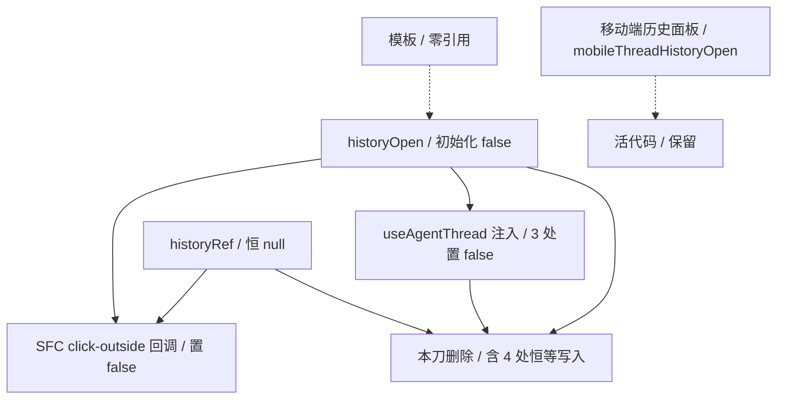

# AgentSideRail 死链清理（Phase 4 / P1 第一刀）设计规格

状态：待评审（brainstorming 产出，2026-11-08）
前置：`docs/superpowers/specs/2026-11-08-agent-siderail-phase3-closeout.md`（Phase 3 结项，已交付）
实施计划：`docs/superpowers/plans/2026-11-08-agent-siderail-p1-denoise.md`
分支约定：feature 分支 + PR + squash merge；`gh api` Git-Data 链提交。
适用规范：`docs/superpowers/SPEC-CONVENTIONS.md`、`docs/agent/delivery.md`、`AGENTS.md`。

## 0. 配图索引

本文档的图分两类：**结构图**一律以 Mermaid 内嵌；**视觉稿**以 `assets/` 下的 SVG 附件承载。本文只有结构图。

| 编号 | 形式 | 内容 | 位置 | 用途 |
| --- | --- | --- | --- | --- |
| 图 1 | 内嵌 Mermaid | `historyOpen` / `historyRef` 死链拓扑与删除边界 | §5 | 区分「恒等写入可删」与「移动端历史面板必须保留」，作为改动范围的验收基准 |

## 1. 目标（3 条以内，均可验收）

1. 删除 ADR-0015「单对话」退役后遗留的 PC 侧历史 popover 死链（`historyOpen` / `historyRef` / `useClickOutside(historyRef, …)` 及其跨文件恒等写入），**零行为变更**。
2. 建立一条**类别化**可失败门禁：SFC 中每个 `useClickOutside(X, …)` 的 `X` 必须在模板有 `ref="X"` 绑定；并配变异测试证明该判据能转红。
3. 首次兑现 Phase 3 结项的 KPI 换轨：本刀使 SFC → composable 的**注入依赖数减少 1**（`AgentThreadDeps` 去掉 `historyOpen`），且不新增任何注入依赖 / 回环 / 共享 ref 写者。

## 2. 范围（含明确不做）

**做**：
- `AgentSideRail.vue` 删除死链声明、空 ref 监听、注入对象中的 `historyOpen` 字段。
- `useAgentThread.ts` 删除 `AgentThreadDeps.historyOpen` 类型字段、解构项、`selectThread` 中 3 处 `historyOpen.value = false` 恒等写入。
- 新增 1 个源级 ratchet 测试，覆盖「死链清除 + 活面板配对 + 类别化 ref 绑定判据」。
- 本规格、结项记录、实施计划三份文档。

**明确不做**：
- 不动 `threads` / `fetchThreads` / `openThreadHistory` / `closeThreadHistory` / `mobileThreadHistoryOpen` —— 移动端对话历史面板是活代码。
- 不动 `useClickOutside` 的 import 及 `attachMenuRef` / `thinkingMenuRef` 两处调用。
- 不动 `sendMessage` / `handleEvent` / `defineExpose` 11 项对外契约（Phase 3 §4.1 冻结边界）。
- 不做生产部署变更、不做 bundle 指纹比对（纯搬运式删除的字符串集合变化无法证明行为等价，唯一有效验收是行为级冒烟，归 P0）。
- 不新增 composable、不新增抽象层、不为「未来可能复用」抽公共函数（YAGNI）。

## 3. 与既有规格的关系（含对上一轮路线的显式修订）

### 3.1 承接

本文**显式承接** `2026-11-08-agent-siderail-phase3-closeout.md` 的 §4「停止按功能簇拆」、§4.1 冻结边界、§5 交接基线。Phase 3 已收口，本文是 Phase 4 的第一刀，按「去噪 → 状态所有权 → 门禁化」顺序执行，不再以行数为目标。

### 3.2 对「P1 去噪清理」候选清单的事实复核（双路径验证）

上一轮 PM 路线给出 5 项候选。本次用 **① `gh api` master blob 直读** 与 **② Python 全仓符号扫描 / 模板区切片** 两种方式逐项复核，结论如下（master blob `6c8fbf9f5caa3b02a372ba45df9245c3382d3e1d`）：

| 候选 | 复核结果 | 判定 |
| --- | --- | --- |
| 删 `historyOpen` / `historyRef` / `useClickOutside(historyRef,…)` | 模板零引用；全仓 9 处 `historyOpen` 命中中**无任何置真写入**；`historyRef` 仅定义 + 1 处监听且模板无 `ref="historyRef"`；`useAgentThread` 3 处均为 `= false` 恒等写入 | ✅ **成立**，但需跨 2 文件同步删（上轮误判为 SFC 单文件） |
| `TURN_UNDO_DISABLED_TITLE` 恒 disabled 死按钮 | 定义 1 处、模板 `:title` 1 处，按钮硬编码 `disabled`；但这是**产品占位**（文案「需 runtime 批量移除工具，见 ADR」），删除会少一个按钮、改变 UI 与 `lastTurnReceipt.undoTurn` 呈现 | ❌ 不是零行为变更，**移出本刀**，登记 §12 待产品裁决 |
| 合并「逐字重复」的 `fillExampleUtterance` / `fillFromUtterance` | **并非逐字重复**：前者 `input.value = text`，后者 `input.value = buildDraftFromUtterance(u)`；仅 guard 与 `nextTick` focus 相同。`entryCta.test.ts` 还钉了 CTA 按钮不得出现 `fillFromUtterance` | ❌ 事实错误，**撤下**；参数化合并属结构变更且会让该 ratchet 语义漂移 |
| 统一 `loadHistory` 与 `reconcileLatestAssistant.pull()` 的 304 兜底 | **已经统一**：4 处 `cache: 'no-store'`（`fetchThreads` / `loadHistory` / `loadOlder` / `pull`），3 处 `chat/user/messages` 端点全部带禁缓存；`historyFetchNoStore.test.ts` 有 4 例 ratchet 钉死 | ❌ 陈旧结论，**撤下**；真实差异是 `pull()` 缺 `if (!res.ok)`，补它属**行为变更**，登记 §12 |
| 清理「功能已删、注释未删」大段 | 现存大段注释多为事故归因与退役判据（`bareBar.test.ts` / `historyFetchNoStore.test.ts` 头部），是有价值的历史记录；SFC 内未发现可整段删除的废弃功能注释 | ❌ **本刀不做**，避免为删而删 |

⇒ **修订**：P1 第一刀范围从「5 项清理」收敛为「1 项死链 + 1 条类别化门禁」。这不是缩水，是把上一轮基于二手结论的清单替换为可证伪的工程契约。

### 3.3 不推翻

不推翻任何 ADR / 既有规格；`docs/superpowers/INDEX.md`（2026-10-03 生成、自称 409 份）未收录本文与结项记录，本刀不修改该索引。

## 4. 规范与判据（可复用规则）

### 4.1 死链判定三条件（三者同时成立才可删）

1. **值域可证**：该 ref 初始化后，全仓所有写入均为同一常量，且无任何置真 / 其它值写入。
2. **无外部读取**：模板区零引用、`defineExpose` 未暴露、无 watch / computed 依赖它、无跨文件读取影响分支。
3. **删除后类型自洽**：注入对象的字段与 `Deps` 接口字段同步删除，`vue-tsc -b` EXIT=0。

本刀准入证据：`historyOpen` 初始化 `ref(false)`；写入点 = SFC 回调 1 处 + `useAgentThread.selectThread` 3 处，全为 `= false`；模板 `bareBar.test.ts` 已有 `expect(tpl).not.toContain('historyOpen')` 断言（ADR-0015 退役）；`defineExpose` 11 项中不含它。故值域恒为 `{false}`，所有读写均可消除。

### 4.2 类别化门禁（不是枚举式）

```text
对 SFC script 区中每个 `useClickOutside(X, …)`：
    模板区必须存在 `ref="X"` 绑定。
```

- 该判据卡的是**类别**（所有 click-outside 目标），不是卡 `historyRef` 这个值；今后新增任何「挂空元素」的 click-outside 都会被拦下。
- 当前实测：`attachMenuRef` ✅、`thinkingMenuRef` ✅、`historyRef` ❌ —— 唯一违规项，删除后判据转绿。
- 判据自身须做 RED 验证：在**未改实现**的基线上跑一次，必须失败（见实施计划 Task 1 Step 2）。

### 4.3 判据纪律（继承 `docs/agent/delivery.md` §「判据必须能真的失败」）

- 测试必须读**真实源文件**，不得复刻逻辑副本。
- 每条否定断言配肯定断言（存在性配对），防止「把文件删空也能绿」。
- 实现后必须做**变异测试**：注入违规 → 断言转红 → 恢复；至少覆盖「死链复现」「活面板误删」「click-outside 目标误删」三类。
- 引用了事实性数字 / 符号归属 ⇒ 先实测再写；工具报错不等于仓库事实（本机 `grep -rn` 曾被 shim 包装返回 0 命中，必须用 Python 直读复核）。

## 5. 架构与契约



**图 1 · 这张图把 `historyOpen` 的全部 4 个写入点与 `historyRef` 的空监听画成一条可整体消除的死链，并把移动端历史面板单独隔离为保留区；验收时用它核对「删的是死链、留的是活面板」，避免把两个同名概念混为一谈。**

改动边界见 图 1：只有左侧死链进入删除集合，右侧活面板不在本刀范围。

| 项 | 改动前 | 改动后 |
| --- | --- | --- |
| SFC 顶层状态 | `historyOpen` / `historyRef` 2 个 ref | 0 |
| `useClickOutside` 调用 | 3 处（`attachMenuRef` / `thinkingMenuRef` / `historyRef`） | 2 处 |
| `AgentThreadDeps` 字段 | 含 `historyOpen: Ref<boolean>` | 去掉该字段 |
| `selectThread` 分支 | 3 处早返回带 `historyOpen.value = false` | 保留 `return` / 守卫 / `await loadHistory()`，仅去恒等赋值 |
| 注入依赖数（本 composable） | 17 | 16 |
| 对外 API | 无变化 | 无变化 |

**无新增接口、无新增文件类型、无数据流变化。** `useAgentThread` 返回的 `AgentThreadApi` 签名完全不变。

## 6. 主场景规格（逐项可验收）

| 场景 | 期望（与改动前逐字一致） |
| --- | --- |
| `selectThread` 传入非当前 `sessionId` | 直接 return，不切 thread、不清 composer、不发请求 |
| `selectThread` 传入当前 `agentThreadId` | 直接 return |
| `selectThread` 切到共享 thread | 仍执行 `clearComposer` / `persistActiveThreadId` / `clearForkedThreadId` / 清空 6 个状态 ref / `await loadHistory()` |
| 移动端对话历史面板 | `openThreadHistory` / `closeThreadHistory` / `threads` / `fetchThreads` / `v-for="thread in threads"` 全部保留，行为不变 |
| 附件菜单 / 思考菜单点击外部关闭 | 两处 `useClickOutside` 仍生效 |
| 模板绑定 | 零改动（本刀不碰 `<template>`） |

## 7. 数据与状态变更

- **删除**：`historyOpen`（SFC ref）、`historyRef`（SFC ref）、`AgentThreadDeps.historyOpen`。
- **共享 ref 写者数**：`historyOpen` 从 4 个写者降为 0（该 ref 消失）。
- **注入依赖数**：`useAgentThread` -1；其余 6 个 composable 不变。
- **回环数**：不变（5）；不新增 SFC → composable → SFC 回环。
- **持久化 / 网络 / 路由**：零变化。

## 8. 纯函数与算法

本刀不新增纯函数、不新增算法。测试侧复用既有范式：`stripComments`（剥 `/* */` / `<!-- -->` / `//`，避免注释里的历史归因造成假绿）、模板区切片、正则按内容锚点定位。所有断言基于剥注释后的真实源码文本。

## 9. 文件级改动清单（按内容锚点定位，不用行号）

> 行号会随改动位移；以下是唯一定位锚点，执行时用 `grep -n '<锚点>' <file>` 当场打印行号。

| 文件 | 操作 | 定位锚点 |
| --- | --- | --- |
| `apps/web/src/components/agent/AgentSideRail.vue` | 删 3 行声明 + 1 个 3 行回调块 | `const historyOpen = ref(false)`；`const historyRef = ref<HTMLElement \| null>(null)`；`useClickOutside(historyRef, () => {` 至紧随的 `})` |
| `apps/web/src/components/agent/AgentSideRail.vue` | 删注入对象 1 行 | `useAgentThread({` 调用块内的 `  historyOpen,` |
| `apps/web/src/components/agent/useAgentThread.ts` | 删接口字段 | `AgentThreadDeps` 内的 `  historyOpen: Ref<boolean>` |
| `apps/web/src/components/agent/useAgentThread.ts` | 删解构项 | `} = deps` 之前解构块内的 `    historyOpen,` |
| `apps/web/src/components/agent/useAgentThread.ts` | 删 3 行恒等写入 | `selectThread` 函数体内的 `      historyOpen.value = false`（3 处，分别在两个早返回分支与 `clearForkedThreadId` 之后） |
| `apps/web/src/components/agent/AgentSideRail.deadHistoryChain.test.ts` | **新增** | 见 §10 |
| `docs/superpowers/specs/2026-11-08-agent-siderail-phase3-closeout.md` | 新增 | 已产出 |
| `docs/superpowers/specs/2026-11-08-agent-siderail-p1-denoise-design.md` | 新增 | 本文 |
| `docs/superpowers/plans/2026-11-08-agent-siderail-p1-denoise.md` | 新增 | 实施计划 |

**保留锚点（不得删除）**：`const threads = ref<AgentThreadRow[]>([])`、`function openThreadHistory()`、`function closeThreadHistory()`、`mobileThreadHistoryOpen`、`useClickOutside(attachMenuRef`、`useClickOutside(thinkingMenuRef`、`import { useClickOutside }`、模板 `v-for="thread in threads"`。

## 10. 测试策略与验收标准

### 10.1 新增 ratchet：`AgentSideRail.deadHistoryChain.test.ts`

读 `AgentSideRail.vue` 与 `useAgentThread.ts` 两个真实文件，断言分四组：

1. **死链清除**：剥注释后的 SFC 与 composable 均不含 `historyOpen` / `historyRef`；`useAgentThread({` 调用块不含 `historyOpen`；`AgentThreadDeps` 接口块不含该字段。
2. **存在性配对（防假绿）**：`threads` / `fetchThreads` / `openThreadHistory` / `closeThreadHistory` / `mobileThreadHistoryOpen` 仍在；模板仍含 `v-for="thread in threads"`；`defineExpose` 仍含 `openThreadHistory` 与 `closeThreadHistory`。
3. **类别化判据**：遍历所有 `useClickOutside(X, …)`，每个 `X` 在模板区都有 `ref="X"`；且断言 `attachMenuRef` / `thinkingMenuRef` 两处调用仍在、import 仍在。
4. **分支完整性**：`useAgentThread.selectThread` 仍含 `if (threadId !== getSessionId())`、`if (threadId === agentThreadId.value)`、`clearForkedThreadId(getSessionId())`、`await loadHistory()`，防止把守卫逻辑连同恒等赋值一起删掉。

### 10.2 变异测试（必须 RED，且 exit≠0）

| 变异 | 注入方式 | 期望转红的断言组 |
| --- | --- | --- |
| M1 死链复现 | 把 `const historyOpen = ref(false)` 加回 SFC | 组 1 |
| M2 恒等写入复现 | 把 `historyOpen.value = false` 加回 `selectThread` | 组 1 |
| M3 活面板误删 | 删掉 `closeThreadHistory` 定义行 | 组 2 |
| M4 click-outside 目标误删 | 删掉 `useClickOutside(attachMenuRef` 调用行 | 组 3 |
| M5 类别判据失效 | 新增一个 `useClickOutside(ghostRef, …)` 但模板无 `ref="ghostRef"` | 组 3 |

每次变异后恢复源文件并复跑转绿。基线（未改实现）跑测试须 RED —— 这是判据自身有效的证明。

**判据自身已在规格写作阶段预验证**（对 master blob 的真实源文件做 Python 直读 + 等价切片）：
- 组 1：`sfc` / `thread` 中 `historyOpen` / `historyRef` 均命中，`depsBlock`（709 字符）与 `injectBlock`（352 字符）都非空且含 `historyOpen` ⇒ 4 条否定断言必红，**不是锚点切空造成的假红**。
- 组 2：5 个活面板锚点、模板 `v-for="thread in threads"`、`defineExpose` 块中两项契约全部命中 ⇒ 配对有效。
- 组 3：`useClickOutside` 目标实测为 `attachMenuRef` / `thinkingMenuRef` / `historyRef`；前两者有 `ref` 绑定、`historyRef` 无 ⇒ 类别化循环恰好拦下 1 条。
- 组 4：`selectThread` 函数块 2461 字符，5 条守卫全部命中且非空。
⇒ 基线恰好「组 1 + 组 3 红、组 2 + 组 4 绿」，证明 RED 来自真实死链而非判据缺陷。正式判据仍以 Task 1 的 vitest 文件为准，此处只是设计期取证。

### 10.3 提交前门禁（全部可执行）

| # | 命令 | 期望 |
| --- | --- | --- |
| 1 | `npx vitest run src/components/agent/AgentSideRail.deadHistoryChain.test.ts`（node24 + `env -u NODE_OPTIONS`） | 全绿 |
| 2 | `npx vitest run "src/components/agent/AgentSideRail"` | 43 files / **221 tests**（基线 217 + 新增 4）全绿，失败数 0，且末尾 `Errors 0` / `Exit status 0` |
| 3 | `npx vue-tsc -b`（apps/web） | EXIT=0 |
| 4 | `npx tsc --noEmit` | 新测试文件零错误（其余 `.vue` 模块声明噪音属既有） |
| 5 | `pnpm verify-spec-figures`（含 `--file` 三份文档） | 无 error |
| 6 | `pnpm -r build` | 通过（CI 的 tsc 会编译 `*.test.ts`，故测试断言禁用 `as never`） |
| 7 | `gh api` 推前逐路径核对 base tree blob sha | 本刀 3 个改动 / 新增文件之外的 master 文件零改动 |
| 8 | PR 三个 required check | 全绿后 squash 合并 |

### 10.4 目视 / 行为验收

- 纯删除恒等状态，字符串集合变化无法证明行为等价；**本刀不做 bundle 指纹比对**。
- 本刀合并后不要求新的生产冒烟（P0 独立负责），但需在 PR 描述中注明「已自动部署到生产，业务链路验收仍属 P0 遗留」。
- `deploy.yml` paths 白名单含 `apps/web/**` ⇒ 本刀合并**会触发自动部署**；纯文档部分不触发。

## 11. 风险

| 风险 | 缓解 |
| --- | --- |
| 误把移动端历史面板当成同一死链删除 | 组 2 存在性配对 + M3 变异 RED；`defineExpose` 契约断言 |
| 删 `historyOpen,` 时误删同名的其它解构项 | 用 `useAgentThread({` 块切片定位，不按裸行匹配 |
| 本机 `grep` shim 造成 0 命中假象 | 所有事实以 `gh api` blob + Python 直读双路径复核 |
| 本地工作树漂移导致「本地绿 / CI 红」 | 以 CI 为唯一权威；推前逐文件裸 blob sha 比对 |
| ratchet 恒绿 | 基线 RED + 5 条变异 RED + 否定/肯定配对 |
| CI 的 `pnpm -r build` 编译测试文件 | 测试断言不用 `as never`，类型标注不依赖隐式 any |

## 12. 后续包 / 路线图（本包外的东西也登记）

| 包 | 内容 | 准入条件 |
| --- | --- | --- |
| **P0 剩余** | 生产行为冒烟：会话页不白屏、SSE 异步受理须轮询到 owner 流 finalize、画布、分享（Chrome CDP `--no-sandbox` + 注入 token）；把「自动部署」写进完成定义 | 本刀不阻塞，可并行 |
| **P1-B（候选，未立项）** | `reconcileLatestAssistant.pull()` 补 `if (!res.ok)` 与其它 3 处统一；三处 `chat/user/messages` URL 抽公共纯函数 | **行为变更**：须先写行为级契约测试 + 变异验证，且证明不会改变 304 事故修复口径 |
| **P1-C（候选，需产品裁决）** | `TURN_UNDO_DISABLED_TITLE` 恒 disabled 按钮是否退役 | 产品确认「少一个按钮」可接受 + 视觉验收 |
| **P2** | `taskProgress` / `scrollToBottom` / `agentThreadId` 单一写者契约 | 先补写者唯一性契约测试并变异验证，再改实现 |
| **P3 冻结** | `sendMessage` / `handleEvent` / `defineExpose` 11 项 | 除非有明确行为变更需求且先有行为级契约 |
| **P4** | `defineExpose` 源级覆盖；把「本地工作树 = master」「注入依赖数 ≤ N」「回环数 ≤ M」做成**可失败**门禁，接进已有 required check job（不新建 job） | 本刀的类别化 ratchet 可作为范式。**已由 2026-11-08 P4 独立刀承接并显式结案两项**：①「本地工作树 = master」不做 CI 门禁（checkout 恒绿＝伪门禁），真实治理手段是推前 `gh api` 全树 blob 核对；②「回环数 ≤ M」降级为可算的回调型注入键代理指标，原文「5 条回环」不可静态精算。CDP 五层冒烟脚本化不属 P4 原始定义，拆到 #4 ops runbook。见 `docs/superpowers/specs/2026-11-08-agent-siderail-p4-gates-design.md` §3.3 |

## 13. 配图规范自检

- 图：1 张内嵌 Mermaid（结构图），§0 索引已列、图注说明用途、正文 §5 引用「见 图 1」与「改动边界见 图 1」；8 个节点（≤12）、标签全部加引号、未用 `<br/>` 与圆括号。
- 校验命令：`pnpm verify-spec-figures --file docs/superpowers/specs/2026-11-08-agent-siderail-p1-denoise-design.md`。
- 本刀不改 `docs/agent/*.md` ⇒ 不触发 `pnpm verify-claims`；不改 `prompt-registry/**` ⇒ 不触发 `pnpm prompt:lint`。
