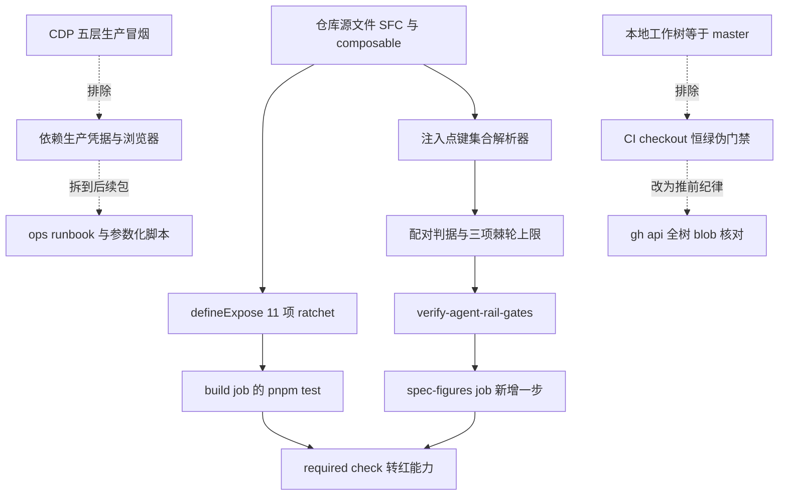

# AgentSideRail 契约门禁化（Phase 4 / #3 P4）设计规格

状态：待评审（brainstorming 产出，2026-11-08）
前置：`docs/superpowers/specs/2026-11-08-agent-siderail-phase3-closeout.md`（Phase 3 结项，§5 把四项风险交给 P4）、`docs/superpowers/specs/2026-11-08-agent-siderail-p1-denoise-design.md`（§12 定义 P4 范围）、`docs/ops/2026-11-08-phase3-prod-smoke.md`（P0 五层生产验收，§6 登记下一优先级）、`docs/superpowers/specs/2026-11-08-web-dist-incremental-upload-design.md`（#2 部署链治理，§12 把 P4 登记为下一刀）
实施计划：`docs/superpowers/plans/2026-11-08-agent-siderail-p4-gates.md`
分支约定：feature 分支 + PR + squash merge；`gh api` Git-Data 链提交。
适用规范：`docs/superpowers/SPEC-CONVENTIONS.md`、`docs/agent/delivery.md`、`AGENTS.md`。
真值基线：master `8424bb023ab95c579d47270e1351679f8f7a4071`（`gh api` 读取，2026-11-08）。

## 0. 配图索引

本文档的图分两类：**结构图**一律以 Mermaid 内嵌；**视觉稿**以 `assets/` 下的 SVG 附件承载。本文只有结构图。

| 编号 | 形式 | 内容 | 位置 | 用途 |
| --- | --- | --- | --- | --- |
| 图 1 | 内嵌 Mermaid | 三层门禁的落点与被显式排除的两类「伪门禁」 | §5 | 验收时用它界定「哪些判据能进 CI required check、哪些只能在特定环境跑」，防止把生产依赖型或恒绿型判据混进必需门禁 |

## 1. 目标（3 条以内，均可验收）

1. 把 `defineExpose` 对外 11 项冻结契约从「3 个测试里的零散断言」升级为**一处类别化全覆盖 ratchet**：键名精确集合相等、每项绑定可解析的实现来源、增删或改名都必须让 CI 转红。
2. 把「注入依赖数 / 回环数」从**不可复现的人工估算**换成机器可算、单调不增的棘轮门禁，接进**已有 required check job**（`spec-figures`），不新建 job；并把注入点与 `Deps` 接口的键集合做成双向配对判据，防止「加依赖不改接口」绕过数字上限。
3. 建立 ratchet 健康度自检与 CI 接线自检，防「陈旧测试读不存在的源文件」与「门禁步骤被悄悄摘除」两类假绿复发；上述判据逐条变异必须 RED，修复后 PASS。

## 2. 范围（含明确不做）

**做**：

- 新增 `apps/web/src/components/agent/AgentSideRail.defineExpose.test.ts`：11 项键名集合 + 每项绑定的实现来源配对 + 存在性肯定断言。
- 新增 `scripts/verify-agent-rail-gates.py`：注入点键集合 ⇄ `Deps` 接口属性集合配对、注入依赖总数/每簇/回调型键数三项棘轮上限、ratchet 测试源文件健康度、CI 接线自检；`package.json` 增加 `verify-agent-rail-gates` 脚本。
- `.github/workflows/ci.yml` 的 `spec-figures` job 增加一步 `pnpm verify-agent-rail-gates`；不新建 job、不改 `build` / `docker-build` 两个 job。
- 本规格、实施计划；同步修订结项规格 §5 交接表、P1 规格 §12 P4 行、P0 报告 §6 下一优先级、#2 规格 §12 路标，做状态衔接。
- 合并后核验 master 合并树逐文件 blob sha、生产 `/api/health` 与 web 首页 200、分支清理、工作日志回写。

**明确不做**：

- **不改任何产品代码**：`AgentSideRail.vue`、全部 composable、`follow-up-tail.ts`、`packages/**`、`apps/server/**` 一律不动。本刀是纯门禁刀，零行为变更。
- **不把 CDP 五层生产冒烟做成 CI 门禁，本刀也不固化其脚本**：它需要生产 SSH 私钥、容器内 `JWT_SECRET`、headless Chrome 与可达的公网地址，且会向生产写入真实回合数据；放进 required check 必然 flaky 且把凭据带进 CI。结项规格 §5 的 P4 原始定义本就不含它，详见 §3.3 决策 1。
- **不把「本地工作树 = master」做成 CI 门禁**：CI 的 checkout 天然是干净树，该判据在 CI 恒绿，属伪门禁。正确形态是推前的 `gh api` 全树 blob 核对（本机侧纪律），本刀不为其新增脚本，见 §3.3 决策 2。
- **不新建 CI job、不改 required check 集合**：按结项规格 §5「接进已有 required check，不新建 job」。
- 不改 `deploy.yml`、`deploy/**`、`nginx.conf`；不改 `docs/agent/*.md`（会触发 `verify-claims` 的无关改动面）。
- 不改 `sendMessage` / `handleEvent` 及 `canvas_command` 分支 / `defineExpose` 11 项 Phase 3 §4.1 冻结契约。
- **不追溯改写** P0 报告与结项规格当时的验收结论；只追加状态演进行。

## 3. 与既有规格的关系

### 3.1 承接

- 结项规格 §5 交接表四行：`defineExpose` 零源级覆盖、注入依赖/回环数无门禁、陈旧 ratchet 恒红假象、本地工作树漂移；以及 §4.1 冻结边界与 §5 交接基线值。
- P1 规格 §12 分期表 P4 行：「`defineExpose` 源级覆盖；把『本地工作树 = master』『注入依赖数 ≤ N』『回环数 ≤ M』做成**可失败**门禁，接进已有 required check job（不新建 job）｜本刀的类别化 ratchet 可作为范式」。
- P0 报告 §6 第 3 条把 P4 列为 F1 与部署链之后的下一优先级；#2 规格 §12 把 P4 登记为路标 #3。
- 判据纪律继承 `docs/agent/delivery.md`：行为级/类别化判据、基线 RED、逐条变异 RED、恢复后裸 blob sha 全等。

### 3.2 对旧结论的显式修订（基线重定义）

P4 的第一项工作是**复核结项规格交接的基线值**，结果如下。四项全部是人工估算，与仓库当前源码的机器精算不一致；若直接把 `55` / `5` 写成硬门禁，得到的会是恒假或恒真的伪门禁。

| 项 | 结项规格 §5 值 | 机器精算值（master `8424bb02`） | 偏差原因 | 门禁取值 |
| --- | --- | --- | --- | --- |
| 注入 composable 数 | 7 | **10** 个 `useXxx({` 注入点；其中 6 个声明了 `*Deps` 接口 | 原文按「主要搬运簇」人工数，漏计 `useAgentStream` / `useAgentDock` / `useUtteranceRotation` / `useNetworkNotice` 等自含参数型注入 | 全量扫描 10 个，不用 7 |
| 注入依赖总数 | 约 55 | **81** 个注入点顶层键；6 个 `*Deps` 接口合计 **64** 属性 | 原文为估算且带「约」字，口径未定义 | 棘轮上限 81，接口属性口径另记 64 |
| 回环数 | 5 | **17** 个回调型注入键（`=>` 形式）；原文语义的「composable 反向写 SFC 状态」**无法静态精确计算** | 原文按 `scrollToBottom` 27 处、`taskProgress` 14 处等跨簇写入人工归纳 | 降级为可算代理指标，见 §3.3 决策 3 |
| 后继首刀「减少 1 个」 | 要求后继第一刀兑现 | P1 已兑现（`AgentThreadDeps` 17 → 16，实测 16） | 结项时以 P1 为「第一刀」，其后 #2 与本刀是基础设施刀 | 本刀不改产品代码 ⇒ 只锁上限、不减少，不算违背；记录 P1 已兑现 |

⇒ **本规格显式重定义基线**：以 `scripts/verify-agent-rail-gates.py` 的解析结果为准，结项规格里的 7 / 55 / 5 保留为历史估算记录，不追溯改数字、只在本规格登记修订。这正是「把估算换成可失败门禁」的实质。

### 3.3 三个显式边界决策（PM / 架构）

**决策 1 —— CDP 五层冒烟脚本化拆到 #4，不进本刀。** P0 的五个层级里 L0/L1/L2/L3/L4 依赖公网可达性、自签 JWT、生产数据库与 headless Chrome；它属于**发布后验收工具**，不属于每次 PR 都能确定执行的门禁。结项规格 §5 的 P4 定义只列了三项源级门禁，CDP 脚本化是 P0 报告 §6 后续建议的外延。把它与源级门禁混在一刀，会让「所有判据逐条变异 RED」的准入条件无法成立（生产环境不可在 CI 变异）。#4 将以 `docs/ops/` runbook + 参数化脚本形态交付，不挂 required check。

**决策 2 —— 「本地工作树 = master」不做 CI 门禁。** CI checkout 天然满足，判据恒绿。真实风险发生在本机（结项规格纠偏 2：本地曾 721 文件内容不同、1872 文件缺失，`waitSettle` 恒红），治理手段是推前 `gh api` 全树 blob 逐路径核对——这是**本机操作纪律**，已在前三刀严格执行，本刀继续沿用，不新增脚本、不挂 CI。P1 规格 §12 中该子项据此显式结案为「不实现为 CI 门禁」。

**决策 3 —— 回环数降级为可算代理。** 原文「5 条回环」指 composable 反向调用/写回 SFC 状态的路径，静态分析无法在不解析 Vue 响应式语义的前提下精确判定。本刀改为锁**回调型注入键**（SFC 向 composable 注入 `() => ...` 动态回读通道）的类别化集合与上限 17；新增回环必须显式更新基线并说明理由。这是**降级**，不是「已实现 5 条回环门禁」，规格与验收报告均不得写成后者。

### 3.4 不推翻

- 不推翻任何既有 ADR、Phase 3 结项结论、P1 规格的去噪范围、F1 与 #2 的验收结论。
- 不修改 `docs/superpowers/INDEX.md`（已陈旧且由生成流程维护）。
- 冻结边界（结项规格 §4.1）继续有效。

## 4. 规范与判据（可复用规则）

### 4.1 门禁准入三问

一条判据能进 `spec-figures` required check，必须同时满足：

1. **零外部依赖**：只读仓库内源文件 + Python 标准库；不访问网络、不读密钥、不启浏览器、不依赖 `gh` CLI 或 node_modules。
2. **确定性**：同输入同输出，不受时间、机器、CI runner 镜像、文件 mtime 影响。
3. **可失败**：能构造出让它转红的变异，且变异命中预期判据组（不是靠抛异常或文件缺失假红）。

CDP 冒烟违反 1 与 2，本地树比对违反 3（CI 恒绿）——这是 §3.3 两项决策的判据依据。

### 4.2 类别化判据优先于枚举数字

继承 P1 的 `useClickOutside(X) → ref="X"` 范式：先做**双向集合配对**（注入点键集合 ⇄ `Deps` 接口属性集合；`defineExpose` 键集合 ⇄ 冻结契约集合），再用数字棘轮兜底。只锁数字会被「改名」「换簇」「加键不写接口」绕过；只锁集合无法表达「不许膨胀」。

### 4.3 棘轮语义

- 总数与每簇键数：**只许减、不许增**（`≤ 基线`）。减少时允许自动通过，增加时必须显式更新基线文件并写理由。
- 回调型键：集合与数量**双向锁定**，新增即红。
- 基线值写在 verifier 的单一常量表内，不在多处复制。

### 4.4 判据纪律（继承 `docs/agent/delivery.md`）

- 接线前基线 RED；逐条变异 RED 且命中预期组；恢复后 PASS 且逐文件裸 blob sha 与固定版全等。
- 注释一律先剥离再匹配（历史归因注释提到退役符号会造成假绿）。
- 否定断言必须配肯定断言，防「把文件删空也能绿」。
- ⭐ 变异不 RED 先怀疑伪变异：注入点被下游过滤吞掉 ⇒ 行为零变化 ⇒ 测试照绿；必须确认变异真的改变了 verifier 输入。

## 5. 架构与契约

见 图 1：三层门禁各自落在哪个 job、哪些判据被排除以及排除依据。验收时按图逐层核对「可进 CI 的判据是否真的接上了、被排除的判据是否真的没混进来」。

*图 1 · 实线是本刀落地并接入 required check 的判据链，虚线是被显式排除的两类伪门禁及其正确归属。图注说明了三层落点：SFC 源文件 → 两组可失败判据 → 两个已有 job；验收时用它逐项核对「接上了什么、排除了什么、排除后归到哪里」。*

正文引用：本刀只在 图 1 的 B / C / E / F / G 五处新增判据与接线；D 与 H 是已有 job 与已有 required check，J / K / L 不得进入 CI。

## 6. 主场景规格（逐项可验收）

| 组 | 判据 | 失败条件 |
| --- | --- | --- |
| G1 `defineExpose` 冻结契约 | 11 项键名**精确集合**相等；每项值可解析为「SFC 内定义符号」/「已注入 composable 对象的成员」/「非空内联函数」三类之一 | 少一项、多一项、改名、值换成未定义符号、把键名只写进注释 |
| G2 注入点 ⇄ 接口配对 | 6 个声明 `*Deps` 接口的 composable，其 SFC 注入点顶层键集合与接口属性集合**双向相等** | 加键不写接口、接口加属性不传、单侧改名 |
| G3 三项棘轮上限 | 注入点总数 ≤ 10、顶层键总数 ≤ 81、回调型键总数 ≤ 17，且每簇键数 ≤ 基线表中该簇值 | 任一计数增加、新增未登记的注入点、新增回读通道 |
| G4 ratchet 健康度 | 每个 `AgentSideRail.*.test.ts` 里 `readFileSync` 引用的相对源文件必须存在；`defineExpose.test.ts` 必须存在且声明 `FROZEN_EXPOSE_KEYS`（与 verifier 常量对齐） | 陈旧测试读到已删除文件、新 ratchet 被整体删除、两处冻结集合漂移 |
| G5 CI 接线自检 | `ci.yml` 的 `spec-figures` job 含 `pnpm verify-agent-rail-gates`；`package.json` 含同名 script 且指向真实脚本；脚本文件存在 | 步骤被摘除、script 被改名、脚本被删 |

G2 覆盖不到的 4 个注入点（`useAgentStream` / `useAgentDock` / `useUtteranceRotation` / `useNetworkNotice`）由 G3 的**全量计数与白名单**兜住，不得绕过；白名单新增需显式改基线。

## 7. 数据与状态变更

- **无产品状态变更**：不改任何运行时代码、不改数据库/环境/部署链、不改冻结契约。
- 新增文件 4 个：`AgentSideRail.defineExpose.test.ts`、`scripts/verify-agent-rail-gates.py`、本规格、实施计划。
- 修改文件 6 个：`package.json`、`ci.yml`、结项规格、P1 规格、P0 报告、#2 规格（均只追加/替换状态行，不改历史结论）。
- CI 产物：`spec-figures` job 多一个步骤，预计秒级（纯文本解析），不影响 9–10 分钟的 `build` job。

## 8. 定量依据与算法

**解析器**：从 `AgentSideRail.vue` 全文匹配 `\b(use[A-Z]\w+)\s*\(\s*\{`；自 `{` 起逐字符配平括号，显式跳过行注释、块注释、单双引号与模板字符串（含转义），忽略字符串内的括号；回到顶层后按深度 0 的逗号切分条目，取冒号左侧为键名。该算法在 master `8424bb02` 实测结果稳定两轮一致。

| 注入点 | 顶层键 | 回调型键 | `*Deps` 接口属性 |
| --- | ---: | ---: | ---: |
| `useAgentComposer` | 11 | 1 | 11 |
| `useAgentMessageActions` | 9 | 4 | 9 |
| `useAgentPropose` | 5 | 0 | 5 |
| `useAgentStream` | 1 | 1 | 无接口 |
| `useAgentDock` | 10 | 0 | 无接口 |
| `useAgentQueue` | 11 | 3 | 11 |
| `useUtteranceRotation` | 5 | 1 | 无接口 |
| `useAgentObserver` | 12 | 4 | 12 |
| `useNetworkNotice` | 1 | 1 | 无接口 |
| `useAgentThread` | 16 | 2 | 16 |
| **合计** | **81** | **17** | **64** |

**`defineExpose` 配对规则**：11 项冻结键名取自结项规格 §4.1；值分三类——`obj.prop` 要求 `obj` 在 SFC 里有 `const obj = useXxx(` 定义，裸标识符要求有 `const` / `function` / 解构定义，内联箭头函数要求函数体非空。键名集合比对前先剥离 `defineExpose` 块内的注释，防止注释里的契约名充当实现。

## 9. 文件级改动清单（按内容锚点定位，不用行号）

| 文件 | 锚点 | 变更 |
| --- | --- | --- |
| `apps/web/src/components/agent/AgentSideRail.defineExpose.test.ts` | 新文件 | G1 类别化 ratchet |
| `scripts/verify-agent-rail-gates.py` | 新文件 | G1 集合校验与常量对齐 / G2 / G3 / G4 / G5 与基线常量表 |
| `package.json` | `"verify-web-upload": ...` 之后 | 新增 `verify-agent-rail-gates` script |
| `.github/workflows/ci.yml` | `- name: Verify web dist upload contract` 之后 | 新增一步跑本门禁 |
| 结项规格 | §5 交接表「`defineExpose` 零源级覆盖」等 3 行 | 追加承接状态与基线重定义指引 |
| P1 规格 | §12 分期表 P4 行 | 标注本刀实现范围与两项显式结案 |
| P0 报告 | §6 第 3 条 | 更新下一优先级排序 |
| #2 规格 | §12 后续包 | 把 P4 从「下一步」改为「已开刀」 |

## 10. 测试策略与验收标准

- **接线前 RED（实测）**：verifier 与 ratchet 写好但 CI/package 尚未接线时 **9/11、exit=1**，失败组恰为 `G5_ci_spec_figures_step` 与 `G5_package_script_wired`；G1–G4 全绿 ⇒ 证明判据不是恒红/恒绿假象。中途曾出现 G2 假差异（`attachments` / `refKeys` / `init` / `url`），根因是接口属性正则 `^\s{2,4}` 的 `\s` 含换行、跨行命中多行函数签名的参数名；改为逐行括号深度解析后修正。**这是判据自身缺陷，不是产品缺陷**。
- **PASS（实测）**：G1–G5 共 **11 条 record 全绿**，`pnpm verify-agent-rail-gates` exit 0；`vitest` 定向新测试 **4/4 全绿**。
- **变异（实测 7/7 符合预期，恢复后 13 文件裸 blob sha 全等）**：
  - M1 从 `defineExpose` 删 `closePanel` → `G1_expose_frozen_contract` RED，且 vitest ratchet 同步 exit=1；
  - M2 给 `useAgentQueue` 注入点加一键但不改接口 → `G2_injection_vs_deps_pairing` + `G3_total_keys_ratchet` RED；
  - M3 给 `AgentQueueDeps` 加一属性但不改注入点 → `G2_injection_vs_deps_pairing` RED；
  - M4 把 `queuedSlots` 改成箭头函数（键集合不变、回读通道 +1）→ 仅 `G3_callback_keys_ratchet` RED；
  - M5 把 `bareBar.test.ts` 的 `readFileSync` 目标改成不存在文件 → `G4_ratchet_source_targets_exist` RED；
  - M6 从 `ci.yml` 摘掉门禁步骤 → `G5_ci_spec_figures_step` RED；
  - M7 **伪变异对照**：在 `defineExpose` 块注释里写入两个契约键名 → verifier **11/11 PASS**、vitest exit=0，证明注释剥离有效、判据不假绿。
  - 每条变异前断言源文件确实变化；恢复后逐文件裸 blob sha 与固定版全等、verifier 11/11 复绿。
- **本地门禁**：定向/全 agent 组 vitest、`vue-tsc -b`、`pnpm -r build`、`verify-spec-figures` 全量与逐篇、`verify-links`、`verify-claims`、新 verifier。
- **CI 三必需**：Verify spec figures / Build monorepo / Build API Docker image 全 pass；新步骤在 `Verify spec figures` job 内 success。
- **合并后**：`gh api` 逐路径核对 10 个文件 blob sha 全等；删分支；`http://119.29.173.89:8888/` 与 `/api/health` 均 200；`apps/web/**` 无产品代码改动 ⇒ 不要求新的生产行为冒烟。
- **部署触发的显式决策**：`deploy.yml` 的 `push.paths` 白名单含 `package.json`（第 19 行），本刀新增 CI script 会**自动触发一次生产发布**（web + Build API on CVM）。选择保留这一惯例、不绕过触发、不改 `deploy.yml`：① `package.json` 进白名单是有意设计，依赖或构建脚本变化必须能触发发布；② 为省一次部署去改 paths 属超范围行为变更；③ 该次发布是 #2 增量上传链路的第二次真实运行，可顺带确认耗时稳定。合并后等待该 run 结论 success 并核对健康 200，**但其结论不作为本刀门禁验收判据**（本刀零产品代码改动，构建产物与当前生产字节级相同）。

## 11. 风险

| 风险 | 表现 | 缓解 |
| --- | --- | --- |
| R1 解析器被模板字符串/嵌套箭头里的括号骗过 | 计数漂移产生假红 | 解析器显式跳过字符串与注释；两轮实测一致；基线表逐簇列出便于 diff 定位 |
| R2 只锁数字被绕过 | 改名、换簇、加键不写接口 | G2 双向集合配对 + G3 白名单；M2/M3 变异实证 |
| R3 门禁恒绿 | 注释里的键名算命中、陈旧测试读空文件 | 剥离注释 + M7 反证 + G4 健康度 + G5 接线自检 |
| R4 本地工作树漂移 | 本地测的文件与 master 不同 | 推前 `gh api` 全树 blob 逐路径核对；本次已核对 7 个关键文件全 SAME |
| R5 跨环境差异 | macOS / CI 的 python 或换行差异 | verifier 只用标准库、按 UTF-8 读、不依赖 shell；CI 已有 `python3` 成功先例（`verify-web-upload`） |
| R6 规格-实现漂移 | 规格写 55/5、实现锁 81/17 | §3.2 显式重定义 + §8 基线表 + 衔接文档同步修订 |
| R7 误把降级写成完成 | 报告称「已实现 5 条回环门禁」 | §3.3 决策 3 与 §11 均写明是代理指标；验收报告沿用同一措辞 |

## 12. 后续包 / 路线图（本包外的东西也登记）

- **#4 CDP 五层冒烟脚本化**：把 `/tmp/p0_probe.py` / `p0_cdp.mjs` / `p0_open_rail.mjs` / `p0_send.mjs` 参数化落库为 ops runbook；生产地址、容器名、端口、JWT 来源全部走环境变量；不挂 required check。
- **原子 staging 发布**：发布目录 staged 构建 + 原子切换（#2 已显式排除）。
- **上传字节数写入 step summary**：#2 的后续观测项。
- **P2 状态写者收敛**：`scrollToBottom` 27 处调用 / `taskProgress` 14 处写入的共享可变状态治理，未启动；本刀只锁门禁不动所有权。
- 冻结边界不变：`sendMessage` / `handleEvent` / `canvas_command` / `defineExpose` 11 项。

## 13. 配图规范自检

- §0 索引登记 图 1；§5 内嵌 Mermaid `flowchart TD`，共 14 个节点、标签全部引号包裹、无 ` `、无英文括号；图注写明「说明了什么、验收时怎么用」；§5 正文显式引用 图 1。
- 无 SVG 附件 ⇒ R1/R6/R8 不适用；R2/R3/R5/R7 由 `pnpm verify-spec-figures --file <本文>` 校验，结果在实施计划 Task 5 记录。
- 本文不改 `docs/agent/*.md`，故不触发 `verify-claims` 的事实断言变更；本文不含产品代码改动，合并后不改前端产物。
