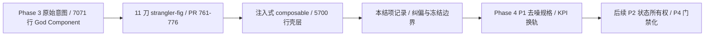

# AgentSideRail Phase 3 Strangler-Fig 重构 · 结项记录

状态：已交付并收口（2026-11-08）
前置：本重构此前**没有独立 spec 文件**，意图与逐刀验收散落在对话和 `.workbuddy/memory/2026-11-08.md`；本文是其正式化收尾，也是 `docs/superpowers/specs/` 中该主题的唯一权威记录。
后继：`docs/superpowers/specs/2026-11-08-agent-siderail-p1-denoise-design.md`（Phase 4 第一刀）
实施计划：`docs/superpowers/plans/2026-11-08-agent-siderail-p1-denoise.md`
分支约定：feature 分支 + PR + squash merge；本仓 `git push` 被网络阻断，提交走 `gh api` Git-Data 链（见 `docs/agent/delivery.md`）。

> 本文只做收尾与交接，**不追加实施动作**。所有数据以 `gh api` 的 master 树与已合并 PR 为准，不以本地工作树为准。

## 0. 配图索引

本文档的图分两类：**结构图**一律以 Mermaid 内嵌；**视觉稿**以 `assets/` 下的 SVG 附件承载。本文只有结构图。

| 编号 | 形式 | 内容 | 位置 | 用途 |
| --- | --- | --- | --- | --- |
| 图 1 | 内嵌 Mermaid | 规格链与阶段交接 | §1 | 判断后续改动属于「继续搬运」还是「换轨清理」，并定位本文在规格链中的位置 |

## 1. 目标与规格链

原始意图：把 `apps/web/src/components/agent/AgentSideRail.vue`（基线 7071 行）按功能簇逐刀拆为独立 composable，每刀一个独立小 PR、**零行为变更**、源级 ratchet 测试 + CI 门禁、squash 合并。

**图 1 · 这张图说明 Phase 3 的意图如何变成已交付事实、又在何处正式收口并换轨；用它判断一项新改动该引用本文作为「已完成的历史边界」，还是该引用后继规格作为「待做的工程契约」。**

本文在规格链中的位置见 图 1：它是「已完成」与「待做」之间的分界，不是第三份并列的实施规格。

## 2. 实际交付（以 `gh api` 已合并 PR 为准）

| 刀 | PR | 合并时间 UTC | 抽取目标 | 产物 |
| --- | --- | --- | --- | --- |
| 1 | #761 | 2026-11-07T08:51:14Z | dock / panel 逻辑 | `useAgentDock.ts` |
| 2 | #762 | 2026-11-07T10:59:25Z | 消息渲染判据 | `agentMessageRender` |
| 3 | #763 | 2026-11-07T11:21:13Z | 历史 / presentation 渲染派生 | `agentMessageRender` |
| 4 | #764 | 2026-11-07T11:58:29Z | `parseMessageMetadataSafe` 纯函数 | `agentMessageRender` |
| 5 | #768 | 2026-11-07T12:57:12Z | `canvasOutputsForMessage` 派生 | `agentCanvasOutputs` |
| 6 | #770 | 2026-11-07T14:14:09Z | Propose / Asks 交互 | `useAgentPropose.ts` |
| 7 | #771 | 2026-11-07T15:30:23Z | Composer / Attachments | `useAgentComposer.ts` |
| 8 | #772 | 2026-11-07T17:41:00Z | Queue-Draft | `useAgentQueue.ts` |
| 9 | #773 | 2026-11-07T18:17:28Z | Thread 生命周期 | `useAgentThread.ts` |
| 10 | #775 | 2026-11-07T18:54:09Z | Observer-SSE / 旁听常驻订阅 | `useAgentObserver.ts` |
| 11 | #776 | 2026-11-08T01:40:38Z | 消息气泡操作 | `useAgentMessageActions.ts` |

- 中间 **#774 是失败提交**：Git-Data tree entry 用了 app 相对路径（`src/components/agent/...`），GitHub 把 8 个文件当作在错误位置「新增」，真实文件零改动。已关闭并删分支，重提为 #775。此坑已固化为跨刀判据。
- 最新 master HEAD（本文写作时）：`dd0c43e55a7f79f3ae8981924c47a69fd9dae36b`（#776 squash）。
- SFC 规模：7071 → **5700 行**（`gh api` blob `6c8fbf9f5caa3b02a372ba45df9245c3382d3e1d`，272046 字节，本地裸 blob sha 一致）。
- 每刀的三个 required check 均通过：`Verify spec figures` / `Build monorepo`（含全量 vitest）/ `Build API Docker image`。

### 2.1 沉淀下来的可复用判据

1. **Git-Data tree entry 必须 repo-root 相对**（`apps/web/...`），否则产生幻影文件。
2. **零行为变更必须可证伪**：从 master blob 取原簇文本 → 只做依赖替换 → 与 composable 函数体忽略前导缩进逐行 diff，完全一致才成立（第十一刀 142 行逐字通过）。
3. **模板密集簇用解构暴露返回值**，可做到零模板改动；解构后须逐个核对 SFC 真读到，否则 `vue-tsc` 报未使用。
4. **符号迁入 composable 后，源级 ratchet 的 grep 目标必须同步改指新文件**；定位符要带唯一锚点（`const {` 会命中更靠前的其它解构）。
5. **推前与推后都做全树 blob 核对**：本地工作树不可信，master 真值只认 `gh api`。

## 3. 完成定义核对与三项认知纠偏

`docs/agent/delivery.md` 的完成定义要求「合并后盯部署 + 上线生产验证」。逐项核对：

| 判据 | 实际状态 | 结论 |
| --- | --- | --- |
| 三个 required check 全绿 | 11 刀逐刀全绿 | 满足 |
| `vue-tsc -b` 类型门禁 | 逐刀 EXIT=0 | 满足 |
| 源级 ratchet + 变异测试 | 逐刀有 ratchet；零行为变更靠逐字 diff 证伪 | 满足 |
| 部署 | **每次 push master 自动部署**，#776 后 `Deploy web to CVM` success，CVM `/opt/lnkpi/web/dist/index.html` 时间 `2026-11-08 09:42:01 +0800` 对齐合并 | 已发生，但此前被误记为「部署暂缓」 |
| 生产业务链路验收 | workflow 只验「nginx 返回 html + `/api` 代理」；`/api/health` 200；结项时**无会话页 / SSE / 画布 / 分享的行为级取证** | 结项时**未满足**；2026-11-08 已由 `docs/ops/2026-11-08-phase3-prod-smoke.md` 补齐五层行为取证，十一刀生产行为回归未发现；另列既有缺陷 F1（`follow-up-tail.ts` 未处理 `AbortError`）未闭环，按 `delivery.md` 纪律不宣告 ALL_PASS；F1 后由 2026-11-08 F1 独立刀修复并**生产复验闭环**（`docs/superpowers/specs/2026-11-08-follow-up-tail-abort-rejection-design.md`、`docs/ops/2026-11-08-phase3-prod-smoke.md` §3），此为状态演进、不追溯改写当时的验收结论 |

**纠偏 1 —— 「部署暂缓」从未发生。** `deploy.yml` 由 `push master` 自动触发，paths 白名单含 `apps/web/**`。前 11 刀每次合并都已上生产。后续任何规格不得再写「部署暂缓」；纯文档 PR 因 paths 白名单不含 `docs/**` 才不触发部署。

**纠偏 2 —— 本地验证链不可信。** 本地工作树相对 master 有 721 个文件内容不同、1872 个文件缺失（仅 2992/4864 blob）。本地 `AgentSideRail` 全组曾有 3 例恒红，根因是本地 `AgentSideRail.waitSettle.test.ts` 为陈旧版（只 grep SFC），master 版（blob `c5edc79b`）已改读 `useAgentPropose.ts`，CI 显示 `✓ 6 tests`。从 master blob 同步该文件后，本地全组 **43 files / 217 tests 全绿**，与 CI 对齐。**前 11 刀能安全落地靠的是「gh api 拉 base 逐字比对 + 只提交改动文件 + CI 兜底」，不是本地测试。**

**纠偏 3 —— 行数 KPI 失真。** 5700 行里 `<style scoped>` 1468 行、`<template>` 1289 行，`script setup` 仅 2941 行。真正可继续安全抽离的约 160 行（script 的 5.4%），冻结中枢 851 行（29%）。`useDisclosure.ts` 属于 `AgentTurnTimeline.vue`，注入本 SFC 的 composable 是 **7 个**而非 8 个。

## 4. 停止继续按功能簇拆的判据

7 个 composable 已要求 SFC 注入约 **55 个 ref / getter / 回调**，形成 **5 条 SFC → composable → SFC 回环**；`scrollToBottom` 27 处调用、`taskProgress` 14 处写入跨 6 个簇、`agentThreadId` 14 处。继续搬运只会让注入依赖数与回环数上升。

⇒ **真实债务是「共享可变状态的多写者」，不是「代码放在哪个文件」。** 因此 Phase 3 正式收口，KPI 从「行数」换轨为「注入依赖数 / 回环数 / 共享 ref 写者数」。

### 4.1 冻结边界（后续无行为变更需求时不动）

- `sendMessage`（对话发送主路径）、`handleEvent`（SSE 事件分派）及其 `canvas_command` 分支。
- S2 核心 ref 所有权、S12 / S14 接线层。
- `defineExpose` 对外 11 项契约：`newAgentSession` / `openThreadHistory` / `closeThreadHistory` / `openPanel` / `closePanel` / `setComposerInput` / `addAttachment` / `reconcileFromNodes` / `confirmProposeWait` / `cancelProposeForNode` / `addFromCanvasNodes`。
- 例外：有明确行为变更需求（如 VISP Phase 2b 残余）且**先有行为级契约测试**时，方可动。

## 5. 遗留风险与交接

| 风险 | 现状 | 承接方 |
| --- | --- | --- |
| 11 刀已上线但无行为级生产验收 | 纯搬运重构的字符串全不变，bundle 指纹无法区分抽前抽后；唯一有效验收是行为冒烟 | Phase 4 P0（会话页不白屏、SSE 异步受理须轮询到 owner 流 finalize、画布、分享）—— **已执行，结果见 `docs/ops/2026-11-08-phase3-prod-smoke.md`** |
| 本地工作树大面积漂移 | 已同步 1 个陈旧测试文件，`apps/web` 余 3 个漂移与本模块无关 | Phase 4 P0 / P4 门禁化 |
| `defineExpose` 零源级覆盖 | 11 项对外契约无 ratchet | Phase 4 P4 —— **已由 2026-11-08 P4 门禁化独立刀承接到一处类别化全覆盖 ratchet**（`docs/superpowers/specs/2026-11-08-agent-siderail-p4-gates-design.md`） |
| 注入依赖数 / 回环数无门禁 | 只有人工统计，不可失败 | Phase 4 P4（接进已有 required check，不新建 job）—— **已承接**；机器精算基线见下方修订说明 |
| 陈旧 ratchet（`waitSettle`）曾产生恒红假象 | 已对齐 master；同类问题可能再发 | Phase 4 P4 —— **已由 ratchet 健康度自检承接** |

**交接给后继规格的基线值**：注入依赖约 55、回环 5、SFC 5700 行 / script 2941 行、7 个注入 composable。后继规格的第一刀应**不增加**注入依赖总数，并以「减少 1 个」为首次兑现。

**基线值修订说明（2026-11-08 P4 门禁化，只追加、不改写上行原文）**：上行的 7 / 55 / 5 均为人工估算，P4 准入复核后机器精算为 **10 个 `useXxx({` 注入点 / 81 个顶层键 / 17 个回调型键**，其中 6 个 composable 声明了 `*Deps` 接口合计 64 属性；「回环 5」的原文语义无法静态精确计算，P4 显式降级为回调型键这一可算代理指标。P1 第一刀已兑现「减少 1 个」（`AgentThreadDeps` 17 → 16）。完整证据与门禁取值见 `docs/superpowers/specs/2026-11-08-agent-siderail-p4-gates-design.md` §3.2 / §8。

## 6. 与既有规格的关系

- **显式声明**：本文是 `docs/superpowers/specs/` 中首次为 AgentSideRail Phase 3 建立的规格实体，此前无同名 / 同主题 spec；索引 `docs/superpowers/INDEX.md` 生成于 2026-10-03（自称 409 份），未收录本文与后继规格，**不改动该索引**（它已陈旧且由生成流程维护，改它属于无关重构）。
- **显式修订**：对话中形成的「P0→P4 路线」在本文 §3 / §4 的事实纠偏后继续有效，但其中「P1 去噪清理」逐项候选需重新做事实复核；复核结论与修订范围写在后继规格 §3，不在本文预先判定。
- **不推翻**任何既有 ADR / 规格；本文只给 Phase 3 一个可引用的终点。

## 7. 配图规范自检

- 图：1 张内嵌 Mermaid（结构图），§0 索引已列、图注说明用途、正文 §1 引用「见 图 1」；节点 ≤ 12、标签全部加引号、未用 ` ` 与圆括号。
- 校验命令：`pnpm verify-spec-figures --file docs/superpowers/specs/2026-11-08-agent-siderail-phase3-closeout.md`；执行结果见本文提交时的 PR 描述。
- 本文未改 `docs/agent/*.md`，故不触发 `pnpm verify-claims`；本文不含 `apps/**` 改动，合并后不触发 `deploy.yml`。
