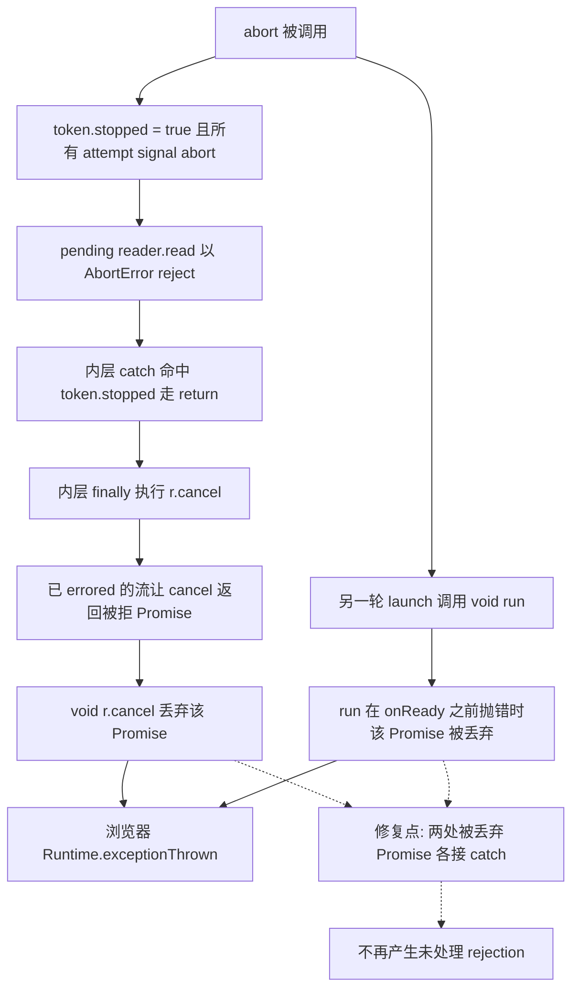

# follow-up-tail AbortError 未处理 rejection 修复（Phase 4 / F1 独立刀）设计规格

状态：待评审（brainstorming 产出，2026-11-08）
前置：`docs/ops/2026-11-08-phase3-prod-smoke.md`（P0 生产行为冒烟，§3 登记缺陷 F1）、`docs/superpowers/specs/2026-11-08-agent-siderail-phase3-closeout.md`（Phase 3 结项，完成定义表保留 F1 未闭环）
实施计划：`docs/superpowers/plans/2026-11-08-follow-up-tail-abort-rejection.md`
分支约定：feature 分支 + PR + squash merge；`gh api` Git-Data 链提交。
适用规范：`docs/superpowers/SPEC-CONVENTIONS.md`、`docs/agent/delivery.md`、`AGENTS.md`。

## 0. 配图索引

本文档的图分两类：**结构图**一律以 Mermaid 内嵌；**视觉稿**以 `assets/` 下的 SVG 附件承载。本文只有结构图。

| 编号 | 形式 | 内容 | 位置 | 用途 |
| --- | --- | --- | --- | --- |
| 图 1 | 内嵌 Mermaid | abort 之后两条被丢弃的 Promise 及其 rejection 出口 | §5 | 界定修复范围：只补两处 rejection handler，不改订阅状态机与重连语义 |

## 1. 目标（3 条以内，均可验收）

1. 消除 `follow-up-tail.ts` 中两条**无 rejection handler 的被丢弃 Promise**（`launch()` 的 `void run(mark)`、`finally` 的 `void r.cancel?.()`），使浏览器在 SSE 流被 abort 时不再产生 `Uncaught (in promise) AbortError`。
2. 建立**行为级**可失败契约：用真实 `createFollowUpTailListener` 驱动「建连 → abort → `reader.cancel()` 异步 reject」链路，以 Node `unhandledRejection` 事件为可观测出口，基线 RED、修复后 PASS，并做变异测试证明判据能转红。
3. 建立**类别化**源级门禁：本文件内所有以 `void` 丢弃的 Promise 调用必须显式接 `.catch`；防止今后新增同类「静默丢弃」写法。

## 2. 范围（含明确不做）

**做**：

- `apps/web/src/components/agent/follow-up-tail.ts` 两处补 rejection handler（各 1 行 + 注释）。
- 新增 `follow-up-tail.unhandledRejection.test.ts`：行为级契约 + 源级类别化门禁 + 探针自检。
- 本规格、实施计划两份文档；同步修订 P0 报告 §3、§6 与结项规格完成定义表，把 F1 从「未闭环」改为「已由本刀承接」。
- 合并后复跑生产侧 CDP 异常计数（若 `deploy.yml` 的 runner→CVM scp 再次挂死，按 §11 风险登记，不做高风险手动兜底）。

**明确不做**：

- 不改订阅状态机：不触碰 `abort()` 的 token 遍历、`delay()` 的 abort 语义、重连预算、clean-end 重连、404/401/403 终态、`onReady` 的「首响应即就绪」契约。
- 不把 `void run(mark)` 改成 `await run(mark)`：常驻订阅循环在 abort 前不结束，await 会让 `start()` / `resume()` 永久挂起（P0 报告 §3 与文件头注释已写明）。
- 不收紧 `TailReaderLike.cancel?: () => unknown` 为 `() => Promise<unknown>`：现有三处测试桩返回 `void`，收紧会连带修改测试，且 TS 仍不会强制 `.catch`，收益为零；修复必须在实现侧同时容纳「同步抛错」与「异步 reject」。
- 不改 `sendMessage` / `handleEvent` / `canvas_command` 分支 / `defineExpose` 11 项对外契约（Phase 3 §4.1 冻结边界）。
- 不新建 composable、不新增抽象层、不引入日志上报（新产物会改变 console 判据）、不做零行为变更刀之外的清理。

## 3. 与既有规格的关系

### 3.1 承接

本文**显式承接** P0 报告 §3 的 F1 与 §6 的优先级排序（F1 > 部署链治理 > P4 门禁化），以及结项规格 §4.1 冻结边界、§5 交接基线。结项规格完成定义表第 75 行「另列既有缺陷 F1 未闭环、不宣告 ALL_PASS」由本刀改写为「F1 已由本规格修复；生产复验见 §10」，**但不追溯把历史验收结论改成 ALL_PASS** —— 当时确实存在未闭环项，历史记录保持原貌，只补状态演进。

### 3.2 对 P0 报告建议的显式修订

P0 报告 §3「建议修复」列了三条，本刀复核后修订如下：

| 建议 | 复核结论 | 判定 |
| --- | --- | --- |
| ① `void Promise.resolve(r.cancel?.()).catch(() => {})`；并把 `cancel` 收紧为 `() => Promise<unknown>` | 前半条成立；**后半条撤下**：`follow-up-tail.test.ts:685` 等测试桩的 `cancel` 返回 `void`，收紧将迫使改动测试且 TS 依旧不强制 `.catch` | ✅ 采纳实现，❌ 撤下类型收紧 |
| ② `void run(mark).catch(() => {})` 兜底 | 成立。但必须注意：`run()` 若在 `onReady()` 之前抛错，`launch()` 仍等 `ready` ⇒ `start()` 挂起是**既有行为**，本刀不顺带改变它，避免夹带未验收行为变更 | ✅ 采纳，且限定语义不变 |
| ③ 先写「CDP 复现发新回合 → abort → 断言 `Runtime.exceptionThrown` 计数为 0」的行为级契约 | 方向成立，但**直接拿生产环境做 RED 基准不可重复**：依赖真实回合耗时、后端状态、部署是否成功。改为两层：CI 内跑**确定性 Node 行为级契约**（`unhandledRejection` 事件，见 §8），本地再跑一次**浏览器级 CDP 复核**（`unhandledrejection` 事件，见 §10） | ✅ 采纳意图，🔧 修订执行方式 |

### 3.3 不推翻

不推翻任何 ADR / 既有规格；不修改 `docs/superpowers/INDEX.md`（2026-10-03 生成、自称 409 份，未收录 11 月新增文档，属已知陈旧索引，本刀不动）。

## 4. 规范与判据（可复用规则）

### 4.1 「被丢弃的 Promise」三问

任何 `void someAsyncCall()` 落地前必须回答：

1. **它会 reject 吗？** 只要函数体含 `await`、或返回类型宽于 `void`（本例 `cancel?: () => unknown`、`run(): Promise<void>`），答案就是「会」。
2. **reject 会被谁接住？** 同步 `try/catch` **接不住**异步 reject；「先 `void` 再 catch 外层」是无效写法。
3. **吞掉之后 observable 行为变了吗？** 只允许「不再产生 unhandled rejection」，不得改变 resolve/reject 之外的状态迁移。

⇒ 结论：**吞异常必须挂在被丢弃的那个 Promise 上**，写作 `void Promise.resolve(x).catch(() => {})`（兼容同步抛错 + 异步 reject）或 `void x.catch(() => {})`（x 已知是 Promise）。

### 4.2 行为级判据（不是源码文本判据）

判据的可观测出口是**运行时事件**，不是源码字符串：

- 构造 `fetchImpl` 返回带 `getReader()` 的假流；`read()` 在 `signal.abort` 时以 `DOMException('signal is aborted without reason', 'AbortError')` reject（复刻真实浏览器）；`cancel()` 返回 `Promise.reject(同一 AbortError)`（复刻「流已 errored，cancel 返回被拒 Promise」的 Streams 规范行为）。
- 调 `await listener.start()` 后 `listener.abort()`，等待一个真实时钟 tick，断言 `unhandledRejection` 事件计数为 **0**。
- 每条否定断言必须配肯定断言：`cancel()` 确实被调用、探针自身确实能捕获一次人为制造的未处理 rejection（否则「探针没接线」会假绿）。

### 4.3 类别化源级门禁

```text
对 follow-up-tail.ts 中每个以 `void` 开头丢弃调用的语句：
    该语句必须包含 `.catch(`，或该语句不是 Promise 调用。
```

- 卡的是**类别**（所有 void 丢弃的异步调用），不是卡 `run(mark)` / `cancel` 这两个具体值。
- 配存在性断言：源文件中 `void` 丢弃语句数量 ≥ 2，防止「把两条都删空」也能绿。
- 该门禁是**第二道**，第一道是 §4.2 的行为级判据；两者独立 RED 才算数。

### 4.4 判据纪律（继承 `docs/agent/delivery.md` §「判据必须能真的失败」）

- 测试必须驱动**真实工厂函数**，不得复刻一份逻辑副本。
- 基线必须 RED 且 `exit≠0`；实现后必须做变异测试，逐一还原两处修复，各自转红。
- `docs/agent/delivery.md` 已明确「未处理 rejection 会被 vitest 单独计入 `Errors`，全量 passed 但 Errors 非零 ⇒ exit 1」，本刀的判据与该纪律同源。
- 事实性数字 / 符号归属落笔前实测；本机 `grep -rn` 可能被 shim 包装返回 0 命中，一律用 Python 直读复核。

## 5. 架构与契约



*图 1 · 这条链说明 F1 的两条独立 rejection 出口都在「显式终止」路径上，且与重连状态机无关；虚线是本次仅有的改动，实线全部保持原样。验收时用它界定「改了什么、没改什么」。*

正文引用：修复范围严格按 图 1 的 K 节点所示两处 `.catch`，A–J 的状态迁移与 `onReady` 契约均不动。

**契约不变项**：`FollowUpTailListener` 的 7 个方法签名、`FollowUpTailState` 四态、`FollowUpTailDeps` 全部字段、`TailReaderLike` / `TailResponseLike` 结构、`isTurnTerminal` 导出，均零改动。

## 6. 主场景规格（逐项可验收）

| # | 场景 | 期望 |
| --- | --- | --- |
| S1 | 建连后显式 `abort()`，且 `cancel()` 异步 reject `AbortError` | 零 `unhandledRejection` 事件；`cancel()` 确实被调用一次 |
| S2 | `baseUrl()` 在首个响应前抛错，使 `run()` 的 Promise reject | 零 `unhandledRejection` 事件；`start()` 的挂起语义与基线一致（不新增 resolve 路径） |
| S3 | 探针自检：人为 `void Promise.reject(...)` | 探针捕获到 1 个事件（证明捕获链真的接线） |
| S4 | 类别化门禁 | 源文件每个 `void` 丢弃语句都带 `.catch`，且该语句数量 ≥ 2 |
| S5 | 既有行为不回归 | `follow-up-tail.test.ts` / `.main.test.ts` 全组仍绿；全量 `AgentSideRail` 组仍绿 |

## 7. 数据与状态变更

无。不新增状态、不新增 ref、不新增 store 字段；`live` / `current` / `state` / `lastSeq` / `roundSeq` 的写入点零改动。本刀不产生任何持久化数据或接口字段变更。

## 8. 纯函数与算法

无新增纯函数。两处修改均为 Promise 链末端接 `.catch`：

- `launch()`：`void run(mark).catch(() => {})` —— `run()` 的返回类型是 `Promise<void>`，`.catch` 后返回的 Promise 恒 fulfilled，不再成为未处理 rejection。
- 内层 `finally`：`void Promise.resolve(r.cancel?.()).catch(() => {})` —— 外层同步 `try/catch` 保留，接住 `cancel()` 同步抛错；`Promise.resolve` 把 `unknown` 归一为 Promise，接住异步 reject。

⚠️ 两处均**不调用 `mark()` / `onReady()`**：在 `run()` 提前抛错时维持既有「`launch()` 等不到 ready」的行为，避免夹带未在 §6 登记的行为变更（S2）。

## 9. 文件级改动清单（按内容锚点定位，不用行号）

| 文件 | 动作 | 锚点 |
| --- | --- | --- |
| `apps/web/src/components/agent/follow-up-tail.ts` | 修改 2 行 | `void run(mark)`；`void r.cancel?.()` |
| `apps/web/src/components/agent/follow-up-tail.unhandledRejection.test.ts` | 新增 | 读取同目录 `follow-up-tail.ts` 磁盘文本 + 导入 `createFollowUpTailListener` |
| `docs/superpowers/specs/2026-11-08-follow-up-tail-abort-rejection-design.md` | 新增 | 本文 |
| `docs/superpowers/plans/2026-11-08-follow-up-tail-abort-rejection.md` | 新增 | 实施计划 |
| `docs/ops/2026-11-08-phase3-prod-smoke.md` | 修改 | §3 标题与「建议修复」段、§6 结论第 2/3 条 |
| `docs/superpowers/specs/2026-11-08-agent-siderail-phase3-closeout.md` | 修改 | 完成定义表「生产业务链路验收」行 |

## 10. 测试策略与验收标准

**本地门禁（提交前）**：

1. `vitest run src/components/agent/follow-up-tail.unhandledRejection.test.ts --maxWorkers=1 --no-file-parallelism`：基线 RED（S1/S2/S4 失败、S3 绿），修复后 4/4 或 5/5 PASS。
2. 变异测试：M1 仅还原 `void run(mark)` ⇒ S2 + S4 红；M2 仅还原 `void r.cancel?.()` ⇒ S1 + S4 红；M3 两处同时还原 ⇒ S1/S2/S4 全红；M4 把 `if (reader)` 改成 `if (false && reader)` ⇒ S1 的肯定断言红。每次恢复后裸 blob sha 与修复产物全等。
3. 定向全组：`follow-up-tail.test.ts` + `.main.test.ts` + 新测试；`AgentSideRail` 全组 44 files / 221 tests 基线不回退。
4. `vue-tsc -b`（apps/web）EXIT=0；`pnpm -r build` EXIT=0；`pnpm verify-spec-figures` 全量 0 error、`--file` 逐篇 0/0；`pnpm verify-links` 0；`pnpm verify-claims` 全绿。

**浏览器级 CDP 复核（本地可重复，不依赖生产部署）**：

用 esbuild 把 `follow-up-tail.ts` 打成 IIFE，在 headless Chrome 页面里注入同样的假流，监听 `window.onunhandledrejection` 与 CDP `Runtime.exceptionThrown`，对「修复前 / 修复后」两份 bundle 各跑一次：**修复前 ≥1 个事件、修复后 0 个**。这是 P0 报告建议 ③ 的确定性替身：它复现的是同一个浏览器级异常事件，但不需要真实回合、真实后端与成功部署。

**生产复验（合并后）**：`deploy.yml` 由 `push master` 自动触发且 paths 含 `apps/web/**`。部署成功则复跑 P0 的 CDP 真实回合脚本，断言 `Runtime.exceptionThrown` 计数为 0；若 runner→CVM scp 再次挂死，按 §11 登记，不手动兜底、不 rerun。

> **复验结果（2026-11-08，PR #779 / merge `f84985f9`）**：`Deploy to Tencent Cloud` run `42453812598` success（16m52s），生产 dist 已更新。CDP 页面加载 10/10、展开侧栏 9/9，**连续两轮真实回合各 13/13 ALL_PASS**，`PAGE ERROR DETAILS = []`、`consoleErrors = []` ⇒ F1 生产闭环。证据归档于 `docs/ops/2026-11-08-phase3-prod-smoke.md` §3。

**CI 三必需**：`Verify spec figures` / `Build monorepo`（含全量 vitest）/ `Build API Docker image` 全 pass 才 squash。

## 11. 风险

| 风险 | 触发 | 缓解 |
| --- | --- | --- |
| 吞异常掩盖真实错误 | `.catch(() => {})` 无日志 | 范围限定在**仅显式终止路径**；`run()` 的常规异常仍由内层 `catch` 走重连，`onReady` 契约不变；既有两组长测试兜住重连语义 |
| 探针污染 vitest 自身的 unhandledRejection 监听 | 测试临时 `removeAllListeners` | 保存并完整恢复 `process.listeners('unhandledRejection')`；每例 `try/finally` 恢复，探针自检用例覆盖该能力 |
| 行为级判据在 CI 与本地不一致 | 假时钟 / 环境差异 | 用**真实时钟**等待 30ms（`unhandledRejection` 在微任务队列排空后由 Node 触发），不用 fake timers |
| 部署链 scp stall 复发导致生产复验做不了 | #777 已发生一次 | 生产侧只做**观察**，不作为本刀合并闸门；本刀的有效性由 CI 内行为级契约 + 本地浏览器级 CDP 复核承担 |
| 本地工作树大面积漂移 | 主仓 721 文件内容不同 / 1872 文件缺失 | 推前用 `gh api` 拉 master 逐路径 blob sha 比对；只提交 §9 列出的 6 个文件；tree entry 一律 repo-root 相对路径 |

## 12. 后续包 / 路线图（本包外的东西也登记）

1. **部署链治理**：已由独立刀 #2 承接，见 `docs/superpowers/specs/2026-11-08-web-dist-incremental-upload-design.md` 与其实施计划。**本条原写「scp 持久挂死 / retry 方向」已被定量证据修订并撤销**：run `42453812598` 的上传步骤 15.05 分钟后成功，远端 tgz 字节单调增长，属「固定大载荷 × 慢且抖动链路」而非挂死；治理方向改为「按内容差量同步 + 上传后 sha256 清单校验 + 一键回退」，retry / rerun 不减载荷故不采用。TRUE MASTER 兜底纪律保持不变。
2. **P4 门禁化**：把 P0 的 CDP 五层冒烟做成可重复脚本；补 `defineExpose` 11 项源级覆盖；把「注入依赖数 / 回环数 / 本地工作树 = master」做成可失败 CI 检查。
3. **P1 剩余刀**：B（撤销按钮占位，需产品裁决）、C（`pull()` 缺 `if (!res.ok)`，属行为变更，须先补行为级契约）。
4. **P2 状态所有权收敛**：`taskProgress` / `scrollToBottom` / `agentThreadId` 单一写者契约（先补写者唯一性测试与变异验证，再改实现）。
5. **`launch()` 挂起语义**：`run()` 在 `onReady()` 之前抛错会让 `start()` 永久等待，属真实但未被本刀范围登记的缺陷；若立项，须先写行为级 RED（超时/拒绝语义）再改，不得夹带。

## 13. 配图规范自检

- §0 索引登记 图 1；§5 内嵌 Mermaid `flowchart TD`，共 12 个节点（≤ 12）、标签全部引号包裹、无 `<br/>`、无英文括号；图注写明「说明了什么、验收时怎么用」；§5 正文显式引用 图 1。
- 无 SVG 附件 ⇒ R1/R6/R8 不适用；R2/R3/R5/R7 由 `pnpm verify-spec-figures --file <本文>` 校验，结果在实施计划 Task 5 记录。
