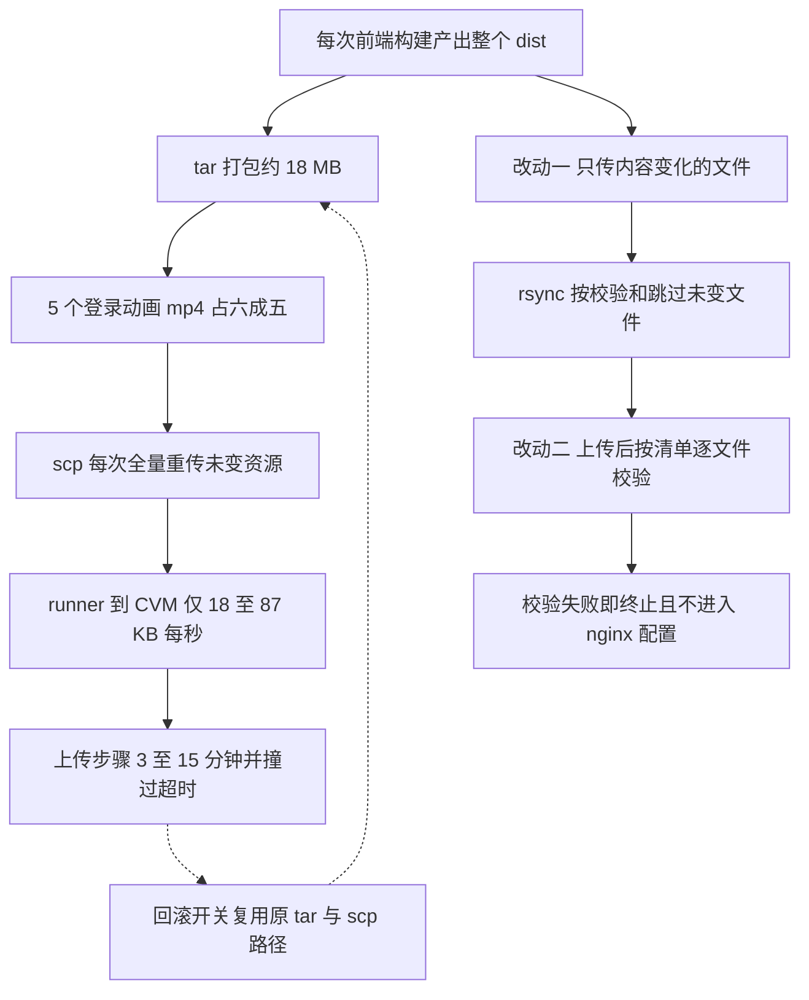

# Web dist 增量上传与完整性校验（Phase 4 / #2 部署链治理）设计规格

状态：待评审（brainstorming 产出，2026-11-08）
前置：`docs/superpowers/specs/2026-11-08-follow-up-tail-abort-rejection-design.md`（F1 独立刀，§12 把部署链登记为后续包）、`docs/ops/2026-11-08-phase3-prod-smoke.md`（P0 生产验收，§6 登记 #777 部署取消）、`docs/superpowers/specs/2026-11-08-agent-siderail-phase3-closeout.md`（Phase 3 结项）
实施计划：`docs/superpowers/plans/2026-11-08-web-dist-incremental-upload.md`
分支约定：feature 分支 + PR + squash merge；`gh api` Git-Data 链提交。
适用规范：`docs/superpowers/SPEC-CONVENTIONS.md`、`docs/agent/delivery.md`、`AGENTS.md`。
真值基线：master `4a5aa564e050355458c4775e50098d98b0651eb5`（`gh api` 读取，2026-11-08）。

## 0. 配图索引

本文档的图分两类：**结构图**一律以 Mermaid 内嵌；**视觉稿**以 `assets/` 下的 SVG 附件承载。本文只有结构图。

| 编号 | 形式 | 内容 | 位置 | 用途 |
| --- | --- | --- | --- | --- |
| 图 1 | 内嵌 Mermaid | 全量 tar 上传的耗时因果链与本次两处改动 | §5 | 界定改动只落在「打包传输方式」与「上传后校验」，发布目录语义与 nginx 配置链不动 |

## 1. 目标（3 条以内，均可验收）

1. 把 `deploy-web` 的上传载荷从「每次全量 24 MB dist 打成的 16–19 MB tar」降为「仅内容发生变化的文件」，使 `Upload web dist and nginx config` 步骤在合并后的一次真实 `deploy_web_only` 发布中 **≤ 8 分钟**（历史同链路实测 3.08 / 15.05 分钟，被人工取消的一次 8.07 分钟）。
2. 新增**上传后完整性契约**：远端按清单逐文件 `sha256sum -c` 校验，校验失败必须以非 0 退出、不得进入 `Configure nginx on CVM`；原链路没有任何内容校验，`tar -xzf` 成功不等于内容正确。
3. 建立**行为级可失败判据**：端到端跑真实上传脚本与真实 `rsync`，用本地目录模拟远端，断言「未变大文件不被重传、变更文件到位、旧 `assets` 被清理、校验失败会阻断、legacy 开关可回退」；基线 RED，逐条变异 RED，修复后 PASS。

## 2. 范围（含明确不做）

**做**：

- 新增 `deploy/upload-web-dist.sh`：生成本地 sha256 清单 → 远端按原语义清 `assets` → `rsync -az --checksum --partial --timeout` 增量同步 → 传 `nginx.conf` / `deploy-web.sh` / 清单 → 远端 `sha256sum -c` 校验 → 成功才清理临时文件。
- 新增 `scripts/verify-web-upload.py`：行为级 harness，支持注入远端执行器与文件复制器，含探针自检；`package.json` 增加 `verify-web-upload` 脚本。
- 把 `.github/workflows/deploy.yml` 的 `Upload web dist and nginx config` 内联 6 行替换为 `bash deploy/upload-web-dist.sh`；`.github/workflows/ci.yml` 的 `spec-figures` job 增加一步跑该契约。
- 保留 **#723 分享默认 OG 卡播种**：`deploy/static/share-og-default.png` 仍随每次 web 部署落到主机 `${DEPLOY_DIR}/share/` 且 `chmod 644`；增量与 legacy 两条上传路径都必须播种，并配行为级断言。
- 本规格、实施计划；同步修订 F1 规格 §12、P0 报告 §6 中关于「scp 持久挂死」的结论与下一步排序。
- 合并后按 §10 做一次真实 `workflow_dispatch` 发布复验并回写证据。

**明确不做**：

- 不改 `deploy/deploy-web.sh`、`deploy/nginx.conf` 的端口替换 / `nginx -t` / `systemctl restart` 链；不改 web root `/opt/lnkpi/web/dist`。
- **不改 #723 的 OG 播种落点与权限**：仍写 `${DEPLOY_DIR}/share/share-og-default.png` 且 `chmod 644`；不为「简化」而把它塞进 dist 或改成按需下载（会让所有分享卡 OG 预览图 404）。
- 不改 `deploy-web` job 的触发条件、`needs: changes`、`environment: production`、`concurrency: lnkpi-release`、`timeout-minutes: 30`；不改 `Build API on CVM` / `recover-only` 两个 job。
- **不引入 `rsync --delete`**：原流程 `rm -rf assets` 后 tar 覆盖，会保留远端非 `assets` 的历史文件；`--delete` 会删除它们，属行为变更。本刀保留「只清 `assets`」的原语义。
- 不改目录切换方式：不做 staging + 原子 `mv`。原链路直接写发布目录，本刀保持直接写，避免引入新的发布窗口与回滚语义。
- 不加 retry / rerun / 分块续传来「救」慢链路：这些都不减少载荷，只会把 15 分钟变成多次 15 分钟（见 §3.2 对旧结论的修订）。
- 不改 `sendMessage` / `handleEvent` / `canvas_command` / `defineExpose` 11 项 Phase 3 冻结契约；不改任何产品代码、不改 `prompt-registry/**`、不改 `docs/agent/*.md`。
- 不因本刀改 `apps/web/**` 源码，也不重建前端产物；本地 `apps/web/dist` 仅用于体积测量，不用于生产兜底（本地与 CI 构建的 chunk 哈希已实证不同）。

## 3. 与既有规格的关系

### 3.1 承接

- F1 规格 §12 第 1 条登记「部署链治理：runner→CVM scp 持久挂死已两次复发，需单独立项」；本刀即为该立项，承接其「独立小 PR、行为级判据、生产复验」纪律。
- P0 报告 §6 把 #777「因 scp stall 未上线」记为待办；本刀给出定量根因与关闭路径。
- Phase 3 结项规格的冻结边界与「不宣告 ALL_PASS 除非生产闭环」纪律继续适用。

### 3.2 对旧结论的显式修订

上一轮 F1 归档时把 runner→CVM 描述为「极慢但未死」，并建议「减小载荷（rsync 增量或分块）+ 上传后校验 + 步骤级超时」。本规格把结论推进为可定量的三层，并**撤销**其中两个方向：

| 旧表述 | 修订后 | 证据 |
| --- | --- | --- |
| 「scp 持久挂死」 | **不是挂死，是链路慢 + 载荷固定过大**；远端 tgz 在 20 秒内单调递增 15,928,320 → 16,189,440 B，约 13 KB/s，run `42453812598` 最终 success | `docs/ops/2026-11-08-phase3-prod-smoke.md` §3 / F1 归档日志 |
| 「加 retry / rerun」 | **撤销**：不减载荷的 retry 会放大总耗时；`gh run rerun --failed` 对慢链路无效 | 本规格 §8 定量 |
| 「分块 + 步骤超时」 | **降级为可选项**：分块不减少总字节；步骤级超时只把失败提前，不改善成功率 | 本规格 §8 |
| 「#777 在 8 分钟 cancel 过早」 | 保留该判断，但补上「20 分钟内不 cancel」只是运维规避，不是治理 | 本规格 §11 |

### 3.3 不推翻

- 保留「本机 → CVM SSH 18 MB/s 正常，stall 只在 runner → CVM:22 数据通道」的链路定位。
- 保留「兜底部署必须重建 TRUE MASTER 源码、逐文件裸 blob sha 比对」纪律；本刀不涉及手动兜底。
- 保留 P0 报告当时的「F1 未闭环 ⇒ 不宣告 ALL_PASS」历史结论；本刀不追溯改写。

## 4. 规范与判据（可复用规则）

### 4.1 生产流水线改动三问

今后任何改 `deploy.yml` / `ci.yml` 的刀，规格必须逐条作答，缺一不予评审通过：

1. **载荷**：这次改动减少还是增加了跨公网传输的字节？能否量化？
2. **可检出**：传输不完整或内容损坏时，有没有在「改生产状态之前」失败的能力？
3. **可回退**：不改代码、只改一个开关或一个 commit revert，能否回到旧链路？

### 4.2 行为级判据（不是 workflow 文本判据）

- 主判据必须**真实执行上传脚本**，用真实 `rsync` / 真实 `sha256sum`，只是把「远端」替换为本地目录；断言远端文件集合与逐文件哈希。
- 禁止用「`deploy.yml` 里出现了 `rsync`」这类文本断言充当验收：它无法检出参数写错、校验被绕过、清理语义丢失。
- 每条否定断言配一条肯定断言与一条探针自检：远端执行器确实被调用、同步日志确实产生、校验确实读到清单。

### 4.3 类别化源级门禁（辅助，不单独充当验收）

- `deploy-web` 的上传步骤不得再内联 `scp /tmp/lnkpi-web-dist.tgz`；必须调用可测脚本。
- 脚本内每一次 `rsync` 目标为远端发布目录时，必须带 `--checksum`；`sha256sum -c` 失败必须 `exit 1` 且不得依赖 `|| true`。
- 这两条由 `verify-web-upload.py` 读取真实文件做类别化检查，并配变异测试证明会 RED。

### 4.4 判据纪律（继承 `docs/agent/delivery.md`）

基线必须 RED 且 exit≠0；每条变异必须真改变输出后能转红；禁止伪变异（注入点被下游吞掉）。恢复后逐文件裸 blob sha 与本地固定版一致。

## 5. 架构与契约

*图 1 · 这条链说明慢的根因是「固定大载荷 × 慢且抖动的链路」，两处改动分别切断载荷与「无声的不完整发布」；虚线是一键回退路径。验收时用它界定改动只落在打包传输与校验，发布目录语义、nginx 链、job 编排全部保持原样。*

正文引用：实现严格按 图 1 的 G / H / I / J 四处落地，A–F 是未改动的现状链，K 是回退路径。

**契约不变项**：

| 契约 | 值 |
| --- | --- |
| 远端发布目录 | `/opt/lnkpi/web/dist` |
| 清旧文件语义 | 仅 `rm -rf ${DEPLOY_DIR}/web/dist/assets`，不用 `--delete` |
| 随包上传的配置 | `/tmp/nginx.conf`、`/tmp/deploy-web.sh` → `${DEPLOY_DIR}/deploy/`，`chmod +x` |
| #723 分享 OG 卡 | `deploy/static/share-og-default.png` → `${DEPLOY_DIR}/share/share-og-default.png`，`chmod 644`；增量与 legacy 两条路径都播种 |
| 成功后清理 | `/tmp/lnkpi-web-dist.tgz`、`/tmp/nginx.conf`、`/tmp/deploy-web.sh`、`/tmp/share-og-default.png`；清单保留 |
| 后续步骤 | `Configure nginx on CVM` → `Verify web deployment` 顺序与命令不变 |
| 交付物集合 | `dist` 内 163 个文件的相对路径与内容，与旧链路解包结果一致 |

## 6. 主场景规格（逐项可验收）

| # | 场景 | 期望 |
| --- | --- | --- |
| S1 | 远端已有内容相同但 mtime 不同的大文件，本次构建只改了 `index.html` 与一个 hashed chunk | 同步日志不含该大文件；远端大文件仍在且与本地 sha 相同 |
| S2 | 本地新增 / 修改文件 | 远端出现同名文件且 sha 与本地一致；全部 163 个相对路径通过清单校验 |
| S3 | 远端残留上一版 `assets` 里的旧 hashed 文件 | 同步前被清理，同步后 `assets` 集合与本地一致 |
| S4 | 远端某个文件内容被篡改，且 `LNKPI_WEB_VERIFY_ONLY=1` 只重跑校验 | 脚本 exit≠0，输出不含成功标记；不触碰 nginx 配置 |
| S5 | `LNKPI_WEB_UPLOAD_LEGACY=1` | 走原 `tar` + `scp` + 解包路径，交付物集合与 S2 相同，且仍通过清单校验 |
| S6 | runner 无 `rsync` | 自动降级到 legacy 路径并打印原因，不因能力缺失导致部署失败 |
| S7 | 探针自检 | 远端执行器调用次数 > 0、同步日志非空、清单文件行数 = 本地文件数；否则测试判为假绿 |
| S8 | #723 分享 OG 卡 | `share-og-default.png` 被复制到远端 inbox 并落到 SHARE_DIR，逐字节一致且权限 `644`；增量与 legacy 路径都成立 |

## 7. 数据与状态变更

- 远端新增临时文件 `/tmp/lnkpi-web-manifest.sha256`，**成功与失败都保留**，供 `LNKPI_WEB_VERIFY_ONLY=1` 随时重验；成功时只清理 `lnkpi-web-dist.tgz`、`nginx.conf`、`deploy-web.sh`，与旧链路一致。
- 远端发布目录内**不新增任何文件**：清单不放进 `dist`，避免被 nginx 静态暴露，也避免污染交付物集合。
- 不改数据库、不改 `.env`、不改 nginx 配置内容、不改容器镜像。
- 新环境变量均为可选，缺省值等价于生产现状：`LNKPI_WEB_DIST`、`LNKPI_WEB_REMOTE_DIST`、`LNKPI_WEB_REMOTE_DEPLOY_DIR`、`LNKPI_WEB_REMOTE_HOST`、`LNKPI_WEB_RSYNC_DEST`、`LNKPI_WEB_RSYNC_BIN`、`LNKPI_WEB_REMOTE_EXEC`、`LNKPI_WEB_COPY`、`LNKPI_WEB_SIDECARS`、`LNKPI_WEB_WORK`、`LNKPI_WEB_INBOX`、`LNKPI_WEB_SHARE_DIR`、`LNKPI_WEB_SYNC_LOG`、`LNKPI_WEB_UPLOAD_LEGACY`、`LNKPI_WEB_VERIFY_ONLY`。
- 校验命令语义等价于 `sha256sum -c`：本机 macOS 无 `sha256sum` 时脚本与远端都自动改选 `shasum -a 256 -c`；生产 runner 与 CVM 均走 `sha256sum`。同步日志用 `rsync --out-format='%i %n' --stats`，行为测试据此区分「内容传输（`>` / `<`）」与「仅 mtime 更新（`.`）」。

## 8. 定量依据与算法

**测量数据（`gh api` jobs/steps 时间戳，2026-11-08）**：

| run | 结论 | `Build web` | `Upload web dist` | job 总时长 |
| --- | --- | --- | --- | --- |
| `42453812598` | success | 1.13 min | **15.05 min** | 16.87 min |
| `42442096327` | cancelled | 1.22 min | 8.07 min 被取消 | 9.58 min |
| `42435277817` | success | 0.92 min | **3.08 min** | 4.63 min |

`apps/web/dist` 共 163 文件 / 23,876,261 B；`auth/login-loop-0X.mp4` 5 个合计 15,593,315 B（**65.3%**），源文件在 `apps/web/public/auth/`，构建只做复制，历次发布内容不变。本地 `tar -czf` 得 18,704,681 B；CVM 侧观测到 CI 上传的 tgz 为 16,189,440 B。按 3.08–15.05 min 折算有效吞吐约 18–87 KB/s，波动近 5 倍。

**结论**：在慢链路上，耗时 ≈ 载荷 ÷ 吞吐。retry 让分母不变、分子重复；分块让分子不变；步骤超时只改变失败时点。唯一确定有效的手段是**减小分子**：跳过 15.6 MB 从不变化的静态资源。

**增量算法**：不维护「大文件白名单」，用 `rsync --checksum` 对每个文件按内容判定，天然覆盖未来新增的大资源；`--partial` 保留中断的分片；`-z` 压缩文本类 chunk。上传后用本地生成的完整清单在远端 `sha256sum -c`，把「传输不完整」从静默成功变成硬失败。

## 9. 文件级改动清单（按内容锚点定位，不用行号）

| 路径 | 动作 | 锚点 |
| --- | --- | --- |
| `deploy/upload-web-dist.sh` | 新增 | 全文件；含 `main` / `verify_only` / `legacy_upload` / `incremental_upload` 四个函数 |
| `scripts/verify-web-upload.py` | 新增 | 行为级 harness + 类别化源级检查 + 7 组场景 + 探针自检 |
| `package.json` | 改 | `scripts` 增加 `verify-web-upload` |
| `.github/workflows/deploy.yml` | 改 | `Upload web dist and nginx config` step 的 `run:` 块整体替换 |
| `.github/workflows/ci.yml` | 改 | `spec-figures` job 的 `Verify markdown links` 之后增加一步 |
| `docs/superpowers/specs/2026-11-08-web-dist-incremental-upload-design.md` | 新增 | 本文 |
| `docs/superpowers/plans/2026-11-08-web-dist-incremental-upload.md` | 新增 | 实施计划 |
| `docs/superpowers/specs/2026-11-08-follow-up-tail-abort-rejection-design.md` | 改 | §12 第 1 条：从「持久挂死 / retry」改为「本刀承接，定量结论见 §8」 |
| `docs/ops/2026-11-08-phase3-prod-smoke.md` | 改 | §6 下一步排序与 #777 结论补注 |

## 10. 测试策略与验收标准

- **基线 RED**：`scripts/verify-web-upload.py` 在脚本/接线落地前 **0/11、exit=1**（当时 11 组全红；补齐 #723 播种后判据扩为 13 组）。
- **PASS**：**13/13**（S1–S8 行为组 + SS1–SS5 类别化源级组），`pnpm verify-web-upload` exit 0。
- **变异（实测，6 条全 RED 且命中预期场景）**：M1 删 `--checksum` → S1 等 5 组；M2 把校验改恒真 → S4；M3 删 `rm -rf assets` → S3；M4 删 legacy 分支 → S5 + S6；M5 让 `run_remote` 空转 → S7 等 6 组；M6 删 OG 播种 → S8 + SS5。恢复后裸 blob sha `dc50321cc6eabe356e1186db36e50f49ebbe237d` 全等、13/13 复绿。
- **本地全量门禁实测**：`vue-tsc -b` 0、`pnpm -r build` 0；`pnpm test` 在 182 个 server 文件中 6 个 SQLite 集成文件的 `beforeAll` 撞 10s hook timeout（并行资源竞争，本刀零产品代码改动），**单独以 `--maxWorkers=1 --no-file-parallelism` 重跑 6 文件 30/30 PASS**；CI `Build monorepo` 为最终判据。
- **推前核对（必做，实测有效）**：逐路径比对 master blob 后发现本地 `package.json` / `deploy.yml` 落后，已从 master blob 落盘恢复并重放改动（详见 §11 R8）。
- **本地门禁**：`vue-tsc -b`、`pnpm -r build`、`pnpm verify-spec-figures`（全量 + 本文逐篇）、`pnpm verify-links`、`pnpm verify-claims`、全量 vitest（本刀不改产品代码，回归用）。
- **CI 三必需**：`Verify spec figures` / `Build monorepo` / `Build API Docker image` 全 pass；其中 `Verify spec figures` 已包含新增契约步骤。
- **生产验收（合并后，已实测）**：`deploy.yml` paths 含 `.github/workflows/deploy.yml` 与 `package.json` ⇒ 合并自动触发部署；若 `environment: production` 挂审批，按既有闸门纪律处理，不绕过。主判据为这一次真实 push 自动部署：上传步骤 ≤ 8 min、日志出现 `UPLOAD_MODE=incremental` / `MANIFEST_OK` / `WEB_DIST_UPLOAD_OK`、远端清单 `sha256sum -c` 自洽、`http://119.29.173.89:8888/` 与 `/api/health` 均 200、#723 OG 卡 200、交付物集合不变。**`deploy_web_only` 手工二次对照降为可选**（两条触发分支共用同一脚本与 env，不新增代码路径覆盖，且会与同组 `Build API on CVM` 排队并再动一次生产 nginx）；理由与实测数据见 `docs/ops/2026-11-08-web-dist-upload-prod-verify.md` §5。
- **不达标处理**：先 revert 单个 squash commit 恢复旧链路，再取证复盘；不手动 scp 兜底、不 rerun 慢链路。

## 11. 风险

| # | 风险 | 缓解 |
| --- | --- | --- |
| R1 | GitHub runner 未预装 `rsync` | 脚本 `command -v rsync` 前置检查，缺失自动降级 legacy 路径并打印原因（S6）；CVM 侧已确认 `/usr/bin/rsync` |
| R2 | `rsync` over ssh 在高延迟链路上握手更慢 | 只多一次连接；载荷降一个数量级；真实 dispatch 复验耗时，超门槛即 revert |
| R3 | `--checksum` 让远端对 163 个文件算 sha，增加 CPU | 24 MB 级计算在 CVM 上可忽略，且发生在部署窗口内一次性 |
| R4 | 直接写发布目录，传输中断会留半成品 | 旧链路同样如此；本刀新增清单校验，校验失败即阻断 nginx 配置，半成品不会被「宣布成功」；原子 staging 明确列为后续包 |
| R5 | macOS 本地 rsync 2.6.9 与 runner 3.x 参数行为差异 | 只用两版共有参数（`-az --checksum --partial --timeout --out-format`）；harness 在本机跑通后仍以 CI 真实 dispatch 为最终判据 |
| R6 | 合并 `deploy.yml` 自身触发生产发布，可能排队或需审批 | 规格写明闸门纪律；不并行推其他发布；合并后核对 run 列表确认自己的 run 未被 concurrency 静默取消 |
| R7 | 本地 `apps/web/dist` 与 CI 产物 chunk 哈希不同 | 本刀不上传本地产物；体积测量只用相对构成，验收只认 CI 产物 |
| R8 | 本地工作树落后于 master | 推前逐路径裸 blob sha 比对，差异文件先从 master blob 落盘再重放改动。**本刀实测抓获**：本地 `deploy.yml` 缺 #723 OG 播种与 disk-watchdog、`package.json` 缺 `pnpm.patchedDependencies` 与 `verify-thread-unify`；已全部恢复，否则会回退并行 PR 的生产修复 |

## 12. 后续包 / 路线图（本包外的东西也登记）

1. **原子发布**：staging 目录 + 校验后 `mv` 切换，消除 R4 的半成品窗口；属发布语义变更，须另立规格并配行为级 RED。
2. **上传进度可观测**：把 `rsync --out-format` 的传输字节数写进 `$GITHUB_STEP_SUMMARY`，形成每次部署的载荷趋势；本刀只把日志留给 harness 断言。
3. **P4 门禁化**：CDP 五层冒烟固化、`defineExpose` 11 项源级覆盖、注入依赖数 / 回环数可失败门禁。
4. **P1 剩余刀 / P2 状态所有权收敛**：沿用 Phase 3 结项规格 §12 排序，不因本刀调整。
5. **F1 之后的新缺陷**：`launch()` 在 `onReady()` 之前抛错会让 `start()` 永久等待，仍未立项。

## 13. 配图规范自检

- §0 索引登记 图 1；§5 内嵌 Mermaid `flowchart TD`，共 11 个节点（≤ 12）、标签全部引号包裹、无 ` `、无英文括号；图注写明「说明了什么、验收时怎么用」；§5 正文显式引用 图 1。
- 无 SVG 附件 ⇒ R1/R6/R8 不适用；R2/R3/R5/R7 由 `pnpm verify-spec-figures` 校验。
- **实测**：`pnpm verify-spec-figures --file <本文>` → 1 篇、0 error、0 warning；全量 → 197 篇在范围内、0 error（2 条历史文档 R4 警告，非本刀引入）；`pnpm verify-links` 0；`pnpm verify-claims` 7/7。
