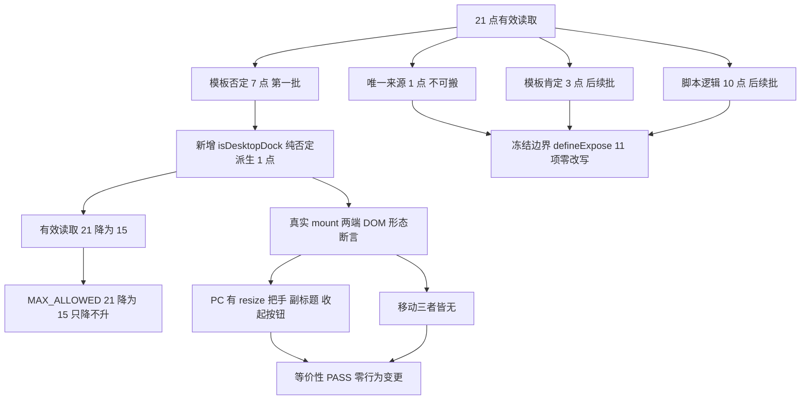

# `isMobileLayout` 读取域逐处搬 · 第一批设计规格（路线 ③ 第三刀）

状态：待评审（2026-11-09）
前置：`docs/ops/2026-11-09-is-mobile-layout-scope-runbook.md` §6 四条准入；`docs/superpowers/specs/2026-11-09-is-mobile-layout-scope-gate-design.md` §14；母规格 §10 / §15.9；Phase 3 结项规格 §4
实施计划：`docs/superpowers/plans/2026-11-09-is-mobile-layout-migration-batch1.md`
真值基线：`2b6693c579ffb2931a84d1954e93fecf5617db91`（写作时 `gh api` true master；推送前重新核对 + `MASTER_MOVED_SAFE`）
分支约定：feature 分支 + PR + squash；推送全走 `gh api` Git Data API

## 0. 配图索引

本文档只有结构图，一律 Mermaid 内嵌，无像素附件。

| 编号 | 形式 | 内容 | 位置 | 用途 |
| --- | --- | --- | --- | --- |
| 图 1 | 内嵌 Mermaid `flowchart TD` | 21 点有效读取的四类分派、第一批搬 7 处模板否定读取后的上限收敛与行为级等价性出口 | §5 | 作为「逐处搬第一批为什么只搬这 7 处、上限为何降到 15」的验收基准 |

## 1. 目标（3 条以内，均可验收）

1. **逐条分类 21 点**（runbook §6 准入 1）：把 `AgentSideRail.vue` 剥离注释后的 21 处有效读取按「唯一来源 / 模板否定 / 模板肯定 / 脚本逻辑」四类写进规格，分类表逐行可核对，禁止含糊表述。
2. **第一批搬 7 处并收紧棘轮**（准入 2）：把模板里 7 处重复的 `!isMobileLayout` 收敛为单一语义派生 `isDesktopDock`，有效读取点 21 → 15，`MAX_ALLOWED` 同步从 21 降到 15；**禁止一次性抬高上限**，剩余 15 点留待后续批次。
3. **行为级等价性证明**（准入 3）：新增真实 mount 契约测试，在 PC（`matchMedia.matches=false`）与移动（`matches=true`）两端断言 7 处锚点对应的 DOM 形态与搬迁前完全一致；变异验证能精确 RED。零行为变更。

## 2. 范围（含明确不做）

**做**：

- 改 `apps/web/src/components/agent/AgentSideRail.vue`：新增 1 个 `isDesktopDock` computed，替换 7 处模板 `!isMobileLayout`。
- 改 `scripts/verify-is-mobile-layout-scope.py`：`MAX_ALLOWED` 21 → 15，V3 方向判据里的硬编码同步。
- 新增 `apps/web/src/components/agent/AgentSideRail.desktopDockDerived.test.ts`（行为级 mount 契约）。
- 新增 13 章规格、实施计划、runbook 补充、证据；Issue #755 与本规格 §14 只追加登记。
- 变异测试 ≥ 6 组；`vue-tsc -b`；CI 三必需；生产发布后的 bundle 级复测。

**明确不做**：

- **不搬**剩余 15 点（脚本逻辑 10 处、模板肯定 3 处、唯一来源 1 处、新派生定义 1 处），留后续批次逐处降上限。
- 不改 `presentation/**` 与 `packages/shared/**`（门禁 V2 零容忍区）；不改 `useAgentMobileLayout()` 定义点位置（门禁 V4 唯一）。
- 不碰 `sendMessage` / `handleEvent` / `canvas_command` / `defineExpose` 11 项冻结边界；不按功能簇拆；不改任何网络调用、CSS、props、emit、Teleport 结构。
- 不改母规格（避免与紧邻 PR 抢同一路径）；不改 `ci.yml` 挂载行；不改 `package.json` / `deploy.yml` / `pc-visual-baseline.json`。
- 不新建 required check；不把上限抬回 21；不宣称 21 点已全部搬迁。

## 3. 与既有规格的关系

- **承接**母规格 §10「仅 Shell 读布局断点」与 §15.4 第 3 项：`AgentSideRail.vue` 本身就是 Shell，读布局断点**合法**；本刀不是把读取移出 Shell，而是把 Shell 内 7 处重复否定判断收敛为单一语义派生，属于 DRY 与语义化，**不宣称布局分支被移出 Shell**。
- **严格按** #793 runbook §6 四条准入：先分类、每批降上限、行为级契约 + 变异、冻结边界不动。
- **正交于**路线 ② 的删除域裁决：`presentation/` 内 `isMobileLayout` 命中 0，两刀零文件相交；本刀不改 `scripts/verify-pc-canvas-legacy-scope.py` 与母规格 §15.9。
- **不复活**母规格 §6.3「删 29 处 + 降级 PCDockShell」：Phase 3 结项 §4 已判定路线换轨、停止按功能簇拆。

## 4. 规范与判据（可复用）

- **判据 A（真值源）**：`AgentSideRail.vue` 必须从 `gh api` true master 取回后编辑；本机工作树与 master 曾实测裸 blob sha 不同，且该路径是并行会话活跃改动区。
- **判据 B（等价派生）**：`isDesktopDock = computed(() => !isMobileLayout.value)` 必须是对 `!isMobileLayout.value` 的**纯否定**，不得夹带 `open` / `floating` / `railHiddenByTab` 等第二条件；模板里 `isMobileLayout` 是自动解包 ref，`!isMobileLayout` 与 `isDesktopDock` 语义等价。
- **判据 C（棘轮方向）**：`MAX_ALLOWED` 只降不升；V3 判据内的 `^MAX_ALLOWED = 15$` 必须与常量同步，否则「改了上限但方向判据没改」会假红或恒绿。
- **判据 D（行为级而非仅源码级）**：测试必须真实 `mount(AgentSideRail)`，在两端 `matchMedia.matches` 下断言 DOM；用 `v-show` 的面板（不是 `v-if`）保证子元素在 DOM 中，Teleport 目标须一并纳入查询。
- **判据 E（冻结边界）**：搬迁前后 `defineExpose` 11 项、`getIsMobileLayout` 契约、`sendMessage` / `handleEvent` / `canvas_command` 逐项零改写；由测试断言与推前逐路径 diff 双重守护。
- **判据 F（注释剥离）**：计数前先 `strip_comments`；新写的注释里不得出现 `!isMobileLayout` 字面量，否则计数漂移。
- **判据 G（生产发布）**：`deploy.yml` 的 `push.paths` 含 `apps/web/**` ⇒ 本刀必然触发生产发布，必须配 bundle 级下钻复测 + `/api/health`，不得只做 CI 门禁。

## 5. 架构与契约（配结构图）

见 图 1：21 点分四类，第一批只动「模板否定」这一类；搬完后 Shell 仍读布局断点，只是把 7 处重复判断收口到一个有名字的派生状态，上限随之从 21 降到 15。

**图 1 · 21 点分类、第一批收敛与等价性出口**

*图 1 · 这张图说明第一批只搬 7 处模板否定读取、为何上限是 15，以及行为级测试如何覆盖 PC / 移动两端；验收时用变异证明「派生定义改成恒真」「少替换一处」「上限被抬高」「冻结边界被改」都会精确 RED。*

**契约边界**：`isDesktopDock` 是 `AgentSideRail.vue` 的局部 computed，不出组件、不进 props、不进 expose；不改变 `useAgentMobileLayout()` 的唯一定义点。

## 6. 主场景规格（逐项可验收）

- **S1 分类表**：21 点按四类逐行列出（唯一来源 1 / 模板否定 7 / 模板肯定 3 / 脚本逻辑 10），与剥离注释后的真实源码行逐一对应。
- **S2 搬迁完整性**：7 处模板否定读取全部替换为 `isDesktopDock`；源码中模板区不再出现 `!isMobileLayout`（脚本区的 `!isMobileLayout.value` 不属本批）。
- **S3 棘轮下降**：`MAX_ALLOWED = 15`，V3 方向判据同步；`verify-is-mobile-layout-scope.py` 全绿且 `--json` 显示 Shell 计数恰为 15。
- **S4 两端形态（行为级）**：PC 端 `.agent-resize-handle` / `.agent-subtitle` / `[title="收起助手"]` 三者均存在；移动端三者均不存在；且 PC 端有效性断言先通过（防空集假绿）。
- **S5 等价性（行为级）**：`isDesktopDock` 在 `isMobileLayout=true/false` 两端分别等于 `false/true`；变异把定义改成恒 `true` ⇒ S4/S5 RED。
- **S6 冻结边界**：`defineExpose` 11 项、`getIsMobileLayout` 网络与命令边界在搬迁前后逐项相同。
- **S7 生产复测**：发布后下钻懒加载 chunk 确认 `isDesktopDock` 已上线、`/api/health` 200，且未回退并行改动。

## 7. 数据与状态变更

- 不新增 store 字段、不改接口、不动 DTO、不改路由、不改 CSS 变量名。
- 新增一个组件局部 `ComputedRef<boolean>` `isDesktopDock`，无持久化、无跨组件可见性。
- `MAX_ALLOWED` 从 21 变为 15，是门禁的方向性收紧，不是放宽。
- 生产发布一次（web-only），API 构建按既有 workflow 跳过。

## 8. 纯函数与算法

- `isDesktopDock = computed(() => !isMobileLayout.value)`：唯一新增逻辑，纯否定、无副作用。
- `strip_comments(src)` / `count_hits(text)`：沿用既有门禁脚本，不做算法改动。
- 行为级测试用 `vi.stubGlobal('matchMedia', ...)` 分别返回 `matches:false` / `true`，其余 stub 沿用 `AgentSideRail.askInline.test.ts` 的 `mountRail()` 范式（pinia + memory router + sessions/provider/mermaid mock）。
- DOM 查询以 `document.body` 与 wrapper 并集处理 Teleport；面板用 `v-show` 保证子元素在 DOM 中。

## 9. 文件级改动清单（按内容锚点定位，不用行号）

| 文件 | 动作 | 责任 |
| --- | --- | --- |
| `apps/web/src/components/agent/AgentSideRail.vue` | 修改 | 新增 `isDesktopDock` computed；替换 7 处模板 `!isMobileLayout` |
| `scripts/verify-is-mobile-layout-scope.py` | 修改 | `MAX_ALLOWED` 21 → 15 + V3 硬编码同步 |
| `apps/web/src/components/agent/AgentSideRail.desktopDockDerived.test.ts` | 新增 | 行为级两端形态 + 等价性 + 冻结边界断言 |
| `docs/superpowers/specs/2026-11-09-is-mobile-layout-migration-batch1-design.md` | 新增 | 本文 |
| `docs/superpowers/plans/2026-11-09-is-mobile-layout-migration-batch1.md` | 新增 | 实施计划 |
| `docs/ops/2026-11-09-is-mobile-layout-migration-batch1-runbook.md` | 新增 | 准入 / 变异 / 生产复测步骤 |
| `docs/ops/2026-11-09-is-mobile-layout-migration-batch1-evidence.md` | 新增 | 取证、RED→PASS、变异、发布复测 |

**零改动**：母规格、`ci.yml`、`package.json`、`deploy.yml`、`presentation/**`、`packages/shared/**`、`pc-visual-baseline.json`、路线 ② 的全部交付文件。

## 10. 测试策略与验收标准

- **T1 行为级 RED→PASS**：先写 `AgentSideRail.desktopDockDerived.test.ts` 断言 `isDesktopDock` 存在与两端形态 ⇒ 在改产品代码前 RED；改后 PASS。
- **T2 变异 ≥ 6 组**（沙箱或临时改后恢复，恢复后核裸 blob sha）：派生定义改恒 `true` ⇒ S5 RED；少替换一处模板 ⇒ S2 RED；`MAX_ALLOWED` 抬回 21 ⇒ S3 方向 RED；删 1 个 `defineExpose` 项 ⇒ S6 RED；锚点只写注释 ⇒ 对照绿；新增一处读取 ⇒ 门禁 V3 RED。
- **T3 门禁**：`python3 scripts/verify-is-mobile-layout-scope.py` `VERDICT ALL_PASS` 且计数 15；`verify-agent-rail-gates` 11/11；`verify-spec-figures` 本规格 0 error。
- **T4 编译与测试**：`vue-tsc -b` 通过；`vitest` 用 nvm node24 + `--maxWorkers=1 --no-file-parallelism` 跑目标测试与相关回归；`pnpm -r build` 编译 `*.test.ts` ⇒ 断言禁 `as never`。
- **T5 交付**：推前逐路径 `MASTER_MOVED_SAFE` 核对；CI 三必需全 success；squash 后合并树差异恰为 7 路径、parent 正确、`ALL_PARALLEL_KEPT` 为真；生产发布 success + bundle 下钻 + health 200；Issue #755 只追加回填。
- **完成定义**：T1–T5 全绿 + 诚实边界登记。**不宣称** 21 点全部搬迁、**不宣称**布局分支移出 Shell、**不宣称**新增 required check。

## 11. 风险

- **R1 并行工作树冲突**：`AgentSideRail.vue` 是活跃改动区 ⇒ 从 true master 取回后编辑；推前核对裸 blob sha，若前移则重新取回重做，不追溯改写结论。
- **R2 伪收敛**：把读取点「藏」进 composable 而不改变语义 ⇒ 本刀明确登记为 Shell 内 DRY 语义化，不宣称架构收敛完成。
- **R3 上限方向被改坏**：V3 里 `^MAX_ALLOWED = 21$` 硬编码忘同步 ⇒ 用 S3 + 变异锁死。
- **R4 Teleport / v-show 误判**：面板 Teleport 到 body，wrapper 查询取不到 ⇒ 测试用 body 与 wrapper 并集，并加 PC 端有效性断言防「两端都不存在」的假绿。
- **R5 注释计数漂移**：新注释写 `!isMobileLayout` ⇒ 计数变 22 假红 ⇒ 判据 F 显式禁止。
- **R6 生产发布遗漏复测**：`apps/web/**` 触发 deploy ⇒ T5 强制 bundle 下钻 + health，且核对零回退并行改动。
- **R7 注释里的锚点造成假绿**：沿用 `strip_comments`，变异对照绿验证。

## 12. 后续路线

1. **第二批**：搬 3 处模板肯定读取到 `isMobileDock` 语义派生，上限 15 → 13；第三批处理脚本逻辑 10 处，逐处降上限。每批独立 PR + 行为级测试 + 变异 + 生产复测。
2. **路线 ②** 已裁决 `NO_MERGE`、删除动作终止；两刀零相交。
3. **独立窗口**：PR #625（SP-E CAS v2 规格待评审）、A-6 真机复测；按用户既定口径不进主序列。
4. 冻结边界不变；不按功能簇拆。

## 13. 配图规范自检

- 图 1 为 Mermaid 内嵌 `flowchart TD`，非空且首行受支持；§0 索引列出图 1；图注为 `*图 1 · …*`；正文 §5 引用「图 1」两次以上。
- 无 PNG/JPG/SVG 附件，不触发 R6/R8。
- 本刀不改 `docs/superpowers/SPEC-CONVENTIONS.md`；`pnpm verify-spec-figures` 结果登记在证据文档。
