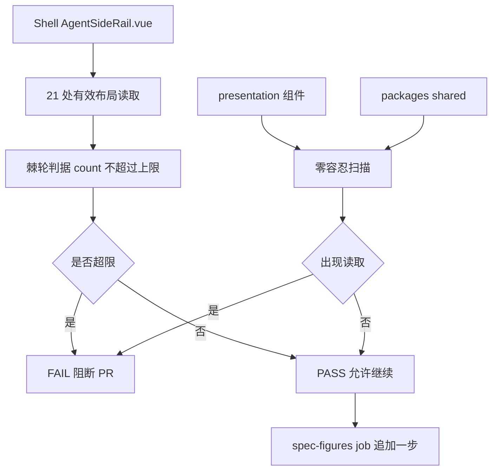

# `isMobileLayout` 读取域棘轮门禁设计规格（路线 ④ 第一刀）

状态：待评审（2026-11-09）
前置：母规格 §10「仅 Shell 读布局断点」/ §15.4 第 3 项、`docs/superpowers/specs/2026-11-08-agent-siderail-phase3-closeout.md` §4、#4 门禁准入三问
实施计划：`docs/superpowers/plans/2026-11-09-is-mobile-layout-scope-gate.md`
分支约定：feature 分支 + PR + squash；`gh api` Git-Data 链
真值基线：写作时 master `aa4aa528`（PR #791 合并前）；推送前重新 `gh api` 核对 + `MASTER_MOVED_SAFE`

## 0. 配图索引

| 图号 | 类型 | 位置 | 说明 |
| --- | --- | --- | --- |
| 图 1 | Mermaid `flowchart TD` 内嵌 | §5 | 读取点从 Shell 到 Content 的边界，以及棘轮门禁如何把 21 这个有效读取点上限锁住 |

## 1. 目标（3 条以内，均可验收）

1. **先冻结再搬**：在逐处搬迁 22 处 `isMobileLayout` 之前，补一条可失败的 CI 棘轮，把「Content 不读布局」「Shell 读取点只降不升」变成机器判据。
2. **满足门禁准入三问**：零外部依赖（Python 标准库）、确定性（只扫源码文本）、可失败（≥6 组变异精确 RED）。
3. **零行为变更**：不改任何产品代码的渲染逻辑；本刀只加门禁脚本、CI 一步、runbook 与证据。

## 2. 范围（含明确不做）

- **做**：新增 `scripts/verify-is-mobile-layout-scope.py`；在既有 `spec-figures` job 追加一步（**不新建 job**、不改 `package.json`）；写 runbook / 证据；变异测试。
- **不做**：逐处搬 22 处读取（后继刀）；改 `AgentSideRail.vue` / `presentation/**` 的任何渲染逻辑；像素/浏览器判据；挂 `deploy.yml`；新建 required check。
- **明确不碰**：`package.json`（`deploy.yml` 的 `push.paths` 含它 ⇒ 只加 CI script 也会触发生产发布）、`deploy.yml` 本身、`apps/**` 语义。

## 3. 与既有规格的关系

- 承接母规格 §10 与 §15.4 第 3 项，是 ② 护栏、③ 口径澄清之后的最后一刀收尾。
- 受制于 Phase 3 结项 §4：不再按功能簇拆；冻结边界不变。本刀不改产品代码。
- 复用 #4 / ② 的 verifier 范式：`strip_comments`、分组判据、字符级只追加、裸 blob sha 恢复校验。
- **不重复** ② 的视觉回归：② 判据是渲染形状，本刀判据是源码读取域，二者正交。

## 4. 规范与判据（可复用）

- **判据 A（先门禁后搬迁）**：没有棘轮就逐处搬，等于无法证明「没有新增读取」。
- **判据 B（棘轮而非等值）**：上限 `21` 只允许下降；若有人修掉一处，门禁应顺势把新数记为新上限的**允许方向**，而不是要求精确等于 21 造成将来误 RED。实现为 `count <= MAX_ALLOWED`。
- **判据 C（注释剥离）**：源级计数一律先 `strip_comments`，防止把锚点写注释里造成假绿（#4 M7 实证）。
- **判据 D（写了必须挂）**：verifier 断言 `ci.yml` 的 `spec-figures` job 中确有调用行，防「脚本在仓库里但没人跑」。
- **判据 E（扫描全目录）**：`presentation/**` 与 `packages/shared/**` 全目录递归扫描，不做单文件白名单。

## 5. 架构与契约（配结构图）

见 图 1：Shell SFC 是唯一允许读取布局断点的位置，Content 与 shared 层为零容忍区，CI 一步把两者锁住。

**图 1 · isMobileLayout 读取域与棘轮出口**

*图 1 · 这张图说明 Shell 侧的上限棘轮与 Content/shared 侧的零容忍扫描如何汇到同一个 FAIL 出口；验收时用变异证明「多一处读取」「Content 注入一处」「删掉 CI 挂载」都会精确 RED。*

**契约边界**：verifier 只读源码文本与 CI 配置，不解析 Vue、不起浏览器、不连网络；上限常量必须来自脚本内的显式常量并登记来源。

## 6. 主场景规格（逐项可验收）

- **S1 上限棘轮**：`AgentSideRail.vue` 内剥离注释后的 `isMobileLayout` 有效出现次数 `<= 21`；master 实测恰为 21（grep 计到 22 行，其中 1 行是文档注释）。
- **S2 零容忍区**：`apps/web/src/components/agent/presentation/**` 与 `packages/shared/**` 内出现次数必须为 0。
- **S3 唯一定义点**：`useAgentMobileLayout()` 调用点数量为 1，且位于 `AgentSideRail.vue`。
- **S4 CI 挂载**：`.github/workflows/ci.yml` 的 `spec-figures` job 内存在 `python3 scripts/verify-is-mobile-layout-scope.py` 调用行。
- **S5 注释剥离**：计数前剥离 `//` / `/* */` / 字符串外的注释；注释里的锚点不计入。
- **S6 可失败**：`--json` 输出分组结果，任一失败 `exit 1`。

## 7. 数据与状态变更

- 无产品数据、无 store、无数据库、无网络写入。
- 只新增 5 个文件（规格 / 计划 / verifier / runbook / 证据）+ 修改 1 个已有 CI 配置（追加 2 行）。

## 8. 纯函数与算法

- `strip_comments(src)`：沿用 #4 / ② 的逐字符扫描实现（code / 行注释 / 块注释 / 三种引号）。
- `count_hits(text)`：剥离注释后按 `\bisMobileLayout\b` 计数，逐行统计便于定位。
- `scan_tree(root, patterns)`：`pathlib.rglob` 递归，过滤 `.vue` / `.ts` / `.tsx` / `.js`，返回路径 → 命中数。

## 9. 文件级改动清单（按内容锚点定位，不用行号）

- **新增**：本文、实施计划、`scripts/verify-is-mobile-layout-scope.py`、`docs/ops/2026-11-09-is-mobile-layout-scope-runbook.md`、`docs/ops/2026-11-09-is-mobile-layout-scope-evidence.md`。
- **修改**：`.github/workflows/ci.yml` 在 `spec-figures` job 的门禁步骤区追加一个 `- name` + `run` 步骤（只追加，不改既有行）。
- **零改动**：`package.json`、`deploy.yml`、`apps/**`、`services/**`、`charts/**`、② / ③ 的全部交付文件。

## 10. 测试策略与验收标准

- **T1 verifier**：V1 零外部依赖、V2 零容忍区为 0、V3 上限棘轮方向正确、V4 唯一定义点、V5 CI 挂载在位、V6 注释剥离有效 —— 全 PASS 且 `exit 0`。
- **T2 变异**（≥6 组，每条恢复后核裸 blob sha 全等）：往 presentation 注入一处读取 ⇒ V2 RED；在 SFC 加一处 ⇒ V3 RED；删 CI 挂载 ⇒ V5 RED；把 `<=` 改成无上限 ⇒ V3 RED；锚点只写注释 ⇒ 仍 RED；只追加无关注释 ⇒ 对照全绿。变异在 `/tmp` 沙箱树或「临时改后恢复」两种形态中择一，禁止污染产品代码。
- **T3 真实运行**：本地 `python3 scripts/verify-is-mobile-layout-scope.py` `VERDICT ALL_PASS`；CI 的 `Verify spec figures` job 实际执行该步骤并成功（自举证明）。
- **T4 全量门禁**：`verify-spec-figures`（本文 0 error / 0 warning、全量 0 error）、`verify-links`、`verify-claims`、`verify-agent-rail-gates`、`verify-web-upload`、`verify-pc-visual-regression`、占位符扫描、推前逐路径 blob sha 核对。
- **完成定义**：T1–T4 全绿 + CI 三必需全 pass + 合并树核对 + `Issue #755` 第 3 项登记为「门禁已立、逐处搬仍待」。**不宣称** 22 行读取已被搬迁、**不宣称**新建 required check。

## 11. 风险

| 风险 | 表现 | 缓解 |
| --- | --- | --- |
| R1 误触生产发布 | 顺手改 `package.json` 或 `deploy.yml` | §2/§9 显式禁止；已核 `deploy.yml` 的 `push.paths` 不含 `ci.yml` |
| R2 门禁恒绿 | 只扫单文件或没挂 CI | 判据 D + V5 + 变异锁死 |
| R3 注释假绿 | 锚点只写在注释里 | `strip_comments` + M5 |
| R4 变异污染产品代码 | 临时改 SFC 未恢复 | 用 `--root` 沙箱树做行为级变异，恢复后核 blob sha |
| R5 基线前移 | ②③ 合并让 master 前移 | 推前全树核对 + `MASTER_MOVED_SAFE` + 只追加状态回填 |

## 12. 后续包 / 路线图

- **逐处搬（本刀唯一后继）**：按「Shell 合理读取 / Content 禁止读取」分类，逐处把 22 处收敛到最小集合；每搬一处上限随之下降，门禁自动收紧。须另开刀并配行为级契约测试。
- **删除刀**：② 护栏的后继，与本刀无依赖。
- **判据 D 重开条件**（③ §4）：Phase 2 口径若重开，须先有行为级契约测试 + 变异验证。
- 冻结边界不变：`sendMessage` / `handleEvent` / `canvas_command` / `defineExpose` 11 项。

## 13. 配图规范自检

- §0 索引登记 图 1；§5 内嵌 Mermaid `flowchart TD`，11 个节点、标签全部引号包裹、无 ` `、无英文括号；图注写明「说明了什么、验收时怎么用」；§5 正文显式引用 图 1。
- 无 SVG 附件 ⇒ R1/R6/R8 不适用；R2/R3/R5/R7 由 `verify-spec-figures --file <本文>` 校验。
- 本刀不改 `docs/agent/*.md`；改的是 `ci.yml` 而非 `deploy.yml`，合并不触发生产发布。

## 14. 实现期精算修正（2026-11-09，只追加）

本节不改写上文的历史时点描述，只登记实现期相对 §4/§6 的精算修正与伪变异实证。

1. **上限 22 → 21**：母规格 §15.4 与本文写作时引用的「22 处 `isMobileLayout`」来自 grep 的**行数**，其中第 830 行是文档注释（`* immediate：isMobileLayout 初值…`）。门禁按判据 C 一律先 `strip_comments` ⇒ 真实有效读取点为 **21**。若沿用 22 作上限，会留 1 的余量，允许「新增一处读取」而不 RED。
2. **伪变异实证**：M2「在 SFC 末尾追加一处 `isMobileLayout`」在 `MAX_ALLOWED=22` 下 **不 RED，exit 0** —— 注入的改变被余量吞掉，正是「变异不 RED 先怀疑伪变异」纪律针对的形态。收紧到 21 后 M2 精确 `V3` RED、exit 1，7 组变异 7/7 OK、恢复后 5 个目标文件裸 blob sha 全等。
3. **判据自匹配修复**：初版 V3/V4/V5/V6 用「检查源码含某锚点」的断言，而锚点字面量就写在判据函数自身里 ⇒ 恒绿、任何变异都不 RED。重构为 `implementation_code()` 剔除判据函数体、只看实现层，并把棘轮方向抽成独立纯函数 `within_ratchet(count, limit)` 供 V3 单独检查。
4. **function_body 修复**：初版沿用 JS verifier 的花括号配对逻辑，对 Python 文件会误截到 300 字符内的 `{`（dict / f-string）⇒ V6 假 RED。改为「截到下一个顶层 `def` / `GROUPS` / `if __name__`」。
5. **YAML 注释假绿**：V5 初版直接对 `ci.yml` 文本做子串匹配，若把挂载行换成 `# python3 scripts/...` 注释仍会判绿。新增 `strip_yaml_comments()`（保留引号内 `#`），M5 精确 RED。
6. **本地工作树漂移**：本机工作树的 `AgentSideRail.vue` 与 master 在剥离注释后都是 21 点；但门禁以 CI checkout 的源码为准，本地脏状态不参与判据。沙箱树从 `gh api` 拉 master 真实文件构建，用于行为级变异，不污染产品代码。
7. **状态登记位置调整**：本刀不再改母规格（避免与 ③ PR #792 抢同一路径），收尾状态改在 `Issue #755`、本规格 §14 与当日工作日志只追加登记。逐处搬仍是后继刀。
