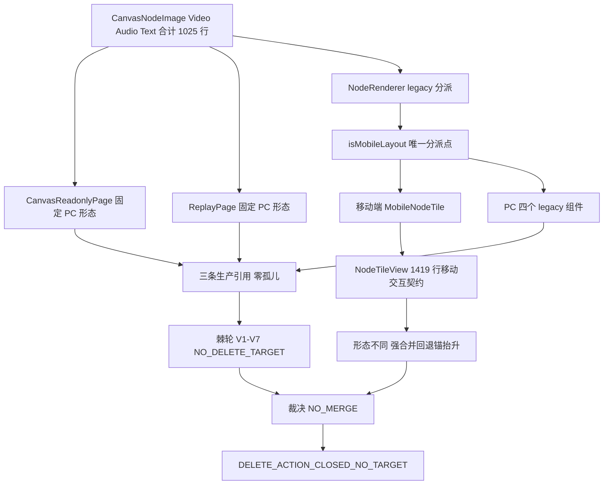

# PC 画布 legacy 合并裁决规格（路线 ② 第二刀）

状态：待评审（2026-11-09）
前置：`docs/superpowers/specs/2026-11-05-sse-conversation-view-unification-design.md` §3 / §9 / §10 / §15.8；`docs/superpowers/specs/2026-11-09-phase4-delete-scope-rebaseline-design.md` §12；`docs/ops/2026-11-09-pc-visual-regression-runbook.md` §7
实施计划：`docs/superpowers/plans/2026-11-09-pc-canvas-legacy-adjudication.md`
真值基线：`d7c8246b2f9acd7a5f7d6431aec3523da2b358ce`（`gh api` 取的 true master；本地工作树 `AgentSideRail.vue` 实测裸 blob sha 与 master 不同，不可信）
分支约定：feature 分支 + PR + squash；推送全走 `gh api` Git Data API

## 0. 配图索引

本文档只有结构图，一律 Mermaid 内嵌，无像素附件。

| 编号 | 形式 | 内容 | 位置 | 用途 |
| --- | --- | --- | --- | --- |
| 图 1 | 内嵌 Mermaid `flowchart TD` | 四个 PC legacy 组件的三条生产引用链、唯一布局分派点与 `NO_MERGE` 裁决出口 | §5 | 作为「为什么不能合并、为什么没有可删对象」的验收基准，区分只读页链 / 回放页链 / 画布页分派链 |

## 1. 目标（3 条以内，均可验收）

1. **回答 §15.8 留下的架构问题**：以 true master 源码实证裁决「`components/canvas/` 的 PC legacy 分支与移动端共享锚是否合并」，结论显式为 `NO_MERGE`，并把四条理由写成可机检字段，不得静默留空或含糊表述。
2. **把裁决锁成棘轮**：以源码计算 `components/canvas/` 侧渲染分派引用图，产出 `pc-canvas-legacy-manifest.json`，用零依赖 verifier 的 V1–V7 锁住「四个 legacy 组件零孤儿 ⇒ `NO_DELETE_TARGET`」「活跃分叉不得被静默合并」；当前结论显式为 `NO_MERGE_NO_DELETE_TARGET`。
3. **母规格只追加收口**：§15 追加 §15.9 登记裁决、`DELETE_ACTION_CLOSED_NO_TARGET` 与该侧行为级准入契约；§1–§15.8 字节级零改写（由 sha256 前缀判据守护）。

## 2. 范围（含明确不做）

**做**：

- 新增 `scripts/verify-pc-canvas-legacy-scope.py`（Python 标准库、零外部依赖）。
- 新增 `scripts/fixtures/pc-canvas-legacy-manifest.json`（由 verifier 从 true master 源码计算产出，非手写）。
- 新增 runbook（含 `components/canvas/` 侧行为级准入契约 §7）与证据、本规格与实施计划。
- 既有 `spec-figures` job 追加一步；**不新建 job、不改 `package.json`**。
- 母规格 §15.9 只追加状态回填；变异测试 ≥ 10 组，精确 RED；恢复后裸 blob sha 全等。

**明确不做**：

- **不删、不改任何产品代码**，不改 `apps/web/**` 任何文件（本刀零行为变更、零生产发布）。
- **不执行合并**：不把 `NodeRenderer.vue` 的 `legacy` 分派改成走 `NodeTileView`，不抽公共 map，不改 `CanvasReadonlyPage.vue` / `ReplayPage.vue` / `CanvasPage.vue`。
- 不修改 `pc-visual-baseline.json` / fixture / 采集脚本 / `verify-pc-visual-regression.py`；不改 `scripts/verify-phase4-delete-scope.py` 与 `scripts/verify-is-mobile-layout-scope.py`。
- 不动 `sendMessage` / `handleEvent` / `canvas_command` / `defineExpose` 11 项冻结边界；不按功能簇拆。
- 不改母规格 §2 / §6.2 / §9 / §13 / §15.1–§15.8 的任何历史结论；不追溯改写。
- 不新建 required check；不碰 `deploy.yml`；不把本判据挂进生产链路。
- **不执行第三刀**的逐处搬；第三刀另起 PR。

## 3. 与既有规格的关系

- **承接**路线 ① 规格 §12 第 1 项：该刀实证 `presentation/` 侧 27 blob 零孤儿、`NO_DELETE_TARGET`，并把「PC legacy 与共享锚是否合并」列为删除刀重启的硬前置。本刀正是回答该问题，不重复上一刀的目录扫描。
- **承接**母规格 §10「仅 Shell 读布局断点」：本刀只登记 `NodeRenderer.vue` 是 Content 层唯一布局分派点这一事实，**不迁移**该分派；迁移属第三刀之后的独立行为变更，须另立规格。
- **不复活**母规格 §6.3 验收口径：Phase 3 结项规格 §4 已明确「停止按功能簇拆，`PCDockShell` 不存在」；§15.2 判定为路线换轨、非欠债。
- **正交于**② 的 PC 视觉回归护栏：② 保护 `AgentPresentationHost.vue` 呈现链（渲染形状 diff），本刀保护 `components/canvas/` 的节点渲染分派（源码引用图）。② 的 §7 四项准入**只读不改**，本刀在其之外补该侧准入契约。
- **正交于**④ 的 `isMobileLayout` 棘轮：④ 管 Shell 读取域与 Content 零容忍，本刀管删除域裁决；二者零文件相交。

## 4. 规范与判据（可复用）

- **判据 A（真值源）**：引用图必须来自 `gh api` true master 源码树；本地并行工作树不可采信（实测 `AgentSideRail.vue` 裸 blob sha `47885faf0d` ≠ master `93f3541391`）。
- **判据 B（全目录 + 零孤儿）**：`apps/web/src` 全目录递归扫描，无文件白名单；四个 legacy 组件每个生产引用数必须 ≥ 2。零孤儿 ⇒ 无冗余可删。
- **判据 C（分派点唯一）**：`NodeRenderer.vue` 的 `isMobileLayout.value ? MobileNodeTile : legacy[...]` 形态必须登记；`MobileNodeTile` 的薄壳目标 `NodeTileView` 必须仍被消费。
- **判据 D（棘轮方向 + 合成探针）**：`delete_targets` 只允许「零生产引用且不在保护名单」的真实孤儿；保护名单含四个 legacy 组件、**只读页链**、**回放页链**与分派点。⭐ 只删保护名单特判会被「探针恰是活代码」兜住 ⇒ V3 必须用**合成探针**（人为把保护对象 `prod_refs` 清空再列入 `delete_targets`），使只有保护名单分支能拦住它。
- **判据 E（注释剥离）**：源码计数先 `strip_comments`，CI 挂载检查先 `strip_yaml_comments`（保留引号内 `#`），防锚点写进注释造成假绿。
- **判据 F（判据自匹配防护）**：`implementation_code()` 剔除 `group_v*` 函数体，V7 只看实现层；函数改名类变异须加别名保持脚本可运行，崩溃不算判据转红。
- **判据 G（只追加）**：母规格 §1–§15.8 以字节级前缀 sha256 锁定（当前 34217 字节）；追加内容按**字节**切片后解码，中文文档禁用字符切片。

## 5. 架构与契约（配结构图）

见 图 1：四个 PC legacy 组件合计 1025 行，被三条生产链引用；`CanvasReadonlyPage` 与 `ReplayPage` 固定 PC 形态、无移动端路径，`NodeRenderer` 是唯一按布局断点分派的位置。移动侧薄壳 `MobileNodeTile` 消费 1419 行的 `NodeTileView`，后者承载 tap / 长按 / 选择模式 / 提示词审核等移动交互契约，与 PC 画布的拖拽 / 多选 / 角标 / 编辑器形态不同。

**图 1 · PC 画布 legacy 引用链与合并裁决出口**

*图 1 · 这张图说明四个 PC legacy 组件既非死代码也不与移动端共享锚等价，删除与合并两条路径都被源码事实堵死；验收时用变异证明「漏登记」「引用图漂移」「把活跃组件标成可删」「删掉只追加段」「CI 注释伪装」都会精确 RED。*

**契约边界**：verifier 只读源码文本、manifest、CI 与规格文档；不解析 Vue AST、不起浏览器、不连网络。保护名单是显式常量，来源登记在 manifest 的 `protected.reason`。

**架构裁决 `NO_MERGE` 的四条理由**（写入 manifest 的 `merge_decision.reasons`，V4 逐条校验）：

1. 四个 legacy 组件各被三处生产代码引用，其中 `CanvasReadonlyPage.vue` 与 `ReplayPage.vue` 的 `nodeTypes` 映射固定 PC 形态，不存在移动端替代路径；删除会直接破坏只读页与回放页。
2. `NodeTileView.vue` 1419 行是 Phase 0–1 抬升后的移动端锚，含 tap / 长按 / 选择 / 提示词审核策略（`NodeRenderer.policy.test.ts` 锁策略）；PC 画布节点是拖拽 / 多选 / 角标 / 编辑器语义，二者不是同一形态。
3. 母规格 §3 明确 L5 外壳「各端自理」，PC dock 与 `MobileCanvasShell` 是既定边界；强合并等于回退锚抬升成果，且与「不按功能簇拆」相冲突。
4. `NodeRenderer.vue` 的 `isMobileLayout` 分派是活跃分支而非遗留死链；它在运行时同时服务两端，没有可整体下线的半边。

## 6. 主场景规格（逐项可验收）

- **S1 清单完整性（V1）**：manifest 恰登记 10 个条目（四个 legacy 组件 + `NodeRenderer.vue` + `MobileNodeTile.vue` + `NodeTileView.vue` + `CanvasPage.vue` + `CanvasReadonlyPage.vue` + `ReplayPage.vue`），与真实源码集合相等；漏登记或伪造即 RED。
- **S2 引用图一致（V2）**：每个 legacy 组件的 `prod_refs` 逐项等于真实计算值且 ≥ 2；`MobileNodeTile` 仅 `NodeRenderer` 消费，`NodeTileView` 仅 `MobileNodeTile` 消费。
- **S3 删除棘轮（V3）**：`delete_targets: []` + `verdict: NO_DELETE_TARGET`；合成探针（保护对象 `prod_refs` 清空后列入 `delete_targets`）必须被 `within_ratchet` 拒绝。
- **S4 合并裁决（V4）**：`merge_decision.decision == NO_MERGE`、`reasons` 恰四条且各含关键锚点；`NodeRenderer.vue` 的分派形态与薄壳链登记在位。
- **S5 只追加 + 护栏只读（V5）**：母规格前缀 34217 字节 sha256 相等；§15.9 含「NO_MERGE」「DELETE_ACTION_CLOSED_NO_TARGET」；`pc-visual-baseline.json` 与 ② 的四项准入文本未被改写。
- **S6 写了必须挂（V6）**：`spec-figures` job（剥离 YAML 注释后）含 `python3 scripts/verify-pc-canvas-legacy-scope.py` 调用行。
- **S7 实现层齐备（V7）**：判据函数体剔除后，实现层仍含 6 个关键纯函数，且棘轮与注释剥离实现未被掏空。

## 7. 数据与状态变更

- 不新增 store 字段、不改接口、不动 DTO、不改任何产品运行时状态。
- manifest 为新增静态数据（`schema: lnkpi.pc-canvas-legacy-scope.v1`），含 `baseline_sha` / `delete_targets` / `verdict` / `merge_decision` / `append_only_prefix_bytes` / `append_only_prefix_sha256` / `protected` / `inventory`。
- `inventory` 每项含 `name` / `kind`（`vue` / `page` / `test`）/ `prod_refs` / `lines`。
- 母规格 §15.9 为纯状态回填，不新增功能描述。

## 8. 纯函数与算法

- `strip_comments(src)`：去 `<!-- -->`、`/* */`、行首 `//`；保守不误伤 URL 中的 `//`。
- `strip_yaml_comments(text)`：逐字符跟踪引号，行内 `#` 仅在空白后且非引号内截断。
- `reference_pattern(stem)`：`.vue` 用 `(?<!\w)stem(?!\w)`；禁止 `types` 之类泛用词裸词匹配。
- `compute_inventory(root)`：扫 `apps/web/src` 全目录 → 剥注释 → 区分生产文件与测试文件 → 逐目标算引用图与行数，返回清单与源码字典。
- `within_ratchet(targets, inventory)`：目标不得在保护名单、必须真实存在、必须零生产引用，否则 `False`；合成探针直接喂入本函数验证保护分支。
- `implementation_code(code)`：Python 顶层定义边界截尾，剔除 `group_v1..v7` 函数体。

## 9. 文件级改动清单（按内容锚点定位，不用行号）

| 文件 | 动作 | 责任 |
| --- | --- | --- |
| `scripts/verify-pc-canvas-legacy-scope.py` | 新增 | V1–V7 判据 + `--emit-manifest` + `--root` 沙箱模式 |
| `scripts/fixtures/pc-canvas-legacy-manifest.json` | 新增 | 由 true master 源码计算的引用图与裁决 |
| `docs/ops/2026-11-09-pc-canvas-legacy-scope-runbook.md` | 新增 | env / 判据表 / 三条坑 / 变异 / 行为级准入契约 |
| `docs/ops/2026-11-09-pc-canvas-legacy-scope-evidence.md` | 新增 | 取证数据、V1–V7、变异结果、诚实边界 |
| `docs/superpowers/specs/2026-11-09-pc-canvas-legacy-adjudication-design.md` | 新增 | 本文 |
| `docs/superpowers/plans/2026-11-09-pc-canvas-legacy-adjudication.md` | 新增 | 实施计划 |
| `docs/superpowers/specs/2026-11-05-…-design.md` | 只追加 §15.9 | 状态回填，零删除改写 |
| `.github/workflows/ci.yml` | 只追加 2 行 | 挂到既有 `spec-figures` job |

**零改动**：`apps/**`、`package.json`、`deploy.yml`、`pc-visual-baseline.json`、② / ④ 的全部交付文件。

## 10. 测试策略与验收标准

- `python3 scripts/verify-pc-canvas-legacy-scope.py` 输出 `VERDICT ALL_PASS NO_MERGE_NO_DELETE_TARGET`，`exit 0`。
- 变异测试 ≥ 10 组，含行为级（真实删除 `CanvasNodeImage.vue` ⇒ V1/V2 RED）、合成探针（清空保护对象引用 ⇒ V3 RED）、注释伪装对照绿与「函数改名加别名」判据级 V7 RED；恢复后交付文件裸 blob sha 全等。
- CI 三必需（`Verify spec figures` / `Build monorepo` / `Build API Docker image`）全 success；新增步骤在 `spec-figures` job 内自举通过。
- `pnpm verify-spec-figures` 对本规格 0 error；既有历史 warning 不归因本刀。
- 推前 / 合并后全树 blob sha 核对：差异恰为 8 个改动路径、parent 正确、`ALL_PARALLEL_KEPT` 为真。
- `deploy.yml` 的 `push.paths` 不含 `docs/` / `scripts/` / `ci.yml` ⇒ 零生产发布。

## 11. 风险

- **R1 清单伪绿**：手写空 `delete_targets` 而不扫源码 ⇒ V1/V2 用真实目录集合与引用图双向卡住。
- **R2 伪变异**：删保护名单特判但探针恰是活代码 ⇒ 下游零引用检查兜住、行为零变化 ⇒ V3 用合成探针；函数改名致崩溃不是判据转红 ⇒ 加别名保运行。
- **R3 注释伪装**：`# 注释里的 CI 挂载行` 或 `//` 里的组件名 ⇒ `strip_yaml_comments` / `strip_comments` + 对照变异。
- **R4 字符/字节切片错配**：中文母规格按字符切 `spec[34217:]` 恒空 ⇒ V5 改字节切片再 decode。
- **R5 泛用词假引用**：`types` 裸词匹配命中大量文件 ⇒ `.ts` 一律按路径片段匹配。
- **R6 基线前移**：写作→推送间 master 前进 ⇒ `MASTER_MOVED_SAFE` 逐路径核对，只追加登记，不回退并行改动；合并时按真实 parent 复核。
- **R7 裁决被误读为功能闭环**：`NO_MERGE` 是「删除动作终止、目标不适用」，不是「Phase 4 已实现」。§15.9 与证据文档必须显式分列，禁止回填为闭环。
- **R8 护栏只读被破坏**：本刀若顺手改 `pc-visual-baseline.json` 或采集脚本，会使 ② 的 diff 恒空伪绿 ⇒ §2 显式禁止，V5 校验准入文本在位。

## 12. 后续路线

1. **母规格 Phase 4 删除动作终止**：本刀裁决后，§9 的「删 1100–1450 行」不再作为待办；`presentation/` 与 `components/canvas/` 两侧均无孤儿，后继不再重启删除刀。若将来真要合并，须以产品需求驱动另立规格，并按本刀 runbook §7 的行为级准入重新取证。
2. **路线 ③ 逐处搬**：与删除域零相交，按 `docs/ops/2026-11-09-is-mobile-layout-scope-runbook.md` §6 四条准入逐处降上限；本刀不改 `MAX_ALLOWED`。
3. **独立窗口**：PR #625（SP-E CAS v2 规格待评审）、A-6 真机复测；二者与主线零交集，按用户既定口径不进主序列。
4. 冻结边界不变；不按功能簇拆。

## 13. 配图规范自检

- 图 1 为 Mermaid 内嵌 `flowchart TD`，非空且首行受支持；§0 索引列出图 1；图注为 `*图 1 · …*`；正文 §5 引用「图 1」两次以上。
- 无 PNG/JPG/SVG 附件，不触发 R6/R8。
- 本刀不改 `docs/superpowers/SPEC-CONVENTIONS.md`；`pnpm verify-spec-figures` 结果登记在证据文档。

## 14. 实现期补充（2026-11-09，只追加）

本节不改写 §1–§13 的任何结论，只登记实现期实测与相对计划的精算修正。

1. **变异实测 12 组 12/12**（规格 §10 的「≥10 组」为下限，实际执行 12 组，见证据 §4）。主仓与 true master 镜像沙箱双跑 V1–V7 均 `VERDICT ALL_PASS NO_MERGE_NO_DELETE_TARGET`、`exit 0`；`verify-spec-figures --file <本文>` 0 error / 0 warning，全量 214 篇 0 error / 2 个既有 warning。
2. **两条伪变异防护实证**（再次印证「变异不 RED 先怀疑伪变异」）：M10 掏空保护名单特判，若探针恰是活代码则下游零引用检查会兜住 ⇒ 用**合成探针**（人为清空 `NodeTileView.vue` 的 `prod_refs`）使只有保护名单分支能拦住；M8 函数改名致 `NameError` 崩溃（exit 1 但无 FAIL 行）⇒ 改名同时加别名保持脚本可运行，验证 `implementation_code()` 剔除判据体后 V7 精确 RED。
3. **三条判据精算修正**（证据 §7）：`discover_legacy()` 首版以三个消费页为发现源，多命中 `CanvasNodeGroup` / `CanvasNodePrompt` ⇒ 改为只以 `NodeRenderer.vue` 分派源码反推；V4 引用链计数「≥8」真实为 7 ⇒ 改逐页精确断言；V5 校验 ② runbook 字面「四项」不存在 ⇒ 改校验标题 + 四项内容 token。
4. **`prod_refs` 类型**：manifest 中为引用文件路径列表而非整数；规格 §6 的「≥ 2」按列表长度判定。中文母规格按**字节**切片判据实证有效（M5 字节截断精确 V5 RED）。
5. ⭐ **基线前移**：写作时 master `d7c8246b`，推送前前移至 `2b6693c5`（并行改动 `AgentSideRail.vue` + 新增 `useMobileKeyboardInset.ts`）。`MASTER_MOVED_SAFE`：8 个交付路径在新旧 master blob **全等**；按新 master 重建 966 文件镜像后，沙箱 V1–V7 与 12 组变异全部重跑仍全绿。manifest 的 `baseline_sha` 保留历史时点值，不追溯改写；证据 §9 只追加登记。
6. **诚实边界不变**：本节不宣称 Phase 4 功能闭环、不宣称删除动作已执行、不宣称任何产品代码改动或生产发布。
