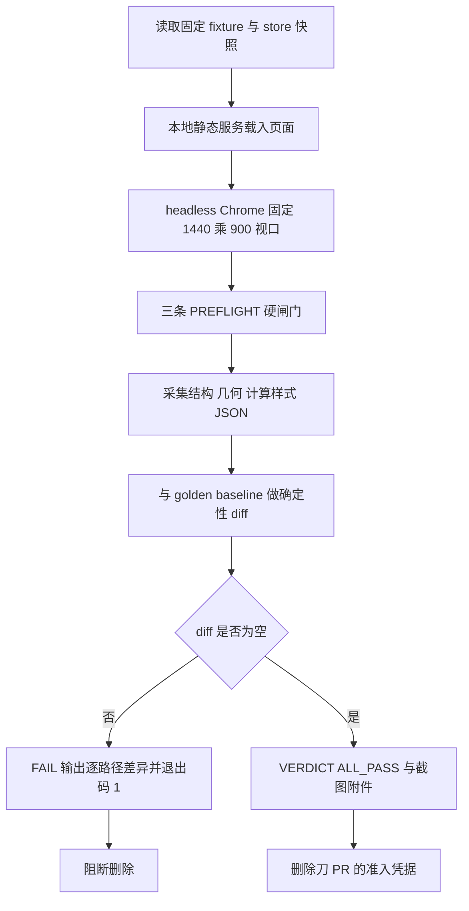

# PC 会话页自动化视觉回归套件设计规格（SSE 母规格 Phase 4 准入前置）

状态：待评审（brainstorming 产出，2026-11-09）
前置：`docs/superpowers/specs/2026-11-05-sse-conversation-view-unification-design.md` §10 / §15.4、`Issue #755` P2、`docs/superpowers/specs/2026-11-08-agent-siderail-phase3-closeout.md` §4、`docs/superpowers/specs/2026-11-09-prod-cdp-smoke-runbook-design.md`（三条 CDP 取证坑）
后继：本文闭环后，才允许开「删 `components/agent/presentation/` 下 PC 冗余渲染」刀
实施计划：`docs/superpowers/plans/2026-11-09-pc-visual-regression-harness.md`
分支约定：feature 分支 + PR + squash merge；`gh api` Git-Data 链提交，见 `docs/agent/delivery.md`
适用规范：`docs/superpowers/SPEC-CONVENTIONS.md`、`docs/agent/delivery.md`、`AGENTS.md`
真值基线：master `7c4066e70dfa08fc0f84886021e566ab9a49a15d`（`gh api` 读取，2026-11-09 写作时点；推送前须重新核对）

## 0. 配图索引

| 图号 | 类型 | 位置 | 说明 |
| --- | --- | --- | --- |
| 图 1 | Mermaid `flowchart TD` 内嵌 | §5 | 从固定 fixture 到 golden baseline 确定性 diff 的准入链路，以及 FAIL 如何阻断删除刀 |

## 1. 目标（3 条以内，均可验收）

1. **给删除动作装上回退保护**：在删 `presentation/` 下 1100–1450 行 PC 冗余渲染之前，产出一套可重跑的 PC 会话页结构与几何基线；删除刀跑同一 fixture，diff 必须为空才准入。
2. **判据确定性、零新依赖**：不引入新的 npm 依赖，不连生产、不依赖 JWT、不写任何线上数据；判据输出为固定键序的 JSON 文本 diff，同一输入两次运行结果逐字节相同。
3. **可失败**：提供零外部依赖的静态判据脚本 V1–V7 与至少 8 组变异，证明「元素消失 / 宽度变化 / 视口退化 / 基线被删 / PASS 被伪造」都能让判据 RED。

## 2. 范围（含明确不做）

- **做**：PC 断点下的会话页 dock 面板与 `presentation/` 内容区的结构 / 几何 / 计算样式采集；golden baseline 入库；确定性 diff；截图作为人工目视附件；准入契约写进 runbook；三条 PREFLIGHT 硬闸门；变异测试与负向自检。
- **不做**：像素级 diff 与相似度阈值（字体、抗锯齿、GPU 让像素不确定）；挂进 CI required check（依赖本机 Chrome，不满足门禁准入三问「零外部依赖」）；改动 `agentCommandClient` / `sendMessage` / SSE 拉流（冻结边界）；删除任何 PC 渲染代码（**本文只造护栏，不动被护栏保护的对象**）；移动端形态判据；生产 CDP 冒烟脚本 `scripts/prod-cdp-smoke.mjs` 的改动。
- **明确不碰**：`package.json`、`.github/workflows/**`（避免触发 `deploy.yml` 的 `push.paths`，也避免「只加 CI script 也触发一次发布」的历史坑）。

## 3. 与既有规格的关系

- **承接**母规格 §10「目视验收」与 `Issue #755` P2：把「双端快照契约 + 目视」升级为可重跑、可失败的自动化前置，不改母规格的历史结论。
- **承接**#4 runbook 的三条取证坑：756px 移动端断点、`Emulation.setDeviceMetricsOverride` 只作用于单 session、同 URL 残留 tab 串台 —— 三者同样会污染几何快照，必须做成 PREFLIGHT 而非事后解释。
- **受制于**Phase 3 结项 §4 / §4.1：不再按功能簇拆，冻结 `sendMessage` / `handleEvent` / `canvas_command` / `defineExpose` 11 项；本文不改产品代码，天然不触碰冻结边界。
- **不重复**#4 的 CDP 五层冒烟：后者面对生产、判据是「页面活着」；本文面对本地 fixture、判据是「PC 渲染形状逐项一致」。两者可复用同一套 CDP 连接范式，但脚本、基线、退出语义各自独立。
- **动机实证**：PR #789「SVG 卡片不再写死 720px 宽」正是几何断言能抓住的宽度溢出类回归，说明删冗余渲染前没有宽度/可见性基线会直接漏检。

## 4. 规范与判据（可复用，后续同类需求直接套）

- **判据 A（结构优于像素）**：视觉回归的第一道判据必须是 DOM 结构 + 几何 + 白名单计算样式的 JSON 基线；PNG 只作附件，不进通过条件。
- **判据 B（确定性四固定）**：固定视口、固定 fixture、固定 `deviceScaleFactor`、固定等待条件（字体 ready + 动画禁用 + 两次 requestAnimationFrame），四者缺一即判据不可信。
- **判据 C（准入而非门禁）**：依赖本机浏览器的套件不挂 CI required check，改为「删除刀 PR 必须附 `VERDICT ALL_PASS` 与空 diff 证据」的准入闸门；这是 #4 门禁准入三问的延续。
- **判据 D（先基线后删除）**：golden baseline 必须在删除刀**之前**独立合入；删除刀不得同时修改 baseline，否则 diff 恒空即为伪绿。
- **判据 E（可失败）**：verifier 只读脚本文本与 runbook，零外部依赖；每条源级断言前 `stripComments`，防止把关键锚点只写在注释里造成假绿（#4 M7 实证）。

## 5. 架构与契约（配结构图）

见 图 1：整条链路的输入是版本控制内的固定 fixture，输出是「可复现的空 diff 凭据」，FAIL 必须硬阻断删除刀的准入。

**图 1 · PC 视觉回归套件的准入链路与失败出口**

*图 1 · 这张图说明固定输入如何变成可复现的空 diff 凭据，以及任何结构/几何变化都从 FAIL 出口硬阻断删除动作；验收时用逐条变异证明 PREFLIGHT、diff 判据与 PASS 计数都不是恒绿装饰。*

**契约边界**：采集脚本只产 JSON + PNG，不修改仓库文件；verifier 只判据脚本文本、runbook 与 baseline 的存在性/确定性，不起浏览器；baseline 是唯一的形状真值，删除刀不得改它。

## 6. 主场景规格（逐项可验收）

- **S1 PREFLIGHT**：browser 级 `Browser.setWindowBounds` 设 1440×900，并用全新 CDP session 复核 `innerWidth`；`/json/list` 清理同 URL 残留 tab；PC 布局断言（移动端断点直接 FAIL，不静默换判据）。任一失败先于采集退出。
- **S2 采集**：目标区固定为 PC dock 面板与 `components/agent/presentation/` 渲染区；每个元素记录标签名、稳定 class 白名单、文本长度、`getBoundingClientRect` 取整后的 x/y/w/h、`getComputedStyle` 白名单属性；键序固定、数组按 DOM 顺序，省略任何随机 id 或时间戳。
- **S3 确定性**：同一 fixture 连续两次采集，两份 JSON `sha256` 必须相等；不相等即 FAIL，并打印首个差异路径。
- **S4 diff**：与 `pc-visual-baseline.json` 逐路径比较，输出「新增 / 缺失 / 值变化」三类；`diff_count=0` 才 PASS，SKIP 不计 PASS。
- **S5 截图**：PNG 落到 `LNKPI_PC_SHOT_DIR`，仅作为人工目视附件写进 runbook，不参与退出码。
- **S6 准入凭据**：runbook 明确「删除刀 PR 描述必须包含 `VERDICT ALL_PASS`、`diff_count=0`、两次采集 sha256、截图路径」四项，缺一不视为闭环。

## 7. 数据与状态变更

- 新增 `scripts/fixtures/pc-visual-fixture.json`：固定消息 / 节点 / presentation 快照，纯数据，不含 token、生产地址、会话 id。
- 新增 `scripts/baselines/pc-visual-baseline.json`：S2 采集结果的 golden 副本，独立合入、后续只读。
- 不新增全局 store 字段，不改 `useAgentStore`；不写生产数据库，不发起 POST。

## 8. 纯函数与算法（含单测要求）

- `normalizeSnapshot(raw)`：把 CDP 采集的原始数组转成固定键序、整数化几何、白名单样式的可比较结构；单测覆盖「浮点取整」「键序稳定」「随机 id 被剔除」三类。
- `diffSnapshots(golden, current)`：返回结构化差异列表，纯函数；单测覆盖新增 / 缺失 / 值变化 / 空 diff 四例，且断言结果可序列化为稳定文本。
- `stripComments(src)`：沿用 #4 verifier 的逐字符扫描实现，判据 A–E 的源级断言一律先剥离注释。

## 9. 文件级改动清单（按内容锚点定位，不用行号）

- **新增**：`scripts/pc-visual-regression.mjs`（采集入口，env 参数化）、`scripts/verify-pc-visual-regression.py`（V1–V7 零依赖判据）、`scripts/fixtures/pc-visual-fixture.json`、`scripts/baselines/pc-visual-baseline.json`、`docs/ops/2026-11-09-pc-visual-regression-runbook.md`（env SSOT / PREFLIGHT / 准入契约）。
- **新增**：本文与实施计划两份文档。
- **零改动**：`apps/web/**`、`services/**`、`charts/**`、`package.json`、`.github/workflows/**`、`scripts/prod-cdp-smoke.mjs`、`scripts/verify-prod-cdp-runbook.py`。
- **行为级守卫**：verifier 断言采集脚本不含硬编码生产地址 / 会话 id / `/tmp` 历史路径，且 `Browser.setWindowBounds` / `/json/close/` / PREFLIGHT 先于采集三处均在位。

## 10. 测试策略与验收标准

- **T1 verifier**：V1 零硬编码、V2 env 双向相等、V3 三条 PREFLIGHT 齐备且先于采集、V4 确定性双跑 sha256 判据、V5 diff 三类齐全且 SKIP 不计 PASS、V6 未挂 CI / 未改 package.json、V7 runbook 写明三条坑与准入契约 —— 全 PASS 且 `exit 0`。
- **T2 变异测试**（≥8 组，每条恢复后相关文件裸 blob sha 全等）：删 `Browser.setWindowBounds`、删 `/json/close/`、把 PREFLIGHT 移到采集之后、把确定性双跑改成单跑、把 diff 判据改成恒空、把 SKIP 计入 PASS、把 PNG 像素差异接进退出码、删 runbook 的准入契约、只追加一行无关注释作为伪变异对照。V1–V7 每组至少一条精确 RED，对照组仍全绿。
- **T3 真实本地运行**：独立 headless Chrome 起本地页面，仅设必填 env，两次采集 sha256 相等、diff_count=0、`exit 0`、PNG 落盘；缺任一必填 env 时 `exit 1` 且不连任何站点。
- **T4 本地全量门禁**：`verify-spec-figures`（本文 0 error / 0 warning）、`verify-links`、`verify-claims`、`verify-agent-rail-gates`、`verify-web-upload`、占位符扫描、推前逐路径 blob sha 核对。
- **完成定义**：T1–T4 全绿 + CI 三必需全 pass + 合并树逐文件 blob sha 全等 + `Issue #755` P2 打勾。**不宣称**本文完成了 PC 冗余渲染的删除，也不宣称本套件已挂进 CI。

## 11. 风险

| 风险 | 表现 | 缓解 |
| --- | --- | --- |
| R1 伪绿 baseline | 删除刀同时改 baseline ⇒ diff 恒空 | 判据 D + verifier 断言 baseline 在删除刀 PR 的改动清单中缺失 |
| R2 几何不确定 | 字体/动画/缩放让两次采集不等 | 判据 B 四固定 + S3 双跑 sha256 硬闸门 |
| R3 移动端断点串台 | 756px 下采到移动壳，形状全变但仍能自洽 | 承接 #4 三条 PREFLIGHT，M1/M2/M3 变异 |
| R4 像素判据不可复现 | 引入相似度阈值导致间歇 RED | 范围显式禁止像素进退出码 + T2 变异锁死 |
| R5 误触生产发布 | 顺手改 `package.json` 或 workflow | 范围显式禁止 + V6 |
| R6 基线在写作到推送间前移 | 用旧 master tree 作 base_tree 回退并行改动 | 推前 `gh api` 全树 blob 核对 + `MASTER_MOVED_SAFE` + 状态回填，不改写历史口径 |

## 12. 后续包 / 路线图（本包外的东西也登记）

- **删除刀（本文唯一后继）**：删 `presentation/` 下 1100–1450 行 PC 冗余渲染，PR 必须附 S6 四项凭据；本包不合格则删除刀不准开。
- **Phase 2 口径澄清**：母规格 §6.2「SFC 零网络调用」与 §2「不动 L0 拉流」冲突，二选一（推荐收敛为「L1 指令零内联调用」）。
- **22 处 `isMobileLayout` 单向收敛**：按母规格 §10 补可失败 CI 守卫后逐处搬，排在删除刀之后。
- **Issue #755 P3**：R1 生命周期幂等复核、标题副标，维持低优先。
- 冻结边界不变：`sendMessage` / `handleEvent` / `canvas_command` / `defineExpose` 11 项。

## 13. 配图规范自检

- §0 索引登记 图 1；§5 内嵌 Mermaid `flowchart TD`，共 11 个节点、标签全部引号包裹、无 ` `、无英文括号；图注写明「说明了什么、验收时怎么用」；§5 正文显式引用 图 1。
- 无 SVG 附件 ⇒ R1/R6/R8 不适用；R2/R3/R5/R7 由 `pnpm verify-spec-figures --file <本文>` 校验。
- 本文不改 `docs/agent/*.md`，不触发 `verify-claims` 的事实断言变更；不含 `apps/**` 改动，合并后不触发 `deploy.yml`。

## 14. 实现期补充登记（2026-11-09，只追加）

本节不改写上文任何历史时点结论，只登记实现阶段相对 §2/§7/§9/§10 的补充与实测。

1. **护栏有效性的关键实现决策**：§5 的「本地静态服务载入页面」若用自造静态 HTML，删除 `presentation/` 组件不会改变 DOM ⇒ diff 恒空即为伪绿（R1 的更坏形态）。因此 fixture 页 `scripts/fixtures/pc-visual-page.html` 通过本地 Vite **挂载真实 `AgentPresentationHost.vue`**（prose_block / shot_table 两组固定 envelope），只读仓库既有 `vite` / `@vitejs/plugin-vue` / `vue`，零新增 npm 依赖。新增 `scripts/fixtures/pc-visual.vite.config.mjs` 承载 root 与两个 alias；两者均为 `scripts/**` 新增，仍满足 §9「零改动 `apps/web/**` / `package.json` / workflows」。
2. **适用边界（诚实登记）**：PC dock 外壳 `.pc-dock-shell` 是 fixture 页的固定宽度容器，用于给几何稳定父级，**不是生产 `AgentSideRail.vue` 的完整 PC 面板复制品**。本套件保护的是 `presentation/` 组件链的渲染形状；不保护像素外观、移动端形态、生产侧栏布局与 SSE 网络层。
3. **判据 D 的落法**：golden baseline 随本刀（护栏刀）独立入库，删除刀是**另一个 PR**且不得修改 baseline / fixture / 两个脚本；满足「先基线后删除」。§9 清单之外实际新增 2 个 fixture 文件，合计提交 10 个新增文件（含证据文档）。
4. **变异扩容**：§10 T2 的 ≥8 组实际做 11 组 —— M1–M9 静态精确 RED、M10 无关注释对照绿、**M11 行为级**（把 fixture 页 `presentation.map` 改为 `slice(0,1).map`，真实运行 `diff_count>0` 且 `exit 1`），直接证明「删真实组件渲染会被护栏抓住」而非只有源级断言。每条恢复后 4 个目标文件裸 blob sha 全等。
5. **实测数值**：Chrome 156 headless，`PREFLIGHT P1/P2/P3 PASS`、`innerWidth=1440`、`innerHeight=757`（窗口占用，稳定复现）、`hosts=2 nodes=100`、基线 `elements=101`、`DETERMINISM_OK sha256=82d36fe47f22b5410e191e6299a9abebac83429accfc7fbf30baa40be59377b2`；全新 Chrome 进程复跑 `diff_count=0`、`VERDICT ALL_PASS`、`exit 0`。V1–V7 `ALL_PASS`。
6. **本机环境坑（新增）**：本机 HTTP 代理会拦截 `127.0.0.1`，Chrome 启动参数必须带 `--no-proxy-server`；本地 Vite 服务须作为受管后台任务常驻，随单条命令结束的后台进程会被回收导致 P3 假失败。`curl` 核验须加 `--noproxy '*'`。
7. 冻结边界不变：`sendMessage` / `handleEvent` / `canvas_command` / `defineExpose` 11 项；**不再按功能簇拆**。
