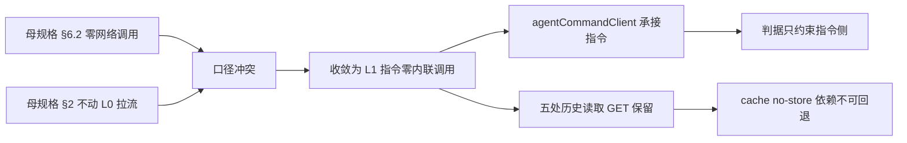

# Phase 2 口径澄清决策规格（L1 指令零内联调用）

状态：待评审（2026-11-09，路线 ③）
前置：`docs/superpowers/specs/2026-11-05-sse-conversation-view-unification-design.md` §2 / §6.2 / §15.4、`docs/superpowers/specs/2026-11-08-agent-siderail-phase3-closeout.md` §4
实施计划：`docs/superpowers/plans/2026-11-09-phase2-l1-command-scope-clarification.md`
分支约定：feature 分支 + PR + squash；`gh api` Git-Data 链，见 `docs/agent/delivery.md`
真值基线：写作时 master `aa4aa528`（PR #791 合并前）；推送前须重新 `gh api` 核对并做 `MASTER_MOVED_SAFE`

## 0. 配图索引

| 图号 | 类型 | 位置 | 说明 |
| --- | --- | --- | --- |
| 图 1 | Mermaid `flowchart LR` 内嵌 | §5 | 口径冲突的两个来源、收敛后的判据边界，以及被明确排除的读取侧 |

## 1. 目标（3 条以内，均可验收）

1. **消歧**：把母规格 §6.2「SFC 零网络调用」与 §2「不动 L0 拉流」的口径冲突，显式收敛为**「L1 指令零内联调用」**，并把 5 处历史读取 `fetch` 登记为合规保留项。
2. **零行为变更**：不改任何产品代码、不改 `agentCommandClient.ts`、不碰 `sendMessage` / 历史加载附近的冻结边界；只做文档决策与状态回填。
3. **可审计**：决策、证据、被排除项与后续触发条件都写进仓库与 `Issue #755`，不追溯改写 §6.2 与 §2 原文。

## 2. 范围（含明确不做）

- **做**：母规格只追加 §15.7 决策登记；产出本规格与计划；写证据文档；更新 `Issue #755` 的 Phase 2 条目与说明评论。
- **不做**：上收 5 处 `fetch`；新增/删除 CI 门禁；改 `package.json` / workflows / `apps/**` / `services/**`；给母规格补配图或重编号；把 §6.2 原文改写成新口径。
- **明确不碰**：`apps/web/src/components/agent/AgentSideRail.vue`、`apps/web/src/agent/command/agentCommandClient.ts`、`scripts/pc-visual-regression.mjs` 及 ② 的全部交付文件。

## 3. 与既有规格的关系

- 承接母规格 §15.4 第 2 项「Phase 2 口径澄清」，是 ② PC 视觉回归护栏入库后的下一刀。
- 受制于 Phase 3 结项 §4：不再按功能簇拆，冻结 `sendMessage` / `handleEvent` / `canvas_command` / `defineExpose` 11 项；本刀天然不触碰。
- 不重复 ② 的护栏工作：② 保护 `presentation/` 渲染形状，本刀只解决规格文字口径。
- 不把 ② 的交付登记回母规格 Phase 2；两套 Phase 4 编号辨析见母规格 §15.1，本刀沿用不改写。

## 4. 规范与判据（可复用）

- **判据 A（历史结论不追溯改写）**：原文冲突保留，用「只追加决策登记」收敛解释权；字符级 `SequenceMatcher` 证明零删除/改写。
- **判据 B（口径必须可由代码证伪）**：新口径「L1 指令零内联调用」必须有 master 代码实测支撑 —— `agentCommandClient` 被 SFC import，且 SFC 内不存在内联指令 POST。
- **判据 C（排除项显式登记）**：5 处 `fetch` 逐条列出行号、端点、HTTP 语义与 `cache:'no-store'` 依赖，禁止用「其余调用」一笔带过。
- **判据 D（触发条件前置）**：只在上收收益 > 冻结边界风险、且先有行为级契约测试 + 变异验证时，才允许重开「SFC 零网络调用」。

## 5. 架构与契约（配结构图）

见 图 1：口径冲突来自母规格两处原文，收敛点以 master 代码实测为锚，读取侧被明确划到判据之外。

**图 1 · Phase 2 口径收敛的判据边界**

*图 1 · 这张图说明冲突的两个来源、收敛后的判据边界，以及为什么 5 处历史读取不在约束内；验收时用 master 源码逐行核对端点与 `cache:'no-store'`，并用字符级只追加校验证明 §6.2 原文未被改写。*

**契约边界**：本刀只产文档与 issue 状态，不改代码；决策的解释权归 §15.7，历史原文继续作为时点记录。

## 6. 主场景规格（逐项可验收）

- **S1 代码取证**：以 `gh api` 读 master 的 `AgentSideRail.vue` 与 `agentCommandClient.ts`，列出 5 处 `fetch` 的行号与端点；确认 `agentCommandClient` 在 SFC 的 import 存在。
- **S2 决策登记**：母规格只追加 §15.7，写明推荐口径、证据、排除项、判据 D 的重开条件。
- **S3 issue 同步**：`Issue #755` 的 Phase 2 条目打勾并追加说明评论，明确「口径已澄清 ≠ 5 处 fetch 已上收」。
- **S4 证据**：写 `docs/ops/2026-11-09-phase2-scope-clarification-evidence.md`，登记只追加字符数与 blob sha、门禁结果与诚实边界。

## 7. 数据与状态变更

- 无产品数据、无 store 字段、无数据库写入、无网络 POST。
- 只改 4 个新增文档 + 1 个已有文档的末尾追加 + 1 个 GitHub issue 的正文/评论。

## 8. 纯函数与算法

- 沿用 `difflib.SequenceMatcher` 做字符级「只追加」校验：`get_opcodes()` 中不得出现 `delete` / `replace`。
- 裸 blob sha 用 `sha1("blob %d\0" + data)`，与推前/推后/合并树核对共用同一实现。

## 9. 文件级改动清单（按内容锚点定位，不用行号）

- **新增**：本文、实施计划、证据文档、决策说明（并入证据文档，不单开）；共 3 个新增文件。
- **只追加**：`docs/superpowers/specs/2026-11-05-sse-conversation-view-unification-design.md` 末尾 §15.7（须在 ② 的 §15.6 之后，等 PR #791 合并再做）。
- **零改动**：所有 `apps/**`、`services/**`、`charts/**`、`package.json`、`.github/workflows/**`、② 的全部 10 个新增文件。

## 10. 测试策略与验收标准

- **T1 只追加校验**：母规格 `delete_or_replace=0`，追加字符数 > 0，旧 blob sha 与 master 完全一致。
- **T2 门禁**：`verify-spec-figures --file <本文>` 0 error / 0 warning；全量 `verify-spec-figures` 0 error；`verify-links` exit 0；`verify-claims` 7/7；占位符零命中；`verify-pc-visual-regression.py` 保持 ALL_PASS（证明未碰 ② 文件）。
- **T3 代码取证复核**：S1 的 5 处端点与行号可复现，证据文档中的数字与 master 一致。
- **T4 入库**：推前/推后/合并树三次全树 blob sha 核对；CI 三必需全 success；不触发 `deploy.yml`（本刀路径不在其 `push.paths` 内）。
- **完成定义**：T1–T4 全绿 + `Issue #755` 条目打勾。**不宣称** 5 处 `fetch` 已上收、**不宣称**新增了 CI 守卫、**不宣称**母规格 §6.2 原文被修正。

## 11. 风险

| 风险 | 表现 | 缓解 |
| --- | --- | --- |
| R1 与 ② 抢同一文件 | 两刀都改母规格，blob 覆盖丢 §15.6 | 本刀必须等 #791 合并后基于新 master 取旧 blob；推前核对 `MASTER_MOVED_SAFE` |
| R2 口径被误读为「已上收」 | issue 打勾被当成代码已改 | §15.7 / issue 评论 / 证据三处都写明「口径澄清 ≠ 实现」 |
| R3 基线前移 | 写作到推送间并行 PR 合入 | 只追加状态回填小节 + 换 parent / `base_tree`，不改写历史 sha |
| R4 误触生产发布 | 顺手改 `package.json` / workflow | §9 显式禁止 + 推前路径核对 |

## 12. 后续包 / 路线图

- **④ `isMobileLayout` 门禁**：22 处读取点补「仅 Shell 可读」可失败棘轮，逐处搬留作后继刀。
- **删除刀**：② 护栏的唯一后继，须附 runbook §7 四项凭据。
- **判据 D 重开条件**：只有当「SFC 零网络调用」收益被重新论证，且先有行为级契约测试 + 变异验证，才允许再动 5 处 `fetch`；届时必须单独开刀，不得夹带在文档刀里。
- 冻结边界不变：`sendMessage` / `handleEvent` / `canvas_command` / `defineExpose` 11 项。

## 13. 配图规范自检

- §0 索引登记 图 1；§5 内嵌 Mermaid `flowchart LR`，8 个节点、标签全部引号包裹、无 ` `、无英文括号；图注写明「说明了什么、验收时怎么用」；§5 正文显式引用 图 1。
- 无 SVG 附件 ⇒ R1/R6/R8 不适用；R2/R3/R5/R7 由 `verify-spec-figures --file <本文>` 校验。
- 本刀不改 `docs/agent/*.md`，不触发 `verify-claims` 的事实断言变更；不含 `apps/**` 改动，合并后不触发 `deploy.yml`。
