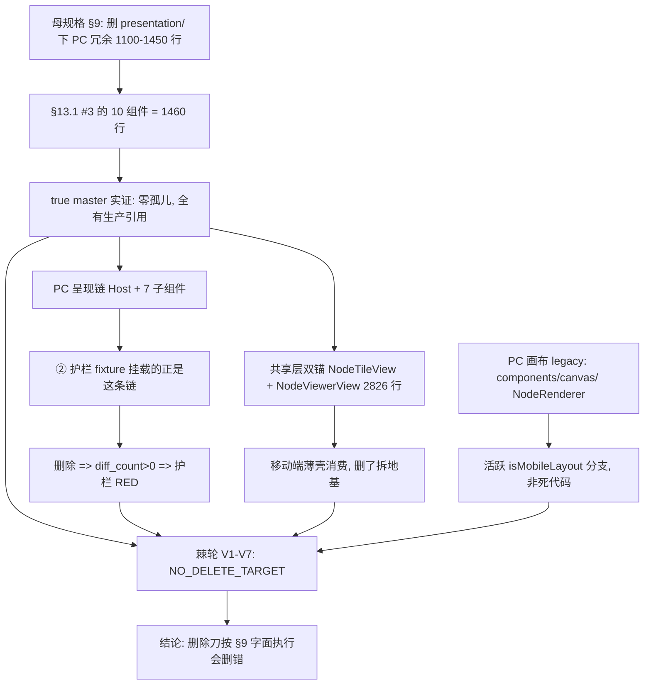

# Phase 4 删除域重界定设计规格（路线 ① 第一刀）

状态：已闭环（2026-11-10，adjudicated NO_DELETE_TARGET；删除刀本体按母规格 §9 字面终止，后继转入 ② 删除刀重定义，不在路线 ③ 主线）
前置：`docs/superpowers/specs/2026-11-05-sse-conversation-view-unification-design.md` §9 / §13.1 / §15.4；`docs/ops/2026-11-09-pc-visual-regression-runbook.md` §7；Phase 3 结项规格 §4
实施计划：`docs/superpowers/plans/2026-11-09-phase4-delete-scope-rebaseline.md`
真值基线：`75f597c765a8cec5eca79a26911773d6ffa9d0a9`（`gh api` 取的 true master；本地并行工作树不可信）
分支约定：feature 分支 + PR + squash；推送全走 `gh api` Git Data API

## 0. 配图索引

本文档只有结构图，一律 Mermaid 内嵌，无像素附件。

| 编号 | 形式 | 内容 | 位置 | 用途 |
| --- | --- | --- | --- | --- |
| 图 1 | 内嵌 Mermaid `flowchart TD` | 母规格 §9 删除对象与 true master 实际组件链的错位，以及棘轮判据的七个出口 | §5 | 作为「删除域为什么必须重界定」的验收基准，区分共享层锚 / PC 呈现链 / PC 画布 legacy 三类实体 |

## 1. 目标（3 条以内，均可验收）

1. **把「该删什么」从主观行数变成可机检契约**：以 true master 源码计算 `presentation/` 全目录引用图，产出 `phase4-delete-scope-manifest.json`，并用零依赖 verifier 的 V1–V7 把它锁成棘轮；当前结论显式为 `NO_DELETE_TARGET`，不得静默留空。
2. **证伪母规格 §9 的删除对象**：以代码实证登记「§13.1 #3 的 10 个组件（合计 1460 行）现为活代码、零孤儿；`NodeTileView`/`NodeViewerView` 2826 行是共享层本体；PC 画布 legacy 渲染在 `components/canvas/`」三处漂移，且**§9 要删的对象正是 ② 护栏所保护的对象**（互斥）。
3. **母规格只追加收口**：§15 追加 §15.8 登记 §15.4 三格闭环、删除域漂移与护栏互斥；§1–§15.7 字符级零改写（由 sha256 前缀判据守护）。

## 2. 范围（含明确不做）

**做**：

- 新增 `scripts/verify-phase4-delete-scope.py`（Python 标准库、零外部依赖）。
- 新增 `scripts/fixtures/phase4-delete-scope-manifest.json`（由 verifier 从 true master 镜像计算产出，非手写）。
- 既有 `spec-figures` job 追加一步；**不新建 job、不改 `package.json`**。
- 新增 runbook / 证据 / 本规格 / 实施计划；母规格 §15.8 只追加状态回填。
- 变异测试 ≥ 10 组，精确 RED；恢复后裸 blob sha 全等。

**明确不做**：

- **不删任何产品代码**，不改 `apps/web/**` 任何文件（本刀零行为变更、零生产发布）。
- 不执行「删除刀」本体（路线 ② 后继刀）；不修改 `pc-visual-baseline.json` / fixture / 采集脚本 / `verify-pc-visual-regression.py`。
- 不动 `sendMessage` / `handleEvent` / `canvas_command` / `defineExpose` 11 项冻结边界；不按功能簇拆。
- 不改母规格 §2 / §6.2 / §9 / §13 / §15.1–§15.7 的任何历史结论；不追溯改写。
- 不新建 required check；不碰 `deploy.yml`；不把本判据挂进生产链路。

## 3. 与既有规格的关系

- **承接**母规格 §15.4「按准入前置排序」：第 1 项（PC 视觉回归套件）由 #791 闭环、第 2 项（Phase 2 口径）由 #792 闭环、第 3 项（门禁）由 #793 闭环。本刀是**母规格完成度收口**，不是新增功能刀。
- **不复活**母规格 §6.3 验收口径：Phase 3 结项规格 §4 已明确「停止按功能簇拆，`PCDockShell` 不存在，`isMobileLayout` 29→22」，§15.2 判定为「路线换轨，非欠债」。
- **正交于**② 的 PC 视觉回归：② 判据是渲染形状 diff（本机 Chrome），本刀判据是源码引用图（零外部依赖）。但本刀**实证二者对象重叠且互斥**，这是必须登记的新发现。
- **不重复**④ 的 `isMobileLayout` 棘轮：④ 管读取域，本刀管删除域。

## 4. 规范与判据（可复用）

- **判据 A（真值源）**：删除清单必须来自 `gh api` true master 源码树，禁止采信本地并行工作树（实测 951 个源文件中 7 个与 master 裸 blob sha 不同，含 `AgentSideRail.vue` 与 `AgentSvgCard.vue`）。
- **判据 B（全目录 + 零孤儿）**：`presentation/` 全目录递归扫描，无文件白名单；每个非测试文件的生产引用数必须 ≥ 1。零孤儿 ⇒ 无冗余可删。
- **判据 C（棘轮方向）**：`delete_targets` 只允许「零生产引用且不在保护名单」的真实孤儿；保护名单 = 共享层双锚 + 护栏挂载点。空集必须显式 `NO_DELETE_TARGET`。
- **判据 D（引用图一致）**：manifest 的 `prod_refs` 必须与真实计算值逐项相等，防止手写清单漂移；`.vue` 按组件标识符匹配，`.ts` 按路径片段匹配（`types` 这类泛用词禁止裸词匹配）。
- **判据 E（注释剥离）**：源码计数先 `strip_comments`（JS/TS/Vue/HTML 注释），CI 挂载检查先 `strip_yaml_comments`（保留引号内 `#`），防锚点写进注释造成假绿。
- **判据 F（判据自匹配防护）**：`implementation_code()` 剔除 `group_v*` 函数体，V7 只看实现层，避免断言锚点字面量写在判据函数自身里导致恒绿。
- **判据 G（只追加）**：母规格 §1–§15.7 以字节级前缀 sha256 锁定；追加内容按字节切片后解码（中文文档不得用字符切片）。

## 5. 架构与契约（配结构图）

见 图 1：母规格 §9 的删除箭头指向 `presentation/`，但该目录现在是共享层本体与 PC 呈现链；真正与「移动端锚」并存的 PC 画布 legacy 渲染在 `components/canvas/`，且是 `NodeRenderer` 的活跃分支，不是死代码。

**图 1 · 删除对象错位与棘轮七出口**

*图 1 · 这张图说明母规格 §9 的删除箭头落在活跃共享层上，且与 ② 护栏保护对象重叠；验收时用变异证明「清单漏登记」「引用图漂移」「保护对象被标可删」「护栏互斥未登记」「CI 注释伪装」都会精确 RED。*

**契约边界**：verifier 只读源码文本、manifest、CI 与规格文档；不解析 Vue AST、不起浏览器、不连网络。保护名单是显式常量，来源登记在 manifest 的 `protected.reason`。

## 6. 主场景规格（逐项可验收）

- **S1 清单完整性（V1）**：manifest 恰登记 27 个条目（26 个源文件 + 1 个 `__snapshots__/*.snap`），与真实目录集合相等；漏登记或伪造即 RED。
- **S2 引用图一致（V2）**：16 个非测试条目的 `prod_refs` 逐项等于真实计算值；`AgentPresentationHost.vue` 等全部 ≥ 1，零孤儿。
- **S3 删除棘轮（V3）**：`delete_targets: []` + `verdict: NO_DELETE_TARGET`；若非空则逐项过 `within_ratchet`。
- **S4 保护对象（V4）**：`NodeTileView.vue` / `NodeViewerView.vue` 各有移动端薄壳消费；`AgentPresentationHost.vue` 被 `AgentSideRail.vue` 消费且被 fixture 挂载。
- **S5 只追加 + 死锁登记（V5）**：母规格前缀 30150 字节 sha256 相等；§15.8 含「护栏 / 互斥」；runbook 保留 `pc-visual-baseline.json` 与四项准入。
- **S6 写了必须挂（V6）**：`spec-figures` job（剥离 YAML 注释后）含调用行。
- **S7 实现层齐备（V7）**：判据函数体剔除后，实现层仍含 6 个关键纯函数，且棘轮与注释剥离实现未被掏空。

## 7. 数据与状态变更

- 不新增 store 字段、不改接口、不动 DTO。
- manifest 为新增静态数据（`schema: lnkpi.phase4-delete-scope.v1`），含 `baseline_sha` / `delete_targets` / `verdict` / `append_only_prefix_bytes` / `append_only_prefix_sha256` / `protected` / `inventory`。
- `inventory` 每项含 `name` / `kind`（`vue` / `module` / `test` / `other`）/ `prod_refs`。

## 8. 纯函数与算法

- `strip_comments(src)`：去 `<!-- -->`、`/* */`、行首 `//`；保守不误伤 URL 中的 `//`。
- `strip_yaml_comments(text)`：逐字符跟踪引号，行内 `#` 仅在空白后且非引号内截断。
- `reference_pattern(stem, ext)`：`.vue` 用 `(?<!\w)stem(?!\w)`；`.ts` 用路径片段 `['"][^'"]*(/|\.)stem['"]`。
- `compute_inventory(root)`：扫 `apps/web/src` 全目录 → 剥注释 → 生产文件集 → 逐目标算引用图，返回清单与源码字典。
- `within_ratchet(targets, inventory, src)`：目标不得是双锚 / Host、必须真实存在、必须零生产引用，否则 `False`。
- `implementation_code(code)`：Python 顶层定义边界截尾，剔除 `group_v1..v7` 函数体。

## 9. 文件级改动清单（按内容锚点定位，不用行号）

| 文件 | 动作 | 责任 |
| --- | --- | --- |
| `scripts/verify-phase4-delete-scope.py` | 新增 | V1–V7 判据 + `--emit-manifest` + `--root` 沙箱模式 |
| `scripts/fixtures/phase4-delete-scope-manifest.json` | 新增 | 由 true master 镜像计算的删除域清单 |
| `docs/ops/2026-11-09-phase4-delete-scope-runbook.md` | 新增 | env / 判据表 / 三条坑 / 变异 / 准入契约 |
| `docs/ops/2026-11-09-phase4-delete-scope-evidence.md` | 新增 | 取证数据、V1–V7、变异结果、诚实边界 |
| `docs/superpowers/specs/2026-11-09-phase4-delete-scope-rebaseline-design.md` | 新增 | 本文 |
| `docs/superpowers/plans/2026-11-09-phase4-delete-scope-rebaseline.md` | 新增 | 实施计划 |
| `docs/superpowers/specs/2026-11-05-…-design.md` | 只追加 §15.8 | 状态回填，零删除改写 |
| `.github/workflows/ci.yml` | 只追加 2 行 | 挂到既有 `spec-figures` job |

## 10. 测试策略与验收标准

- `python3 scripts/verify-phase4-delete-scope.py` 输出 `VERDICT ALL_PASS NO_DELETE_TARGET`，`exit 0`。
- 变异测试 ≥ 10 组，含行为级（真实删除一个组件文件 ⇒ 清单/引用图 RED）与判据级（锚点只写注释 ⇒ 对照绿）；恢复后 5 个交付文件裸 blob sha 全等。
- CI 三必需（`Verify spec figures` / `Build monorepo` / `Build API Docker image`）全 success；新增步骤在 `spec-figures` job 内自举通过。
- `pnpm verify-spec-figures` 对本规格 0 error；既有 2 个历史 warning 不归因本刀。
- 推前 / 合并后全树 blob sha 核对：差异恰为改动路径，parent 正确。
- `deploy.yml` 的 `push.paths` 不含 `docs/` / `scripts/` / `ci.yml` ⇒ 零生产发布。

## 11. 风险

- **R1 清单伪绿**：手写一个空 `delete_targets` 而不扫源码 ⇒ V1/V2 用真实目录集合与引用图双向卡住。
- **R2 判据自匹配恒绿**：锚点字面量写在 `group_v*` 内 ⇒ V7 用 `implementation_code()` 只看实现层。
- **R3 注释伪装**：`# 注释里的 CI 挂载行` 或 `//` 里的组件名 ⇒ `strip_yaml_comments` / `strip_comments` + 对照变异。
- **R4 字符/字节切片错配**：中文母规格按字符切 `spec[30150:]` 恒空 ⇒ V5 改字节切片再 decode。
- **R5 泛用词假引用**：`types` 裸词匹配命中大量文件 ⇒ `.ts` 一律按路径片段匹配。
- **R6 基线前移**：写作→推送间 master 前进 ⇒ `MASTER_MOVED_SAFE` 逐路径核对，只追加登记，不回退并行改动。
- **R7 护栏与删除刀互斥**：登记为事实，不在本刀内解决；后继刀必须先重新界定删除对象，不得直接照 §9 开刀。

## 12. 后续路线

1. **路线 ② 删除刀重定义**：本刀实证 `NO_DELETE_TARGET` ⇒ 删除刀不能按 §9 字面执行。后继须先回答「PC 画布 legacy 与移动端锚是否要合并」，并补 `components/canvas/` 侧的行为级护栏；这是真实行为变更 + 生产发布，须单独规格评审。
2. **路线 ③ 逐处搬**：与删除域零相交（`presentation/` 内 `isMobileLayout` 命中 0），按 `docs/ops/2026-11-09-is-mobile-layout-scope-runbook.md` §6 四条准入逐处降上限。
3. **独立窗口**：PR #625（SP-E CAS v2 规格待评审）、A-6 真机复测；二者与母规格线零交集，按用户既定口径不进主序列。
4. 冻结边界不变；不按功能簇拆。

## 13. 配图规范自检

- 图 1 为 Mermaid 内嵌 `flowchart TD`，非空且首行受支持；§0 索引列出图 1；图注为 `*图 1 · …*`；正文 §5 引用「图 1」两次以上。
- 无 PNG/JPG/SVG 附件，不触发 R6/R8。
- 本刀不改 `docs/superpowers/SPEC-CONVENTIONS.md`；`pnpm verify-spec-figures` 结果登记在证据文档。

## 14. 实现期补充（2026-11-09，只追加）

- **变异实测 14 组 14/14 ALL_PASS**（规格 §10 的「≥10 组」为下限，实际执行 14 组，见证据 §4）。主仓与 master 镜像沙箱双跑 V1–V7 均 `exit 0`；`verify-spec-figures` 本规格 0 error / 0 warning，全量 0 error / 2 个既有 warning。
- ⭐⭐ **两条伪变异实证**（再次印证「变异不 RED 先怀疑伪变异」）：
  1. **M9 首轮不 RED**：注入只删掉保护名单特判，但探针 `NodeTileView.vue` 恰好也是活代码 ⇒ 下游「零引用」检查照样拒绝 ⇒ 行为零变化。修法：V3 加**合成探针**（人为清空保护对象的 `prod_refs`），使只有保护名单分支能拦住它；另加活代码探针覆盖第二条拒绝路径。修后精确 `V3` RED。
  2. **M11 首轮不 RED**：注入把实现层函数改名导致 `NameError` 崩溃，`exit 1` 但无 FAIL 行 ⇒ 是崩溃不是判据转红。修法：改名同时加别名保持脚本可运行，验证 `implementation_code()` 剔除判据函数体后 `V7` 找不到实现层锚点 ⇒ 精确 `V7` RED。
- **计数口径修正**：`presentation/` 目录在 true master 含 1 个 `__snapshots__/*.snap`，`source_files` 与 `dir_count` 必须同步纳入，否则 V1 的 26 vs 27 假红。
- **中文文档只追加判据**：前缀长度是字节数，`spec[30150:]` 字符切片恒空 ⇒ V5 假红；改为 `raw[:n]` 后再 decode。
- **V1 计数 bug**：`dir_count` 是 int 而非集合，初版 `len(ctx['dir_count'])` 抛 `TypeError`；已修并重跑全绿。
- 本节不改写 §1–§13 的任何结论；所有数值为执行时实测。

## 15. 状态收口（2026-11-10 只追加）

- **结论锁定**：`NO_DELETE_TARGET` 成立（V1–V7 + 14 组变异全 PASS）。母规格 §9 要删的对象 = ② 护栏保护对象，规格级互斥 ⇒ **删除刀按 §9 字面终止，无待办功能**。
- **状态变更**：顶部状态由「待评审（2026-11-09）」改为「已闭环（2026-11-10，adjudicated NO_DELETE_TARGET）」。闭环不代表"删除了什么"，而是"经实证确认无可删对象，删除动作终止"——消除此前"母规格 Phase 4 仍 ⏳ 未闭环"的假进行中信号。
- **真实后继**：删除域如要重新开启，须先回答「PC 画布 legacy（`components/canvas/`）与移动端锚是否合并」并补 `components/canvas/` 侧行为级护栏；这是真实行为变更 + 生产发布，归 ② 删除刀重定义，**不在路线 ③ 主线**，须单独规格评审。
- **与路线 ③ 的关系**：`AgentSideRail.vue` 残留的 8 处 `isMobileLayout` 读取（grep 实证 master：L737/L839/L859/L1005/L1253/L1264/L1272/L1295）已整批移交 PR5 移动壳层（relocate/remove），**不在此删除域范围内**（删除域只管 `presentation/`，与 `isMobileLayout` 读取零相交）。
- **诚实边界**：不宣称"Phase 4 删除动作已完成"——本就无对象可删；不宣称 §9 原文被修正、护栏被放宽、新增 required check。
